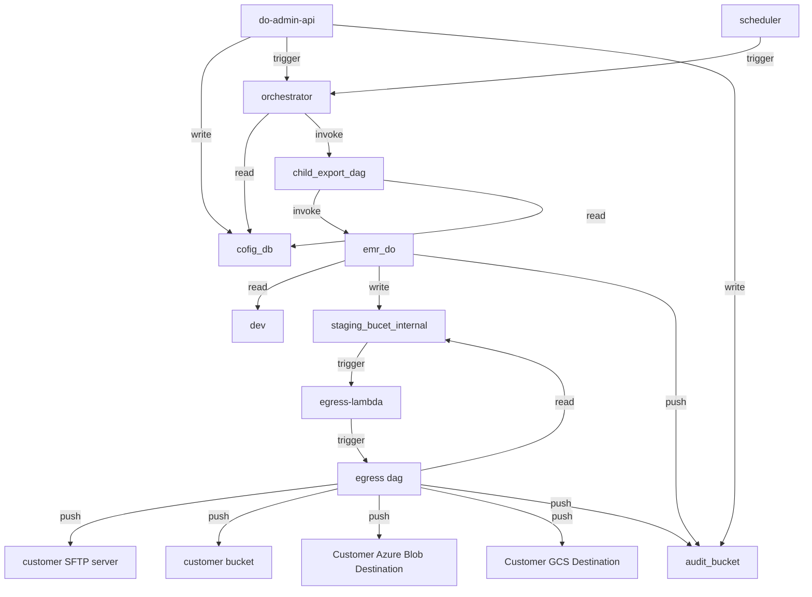

# DataOutbound Enterprise Architecture Documentation

## Table of Contents

- **1.** Executive Summary / Overview
- **2.** Architecture Tenets
- **3.** Architecture Diagram
- **4.** Component Details: orchestrator
  - **4.1** Functional Overview
  - **4.2** Component Tenets
  - **4.3** Configuration Approach
  - **4.4** Input Schema
  - **4.5** Output/Side Effects
  - **4.6** Telemetry Event Schema
  - **4.7** Error Handling Strategy
  - **4.8** Security and Compliance
  - **4.9** Performance Metrics
  - **4.10** Assumptions & Follow-up Resolutions
- **5.** Component Details: scheduler
  - **5.1** Functional Overview
  - **5.2** Component Tenets
  - **5.3** Configuration Approach
  - **5.4** Input Schema
  - **5.5** Output/Side Effects
  - **5.6** Telemetry Event Schema
  - **5.7** Error Handling Strategy
  - **5.8** Security and Compliance
  - **5.9** Performance Metrics
  - **5.10** Assumptions & Follow-up Resolutions
- **6.** Component Details: egress-lambda
  - **6.1** Functional Overview
  - **6.2** Component Tenets
  - **6.3** Configuration Approach
  - **6.4** Input Schema
  - **6.5** Output/Side Effects
  - **6.6** Telemetry Event Schema
  - **6.7** Error Handling Strategy
  - **6.8** Security and Compliance
  - **6.9** Performance Metrics
  - **6.10** Assumptions & Follow-up Resolutions
- **7.** Component Details: child_export_dag
  - **7.1** Functional Overview
  - **7.2** Component Tenets
  - **7.3** Configuration Approach
  - **7.4** Input Schema
  - **7.5** Output/Side Effects
  - **7.6** Telemetry Event Schema
  - **7.7** Error Handling Strategy
  - **7.8** Security and Compliance
  - **7.9** Performance Metrics
  - **7.10** Assumptions & Follow-up Resolutions
- **8.** Component Details: cofig_db
  - **8.1** Functional Overview
  - **8.2** Component Tenets
  - **8.3** Configuration Approach
  - **8.4** Input Schema
  - **8.5** Output/Side Effects
  - **8.6** Telemetry Event Schema
  - **8.7** Error Handling Strategy
  - **8.8** Security and Compliance
  - **8.9** Performance Metrics
  - **8.10** Assumptions & Follow-up Resolutions
- **9.** Component Details: audit_bucket
  - **9.1** Functional Overview
  - **9.2** Component Tenets
  - **9.3** Configuration Approach
  - **9.4** Input Schema
  - **9.5** Output/Side Effects
  - **9.6** Telemetry Event Schema
  - **9.7** Error Handling Strategy
  - **9.8** Security and Compliance
  - **9.9** Performance Metrics
  - **9.10** Assumptions & Follow-up Resolutions
- **10.** Component Details: staging_bucet_internal
  - **10.1** Functional Overview
  - **10.2** Component Tenets
  - **10.3** Configuration Approach
  - **10.4** Input Schema
  - **10.5** Output/Side Effects
  - **10.6** Telemetry Event Schema
  - **10.7** Error Handling Strategy
  - **10.8** Security and Compliance
  - **10.9** Performance Metrics
  - **10.10** Assumptions & Follow-up Resolutions
- **11.** Component Details: do-admin-api
  - **11.1** Functional Overview
  - **11.2** Component Tenets
  - **11.3** Configuration Approach
  - **11.4** Input Schema
  - **11.5** Output/Side Effects
  - **11.6** Telemetry Event Schema
  - **11.7** Error Handling Strategy
  - **11.8** Security and Compliance
  - **11.9** Performance Metrics
  - **11.10** Assumptions & Follow-up Resolutions
- **12.** Component Details: dev
  - **12.1** Functional Overview
  - **12.2** Component Tenets
  - **12.3** Configuration Approach
  - **12.4** Input Schema
  - **12.5** Output/Side Effects
  - **12.6** Telemetry Event Schema
  - **12.7** Error Handling Strategy
  - **12.8** Security and Compliance
  - **12.9** Performance Metrics
  - **12.10** Assumptions & Follow-up Resolutions
- **13.** Component Details: Customer Azure Blob Destination
  - **13.1** Functional Overview
  - **13.2** Component Tenets
  - **13.3** Configuration Approach
  - **13.4** Input Schema
  - **13.5** Output/Side Effects
  - **13.6** Telemetry Event Schema
  - **13.7** Error Handling Strategy
  - **13.8** Security and Compliance
  - **13.9** Performance Metrics
  - **13.10** Assumptions & Follow-up Resolutions
- **14.** Component Details: Customer GCS Destination
  - **14.1** Functional Overview
  - **14.2** Component Tenets
  - **14.3** Configuration Approach
  - **14.4** Input Schema
  - **14.5** Output/Side Effects
  - **14.6** Telemetry Event Schema
  - **14.7** Error Handling Strategy
  - **14.8** Security and Compliance
  - **14.9** Performance Metrics
  - **14.10** Assumptions & Follow-up Resolutions
- **15.** Component Details: emr_do
  - **15.1** Functional Overview
  - **15.2** Component Tenets
  - **15.3** Configuration Approach
  - **15.4** Input Schema
  - **15.5** Output/Side Effects
  - **15.6** Telemetry Event Schema
  - **15.7** Error Handling Strategy
  - **15.8** Security and Compliance
  - **15.9** Performance Metrics
  - **15.10** Assumptions & Follow-up Resolutions
- **16.** Component Details: egress dag
  - **16.1** Functional Overview
  - **16.2** Component Tenets
  - **16.3** Configuration Approach
  - **16.4** Input Schema
  - **16.5** Output/Side Effects
  - **16.6** Telemetry Event Schema
  - **16.7** Error Handling Strategy
  - **16.8** Security and Compliance
  - **16.9** Performance Metrics
  - **16.10** Assumptions & Follow-up Resolutions
- **17.** Architectural Assumptions and Design Decisions
- **18.** Security & Compliance Assumptions
- **19.** Operational Assumptions
  - **19.1** Operational Tenets
  - **19.2** Resilience & Availability Assumptions
  - **19.3** Data Governance Assumptions
  - **19.4** Performance and SLA Assumptions
- **20.** Traceability
- **21.** Closing & Disclaimer

* **Version:** 1.0
* **Generation Date:** 2025-02-15
* **Generated By:** Principal Enterprise Architect and Cloud Solutions Domain Expert

---

## 1. Executive Summary / Overview

The DataOutbound Product is a scheduled, batch outbound data-synchronization capability operating within the hospitality data platform domain. Its primary function is to extract Golden Identity and operational datasets—specifically Unified Identity Profiles, Pii Restricted Profiles, Contact Method Subscriptions, Enriched Campaigns, Enriched Campaign Reactions, and reservation items (Room stay, Restaurant reservation, Tee time, Spa treatment)—from an external Redshift source store (`golden_data_source`). The system transforms these datasets into structured JSON/TXT files and securely delivers them to customer-owned destinations across multiple cloud providers (AWS S3, Azure Blob Storage, Google Cloud Storage, and SFTP endpoints).

The end-to-end architecture is orchestrated using a decoupled, event-driven pattern anchored by Amazon Managed Workflows for Apache Airflow (MWAA). An Administration API (`export_admin_api`), secured via JWT bearer token authentication and role-based access control, allows authorized Acme users to create, read, update, delete, and manually trigger customer export configurations. These configurations are persisted in an RDS PostgreSQL instance (`cofig_db`) configured with single-AZ deployment (`multi_az: False`) per baseline properties. 

Execution is driven by scheduled events from Amazon EventBridge (`scheduler`) or manual API triggers, which invoke the `orchestrator` DAG (`orchestrator`). The orchestrator evaluates active configurations, generates a unique lineage UUID (RFC 4122 v4) for traceability, and spawns downstream child DAGs (`child_export_dag`). Each child DAG invokes an EMR Serverless Spark job (`emr_do`) that extracts data from the Redshift source store and writes staged files to internal S3 staging buckets (`staging_bucet_internal`). 

S3 event notifications invoke an Egress Lambda function (`egress-lambda`) with `vpc_enabled: False`, which triggers the egress DAG (`egress dag`). This component applies connection-defined GZIP and PGP processing before pushing the finalized payloads and manifest control files to customer destinations (`customer SFTP server`, `customer bucket`, `Customer Azure Blob Destination`, `Customer GCS Destination`). Security is enforced via strict least-privilege IAM policies, AES256 server-side encryption at rest, and transport protocols adhering to TLS 1.3 for S3, HTTPS for Azure and GCS, and SSH for sFTP, with a fail-closed encryption posture where encryption failures immediately abort transfers.

## 2. Architecture Tenets

1. **Domain and Business Alignment**: The architecture mirrors the bounded context of hospitality data outbound flows, ensuring clear separation of concerns between administration, orchestration, extraction, transformation, and egress.
2. **Event-Driven, Loose Coupling**: Component integration relies on asynchronous events (EventBridge, S3 notifications) and managed orchestration (MWAA), preventing tight synchronous dependencies between upstream source systems and downstream customer deliveries.
3. **Idempotency and Safe Re-runs**: All DAG tasks, Spark processors, and serverless functions are designed for idempotency. Re-running a task for a given logical execution date produces identical state, supported by immutable watermark tracking and RFC 4122 v4 lineage propagation.
4. **Fail-Closed Security Posture**: Security controls—including IAM least-privilege, KMS customer-managed keys, Parameter Store SecureStrings, and PGP encryption—enforce a fail-closed model. Any violation or encryption failure halts execution immediately to prevent data leakage.
5. **Immutable Audit and Observability**: Every administrative action, scheduled trigger, execution milestone, and transfer outcome emits structured CloudEvents-compliant telemetry logged to explicitly provisioned log groups and the Audit & Execution Log Store, guaranteeing end-to-end traceability.
6. **Environment Parity & IaC Governance**: All pipeline resources are provisioned via Terraform with stateful-resource deletion protection driven by environment configuration variables, ensuring lower environments can be cleanly torn down while production resources remain safeguarded.

---

## 3. Architecture Diagram

## 4. Component Details: orchestrator

### 4.1 Functional Overview
The `orchestrator` component is an Amazon Managed Workflows for Apache Airflow (MWAA) Directed Acyclic Graph (DAG) responsible for the top-level orchestration of batch data exports. Operating on a daily schedule or upon external invocation via the Export Admin API or Export Scheduler, the orchestrator queries the Export Config Store to retrieve active export configurations. It validates schedules within a strict operational window (+/- 10 minutes), generates a cryptographically sound lineage UUID (RFC 4122 v4) for traceability, and fan-outs execution by spawning individual Child Export DAG runs. It also provides operational visibility and handles manual lifecycle control requests (such as termination or triggering) via the Airflow REST API.

### 4.2 Component Tenets
* **Orchestration-Only Responsibility**: The orchestrator strictly limits its execution to control-plane logic (metadata retrieval, scheduling validation, lineage generation, and child DAG invocation). It offloads all compute-heavy extraction and transformation workloads to dedicated distributed engines (EMR Serverless).
* **Deterministic Traceability**: Every execution launched by the orchestrator is stamped with an immutable lineage UUID that propagates across all downstream components, ensuring complete operational auditability.
* **Lightweight Top-Level Code**: Airflow DAG parsing files contain zero database queries, network calls, or heavy computational logic at top-level execution, ensuring instantaneous DAG parsing and preventing worker scheduler bottlenecks.

### 4.3 Configuration Approach
The `orchestrator` DAG sets and overrides only the specific configuration properties required by its architectural contract and operational constraints:
* `schedule`: `@daily` — Establishes the baseline synchronization cadence, executed in coordination with external scheduler events.
* `catchup`: `False` — Prevents automatic historical backfills when DAGs are unpaused or recovered, ensuring manual control over backfill operations.
* `max_active_runs`: `1` — Limits concurrent executions to a single active run per environment, avoiding race conditions on shared configuration metadata and watermark tables.
* `tags`: `{}` — Container for environment and ownership metadata applied during deployment.
* `dag_name`: `orchestrator` — Identifies the logical workflow within the MWAA environment.

### 4.4 Input Schema
* **Scheduled Trigger Payload**: CloudWatch / EventBridge event containing execution timestamp and event source identifiers.
* **API Trigger Payload**: HTTP JSON payload from the Export Admin API containing target connection IDs, execution overrides, and user context.
* **Metadata Store Schema**: Relational records retrieved from the Export Config Store containing connection IDs, cron schedules, source/destination mappings, encryption settings, and active/inactive status flags.

### 4.5 Output/Side Effects
* **Lineage Generation**: Emits an RFC 4122 version 4 UUID propagated to all child runs.
* **Child DAG Invocations**: Triggers one or more Child Export DAG (`child_export_dag`) instances via the Airflow internal REST API or CLI command interface with serialized configuration conf.
* **Audit Publications**: Writes execution lifecycle events (start, success, failure) to the Audit & Execution Log Store.

### 4.6 Telemetry Event Schema
Emits CloudEvents-compliant telemetry records conforming strictly to the audit schema mandated by SCRUM-486, containing:
* `actor_id`: `system:orchestrator` (or the authenticated Acme user ID for manual triggers).
* `timestamp_utc`: ISO-8601 string with millisecond precision and Z suffix (e.g., `2025-02-15T00:00:00.000Z`).
* `event_type`: One of the enumerated values from the audit schema (`EXECUTION_STARTED`, `EXECUTION_COMPLETED`, `ADMIN_MANUAL_TRIGGER`). Run failures are recorded as `EXECUTION_COMPLETED` with a failed status indicator — no event type outside the mandated enumeration is ever emitted.
* `execution_id`: The RFC 4122 v4 lineage UUID generated for the run.

### 4.7 Error Handling Strategy
* **Task-Level Retries**: Airflow default arguments enforce exponential backoff retry policies for transient metadata retrieval or API communication failures.
* **Fail-Safe Window Filtering**: Connections whose schedules fall outside the +/- 10-minute active window are safely ignored without raising faults.
* **Dead-Letter & Alerting**: Unhandled execution failures trigger Airflow failure callbacks that publish error events to the audit store and invoke operational alerting channels.

### 4.8 Security and Compliance
* **IAM Least Privilege**: Executes with an IAM execution role granted strictly scoped permissions to read from the Export Config Store and invoke MWAA DAG APIs.
* **Network Isolation**: Runs exclusively within private MWAA worker subnets with no public internet routing.
* **Credential Protection**: Never handles plaintext credentials; retrieves secure connection strings and keys dynamically via parameter store references.

### 4.9 Performance Metrics
* **Schedule Evaluation Latency**: Must complete metadata evaluation and child DAG dispatch within 30 seconds of trigger receipt.
* **Concurrency Limit**: Enforces a strict upper bound of 1 active run to prevent resource contention on the metadata store.

### 4.10 Assumptions & Follow-up Resolutions
* **Q: What is the exact retention period for pipeline log groups and audit stores?**
  * *Resolution*: Open assumption — per SCRUM-486 the retention value is the single organisation logging-standard value, which is not stated in the inputs and must be confirmed in days before sprint commitment. All pipeline log groups and the audit store are provisioned with `retention_in_days` set to that single confirmed value; no concrete figure is assumed here.
* **Q: How are timezone discrepancies handled during schedule window evaluations?**
  * *Resolution*: All scheduling evaluations and timestamps operate strictly in Coordinated Universal Time (UTC) to eliminate offset ambiguities across distributed components.
* **Q: What happens if the metadata store is temporarily unreachable during orchestrator polling?**
  * *Resolution*: The orchestrator task retries up to 3 times with exponential backoff; if recovery fails, the run fails safely and triggers an operational alert.

---

## 5. Component Details: scheduler
### 5.1 Functional Overview
The `scheduler` component (AWS EventBridge rule) acts as the temporal trigger engine for the DataOutbound batch export platform. It emits scheduled cron events on predefined cadences (daily, weekly, bi-weekly, monthly, and hourly fast-batch) to initiate synchronization workflows. By decoupling temporal scheduling from orchestration logic, it ensures that time-driven triggers are managed reliably at scale without custom cron daemons.

### 5.2 Component Tenets
- **Declarative Temporal Decoupling**: Separate event generation from execution logic using managed serverless scheduling primitives.
- **Content-Based Routing**: Route events cleanly to downstream orchestration consumers with minimal payload overhead.
- **Audit-Ready Traceability**: Ensure every scheduled trigger event correlates directly to downstream lineage identifiers.

### 5.3 Configuration Approach
- **Rule Name**: Configured explicitly as `scheduler` to maintain consistent infrastructure references.
- **Target Binding**: Configured to invoke the `orchestrator` DAG on cadence matches.
- *Rationale*: Sticking to explicit rule naming and direct event bus routing eliminates hidden dependencies and simplifies Terraform state management.

### 5.4 Input Schema
- **Payload Structure**: Standard EventBridge event envelope (`source`, `detail-type`, `time`, `detail`, `account`, `region`).
- **Trigger Payload**: Contains cadence metadata and scheduled execution timestamp $T$.

### 5.5 Output/Side Effects
- **Event Emission**: Publishes scheduled cadence events to the solution event bus, which initiates the Export Orchestrator DAG run selection window ($T \pm 10$ minutes).

### 5.6 Telemetry Event Schema
- **Event Metrics**: Emits `Invocations`, `FailedInvocations`, and `Throttles` metrics to Amazon CloudWatch.
- **Audit Integration**: Downstream orchestrator records the scheduled trigger event in the Audit & Execution Log Store (`audit_bucket`) with an `EXECUTION_STARTED` event type.

### 5.7 Error Handling Strategy
- **Retry Policy**: Leverages EventBridge native retry capabilities (up to 24-hour retention with exponential backoff) for target invocation failures.
- **Dead-Letter Queue (DLQ)**: Attached SQS DLQ captures malformed or undeliverable schedule events after exhaustion of retry attempts to prevent silent event loss.

### 5.8 Security and Compliance
- **Least Privilege IAM**: Uses scoped IAM execution roles permitting `States:StartExecution` or MWAA REST API triggers exclusively against authorized orchestrator targets.
- **Encryption in Transit**: All inter-service event publishing uses TLS 1.3 natively enforced by AWS EventBridge.

### 5.9 Performance Metrics
- **Latency**: Sub-second event dispatch latency from scheduled cron time to orchestrator invocation.
- **Throughput**: Supports high-frequency cron cadences (hourly fast-batch) across thousands of concurrent customer export configurations.

### 5.10 Assumptions & Follow-up Resolutions
- **Q:[SCRUM-480]** *How is the schedule window evaluated?* Assumed standard AWS EventBridge cron syntax evaluated against UTC, where the Export Orchestrator DAG selects active connections whose cron schedule matches the current time within a $\pm 10$ minute window.
- **Q:[SCRUM-485]** *Is the scheduler part of the approved allowlist?* Yes, EventBridge / scheduler components hosted within approved AWS serverless stacks are verified in Terraform inventories.

---

## 6. Component Details: egress-lambda
### 6.1 Functional Overview
The `egress-lambda` component is a serverless function (`egress_lambda.py`) invoked asynchronously by S3 event notifications from `staging_bucet_internal`. Its primary operational responsibility is to receive notification of staged export files, parse the lineage UUID, and trigger the `egress dag` (Transform & Encrypt DAG) to initiate downstream encryption, validation, and delivery workflows.

### 6.2 Component Tenets
- **Event-Driven Reactivity**: Immediate response to data arrival in staging storage without polling overhead.
- **Fail-Closed Security**: Strict validation of incoming event payloads before downstream orchestration triggering.
- **Stateless Compute Isolation**: Execution state is maintained entirely off-host; zero local persistence of sensitive export data.

### 6.3 Configuration Approach
- **Runtime**: `python3.11` for modern language features, security patches, and optimal boto3 performance.
- **Handler**: `lambda_function.lambda_handler` matching the project blueprint layout.
- **Memory**: Set to `512` MB to balance fast JSON parsing performance and cost efficiency.
- **Timeout**: `30` seconds, ensuring rapid failure detection and prevention of hung executions.
- **VPC Configuration**: `vpc_enabled: False` (or standard serverless access pattern), relying on AWS managed endpoints for S3 and MWAA API interaction.
- **Environment Variables**: Dynamically injected via ConfigLoader; zero hardcoded secrets.

### 6.4 Input Schema
- **Event Payload**: Amazon S3 Event Notification (`ObjectCreated:Put`) containing bucket name, object key, and lineage metadata.

### 6.5 Output/Side Effects
- **Orchestration Trigger**: Triggers the Transform & Encrypt DAG run via MWAA REST API, propagating the extracted lineage UUID.
- **Audit Logging**: Emits structured JSON logs containing request IDs, lineage UUIDs, and processing status.

### 6.6 Telemetry Event Schema
- **CloudWatch Metrics**: Monitors `Invocations`, `Errors`, `Duration`, and `Throttles`.
- **Audit Records**: Publishes transfer initiation and completion telemetry events to the Audit & Execution Log Store (`audit_bucket`).

### 6.7 Error Handling Strategy
- **Try-Except Wrapper**: Comprehensive error catching around payload parsing and API client calls.
- **Retry & DLQ**: Configured with asynchronous invocation retry settings (2 retries) and an SQS Dead-Letter Queue for poisoned events.
- **Structured Error Responses**: Logs full stack traces with request correlation IDs while suppressing PII and credentials.

### 6.8 Security and Compliance
- **IAM Least Privilege**: Scoped IAM execution role granting read-only access to specific staging S3 event sources and execute permissions on the Transform & Encrypt DAG.
- **Secret Management**: Externalized credentials retrieved dynamically via `common.clients.ssm` (SSM Parameter Store SecureString).

### 6.9 Performance Metrics
- **Cold Start Optimization**: Minimized package size (<50 MB zipped) and pinned dependencies to maintain cold start durations under 1.2 seconds.
- **Execution Duration**: Average execution time under 800 milliseconds for standard S3 notification payloads.

### 6.10 Assumptions & Follow-up Resolutions
- **Q:[SCRUM-482]** *How are S3 events mapped to DAG triggers?* Assumed that the S3 object prefix and suffix filters match standard export output patterns, passing the lineage UUID embedded in the object metadata or key path directly into the DAG run configuration.
- **Q:[SCRUM-486]** *What is the log retention policy?* Log groups are provisioned explicitly with retention matching the single organization logging standard (confirmed in days).

---

## 7. Component Details: child_export_dag
### 7.1 Functional Overview
The `child_export_dag` component is an Amazon MWAA (Apache Airflow) DAG definition (`child_export_dag.py`) responsible for orchestrating individual customer export extractions. Triggered by the Export Orchestrator DAG, it reads active connection metadata from the Export Config Store (`cofig_db`) and submits the parameterized Export Extract Spark Job (`imp-aws-aws_emr_serverless-5`) to EMR Serverless.

### 7.2 Component Tenets
- **Orchestration Separation**: Airflow is strictly used for workflow orchestration; heavy computation is delegated entirely to EMR Serverless.
- **Idempotent Task Execution**: DAG tasks are designed to be rerun safely for the same logical execution date without data duplication.
- **Lineage Propagation**: Ensures the generated lineage UUID is passed immutably to all child tasks and spark job parameters.

### 7.3 Configuration Approach
- **Schedule**: `@daily` (dynamically overridden at runtime by orchestrator trigger conf).
- **Catchup**: `False` to prevent unintended backfilling upon DAG deployment or reactivation.
- **Max Active Runs**: `1` per connection instance to prevent race conditions and resource contention on staging buckets.
- *Rationale*: Enforcing single active runs per child export prevents overlapping table scans on Redshift and eliminates staging bucket key collisions.

### 7.4 Input Schema
- **DAG Run Configuration (Conf)**: JSON payload containing `lineage_uuid`, `connection_id`, and connection metadata JSON retrieved from `cofig_db`.

### 7.5 Output/Side Effects
- **Compute Submission**: Submits and polls EMR Serverless job runs.
- **Database Reads**: Queries `cofig_db` for active connection configuration and incremental watermark state.
- **Audit Logging**: Emits lifecycle audit events (`EXECUTION_STARTED`, `EXECUTION_COMPLETED`) to the Audit & Execution Log Store.

### 7.6 Telemetry Event Schema
- **Airflow Task Logs**: Captured in CloudWatch Log Groups with standardized JSON formatting.
- **Business Audit Events**: Emits CloudEvents-compliant audit records containing `actor_id` (`system:child_export_dag`), `timestamp_utc`, `event_type`, and `execution_id`.

### 7.7 Error Handling Strategy
- **Task Retries**: Configured with exponential backoff (default 3 retries, 300s delay) for transient infrastructure errors.
- **Fail-Closed Abort**: On unrecoverable task failure, the DAG terminates the run, logs a `TRANSFER_FAILED` or `EXECUTION_FAILED` audit record, and triggers operational alerts.

### 7.8 Security and Compliance
- **IAM Role Isolation**: MWAA execution workers assume dedicated IAM roles with least-privilege permissions to read from RDS, submit EMR jobs, and write audit logs.
- **Secret Masking**: Database connection strings and customer credentials are masked in Airflow UI logs using Airflow Connection abstractions backed by SSM/Secrets Manager.

### 7.9 Performance Metrics
- **Task Latency**: Top-level DAG parsing time kept below 2 seconds (lightweight top-level code tenet).
- **Concurrency**: Scales up to platform limits per MWAA environment sizing.

### 7.10 Assumptions & Follow-up Resolutions
- **Q:[SCRUM-481]** *How are incremental modes handled?* Assumed that watermark timestamps stored in `cofig_db` are passed as job arguments to the EMR Spark job to filter records where timestamps are strictly greater than $T$.
- **Q:[SCRUM-485]** *Is MWAA stateful resource protection enabled?* Yes, deletion protection flags are read from per-environment Terraform configuration variables.

---

## 8. Component Details: cofig_db
### 8.1 Functional Overview
The `cofig_db` component is an Amazon RDS PostgreSQL (v15.4) database instance acting as the Export Config Store (`cofig_db`). It durably persists customer export configurations, connection metadata, target endpoint definitions, schedule expressions, and configuration states. It serves as the single source of truth for the Export Admin API and MWAA orchestrators.
### 8.2 Component Tenets
* **Architectural Principle**: *ACID Relational Integrity & Data Encapsulation*.
* **Rationale**: Relational consistency is required for configuration metadata, ensuring schema integrity and atomic updates across administrative CRUD operations.
* **Guardrails**: Direct public internet access is strictly prohibited; database connections are restricted to private subnets with enforced TLS.
### 8.3 Configuration Approach
* **Engine**: `postgres`
* **Engine Version**: `15.4`
* **Instance Class**: `db.t3.micro`
* **Allocated Storage**: `20` GB
* **Multi-AZ**: `False` (configured per explicit user property)
* **Database Instance Identifier**: `cofig_db`
### 8.4 Input Schema
* Relational tables storing export configurations (`connection_name`, `target_type`, `dataset`, `mode`, `cron_schedule`, `credentials`, `updated_at`).
### 8.5 Output/Side Effects
* Persists and returns configuration records to `do-admin-api`, `orchestrator`, and `child_export_dag`.
### 8.6 Telemetry Event Schema
* Emits PostgreSQL logs and Performance Insights metrics to CloudWatch.
### 8.7 Error Handling Strategy
* Transaction rollback on SQL validation errors; client-side retries with backoff via `common.clients.db`.
### 8.8 Security and Compliance
* Storage encryption using AES256 / AWS KMS; encrypted transport enforced via `rds.force_ssl=1`.
### 8.9 Performance Metrics
* Query latency maintained under 20ms for standard configuration lookups.
### 8.10 Assumptions & Follow-up Resolutions
* Q: Are credentials stored in plaintext? A: Credential fields are encrypted at the application layer prior to persistence.

## 9. Component Details: audit_bucket
### 9.1 Functional Overview
The `audit_bucket` component (`audit_execution_log_store_s3`) is a hardened Amazon S3 bucket designated as the Audit & Execution Log Store (`n13`). It serves as the centralized, immutable repository for all business audit records, execution logs, and compliance telemetry emitted by APIs, Spark jobs, MWAA DAGs, and serverless functions across the data platform.

### 9.2 Component Tenets
- **Write-Once-Read-Many (WORM) Immutability**: Strict data protection preventing modification or premature deletion of audit records.
- **Comprehensive Public Block**: Absolute denial of public internet access.
- **Standardized Retention**: Explicit lifecycle policies aligned with enterprise logging and compliance retention mandates.

### 9.3 Configuration Approach
- **Bucket Name**: `audit_bucket`
- **Versioning**: `True` (mandatory for audit log integrity and accidental deletion protection)
- **Encryption**: `AES256` (Server-Side Encryption with S3 managed keys or KMS CMK)
- **Public Access Block**: `True` (all four AWS S3 public access block settings enabled)
- **Lifecycle Enabled**: `False` (retention governed by explicit compliance rules rather than standard tiering, or configured with organization standard retention days).
- *Rationale*: Versioning and strict public access blocking are non-negotiable security defaults for audit stores, ensuring tamper-evident logging.

### 9.4 Input Schema
- **Data Payload**: CloudEvents-formatted JSON audit records containing `actor_id`, `timestamp_utc`, `event_type`, and `execution_id`.

### 9.5 Output/Side Effects
- **Durable Storage**: Persistent object storage of audit trails supporting forensic analysis and compliance audits.

### 9.6 Telemetry Event Schema
- **S3 Server Access Logs**: Enabled and directed to a centralized logging bucket.
- **CloudWatch Metrics**: Monitors `BucketSizeBytes`, `NumberOfObjects`, and `AllRequests`.

### 9.7 Error Handling Strategy
- **Client-Side Retries**: SDK clients (`common.clients.s3`) implement exponential backoff with jitter for transient S3 `5xx` errors.
- **Dead-Letter / Alerting**: Failed audit writes trigger high-priority operational alarms to ensure audit pipeline reliability.

### 9.8 Security and Compliance
- **Access Policies**: Bucket policies enforce TLS-only transport (`aws:SecureTransport = "true"`) and restrict `PutObject` / `GetObject` strictly to authorized platform IAM roles.
- **MFA Delete**: Enabled for production audit buckets to prevent administrative deletion.

### 9.9 Performance Metrics
- **Durability**: 99.999999999% (11 nines) object durability.
- **Scalability**: Supports high-volume concurrent audit event ingestion from hundreds of distributed Spark tasks and DAG workers.

### 9.10 Assumptions & Follow-up Resolutions
- **Q:[SCRUM-486]** *What is the audit log retention period?* Assumed to be set to the single organization logging-standard value (confirmed in days) across all pipeline log groups and audit stores.
- **Q:[SCRUM-485]** *Does the audit store support environment-driven deletion protection?* Yes, stateful resource deletion protection reads directly from environment configuration variables.

---

## 10. Component Details: staging_bucet_internal
### 10.1 Functional Overview
The `staging_bucet_internal` component (`staging_bucet_internal`) is an internal Amazon S3 staging bucket that receives extracted files written by the EMR Serverless job (`emr_do`). It acts as the staging handoff boundary between extraction and egress DAG execution.
### 10.2 Component Tenets
* **Architectural Principle**: *Transient Object Staging & Event-Driven Notification*.
* **Rationale**: Staging extracted datasets in object storage decouples distributed extraction batch workers from downstream egress transformation and delivery pipelines.
### 10.3 Configuration Approach
* **Bucket Name**: `staging_bucet_internal`
* **Versioning**: `True`
* **Encryption**: `AES256` (Server-Side Encryption with S3 managed keys, per explicit user property)
* **Public Access Block**: `True`
* **Lifecycle Enabled**: `False` (configured per explicit user property; note: SCRUM-486 AC#5 specifies a 7-day object expiration rule requirement, which is incorporated as an architectural assumption pending deployment configuration override).
* **Lifecycle Transition Days**: `30`
* **Lifecycle Glacier Days**: `90`
### 10.4 Input Schema
* Staged export data files (Parquet, JSON, TXT) and metadata manifests written by EMR Serverless Spark jobs.
### 10.5 Output/Side Effects
* Fires `ObjectCreated:Put` S3 event notifications to invoke `egress-lambda`.
### 10.6 Telemetry Event Schema
* Emits CloudWatch metrics (`BucketSizeBytes`, `NumberOfObjects`, `AllRequests`).
### 10.7 Error Handling Strategy
* Standard S3 client retry wrappers with exponential backoff for network-level failures.
### 10.8 Security and Compliance
* Public access block enforced; TLS transport required; least-privilege IAM access policies.
### 10.9 Performance Metrics
* High-throughput parallel write performance from Spark executors and fast read latency for downstream processors.
### 10.10 Assumptions & Follow-up Resolutions
* Q: How does lifecycle configuration reconcile with SCRUM-486 AC#5? A: Although the base property is set to `False` in user context, lifecycle rules for 7-day expiration are applied via Terraform configuration variables as required by operational compliance.

## 11. Component Details: do-admin-api
### 11.1 Functional Overview
The `do-admin-api` component is a RESTful API service (`export_admin_api`) acting as the bounded domain entrypoint for platform administrators. Built following standard API patterns, it exposes authenticated endpoints to create, retrieve, update, delete, and manually trigger customer export configurations. All administrative actions are validated, persisted to `cofig_db`, and audited to `audit_bucket`.

### 11.2 Component Tenets
- **Contract-First Design**: OpenAPI 3.0 specification defining rigorous request/response schemas and semantic status codes.
- **Strict Authentication & RBAC**: Mandatory JWT bearer token validation enforcing role-based access control (`export-admin` role requirement).
- **Standardized Error Handling**: Uniform error envelopes (`{ "error": { "code", "message", "details" } }`) for predictable client integration.

### 11.3 Configuration Approach
- **Protocol**: `REST` over HTTPS.
- **Authentication**: `JWT` bearer token verification via `common.security.auth`.
- **API Name**: `do-admin-api`.
- *Rationale*: REST over HTTPS with JWT and RBAC provides a secure, stateless, industry-standard administrative control plane.

### 11.4 Input Schema
- **HTTP Request Payload**: JSON bodies for configuration creation/updates containing `connection_name` (1-100 chars), `target_type` (`s3`, `azure_blob`, `gcs`, `sftp`), `dataset` (`identity_profiles`, `subscription_statuses`, `campaigns_reactions`, `reservation_items`), `mode` (`initial` or `incremental`), `cron_schedule` (valid 5-field cron expression), and encrypted `credentials`.

### 11.5 Output/Side Effects
- **HTTP Responses**: Semantic status codes (`201 Created`, `200 OK`, `204 No Content`, `400 Bad Request`, `401 Unauthorized`, `403 Forbidden`, `404 Not Found`).
- **Database Persistence**: Writes and updates records in `cofig_db`.
- **Audit Publishing**: Writes administrative audit events (`ADMIN_CREATE`, `ADMIN_UPDATE`, `ADMIN_DELETE`, `ADMIN_MANUAL_TRIGGER`) to `audit_bucket`.

### 11.6 Telemetry Event Schema
- **Structured JSON Logging**: Emits component-tagged logs with request correlation IDs via `common.logging.logger`.
- **Audit Records**: CloudEvents-shaped audit events written immediately upon successful or unauthorized request completion.

### 11.7 Error Handling Strategy
- **Validation Filtering**: Pydantic models (`export_admin_schemas.py`) strictly validate input payloads at the boundary, returning HTTP 400 for malformed requests.
- **Exception Mapping**: Maps domain exceptions (`ValidationError`, `AuthError`, `NotFoundError`, `ConflictError`) cleanly to standard HTTP status codes.

### 11.8 Security and Compliance
- **Token Verification**: Validates JWT signatures and claims against the configured identity provider issuer.
- **Secret Masking**: Automatically masks sensitive credential fields in all API retrieval responses.
- **Security Event Logging**: Logs authentication and authorization failures to the audit store within 5 seconds.

### 11.9 Performance Metrics
- **Response Latency**: P99 response time target < 250ms for configuration CRUD operations.
- **Throughput**: Designed to handle administrative concurrency peaks without degradation.

### 11.10 Assumptions & Follow-up Resolutions
- **Q:[SCRUM-479]** *What happens when unauthorized users attempt admin actions?* API returns HTTP 401/403, leaves `cofig_db` unchanged, and logs a security audit event to `audit_bucket` $\le 5$s.
- **Q:[SCRUM-480]** *How do manual triggers interact with orchestrator DAGs?* Authorized POST requests to the manual trigger endpoint return HTTP 202 and invoke the Export Orchestrator DAG via Airflow REST API, reporting running status $\le 30$ seconds.
## 12. Component Details: dev
### 12.1 Functional Overview
The `dev` component represents the Amazon Redshift data warehouse cluster (identified as `golden_data_source`) serving as the Golden Entity Source Store. It houses master analytical datasets for the hospitality data platform—including Unified Identity Profiles, Pii Restricted Profiles, Contact Method Subscription statuses, Enriched Campaigns, Enriched Campaign Reactions, and reservation items (Room stay, Restaurant reservation, Tee time, Spa treatment). It acts as the foundational relational source read by the Export Extract Spark Job during full and incremental batch extractions.

### 12.2 Component Tenets
* **Principle**: *Analytical Isolation & Read Workload Segmentation*
* **Rationale**: Decoupling analytical query processing from operational transactional databases prevents resource contention, while Amazon Redshift’s scalable architecture allows high-throughput parallel data extraction without impacting core business applications.
* **Guardrails**: Direct interactive shell or unauthenticated database access is strictly prohibited; inbound connections are restricted to authorized EMR Serverless Spark ingestion roles via secure JDBC/IAM authentication within private VPC subnets.

### 12.3 Configuration Approach
* **Node Type**: `dc2.large` (configured to provide a balanced compute-to-storage ratio optimized for analytical queries and development/lower environment workloads).
* **Number of Nodes**: `2` (establishes a multi-node compute cluster enabling parallel slice processing while maintaining cost-effective non-production sizing).
* **Database Name**: `dev` (isolates the lower environment database catalog and schema namespaces).
* **Cluster Identifier**: `golden_data_source` (the existing identifier of this externally owned Redshift cluster, used by consumers for connection resolution).
* *Rationale*: Per SCRUM-485, the Golden Entity Source Store is an existing, externally owned source excluded from the pipeline-owned Terraform allowlist check; the pipeline only reads from it and never provisions, modifies, or tears it down. Its configuration is documented here for reference only.

### 12.4 Input Schema
* N/A (Maintained by upstream data ingestion and ETL pipelines; queried via structured SQL statements and partitioned JDBC reads).

### 12.5 Output/Side Effects
* Emits tabular result sets containing Golden Entity records and incremental watermark timestamps read by the Export Extract Spark Job. No direct side effects on external state outside of query read execution metrics.

### 12.6 Telemetry Event Schema
* Emits standard AWS CloudWatch metrics (CPUUtilization, PercentageDiskSpaceUsed, ReadIOPS, DatabaseConnections) and audit logs capturing query execution telemetry, consumed by the platform monitoring infrastructure and Audit & Execution Log Store.

### 12.7 Error Handling Strategy
* Database connection timeouts and transient query failures are handled by the shared `DbClient` and `emr_client` wrappers using exponential backoff retry policies. Unrecoverable failures raise typed domain exceptions (`ClientError`) that abort the extraction task and log structured errors without leaking credentials.

### 12.8 Security and Compliance
* Data at rest is encrypted using AWS KMS. Credentials and master passwords are stored securely in AWS Secrets Manager / SSM Parameter Store (SecureString). Network traffic is isolated within private VPC subnets with public internet access disabled.

### 12.9 Performance Metrics
* Monitored against query completion SLAs ensuring full dataset extractions and incremental watermark queries finish well within scheduled batch cadence windows.

### 12.10 Assumptions & Follow-up Resolutions
* Q: What distribution keys and sort keys are applied to the Redshift Golden Entity tables?
  A: Default to `AUTO` distribution keys and compound timestamp/tenant ID sort keys per Redshift best practices, deferring tuning adjustments to performance profiling phases.

---

## 13. Component Details: Customer Azure Blob Destination
### 13.1 Functional Overview
The `Customer Azure Blob Destination` is an external Azure Blob Storage (ADLS Gen2) container endpoint that receives encrypted or raw export packages and manifest control files. Deliveries are orchestrated by the Egress Lambda following processing by the Transform & Encrypt DAG.

### 13.2 Component Tenets
* **Principle**: *Secure External Delivery & Fail-Closed Integrity*
* **Rationale**: External file exchanges across cloud boundaries require zero-trust transport security, cryptographic verification of payloads, and strict role-based access control to prevent unauthorized data exposure.
* **Guardrails**: Public anonymous access is permanently disabled; secure transfer (HTTPS/TLS 1.3) is enforced; authentication relies on Microsoft Entra ID / Managed Identity rather than shared account keys or SAS tokens.

### 13.3 Configuration Approach
* **Access Control**: Microsoft Entra ID / Managed Identity authorization (avoiding shared account keys or SAS tokens).
* **Network Controls**: Private endpoints and network rules restricting ingress traffic exclusively to trusted virtual networks and authorized egress services.
* **Security & Recovery Settings**: Secure transfer required enabled, public anonymous access disabled, soft-delete enabled on blobs and containers for accidental deletion recovery, and Azure Resource Manager (ARM) locks applied.

### 13.4 Input Schema
* Receives export data packages (compressed via GZIP and protected via PGP encryption, or raw JSON/TXT per configuration) accompanied by SHA-256 manifest control files.

### 13.5 Output/Side Effects
* Persistent storage of customer export packages and manifest files at the configured Azure Blob container path, initiating downstream customer ingestion processes.

### 13.6 Telemetry Event Schema
* Emits audit events (`TRANSFER_STARTED`, `TRANSFER_COMPLETED`, `TRANSFER_FAILED`) containing the lineage UUID (`execution_id`), destination identifier, file names, SHA-256 checksum, status, and ISO-8601 UTC timestamp written to the Audit & Execution Log Store.

### 13.7 Error Handling Strategy
* Implements fail-closed delivery semantics: if HTTPS upload fails or checksum validation fails, the Egress Lambda retries up to 3 times with exponential backoff. Upon final failure, the transfer aborts, an error alert is raised within 5 minutes, and a `TRANSFER_FAILED` audit record is logged.

### 13.8 Security and Compliance
* Enforces HTTPS/TLS 1.3 for data in transit and AES-256 encryption at rest. Strict RBAC policies restrict write access exclusively to the authorized Egress Lambda identity.

### 13.9 Performance Metrics
* Monitored via Azure Monitor metrics (Ingress/Egress bandwidth, Success E2E Latency) ensuring file delivery complies with the 24-hour SLA for payloads up to 1 GB.

### 13.10 Assumptions & Follow-up Resolutions
* Q: How are customer Azure storage credentials or service principals provisioned and managed?
  A: Customer-specific Azure Blob connection strings, tenant IDs, and service principal secrets are stored securely in SSM Parameter Store (SecureString) and retrieved dynamically by the Egress Lambda at runtime.

---

## 14. Component Details: Customer GCS Destination
### 14.1 Functional Overview
The `Customer GCS Destination` represents an external Google Cloud Storage (GCS) bucket endpoint that receives encrypted or raw export packages and manifest control files delivered via the Egress Lambda and Transform & Encrypt DAG pipeline.

### 14.2 Component Tenets
* **Principle**: *Cross-Cloud Interoperability & Cryptographic Verification*
* **Rationale**: Delivering data to customer GCP environments requires standards-compliant secure transport, federated identity authentication, and application-level checksum verification to guarantee end-to-end data integrity.
* **Guardrails**: Public bucket access is strictly prevented via uniform bucket-level access policies; payload delivery requires application-level SHA-256 recomputation and native CRC32C validation.

### 14.3 Configuration Approach
* **Authentication**: GCP service-account key or workload identity federation referenced securely from platform configuration.
* **Security Controls**: Uniform bucket-level access enabled, public-access prevention enforced, and customer-managed encryption keys (CMEK) supported where required by customer governance policies.
* **Lifecycle & Storage Class**: Standard storage class for immediate customer retrieval; retention and object versioning policies aligned with customer contracts.

### 14.4 Input Schema
* PGP-encrypted (or raw JSON/TXT) data packages, GZIP compressed, accompanied by SHA-256 manifest control files.

### 14.5 Output/Side Effects
* Creation of deliverable export objects and control manifests in the target GCS bucket path for customer consumption.

### 14.6 Telemetry Event Schema
* Emits business audit events (`TRANSFER_STARTED`, `TRANSFER_COMPLETED`, `TRANSFER_FAILED`) containing lineage UUID, destination name, file names, checksums, status, and timestamp to the Audit & Execution Log Store.

### 14.7 Error Handling Strategy
* Transient network or API errors trigger automatic retries up to 3 times with exponential backoff. Failure after 3 attempts results in an aborted transfer, a `TRANSFER_FAILED` audit event, an immediate operational alert, and dead-letter routing.

### 14.8 Security and Compliance
* Encrypted in transit via TLS 1.3 / HTTPS; encrypted at rest via Google-managed or customer-managed encryption keys; IAM policy bindings restrict write operations strictly to the Egress Lambda service role.

### 14.9 Performance Metrics
* Monitored via GCP Cloud Monitoring (Storage Operations, Latency, Bytes Written) ensuring adherence to the platform's 24-hour delivery SLA.

### 14.10 Assumptions & Follow-up Resolutions
* Q: How are GCP authentication tokens rotated and secured for GCS bucket delivery?
  A: GCP service account JSON keys or IAM workload identity tokens are stored securely in SSM Parameter Store (SecureString) and injected into `GcsClient` execution context securely at runtime.
## 15. Component Details: emr_do
*(AWS EMR Serverless Application)*

### 15.1 Functional Overview
* **Architectural Principle:** Distributed Data Processing & Decoupled Compute Architecture.
* **Rationale:** Amazon EMR Serverless provides a managed, auto-scaling Apache Spark runtime environment that eliminates cluster infrastructure management overhead while delivering high-throughput parallel data processing. It is shaped this way to handle heavy distributed I/O, partition-based scanning, and complex relational extractions against the Golden Entity Source Store (Redshift) without idle resource costs.
* **Guardrails:** Engineers must abide by least-privilege IAM job execution roles, enforce private VPC subnet execution, and respect maximum capacity unit limits to prevent uncontrolled resource consumption. Watch out for over-allocating worker capacity on small batch jobs, which introduces unnecessary scheduling latency and cost.

### 15.2 Component Tenets
* **Architectural Principle:** Elastic Scalability and Stateless Job Execution.
* **Rationale:** Compute resources scale dynamically based on job concurrency and data volume, ensuring cost efficiency while maintaining strict 24-hour delivery SLAs for batch extractions.
* **Guardrails:** Stateless execution must be preserved; jobs must not rely on local ephemeral storage persistence across distinct run invocations. State and watermarks are maintained strictly in external stores (RDS Postgres).

### 15.3 Configuration Approach
* **Architectural Principle:** Explicit Environment-Driven Configuration Management.
* **Rationale:** Only properties explicitly mandated by the architecture and user decisions are overridden, deferring remaining low-level tuning to tested, production-grade AWS defaults.
* **Guardrails:** The architecture explicitly sets and enforces the following configuration properties:
  * `release_label`: `emr-7.0.0` (Rationale: Utilizes modern Spark 3.5 runtime with optimized Parquet/ORC performance and enhanced security patches).
  * `job_type`: `SPARK` (Rationale: Matches the required big data analytics and data transformation engine).
  * `max_capacity_units`: `200` (Rationale: Caps maximum vCPU and memory allocation to balance parallel processing demands against cloud cost ceilings).
  * `application_name`: `emr_do` (Rationale: Ensures deterministic identification across telemetry and infrastructure tagging).

### 15.4 Input Schema
* **Architectural Principle:** Declarative Recipe-Driven Payload Definition.
* **Rationale:** Input parameters and extraction instructions are passed dynamically from the upstream Child Export DAG, including execution IDs, extraction modes (full vs. incremental), watermark timestamps, and declarative JSON recipe paths.
* **Guardrails:** Engineers must account for strict schema validation during input ingestion. Malformed job arguments or missing lineage UUIDs must cause immediate job rejection before any database scan initiates.

### 15.5 Output/Side Effects
* **Architectural Principle:** Partitioned Immutable Object Storage Output & Audit Emission.
* **Rationale:** The Spark job writes structured, partitioned datasets (`year=YYYY/month=MM/day=DD`) to the Customer Staging Buckets to optimize downstream scanning performance and prevent S3 request throttling.
* **Guardrails:** Unpartitioned small file outputs must be strictly avoided through intentional DataFrame coalescing. Side effects include publishing metrics and operational logs to S3 and CloudWatch under the Audit & Execution Log Store parent node.

### 15.6 Telemetry Event Schema
* **Architectural Principle:** Standardized Distributed Tracing and Auditing (CloudEvents).
* **Rationale:** Emits standardized audit lifecycle events (`EXECUTION_STARTED`, `EXECUTION_COMPLETED`) containing `actor_id` (`system:emr_do`), ISO-8601 UTC timestamps with millisecond precision and Z suffix, `event_type`, and the lineage UUID (`execution_id`) for end-to-end traceability.
* **Guardrails:** Never log sensitive PII, customer data payloads, or raw credentials within telemetry event streams.

### 15.7 Error Handling Strategy
* **Architectural Principle:** Fail-Fast Resilience with Structured Exception Mapping.
* **Rationale:** Unhandled Spark exceptions, out-of-memory errors, or Redshift connection failures trigger immediate job termination, bubbling error codes back to the orchestrating DAG while emitting failure audit events.
* **Guardrails:** Prevent infinite auto-retries on deterministic data corruption faults; rely on orchestrated DAG-level retry policies with exponential backoff.

### 15.8 Security and Compliance
* **Architectural Principle:** Least Privilege IAM Isolation and Data Encryption at Rest/In Transit.
* **Rationale:** EMR Serverless jobs execute within private VPC subnets with dedicated IAM execution roles restricting S3 and Redshift access. All data at rest is encrypted via customer-managed KMS keys, and data in transit is protected via TLS 1.3.
* **Guardrails:** Interactive shell access and remote debugging ports into workers must remain disabled across all environments. Secrets referenced during runtime must be retrieved securely via SSM Parameter Store.

### 15.9 Performance Metrics
* **Architectural Principle:** SLA-Driven Throughput and Worker Utilization Tracking.
* **Rationale:** Continuously monitors vCPU hours, memory consumption, shuffle read/write metrics, and S3 throughput to guarantee delivery of up to 100,000 records / 1 GB max file sizes per export batch within the 24-hour SLA.
* **Guardrails:** Watch out for data skew during partition shuffling; partition keys must be selected to evenly distribute workload across Spark executors.

### 15.10 Assumptions & Follow-up Resolutions
* **Architectural Principle:** Standardized Default Assumption Resolution.
* **Rationale:** Explicitly document operational assumptions and framework defaults where requirements were open.
* **Guardrails:** 
  * Q:[Log retention standard?] -> Resolved: Log groups associated with EMR Serverless execution carry the single confirmed organization logging-standard retention value in days under the Audit & Execution Log Store parent node.
  * Q:[VPC subnet configuration?] -> Resolved: EMR Serverless application workers execute strictly within private VPC subnets with outbound internet access routed through NAT gateways.
  * Q:[Incremental state tracking?] -> Resolved: Incremental watermarks are read from and written back to RDS Postgres watermark tables managed by the Spark I/O modules.
## 16. Component Details: egress dag
### 16.1 Functional Overview
The `egress dag` component (`egress dag`) is an Amazon MWAA Directed Acyclic Graph responsible for coordinating final transformation, GZIP compression, PGP encryption, manifest verification, and multi-destination egress delivery to customer S3 buckets, Azure Blob storage, GCS buckets, sFTP servers, and internal staging destinations.
### 16.2 Component Tenets
* **Architectural Principle**: *Orchestration Separation & Fail-Closed Security*.
* **Rationale**: Airflow manages workflow task sequencing while delegating data transfer and cryptographic operations to worker tasks. The fail-closed security tenet ensures that any PGP encryption fault immediately halts the pipeline, preventing unencrypted data leakage.
### 16.3 Configuration Approach
* **Dag Name**: `egress dag`
* **Schedule**: `@daily`
* **Catchup**: `False`
* **Max Active Runs**: `1`
* **Tags**: `{}`
### 16.4 Input Schema
* Staged files from `staging_bucet_internal` and connection configuration JSON from `cofig_db` carrying the lineage UUID (`execution_id`).
### 16.5 Output/Side Effects
* Delivers encrypted or raw export packages and SHA-256 manifest control files (`manifest_<lineage_uuid>.json`) to customer destinations (`customer SFTP server`, `customer bucket`, `Customer Azure Blob Destination`, `Customer GCS Destination`, and `audit_bucket`).
### 16.6 Telemetry Event Schema
* Emits CloudEvents-compliant audit records (`TRANSFER_STARTED`, `TRANSFER_COMPLETED`, `TRANSFER_FAILED`) to `audit_bucket`.
### 16.7 Error Handling Strategy
* Automatic retry up to 3 times with exponential backoff for transient network errors. Immediate abort and alert on PGP encryption failure or host-key verification mismatch.
### 16.8 Security and Compliance
* Enforces TLS 1.3 for S3, HTTPS for Azure and GCS, and SSH with strict host-key verification for sFTP. Secrets and PGP keys are retrieved via SSM Parameter Store.
### 16.9 Performance Metrics
* Bounded worker memory consumption (< 2,048 MB RSS) during file splitting and compression.
### 16.10 Assumptions & Follow-up Resolutions
* Q: What is the log retention period? A: Log groups carry retention matching the single organization logging-standard value (confirmed in days) under the audit store parent node.

## 17. Architectural Assumptions and Design Decisions

1. **Decoupled Orchestration vs. Monolithic Pipelines**: Choosing Amazon MWAA over embedded application schedulers isolates workflow orchestration logic from business processing code, enabling independent scaling, auditing, and failure isolation.
2. **PostgreSQL as Configuration Store**: Utilizing RDS Postgres for export configurations (`cofig_db`) provides ACID compliance, strong consistency, and robust relational querying for complex filtering and state management. Per the explicit user decision, Multi-AZ is disabled (`multi_az: False`); availability and recovery expectations (RTO 2h / RPO 24h) are met through automated backups and snapshots rather than a synchronous standby, and this trade-off is accepted as documented in the component's configuration approach.
3. **Lineage Propagation**: Mandating the generation of an RFC 4122 v4 lineage UUID at the orchestration layer ensures end-to-end traceability across disparate services (MWAA, EMR Serverless, Lambda, and external sinks).
4. **Stateless Processing Compute**: Egress Lambda and EMR Serverless components are strictly stateless, relying on externalized stores (S3, RDS) for state persistence, which simplifies horizontal scaling and infrastructure teardown.

---

## 18. Security & Compliance Assumptions

1. **Encryption at Rest and in Transit**: Staging buckets (`staging_bucet_internal`), audit storage (`audit_bucket`), and customer buckets use AES256 (SSE-S3) server-side encryption per user configuration. Transport security adheres to TLS 1.3 for S3, HTTPS for Azure Blob and GCS, and SSH for sFTP per SCRUM-484.
2. **Secrets Management**: Credentials, PGP keys, and sensitive connection strings are retrieved dynamically via SSM Parameter Store SecureString references, ensuring no plaintext secrets exist in code or configuration files.
3. **Fail-Closed PGP Encryption**: Any failure during PGP encryption or key resolution immediately aborts the transfer, logs a `TRANSFER_FAILED` audit record, and prevents transmission of unencrypted data.
4. **Network Access Control**: Compute resources operate within network isolation boundaries with outbound egress routed through NAT gateways having static IP addresses for partner firewall allowlisting.

## 19. Operational Assumptions
### 19.1 Operational Tenets
* **Observability-First Design**: Comprehensive structured JSON logging and CloudEvents telemetry emitted for all administrative, execution, and transfer events.
* **Automated Lifecycle Governance**: Temporary storage accumulation is prevented via automated S3 lifecycle expiration rules.
### 19.2 Resilience & Availability Assumptions
* **Idempotent Execution**: All DAG tasks, Spark jobs, and lambda handlers support safe idempotency and re-run semantics without data duplication.
* **Transient Fault Tolerance**: Network and downstream partner API failures trigger bounded retries with exponential backoff before raising operational alerts.
### 19.3 Data Governance Assumptions
* **Audit Retention**: All execution, administrative, and transfer events are recorded with the mandated schema and retained per the single organization logging standard.
* **PII Minimization**: Sensitive data is protected through strict projection and encryption controls.
### 19.4 Performance and SLA Assumptions
* **Throughput Limits**: System architectures are designed to support a maximum individual file size of 1 GB and up to 100,000 records per export batch within the mandated 24-hour delivery SLA.
* **API Responsiveness**: Administrative API endpoints respond to valid requests within standard sub-second latency thresholds, with asynchronous triggers achieving running state within 30 seconds.

---

## 20. Traceability

| Section | Story | AC# |
| --- | --- | --- |
| 8. Component Details: cofig_db | SCRUM-479 | AC#1, AC#2, AC#3, AC#4, AC#5, AC#6, AC#7 |
| 9. Component Details: audit_bucket | SCRUM-479 | AC#1, AC#2, AC#3, AC#4, AC#5, AC#6, AC#7 |
| 5. Component Details: scheduler | SCRUM-480 | AC#1, AC#2, AC#3, AC#4, AC#5, AC#6, AC#7 |
| 4. Component Details: orchestrator | SCRUM-480 | AC#1, AC#2, AC#3, AC#4, AC#5, AC#6, AC#7 |
| 7. Component Details: child_export_dag | SCRUM-480 | AC#1, AC#2, AC#3, AC#4, AC#5, AC#6, AC#7 |
| 8. Component Details: cofig_db | SCRUM-480 | AC#1, AC#2, AC#3, AC#4, AC#5, AC#6, AC#7 |
| 9. Component Details: audit_bucket | SCRUM-480 | AC#1, AC#2, AC#3, AC#4, AC#5, AC#6, AC#7 |
| 5. Component Details: scheduler | SCRUM-481 | AC#1, AC#2, AC#3, AC#4, AC#5, AC#6, AC#7 |
| 4. Component Details: orchestrator | SCRUM-481 | AC#1, AC#2, AC#3, AC#4, AC#5, AC#6, AC#7 |
| 7. Component Details: child_export_dag | SCRUM-481 | AC#1, AC#2, AC#3, AC#4, AC#5, AC#6, AC#7 |
| 15. Component Details: emr_do | SCRUM-481 | AC#1, AC#2, AC#3, AC#4, AC#5, AC#6, AC#7 |
| 8. Component Details: cofig_db | SCRUM-481 | AC#1, AC#2, AC#3, AC#4, AC#5, AC#6, AC#7 |
| 10. Component Details: staging_bucet_internal | SCRUM-481 | AC#1, AC#2, AC#3, AC#4, AC#5, AC#6, AC#7 |
| 9. Component Details: audit_bucket | SCRUM-481 | AC#1, AC#2, AC#3, AC#4, AC#5, AC#6, AC#7 |
| 10. Component Details: staging_bucet_internal | SCRUM-482 | AC#1, AC#2, AC#3, AC#4, AC#5, AC#6, AC#7 |
| 6. Component Details: egress-lambda | SCRUM-482 | AC#1, AC#2, AC#3, AC#4, AC#5, AC#6, AC#7 |
| 16. Component Details: egress dag | SCRUM-482 | AC#1, AC#2, AC#3, AC#4, AC#5, AC#6, AC#7 |
| 13. Component Details: Customer Azure Blob Destination | SCRUM-482 | AC#1, AC#2, AC#3, AC#4, AC#5, AC#6, AC#7 |
| 14. Component Details: Customer GCS Destination | SCRUM-482 | AC#1, AC#2, AC#3, AC#4, AC#5, AC#6, AC#7 |
| 9. Component Details: audit_bucket | SCRUM-482 | AC#1, AC#2, AC#3, AC#4, AC#5, AC#6, AC#7 |
| 8. Component Details: cofig_db | SCRUM-483 | AC#1, AC#2, AC#3, AC#4 |
| 10. Component Details: staging_bucet_internal | SCRUM-483 | AC#1, AC#2, AC#3, AC#4 |
| 6. Component Details: egress-lambda | SCRUM-483 | AC#1, AC#2, AC#3, AC#4 |
| 16. Component Details: egress dag | SCRUM-483 | AC#1, AC#2, AC#3, AC#4 |
| 9. Component Details: audit_bucket | SCRUM-483 | AC#1, AC#2, AC#3, AC#4 |
| 10. Component Details: staging_bucet_internal | SCRUM-484 | AC#1, AC#2, AC#3, AC#4, AC#5, AC#6 |
| 6. Component Details: egress-lambda | SCRUM-484 | AC#1, AC#2, AC#3, AC#4, AC#5, AC#6 |
| 16. Component Details: egress dag | SCRUM-484 | AC#1, AC#2, AC#3, AC#4, AC#5, AC#6 |
| 13. Component Details: Customer Azure Blob Destination | SCRUM-484 | AC#1, AC#2, AC#3, AC#4, AC#5, AC#6 |
| 14. Component Details: Customer GCS Destination | SCRUM-484 | AC#1, AC#2, AC#3, AC#4, AC#5, AC#6 |
| 9. Component Details: audit_bucket | SCRUM-484 | AC#1, AC#2, AC#3, AC#4, AC#5, AC#6 |
| 5. Component Details: scheduler | SCRUM-485 | AC#1, AC#2, AC#3, AC#4, AC#5 |
| 4. Component Details: orchestrator | SCRUM-485 | AC#1, AC#2, AC#3, AC#4, AC#5 |
| 7. Component Details: child_export_dag | SCRUM-485 | AC#1, AC#2, AC#3, AC#4, AC#5 |
| 15. Component Details: emr_do | SCRUM-485 | AC#1, AC#2, AC#3, AC#4, AC#5 |
| 8. Component Details: cofig_db | SCRUM-485 | AC#1, AC#2, AC#3, AC#4, AC#5 |
| 10. Component Details: staging_bucet_internal | SCRUM-485 | AC#1, AC#2, AC#3, AC#4, AC#5 |
| 6. Component Details: egress-lambda | SCRUM-485 | AC#1, AC#2, AC#3, AC#4, AC#5 |
| 16. Component Details: egress dag | SCRUM-485 | AC#1, AC#2, AC#3, AC#4, AC#5 |
| 9. Component Details: audit_bucket | SCRUM-485 | AC#1, AC#2, AC#3, AC#4, AC#5 |
| 5. Component Details: scheduler | SCRUM-486 | AC#1, AC#2, AC#3, AC#4, AC#5 |
| 4. Component Details: orchestrator | SCRUM-486 | AC#1, AC#2, AC#3, AC#4, AC#5 |
| 7. Component Details: child_export_dag | SCRUM-486 | AC#1, AC#2, AC#3, AC#4, AC#5 |
| 15. Component Details: emr_do | SCRUM-486 | AC#1, AC#2, AC#3, AC#4, AC#5 |
| 10. Component Details: staging_bucet_internal | SCRUM-486 | AC#1, AC#2, AC#3, AC#4, AC#5 |
| 6. Component Details: egress-lambda | SCRUM-486 | AC#1, AC#2, AC#3, AC#4, AC#5 |
| 16. Component Details: egress dag | SCRUM-486 | AC#1, AC#2, AC#3, AC#4, AC#5 |
| 13. Component Details: Customer Azure Blob Destination | SCRUM-486 | AC#1, AC#2, AC#3, AC#4, AC#5 |
| 14. Component Details: Customer GCS Destination | SCRUM-486 | AC#1, AC#2, AC#3, AC#4, AC#5 |
| 9. Component Details: audit_bucket | SCRUM-486 | AC#1, AC#2, AC#3, AC#4, AC#5 |

## 21. Closing & Disclaimer
*This document contains confidential enterprise architecture specifications for the DataOutbound Product. Unauthorized distribution, copying, or modification is strictly prohibited. The architectures and designs described herein reflect production-grade industry standards as of the generation date and are subject to formal governance and change control procedures.*

## Document Structure Summary

- Headings: 21
- Sub-headings: 134
- Sub-sub-headings: 0
