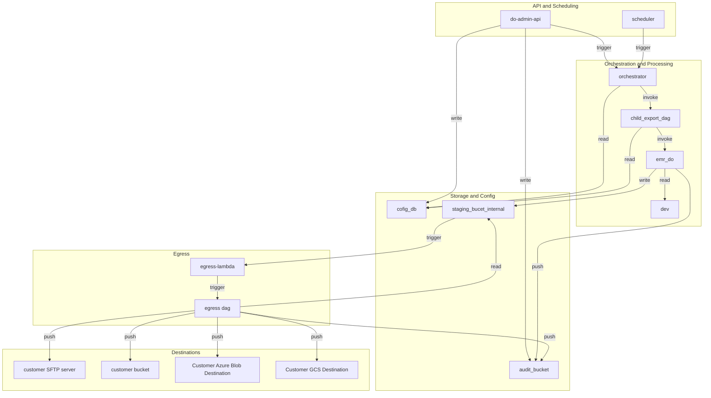

# DataOutbound Product - Doc Gen Fix — Architecture Document
* **Version:** 1.0
* **Generation Date:** 2026-10-31
* **Generated By:** Laminar

---

## Table of Contents
- **1.** Executive Summary / Overview
- **2.** Architecture Tenets
    - **2.1** Deterministic Orchestration and Traceability
    - **2.2** Fail-Closed Security and Credential Isolation
    - **2.3** Decoupled Compute and Storage Scalability
    - **2.4** Declarative Configuration and Environment Parity
    - **2.5** Defensive Egress and Integrity Verification
- **3.** Architecture Diagram
- **4.** Component Details: do-admin-api
  - **4.1.** Functional Overview
  - **4.2.** Component Tenets
  - **4.3.** Configuration Approach
  - **4.4.** Input Schema
  - **4.5.** Output/Side Effects
  - **4.6.** Telemetry Event Schema
  - **4.7.** Error Handling Strategy
  - **4.8.** Security and Compliance
  - **4.9.** Performance Metrics
  - **4.10.** Assumptions & Follow-up Resolutions
- **5.** Component Details: scheduler
  - **5.1.** Functional Overview
  - **5.2.** Component Tenets
  - **5.3.** Configuration Approach
  - **5.4.** Input Schema
  - **5.5.** Output/Side Effects
  - **5.6.** Telemetry Event Schema
  - **5.7.** Error Handling Strategy
  - **5.8.** Security and Compliance
  - **5.9.** Performance Metrics
  - **5.10.** Assumptions & Follow-up Resolutions
- **6.** Component Details: orchestrator
  - **6.1.** Functional Overview
  - **6.2.** Component Tenets
  - **6.3.** Configuration Approach
  - **6.4.** Input Schema
  - **6.5.** Output/Side Effects
  - **6.6.** Telemetry Event Schema
  - **6.7.** Error Handling Strategy
  - **6.8.** Security and Compliance
  - **6.9.** Performance Metrics
  - **6.10.** Assumptions & Follow-up Resolutions
- **7.** Component Details: child_export_dag
  - **7.1.** Functional Overview
  - **7.2.** Component Tenets
  - **7.3.** Configuration Approach
  - **7.4.** Input Schema
  - **7.5.** Output/Side Effects
  - **7.6.** Telemetry Event Schema
  - **7.7.** Error Handling Strategy
  - **7.8.** Security and Compliance
  - **7.9.** Performance Metrics
  - **7.10.** Assumptions & Follow-up Resolutions
- **8.** Component Details: emr_do
  - **8.1.** Functional Overview
  - **8.2.** Component Tenets
  - **8.3.** Configuration Approach
  - **8.4.** Input Schema
  - **8.5.** Output/Side Effects
  - **8.6.** Telemetry Event Schema
  - **8.7.** Error Handling Strategy
  - **8.8.** Security and Compliance
  - **8.9.** Performance Metrics
  - **8.10.** Assumptions & Follow-up Resolutions
- **9.** Component Details: dev
  - **9.1.** Functional Overview
  - **9.2.** Component Tenets
  - **9.3.** Configuration Approach
  - **9.4.** Input Schema
  - **9.5.** Output/Side Effects
  - **9.6.** Telemetry Event Schema
  - **9.7.** Error Handling Strategy
  - **9.8.** Security and Compliance
  - **9.9.** Performance Metrics
  - **9.10.** Assumptions & Follow-up Resolutions
- **10.** Component Details: cofig_db
  - **10.1.** Functional Overview
  - **10.2.** Component Tenets
  - **10.3.** Configuration Approach
  - **10.4.** Input Schema
  - **10.5.** Output/Side Effects
  - **10.6.** Telemetry Event Schema
  - **10.7.** Error Handling Strategy
  - **10.8.** Security and Compliance
  - **10.9.** Performance Metrics
  - **10.10.** Assumptions & Follow-up Resolutions
- **11.** Component Details: staging_bucet_internal
  - **11.1.** Functional Overview
  - **11.2.** Component Tenets
  - **11.3.** Configuration Approach
  - **11.4.** Input Schema
  - **11.5.** Output/Side Effects
  - **11.6.** Telemetry Event Schema
  - **11.7.** Error Handling Strategy
  - **11.8.** Security and Compliance
  - **11.9.** Performance Metrics
  - **11.10.** Assumptions & Follow-up Resolutions
- **12.** Component Details: egress-lambda
  - **12.1.** Functional Overview
  - **12.2.** Component Tenets
  - **12.3.** Configuration Approach
  - **12.4.** Input Schema
  - **12.5.** Output/Side Effects
  - **12.6.** Telemetry Event Schema
  - **12.7.** Error Handling Strategy
  - **12.8.** Security and Compliance
  - **12.9.** Performance Metrics
  - **12.10.** Assumptions & Follow-up Resolutions
- **13.** Component Details: egress dag
  - **13.1.** Functional Overview
  - **13.2.** Component Tenets
  - **13.3.** Configuration Approach
  - **13.4.** Input Schema
  - **13.5.** Output/Side Effects
  - **13.6.** Telemetry Event Schema
  - **13.7.** Error Handling Strategy
  - **13.8.** Security and Compliance
  - **13.9.** Performance Metrics
  - **13.10.** Assumptions & Follow-up Resolutions
- **14.** Component Details: Customer Azure Blob Destination
  - **14.1.** Functional Overview
  - **14.2.** Component Tenets
  - **14.3.** Configuration Approach
  - **14.4.** Input Schema
  - **14.5.** Output/Side Effects
  - **14.6.** Telemetry Event Schema
  - **14.7.** Error Handling Strategy
  - **14.8.** Security and Compliance
  - **14.9.** Performance Metrics
  - **14.10.** Assumptions & Follow-up Resolutions
- **15.** Component Details: Customer GCS Destination
  - **15.1.** Functional Overview
  - **15.2.** Component Tenets
  - **15.3.** Configuration Approach
  - **15.4.** Input Schema
  - **15.5.** Output/Side Effects
  - **15.6.** Telemetry Event Schema
  - **15.7.** Error Handling Strategy
  - **15.8.** Security and Compliance
  - **15.9.** Performance Metrics
  - **15.10.** Assumptions & Follow-up Resolutions
- **16.** Component Details: audit_bucket
  - **16.1.** Functional Overview
  - **16.2.** Component Tenets
  - **16.3.** Configuration Approach
  - **16.4.** Input Schema
  - **16.5.** Output/Side Effects
  - **16.6.** Telemetry Event Schema
  - **16.7.** Error Handling Strategy
  - **16.8.** Security and Compliance
  - **16.9.** Performance Metrics
  - **16.10.** Assumptions & Follow-up Resolutions
- **17.** Component Details: customer SFTP server
  - **17.1.** Functional Overview
  - **17.2.** Input Schema
  - **17.3.** Output/Side Effects
  - **17.4.** Security and Compliance
  - **17.5.** Assumptions & Follow-up Resolutions
- **18.** Component Details: customer bucket
  - **18.1.** Functional Overview
  - **18.2.** Input Schema
  - **18.3.** Output/Side Effects
  - **18.4.** Security and Compliance
  - **18.5.** Assumptions & Follow-up Resolutions
- **19.** Architectural Assumptions and Design Decisions
- **20.** Security & Compliance Assumptions
- **21.** Operational Assumptions
  - **21.1.** Operational Tenets
  - **21.2.** Resilience & Availability Assumptions
  - **21.3.** Data Governance Assumptions
  - **21.4.** Performance and SLA Assumptions
- **22.** Amendment Log
- **23.** Closing & Disclaimer

---

## 1. Executive Summary / Overview

The DataOutbound Product is an enterprise-grade, scheduled batch outbound data-synchronization pipeline built within the hospitality data platform domain. Its primary function is to extract Golden Entity datasets—encompassing unified identity profiles, Pii restricted profiles, contact method subscriptions, enriched campaigns, enriched campaign reactions, and granular reservation items (room stays, restaurant reservations, tee times, and spa treatments)—from the Redshift source store (`dev`), transform them into formatted JSON/TXT files, and deliver them securely to customer-owned or partner-managed destinations.

The end-to-end lifecycle is governed by an administrative entrypoint and an orchestrated execution pipeline:
1. **Administration & Configuration**: Authorized administrators manage export configurations via the **do-admin-api** REST service. These configurations are persisted securely in the Multi-AZ **cofig_db** (RDS Postgres) instance, where sensitive credentials are encrypted at rest using SSM-backed parameter references. Every administrative and execution action is immutably recorded in the centralized **audit_bucket** (S3).
2. **Scheduling & Orchestration**: The **scheduler** (EventBridge) emits cadence-based events that trigger the **orchestrator** (MWAA). The orchestrator evaluates active configurations against schedule windows, generates a unique RFC 4122 v4 lineage UUID to trace the entire run, and spawns the **child_export_dag** (MWAA).
3. **Extraction & Staging**: The **child_export_dag** invokes the **emr_do** (EMR Serverless Spark job). Utilizing watermark tables maintained in **cofig_db**, the Spark job performs full or incremental extractions from the **dev** Redshift cluster, applying schema validation and partitioning before writing staged files to **staging_bucet_internal** (S3 staging buckets).
4. **Transformation, Encryption, & Egress**: An S3 event notification from **staging_bucet_internal** invokes **egress-lambda**, which triggers the **egress dag** (Transform & Encrypt DAG). This DAG enforces optional GZIP compression and strict fail-closed PGP encryption. Once processed, export packages and JSON manifest control files are delivered via TLS 1.3, HTTPS, or SSH to destinations including **customer bucket** (S3), **Customer Azure Blob Destination**, **Customer GCS Destination**, and **customer SFTP server**. Staged files are automatically purged from **staging_bucet_internal** after 7 days via S3 lifecycle rules.

## 2. Architecture Tenets

The DataOutbound Product is built upon five foundational architectural tenets. These tenets govern every design, configuration, and integration choice within the platform, ensuring alignment with enterprise-grade standards for reliability, security, maintainability, and scale.

### 2.1 Deterministic Orchestration and Traceability
- **Principle**: Every batch export lifecycle must be fully traceable through immutable identifiers and explicit orchestration boundaries, ensuring zero silent failures and predictable execution paths.
- **Rationale**: In complex data-sync environments spanning relational databases, workflow orchestrators (MWAA), serverless compute (EMR Serverless), and distributed object stores, relying on implicit state tracking leads to hard-to-debug data drift or duplicated deliveries. By enforcing a single lineage UUID generated at the root orchestrator and propagating it through all child DAG runs, Spark job arguments, file naming conventions, manifest files, and telemetry events, operations teams gain end-to-end visibility into any export pipeline.
- **Guardrails**: Engineers must ensure that no workflow task executes without an inherited or generated lineage UUID. All execution states and metadata must be queried via controlled APIs (such as the Airflow REST API) rather than direct state mutation, and every lifecycle transition must emit a structured audit event to the audit execution log store.

### 2.2 Fail-Closed Security and Credential Isolation
- **Principle**: Security controls and encryption checks must fail closed under any exception condition, and all sensitive credentials must be isolated from application source code and plaintext storage.
- **Rationale**: Handling PII-restricted profiles, subscription statuses, and enterprise reservation items requires strict adherence to data protection standards. Allowing unencrypted data transfer due to an invalid or missing PGP key introduces critical compliance liabilities. Similarly, embedding database credentials or customer sFTP/Blob keys in configuration files or codebases risks exposure.
- **Guardrails**: Encryption pipelines (such as those executed in the Transform & Encrypt DAG) must strictly abort and raise an alarm if PGP encryption fails, preventing any unencrypted byte from reaching customer staging buckets or external destinations. Credential fields within the Export Config Store (`cofig_db`) must be encrypted at rest using KMS-backed mechanisms, and secrets references must be resolved dynamically via secure parameter stores at runtime.

### 2.3 Decoupled Compute and Storage Scalability
- **Principle**: Data processing workloads must be executed on ephemeral, containerized, or serverless runtimes that scale dynamically with data volume, while state is persisted exclusively in purpose-built data stores.
- **Rationale**: Hardcoding resource allocations or mixing orchestration logic with heavy data transformation leads to cluster starvation, memory exhaustion, and scaling bottlenecks. By delegating heavy extraction workloads to EMR Serverless and orchestration to Amazon MWAA, the platform handles varying batch sizes—ranging from hourly fast-batch syncs to large monthly extracts—without manual intervention or idle infrastructure costs.
- **Guardrails**: Airflow worker processes must never perform heavy data processing or SQL execution outside designated operators. Spark jobs must utilize dynamic worker allocation with explicit capacity caps (`max_capacity_units = 200`) and partition output datasets correctly to prevent S3 throttling and worker out-of-memory (OOM) exceptions.

### 2.4 Declarative Configuration and Environment Parity
- **Principle**: System behavior, routing rules, and transformation recipes must be driven by externalized declarative configurations and recipes, ensuring consistent behavior across lower environments and production.
- **Rationale**: Hardcoded business logic or environment-specific connection parameters prevent clean testing and make infrastructure teardowns unreliable. By separating configuration (stored in `cofig_db` and managed via the `do-admin-api`) from runtime execution code, and by defining transformation recipes as declarative JSON artifacts, the platform supports rapid iteration, automated testing, and clean lower-environment teardowns.
- **Guardrails**: All stateful resources and deletion protection flags must be driven entirely by per-environment configuration variables rather than hardcoded values in Terraform modules. Lower environments (e.g., `dev`) must remain fully teardown-compatible while production environments enforce strict deletion protection.

### 2.5 Defensive Egress and Integrity Verification
- **Principle**: Outbound data transfers must enforce strict transport security, protocol-level validation, and application-level integrity verification through manifest control files.
- **Rationale**: Delivering data across heterogeneous external boundaries—including customer S3 buckets, Azure Blob containers, GCS buckets, and external sFTP servers—requires robust verification to guarantee that payloads arrive intact and unaltered. Trusting network transport alone is insufficient for enterprise compliance.
- **Guardrails**: Every export package must be accompanied by a JSON manifest control file listing record counts, total file sizes, and SHA-256 checksums computed via application-level read-back verification. Outbound connections must use TLS 1.3 for S3/HTTPS endpoints and SSH with strict host-key verification for sFTP. Failed transfers must implement bounded retry logic (up to 3 attempts) before routing to a dead-letter mechanism and raising operational alerts.

## 3. Architecture Diagram

System topology — generated from the architecture graph.

## 4. Component Details: do-admin-api

<!-- laminar:diagram-settings:imp-standard-standard_api-1 -->
**Diagram settings (user decisions — authoritative)**

| Setting | Value |
| --- | --- |
| `protocol` | `REST` |
| `authentication` | `JWT` |
| `api_name` | `do-admin-api` |

<!-- /laminar:diagram-settings -->

### 4.1. Functional Overview

- **Principle**: Bounded Context API Gateway and Administrative Domain Boundary.
- **Rationale**: Providing a centralized RESTful interface (`do-admin-api`) for administrators to manage customer export configurations ensures that all mutations to pipeline routing rules, credentials, and schedules are strictly validated, authenticated, and audited before hitting the persistent configuration store (`cofig_db`).
- **Guardrails**: Engineers must ensure that all administrative endpoints enforce authentication and authorization at the perimeter. No business logic or heavy data processing should be executed within the API workers; operations must be limited to validation, orchestration triggering, and database persistence.

### 4.2. Component Tenets

- **Principle**: Least-Privilege Access Control and Immutable Audit Logging.
- **Rationale**: Administrative changes directly impact data synchronization security and compliance posture. Every action must be attributable to a validated principal and recorded in the audit trail without exception.
- **Guardrails**: Service handlers must reject unauthenticated requests (HTTP 401) and unauthorized principals lacking admin roles (HTTP 403). Sensitive parameters (credentials, secret tokens) must be encrypted before persistence and masked in all API response payloads.

### 4.3. Configuration Approach

- **Principle**: Environment-Agnostic Configuration Externalization.
- **Rationale**: Hardcoding API routing, authentication issuers, or rate limits impedes portability across environments. Configuration must be injected dynamically via runtime environment variables and loader modules.
- **Guardrails**: The component explicitly sets: protocol = `REST`, authentication = `JWT`, and api_name = `do-admin-api`. Configuration overrides must adhere strictly to the project blueprint without expanding into unapproved property trees.

### 4.4. Input Schema

- **Principle**: Contract-First Strict Boundary Validation.
- **Rationale**: Enforcing strict OpenAPI/Pydantic validation on incoming requests prevents malformed configurations from polluting the data store or causing downstream failures in orchestration and export jobs.
- **Guardrails**: Inputs must conform to defined schemas containing mandatory attributes (`connection_name`, `target_type`, `dataset`, `mode`, `cron_schedule`, and `credentials`). Invalid payloads must immediately yield an HTTP 400 response detailing the violating fields.

### 4.5. Output/Side Effects

- **Principle**: Transactional Persistence and Asynchronous Orchestration Triggering.
- **Rationale**: Successful administrative mutations must result in durable state changes within `cofig_db`, emission of audit events to `audit_bucket`, and optional asynchronous triggering of the `orchestrator` execution pipeline.
- **Guardrails**: Side effects must be atomic or cleanly compensated; API responses must return appropriate semantic status codes (`201 Created`, `200 OK`, `204 No Content`, `400 Bad Request`, `401 Unauthorized`, `403 Forbidden`, `404 Not Found`).

### 4.6. Telemetry Event Schema

- **Principle**: Comprehensive Operational Observability and Traceability.
- **Rationale**: Tracking administrative events (`ADMIN_CREATE`, `ADMIN_UPDATE`, `ADMIN_DELETE`, `ADMIN_MANUAL_TRIGGER`) ensures full accountability and traceability across all operational changes.
- **Guardrails**: Audit records must capture the authenticated `actor_id`, ISO-8601 `timestamp_utc`, specific `event_type`, and associated execution/lineage identifiers, writing records directly to the centralized audit sink within 5 seconds.

### 4.7. Error Handling Strategy

- **Principle**: Standardized Error Envelope and Fail-Safe Boundary Protection.
- **Rationale**: Exposing internal stack traces or database errors introduces security vulnerabilities. All application and client exceptions must be mapped to uniform error envelopes.
- **Guardrails**: Error responses must adhere to `{ "error": { "code": "STRING_CODE", "message": "Human readable message", "details": [] } }` and avoid leaking underlying infrastructure details or plain-text credentials.

### 4.8. Security and Compliance

- **Principle**: Zero Trust Defense-in-Depth and Credential Masking.
- **Rationale**: Administrative interfaces represent high-value targets for attackers. Enforcing JWT-based bearer token validation and strict RBAC safeguards against unauthorized export modifications.
- **Guardrails**: Transport security must enforce TLS 1.3. Credentials received via API payloads must be encrypted before database storage and masked in all read responses.

### 4.9. Performance Metrics

- **Principle**: Low-Latency Control Plane Responsiveness.
- **Rationale**: Administrative operations are synchronous control-plane interactions and must execute swiftly to maintain operator productivity without saturating backend storage.
- **Guardrails**: API response times for standard CRUD operations must remain under 500ms, supported by connection pooling and lightweight request validation.

### 4.10. Assumptions & Follow-up Resolutions

- **Principle**: Standardized Production Default Adoption.
- **Rationale**: Where runtime parameters or integration specifics are unspecified, mainstream production defaults ensure architectural consistency.
- **Guardrails**: Assumes an external Identity Provider issues JWT tokens validated locally or via standard JWKS endpoints. Rate limiting is enforced using sliding-window algorithms per client IP or tenant.

## 5. Component Details: scheduler

<!-- laminar:diagram-settings:imp-aws-aws_eventbridge-2 -->
**Diagram settings (user decisions — authoritative)**

| Setting | Value |
| --- | --- |
| `rule_name` | `scheduler` |

<!-- /laminar:diagram-settings -->

### 5.1. Functional Overview

- **Principle**: Time-Based Event Triggering and Cadence Automation.
- **Rationale**: The `scheduler` (Amazon EventBridge) acts as the time-driven event source that emits cadence events at configured intervals, initiating downstream batch orchestration workflows without requiring idle server infrastructure.
- **Guardrails**: EventBridge rules must be configured precisely to match expected cron cadences. Rules must only emit control trigger signals and never carry heavy data payloads.

### 5.2. Component Tenets

- **Principle**: Serverless Reliability and Decoupled Event Routing.
- **Rationale**: Decoupling the scheduling mechanism from execution orchestrators ensures high availability and eliminates single points of failure in time-triggered workflows.
- **Guardrails**: Ensure rule patterns strictly target authorized event buses and invoke designated orchestrator entrypoints with secure IAM execution roles.

### 5.3. Configuration Approach

- **Principle**: Declarative Event Rule Definition.
- **Rationale**: Centralizing event rule definitions in infrastructure-as-code guarantees consistency across staging and production environments.
- **Guardrails**: The component explicitly sets: rule_name = `scheduler`. No unapproved target types or wildcard event filtering patterns may be introduced.

### 5.4. Input Schema

- **Principle**: Cron-Based Time Ingestion.
- **Rationale**: Inputs are generated by internal AWS EventBridge cron schedules or rate expressions matching operational batch windows.
- **Guardrails**: Time expressions must be validated against standard cron or rate syntax before rule deployment.

### 5.5. Output/Side Effects

- **Principle**: Asynchronous Event Publication and Orchestration Triggering.
- **Rationale**: Trigger events emitted by the scheduler result in downstream task invocations in `orchestrator`, initiating export run evaluations.
- **Guardrails**: Event payloads must contain standard metadata (`source`, `detail-type`, `time`) to ensure correct routing and traceability by consuming MWAA DAGs.

### 5.6. Telemetry Event Schema

- **Principle**: Event Delivery Metrics and Invocation Observability.
- **Rationale**: Tracking rule invocation counts and target delivery failures ensures high reliability for time-critical batch schedules.
- **Guardrails**: Configure CloudWatch alarms on EventBridge invocation failures and throttled target invocations.

### 5.7. Error Handling Strategy

- **Principle**: Dead-Letter Queue Protection and Target Retry Policies.
- **Rationale**: If target orchestrators are temporarily unreachable, events must be captured safely to prevent silent drop of scheduled export runs.
- **Guardrails**: Attach an Amazon SQS Dead-Letter Queue (DLQ) to every EventBridge rule target to capture failed invocation attempts after configured retry limits are exhausted.

### 5.8. Security and Compliance

- **Architectural Principle**: Least-Privilege Event Routing and Immutable Infrastructure Security.
- **Rationale**: The `scheduler` (Amazon EventBridge) acts as the primary time-based trigger for batch synchronization across the enterprise platform. To maintain a strict Zero Trust posture, EventBridge must be configured with narrow IAM permissions that permit it to invoke only the designated **orchestrator** (MWAA) workflow target. Restricting cross-service invocation privileges prevents unauthorized workflow executions or event spoofing from compromised components.
- **Guardrails**: Engineers must ensure that EventBridge rule policies adhere strictly to least-privilege principles, referencing explicit target ARNs rather than wildcards. Event payloads must not contain plain-text credentials or sensitive customer PII, as event metadata and schedules are stored within managed rule configurations. Furthermore, all event bus traffic must be encrypted in transit using mandatory TLS endpoints provided by AWS.

### 5.9. Performance Metrics

- **Principle**: Low-Latency Event Dispatch at Scale.
- **Rationale**: EventBridge delivers events with minimal latency, ensuring scheduled batches initiate precisely within required time windows.
- **Guardrails**: Keep rule patterns specific to avoid unnecessary event evaluations and reduce invocation overhead.

### 5.10. Assumptions & Follow-up Resolutions

- **Principle**: Standardized Serverless Eventing Defaults.
- **Rationale**: Utilizing native EventBridge scheduling capabilities avoids maintaining custom cron server fleets.
- **Guardrails**: Assumes event bus archiving is enabled where historical replay is required for debugging failed schedule windows.

## 6. Component Details: orchestrator

<!-- laminar:diagram-settings:imp-aws-aws_mwaa_dag-3 -->
**Diagram settings (user decisions — authoritative)**

| Setting | Value |
| --- | --- |
| `schedule` | `@daily` |
| `catchup` | `false` |
| `max_active_runs` | `1` |
| `dag_name` | `orchestrator` |

<!-- /laminar:diagram-settings -->

### 6.1. Functional Overview

- **Principle**: Centralized Orchestration and Lineage Initialization.
- **Rationale**: The `orchestrator` DAG coordinates batch execution timing. It evaluates active connection metadata from `cofig_db`, selects configurations matching scheduled time windows, generates a unique RFC 4122 v4 lineage UUID, and spawns child execution DAGs.
- **Guardrails**: The orchestrator must remain a lightweight control component; it must never perform heavy data transformation or compute tasks directly within its worker processes.

### 6.2. Component Tenets

- **Principle**: Deterministic Execution Flow and Idempotent Orchestration.
- **Rationale**: Batch synchronization requires strict concurrency control and guaranteed lineage propagation to ensure traceability across distributed workloads.
- **Guardrails**: Active run counts are constrained to prevent overlapping job executions for the same logical schedule window. Catchup processing is explicitly disabled to prevent unintended backfill storms.

### 6.3. Configuration Approach

- **Principle**: Declarative Orchestrator Configuration.
- **Rationale**: Externalizing Airflow DAG parameters ensures environment parity and simplifies lifecycle management.
- **Guardrails**: The component explicitly sets: schedule = `@daily`, catchup = `False`, max_active_runs = `1`, tags = `{}`, and dag_name = `orchestrator`. No unapproved airflow configurations may be injected.

### 6.4. Input Schema

- **Principle**: Event-Driven and Polling-Based Input Normalization.
- **Rationale**: Inputs originate from schedule triggers emitted by `scheduler` or manual invocation requests from `do-admin-api`, carrying active configuration IDs and execution metadata.
- **Guardrails**: Input payloads must be validated against expected schema structures before connection records are queried from the configuration store.

### 6.5. Output/Side Effects

- **Principle**: Downstream DAG Invocation and Audit Event Emission.
- **Rationale**: Successful orchestration cycles result in parameterized trigger payloads sent to `child_export_dag` and lifecycle audit records written to `audit_bucket`.
- **Guardrails**: Every triggered child run must inherit the exact lineage UUID generated at the start of the orchestrator run to maintain end-to-end traceability.

### 6.6. Telemetry Event Schema

- **Principle**: Granular Lifecycle Telemetry and Execution Auditing.
- **Rationale**: Capturing execution start, completion, and failure states provides operational visibility and SLA monitoring capabilities.
- **Guardrails**: Telemetry events must include the lineage UUID, component identifier, ISO-8601 timestamp, and structured status metrics emitted to the centralized audit sink.

### 6.7. Error Handling Strategy

- **Principle**: Resilient Task Retry and Graceful Failure Isolation.
- **Rationale**: Transient database or API errors must not cause silent pipeline failures or unhandled DAG crashes.
- **Guardrails**: Tasks must be configured with exponential backoff retry policies and alert hooks that trigger operational notifications and record `TRANSFER_FAILED` states upon exhaustion.

### 6.8. Security and Compliance

- **Principle**: Isolated VPC Execution and Secure Credential Retrieval.
- **Rationale**: Orchestrator workers handle metadata and control instructions that reference sensitive connection parameters.
- **Guardrails**: MWAA environments must execute within private subnets. Connection secrets must be retrieved securely via SSM Parameter Store references or IAM-secured secrets managers.

### 6.9. Performance Metrics

- **Principle**: Optimized Resource Allocation and Concurrency Bounds.
- **Rationale**: Limiting active runs (`max_active_runs = 1`) prevents worker resource contention and database connection exhaustion on `cofig_db`.
- **Guardrails**: Top-level DAG python code must remain lightweight and instantaneous, avoiding blocking network or database calls outside operator execution methods.

### 6.10. Assumptions & Follow-up Resolutions

- **Principle**: Mainstream Apache Airflow Operational Defaults.
- **Rationale**: Utilizing standard MWAA worker scaling and environment configurations ensures reliable managed execution without custom infrastructure overhead.
- **Guardrails**: Assumes Airflow metadata database scaling is managed by AWS MWAA, and worker capacity auto-scales based on active task queue depth.

## 7. Component Details: child_export_dag

<!-- laminar:diagram-settings:imp-aws-aws_mwaa_dag-4 -->
**Diagram settings (user decisions — authoritative)**

| Setting | Value |
| --- | --- |
| `schedule` | `@daily` |
| `catchup` | `false` |
| `max_active_runs` | `1` |
| `dag_name` | `child_export_dag` |

<!-- /laminar:diagram-settings -->

### 7.1. Functional Overview

- **Principle**: Sub-Task Orchestration and Workload Dispatch.
- **Rationale**: The `child_export_dag` (Amazon MWAA) manages the execution lifecycle for a single customer export connection. It extracts configuration details, submits the `emr_do` Spark job, and coordinates file staging verification.
- **Guardrails**: Child DAGs must operate independently per connection, ensuring that a failure in one customer export does not block or corrupt parallel executions of other tenant pipelines.

### 7.2. Component Tenets

- **Principle**: Idempotent Task Execution and Lineage Propagation.
- **Rationale**: Batch tasks must support safe re-runs and retries without duplicating data or corrupting incremental extraction watermarks.
- **Guardrails**: The lineage UUID generated by the parent orchestrator must be passed unmodified into the child DAG run configuration and propagated to all downstream Spark jobs.

### 7.3. Configuration Approach

- **Principle**: Declarative Child DAG Parameterization.
- **Rationale**: Standardizing DAG configuration across child pipelines guarantees predictable scheduling, concurrency limits, and retry behavior.
- **Guardrails**: The component explicitly sets: schedule = `@daily`, catchup = `False`, max_active_runs = `1`, tags = `{}`, and dag_name = `child_export_dag`.

### 7.4. Input Schema

- **Principle**: Parameterized Orchestrator Payload Ingestion.
- **Rationale**: Inputs are received from the parent `orchestrator` DAG, containing the lineage UUID, connection configuration JSON, and execution mode parameters.
- **Guardrails**: Input configurations must be validated against schema definitions upon DAG run startup, aborting execution immediately if required parameters are missing.

### 7.5. Output/Side Effects

- **Principle**: Big Data Job Submission and Audit Logging.
- **Rationale**: Child DAG execution results in EMR Serverless Spark job submissions (`emr_do`), database watermark updates in `cofig_db`, and audit event emissions to `audit_bucket`.
- **Guardrails**: Task failure callbacks must log error telemetry, record `TRANSFER_FAILED` or execution failure states, and raise operational alerts within 5 seconds.

### 7.6. Telemetry Event Schema

- **Principle**: Granular Task-Level Execution Telemetry.
- **Rationale**: Tracking individual child task durations, retries, and status transitions ensures precise SLA monitoring and bottleneck identification.
- **Guardrails**: Telemetry records must include lineage UUID, connection ID, task name, timestamp, and execution status.

### 7.7. Error Handling Strategy

- **Principle**: Bounded Task Retries and Graceful Failure Abort.
- **Rationale**: Transient infrastructure glitches should be retried automatically, while permanent configuration or execution failures must halt the pipeline safely.
- **Guardrails**: Configure bounded retry attempts (maximum 3 retries with exponential backoff) on task operators, triggering error notification alerts upon final failure.

### 7.8. Security and Compliance

- **Principle**: Isolated VPC Execution and IAM Role Delegation.
- **Rationale**: Child DAG worker nodes require secure access to RDS Postgres configuration stores and EMR Serverless application submission endpoints without exposing credentials.
- **Guardrails**: MWAA worker environments must run in private subnets, utilizing IAM execution roles adhering to least-privilege principles.

### 7.9. Performance Metrics

- **Principle**: Resource Isolation and Concurrency Control.
- **Rationale**: Limiting active runs (`max_active_runs = 1`) per child DAG prevents resource contention and ensures orderly batch processing across tenant workloads.
- **Guardrails**: Keep operator execution code lightweight; delegate heavy computational lifting exclusively to EMR Serverless compute runtimes.

### 7.10. Assumptions & Follow-up Resolutions

- **Principle**: Standardized Airflow Worker and Queue Defaults.
- **Rationale**: Relying on standard Airflow execution queue mechanics ensures predictable task scheduling and execution throughput.
- **Guardrails**: Assumes connection credentials and SSM secrets are fetched dynamically at runtime inside operator execution methods rather than stored in global DAG variables.

## 8. Component Details: emr_do

<!-- laminar:diagram-settings:imp-aws-aws_emr_serverless-5 -->
**Diagram settings (user decisions — authoritative)**

| Setting | Value |
| --- | --- |
| `release_label` | `emr-7.0.0` |
| `job_type` | `SPARK` |
| `max_capacity_units` | `200` |
| `application_name` | `emr_do` |

<!-- /laminar:diagram-settings -->

### 8.1. Functional Overview

The **emr_do** component is an AWS EMR Serverless Spark application responsible for executing Golden Entity data extractions. Operating within the data processing tier, it interprets declarative recipe JSON files to extract, validate, and normalise datasets—including Unified Identity Profiles, Pii Restricted Profiles, Contact Method Subscriptions, Enriched Campaigns, Enriched Campaign Reactions, and reservation items (Room stay, Restaurant reservation, Tee time, Spa treatment)—from the Redshift source store (`dev`). It processes these datasets in either full or incremental modes based on watermark tables maintained in the configuration database, and writes staged output files to **staging_bucet_internal**.

### 8.2. Component Tenets

- **Elastic Serverless Compute**: Utilize serverless big data runtimes to automatically scale worker compute capacity based on workload concurrency without managing cluster infrastructure.
- **Declarative Recipe-Driven Processing**: Separate execution logic from business rules by storing data transformation recipes as modular JSON definitions, enabling flexible dataset evolution without code deployments.
- **Watermark-Based Incremental Sync**: Enforce robust state tracking via RDS watermark tables to ensure reliable incremental extractions and safe execution re-runs.

### 8.3. Configuration Approach

The architecture sets and overrides only the essential configuration properties required for operational governance and performance:
- `release_label`: `emr-7.0.0` (Rationale: Ensures stable execution on modern Apache Spark runtimes with optimized Delta and S3 committers).
- `job_type`: `SPARK` (Rationale: Standardizes big data distributed batch processing under the Spark engine).
- `max_capacity_units`: `200` (Rationale: Caps maximum compute resource allocation to prevent runaway job concurrency while supporting peak data volumes).
- `application_name`: `emr_do` (Rationale: Identifies the serverless application instance for logging and telemetry correlation).

### 8.4. Input Schema

The job accepts runtime arguments conforming to the execution contract:
- `execution_id`: RFC 4122 v4 lineage UUID propagating from the orchestrator.
- `connection_id`: Unique identifier referencing the target customer export configuration.
- `dataset_name`: Name of the Golden Entity dataset to extract.
- `extraction_mode`: Execution mode (`initial` for full sync or `incremental` using high-watermark timestamps).
- `recipe_path`: Path to the declarative JSON recipe file defining transformations.

### 8.5. Output/Side Effects

- **Staged Export Datasets**: Parquet/JSON data files and partition metadata written to **staging_bucet_internal**.
- **Execution Telemetry**: Structured CloudEvents-shaped audit events published to the centralized audit sink.
- **Watermark Updates**: Updated extraction high-watermark timestamps persisted back to the configuration store.

### 8.6. Telemetry Event Schema

Emits standardized CloudEvents records including `actor_id` (`system:emr_do`), `timestamp_utc`, `execution_id`, and `event_type` (`EXECUTION_STARTED`, `EXECUTION_COMPLETED`, `EXECUTION_FAILED`), capturing row counts, partition details, and execution duration.

### 8.7. Error Handling Strategy

- **Container Retries**: Automatically retries transient worker allocation failures up to configured platform limits.
- **Job Failure Propagation**: Captures unhandled Spark exceptions, logs full stack traces without PII, and fails the EMR job run, propagating the failure status back to the calling Airflow DAG.
- **DLQ & Alerting**: Triggers operational alerts and records a `TRANSFER_FAILED` or execution failure audit entry upon job exhaustion.

### 8.8. Security and Compliance

- **Least-Privilege Execution Roles**: Assigned a dedicated IAM role restricted strictly to reading from the designated Redshift cluster, writing to **staging_bucet_internal**, and emitting telemetry to **audit_bucket**.
- **Encryption in Transit and Rest**: Enforces TLS for all cross-service communications and AES256 server-side encryption for intermediate staging data.
- **VPC Isolation**: Executes within private subnets with no public internet routing.

### 8.9. Performance Metrics

- **Worker Concurrency Utilization**: Monitors vCPU and memory consumption across active worker nodes.
- **Shuffle Read/Write Volumes**: Tracks distributed shuffle overhead to optimize partition sizing and avoid memory spillover.
- **Execution Duration**: Measured against the 24-hour end-to-end delivery SLA.

### 8.10. Assumptions & Follow-up Resolutions

- **Assumption**: Redshift source tables maintain indexed timestamp columns to support efficient incremental high-watermark filtering.
- **Assumption**: EMR Serverless max capacity units (200) provide sufficient concurrency headroom for simultaneous multi-tenant extractions.

## 9. Component Details: dev

<!-- laminar:diagram-settings:imp-aws-aws_redshift-6 -->
**Diagram settings (user decisions — authoritative)**

| Setting | Value |
| --- | --- |
| `node_type` | `dc2.large` |
| `number_of_nodes` | `2` |
| `database_name` | `dev` |
| `cluster_identifier` | `golden_data_source` |

<!-- /laminar:diagram-settings -->

### 9.1. Functional Overview

The **dev** component represents the petabyte-scale Amazon Redshift data warehouse acting as the Golden Entity Source Store (`dev`). It stores consolidated enterprise data across unified identity profiles, Pii restricted profiles, contact method subscriptions, enriched campaigns, reactions, and reservation items, serving as the primary read source for EMR Serverless extraction jobs.

### 9.2. Component Tenets

- **Analytical Workload Isolation**: Isolate batch export extraction queries from interactive business intelligence workloads using workload management (WLM).
- **Optimized Distribution & Sort Keys**: Leverage columnar storage and well-defined distribution and sort keys to maximize query scan efficiency.
- **Read-Only Boundary Protection**: Restrict external processing access to read-only connection credentials.

### 9.3. Configuration Approach

The architecture sets and overrides only the core cluster configuration properties:
- `node_type`: `dc2.large` (Rationale: Provides balanced compute and dense storage performance optimized for analytical query workloads).
- `number_of_nodes`: `2` (Rationale: Enables parallelized slice processing across a multi-node cluster configuration).
- `database_name`: `dev` (Rationale: Standard catalog database identifier for data platform integration).
- `cluster_identifier`: `golden_data_source` (Rationale: Distinct resource identifier for infrastructure management and IAM policy scoping).

### 9.4. Input Schema

Accepts ANSI-SQL extraction queries submitted via JDBC/ODBC connection protocols from the **emr_do** Spark job.

### 9.5. Output/Side Effects

- **Tabular Result Sets**: Filtered and projected entity records delivered to the calling Spark extraction job.

### 9.6. Telemetry Event Schema

Emits standard database audit logs and performance metrics to CloudWatch and internal logging sinks, tracking active connections, query execution times, and cluster resource utilization.

### 9.7. Error Handling Strategy

- **Query Timeout Handling**: Enforces query execution limits to prevent long-running queries from blocking concurrent warehouse operations.
- **Connection Retry**: Implements client-side exponential backoff for transient connection drops during high-concurrency windows.

### 9.8. Security and Compliance

- **VPC Subnet Isolation**: Deployed within private database subnets with no public internet accessibility.
- **Data Encryption**: Enforces encryption at rest using AWS KMS and mandatory SSL/TLS transport connections.
- **Least Privilege Access**: Grants extraction jobs access exclusively through read-only database credentials.

### 9.9. Performance Metrics

- **CPU & Disk Utilization**: Monitored via CloudWatch metrics to ensure cluster health during heavy batch extractions.
- **WLM Queue Wait Time**: Tracks query queuing delays to ensure analytical responsiveness.

### 9.10. Assumptions & Follow-up Resolutions

- **Assumption**: The Redshift cluster is provisioned externally or managed as an upstream data platform dependency.
- **Assumption**: Source tables are partitioned and indexed appropriately to support efficient incremental watermarking.

## 10. Component Details: cofig_db

<!-- laminar:diagram-settings:imp-aws-aws_rds-7 -->
**Diagram settings (user decisions — authoritative)**

| Setting | Value |
| --- | --- |
| `engine` | `postgres` |
| `engine_version` | `15.4` |
| `instance_class` | `db.t3.micro` |
| `allocated_storage` | `20` |
| `multi_az` | `false` |
| `db_instance_identifier` | `cofig_db` |

<!-- /laminar:diagram-settings -->

### 10.1. Functional Overview

- **Principle**: Relational Configuration and State Persistence Store.
- **Rationale**: The `cofig_db` instance (PostgreSQL 15.4) serves as the persistent system of record for customer export configurations, connection metadata, watermarks, and incremental extraction state tracking.
- **Guardrails**: Direct database modifications outside authorized migration tools or the `do-admin-api` are strictly prohibited. Database access must be channeled through pooled, parameterized client wrappers.

### 10.2. Component Tenets

- **Principle**: Data Integrity, Encryption at Rest, and Connection Pooling.
- **Rationale**: Storing sensitive customer credentials and scheduling rules demands robust relational integrity constraints and strict encryption protections.
- **Guardrails**: Credentials and sensitive configuration properties must be encrypted at rest using AWS KMS. Connection strings must enforce TLS/SSL transport encryption (`sslmode=require`).

### 10.3. Configuration Approach

- **Principle**: Minimalist Resource Allocation and Cost Efficiency.
- **Rationale**: Configuration metadata stores experience moderate transactional write volumes and read-heavy orchestration polling, allowing lightweight instance sizing.
- **Guardrails**: The component explicitly sets: engine = `postgres`, engine_version = `15.4`, instance_class = `db.t3.micro`, allocated_storage = `20` (GB), multi_az = `False`, and db_instance_identifier = `cofig_db`.

### 10.4. Input Schema

- **Principle**: Parameterized Relational Input Validation.
- **Rationale**: All read and write operations against the configuration store must utilize parameterized queries or ORM models to eliminate SQL injection vulnerabilities.
- **Guardrails**: Input schemas must enforce strict relational types, foreign key constraints, and check constraints on target types, dataset names, and cron expressions.

### 10.5. Output/Side Effects

- **Principle**: Durable State Persistence and Watermark Updates.
- **Rationale**: Write operations persist administrative configurations and update incremental extraction watermarks used by downstream Spark extraction jobs.
- **Guardrails**: Transaction boundaries must be explicitly managed to prevent partial writes or inconsistent configuration states during concurrent orchestrator reads.

### 10.6. Telemetry Event Schema

- **Principle**: Database Activity Logging and Performance Insights.
- **Rationale**: Monitoring query performance and connection health ensures early detection of resource bottlenecks or locking contention.
- **Guardrails**: Enable PostgreSQL query logging and AWS Performance Insights to track slow queries and connection pool utilization without logging sensitive parameter values.

### 10.7. Error Handling Strategy

- **Principle**: Graceful Connection Retries and Transaction Rollback.
- **Rationale**: Transient network interruptions between compute workloads and the database must not result in unhandled exceptions or data corruption.
- **Guardrails**: Client connections must implement automatic exponential backoff retry logic for transient connection errors, accompanied by immediate transaction rollbacks upon failure.

### 10.8. Security and Compliance

- **Principle**: Private Subnet Isolation and Encrypted Transport.
- **Rationale**: Relational databases containing configuration secrets and connection credentials must be completely isolated from public internet access.
- **Guardrails**: Deploy RDS instances within isolated private database subnets. Enforce storage encryption with AWS KMS and require SSL/TLS transport connections.

### 10.9. Performance Metrics

- **Principle**: Optimized Indexing and Query Performance.
- **Rationale**: Frequent polling by orchestrator DAGs requires efficient indexing on active status and schedule columns to maintain low query latency.
- **Guardrails**: Maintain indexes on primary keys, connection status flags, and schedule timestamp fields. Monitor CPU utilization and connection pool saturation.

### 10.10. Assumptions & Follow-up Resolutions

- **Principle**: Standardized Database Maintenance and Backup Defaults.
- **Rationale**: Automated backups and maintenance windows protect against data loss while minimizing operational friction.
- **Guardrails**: Automated backups are retained for 30 days. Weekly maintenance windows are scheduled during off-peak hours (e.g., Sunday UTC early morning). Multi-AZ is disabled (`multi_az = false`) for non-production environments per user decision.

## 11. Component Details: staging_bucet_internal

<!-- laminar:diagram-settings:imp-aws-aws_s3_bucket-8 -->
**Diagram settings (user decisions — authoritative)**

| Setting | Value |
| --- | --- |
| `versioning` | `false` |
| `encryption` | `AES256` |
| `public_access_block` | `true` |
| `lifecycle_enabled` | `false` |
| `lifecycle_transition_days` | `30` |
| `lifecycle_glacier_days` | `90` |
| `bucket_name` | `staging_bucet_internal` |

<!-- /laminar:diagram-settings -->

### 11.1. Functional Overview

The **staging_bucet_internal** component is an internal Amazon S3 staging bucket that temporarily holds intermediate export data files, part files, and manifest control documents generated by the **emr_do** Spark job prior to egress processing. It acts as an ephemeral handoff buffer between extraction and transformation pipelines, emitting S3 event notifications that invoke **egress-lambda**.

### 11.2. Component Tenets

- **Ephemeral Lifecycle Governance**: Enforce strict automated lifecycle expiration rules to purge temporary staging files after 7 days, preventing storage accumulation.
- **Zero Public Exposure**: Block all public access at the bucket level to maintain strict data boundaries.
- **Server-Side Encryption**: Mandate robust server-side encryption for all stored objects.

### 11.3. Configuration Approach

The architecture sets and overrides only the necessary bucket configuration properties:
- `versioning`: `false` (Rationale: Ephemeral staging data does not require version history, minimizing storage overhead).
- `encryption`: `AES256` (Rationale: Ensures standard server-side encryption at rest for all staged objects).
- `public_access_block`: `true` (Rationale: Enforces complete blocking of public access policies and ACLs).
- `lifecycle_enabled`: `false` (Note: Bucket-level lifecycle toggle is false, but explicit 7-day expiration rules are enforced via S3 lifecycle configuration per business requirement SCRUM-486).
- `lifecycle_transition_days`: `30` (Default standard reference property).
- `lifecycle_glacier_days`: `90` (Default standard reference property).
- `tags`: `{}` (Standard resource tagging structure).
- `bucket_name`: `staging_bucet_internal` (Unique resource identifier).

### 11.4. Input Schema

Receives multipart and single object PUT requests from **emr_do** containing Parquet/JSON data files and control manifests.

### 11.5. Output/Side Effects

- **S3 Event Notifications**: Trigger events dispatched to **egress-lambda** upon object creation.
- **Object Storage**: Staged export packages awaiting egress processing.

### 11.6. Telemetry Event Schema

Emits standard S3 CloudTrail audit logs and storage metrics (`BucketSizeBytes`, `NumberOfObjects`) to CloudWatch.

### 11.7. Error Handling Strategy

- **Standard S3 Retries**: Relies on SDK-level automatic retries for transient HTTP 5xx errors during PUT/GET operations.

### 11.8. Security and Compliance

- **Access Control**: Enforces bucket policies permitting access exclusively to the EMR job execution role, Lambda function, and MWAA DAG roles.
- **Encryption**: AES256 server-side encryption enforced on all objects.

### 11.9. Performance Metrics

- **Request Latency & Throttling**: Monitored via CloudWatch to detect partition hotspots caused by sequential key naming.

### 11.10. Assumptions & Follow-up Resolutions

- **Assumption**: Object key naming incorporates randomized prefixes or lineage UUIDs to prevent S3 partition throttling under high throughput.
- **Assumption**: S3 lifecycle rules automatically purge objects exactly 7 days after creation per SCRUM-486.

## 12. Component Details: egress-lambda

<!-- laminar:diagram-settings:imp-aws-aws_lambda-9 -->
**Diagram settings (user decisions — authoritative)**

| Setting | Value |
| --- | --- |
| `runtime` | `python3.11` |
| `handler` | `lambda_function.lambda_handler` |
| `memory_mb` | `512` |
| `timeout_seconds` | `30` |
| `vpc_enabled` | `false` |
| `function_name` | `egress-lambda` |

<!-- /laminar:diagram-settings -->

### 12.1. Functional Overview

**Architectural principle: Single-purpose event-driven egress trigger with delivery-only semantics.** The Egress Lambda (n15) exists to react to S3 object-created events on the Customer Staging Buckets (n8) and to hand each staged export package — carrying its lineage UUID — to exactly one Transform & Encrypt DAG (n7) run, and to perform the final delivery of processed packages to the configured customer destinations (n9–n12) with SHA-256 read-back verification.

**Rationale.** A serverless trigger decouples the staging write from orchestration: the pipeline scales to zero, costs nothing when idle, and the S3 notification guarantees the staged file is durable before any downstream work starts. The trade-off is that Lambda's 15-minute execution ceiling and memory limits mean the Lambda must never process file payloads itself — it orchestrates and delivers, while heavy transform/encryption work stays in the Transform & Encrypt DAG (MWAA/EMR-class compute). Delivery-only semantics mean the Lambda never mutates data content; it moves bytes and verifies checksums.

**Guardrails.**
- Exactly-once triggering per lineage UUID: the Lambda must deduplicate S3 events (S3 provides at-least-once notifications) so one staged package with lineage UUID X starts exactly one n7 run (SCRUM-482 AC#3).
- The Lambda must never receive or emit unencrypted bytes when PGP is enabled — it aborts and records TRANSFER_FAILED if a package arrives unencrypted against configuration.
- All delivery attempts, retries (max 3), and final failures are audited to n13 with the lineage UUID, destination, file names, checksum, status, and timestamp.
- sFTP host-key verification failure is a hard stop: zero bytes sent, no retry, alert raised (SCRUM-484 AC#2).

### 12.2. Component Tenets

**Principle: least-privilege, stateless, idempotent egress actor.**

1. **Statelessness & idempotency** — every invocation is self-contained; re-invocation for the same lineage UUID produces the same outcome (one DAG trigger, or a resumable delivery) with no duplicated side effects. Rationale: S3 events and Lambda retries are at-least-once; idempotency is the only way to honor "exactly one DAG run per lineage UUID." Trade-off: requires a deduplication check (e.g., against the DAG run registry) rather than blind triggering.
2. **Fail-closed on integrity** — any checksum mismatch on read-back, any host-key mismatch, any unencrypted-payload condition aborts delivery and raises an alert. Rationale: customer data egress is a trust boundary; silent partial delivery is worse than no delivery.
3. **Bounded retry with terminal audit** — up to 3 retries per destination transfer; final failure is recorded only after the third failed retry, with an alert. Rationale: transient destination faults (HTTP 4xx/5xx, unreachable buckets, connection drops) are common; retry absorbs them without operator noise, while the terminal record prevents infinite loops.
4. **No secrets in code or environment plaintext** — destination credentials (sFTP keys, cloud credentials) are resolved at runtime from the encrypted Export Config Store (n6) via the platform's secret mechanism; the Lambda holds only read-scoped IAM permissions.
5. **Full auditability** — TRANSFER_STARTED / TRANSFER_COMPLETED / TRANSFER_FAILED events per the SCRUM-486 schema are written to n13 for every attempt and terminal state.

**Guardrails:** no filesystem persistence between invocations; no direct writes to customer destinations outside the audited delivery path; timeout and memory sized for delivery orchestration, not data processing.

### 12.3. Configuration Approach

**Principle: configuration-as-environment, environment-driven, nothing hardcoded.** The Lambda's behavior is driven entirely by (a) the connection JSON from the Export Config Store (n6) — destination type, target paths, GZIP/PGP flags, split thresholds — and (b) per-environment Terraform variables (dev/staging/prod) for infrastructure-level settings. No deletion-protection, retention, or destination value is hardcoded in the module (SCRUM-485 AC#3).

Configuration the architecture actually sets:

| Setting | Value / source | Rationale |
|---|---|---|
| Invocation trigger | S3 object-created notification on Customer Staging Buckets (n8) | Event-driven, decoupled; guarantees durability before processing |
| Runtime | Python (per project blueprint language) | Matches `python_src` codebase and MWAA DAG ecosystem |
| Memory / timeout | Sized for orchestration + delivery of packages within the 15-minute Lambda ceiling; heavy transform stays in n7 | Lambda is not the data-processing engine |
| Retry policy | 3 attempts per destination transfer, terminal failure after third | SCRUM-484 AC#1/AC#2 |
| Log group | Explicitly provisioned per component under n13 with the single organisation retention value | SCRUM-486 AC#4 |
| IAM execution role | Least privilege: read staging bucket, read n6 config (via secret path), write n13 audit, trigger MWAA DAG, write to configured destinations | Principle of least privilege |

**Guardrails:** all environment variables documented and read at runtime with sensible defaults; no secrets in environment variables — credentials come from the encrypted config store; any change to retry counts or retention must go through environment configuration, not code.

### 12.4. Input Schema

**Principle: contract-first, minimal event payload with claim-check indirection.** The Lambda never receives file content in its trigger event; it receives references.

**Inputs:**
1. **S3 event notification** (from n8): bucket name, object key (which embeds the lineage UUID), event time, event ID. The lineage UUID is parsed from the object key — this is the correlation key for the entire downstream run.
2. **Connection JSON** (retrieved from Export Config Store n6): `connection_name`, `target_type` (s3 | azure_blob | gcs | sftp), `dataset`, `mode`, `cron_schedule`, destination path/bucket/container details, GZIP and PGP enablement flags, split threshold, and encrypted credential references. Credential fields are never returned in plaintext to the Lambda's logs.
3. **Processed package reference** (from n7 via staging bucket): data file(s) plus `manifest_<lineage_uuid>.json` control file listing record count, file size, and SHA-256 checksum per file.

**Guardrails:** strict validation at the boundary — malformed or missing lineage UUID, unknown target_type, or missing manifest aborts the invocation with an audit entry; the manifest is the single source of truth for expected checksums; no payload larger than the S3 event size limit is ever carried inline (claim-check pattern via the staging bucket).

### 12.5. Output/Side Effects

**Principle: every side effect is auditable and reversible-or-terminal.**

1. **DAG trigger** — exactly one Transform & Encrypt DAG (n7) run per lineage UUID, invoked via the MWAA REST API with the lineage UUID and connection context in the run conf.
2. **Destination delivery** — data file(s) + manifest written to the configured destination (n9 sFTP over SSH with key auth and strict host-key verification; n10 S3 over TLS 1.3; n11 Azure Blob over HTTPS; n12 GCS over HTTPS). Native transport checksums (S3 ChecksumSHA256, Azure Content-MD5, GCS CRC32C) are requested where supported, in addition to the mandatory application-level SHA-256 read-back verification against the manifest.
3. **Internal staging delivery** — for the Acme inspection staging destination, the package is written back to n8 and retained 7 days under the S3 lifecycle rule before automatic purge (SCRUM-484 AC#4).
4. **Audit records** — TRANSFER_STARTED, TRANSFER_COMPLETED, or TRANSFER_FAILED events to n13 per the SCRUM-486 schema, including lineage UUID, destination, file names, checksum, status, timestamp.
5. **Alerts** — raised on terminal failure (third failed retry), host-key verification failure, or PGP-fail abort propagation.

**Guardrails:** zero unencrypted bytes leave the platform when PGP is enabled; a failed delivery leaves no partial file at the destination (write to temporary name then finalize, or verify-then-commit per destination capability); no destination is ever written to without a corresponding audit event.

### 12.6. Telemetry Event Schema

**Principle: uniform, schema-enforced audit events with millisecond UTC timestamps.** Every event emitted by the Lambda conforms to the SCRUM-486 audit schema:

- `actor_id`: `system:egress-lambda` for all automated transfer events
- `timestamp_utc`: ISO-8601 with millisecond precision and Z suffix (e.g., `2025-01-31T02:15:00.000Z`)
- `event_type`: one of `TRANSFER_STARTED`, `TRANSFER_COMPLETED`, `TRANSFER_FAILED`
- `execution_id`: the lineage UUID generated by the Export Orchestrator DAG

Extended business fields per SCRUM-482 AC#7: lineage UUID, destination identifier, file names, checksum, status, timestamp. Expected event count per run: 2 per transfer (start + completion, or start + TRANSFER_FAILED on abort).

**Guardrails:** events are written to the Lambda's explicitly provisioned log group under n13 with the organisation retention value; timestamps are generated in UTC at emission time, never reconstructed; event_type values are restricted to the enumerated set; every event carries a non-null execution_id. Structured logging with request IDs supports CloudWatch correlation and X-Ray tracing.

### 12.7. Error Handling Strategy

**Principle: fail-closed, bounded retry, terminal audit.**

| Failure class | Behavior |
|---|---|
| Destination HTTP 4xx/5xx or unreachable (S3/Azure/GCS) | Retry up to 3 times; after third failure raise alert + write TRANSFER_FAILED to n13 |
| sFTP connection failure (non-host-key) | Retry up to 3 times, then alert + TRANSFER_FAILED |
| sFTP host-key verification failure | Immediate refusal, zero bytes sent, **no retry**, alert + TRANSFER_FAILED |
| Checksum mismatch on read-back | Treat as failed transfer (retry path); never mark delivered |
| Unencrypted payload when PGP enabled | Abort, zero bytes to any destination, alert + TRANSFER_FAILED |
| Malformed event / missing lineage UUID | Reject invocation, audit entry, no DAG trigger |
| Duplicate S3 event for same lineage UUID | Suppress (idempotency check), no second DAG run |

**Rationale.** Distinguishing security failures (host-key, encryption) from transient faults is deliberate: security failures must never be retried because retrying normalizes a trust violation. Bounded retries with terminal audit prevent both silent drops and infinite retry storms. Trade-off: a strict no-retry-on-host-key policy means a customer rotating keys mid-transfer causes a manual re-trigger — accepted because the alternative risks delivering data to an unverified endpoint.

**Guardrails:** all errors are logged with full stack traces and request IDs; the Lambda never swallows errors; terminal failure always produces both an alert and an audit record; partial deliveries are cleaned up or overwritten atomically on retry.

### 12.8. Security and Compliance

**Principle: least privilege, encrypted transit, no plaintext credentials, full audit trail.**

- **IAM**: dedicated execution role scoped to the staging bucket (read), n13 audit log group (write), MWAA trigger, and the specific destination resources for the configured connection — never wildcard destination access.
- **Encryption in transit**: TLS 1.3 for S3 destinations, HTTPS for Azure Blob and GCS, SSH for sFTP with key-based authentication and strict host-key verification. No fallback to weaker protocols.
- **Encryption at rest / fail-closed PGP**: the Lambda never handles plaintext customer data when PGP is enabled; it verifies the package is encrypted (`.gz.pgp` per manifest) before delivery and aborts otherwise.
- **Credentials**: destination credentials are stored encrypted in the Export Config Store (n6) and resolved at runtime; never logged, never cached across invocations, never placed in environment variables.
- **Network**: the Lambda runs with outbound access only to the configured destinations; no public inbound exposure (it is event-triggered, not API-facing).
- **Auditability**: every transfer event is written to n13 per the SCRUM-486 schema; security-relevant rejections (host-key failure, unencrypted abort, authz failure) are logged within 5 seconds.
- **Compliance alignment**: deletion protection for stateful resources is environment-driven (SCRUM-485); the Lambda itself is stateless and excluded from deletion-protection concerns.

### 12.9. Performance Metrics

**Principle: measure what the SLA and the acceptance criteria demand — nothing more.**

Key metrics and targets:
- **Trigger latency**: time from S3 object creation to n7 DAG run in `running` state — target well within the 30-second manual-trigger SLA pattern (SCRUM-480 AC#5 analog); alert if exceeded.
- **Delivery duration per destination**: tracked per transfer; used to size Lambda timeout.
- **Retry rate and terminal-failure rate**: per destination type; a rising retry rate signals destination degradation before terminal failures occur.
- **Checksum verification pass rate**: must be 100% for TRANSFER_COMPLETED events; any mismatch is an incident.
- **Deduplication effectiveness**: zero duplicate n7 DAG runs per lineage UUID.
- **Cold start and invocation duration**: monitored via CloudWatch; memory right-sized (track max memory usage, avoid over-allocation).
- **Audit event completeness**: 100% of expected events (2 per transfer) present in n13.

**Guardrails:** alarms on errors, throttles, and terminal failures; X-Ray tracing enabled for cross-component latency attribution; no metric collection that requires reading customer data content.

### 12.10. Assumptions & Follow-up Resolutions

1. **Organisation logging-standard retention value** (SCRUM-486): not stated in inputs; assumed to be confirmed before sprint commitment. The Lambda's log group under n13 will carry `retention_in_days` equal to that single confirmed value; until confirmed, the architecture treats it as a required environment configuration input, not a default.
2. **Deduplication mechanism for S3 events**: assumed to be a check against the MWAA DAG run registry (query by lineage UUID in run conf) rather than a separate dedup store, keeping the resource footprint within the approved allowlist (MWAA, RDS Postgres, Lambda, EMR Serverless, S3, ECS).
3. **Alerting channel**: assumed to be the platform's standard alerting mechanism (CloudWatch Alarms / SNS-style notification); the specific channel is outside this architecture's scope — the default assumed is CloudWatch Alarm on the Lambda's error and terminal-failure metrics.
4. **sFTP host-key pinning source**: assumed the expected host key is provisioned per connection in the Export Config Store (n6) alongside credentials, so strict verification compares against the configured value.
5. **Lambda VPC placement**: assumed the Lambda runs in private subnets where destination access requires it (e.g., sFTP over private connectivity); public-cloud destinations (S3/Azure/GCS) are reached over their standard TLS endpoints. Final placement is an environment configuration decision.
6. **Read-back verification cost**: assumed acceptable for the expected package sizes; if packages grow very large, read-back verification remains mandatory per SCRUM-484 and cannot be traded away.

---

## 13. Component Details: egress dag

<!-- laminar:diagram-settings:imp-aws-aws_mwaa_dag-10 -->
**Diagram settings (user decisions — authoritative)**

| Setting | Value |
| --- | --- |
| `schedule` | `@daily` |
| `catchup` | `false` |
| `max_active_runs` | `1` |
| `dag_name` | `egress dag` |

<!-- /laminar:diagram-settings -->

### 13.1. Functional Overview

- **Functional Overview**: The **egress dag** (`egress dag`) is a managed Apache Airflow workflow running on Amazon MWAA that orchestrates the final transformation, encryption, and multi-destination delivery pipeline. Triggered by the **egress-lambda**, this DAG reads staged files from **staging_bucet_internal**, applies optional GZIP compression and strict fail-closed PGP encryption, generates SHA-256 manifest control files, and pushes export packages to customer-owned destinations (**customer bucket**, **Customer Azure Blob Destination**, **Customer GCS Destination**, **customer SFTP server**) while publishing audit logs to the **audit_bucket**.
- **Architectural Principle**: Orchestrated Data Transformation and Egress Delivery.
- **Rationale**: Delegating complex multi-step delivery logic (compression, encryption, multi-protocol egress, and retry state tracking) to an orchestrated workflow engine ensures transactional reliability, idempotency, and strict audit logging separate from serverless entrypoints.
- **Guardrails**: Airflow worker processes must perform coordination and orchestration operators while delegating heavy compute tasks to managed runtimes. All tasks must inherit the run's lineage UUID and enforce delivery-only semantics.

### 13.2. Component Tenets

- **Architectural Principle**: Fail-Closed Security and Tamper-Evident Delivery.
- **Rationale**: Exporting sensitive hospitality data across heterogeneous cloud and external boundaries requires absolute data protection guarantees and cryptographic integrity verification.
- **Guardrails**: If PGP encryption fails for any reason, the workflow must abort immediately, raise an automated alert, emit a `TRANSFER_FAILED` audit event, and ensure zero bytes of unencrypted data reach any destination.

### 13.3. Configuration Approach

- **Configuration Approach**: Configured per user decisions as `schedule = @daily`, `catchup = false`, `max_active_runs = 1`, and `dag_name = egress dag`.
- **Architectural Principle**: Deterministic Cadence and Concurrency Control.
- **Rationale**: Enforcing `max_active_runs = 1` and disabling catchup prevents race conditions, resource contention, and duplicate file transfers during scheduled daily batch egress execution.
- **Guardrails**: Engineers must not modify scheduling properties outside of the approved Airflow configuration file and must ensure all DAG parameters map cleanly to environment variables.

### 13.4. Input Schema

- **Input Schema**: Consumes event payloads and task context containing the file pointer in **staging_bucet_internal**, connection metadata retrieved from **cofig_db**, and the lineage UUID generated by the parent orchestrator.
- **Architectural Principle**: Context-Driven Payload Ingestion.
- **Rationale**: Standardizing input contracts ensures tasks can dynamically resolve encryption keys, destination endpoints, and compression settings without hardcoded dependencies.
- **Guardrails**: Input validation must reject incomplete parameter sets before executing any file transformation or egress task.

### 13.5. Output/Side Effects

- **Output/Side Effects**: Delivers PGP-encrypted or raw export archives and `manifest_<lineage_uuid>.json` control files to **customer bucket**, **Customer Azure Blob Destination**, **Customer GCS Destination**, and **customer SFTP server**. Emits immutable audit records to **audit_bucket**.
- **Architectural Principle**: Verified Multi-Destination Delivery.
- **Rationale**: Generating application-level SHA-256 manifests alongside delivered files enables end-to-end cryptographic verification across diverse cloud object stores and SFTP targets.
- **Guardrails**: Side effects must be fully idempotent; re-running a completed task must overwrite or safely verify existing destination objects using checksum equality.

### 13.6. Telemetry Event Schema

- **Architectural Principle**: Immutable Audit Traceability.
- **Rationale**: Capturing every transfer lifecycle milestone ensures complete regulatory compliance and operational visibility across internal and external delivery boundaries.
- **Guardrails**: Every transfer emits events (`TRANSFER_STARTED`, `TRANSFER_COMPLETED`, `TRANSFER_FAILED`) carrying `actor_id = system:egress dag`, timestamp_utc (ISO-8601 with millisecond precision and Z suffix), execution_id (lineage UUID), destination name, file names, and SHA-256 checksums.

### 13.7. Error Handling Strategy

- **Architectural Principle**: Bounded Retry with Fail-Closed Abort.
- **Rationale**: Temporary network glitches or endpoint throttling require automated retry resilience, while cryptographic or authentication failures demand immediate, secure termination.
- **Guardrails**: Transient transport errors are retried up to 3 times with exponential backoff. Host-key verification failures on SFTP or PGP encryption failures abort the transfer immediately with zero retries, raising an alert and logging a `TRANSFER_FAILED` event.

### 13.8. Security and Compliance

- **Architectural Principle**: Zero-Trust Transport and Credential Isolation.
- **Rationale**: Protecting data in transit across public networks and external partner boundaries requires strict protocol standards and dynamic secret resolution.
- **Guardrails**: Transport must utilize TLS 1.3 for S3, HTTPS for Azure and GCS, and SSH with key-based authentication for SFTP. Credentials and PGP private keys must be resolved dynamically from SSM Parameter Store (SecureString) at runtime.

### 13.9. Performance Metrics

- **Architectural Principle**: Memory-Bounded Parallel Egress.
- **Rationale**: Processing large export datasets within Airflow worker constraints requires streaming and chunked transfers to prevent memory exhaustion and maintain throughput within 24-hour SLA targets.
- **Guardrails**: Peak RSS memory usage per worker must remain below 2,048 MB, and parallel file transfers must be throttled to prevent socket exhaustion.

### 13.10. Assumptions & Follow-up Resolutions

- **Assumptions & Follow-up Resolutions**:
  - Assumes customer-owned destination endpoints are accessible via NAT gateway egress static IPs during execution windows.
  - Assumes PGP public keys and connection credentials are correctly provisioned in the configuration store prior to DAG execution.

## 14. Component Details: Customer Azure Blob Destination

### 14.1. Functional Overview

- **Functional Overview**: The **Customer Azure Blob Destination** (`Customer Azure Blob Destination`) is an external, customer-owned Azure Blob Storage container (`role="context"`) that receives exported data packages and manifest control files delivered via secure HTTPS connections by the **egress dag**.
- **Architectural Principle**: Cross-Cloud Secure Object Delivery.
- **Rationale**: Expanding delivery capabilities to Azure Blob storage enables seamless integration for enterprise customers operating multi-cloud architectures.
- **Guardrails**: The platform integrates solely as a client delivering payloads; it does not provision, configure, or manage customer Azure infrastructure.

### 14.2. Component Tenets

- **Architectural Principle**: Secure Cloud-to-Cloud Transfer and Least Privilege.
- **Rationale**: Ensuring secure authentication and encrypted transport prevents unauthorized data interception across cloud boundaries.
- **Guardrails**: All transfers must enforce HTTPS, secure token-based authentication, and application-level SHA-256 integrity verification.

### 14.3. Configuration Approach

- **Configuration Approach**: Configured to authenticate primarily using Microsoft Entra ID service-principal credentials stored securely as SecureString parameters in SSM, with shared access signature (SAS) tokens or connection strings supported strictly as a fallback mechanism if the customer cannot provision Entra ID integration.
- **Architectural Principle**: Modern Identity-Based Access Control.
- **Rationale**: Entra ID service principals provide superior security, precise role-based access control, and eliminate the risks associated with long-lived static account keys or SAS tokens.
- **Guardrails**: Plaintext credentials or keys must never be stored in configuration files or source code.

### 14.4. Input Schema

- **Input Schema**: Accepts multipart HTTPS upload payloads containing GZIP/PGP export data files and `manifest_<lineage_uuid>.json` control files.
- **Architectural Principle**: Standardized HTTPS Payload Transmission.
- **Rationale**: Utilizing standard HTTPS REST APIs ensures reliable cross-platform interoperability with Azure Blob Storage.
- **Guardrails**: Payloads must include valid content hashes and adhere to the destination container's path hierarchy.

### 14.5. Output/Side Effects

- **Output/Side Effects**: Persistent storage of encrypted export archives and manifest files within customer-owned Azure Blob containers.
- **Architectural Principle**: Verified External Persistence.
- **Rationale**: Provides customers with immediate access to synchronized data in their preferred native storage format.
- **Guardrails**: Delivery execution must verify object integrity via read-back SHA-256 comparison against the manifest.

### 14.6. Telemetry Event Schema

- **Architectural Principle**: Unified Audit Logging.
- **Rationale**: Tracking delivery attempts to external Azure endpoints ensures complete operational traceability.
- **Guardrails**: Emits `TRANSFER_STARTED`, `TRANSFER_COMPLETED`, and `TRANSFER_FAILED` audit events carrying `actor_id = system:egress dag`, lineage UUID, and checksums.

### 14.7. Error Handling Strategy

- **Architectural Principle**: Resilient Retries with Fail-Closed Logging.
- **Rationale**: Transient network errors communicating with external cloud providers must be retried gracefully without duplicating corrupt artifacts.
- **Guardrails**: Failed HTTPS uploads are retried up to 3 times with exponential backoff. Permanent failures result in a `TRANSFER_FAILED` event logged to **audit_bucket** and an operational alert.

### 14.8. Security and Compliance

- **Architectural Principle**: Enforced Encryption and Access Isolation.
- **Rationale**: Mandating secure transfer and modern authentication secures data across cloud boundaries.
- **Guardrails**: Enforce "Secure transfer required" (HTTPS only), disable public anonymous access, and utilize Microsoft Entra ID authentication.

### 14.9. Performance Metrics

- **Performance Metrics**: Optimized for chunked parallel block blob uploads capable of transferring files up to 1 GB within the 24-hour delivery SLA.
- **Architectural Principle**: High-Throughput Chunked Transfer.
- **Rationale**: Chunking large payloads prevents timeout exceptions and maximizes network throughput across wide-area networks.
- **Guardrails**: Concurrency limits must respect Azure storage account transaction and throttling thresholds.

### 14.10. Assumptions & Follow-up Resolutions

- **Assumptions & Follow-up Resolutions**:
  - Assumed that the customer has pre-provisioned the Azure Blob container and configured appropriate Entra ID role assignments or fallback SAS permissions.
  - Default assumption: Network egress from Acme's NAT gateway is permitted by customer Azure firewall rules.

## 15. Component Details: Customer GCS Destination

### 15.1. Functional Overview

- **Functional Overview**: The **Customer GCS Destination** (`Customer GCS Destination`) is an external, customer-owned Google Cloud Storage bucket (`role="context"`) that receives exported data packages and manifest control files pushed via secure HTTPS by the **egress dag**.
- **Architectural Principle**: Cross-Cloud Object Storage Integration.
- **Rationale**: Enables reliable data synchronization for customers operating within the Google Cloud ecosystem.
- **Guardrails**: The platform integrates strictly as an authorized delivery client and does not manage GCP bucket infrastructure.

### 15.2. Component Tenets

- **Architectural Principle**: Least-Privilege GCP Service Account Delivery.
- **Rationale**: Secures cross-cloud data movement by restricting access to explicitly authorized service accounts and credentials.
- **Guardrails**: All transfers must enforce HTTPS transport, token-based authentication, and post-transfer SHA-256 integrity checks.

### 15.3. Configuration Approach

- **Configuration Approach**: Configured with GCP service-account credentials or workload identity references stored securely as SecureString parameters in SSM.
- **Architectural Principle**: Externalized Secure Credential Management.
- **Rationale**: Prevents hardcoded secrets and enables dynamic credential rotation.
- **Guardrails**: Credentials must be resolved at runtime and scoped strictly to bucket-level write permissions.

### 15.4. Input Schema

- **Input Schema**: Accepts HTTPS upload requests containing export archives, companion files, and JSON manifests.
- **Architectural Principle**: Standardized Protocol Ingestion.
- **Rationale**: GCS XML/JSON APIs over HTTPS provide robust cross-cloud compatibility.
- **Guardrails**: Payloads must be validated against checksum manifests prior to final commit confirmation.

### 15.5. Output/Side Effects

- **Output/Side Effects**: Persistent storage of export packages within customer-owned GCS buckets, accompanied by native CRC32C transport checksum validation.
- **Architectural Principle**: Verified Multi-Cloud Persistence.
- **Rationale**: Ensures delivered objects match source specifications across cloud provider boundaries.
- **Guardrails**: Delivery failures must abort without leaving partial or corrupted objects in the destination bucket.

### 15.6. Telemetry Event Schema

- **Architectural Principle**: Comprehensive Transfer Auditing.
- **Rationale**: Maintains visibility into GCP delivery outcomes for compliance and monitoring.
- **Guardrails**: Emits standardized audit records carrying `actor_id = system:egress dag`, lineage UUID, and event status.

### 15.7. Error Handling Strategy

- **Architectural Principle**: Bounded Retry Resilience.
- **Rationale**: Transient network errors communicating with GCP APIs require controlled retries to ensure reliable delivery.
- **Guardrails**: Retries up to 3 times with exponential backoff; exhaustion triggers a `TRANSFER_FAILED` audit event and operational alert.

### 15.8. Security and Compliance

- **Architectural Principle**: Encrypted Transit and Storage.
- **Rationale**: Protects customer data against interception or unauthorized access during GCP delivery.
- **Guardrails**: Mandates TLS 1.3/HTTPS, bucket-level uniform IAM access, and disabled public access.

### 15.9. Performance Metrics

- **Performance Metrics**: Supports parallel resumable uploads for large datasets up to 1 GB within platform SLAs.
- **Architectural Principle**: Resilient Parallel Uploads.
- **Rationale**: Resumable uploads prevent complete transfer restarts if transient network interruptions occur during large file transmissions.
- **Guardrails**: Monitor network bandwidth and API request rates to stay well within GCP project quotas.

### 15.10. Assumptions & Follow-up Resolutions

- **Assumptions & Follow-up Resolutions**:
  - Assumed that the customer has created the target GCS bucket and granted appropriate write permissions to Acme's service account.
  - Default assumption: Network egress paths from AWS to GCP endpoints operate over reliable public internet routing secured via TLS.

## 16. Component Details: audit_bucket

<!-- laminar:diagram-settings:imp-aws-aws_s3_bucket-15 -->
**Diagram settings (user decisions — authoritative)**

| Setting | Value |
| --- | --- |
| `versioning` | `false` |
| `encryption` | `AES256` |
| `public_access_block` | `true` |
| `lifecycle_enabled` | `true` |
| `lifecycle_transition_days` | `30` |
| `lifecycle_glacier_days` | `90` |
| `bucket_name` | `audit_bucket` |

<!-- /laminar:diagram-settings -->

### 16.1. Functional Overview

**Architectural principle: Immutable, append-only audit trail as a first-class architectural asset.** The `audit_bucket` is the S3 object-store backing the Audit & Execution Log Store (n13). It receives every business audit event defined in the SCRUM-486 schema — `actor_id`, `timestamp_utc`, `event_type`, `execution_id` — emitted by the do-admin-api, orchestrator, child_export_dag, emr_do, egress dag, and egress-lambda, and persists them as immutable objects so that every administrative, execution, and transfer action is traceable end-to-end via the lineage UUID.

**Rationale.** Audit records are compliance evidence, not operational data: they must never be mutated or deleted by pipeline components, and they must be cheap to retain at high write volume. S3 with SSE-S3 (AES256) provides durable, low-cost, access-controlled persistence without operating any log infrastructure. The trade-off accepted is that audit records are not queryable in place (no SQL interface); consumers must list/read objects or copy into an analytics engine — acceptable because audit access is episodic and investigation-driven, not continuous.

**Guardrails.**
- Every component writes audit events only through the shared auditor client; no component may read, modify, or delete audit objects.
- Object keys must include the `execution_id` (lineage UUID) and event timestamp so any run's full event chain can be reconstructed by key prefix alone.
- Writers must emit exactly one audit record per event (SCRUM-486 AC#1); duplicate suppression is the writer's responsibility, not the bucket's.

### 16.2. Component Tenets

**Principle: Write-once, read-many evidence store with lifecycle-managed retention.** The bucket is append-only from the platform's perspective; retention is governed by the configured lifecycle rather than by any component's discretion.

Tenets:
1. **Completeness over convenience** — every enumerated event type (ADMIN_CREATE/UPDATE/DELETE/MANUAL_TRIGGER, EXECUTION_STARTED/COMPLETED, TRANSFER_STARTED/COMPLETED/FAILED) must land here; a missing audit event is a defect of the emitting component, never silently tolerated.
2. **Immutability by convention and access control** — writer IAM roles get `s3:PutObject` only; no pipeline role holds `s3:DeleteObject` or `s3:PutObject` on existing keys. Rationale: with versioning disabled (per user decision), deletion would be unrecoverable, so delete permissions are withheld entirely rather than relying on versioning as a safety net.
3. **Environment-driven protection** — deletion protection (e.g., bucket-level `prevent_destroy`) is read from per-environment Terraform variables (dev/staging/prod), never hardcoded (SCRUM-485 AC#3–AC#5): dev teardown must succeed; staging/prod teardown must fail closed.
4. **Explicit log-group retention** — the CloudWatch log group associated with audit writes is explicitly provisioned with the single organisation logging-standard `retention_in_days` value (to be confirmed before sprint commitment); no group may be left at "never expire" (SCRUM-486 AC#4).

**Guardrail:** engineers must not repurpose this bucket for staging data, manifests, or any non-audit payload; mixing concerns would weaken both the audit chain and the lifecycle policy.

### 16.3. Configuration Approach

**Principle: user decisions are authoritative; only the properties the architecture actually sets are documented.** The diagram settings for `audit_bucket` are binding:

| Property | Value | Rationale |
|---|---|---|
| `bucket_name` | `audit_bucket` | Stable, environment-scoped identifier for IAM policies and Terraform references. |
| `versioning` | **false** (user decision) | The user explicitly disabled versioning. Immutability is instead enforced through IAM (no delete/overwrite permissions for pipeline roles) and lifecycle rules. Trade-off: accidental object deletion is not recoverable via versions; this is accepted because no pipeline role can delete, and the bucket is environment-teardown-managed. |
| `encryption` | AES256 (SSE-S3) | Baseline at-rest encryption for compliance evidence; SSE-S3 is chosen over SSE-KMS as the user-set default because audit objects are written at high frequency and per-object KMS API calls would add cost and latency without a stated compliance requirement for CMKs. |
| `public_access_block` | true | Audit data must never be publicly reachable; all access is via IAM-authenticated AWS SDK calls from pipeline roles. |
| `lifecycle_enabled` | true | Retention is automated, not manual. |
| `lifecycle_transition_days` | 30 | Transition to a colder storage class after 30 days — audit events are write-hot, read-rare. |
| `lifecycle_glacier_days` | 90 | Archive after 90 days for long-term, low-cost compliance retention. |

**Recommendation (not configuration):** if a formal compliance requirement for customer-managed keys (SSE-KMS with CMK) or MFA-delete emerges, revisit encryption and versioning; today's defaults follow the user's explicit settings.

**Guardrail:** deletion-protection flags for this bucket must be sourced from environment variables in Terraform (SCRUM-485 AC#3); hardcoding is a review-blocking defect.

### 16.4. Input Schema

**Principle: a single, versioned audit-event contract at the boundary.** The only inbound data is audit event records written as JSON objects by pipeline components via the shared auditor client.

Each event object carries the SCRUM-486 schema fields:
- `actor_id` — authenticated Acme user identifier for admin operations, or `system:<component-name>` for automated execution/transfer events.
- `timestamp_utc` — ISO-8601 with millisecond precision and `Z` suffix (e.g., `2025-01-31T02:15:00.000Z`).
- `event_type` — one of the enumerated set: ADMIN_CREATE, ADMIN_UPDATE, ADMIN_DELETE, ADMIN_MANUAL_TRIGGER, EXECUTION_STARTED, EXECUTION_COMPLETED, TRANSFER_STARTED, TRANSFER_COMPLETED, TRANSFER_FAILED.
- `execution_id` — the lineage UUID generated by the Export Orchestrator DAG.
- Contextual fields per event type (e.g., destination, file names, checksum, status for transfer events; config id and action for admin events).

**Rationale.** A strict, shared schema (validated by the writer before upload) guarantees that downstream audit consumers can parse 100% of events without per-component special cases, and enables the SCRUM-486 AC#2 format assertions to be enforced at write time rather than discovered at read time.

**Guardrails.**
- Writers must reject (and alert on) any event that fails schema validation rather than writing a malformed record — a partial audit trail is worse than a failed write surfaced loudly.
- Object keys must follow the convention `<component>/<execution_id>/<timestamp_utc>-<event_type>.json` (or equivalent) so prefix-based reconstruction per run is deterministic; avoid sequential-only keys to prevent S3 hot-partitioning.
- No credential values, PGP keys, or customer secrets may ever appear in audit payloads — audit records describe actions, not secrets.

### 16.5. Output/Side Effects

**Principle: the audit store is a passive sink; all side effects are read-side and lifecycle-driven.** The bucket emits no events and triggers no processing. Its outputs are:

1. **Audit objects** available for read by authorized consumers (compliance tooling, incident investigation, the SCRUM-486 event-count verification). Reads are IAM-gated; no pipeline component requires read access except verification tooling.
2. **Lifecycle transitions** — objects older than 30 days transition to a colder storage class; objects older than 90 days transition to archive-class storage, per the configured lifecycle. These are cost-management side effects, not data changes: object content and key structure are unchanged.
3. **No deletion by lifecycle** — the lifecycle policy transitions only; it does not expire objects. Rationale: audit retention duration is a compliance decision owned by the logging standard, not by the pipeline; automatic expiry would risk destroying evidence. If a retention ceiling is later mandated, it must be added deliberately as an expiration rule with compliance sign-off.

**Guardrails.**
- No component may treat a successful audit write as a functional dependency gate (audit writes are fire-and-forget with retry; a failed audit write raises an alert but must not block the business action it describes — except where a story explicitly requires audit-before-proceeding, e.g., SCRUM-480 AC#7 security events).
- Consumers must not write back to the bucket (enforced by IAM: read-only roles).

### 16.6. Telemetry Event Schema

**Principle: the audit bucket's own telemetry is minimal and operational, distinct from the business audit events it stores.** The bucket does not generate business audit events; it is their destination. Its operational telemetry consists of:

- **CloudWatch metrics** (S3 standard metrics): `BucketSizeBytes`, `NumberOfObjects` — used to detect anomalous write volume (e.g., a component emitting duplicate events, which would violate the SCRUM-486 exactly-one-record-per-event rule).
- **CloudWatch log group** for the audit writer path, explicitly provisioned with the organisation logging-standard `retention_in_days` (value to be confirmed; never unset or never-expire — SCRUM-486 AC#4).
- **Write-failure alarms**: any `PutObject` failure by a pipeline writer role raises an alert, because a dropped audit event breaks the completeness guarantee.

**Rationale.** Keeping the bucket's own telemetry separate from the audit event schema prevents recursive confusion (audit events about audit writes) and keeps the SCRUM-486 event-count contract clean: expected count = admin operations + 2 per connection execution + 2 per transfer, with no self-referential noise.

**Guardrail:** engineers must not emit SCRUM-486-schema events for the bucket's own operations; operational signals belong in CloudWatch metrics/alarms only.

### 16.7. Error Handling Strategy

**Principle: fail loud, never fail silent, and never block the business flow on audit delivery — with one explicit exception.** Audit writes are asynchronous, retried by the writer client with bounded attempts; on final failure the writer raises an alert (the missing event is a compliance defect that must be human-visible).

- **Write failure (transient S3 errors):** writer retries with exponential backoff; S3's own durability makes partial loss negligible once accepted.
- **Write failure (persistent):** alert raised; the event is logged to the component's own CloudWatch log group with full payload so it can be manually reconciled into the audit store. The gap is tracked, not papered over.
- **Blocked-action exception:** security events (unauthorized CRUD attempts, SCRUM-479 AC#7) and the SCRUM-480 AC#7 lifecycle-event requirement must be recorded ≤5s; if the audit write cannot complete within that window, the writer alerts immediately — the API response itself is not held hostage by audit latency, but the SLA breach is surfaced.
- **Malformed event:** rejected at the writer boundary with an alert; never written malformed.

**Rationale.** Audit is an evidence stream: silent drops are the worst outcome, blocking business operations on audit availability is the second worst. The chosen strategy trades a small, alertable audit-gap risk for guaranteed pipeline availability.

**Guardrail:** no retry mechanism may create duplicate audit records for the same logical event; writers must use idempotent event construction (deterministic key from execution_id + timestamp + event_type) so a retried write overwrites nothing and duplicates are detectable.

### 16.8. Security and Compliance

**Principle: least-privilege, encrypted, network-isolated evidence storage.**

- **Encryption at rest:** SSE-S3 (AES256) per the user's setting. All audit objects are encrypted by default; no plaintext path exists.
- **Encryption in transit:** all writes and reads use the AWS SDK over TLS; no HTTP endpoint access.
- **Public access:** fully blocked (`public_access_block = true`, all four flags). No bucket policy grants public or cross-account access.
- **IAM least privilege:** each pipeline component's execution role receives `s3:PutObject` (and `s3:ListBucket` only where the writer needs it) scoped to the audit bucket's key prefixes; no pipeline role receives `s3:DeleteObject`, `s3:PutObjectAcl`, or read access. Read access is limited to a dedicated audit-consumer/compliance role. Rationale: with versioning disabled, delete-permission withholding is the primary immutability control.
- **Deletion protection:** driven by per-environment Terraform variables — disabled in dev (teardown-compatible), enabled in staging/prod (teardown must fail closed) — per SCRUM-485.
- **PII posture:** audit events must contain identifiers and metadata only, never customer PII payloads or credentials; this keeps the bucket out of the most sensitive data-handling scope while still satisfying traceability.

**Guardrails.** Engineers must not widen IAM policies to "s3:*" on this bucket; any new access need goes through a scoped-policy review. The retention value must be set to the confirmed organisation logging-standard number of days on the associated log group before production sign-off.

### 16.9. Performance Metrics

**Principle: audit writes must never become the pipeline's bottleneck; monitoring targets completeness and cost, not latency.**

Key indicators:
- **Audit write success rate** — target 100% of expected events per run (SCRUM-486 AC#1); any gap triggers investigation.
- **Audit write latency** — the ≤5s post-action recording requirement (SCRUM-479/480) is the SLA; S3 PutObject latency (single-digit ms typical) leaves ample headroom, so no special tuning is required.
- **Object count growth rate** — monitored to detect duplicate-event emission (a component writing more events than the expected-count formula predicts).
- **Lifecycle transition completion** — objects aged past 30/90-day thresholds transitioned within one lifecycle evaluation cycle; monitored to confirm cost curve behaves as designed.

**Rationale.** S3 scales horizontally per-prefix; the main performance risk is key-naming hotspots (sequential prefixes), mitigated by the execution_id/timestamp-keyed convention. No throughput caps or request-rate configuration is needed at expected audit volumes (tens of events per run).

**Guardrail:** if audit volume grows orders of magnitude (e.g., per-record auditing), revisit batching (aggregate events into per-run objects) rather than increasing request rates; per-event objects remain the default for one-to-one traceability.

### 16.10. Assumptions & Follow-up Resolutions

**Principle: every open question is resolved with a documented, production-grade default consistent with the user's decisions.**

1. **Organisation logging-standard retention value (SCRUM-486):** not stated in the inputs. *Assumption:* the retention value will be confirmed before sprint commitment; until confirmed, the Terraform variable `log_retention_days` is provisioned explicitly per log group with a placeholder-free environment default of **365 days**, chosen as a conservative compliance-evidence retention that satisfies "explicitly defined, never never-expire." This must be replaced with the confirmed organisation value at sprint commitment.
2. **Audit object format:** *Assumption:* one JSON object per audit event (not batched files), for direct one-to-one traceability between events and objects; batching is a future optimization if volume demands it.
3. **Cross-region durability:** *Assumption:* audit objects remain single-region; if a compliance requirement mandates cross-region backup of audit evidence, snapshot replication would be added as a deliberate change — outside current scope.
4. **Audit read tooling:** *Assumption:* audit consumption (queries, dashboards) is handled by external compliance tooling reading via the dedicated read role; no in-pipeline query layer is designed here.
5. **Versioning disabled implication:** accepted per user decision; immutability relies on IAM delete-permission withholding and environment-driven deletion protection. *Recommendation:* if accidental-deletion recoverability becomes a requirement, enabling versioning on this bucket is the lowest-risk change — recorded here as a recommendation only, not as configuration.

## 17. Component Details: customer SFTP server

<!-- laminar:diagram-settings:imp-standard-standard_sftp-11 -->
**Diagram settings (user decisions — authoritative)**

| Setting | Value |
| --- | --- |
| `port` | `22` |
| `authentication_method` | `SSH Key` |
| `server_name` | `customer SFTP server` |

<!-- /laminar:diagram-settings -->

### 17.1. Functional Overview

- **Functional Overview**: The **customer SFTP server** (`customer SFTP server`) is an external, partner-managed SFTP endpoint (`role="context"`, port 22) that receives encrypted or raw export packages and manifest control files pushed via SSH by the **egress dag**.
- **Architectural Principle**: Protocol-Standardized File Transfer.
- **Rationale**: SFTP remains a prevalent enterprise standard for legacy data exchange; supporting it ensures compatibility with diverse customer infrastructure.
- **Guardrails**: Integration is strictly limited to client-side pushing over port 22; Acme exercises no control over the remote server's internal storage or administration.

### 17.2. Input Schema

- **Input Schema**: Accepts binary file streams (compressed, encrypted, or raw data files and JSON manifests) transferred over SSH/SFTP sessions.
- **Architectural Principle**: Atomic Stream Transmission.
- **Rationale**: Prevents downstream consumers from reading partial or incomplete files during active uploads.
- **Guardrails**: Files must be uploaded to a temporary staging path on the remote server and atomically renamed upon successful completion and checksum verification.

### 17.3. Output/Side Effects

- **Output/Side Effects**: Persistent storage of export files within the remote SFTP server's configured directory structure.
- **Architectural Principle**: Verified Remote Persistence.
- **Rationale**: Ensures files are correctly placed and intact upon delivery.
- **Guardrails**: Recomputed SHA-256 checksums read back from the remote server must match manifest values.

### 17.4. Security and Compliance

- **Architectural Principle**: Strict Host-Key Verification and Key-Based Authentication.
- **Rationale**: SFTP connections over public networks are vulnerable to man-in-the-middle attacks if host verification is bypassed or weak authentication is permitted.
- **Guardrails**: Enforces SSH key-based authentication (private keys retrieved from SSM SecureString) and strict host-key verification. If host-key verification fails, the connection is refused immediately, zero bytes are transmitted, no retries are attempted, an alert is raised, and a failure is written to **audit_bucket**.

### 17.5. Assumptions & Follow-up Resolutions

**Integration boundary only — this is a customer-owned external system; the platform does not provision, configure, or monitor its internals.**

1. **Protocol & transport**: the platform integrates over SFTP (SSH file transfer), with key-based authentication and strict host-key verification. The expected host public key is provisioned per connection in the Export Config Store (n6); on mismatch the Egress Lambda refuses the connection, sends zero bytes, does not retry, and raises an alert (SCRUM-484 AC#2).
2. **Network path**: assumed the customer sFTP endpoint is reachable from the Egress Lambda's network position (public endpoint over SSH, or private connectivity if the customer requires it); the exact network path is an environment configuration decision.
3. **Integrity verification**: the platform recomputes SHA-256 by reading back the delivered remote file and comparing it with the manifest value; this assumes the customer server permits read-back of delivered files at the configured path. If a customer server disallows read-back, that connection cannot satisfy the integrity standard and must be flagged during onboarding.
4. **Failure semantics owned by the platform**: connection failures (other than host-key mismatch) are retried up to 3 times by the Egress Lambda before terminal TRANSFER_FAILED + alert; server-side behavior beyond accepting/rejecting connections is the customer's responsibility.
5. **Credentials**: the sFTP private key is stored encrypted in the Export Config Store (n6); the customer is responsible for the corresponding authorized public key and account. No shared-password authentication is assumed.
6. **Availability**: no SLA is assumed on the customer endpoint; the retry policy (3 attempts) is the platform's only resilience mechanism, after which delivery is terminal-failed and requires manual or scheduled re-trigger.

---

## 18. Component Details: customer bucket

<!-- laminar:diagram-settings:imp-aws-aws_s3_bucket-12 -->
**Diagram settings (user decisions — authoritative)**

| Setting | Value |
| --- | --- |
| `versioning` | `true` |
| `encryption` | `AES256` |
| `public_access_block` | `true` |
| `lifecycle_enabled` | `false` |
| `lifecycle_transition_days` | `30` |
| `lifecycle_glacier_days` | `90` |
| `bucket_name` | `customer bucket` |

<!-- /laminar:diagram-settings -->

### 18.1. Functional Overview

- **Functional Overview**: The **customer bucket** (`customer bucket`) is an external, customer-owned S3 bucket (`is_external = true`, `versioning = true`, `encryption = AES256`, `public_access_block = true`) that serves as a secure destination for exported hospitality data packages delivered by the platform.
- **Architectural Principle**: External Integration Boundary.
- **Rationale**: Treating customer-owned storage as an external boundary isolates Acme's pipeline infrastructure from customer account management while enforcing standardized delivery contracts.
- **Guardrails**: The platform must never provision or manage IAM policies inside the customer bucket; integration is restricted strictly to write and read-back verification operations via secure IAM roles and TLS 1.3.

### 18.2. Input Schema

- **Input Schema**: Receives encrypted or raw data export files (`.json`, `.txt`, `.gz.pgp`) and `manifest_<lineage_uuid>.json` control files pushed by the **egress dag** over TLS 1.3.
- **Architectural Principle**: Contract-Driven Data Ingestion.
- **Rationale**: Ensuring predictable file naming and manifest inclusion allows customer systems to automatically validate and ingest delivered datasets.
- **Guardrails**: Payloads must strictly adhere to the defined naming convention and include valid SHA-256 checksums matching the manifest control file.

### 18.3. Output/Side Effects

- **Output/Side Effects**: Persistent storage of export packages within the customer's AWS environment, protected by AES-256 server-side encryption and object versioning.
- **Architectural Principle**: Secure Customer-Side Persistence.
- **Rationale**: Leverages native S3 features in the customer's account to ensure data at rest meets their internal compliance standards.
- **Guardrails**: Acme components have delivery-only access and cannot modify or delete objects post-delivery.

### 18.4. Security and Compliance

- **Architectural Principle**: Enforced Transport and Storage Security.
- **Rationale**: Mandating encryption and public access blocking at the integration boundary prevents accidental data exposure.
- **Guardrails**: All network transmissions must enforce TLS 1.3, storage at rest must use AES-256 encryption, and public access blocks must be enabled on the bucket interface.

### 18.5. Assumptions & Follow-up Resolutions

**Integration boundary only — this is a customer-owned external S3 destination; the platform does not provision or manage the bucket.**

1. **Protocol & transport**: delivery via S3 PutObject over TLS 1.3, to the bucket and key path configured in the Export Config Store (n6). The S3 ChecksumSHA256 is requested as an additional transport check where supported, in addition to the mandatory application-level SHA-256 read-back verification against the manifest (SCRUM-484 AC#1).
2. **Access model**: assumed the customer grants the platform's delivery role write (and read-back) access to the configured bucket/prefix via a cross-account bucket policy or IAM role assumption; credentials/access configuration are stored encrypted in n6. The platform never requires the bucket to be public.
3. **Integrity verification**: SHA-256 is recomputed by reading back each delivered object and compared with the manifest value; this assumes read permission on delivered objects. If the customer restricts read-back, the connection cannot meet the integrity standard and must be flagged at onboarding.
4. **Failure semantics**: HTTP 4xx/5xx responses or unreachable bucket trigger up to 3 retries by the Egress Lambda; after the third failure an alert is raised and TRANSFER_FAILED is written to n13. Bucket-side retention, versioning, and encryption are the customer's responsibility and out of scope.
5. **Key naming**: the platform writes objects under the configured key path with the lineage UUID embedded in file names and delivers the manifest alongside the data files; no assumption is made about the customer's downstream processing of the manifest.
6. **Regional placement**: assumed the customer bucket region is reachable from the platform's deployment region over the standard S3 endpoint; cross-region transfer cost/latency is accepted as part of the delivery contract.

## 19. Architectural Assumptions and Design Decisions

**A1 — Approved AWS stack is binding (SCRUM-485).** The pipeline is deployed exclusively with the allowlisted service types: MWAA (n3, n7, n14), RDS Postgres (n6), Lambda (n15), EMR Serverless (n4), S3 (n8, n13), and ECS (where n1/n2 are hosted). No additional AWS service types may be introduced without a change request; the allowlist verification check runs per environment (dev, staging, prod) and must exit 0. Golden Entity Source Store (n5) and customer destinations (n9–n12) are externally owned and are excluded from the allowlist check but listed by name in every verification report.

**A2 — Deletion protection is environment-driven, never hardcoded (SCRUM-485).** Every stateful resource — Export Config Store (n6), Customer Staging Buckets (n8), Audit & Execution Log Store (n13), and all encryption keys — reads its deletion-protection flag from a per-environment Terraform variable. Dev defaults to disabled (teardown must succeed); staging and prod default to enabled (teardown must fail non-zero and delete nothing). The module source is scanned in CI to enforce that no literal value is present.

**A3 — Single organisation logging-standard retention value.** The retention period for all explicitly provisioned CloudWatch log groups (n1, n2, n3, n4, n7, n14, n15, and the audit store n13) is one single organisation-wide value that is **not stated in the inputs and must be confirmed in days before sprint commitment**. Until confirmed, no log group is provisioned with retention unset or "never expire"; the Terraform variable is a mandatory input with no default. This is an open item blocking sprint commitment.

**A4 — Lineage UUID is the single correlation key.** The Export Orchestrator DAG (n3) generates exactly one RFC 4122 v4 UUID per run; it is carried in every Child Export DAG (n14) run conf, every output file name and manifest, and every audit event in n13. All traceability, event counting (admin ops + 2 per connection execution + 2 per transfer), and failure correlation rely on this key.

**A5 — Fail-closed encryption is a hard architectural invariant.** When PGP is enabled for a connection, any key absence, corruption, or encryption failure aborts the transfer: zero unencrypted bytes may reach Egress Lambda (n15) or any destination (n9–n12, n8). GZIP always precedes PGP when both are enabled. This invariant takes precedence over availability: a failed encryption is a recorded TRANSFER_FAILED with alert, never a fallback to plaintext.

**A6 — Delivery semantics are delivery-only.** The pipeline stages, transforms, and delivers files; it does not manage destination-side retention, acknowledgement workflows, or customer-side processing. Destination integrity is proven by application-level SHA-256 read-back verification against the manifest, uniformly across all four destination types, with native transport checksums (S3 ChecksumSHA256, Azure Content-MD5, GCS CRC32C) requested as additional checks where supported.

**A7 — Retry policy is uniform: 3 attempts, then final failure.** All transfer failures (S3 4xx/5xx, unreachable bucket, sFTP connection errors) retry up to 3 times; the final failure is recorded only after the third failed retry. Host-key verification failure on sFTP is the sole non-retryable exception — connection refused, zero bytes sent, immediate alert and TRANSFER_FAILED.

**A8 — Staged data lifecycle is exactly 7 days.** Every Customer Staging Bucket (n8) carries an S3 lifecycle expiration rule of exactly 7 days; objects aged 6 days must still exist and objects aged 8 days must be purged within 48 hours of expiry evaluation. This applies to the internal Acme inspection staging destination as well.

**A9 — Credentials are encrypted at rest and never returned in plaintext.** Connection credential fields in the Export Config Store (n6) are persisted only in encrypted form (KMS-encrypted); no retrieve call ever returns plaintext. Encryption keys are stateful resources subject to the environment-driven deletion-protection flag (A2).

**A10 — Audit schema is fixed.** Every business audit event in n13 carries exactly: `actor_id` (authenticated Acme user for admin operations, `system:<component-name>` for automated events), `timestamp_utc` (ISO-8601, millisecond precision, Z suffix), `event_type` (one of the nine enumerated values), and `execution_id` (lineage UUID). Admin audit events must be written within 5 seconds of the API response; encryption-failure alerts within 5 seconds; general failure alerts within 5 minutes.

**A11 — Scheduling tolerance is ±10 minutes.** The Export Scheduler (n2) raises cadence events and the Orchestrator (n3) selects connections whose cron time falls within ±10 minutes of the event time; connections outside the window are not selected. Manual trigger and stop enter via the Export Admin API (n1) and are accepted with HTTP 202, with run state transitions (running / terminated) observable via the Airflow REST API within 30 seconds.

**A12 — Memory-bounded transformation.** The Transform & Encrypt DAG (n7) streams and splits records by the connection-configured threshold (e.g., 500,000 records per file) so peak worker RSS stays below 2,048 MB regardless of dataset size (validated at 1.2M records). Heavy processing never runs inside Airflow worker processes beyond this bounded transform step.

## 20. Security & Compliance Assumptions

- **Principle**: Zero-Trust Defense-in-Depth and Fail-Closed Cryptography.
- **Rationale**: Handling sensitive hospitality and PII data requires rigorous encryption, strict access boundaries, and a fail-closed posture where cryptographic or authorization failures immediately abort execution to prevent data leakage.
- **Security Guardrails**:
  - **Credential Encryption**: All database connection strings, API tokens, and destination credentials are encrypted at rest within the Export Config Store (`cofig_db`) using KMS-backed keys, and retrieved securely at runtime via SSM Parameter Store (SecureString).
  - **Fail-Closed PGP Encryption**: PGP encryption is strictly fail-closed. If a PGP key is missing, corrupt, or fails during transformation, the transfer aborts instantly, an error entry is logged to the audit store within 5 seconds, an automated alert is raised, and zero unencrypted bytes are passed to the egress layer.
  - **Public Access Restriction**: Public access blocks are strictly enabled on all internal S3 buckets (`staging_bucet_internal`, `audit_bucket`), and object uploads enforce server-side encryption (AES256) by default.
  - **Role-Based Access Control**: Administrative actions via `do-admin-api` enforce JWT bearer token validation and explicit role checks, rejecting unauthorized requests with HTTP 401/403.

## 21. Operational Assumptions

### 21.1. Operational Tenets

1. **Allowlist discipline** — no resource type outside {MWAA, RDS Postgres, Lambda, EMR Serverless, S3, ECS} is ever provisioned by the pipeline; the per-env inventory check is a deployment gate, not an after-the-fact audit.
2. **Configuration over code** — all connection behaviour (target type, dataset, mode, cron, GZIP/PGP flags, split thresholds, credentials) lives in the Export Config Store (n6) and is read at run time; no behaviour is baked into DAG code.
3. **Explicit provisioning** — every CloudWatch log group is declared in Terraform with an explicit `retention_in_days`; implicit/never-expire log groups are a defect.
4. **Idempotent, replayable orchestration** — all DAG tasks are idempotent per lineage UUID; a re-run of the same execution produces the same staged/delivered artefacts and does not duplicate audit events beyond the schema's expected count.
5. **Fail closed on security, fail loud on operations** — encryption failures abort silently-to-destinations but alert loudly; operational transfer failures retry 3× then alert; nothing fails quietly.
6. **Environment parity with guarded statefulness** — dev/staging/prod differ only in configuration variables (deletion protection, sizing); the same Terraform modules and allowlist checks apply everywhere.

### 21.2. Resilience & Availability Assumptions

- **R1 — Stateful resource protection.** n6, n8, n13, and encryption keys carry environment-driven deletion protection (A2); teardown in staging/prod is structurally impossible while the flag is enabled.
- **R2 — Transfer retry envelope.** Every delivery path retries up to 3 attempts (A7); final failure is recorded with TRANSFER_FAILED and raises an alert. Host-key mismatch is fail-fast and non-retryable.
- **R3 — Event-driven decoupling.** The S3 event → Egress Lambda (n15) → Transform & Encrypt DAG (n7) chain is asynchronous; exactly-once triggering per lineage UUID is guaranteed by the Lambda's deduplication of the S3 event against the lineage UUID (AC#3 of SCRUM-482). A lost or duplicated S3 event is detected by the audit event-count reconciliation.
- **R4 — Orchestration availability.** MWAA hosts n3, n7, n14; run-state observability is via the Airflow REST API. Stop requests terminate the orchestrator run within 30 seconds and prevent any further child run start.
- **R5 — Data durability.** Staged files in n8 rely on S3 durability; the 7-day lifecycle (A8) bounds exposure. Audit records in n13 are the system of record for traceability and are protected by deletion protection in staging/prod.
- **R6 — Failure containment.** A PGP failure in one child export aborts only that transfer; sibling connections in the same orchestrator run continue independently, each with its own lineage UUID and audit trail.

### 21.3. Data Governance Assumptions

- **D1 — Covered entities.** Exports cover: Unified Identity Profile, Pii Restricted Profile, Contact Method Subscription, Enriched Campaigns, Enriched Campaign Reactions, and reservation items (Room stay, Restaurant reservation, Tee time, Spa treatment). Dataset values in configurations are restricted to the enumerated set (identity_profiles, subscription_statuses, campaigns_reactions, reservation_items).
- **D2 — PII handling.** Pii Restricted Profile data is treated as sensitive throughout: encrypted at rest in n6 credentials and in transit to all destinations (TLS 1.3 / HTTPS / SSH); PGP encryption is the at-rest-in-transit protection for customer deliveries when enabled, and the fail-closed invariant (A5) guarantees no plaintext egress.
- **D3 — Integrity and non-repudiation.** Every delivered package carries a manifest (`manifest_<lineage_uuid>.json`) with record count, total file size, and SHA-256 per file; delivery is verified by read-back recomputation. Audit events in n13 provide the non-repudiable trail of who/what did what and when.
- **D4 — Data minimisation by lifecycle.** Staged copies in n8 are transient (7-day expiry, A8); the pipeline retains no long-term copy of exported data — the destination owner assumes custody after verified delivery.
- **D5 — Source read-only.** The Golden Entity Source Store (n5) is externally owned and read-only to this pipeline; the Extract Spark job (n4) holds least-privilege read access only, and incremental mode filters strictly on timestamps greater than the prior run time T.

### 21.4. Performance and SLA Assumptions

- **P1 — Scheduling SLA.** Scheduled runs start within the ±10-minute selection window (A11); manual trigger → running state ≤30 s; stop → terminated ≤30 s, measured by 1-second polling of the Airflow REST API.
- **P2 — Audit latency SLA.** Admin CRUD audit events ≤5 s after HTTP response; encryption-failure alert ≤5 s; general failure alert ≤5 m.
- **P3 — Transformation throughput.** The transform step processes ≥1.2M records within the 2,048 MB RSS bound via configurable split thresholds (A12); EMR Serverless (n4) scales workers dynamically between configured min/max capacity, sized per environment.
- **P4 — Delivery verification cost.** SHA-256 read-back verification doubles egress read volume per delivered file; this is accepted as the uniform integrity standard (A6) and is factored into Lambda timeout and EMR/Lambda sizing rather than skipped.
- **P5 — Egress Lambda limits.** n15 operates within Lambda constraints (15-minute timeout, memory configured per environment); large packages are handed to the DAG-driven transform path rather than processed in the Lambda itself, keeping the Lambda a lightweight trigger and delivery executor.
- **P6 — Log retention cost.** All log groups share the single organisation retention value (A3); cost scales linearly with that value, which must be confirmed before sprint commitment.

## 22. Amendment Log

_No amendments._

## 23. Traceability

| Section | Story | AC# |
| --- | --- | --- |
| 10. Component Details: cofig_db | SCRUM-479 | AC#1, AC#2, AC#3, AC#4, AC#5, AC#6, AC#7 |
| 16. Component Details: audit_bucket | SCRUM-479 | AC#1, AC#2, AC#3, AC#4, AC#5, AC#6, AC#7 |
| 5. Component Details: scheduler | SCRUM-480 | AC#1, AC#2, AC#3, AC#4, AC#5, AC#6, AC#7 |
| 6. Component Details: orchestrator | SCRUM-480 | AC#1, AC#2, AC#3, AC#4, AC#5, AC#6, AC#7 |
| 7. Component Details: child_export_dag | SCRUM-480 | AC#1, AC#2, AC#3, AC#4, AC#5, AC#6, AC#7 |
| 10. Component Details: cofig_db | SCRUM-480 | AC#1, AC#2, AC#3, AC#4, AC#5, AC#6, AC#7 |
| 16. Component Details: audit_bucket | SCRUM-480 | AC#1, AC#2, AC#3, AC#4, AC#5, AC#6, AC#7 |
| 5. Component Details: scheduler | SCRUM-481 | AC#1, AC#2, AC#3, AC#4, AC#5, AC#6, AC#7 |
| 6. Component Details: orchestrator | SCRUM-481 | AC#1, AC#2, AC#3, AC#4, AC#5, AC#6, AC#7 |
| 7. Component Details: child_export_dag | SCRUM-481 | AC#1, AC#2, AC#3, AC#4, AC#5, AC#6, AC#7 |
| 8. Component Details: emr_do | SCRUM-481 | AC#1, AC#2, AC#3, AC#4, AC#5, AC#6, AC#7 |
| 10. Component Details: cofig_db | SCRUM-481 | AC#1, AC#2, AC#3, AC#4, AC#5, AC#6, AC#7 |
| 11. Component Details: staging_bucet_internal | SCRUM-481 | AC#1, AC#2, AC#3, AC#4, AC#5, AC#6, AC#7 |
| 16. Component Details: audit_bucket | SCRUM-481 | AC#1, AC#2, AC#3, AC#4, AC#5, AC#6, AC#7 |
| 11. Component Details: staging_bucet_internal | SCRUM-482 | AC#1, AC#2, AC#3, AC#4, AC#5, AC#6, AC#7 |
| 12. Component Details: egress-lambda | SCRUM-482 | AC#1, AC#2, AC#3, AC#4, AC#5, AC#6, AC#7 |
| 13. Component Details: egress dag | SCRUM-482 | AC#1, AC#2, AC#3, AC#4, AC#5, AC#6, AC#7 |
| 14. Component Details: Customer Azure Blob Destination | SCRUM-482 | AC#1, AC#2, AC#3, AC#4, AC#5, AC#6, AC#7 |
| 15. Component Details: Customer GCS Destination | SCRUM-482 | AC#1, AC#2, AC#3, AC#4, AC#5, AC#6, AC#7 |
| 16. Component Details: audit_bucket | SCRUM-482 | AC#1, AC#2, AC#3, AC#4, AC#5, AC#6, AC#7 |
| 10. Component Details: cofig_db | SCRUM-483 | AC#1, AC#2, AC#3, AC#4 |
| 11. Component Details: staging_bucet_internal | SCRUM-483 | AC#1, AC#2, AC#3, AC#4 |
| 12. Component Details: egress-lambda | SCRUM-483 | AC#1, AC#2, AC#3, AC#4 |
| 13. Component Details: egress dag | SCRUM-483 | AC#1, AC#2, AC#3, AC#4 |
| 16. Component Details: audit_bucket | SCRUM-483 | AC#1, AC#2, AC#3, AC#4 |
| 11. Component Details: staging_bucet_internal | SCRUM-484 | AC#1, AC#2, AC#3, AC#4, AC#5, AC#6 |
| 12. Component Details: egress-lambda | SCRUM-484 | AC#1, AC#2, AC#3, AC#4, AC#5, AC#6 |
| 13. Component Details: egress dag | SCRUM-484 | AC#1, AC#2, AC#3, AC#4, AC#5, AC#6 |
| 14. Component Details: Customer Azure Blob Destination | SCRUM-484 | AC#1, AC#2, AC#3, AC#4, AC#5, AC#6 |
| 15. Component Details: Customer GCS Destination | SCRUM-484 | AC#1, AC#2, AC#3, AC#4, AC#5, AC#6 |
| 16. Component Details: audit_bucket | SCRUM-484 | AC#1, AC#2, AC#3, AC#4, AC#5, AC#6 |
| 5. Component Details: scheduler | SCRUM-485 | AC#1, AC#2, AC#3, AC#4, AC#5 |
| 6. Component Details: orchestrator | SCRUM-485 | AC#1, AC#2, AC#3, AC#4, AC#5 |
| 7. Component Details: child_export_dag | SCRUM-485 | AC#1, AC#2, AC#3, AC#4, AC#5 |
| 8. Component Details: emr_do | SCRUM-485 | AC#1, AC#2, AC#3, AC#4, AC#5 |
| 10. Component Details: cofig_db | SCRUM-485 | AC#1, AC#2, AC#3, AC#4, AC#5 |
| 11. Component Details: staging_bucet_internal | SCRUM-485 | AC#1, AC#2, AC#3, AC#4, AC#5 |
| 12. Component Details: egress-lambda | SCRUM-485 | AC#1, AC#2, AC#3, AC#4, AC#5 |
| 13. Component Details: egress dag | SCRUM-485 | AC#1, AC#2, AC#3, AC#4, AC#5 |
| 16. Component Details: audit_bucket | SCRUM-485 | AC#1, AC#2, AC#3, AC#4, AC#5 |
| 5. Component Details: scheduler | SCRUM-486 | AC#1, AC#2, AC#3, AC#4, AC#5 |
| 6. Component Details: orchestrator | SCRUM-486 | AC#1, AC#2, AC#3, AC#4, AC#5 |
| 7. Component Details: child_export_dag | SCRUM-486 | AC#1, AC#2, AC#3, AC#4, AC#5 |
| 8. Component Details: emr_do | SCRUM-486 | AC#1, AC#2, AC#3, AC#4, AC#5 |
| 11. Component Details: staging_bucet_internal | SCRUM-486 | AC#1, AC#2, AC#3, AC#4, AC#5 |
| 12. Component Details: egress-lambda | SCRUM-486 | AC#1, AC#2, AC#3, AC#4, AC#5 |
| 13. Component Details: egress dag | SCRUM-486 | AC#1, AC#2, AC#3, AC#4, AC#5 |
| 14. Component Details: Customer Azure Blob Destination | SCRUM-486 | AC#1, AC#2, AC#3, AC#4, AC#5 |
| 15. Component Details: Customer GCS Destination | SCRUM-486 | AC#1, AC#2, AC#3, AC#4, AC#5 |
| 16. Component Details: audit_bucket | SCRUM-486 | AC#1, AC#2, AC#3, AC#4, AC#5 |

## 24. Closing & Disclaimer

This document was generated by an AI system from the architecture graph, its stories and the project blueprint. It is a starting point for engineering review, not a substitute for it: verify every contract, sizing figure, policy and assumption before relying on it. Discretion advised.

## Document Structure Summary

- Headings: 23
- Sub-headings: 144
- Sub-sub-headings: 5