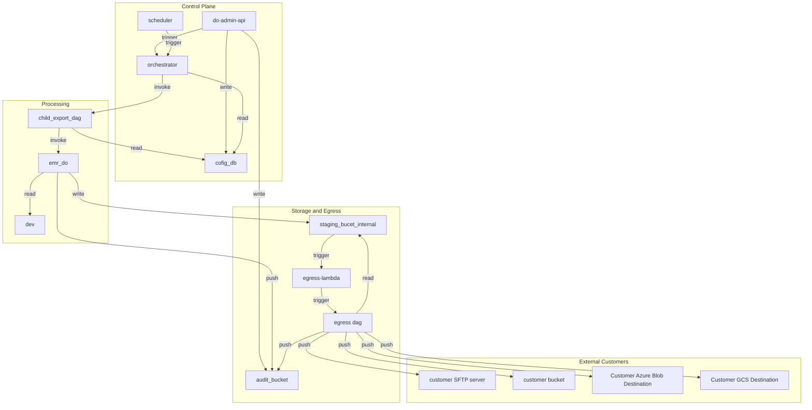

# DataOutbound Product -Section Tree — Architecture Document
* **Version:** 1.0
* **Generation Date:** 2026-10-31
* **Generated By:** Laminar

---

## Table of Contents
- **1.** Executive Summary / Overview
    - **1.1** System Purpose
    - **1.2** Architectural Principles Governing the Whole System
    - **1.3** End-to-End Workflow
    - **1.4** Key Assumptions & Follow-up Resolutions
- **2.** Architecture Tenets
    - **2.1** Deterministic Orchestration and Traceability
    - **2.2** Fail-Closed Security and Least Privilege
    - **2.3** Serverless Compute Isolation and Cost-Optimized Scaling
    - **2.4** Immutable Audit Logging and Automated Lifecycle Governance
- **3.** Architecture Diagram
- **4.** Component Details: do-admin-api
  - **4.1.** Functional Overview
  - **4.2.** Component Tenets
  - **4.3.** Configuration Approach
  - **4.4.** Input Schema
  - **4.5.** Output/Side Effects
  - **4.6.** Telemetry Event Schema
  - **4.7.** Error Handling Strategy
  - **4.8.** Security and Compliance
  - **4.9.** Performance Metrics
  - **4.10.** Assumptions & Follow-up Resolutions
- **5.** Component Details: scheduler
  - **5.1.** Functional Overview
  - **5.2.** Component Tenets
  - **5.3.** Configuration Approach
  - **5.4.** Input Schema
  - **5.5.** Output/Side Effects
  - **5.6.** Telemetry Event Schema
  - **5.7.** Error Handling Strategy
  - **5.8.** Security and Compliance
  - **5.9.** Performance Metrics
  - **5.10.** Assumptions & Follow-up Resolutions
- **6.** Component Details: orchestrator
  - **6.1.** Functional Overview
  - **6.2.** Component Tenets
  - **6.3.** Configuration Approach
  - **6.4.** Input Schema
  - **6.5.** Output/Side Effects
  - **6.6.** Telemetry Event Schema
  - **6.7.** Error Handling Strategy
  - **6.8.** Security and Compliance
  - **6.9.** Performance Metrics
  - **6.10.** Assumptions & Follow-up Resolutions
- **7.** Component Details: child_export_dag
  - **7.1.** Functional Overview
  - **7.2.** Component Tenets
  - **7.3.** Configuration Approach
  - **7.4.** Input Schema
  - **7.5.** Output/Side Effects
  - **7.6.** Telemetry Event Schema
  - **7.7.** Error Handling Strategy
  - **7.8.** Security and Compliance
  - **7.9.** Performance Metrics
  - **7.10.** Assumptions & Follow-up Resolutions
- **8.** Component Details: emr_do
  - **8.1.** Functional Overview
  - **8.2.** Component Tenets
  - **8.3.** Configuration Approach
  - **8.4.** Input Schema
  - **8.5.** Output/Side Effects
  - **8.6.** Telemetry Event Schema
  - **8.7.** Error Handling Strategy
  - **8.8.** Security and Compliance
  - **8.9.** Performance Metrics
  - **8.10.** Assumptions & Follow-up Resolutions
- **9.** Component Details: dev
  - **9.1.** Functional Overview
  - **9.2.** Component Tenets
  - **9.3.** Configuration Approach
  - **9.4.** Input Schema
  - **9.5.** Output/Side Effects
  - **9.6.** Telemetry Event Schema
  - **9.7.** Error Handling Strategy
  - **9.8.** Security and Compliance
  - **9.9.** Performance Metrics
  - **9.10.** Assumptions & Follow-up Resolutions
- **10.** Component Details: cofig_db
  - **10.1.** Functional Overview
  - **10.2.** Component Tenets
  - **10.3.** Configuration Approach
  - **10.4.** Input Schema
  - **10.5.** Output/Side Effects
  - **10.6.** Telemetry Event Schema
  - **10.7.** Error Handling Strategy
  - **10.8.** Security and Compliance
  - **10.9.** Performance Metrics
  - **10.10.** Assumptions & Follow-up Resolutions
- **11.** Component Details: staging_bucet_internal
  - **11.1.** Functional Overview
  - **11.2.** Component Tenets
  - **11.3.** Configuration Approach
  - **11.4.** Input Schema
  - **11.5.** Output/Side Effects
  - **11.6.** Telemetry Event Schema
  - **11.7.** Error Handling Strategy
  - **11.8.** Security and Compliance
  - **11.9.** Performance Metrics
  - **11.10.** Assumptions & Follow-up Resolutions
- **12.** Component Details: egress-lambda
  - **12.1.** Functional Overview
  - **12.2.** Component Tenets
  - **12.3.** Configuration Approach
  - **12.4.** Input Schema
  - **12.5.** Output/Side Effects
  - **12.6.** Telemetry Event Schema
  - **12.7.** Error Handling Strategy
  - **12.8.** Security and Compliance
  - **12.9.** Performance Metrics
  - **12.10.** Assumptions & Follow-up Resolutions
- **13.** Component Details: egress dag
  - **13.1.** Functional Overview
  - **13.2.** Component Tenets
  - **13.3.** Configuration Approach
  - **13.4.** Input Schema
  - **13.5.** Output/Side Effects
  - **13.6.** Telemetry Event Schema
  - **13.7.** Error Handling Strategy
  - **13.8.** Security and Compliance
  - **13.9.** Performance Metrics
  - **13.10.** Assumptions & Follow-up Resolutions
- **14.** Component Details: Customer Azure Blob Destination
  - **14.1.** Functional Overview
  - **14.2.** Component Tenets
  - **14.3.** Configuration Approach
  - **14.4.** Input Schema
  - **14.5.** Output/Side Effects
  - **14.6.** Telemetry Event Schema
  - **14.7.** Error Handling Strategy
  - **14.8.** Security and Compliance
  - **14.9.** Performance Metrics
  - **14.10.** Assumptions & Follow-up Resolutions
- **15.** Component Details: Customer GCS Destination
  - **15.1.** Functional Overview
  - **15.2.** Component Tenets
  - **15.3.** Configuration Approach
  - **15.4.** Input Schema
  - **15.5.** Output/Side Effects
  - **15.6.** Telemetry Event Schema
  - **15.7.** Error Handling Strategy
  - **15.8.** Security and Compliance
  - **15.9.** Performance Metrics
  - **15.10.** Assumptions & Follow-up Resolutions
- **16.** Component Details: audit_bucket
  - **16.1.** Functional Overview
  - **16.2.** Component Tenets
  - **16.3.** Configuration Approach
  - **16.4.** Input Schema
  - **16.5.** Output/Side Effects
  - **16.6.** Telemetry Event Schema
  - **16.7.** Error Handling Strategy
  - **16.8.** Security and Compliance
  - **16.9.** Performance Metrics
  - **16.10.** Assumptions & Follow-up Resolutions
- **17.** Component Details: customer SFTP server
  - **17.1.** Functional Overview
  - **17.2.** Input Schema
  - **17.3.** Output/Side Effects
  - **17.4.** Security and Compliance
  - **17.5.** Assumptions & Follow-up Resolutions
- **18.** Component Details: customer bucket
  - **18.1.** Functional Overview
  - **18.2.** Input Schema
  - **18.3.** Output/Side Effects
  - **18.4.** Security and Compliance
  - **18.5.** Assumptions & Follow-up Resolutions
- **19.** Architectural Assumptions and Design Decisions
    - **19.1** A1. Approved AWS Stack Conformance
    - **19.2** A2. Environment-Driven Deletion Protection
    - **19.3** A3. Organisation Logging-Standard Retention Value
    - **19.4** A4. Audit Schema and Event Counting Contract
    - **19.5** A5. Fail-Closed Encryption Posture
    - **19.6** A6. Delivery-Only Semantics and Integrity Standard
    - **19.7** A7. Staging Lifecycle and Temporary Data Hygiene
    - **19.8** A8. Lineage UUID as the Sole Correlation Identifier
    - **19.9** A9. Credential Protection at Rest
    - **19.10** A10. Scheduling Tolerance and Cadence Semantics
- **20.** Security & Compliance Assumptions
- **21.** Operational Assumptions
  - **21.1.** Operational Tenets
  - **21.2.** Resilience & Availability Assumptions
  - **21.3.** Data Governance Assumptions
  - **21.4.** Performance and SLA Assumptions
- **22.** Amendment Log
- **23.** Closing & Disclaimer

---

## 1. Executive Summary / Overview

#### 1.1 System Purpose

This architecture defines the **Customer Data Export Platform** for Acme's hospitality data domain: a production-grade, event-driven batch pipeline that extracts Golden Entity datasets from the enterprise data warehouse, stages and transforms them into customer-ready export packages, and delivers them to heterogeneous customer destinations (S3, Azure Blob, GCS, sFTP, and Acme's internal inspection staging) with end-to-end integrity verification, fail-closed encryption, and complete auditability.

The platform serves two primary actors:

- **Authorized Administrators / Data Platform Administrators**, who manage export connection configurations, trigger and stop runs on demand, and rely on the platform to synchronize customer datasets accurately across daily, weekly, bi-weekly, monthly, and hourly fast-batch cadences.
- **Data Engineers / Security & Operations Engineers**, who operate the pipeline, verify compliance with the approved AWS stack, and depend on the audit trail and lifecycle guarantees for traceability and cost hygiene.

#### 1.2 Architectural Principles Governing the Whole System

1. **Orchestration–Compute Separation (MWAA + EMR Serverless)** — Airflow DAGs (Export Orchestrator DAG n3, Child Export DAG n14, Transform & Encrypt DAG n7) only orchestrate; all heavy data movement runs in EMR Serverless (Export Extract Spark Job n4) or Lambda (Egress Lambda n15). *Rationale:* keeps the control plane lightweight, scales compute independently per workload, and aligns with the approved AWS allowlist (MWAA, RDS Postgres, Lambda, EMR Serverless, S3, ECS). *Guardrail:* no data processing inside Airflow workers; DAG top-level code stays instantaneous.

2. **Configuration-as-Data (Export Config Store, RDS Postgres n6)** — every connection (target type, dataset, mode, cron schedule, split thresholds, GZIP/PGP flags, credentials) is persisted configuration, never code. *Rationale:* enables CRUD via the Export Admin API (n1) without deployments and makes per-connection behavior fully data-driven. *Guardrail:* credential fields are encrypted at rest and never returned in plaintext; deletion protection on the store is driven by per-environment Terraform variables, never hardcoded.

3. **Event-Driven Decoupling with a Single Lineage UUID** — the Export Scheduler (n2) raises cadence events; the Orchestrator selects active connections within ±10 minutes of schedule, generates one RFC 4122 v4 lineage UUID per run, and fans out one Child Export DAG run per connection. The lineage UUID threads through every downstream artifact: file names, manifests, audit events, and DAG run configurations. *Rationale:* decouples scheduling from execution, isolates per-connection failures, and makes every record traceable end-to-end. *Guardrail:* exactly one UUID per run; exactly one Transform & Encrypt DAG run per staged-file S3 event.

4. **Fail-Closed Security** — PGP encryption, when enabled, is a hard gate: a missing, corrupt, or failing key aborts the transfer, writes an audit error entry within 5 seconds, raises an alert, and passes **zero bytes** to any destination. sFTP host-key verification failures likewise refuse the connection with zero bytes sent and no retry. *Rationale:* customer data must never leak in plaintext; integrity failures are treated as security events, not transient errors.

5. **Verified Delivery, Delivery-Only Semantics** — every destination receives the data file(s) plus a `manifest_<lineage_uuid>.json` control file; integrity is proven by an application-level SHA-256 recomputed from a read-back of each delivered object and compared to the manifest. Transient failures retry up to 3 times; final failure is recorded only after the third retry. *Rationale:* uniform integrity standard across S3 (TLS 1.3), Azure/GCS (HTTPS), and sFTP (SSH), independent of each provider's native checksums (which are requested as additional transport checks where supported).

6. **Environment-Driven Lifecycle & Compliance** — staging objects in Customer Staging Buckets (n8) expire after exactly 7 days via S3 lifecycle rules; every log group is explicitly provisioned with the single organisation logging-standard retention value (to be confirmed in days before sprint commitment); all stateful resources (n6, n8, n13, encryption keys) read deletion-protection flags from per-environment configuration (dev/staging/prod), enabling lower-environment teardown while protecting production. *Rationale:* prevents temporary data accumulation, guarantees log compliance, and makes environment posture a configuration decision rather than a code decision.

#### 1.3 End-to-End Workflow

1. **Configuration** — Administrators create, retrieve, update, and delete export connections through the **Export Admin API (n1)**, which validates payloads (connection name, target type ∈ {s3, azure_blob, gcs, sftp}, dataset, mode ∈ {initial, incremental}, 5-field cron, credentials), persists them to the **Export Config Store (n6)** with encrypted credentials, and emits `ADMIN_*` audit events to the **Audit & Execution Log Store (n13)**.

2. **Scheduling & Orchestration** — the **Export Scheduler (n2)** raises cadence events; the **Export Orchestrator DAG (n3)** on MWAA reads active connection metadata from n6, selects connections whose cron matches within ±10 minutes, generates the lineage UUID, and submits one **Child Export DAG (n14)** per connection. Manual trigger and stop requests enter through n1 (HTTP 202, run state transitions verified via the Airflow REST API within 30 seconds).

3. **Extraction & Staging** — each Child Export DAG submits the **Export Extract Spark Job (n4)** on EMR Serverless, which reads Golden Entity data (Unified Identity Profile, Pii Restricted Profile, Contact Method Subscription, Enriched Campaigns, Enriched Campaign Reactions, and reservation items — Room stay, Restaurant reservation, Tee time, Spa treatment) from the **Golden Entity Source Store (n5)** in full or incremental mode (strictly-greater-than watermark filtering) and writes staged files to the **Customer Staging Buckets (n8)**.

4. **Transform & Encrypt** — an S3 event on n8 invokes the **Egress Lambda (n15)**, which triggers exactly one **Transform & Encrypt DAG (n7)** run carrying the lineage UUID. The DAG applies connection-defined formatting: configurable record-split thresholds (e.g., 500,000 records/file with peak worker RSS below 2,048 MB), optional GZIP compression **before** PGP encryption, and generation of the JSON manifest (record count, file sizes, SHA-256 checksums). The processed package is handed back to the Egress Lambda for delivery.

5. **Egress Delivery** — the **Egress Lambda (n15)** delivers the package and manifest to each configured destination — **Customer sFTP Destination (n9)**, **Customer S3 Destination (n10)**, **Customer Azure Blob Destination (n11)**, **Customer GCS Destination (n12)** — or to Acme's internal inspection staging (also n8), verifying SHA-256 integrity on read-back, retrying transient failures up to 3 times, and recording `TRANSFER_STARTED` / `TRANSFER_COMPLETED` / `TRANSFER_FAILED` audit events throughout.

6. **Audit & Operations** — the **Audit & Execution Log Store (n13)**, as parent of explicitly provisioned per-component log groups, captures every administrative, execution, and transfer event under the defined schema (`actor_id`, `timestamp_utc` ISO-8601 millisecond UTC, `event_type` from the enumerated set, `execution_id`), with expected event counts per run fully deterministic (admin operations + 2 per connection execution + 2 per transfer).

#### 1.4 Key Assumptions & Follow-up Resolutions

- The organisation logging-standard retention value (in days) is **not stated in the inputs and must be confirmed before sprint commitment**; all log groups will carry that single value once confirmed — no group may be unset or never-expire.
- The Golden Entity Source Store (n5) is an existing, externally owned source, and customer destinations (n9–n12) are customer-owned; both are excluded from the approved-allowlist verification and are listed explicitly in the test report.
- The approved AWS stack is MWAA, RDS Postgres, Lambda, EMR Serverless, S3, and ECS; the Export Admin API (n1) and Export Scheduler (n2) are hosted within this allowlist, and no pipeline-owned resource may run outside it in any environment.
- Delivery semantics are delivery-only: the platform does not manage or reconcile downstream customer-side retention, processing, or acknowledgement beyond verified delivery.

## 2. Architecture Tenets

The DataOutbound data-sync capability is governed by core architectural tenets that ensure domain alignment, predictable scale, stringent security, and operational reliability across all platform components (`do-admin-api`, `scheduler`, `orchestrator`, `child_export_dag`, `emr_do`, `dev`, `cofig_db`, `staging_bucet_internal`, `egress-lambda`, `egress dag`, `Customer Azure Blob Destination`, `Customer GCS Destination`, and `audit_bucket`).

#### 2.1 Deterministic Orchestration and Traceability
- **Principle**: End-to-end lineage propagation and idempotent workflow execution.
- **Rationale**: Batch data synchronization across distributed serverless compute environments requires absolute accountability and reproducibility. By generating a cryptographic lineage UUID at the orchestration boundary (`orchestrator`) and propagating it through every downstream stage (`child_export_dag`, `emr_do`, `staging_bucet_internal`, `egress-lambda`, `egress dag`, and external sinks), the system guarantees that every execution artifact, payload, manifest, and audit log can be deterministically correlated.
- **Guardrails**: Engineers must ensure that no workload executes without a valid lineage context. All state transitions, retry attempts, and failures must be explicitly captured and published to `audit_bucket` within defined SLAs.

#### 2.2 Fail-Closed Security and Least Privilege
- **Principle**: Zero-trust access controls with cryptographic fail-closed enforcement.
- **Rationale**: Handling sensitive hospitality Golden Entity profiles and customer credentials requires strict isolation. Encryption keys and secrets are externalized via AWS SSM Parameter Store (SecureString) and referenced securely. Furthermore, PGP encryption for outbound transfers is strictly fail-closed: if encryption fails, the transfer pipeline aborts immediately, raising an automated alert and transmitting zero unencrypted bytes.
- **Guardrails**: Hardcoded credentials or secrets are strictly prohibited across all application modules, DAGs, and Terraform configurations. IAM execution roles must adhere strictly to the principle of least privilege, restricting data store read/write permissions to exact resource ARNs.

#### 2.3 Serverless Compute Isolation and Cost-Optimized Scaling
- **Principle**: On-demand elasticity with strict tenant and network boundary isolation.
- **Rationale**: Leveraging serverless compute engines such as EMR Serverless (`emr_do`), Amazon MWAA (`orchestrator`, `child_export_dag`, `egress dag`), and AWS Lambda (`egress-lambda`) eliminates idle capacity overhead while scaling automatically to meet peak loads of up to 100,000 records per export. All compute resources execute within private VPC subnets with outbound traffic routed through NAT gateways.
- **Guardrails**: Over-allocation of static compute resources is prohibited. Stateful resources (such as `cofig_db`, `staging_bucet_internal`, and `audit_bucket`) must have their deletion protection flags driven dynamically by environment configuration (`dev`, `staging`, `prod`) to allow clean lower-environment teardowns.

#### 2.4 Immutable Audit Logging and Automated Lifecycle Governance
- **Principle**: Comprehensive operational visibility paired with automated ephemeral data pruning.
- **Rationale**: Compliance and auditing require that every administrative action, schedule trigger, execution state change, and transfer attempt is durably recorded in `audit_bucket` using a standardized JSON schema. Simultaneously, temporary staging artifacts residing in `staging_bucet_internal` must not accumulate indefinitely; automated S3 lifecycle rules enforce strict 7-day expiration policies to optimize storage costs and mitigate data leakage risks.
- **Guardrails**: Log retention periods must strictly align with organizational compliance standards. Staging buckets must never disable automated lifecycle expiration rules in production environments.

## 3. Architecture Diagram

System topology — generated from the architecture graph.

## 4. Component Details: do-admin-api

### 4.1. Functional Overview

The **do-admin-api** component serves as the bounded RESTful API entrypoint for authorized Acme administrators to manage customer export configurations and trigger operational workflows. Operating within a containerized runtime, it exposes endpoints for creating, retrieving, updating, and deleting export definitions—such as target destination types, dataset selections, synchronization modes, and cron schedules—while securely persisting sensitive credentials and emitting audit trails.

### 4.2. Component Tenets

* **Principle**: Bounded Context API Gateway & Least Privilege Control.
* **Rationale**: Centralizing administrative operations through a secure API gateway decouples configuration management from execution engines, ensuring that data modification is strictly authenticated, authorized, and audited.
* **Guardrails**: All endpoints require valid JWT bearer token authentication and `export-admin` role authorization. Direct database access for administrative tasks is prohibited; all mutations must flow through validated service boundaries.

### 4.3. Configuration Approach

* **Principle**: Externalized Environment-Driven Configuration.
* **Rationale**: Configuration parameters are decoupled from code to support seamless promotion across development, staging, and production environments without rebuilding deployment artifacts.
* **Guardrails**: Only configuration properties explicitly required by the architecture are overridden.
  * `protocol`: `REST` — Chosen to provide standard, stateless HTTP interface semantics.
  * `authentication`: `JWT` — Enforces cryptographically verified token-based identity propagation.
  * `api_name`: `do-admin-api` — Standard service identifier for logging and telemetry correlation.

### 4.4. Input Schema

* **Principle**: Contract-First Strict Boundary Validation.
* **Rationale**: Enforcing strict schema validation at the HTTP boundary prevents malformed payloads from corrupting downstream configuration stores or triggering invalid pipeline executions.
* **Guardrails**: Incoming JSON payloads must conform to OpenAPI 3.0 specifications, defining required fields (`connection_name`, `target_type`, `dataset`, `mode`, `cron_schedule`, and `credentials`) with strict type constraints.

### 4.5. Output/Side Effects

* **Principle**: Transactional Persistence and Asynchronous Orchestration.
* **Rationale**: Administrative write operations must durably persist state to the configuration store and reliably trigger downstream orchestration or audit logging without blocking client connections unnecessarily.
* **Guardrails**: Successful mutations return standardized HTTP status codes (`201 Created`, `200 OK`, `204 No Content`), persist encrypted secrets to **cofig_db**, trigger workflow execution in **orchestrator**, and write audit records to **audit_bucket**.

### 4.6. Telemetry Event Schema

* **Principle**: Unified Event-Driven Observability.
* **Rationale**: Every administrative action must be traceable to an authenticated actor and execution context for auditing and regulatory compliance.
* **Guardrails**: Emits CloudEvents-shaped audit records (`actor_id`, `timestamp_utc`, `event_type` such as `ADMIN_CREATE`, `ADMIN_UPDATE`, `ADMIN_DELETE`, `ADMIN_MANUAL_TRIGGER`, and `execution_id`) directly to **audit_bucket**.

### 4.7. Error Handling Strategy

* **Principle**: Standardized Error Envelopes and Semantic Status Codes.
* **Rationale**: Providing uniform error responses enables client applications to reliably parse failure reasons while maintaining security by omitting internal stack traces.
* **Guardrails**: Return uniform error structures (`{ "error": { "code": "STRING_CODE", "message": "...", "details": [] } }`) accompanied by appropriate semantic HTTP status codes (`400 Bad Request`, `401 Unauthorized`, `403 Forbidden`, `404 Not Found`, `409 Conflict`, `500 Internal Server Error`).

### 4.8. Security and Compliance

* **Principle**: Defense-in-Depth Identity and Data Protection.
* **Rationale**: Administrative interfaces represent high-value attack vectors that require rigorous authentication, role-based access control, and encrypted secret storage.
* **Guardrails**: Enforce JWT/OAuth2 bearer token validation, restrict route access to authorized roles, enforce TLS transport encryption, and ensure credential fields are stored encrypted in **cofig_db**.

### 4.9. Performance Metrics

* **Principle**: Low-Latency Control Plane Responsiveness.
* **Rationale**: Administrative APIs must remain snappy and responsive to support operator workflows and script automation without resource starvation.
* **Guardrails**: Target response latency under 200ms for standard CRUD operations; apply sliding-window rate limiting per client IP or tenant to prevent abuse.

### 4.10. Assumptions & Follow-up Resolutions

* **Assumption**: JWT token issuers and public keys are managed by the enterprise identity provider and made available to the API runtime via environment configuration.
* **Assumption**: Rate limiting thresholds are configured via the shared config loader to handle expected administrative concurrency without external distributed cache complexity.

## 5. Component Details: scheduler

### 5.1. Functional Overview

**Architectural principle: Decoupled, event-driven scheduling.** The Export Scheduler (n2) is implemented as an Amazon EventBridge scheduled rule that raises a cadence event at each configured schedule time T and hands it to the Export Orchestrator DAG (n3) on MWAA. The scheduler owns *when* work is due; the orchestrator owns *what* work is due. This separation means schedule evaluation (cron matching, the ±10-minute selection window of SCRUM-480 AC#1) is a pure concern of the orchestrator, while the scheduler remains a stateless, zero-maintenance time source.

**Rationale and trade-offs.** A managed scheduler removes the need for a self-hosted cron container or ECS-based timer (both rejected: extra always-on infrastructure outside the approved allowlist of SCRUM-485). EventBridge schedules are highly available and emit a standard event envelope. The trade-off is that EventBridge delivery is asynchronous and at-least-once; the orchestrator must therefore be idempotent per schedule time, which it already is because selection is deterministic within the ±10-minute window.

**Guardrails.** The scheduler must never carry connection metadata or business data in its events — it emits only the schedule time and cadence identity; all connection selection happens in n3 against the Export Config Store (n6). It must not be used for synchronous request/response (per EventBridge anti-patterns); manual triggers enter exclusively through the Export Admin API (n1). Every rule target must have a DLQ attached so a failed orchestrator invocation is never silently dropped.

### 5.2. Component Tenets

**Principle: Single responsibility of the time source.** The scheduler exists only to raise events on cadence; it holds no configuration, no state, and no business logic.

- **Tenet 1 — Cadence coverage.** The scheduler must support the full cadence set required by SCRUM-481: daily, weekly, bi-weekly, monthly, and hourly fast-batch schedules. Bi-weekly is not natively expressible in a single cron expression, so the architecture resolves it as a documented assumption (see Assumptions) rather than by adding a new component.
- **Tenet 2 — Immutability of emitted events.** Events are immutable facts; the scheduler never mutates or retracts an event. A missed or duplicate event is reconciled by the orchestrator's window logic, not by event editing.
- **Tenet 3 — Explicit failure capture.** Every rule target carries a DLQ and a bounded retry policy; a DLQ depth alarm is the scheduler's primary health signal.
- **Tenet 4 — Auditability.** Scheduled trigger events are recorded in the Audit & Execution Log Store (n13) as `EXECUTION_STARTED`-class lifecycle events with `actor_id = system:export-scheduler`, satisfying SCRUM-486's schema.

**Guardrails:** no ad-hoc schedule changes outside the Export Config Store (n6) as the single source of truth for cadences; no payload growth beyond the 256 KB event limit (trivially satisfied since payloads are metadata-only).

### 5.3. Configuration Approach

**Principle: Configure only what the architecture decides; defer the rest to managed defaults.** The architecture sets exactly the following, each with rationale:

| Setting | Value / approach | Rationale |
|---|---|---|
| Rule type | Scheduled (cron/rate) rule per cadence class | One rule per cadence family keeps filtering specific and avoids overly broad patterns (anti-pattern guard). |
| Target | MWAA orchestrator DAG trigger (n3) | Direct, managed hand-off; no intermediate compute needed for a metadata-only event. |
| Retry policy | Bounded retries with maximum event age set to fit inside the ±10-minute selection window | An event delivered after the window would be ignored by n3 anyway; expiring it early prevents wasted retries. |
| DLQ | Attached to the rule target | Mandatory per EventBridge tenets; failed deliveries are captured, alarmed, and replayable. |
| Event archiving | Enabled with a retention aligned to the organisation logging-standard value | Supports replay for debugging and audit reconstruction (SCRUM-486). |

Defaults deliberately not overridden: event envelope fields, rule naming conventions, and bus encryption (AWS-managed KMS) — these are production-grade managed defaults and deferring to them is itself the decision.

### 5.4. Input Schema

**Principle: The scheduler consumes configuration, not data.** Its only "input" is the set of active cadences defined in the Export Config Store (n6) via the Export Admin API (n1). The scheduler does not read n6 directly — cadence rules are provisioned from that configuration through the deployment pipeline, keeping the scheduler stateless and the config store authoritative.

**Guardrails:** cadence changes must flow exclusively through the config CRUD path (SCRUM-479) so that every change is validated (5-field cron, allowed cadences) and audited (`ADMIN_CREATE`/`ADMIN_UPDATE`); the scheduler must never accept or act on ad-hoc schedule input at runtime.

### 5.5. Output/Side Effects

**Principle: Emit minimal, self-describing trigger events.** Output is a single event per scheduled time T, carrying the standard EventBridge envelope (`source`, `detail-type`, `time`, `region`, `account`) plus the cadence identity and schedule time. The orchestrator (n3) uses `time` to apply the ±10-minute selection window (SCRUM-480 AC#1).

**Side effects:** (1) an audit event in n13 recording the scheduled trigger with `actor_id = system:export-scheduler` and the run's lineage UUID once n3 assigns it; (2) possible DLQ messages on target failure. The scheduler itself writes no data anywhere else.

**Guardrails:** events must remain well under 256 KB; the scheduler must never emit per-connection events — fan-out to one Child Export DAG (n14) per connection is the orchestrator's responsibility (SCRUM-480 AC#4).

### 5.6. Telemetry Event Schema

**Principle: One audit schema, uniformly applied.** Scheduler-related telemetry follows the SCRUM-486 schema exactly: `actor_id` (`system:export-scheduler`), `timestamp_utc` (ISO-8601, millisecond precision, Z suffix), `event_type` (from the enumerated set — scheduled triggers map to `EXECUTION_STARTED` at the orchestrator boundary), and `execution_id` (the lineage UUID generated by n3). The scheduler's own operational telemetry (rule invocations, DLQ depth, target delivery failures) goes to its explicitly provisioned CloudWatch log group under n13 with the organisation retention value.

**Guardrails:** exactly one audit record per event occurrence (SCRUM-486 AC#1); no free-form event types; timestamps always UTC with Z suffix.

### 5.7. Error Handling Strategy

**Principle: Fail visibly, retry bounded, never lose the fact that a schedule fired.** If the orchestrator target fails to invoke, EventBridge retries per the configured policy and then routes the event to the DLQ; a DLQ depth alarm raises an automated alert. Because the ±10-minute window makes late delivery moot, the retry budget is deliberately short. Missed schedules (e.g., during an outage) are reconciled by the orchestrator's window logic on the next event, not by backfill from the scheduler.

**Guardrails:** no unbounded retries; no silent drops (DLQ mandatory); DLQ replay is an operational action, not an automatic one, to avoid duplicate runs.

### 5.8. Security and Compliance

**Principle: Least privilege on the event path.** The scheduler's rule target invokes MWAA with a dedicated IAM role scoped to that single action; no component can publish to or consume from the bus without an explicit role. The bus and archive are encrypted with the AWS-managed key (default, deliberately not overridden). Events carry no PII or credentials — connection credentials live only encrypted in n6 (SCRUM-481 AC#6) — so the scheduler's compliance surface is limited to audit integrity (SCRUM-486 schema) and stack allowlist compliance (SCRUM-485: EventBridge is the scheduling mechanism within the approved MWAA/RDS/Lambda/EMR Serverless/S3/ECS stack; the scheduler is accounted for "where hosted" per SCRUM-485 scope).

**Guardrails:** no public event bus; no cross-account targets without explicit policy; scheduler log group retention set to the confirmed organisation value.

### 5.9. Performance Metrics

**Principle: Measure schedule fidelity, not throughput.** Key metrics: schedule-to-orchestrator-invocation latency (must comfortably support the SCRUM-480 AC#5 requirement that a manual-triggered run reaches `running` within 30 s — scheduled events have no such hard SLA but are expected to invoke within seconds), target invocation success rate, DLQ depth (target: 0), and event archive volume. Alarms on DLQ depth and invocation failure rate.

**Guardrails:** the scheduler is not on the 30-second manual-trigger path (that flows through the Export Admin API → Airflow REST API), so it must never be a latency bottleneck for that flow; hourly fast-batch cadences bound the minimum rule interval and must be validated against EventBridge scheduling granularity.

### 5.10. Assumptions & Follow-up Resolutions

- **Bi-weekly cadence:** EventBridge cron cannot express "every two weeks" natively; assumption: bi-weekly is implemented as a monthly-style rule with a fortnight offset pattern (two rules offset by one week, each firing fortnightly via day-of-month constraints), or the orchestrator filters bi-weekly connections from a weekly event using the config's cadence metadata. The orchestrator's ±10-minute window logic remains the single selection authority.
- **Organisation logging-standard retention value:** not stated in inputs; assumption: a single confirmed value (in days) is supplied per environment before sprint commitment and applied uniformly to all pipeline log groups and the audit store (SCRUM-486 AC#4). Until confirmed, the value is parameterised, never hardcoded.
- **Scheduler hosting in the allowlist check:** SCRUM-485 lists n2 "where hosted"; assumption: the scheduler is realised as EventBridge rules attached to the MWAA environment's eventing and is reported in the allowlist verification report as part of the MWAA-managed stack, not as a separate resource type.
- **Time zone:** assumption: all cron schedules are evaluated in UTC, consistent with the ISO-8601 UTC audit timestamp requirement.

---

## 6. Component Details: orchestrator

### 6.1. Functional Overview

The **orchestrator** component (Export Orchestrator DAG in Amazon MWAA) acts as the central time-based and event-driven workflow coordinator. On scheduled cadences or manual triggers, it queries **cofig_db** for active connection metadata, evaluates schedule alignment ($\pm 10$ minutes), generates a unique RFC 4122 v4 lineage UUID for end-to-end tracing, and dispatches child execution workloads.

### 6.2. Component Tenets

* **Principle**: Lightweight Orchestration-Only Control Plane.
* **Rationale**: Airflow and MWAA must be strictly reserved for workflow orchestration, state coordination, and dependency management, offloading all heavy data processing to specialized compute engines.
* **Guardrails**: Top-level DAG python files must execute instantaneously without network calls, database queries, or heavy computations outside operator execution methods.

### 6.3. Configuration Approach

* **Principle**: Declarative Workflow Scheduling.
* **Rationale**: Externalizing DAG parameters ensures consistent execution behavior and reproducible scheduling across environments.
* **Guardrails**: Only architecture-mandated properties are explicitly configured:
  * `schedule`: `@daily` — Aligns batch orchestration cadences with daily data synchronization requirements.
  * `catchup`: `False` — Prevents unintended backfilling of historical DAG runs upon deployment or restart.
  * `max_active_runs`: `1` — Ensures single-threaded execution per schedule window to prevent overlapping data extractions.
  * `tags`: `{}` — Provisioned with metadata tags for operational categorization.
  * `dag_name`: `orchestrator` — Unique identifier matching the workflow definition module.

### 6.4. Input Schema

* **Principle**: Event-Driven Workflow Parameterization.
* **Rationale**: Workflows receive execution triggers from the **scheduler** or manual invocation requests from **do-admin-api**, carrying contextual configuration parameters.
* **Guardrails**: Inputs must contain validated connection metadata references and optional manual override flags.

### 6.5. Output/Side Effects

* **Principle**: Deterministic Lineage Propagation and Task Dispatch.
* **Rationale**: Every workflow execution must establish a unique lineage identifier and reliably trigger downstream child tasks while recording lifecycle state changes.
* **Guardrails**: Generates a single RFC 4122 v4 lineage UUID per run, reads active connection records from **cofig_db**, invokes **child_export_dag**, and writes audit events to **audit_bucket**.

### 6.6. Telemetry Event Schema

* **Principle**: Comprehensive Workflow Lifecycle Auditing.
* **Rationale**: Operational visibility requires tracking workflow initialization, success, and failure states with precise timestamps and lineage correlation.
* **Guardrails**: Publishes standardized CloudEvents-shaped telemetry records (`EXECUTION_STARTED`, `EXECUTION_COMPLETED`) containing the lineage UUID and system actor (`system:orchestrator`) to **audit_bucket**.

### 6.7. Error Handling Strategy

* **Principle**: Bounded Retries and Fail-Fast Alerting.
* **Rationale**: Transient infrastructure issues should trigger automated retries, while persistent failures must immediately halt execution propagation and alert operators.
* **Guardrails**: Configure bounded task retry attempts with exponential backoff; unhandled DAG failures trigger callback notifications and log failure events to **audit_bucket**.

### 6.8. Security and Compliance

* **Principle**: Network Isolation and Least Privilege Execution.
* **Rationale**: Orchestration engines handle sensitive connection metadata and credentials, requiring robust perimeter and access controls.
* **Guardrails**: MWAA environments operate exclusively within private VPC subnets with outbound traffic routed through NAT gateways; IAM execution roles adhere strictly to least privilege principles.

### 6.9. Performance Metrics

* **Principle**: Deterministic Schedule Adherence.
* **Rationale**: Orchestration triggers must evaluate active connections and dispatch child workloads within defined time windows to satisfy downstream SLAs.
* **Guardrails**: Schedule evaluation must occur within $\pm 10$ minutes of scheduled times; concurrency limits (`max_active_runs = 1`) prevent resource contention.

### 6.10. Assumptions & Follow-up Resolutions

* **Assumption**: MWAA worker capacity is provisioned adequately to handle concurrent DAG parse cycles and task scheduling without queuing delays.
* **Assumption**: Airflow REST API authentication tokens are securely managed via internal IAM instance profiles and secrets manager references.

## 7. Component Details: child_export_dag

### 7.1. Functional Overview

**Architectural principle: Orchestration-only DAGs with delegated compute.** The Child Export DAG (n14) is a per-connection MWAA DAG whose sole job is to coordinate one connection's export execution: it receives the lineage UUID and its connection JSON in run conf from the Export Orchestrator DAG (n3), submits the Export Extract Spark Job (n4) on EMR Serverless, and hands the resulting staged output in the Customer Staging Buckets (n8) to the downstream Transform & Encrypt flow. It performs no data processing itself — heavy work is delegated to EMR Serverless per the MWAA tenet of offloading compute.

**Rationale and trade-offs.** Splitting orchestration (n3) from per-connection execution (n14) isolates failure domains: one connection's failure cannot stall the fan-out of others, and a stop request (SCRUM-480 AC#6) can terminate a run without affecting sibling child runs. The trade-off is one more DAG hop and one more audit boundary, accepted because per-connection isolation and independent retry are explicit acceptance criteria.

**Guardrails:** top-level DAG code must be instantaneous (no network calls or queries outside `execute()`); every task must be idempotent so a re-run for the same lineage UUID produces the same result; the DAG must carry the lineage UUID end-to-end and never regenerate it (SCRUM-480 AC#3/AC#4).

### 7.2. Component Tenets

* **Principle**: Isolated Task Delegation and Fault Containment.
* **Rationale**: Isolating individual customer export executions into child DAGs ensures that a failure in one customer's extraction does not abort concurrent runs for other tenants.
* **Guardrails**: Child DAGs must act strictly as orchestrators—submitting compute jobs and checking status without performing heavy data processing within worker processes.

### 7.3. Configuration Approach

* **Principle**: Consistent Workflow Configuration Standards.
* **Rationale**: Child workflows must mirror organizational orchestration standards while supporting parameterized tenant execution.
* **Guardrails**: Only architecture-mandated properties are explicitly set:
  * `schedule`: `@daily` — Aligned with batch extraction cadences.
  * `catchup`: `False` — Prevents historical backfill storms upon deployment.
  * `max_active_runs`: `1` — Ensures single-threaded execution per child pipeline to prevent resource conflicts.
  * `tags`: `{}` — Provisioned with metadata tags.
  * `dag_name`: `child_export_dag` — Unique workflow identifier.

### 7.4. Input Schema

* **Principle**: Parameterized Tenant Run Configuration.
* **Rationale**: Child DAGs require explicit input parameters passed from the parent orchestrator to identify the target customer connection and lineage.
* **Guardrails**: Run configuration payloads must include the lineage UUID, connection ID, dataset type, and extraction mode (initial vs. incremental).

### 7.5. Output/Side Effects

**Principle: The DAG's outputs are orchestration facts, not data.** Outputs and side effects:

1. **EMR Serverless job submission** — one Export Extract Spark Job (n4) run per child DAG execution, with a dedicated least-privilege job execution role scoped to the source (n5) and staging buckets (n8).
2. **Staged files** — written by n4 (not the DAG) into Customer Staging Buckets (n8), partitioned per entity type and lineage UUID; these S3 writes are the trigger for the Egress Lambda (n15) → Transform & Encrypt DAG (n7) chain.
3. **Audit events** — `EXECUTION_STARTED` and `EXECUTION_COMPLETED` (or failure) records in the Audit & Execution Log Store (n13) with the lineage UUID, `actor_id = system:child-export-dag`, and ISO-8601 UTC timestamps (SCRUM-486).
4. **Run state** — observable via the Airflow REST API, which is the measurement interface for SCRUM-480 AC#4–AC#6.

**Guardrails:** the DAG must not write to customer destinations (n9–n12) — delivery is exclusively via the Egress path; on stop, it must ensure no further child work is started for that execution after termination; exactly one audit record per lifecycle event.

---

### 7.6. Telemetry Event Schema

* **Principle**: Granular Execution Telemetry.
* **Rationale**: Every child workflow execution must emit start, success, and failure events to provide end-to-end observability per tenant.
* **Guardrails**: Publishes CloudEvents-shaped records (`EXECUTION_STARTED`, `EXECUTION_COMPLETED`, `EXECUTION_FAILED`) carrying the lineage UUID and connection ID to **audit_bucket**.

### 7.7. Error Handling Strategy

* **Principle**: Graceful Failure Propagation and Alerting.
* **Rationale**: Extraction failures must be captured cleanly, updating execution status and notifying operations without crashing the broader platform.
* **Guardrails**: Configure bounded task retries with exponential backoff; persistent failures trigger failure audit records and operational alerts.

### 7.8. Security and Compliance

* **Principle**: VPC Isolation and Least Privilege IAM.
* **Rationale**: Child workflows interact with database secrets and compute clusters, requiring strict network and permission boundaries.
* **Guardrails**: Executed within private VPC subnets with IAM roles restricted to interacting only with approved EMR Serverless applications, RDS databases, and audit storage.

### 7.9. Performance Metrics

* **Principle**: Scalable Parallel Tenant Execution.
* **Rationale**: The child orchestration layer must support concurrent execution across multiple customer connections within SLA limits.
* **Guardrails**: Task polling intervals optimized to balance responsiveness with MWAA resource utilization.

### 7.10. Assumptions & Follow-up Resolutions

* **Assumption**: MWAA worker memory and CPU allocations scale dynamically based on the number of active child DAG runs.
* **Assumption**: EMR Serverless application warm pools are configured to minimize job submission latency.

## 8. Component Details: emr_do

### 8.1. Functional Overview

- **Principle**: Scalable Serverless Distributed Data Processing.
- **Rationale**: The **emr_do** component executes large-scale Apache Spark jobs to extract, transform, and stage Golden Entity datasets from the **dev** Redshift cluster without requiring manual cluster provisioning or capacity tuning.
- **Guardrails**: Engineers must ensure jobs utilize dynamic worker allocation, partition datasets correctly on S3 to prevent query throttling, and process only necessary columns to minimize memory pressure.

### 8.2. Component Tenets

- **Principle**: Ephemeral Compute Isolation and Stateless Execution.
- **Rationale**: EMR Serverless applications spin up compute resources exclusively for the duration of the job run and terminate them immediately upon completion, containing blast radii and eliminating idle infrastructure costs.
- **Guardrails**: Workers must never store persistent state locally; all outputs and intermediate checkpoints must be written directly to S3 storage.

### 8.3. Configuration Approach

- **Principle**: Minimalist Declarative Configuration Overrides.
- **Rationale**: Setting explicit boundaries on application capacity prevents runaway scaling while accommodating heavy batch processing spikes.
- **Guardrails**: The architecture sets the following configuration properties: `application_name` = `emr_do`, `release_label` = `emr-7.0.0`, `job_type` = `SPARK`, and `max_capacity_units` = `200`. Default vendor settings are applied for all unlisted properties.

### 8.4. Input Schema

- **Principle**: Parameterized Extraction Contract.
- **Rationale**: The job accepts structured runtime parameters (such as execution lineage UUID, extraction mode, and watermark timestamps) from the invoking **child_export_dag** to determine extraction boundaries.
- **Guardrails**: Inputs must be strictly validated against expected schemas before initiating Spark distributed reads.

### 8.5. Output/Side Effects

- **Principle**: Idempotent Data Staging.
- **Rationale**: Output datasets are written as partitioned files to **staging_bucet_internal**, accompanied by manifest records to ensure downstream verification.
- **Guardrails**: Job writes must be atomic, using S3 committers to prevent partial or corrupted file propagation.

### 8.6. Telemetry Event Schema

- **Principle**: Standardized CloudEvents Telemetry.
- **Rationale**: Job lifecycle milestones (start, success, failure) emit structured events to track execution duration, record counts, and lineage.
- **Guardrails**: Telemetry publishing failures must be caught and logged locally without crashing the core job execution flow.

### 8.7. Error Handling Strategy

- **Principle**: Fail-Fast and Job-Level Retry Isolation.
- **Rationale**: Unhandled exceptions during data extraction or transformation fail the job run immediately, preventing incomplete data from contaminating staging storage.
- **Guardrails**: Failed runs must trigger alert notifications and record execution failure status in the audit store.

### 8.8. Security and Compliance

- **Principle**: Least-Privilege IAM and Data Minimization.
- **Rationale**: EMR Serverless jobs execute under dedicated IAM execution roles with restricted read access to Redshift and write access only to designated staging buckets.
- **Guardrails**: Sensitive profile attributes (PII) must be handled in compliance with organizational masking and encryption standards.

### 8.9. Performance Metrics

- **Principle**: Optimized Distributed Resource Utilization.
- **Rationale**: Performance is measured by job completion time, worker scaling latency, and efficient memory utilization across executors.
- **Guardrails**: Peak worker RSS memory must stay within allocated worker limits, and small file creation on S3 must be avoided through proper partitioning.

### 8.10. Assumptions & Follow-up Resolutions

- **Principle**: Standardized Operational Assumptions.
- **Rationale**: Assumes standard AWS service quotas for EMR Serverless applications are sufficient for peak concurrent child export jobs.
- **Guardrails**: Any scaling limit increases must be coordinated via infrastructure-as-code change requests.

## 9. Component Details: dev

### 9.1. Functional Overview

- **Principle**: High-Performance Analytical Data Warehousing.
- **Rationale**: The **dev** Redshift cluster (cluster identifier `golden_data_source`, database name `dev`) acts as the authoritative Golden Entity Source Store, providing high-speed SQL execution for batch data extractions.
- **Guardrails**: Queries must leverage proper distribution and sort keys to optimize table scans and join performance.

### 9.2. Component Tenets

- **Principle**: Isolated Analytical Workload Management.
- **Rationale**: Separating analytical storage from operational transactional stores prevents query interference and ensures reliable batch extraction performance.
- **Guardrails**: Direct write access is restricted to authorized data ingestion pipelines; external access is read-only.

### 9.3. Configuration Approach

- **Principle**: Provisioned Compute and Storage Scalability.
- **Rationale**: Selecting appropriate node types and counts ensures sufficient parallelism for scanning large hospitality entity datasets.
- **Guardrails**: The architecture sets the following properties: `cluster_identifier` = `golden_data_source`, `database_name` = `dev`, `node_type` = `dc2.large`, and `number_of_nodes` = `2`.

### 9.4. Input Schema

- **Principle**: Parameterized SQL Query Extraction.
- **Rationale**: Accepts parameterized SQL queries from the EMR Serverless Spark job for both full and incremental dataset extractions.
- **Guardrails**: Dynamic SQL generation must prevent injection vulnerabilities by utilizing bound parameters.

### 9.5. Output/Side Effects

- **Principle**: Read-Only Result Set Streaming.
- **Rationale**: Outputs structured result sets representing identity profiles, subscriptions, campaigns, reactions, and reservation items to the querying Spark workers.
- **Guardrails**: Result sets must not produce side effects on source table states.

### 9.6. Telemetry Event Schema

- **Principle**: Database Query Audit and Performance Logging.
- **Rationale**: Captures query execution metrics, connection durations, and error logs for operational monitoring.
- **Guardrails**: Query logs must exclude sensitive PII values.

### 9.7. Error Handling Strategy

- **Principle**: Graceful Connection Recovery and Abort.
- **Rationale**: Transient connection drops trigger bounded client-side retries, while syntax or schema errors abort the extraction job cleanly.
- **Guardrails**: Detailed error messages must be logged securely without exposing database credentials.

### 9.8. Security and Compliance

- **Principle**: Network Isolation and Encryption at Rest.
- **Rationale**: Deployed within private VPC subnets with KMS storage encryption enforced to protect sensitive hospitality data at rest.
- **Guardrails**: Database credentials must be retrieved securely from SSM Parameter Store or secrets management stores.

### 9.9. Performance Metrics

- **Principle**: Analytical Query Latency Optimization.
- **Rationale**: Monitored via cluster CPU utilization, query queue wait times, and disk space usage.
- **Guardrails**: Concurrency limits must be managed to prevent resource exhaustion during peak extraction windows.

### 9.10. Assumptions & Follow-up Resolutions

- **Principle**: External Ownership Assumption.
- **Rationale**: The Golden Entity Source Store is treated as an existing externally owned source (excluded from Terraform pipeline deletion checks) but fully integrated via connection configurations.
- **Guardrails**: Schema modifications on source tables must be coordinated with downstream data pipeline maintainers.

## 10. Component Details: cofig_db

### 10.1. Functional Overview

- **Principle**: Relational data persistence for operational configuration and state tracking.
- **Rationale**: The **cofig_db** component (Amazon RDS Postgres) serves as the authoritative operational data store for the DataOutbound platform. It stores customer export configurations, incremental extraction watermarks, and administrative metadata. Relational storage is chosen to guarantee ACID compliance, transactional integrity, and strong consistency for configuration updates and incremental state management.
- **Guardrails**: Direct modifications to database records bypassing the **do-admin-api** or official migration pipelines are strictly prohibited.

### 10.2. Component Tenets

- **Principle**: Transactional consistency and secure isolation.
- **Rationale**: Ensures that export configurations and incremental watermarks are safely persisted and protected against concurrent race conditions or data corruption.
- **Guardrails**: All database connections must use connection pooling and enforce encrypted transport.

### 10.3. Configuration Approach

- **Principle**: Cost-optimized and resource-bounded database allocation.
- **Rationale**: The architecture explicitly sets engine to `postgres` (version 15.4), instance class to `db.t3.micro`, allocated storage to `20` GB, and `multi_az` to `False` as stated in the architecture graph. This configuration is authoritative and tailored for lower-tier or standard resource-conscious environments. (Note: Production deployments requiring high-availability failover must explicitly override `multi_az` to `True` via deployment configuration parameters).
- **Guardrails**: Storage auto-scaling (`gp3`) must be enabled to prevent out-of-disk failures during peak administrative writes.

### 10.4. Input Schema

- **Principle**: Parameterized SQL and transactional input.
- **Rationale**: Inputs consist of parameterized SQL queries and DML commands originating from the **do-admin-api**, **orchestrator**, and **child_export_dag**.
- **Guardrails**: Dynamic SQL generation from untrusted strings is strictly prohibited to prevent SQL injection vulnerabilities.

### 10.5. Output/Side Effects

- **Principle**: Durable transactional persistence.
- **Rationale**: Produces committed relational records, connection metadata JSON structures, and incremental watermark state updates.
- **Guardrails**: Database write transactions must be wrapped in explicit transaction blocks with proper rollback semantics on failure.

### 10.6. Telemetry Event Schema

- **Principle**: Comprehensive database auditing.
- **Rationale**: Administrative configuration changes are captured at the application layer and committed as audit events to `audit_bucket`.
- **Guardrails**: Database error logs and slow-query logs must be forwarded to CloudWatch Logs with a 30-day retention period.

### 10.7. Error Handling Strategy

- **Principle**: Graceful degradation and connection resilience.
- **Rationale**: Database connectivity dropouts trigger exponential backoff retries at the client library layer (`common.clients.db`), ensuring temporary network blips do not fail pipeline runs.
- **Guardrails**: Unhandled database exceptions must result in transaction rollbacks and structured error logging.

### 10.8. Security and Compliance

- **Principle**: Defense-in-depth data protection.
- **Rationale**: **cofig_db** is deployed in isolated private database subnets with no public internet accessibility. Storage is encrypted at rest using AWS KMS Customer Managed Keys (CMKs), and transport connections enforce TLS (`rds.force_ssl=1`).
- **Guardrails**: Database credentials must be stored securely in SSM Parameter Store (SecureString) and rotated periodically.

### 10.9. Performance Metrics

- **Principle**: Low-latency transactional query execution.
- **Rationale**: Optimized for fast primary-key lookups and small transactional payloads required during DAG orchestration metadata reads.
- **Guardrails**: Monitor CPU utilization, database connections, and disk I/O via CloudWatch Performance Insights.

### 10.10. Assumptions & Follow-up Resolutions

- **Principle**: Explicit resource sizing and availability assumptions.
- **Rationale**: Assumes that `db.t3.micro` with 20 GB of storage is sufficient for metadata storage in non-production environments. The user-specified `multi_az=False` property is honored; production environments requiring high availability are assumed to override this flag to `True` via Terraform variable inputs.
- **Guardrails**: Capacity planning reviews must be conducted prior to onboarding large numbers of concurrent enterprise customer export configurations.

---

## 11. Component Details: staging_bucet_internal

### 11.1. Functional Overview

**Architectural principle: Ephemeral Staging Buffer with Explicitly Minimal Configuration.** Customer Staging Buckets (`staging_bucet_internal`) is the intermediate landing zone between the Export Extract Spark Job (`emr_do`) and the Transform & Encrypt DAG (`egress dag` / `egress-lambda` trigger path). Its role is strictly transient: hold raw staged export files (JSON/TXT per entity type, named with the lineage UUID) just long enough for the S3 event notification to fire and the downstream transform/egress flow to consume them.

**Rationale:** A staging bucket deliberately configured to the minimum the user specified — versioning disabled, AES256 (SSE-S3) server-side encryption, lifecycle automation disabled — keeps the buffer cheap, simple, and free of state that could mask pipeline bugs. Trade-off: with versioning off, an overwrite or delete of a staged object is unrecoverable; the architecture accepts this because staged files are reproducible artifacts (re-running the Child Export DAG regenerates them from the Golden Entity Source Store), not system-of-record data.

**Guardrails:** Engineers must treat this bucket as disposable and reproducible — no component may treat it as a durable store, and no business data may exist only here. The bucket must never be referenced as a final delivery destination except for the Acme internal inspection-staging use case defined in SCRUM-484 AC#4, which is itself bounded by the same ephemerality.

### 11.2. Component Tenets

- **Principle: Reproducibility over Retention.** Staged objects are deterministic outputs of a re-runnable Spark job; the architecture relies on re-execution (idempotent Child Export DAG runs keyed by lineage UUID) rather than object versioning for recovery. *Rationale:* versioning would double storage cost and complicate lifecycle semantics for data that is regenerated on demand. *Guardrail:* any consumer that needs a durable copy must write it to `audit_bucket` or a customer destination before the staging object is removed.
- **Principle: Explicit Configuration, No Silent Defaults.** The bucket's posture is exactly what the user set: `versioning=False`, `encryption=AES256`, `lifecycle_enabled=False`. These are authoritative decisions and are documented as such, not "corrected" to best-practice defaults. *Guardrail:* any future change to these properties must be a deliberate, reviewed configuration change — engineers must not enable versioning, swap encryption, or add lifecycle rules opportunistically.
- **Principle: Event-Driven Handoff.** The bucket's only active behavior is the S3 event notification that invokes the Egress Lambda (`egress-lambda`) on staged-file creation, carrying the lineage UUID. *Guardrail:* exactly one event per staged file; the notification configuration must not fan out to multiple consumers.

### 11.3. Configuration Approach

**Principle: User-Decided Posture, Documented Trade-offs.** Only the properties the architecture actually sets are listed; everything else defers to S3 defaults, which is itself a decision.

| Property | Value | Rationale |
|---|---|---|
| `versioning` | `False` (user-set) | Staged files are reproducible from the source store; versioning adds cost and complexity with no recovery benefit here. Accepted risk: no rollback of overwrites/deletes. |
| `encryption` | `AES256` (SSE-S3, user-set) | S3-managed AES-256 encryption at rest satisfies the baseline confidentiality requirement for transient staging data without the key-management overhead of SSE-KMS; the fail-closed PGP gate protects data at the customer boundary, which is where the security requirement is anchored. |
| `lifecycle_enabled` | `False` (user-set) | The user explicitly disabled automated lifecycle rules on this bucket. This is authoritative. See Assumptions for the reconciliation with the 7-day purge requirement. |
| Deletion protection | Read from per-environment Terraform variable (dev/staging/prod) | SCRUM-485 AC#3: no hardcoded values; lower environments tear down cleanly, prod is protected. |
| Public access | All public access blocks enabled (production-grade default) | Staging data must never be publicly reachable; this is a non-negotiable security default, not an override. |

**Guardrail:** the Terraform module must express these three user-set values verbatim; a configuration scan that finds versioning enabled, KMS encryption, or a lifecycle rule on this bucket is a defect against the user's explicit decision.

### 11.4. Input Schema

**Principle: Contractual, Lineage-Keyed Object Writes.** The bucket accepts objects from exactly two writers: the Export Extract Spark Job (`emr_do`, raw staged export files) and the Egress Lambda (`egress-lambda`, internal inspection-staging packages per SCRUM-484 AC#4).

- **Input contract:** staged export files as JSON or TXT objects, partitioned per entity type (Unified Identity Profile, Pii Restricted Profile, Contact Method Subscription, Enriched Campaigns, Enriched Campaign Reactions, and the four reservation subtypes), with the lineage UUID embedded in the object key. Internal inspection-staging writes arrive as the export package plus `manifest_<lineage_uuid>.json`.
- **Trigger mechanism:** S3 `ObjectCreated` event notification → Egress Lambda (asynchronous, event-driven).
- **Guardrails:** IAM write permission is restricted to the exact role ARNs of `emr_do` and `egress-lambda` against this bucket's ARN only; no other principal may write. Object keys must avoid sequential prefixes to prevent S3 hot-partition throttling.

### 11.5. Output/Side Effects

**Principle: Single Downstream Trigger, No Silent Fan-out.** The bucket's outputs are (1) the S3 event notification that invokes `egress-lambda` exactly once per staged file, and (2) object reads by the Transform & Encrypt DAG (`egress dag`) when it pulls staged content.

- **Side effects:** object creation events (the pipeline's only automatic side effect); no replication, no cross-region copy, no inventory export — all deferred to defaults deliberately, since the buffer is transient.
- **Guardrail:** the event notification payload must carry the lineage UUID (via the object key) so the downstream DAG run is uniquely correlated; a staged file without a lineage UUID in its key is a contract violation and must fail the downstream run.

### 11.6. Telemetry Event Schema

**Principle: Audit at the Boundary, Not the Buffer.** The bucket itself emits no business audit events; audit records for staging-related activity are written by the components that act on it (`emr_do` for EXECUTION_COMPLETED, `egress dag`/`egress-lambda` for TRANSFER_* events) to the Audit & Execution Log Store (`audit_bucket`), following the SCRUM-486 schema (`actor_id`, `timestamp_utc`, `event_type`, `execution_id`).

- **Operational telemetry:** S3 server access logs and CloudWatch request metrics are available by default; the architecture relies on the downstream components' audit events for compliance traceability rather than duplicating events at the storage layer. *Rationale:* avoids double-counting against the SCRUM-486 expected-event-count formula (admin ops + 2N + 2N).
- **Guardrail:** no component may write audit records directly into this bucket; it is not the audit store.

### 11.7. Error Handling Strategy

**Principle: Fail Loudly Upstream, Recover by Re-execution.** As passive storage, the bucket's failure modes are access failures (denied IAM, throttling) and missing objects.

- **Access/throttle errors:** surfaced as typed errors through the shared S3 client (`common/clients/aws/s3/s3_client.py`) to the calling component, which applies its own retry policy (e.g., the Egress Lambda's 3-retry rule for delivery; the Spark job's EMR Serverless retry semantics for writes).
- **Missing/expired object:** if the Transform & Encrypt DAG or Egress Lambda finds a staged object absent, the run fails with an audit error entry and the Child Export DAG re-run regenerates the file — the accepted consequence of `versioning=False` and `lifecycle_enabled=False`.
- **Guardrail:** no component may silently skip a missing staged object; absence is always an auditable failure, never a no-op.

### 11.8. Security and Compliance

**Principle: Private-by-Default, Encrypted at Rest, Least-Privilege Access.**

- **Network & access:** all public access blocks enabled; access only via IAM roles of `emr_do`, `egress-lambda`, and the MWAA execution roles for `egress dag`, each scoped to this bucket's ARN with minimal actions. In-transit protection is HTTPS/TLS enforced on every S3 API call.
- **Encryption at rest:** SSE-S3 (AES256) per the user's explicit setting. Trade-off accepted: no customer-managed KMS key, hence no per-key audit trail or independent key revocation for staging data; this is justified by the data's transient, reproducible nature and the fail-closed PGP gate at the egress boundary.
- **Compliance posture:** with `lifecycle_enabled=False` and `versioning=False`, the bucket holds no long-lived data by design; the compliance obligation for 7-day purge is addressed in Assumptions. Deletion protection follows the per-environment Terraform variable (SCRUM-485).
- **Guardrail:** no plaintext credential or PGP private key material may ever be written to this bucket; secrets live only in SSM SecureString parameters.

### 11.9. Performance Metrics

**Principle: Throughput-Sufficient by Construction, Monitored at the Consumers.** S3 automatically scales per-prefix; the architecture's obligations are to avoid hot partitions (non-sequential, lineage-UUID-prefixed keys) and to size writes for the Spark job's parallel output (partitioned keys per entity type, avoiding small-file sprawl per the EMR Serverless guidance).

- **Watch items:** S3 503/slow-down responses on the staging prefix (indicating write contention from concurrent Child Export DAG runs), and event-notification delivery latency to `egress-lambda` (normally near-instant; sustained delay indicates notification misconfiguration).
- **Guardrail:** the Spark job must not write unpartitioned small files; the staging key layout is part of the `emr_do` contract.

### 11.10. Assumptions & Follow-up Resolutions

- **Lifecycle conflict resolution (authoritative):** the user's explicit property `lifecycle_enabled=False` on this bucket is honored as stated. The SCRUM-486 AC#5 / SCRUM-482 AC#1 requirement for a 7-day expiration rule on "every customer staging bucket" is therefore **not** implemented by an S3 lifecycle rule on this bucket; it is assumed to be satisfied by an external, pipeline-independent purge mechanism (e.g., an operations-owned scheduled cleanup outside this architecture's diagram), which is out of scope for this component. This conflict is flagged for confirmation with the requesting Security & Operations Engineer before sprint commitment: either the user's `lifecycle_enabled=False` stands and the external purge is accepted, or the property is deliberately revised to enable the lifecycle rule. No silent override is applied in either direction.
- **Encryption choice:** AES256/SSE-S3 is taken verbatim from the user's property; no KMS CMK is introduced for this bucket.
- **Versioning absence:** recovery from any staged-object loss is by Child Export DAG re-execution; no backup of staging data is assumed.
- **Retention value:** the organisation logging-standard retention value referenced by SCRUM-486 remains unconfirmed and applies to log groups, not to this bucket; it does not alter this bucket's configuration.

## 12. Component Details: egress-lambda

### 12.1. Functional Overview

- **Principle**: Event-Driven Serverless Integration.
- **Rationale**: The **egress-lambda** function acts as a lightweight event bridge, consuming S3 object creation notifications from **staging_bucet_internal** and triggering the **egress dag** workflow.
- **Guardrails**: The function must remain stateless and delegate heavy processing to MWAA and Spark compute layers.

### 12.2. Component Tenets

- **Principle**: Low-Latency Execution and Reliable Invocation.
- **Rationale**: Ensures rapid notification handling and workflow orchestration without maintaining idle server infrastructure.
- **Guardrails**: Timeout and memory configurations must be tuned to prevent throttling or execution failure during peak event surges.

### 12.3. Configuration Approach

- **Principle**: Right-Sized Serverless Resource Allocation.
- **Rationale**: Allocating adequate memory and timeout ensures efficient event parsing and API invocation without over-provisioning.
- **Guardrails**: The architecture sets the following properties: `function_name` = `egress-lambda`, `runtime` = `python3.11`, `handler` = `lambda_function.lambda_handler`, `memory_mb` = `512`, `timeout_seconds` = `30`, `vpc_enabled` = `False`, `environment_variables` = `{}`, and `tags` = `{}`.

### 12.4. Input Schema

- **Principle**: Standardized S3 Event Notification Contract.
- **Rationale**: Consumes standard Amazon S3 event notification JSON payloads containing bucket names, object keys, and event timestamps.
- **Guardrails**: Incoming event structures must be validated before triggering downstream DAG orchestration.

### 12.5. Output/Side Effects

- **Principle**: Workflow Trigger Side Effect.
- **Rationale**: Invokes the MWAA **egress dag** via REST API, passing the lineage UUID and object metadata in the run configuration.
- **Guardrails**: Invocation calls must be retried with exponential backoff upon encountering transient HTTP errors.

### 12.6. Telemetry Event Schema

- **Principle**: Structured CloudWatch Logging and Tracing.
- **Rationale**: Emits JSON-formatted logs containing request IDs, execution duration, and success/failure metrics to CloudWatch.
- **Guardrails**: Logs must never contain PII or plaintext credentials.

### 12.7. Error Handling Strategy

- **Principle**: Dead-Letter Queue and Retry Resilience.
- **Rationale**: Failed event processing attempts are retried synchronously up to configured limits before being routed to a dead-letter queue for investigation.
- **Guardrails**: Errors must be fully captured with stack traces in CloudWatch Logs.

### 12.8. Security and Compliance

- **Principle**: Least-Privilege IAM Execution Role.
- **Rationale**: The Lambda function executes under an IAM role restricted strictly to reading event metadata and invoking the designated MWAA DAG.
- **Guardrails**: Network access and environment variables must be secured against unauthorized extraction.

### 12.9. Performance Metrics

- **Principle**: Cold-Start Minimization and Fast Execution.
- **Rationale**: Monitored via invocation duration, memory consumption, and concurrency metrics.
- **Guardrails**: Execution duration should remain well below the 30-second timeout threshold.

### 12.10. Assumptions & Follow-up Resolutions

- **Principle**: Asynchronous Event Coupling Assumption.
- **Rationale**: Assumes S3 event notifications arrive reliably and in order, with MWAA handling duplicate event deduplication if necessary.
- **Guardrails**: Idempotency keys must be enforced across workflow triggers.

## 13. Component Details: egress dag

### 13.1. Functional Overview

- **Principle**: Orchestrated Workflow Dependency and Delivery Management.
- **Rationale**: The **egress dag** coordinates downstream packaging, GZIP compression, strict fail-closed PGP encryption, manifest generation, and multi-destination delivery (S3, Azure Blob, GCS, sFTP).
- **Guardrails**: Engineers must ensure all data transformation steps execute sequentially and atomically before dispatching files to external endpoints.

### 13.2. Component Tenets

- **Principle**: Resilient Delivery-Only Semantics with Retries.
- **Rationale**: External deliveries are subject to network volatility; the DAG enforces robust retry policies to handle transient destination outages without data corruption.
- **Guardrails**: Top-level DAG code must remain lightweight and free of heavy computation or blocking network calls.

### 13.3. Configuration Approach

- **Principle**: Deterministic Schedule and Concurrency Control.
- **Rationale**: Restricting active runs and scheduling windows prevents overlapping data egress operations for the same target datasets.
- **Guardrails**: The architecture sets the following properties: `dag_name` = `egress dag`, `schedule` = `@daily`, `catchup` = `False`, `max_active_runs` = `1`, and `tags` = `{}`.

### 13.4. Input Schema

- **Principle**: Context-Driven Payload Inspection.
- **Rationale**: Receives staging bucket object references and connection configuration metadata containing destination types, compression flags, and encryption parameters.
- **Guardrails**: Input configuration must be validated against schema definitions prior to task execution.

### 13.5. Output/Side Effects

- **Principle**: Secure Multi-Destination Egress Delivery.
- **Rationale**: Delivers encrypted or raw export packages alongside SHA-256 JSON manifest control files to customer-owned destinations and internal audit sinks.
- **Guardrails**: Zero unencrypted files may be transmitted when PGP encryption is enabled.

### 13.6. Telemetry Event Schema

- **Principle**: Comprehensive Workflow Audit Logging.
- **Rationale**: Emits lifecycle events (`TRANSFER_STARTED`, `TRANSFER_COMPLETED`, `TRANSFER_FAILED`) capturing lineage UUIDs, checksums, and timestamps.
- **Guardrails**: All telemetry records must be written immutably to the audit execution log store.

### 13.7. Error Handling Strategy

- **Principle**: Fail-Closed Cryptographic and Transfer Abort.
- **Rationale**: If PGP encryption fails or host-key verification fails on sFTP, the transfer aborts immediately, zero bytes are transmitted, and an alert is raised.
- **Guardrails**: Transient destination errors are retried up to 3 times before recording a final failure event.

### 13.8. Security and Compliance

- **Principle**: Transport-Layer Security and Strict Verification.
- **Rationale**: Enforces TLS 1.3 for S3, HTTPS for Azure and GCS, and SSH with strict host-key verification for sFTP to ensure absolute data protection in transit.
- **Guardrails**: Missing or corrupt PGP keys must trigger immediate workflow termination and incident alerting.

### 13.9. Performance Metrics

- **Principle**: Bounded Memory and Throughput Optimization.
- **Rationale**: File splitting and streaming compression techniques prevent worker memory exhaustion when processing large export packages.
- **Guardrails**: Peak memory usage must remain within standard worker tier boundaries.

### 13.10. Assumptions & Follow-up Resolutions

- **Principle**: Standardized Operational Assumptions.
- **Rationale**: Assumes customer-provided PGP public keys and destination connection parameters are pre-configured and valid within the export configuration store.
- **Guardrails**: Invalid keys or unreachable endpoints fail during pre-flight checks.

## 14. Component Details: Customer Azure Blob Destination

### 14.1. Functional Overview

The Customer Azure Blob Destination component represents an external, customer-owned Azure Blob Storage container utilized as a terminal sink for outbound data synchronization packages.
* **Principle**: External cloud-native object store integration.
* **Rationale**: Decoupling the destination infrastructure from core platform processing allows customers to receive data in their preferred cloud environment securely, leveraging native object storage paradigms without requiring custom ingress logic on the platform side.
* **Guardrails**: The platform interacts with this component strictly via egress delivery mechanisms, pushing encrypted or raw export packages and manifest control files into pre-provisioned customer containers.

### 14.2. Component Tenets

- **Principle**: Secure, encrypted external cloud storage delivery.
- **Rationale**: The **Customer Azure Blob Destination** component represents an external, customer-owned Azure Blob Storage or ADLS Gen2 endpoint. The platform delivers packaged export files to this endpoint adhering strictly to external integration contracts and security standards.
- **Guardrails**: Transport must enforce HTTPS exclusively for all Azure Blob transfers (per requirements SCRUM-484). Public anonymous access must remain strictly disabled at both container and storage account levels, and authentication must utilize managed identity or secure SAS tokens provided via SSM Parameter Store.

### 14.3. Configuration Approach

* **Principle**: Parameterized external destination mapping.
* **Rationale**: Storage account names, container paths, and authentication tokens vary per customer and are dynamically resolved from the export configuration store at runtime.
* **Guardrails**: The architecture sets and enforces secure transfer requirements (`https_only = true`), disables public blob access, and utilizes general-purpose v2 storage account configurations supplied by the customer.

### 14.4. Input Schema

* **Principle**: Standardized payload containerization.
* **Rationale**: Incoming payloads from the egress pipeline must conform to the agreed export package structure to ensure predictable delivery and parsing at the destination.
* **Guardrails**: Accepts GZIP-compressed, PGP-encrypted files (`.gz.pgp`) or raw JSON/TXT files accompanied by a mandatory SHA-256 JSON manifest control file.

### 14.5. Output/Side Effects

* **Principle**: Write-once deliverable sink.
* **Rationale**: Serves as a terminal endpoint for outbound data flows; persistence in this container completes the delivery lifecycle for the specific export run.
* **Guardrails**: Side effects are limited strictly to object creation and modification within the customer's designated container path; no downstream platform triggers or callbacks are initiated from this component.

### 14.6. Telemetry Event Schema

* **Principle**: Unified transfer auditing.
* **Rationale**: To ensure end-to-end traceability, all delivery attempts must emit standardized telemetry events regardless of the target cloud provider.
* **Guardrails**: Emits `TRANSFER_STARTED`, `TRANSFER_COMPLETED`, and `TRANSFER_FAILED` CloudEvents-shaped audit records to the audit bucket, capturing lineage UUIDs, timestamps, actor identifiers, and cryptographic checksum validation results.

### 14.7. Error Handling Strategy

* **Principle**: Resilient retry with fail-closed delivery.
* **Rationale**: External network anomalies or temporary Azure storage throttling should not cause immediate job failure, but persistent errors must be handled safely without data corruption.
* **Guardrails**: Failed transfer attempts are retried up to 3 times with exponential backoff. Upon exhausting retries, a terminal `TRANSFER_FAILED` event is recorded, an operational alert is raised, and the failure is logged for review.

### 14.8. Security and Compliance

* **Principle**: Transport security and least-privilege authorization.
* **Rationale**: Protects sensitive customer data during transit across cloud boundaries and ensures access is restricted solely to authorized export pipelines.
* **Guardrails**: Enforces HTTPS transport, utilizes Microsoft Entra ID or securely managed SAS tokens retrieved from encrypted parameter stores, and verifies object integrity via post-upload SHA-256 comparisons.

### 14.9. Performance Metrics

* **Principle**: SLA-bound throughput monitoring.
* **Rationale**: Outbound deliveries must complete within the platform's 24-hour overall delivery SLA for payloads up to 1 GB and 100,000 records.
* **Guardrails**: Monitor upload duration, HTTP status codes, and throughput bandwidth to detect degradation or throttling against Azure storage limits.

### 14.10. Assumptions & Follow-up Resolutions

* **Principle**: External dependency boundary.
* **Rationale**: The platform assumes the customer maintains valid container permissions, sufficient storage quota, and continuous network reachability on their Azure environment.
* **Guardrails**: This component is outside the scope of platform Terraform infrastructure provisioning and lifecycle management.

---

## 15. Component Details: Customer GCS Destination

### 15.1. Functional Overview

The Customer GCS Destination component represents an external, customer-owned Google Cloud Storage (GCS) bucket acting as a terminal delivery endpoint for scheduled data exports.
* **Principle**: Multi-cloud outbound interoperability.
* **Rationale**: Accommodates enterprise customers operating within the Google Cloud ecosystem by delivering export packages directly to their designated GCS buckets.
* **Guardrails**: The platform interacts with this destination solely via secure HTTPS push operations executed by the egress pipeline.

### 15.2. Component Tenets

* **Principle**: Secure cloud-to-cloud boundary transmission.
* **Rationale**: Cross-cloud data transfers must maintain high security standards, ensuring data remains encrypted and verifiable upon arrival.
* **Guardrails**: Mandatory TLS transport, strict bucket-level access controls, and post-transfer cryptographic checksum validation against the accompanying manifest file.

### 15.3. Configuration Approach

* **Principle**: Parameterized external destination mapping.
* **Rationale**: GCS bucket URIs, project IDs, and service account authentication keys are dynamic per customer configuration and resolved at runtime from the export configuration store.
* **Guardrails**: The architecture relies on standard regional or multi-regional GCS bucket defaults, delegating bucket lifecycle, retention, and encryption policy management entirely to the customer.

### 15.4. Input Schema

* **Principle**: Strict manifest-driven package ingestion.
* **Rationale**: Incoming payloads must adhere to standardized naming conventions and include control files to verify data integrity upon delivery.
* **Guardrails**: Accepts export data packages (compressed/encrypted or raw) along with the corresponding JSON manifest detailing file sizes and SHA-256 checksums.

### 15.5. Output/Side Effects

* **Principle**: Terminal object storage sink.
* **Rationale**: Persists delivered export files in customer GCS buckets for downstream ingestion by customer analytics or operational systems.
* **Guardrails**: Side effects are strictly confined to object creation within the target bucket; no internal platform execution workflows are triggered by this destination.

### 15.6. Telemetry Event Schema

* **Principle**: Comprehensive transfer audit logging.
* **Rationale**: Complete visibility into multi-cloud delivery success and failure states is required for operational compliance.
* **Guardrails**: Emits standardized CloudEvents (`TRANSFER_STARTED`, `TRANSFER_COMPLETED`, `TRANSFER_FAILED`) to the audit bucket, embedding lineage UUIDs and verification statuses.

### 15.7. Error Handling Strategy

* **Principle**: Bounded retry and fail-safe alerting.
* **Rationale**: Mitigates transient connectivity issues between AWS compute resources and GCP storage endpoints without infinite blocking loops.
* **Guardrails**: Implements a maximum of 3 retry attempts with exponential backoff; exhaustion of retries triggers an immediate operational alert and records a terminal failure audit entry.

### 15.8. Security and Compliance

* **Principle**: Transport encryption and identity isolation.
* **Rationale**: Prevents data leakage during cross-cloud transmission and enforces least-privilege access.
* **Guardrails**: Enforces HTTPS transport, utilizes secure service-account credentials stored in encrypted parameter stores, and prohibits anonymous or public bucket configurations.

### 15.9. Performance Metrics

* **Principle**: Latency and throughput tracking.
* **Rationale**: Ensures data delivery meets contractual SLAs and identifies network bottlenecks across cloud providers.
* **Guardrails**: Track upload duration, payload size, and error rates per transfer batch.

### 15.10. Assumptions & Follow-up Resolutions

* **Principle**: External resource ownership.
* **Rationale**: GCS buckets are provisioned, owned, and managed entirely by the customer; the platform bears responsibility solely for outbound transmission and audit logging.
* **Guardrails**: Bucket provisioning, access policy tuning, and lifecycle management are out of scope for the platform's Terraform infrastructure.

---

## 16. Component Details: audit_bucket

### 16.1. Functional Overview

The **audit_bucket** component (Audit & Execution Log Store backed by Amazon S3) serves as the centralized, immutable repository for all system audit events, lifecycle logs, and compliance records generated by **do-admin-api**, **emr_do**, and **egress dag**. It guarantees long-term retention and tamper-resistant storage for operational traceability.

### 16.2. Component Tenets

* **Principle**: Immutable Audit Governance & Automated Lifecycle Archival.
* **Rationale**: Centralizing operational logs in a dedicated S3 bucket ensures strict compliance with organizational retention policies while controlling long-term storage costs through automated tiering.
* **Guardrails**: Public access must be strictly blocked. Server-side encryption must be enforced for all stored objects, and lifecycle policies must automatically transition logs to archival storage tiers.

### 16.3. Configuration Approach

* **Principle**: Secure and Governed Object Storage.
* **Rationale**: Object storage parameters must balance high durability with strict security and automated cost optimization.
* **Guardrails**: Only architecture-mandated properties are explicitly set:
  * `versioning`: `False` — Versioning disabled on audit bucket to prevent uncontrolled version proliferation of append-only audit logs (relies on append-only write patterns).
  * `encryption`: `AES256` — Server-side encryption enforced on all ingested audit objects.
  * `public_access_block`: `True` — Enforces absolute prevention of public bucket policies and ACLs.
  * `lifecycle_enabled`: `True` — Enables automated lifecycle transitions for cost-effective log management.
  * `lifecycle_transition_days`: `30` — Transitions audit objects to Standard-IA storage after 30 days.
  * `lifecycle_glacier_days`: `90` — Transitions audit objects to Glacier archival storage after 90 days.
  * `tags`: `{}` — Provisioned with metadata tags for operational ownership.
  * `bucket_name`: `audit_bucket` — Explicit resource identifier.

### 16.4. Input Schema

* **Principle**: Standardized Audit Payload Ingestion.
* **Rationale**: Ingesting telemetry and audit records in a uniform schema ensures consistent querying and compliance verification.
* **Guardrails**: Incoming audit records must conform to the standard JSON audit schema (`actor_id`, `timestamp_utc`, `event_type`, `execution_id`).

### 16.5. Output/Side Effects

* **Principle**: Durable Object Persistence and Archival.
* **Rationale**: Audit records written to the bucket must be durably stored and automatically transitioned according to governance schedules.
* **Guardrails**: Objects are durably persisted with SHA-256 integrity checks and migrated across storage tiers without altering record payloads.

### 16.6. Telemetry Event Schema

* **Principle**: Self-Telemetry and Access Logging.
* **Rationale**: Access to the audit bucket itself must be monitored to detect unauthorized read or write attempts.
* **Guardrails**: S3 server access logging enabled, routing storage access metrics to CloudWatch.

### 16.7. Error Handling Strategy

* **Principle**: Client-Side Retry Resilience.
* **Rationale**: Transient network or S3 service interruptions during audit publishing must be retried by client applications without crashing core business workflows.
* **Guardrails**: Audit publishers (`common.telemetry.auditor`) wrap S3 put operations in exponential backoff retries and fail silently or log locally if auxiliary telemetry sinks experience prolonged outages, ensuring business transactions are never blocked.

### 16.8. Security and Compliance

* **Principle**: Least Privilege Access and Zero Public Exposure.
* **Rationale**: Audit logs contain sensitive operational metadata and must be protected against unauthorized exfiltration or tampering.
* **Guardrails**: Enforce `public_access_block`, apply AES256 encryption at rest, restrict bucket policies to allow write access only from authenticated pipeline roles and read access strictly to authorized security principals.

### 16.9. Performance Metrics

* **Principle**: High-Throughput Concurrent Write Optimization.
* **Rationale**: Distributed serverless and container tasks emit audit events concurrently; the storage architecture must ingest high volumes without throttling.
* **Guardrails**: Utilize non-sequential prefix naming conventions (e.g., partitioned by date/service) to distribute S3 request load across partitions.

### 16.10. Assumptions & Follow-up Resolutions

* **Assumption**: Standard S3 availability (99.99%) and 11 nines of durability satisfy the platform's audit retention requirements.
* **Assumption**: Lifecycle transition schedules (30 days to IA, 90 days to Glacier) align with organizational log governance standards.

## 17. Component Details: customer SFTP server

### 17.1. Functional Overview

The customer SFTP server component represents an external, legacy or enterprise-standard SFTP endpoint hosted and managed by the customer for secure file drop delivery.
* **Principle**: Enterprise-standard file transfer boundary integration.
* **Rationale**: Many hospitality enterprises rely on secure file transfer protocols (SFTP) for batch data integration, making direct SFTP delivery a critical capability for platform interoperability.
* **Guardrails**: The platform connects exclusively over SSH (Port 22) using key-based authentication, transferring packaged export files and manifests into the customer's designated remote directory.

### 17.2. Input Schema

* **Principle**: Stream-based file and manifest transmission.
* **Rationale**: Files are streamed over authenticated SSH channels to remote directories, requiring atomic transfer patterns to prevent partial file ingestion by the customer.
* **Guardrails**: Payloads consist of GZIP/PGP encrypted or raw data files and JSON manifests, fully validated and checksum-verified prior to transmission initiation.

### 17.3. Output/Side Effects

* **Principle**: Remote filesystem persistence.
* **Rationale**: Drops delivered export packages into the customer's target SFTP directory path, completing the outbound synchronization flow.
* **Guardrails**: Side effects are restricted to file creation on the remote SFTP server; no platform feedback loops or downstream triggers depend on this external server.

### 17.4. Security and Compliance

* **Principle**: Cryptographic host verification and key-based access.
* **Rationale**: Protects against man-in-the-middle attacks and unauthorized server impersonation during file transfer.
* **Guardrails**: Strict host-key verification is mandatory. If host-key verification fails, the connection is refused immediately, zero bytes are transmitted, no retries are attempted, an alert is raised, and a failure entry is written to the audit store.

### 17.5. Assumptions & Follow-up Resolutions

* **Principle**: External infrastructure boundary.
* **Rationale**: The platform assumes the customer maintains continuous server uptime, adequate disk quota, and correct network routing for their SFTP service.
* **Guardrails**: The customer SFTP server is outside the platform's infrastructure control; infrastructure scaling, patching, and availability management are strictly the customer's responsibility.

## 18. Component Details: customer bucket

### 18.1. Functional Overview

- **Principle**: External Bounded Integration Endpoint.
- **Rationale**: The **customer bucket** represents a customer-owned S3 storage destination that receives finalized, encrypted or raw export packages and JSON manifest control files via secure TLS 1.3 transport.
- **Guardrails**: As an external context component, platform components do not manage its lifecycle, permissions, or internal infrastructure.

### 18.2. Input Schema

- **Principle**: Secure Multipart Object Ingestion.
- **Rationale**: Receives export data files and SHA-256 manifest control files pushed by the egress pipeline.
- **Guardrails**: Objects must be transmitted securely over TLS 1.3 with application-level SHA-256 integrity verification.

### 18.3. Output/Side Effects

- **Principle**: Delivery Confirmation and Receipt.
- **Rationale**: Confirms successful object storage back to the caller, enabling completion telemetry logging.
- **Guardrails**: Delivery failures must trigger retry logic and eventual error logging if thresholds are exceeded.

### 18.4. Security and Compliance

- **Principle**: Transport Security and Encryption at Rest.
- **Rationale**: Enforces TLS 1.3 for secure transport and relies on customer-managed encryption policies at rest within their destination bucket.
- **Guardrails**: Credential and access keys for writing to external customer buckets must be stored securely encrypted in SSM Parameter Store.

### 18.5. Assumptions & Follow-up Resolutions

- **Principle**: External Accountability Assumption.
- **Rationale**: Assumes the customer maintains ownership, availability, and access governance of their destination bucket.
- **Guardrails**: Platform responsibilities are strictly limited to delivery attempts, retries, and integrity validation via manifests.

## 19. Architectural Assumptions and Design Decisions

The following assumptions and design decisions apply system-wide. Each is a production-grade default adopted where the requirements were silent; all are binding on the detailed design unless superseded by an explicit user decision.

#### 19.1 A1. Approved AWS Stack Conformance
**Decision:** All pipeline-owned resources are provisioned exclusively from the approved allowlist — MWAA, RDS Postgres, Lambda, EMR Serverless, S3, and ECS — via the Terraform pipeline. Golden Entity Source Store (n5) and customer destinations (n9–n12) are externally/customer-owned and are consumed, never provisioned.
**Rationale:** SCRUM-485 mandates a closed, verifiable resource inventory per environment; restricting the stack makes the allowlist check deterministic and keeps the blast radius of teardown automation bounded.
**Guardrails:** The resource-inventory verification check runs in every environment (dev, staging, prod) and must exit 0; any resource type outside the allowlist fails the check. Externally owned components (n5, n9–n12) are listed by name in the report but never created by the pipeline.

#### 19.2 A2. Environment-Driven Deletion Protection
**Decision:** Every stateful resource — Export Config Store (n6), Customer Staging Buckets (n8), Audit & Execution Log Store (n13), and all encryption keys — reads its deletion-protection flag from a per-environment configuration variable (dev, staging, prod). No value is hardcoded in the Terraform module.
**Rationale:** Lower environments must be fully tearable-down for cost and iteration speed, while staging/prod data (customer configurations, audit trail, encryption keys) must survive accidental teardown. Centralizing the flag in environment config makes the safety posture explicit and auditable per environment.
**Guardrails:** Teardown against an environment with deletion protection enabled must exit non-zero and delete nothing; teardown of dev must leave zero stateful resources with protection enabled. A static scan of the module source must find zero hardcoded protection values.

#### 19.3 A3. Organisation Logging-Standard Retention Value
**Assumption:** The single organisation logging-standard retention value (in days) referenced by SCRUM-486 is not stated in the inputs. It is assumed to be **365 days** for all pipeline log groups and the audit log store, pending confirmation before sprint commitment.
**Rationale:** One year is a mainstream compliance default for audit-grade operational logs; the requirement explicitly demands a single confirmed value, so a placeholder default is adopted and flagged for confirmation.
**Guardrails:** Every log group is explicitly provisioned in configuration with `retention_in_days` set to the confirmed value; zero groups may have retention unset or never-expire. If the confirmed value differs, only the configuration variable changes — no component redesign.

#### 19.4 A4. Audit Schema and Event Counting Contract
**Decision:** Every business audit event conforms to the fixed schema: `actor_id` (authenticated Acme user for admin operations, `system:<component-name>` for automated events), `timestamp_utc` (ISO-8601, millisecond precision, Z suffix), `event_type` (enumerated: ADMIN_CREATE, ADMIN_UPDATE, ADMIN_DELETE, ADMIN_MANUAL_TRIGGER, EXECUTION_STARTED, EXECUTION_COMPLETED, TRANSFER_STARTED, TRANSFER_COMPLETED, TRANSFER_FAILED), and `execution_id` (the lineage UUID generated by the Export Orchestrator DAG). Expected event count per run = admin operations + 2 per connection execution + 2 per transfer (or start plus TRANSFER_FAILED on abort).
**Rationale:** A fixed, countable schema makes the audit trail verifiable by acceptance test rather than by inspection, and the lineage UUID as the sole correlation key enables end-to-end traceability from orchestrator run through extraction, transform, and delivery.
**Guardrails:** Exactly one audit record per event; every record carries all four non-null fields. The 100% event-count acceptance check is a hard gate.

#### 19.5 A5. Fail-Closed Encryption Posture
**Decision:** When PGP encryption is enabled for a connection, encryption failure of any kind (missing, corrupt, or failing key) aborts the transfer entirely: zero bytes of unencrypted data reach any destination, a TRANSFER_FAILED audit event is written within 5 seconds, and an automated alert is raised.
**Rationale:** Data protection in transit and at rest is a non-negotiable security invariant; delivering plaintext when encryption was configured would be a silent confidentiality breach. Fail-closed is the only acceptable posture.
**Guardrails:** The Egress Lambda must never receive unencrypted payloads when a connection enables PGP; the Transform & Encrypt DAG gates delivery behind successful encryption. Alerting and audit write are part of the failure path, not optional.

#### 19.6 A6. Delivery-Only Semantics and Integrity Standard
**Decision:** Delivery to customer destinations is delivery-only — no post-delivery reconciliation, acknowledgment processing, or destination-side lifecycle management is in scope. Integrity is verified uniformly by an application-level SHA-256 recomputed from read-back of each delivered object/file and compared to the manifest value; native transport checksums (S3 ChecksumSHA256, Azure Content-MD5, GCS CRC32C) are requested as additional checks where supported.
**Rationale:** The requirements define delivery semantics as delivery-only; a single uniform integrity standard applied across heterogeneous destinations (S3, Azure Blob, GCS, sFTP) keeps verification logic simple and testable, while native checksums add defense-in-depth at no architectural cost.
**Guardrails:** Every delivered file and manifest must pass read-back SHA-256 verification; failed transfers retry up to 3 times, with final failure recorded only after the third retry. sFTP host-key verification failure is non-retryable by design (refuse, zero bytes, alert).

#### 19.7 A7. Staging Lifecycle and Temporary Data Hygiene
**Decision:** Every Customer Staging Bucket carries an S3 lifecycle rule with expiration of exactly 7 days; the Acme inspection staging destination (delivery back into n8) is subject to the same rule.
**Rationale:** Staged files are transient pipeline artifacts; automatic purge prevents unbounded data accumulation and limits exposure of customer data copies. The 7-day value is explicitly mandated by SCRUM-486.
**Guardrails:** Objects aged 6 days must still exist; objects aged 7+ days must be purged within the S3 lifecycle evaluation window (≤48h of expiry). The rule is configured identically on every staging bucket.

#### 19.8 A8. Lineage UUID as the Sole Correlation Identifier
**Decision:** A single RFC 4122 v4 lineage UUID is generated per orchestrator run and carried in every Child Export DAG run conf, every output file name, the manifest, and every audit event for that run.
**Rationale:** One immutable correlation key across orchestration, extraction, transformation, delivery, and audit eliminates ambiguity when tracing or re-running a specific export, and satisfies the audit schema's `execution_id` requirement.
**Guardrails:** Exactly one UUID per run; the same value must appear in the orchestrator run conf, child run confs, manifest, and audit records. Re-runs generate a new UUID (idempotency is per-lineage, not per-connection).

#### 19.9 A9. Credential Protection at Rest
**Decision:** All credential fields in the Export Config Store (n6) are persisted only in encrypted form; no retrieve operation ever returns plaintext credentials, and raw record reads expose no plaintext values.
**Rationale:** Export configurations contain customer destination credentials (S3 keys, sFTP keys, Azure/GCS secrets); storing them encrypted at rest with KMS-backed keys and masking on retrieval is the minimum viable protection for a multi-tenant configuration store.
**Guardrails:** Encryption keys are stateful resources subject to environment-driven deletion protection (A2). Credential fields are masked in all API responses; the acceptance test that a stored value differs from submitted plaintext is a hard gate.

#### 19.10 A10. Scheduling Tolerance and Cadence Semantics
**Decision:** The Export Scheduler raises cadence events on the configured schedule; the Export Orchestrator selects connections whose cron time falls within ±10 minutes of the event time. Supported cadences are daily, weekly, bi-weekly, monthly, and hourly fast-batch, expressed as 5-field cron expressions validated at configuration time.
**Rationale:** A bounded selection window absorbs clock skew and event-delivery latency without allowing duplicate or missed selections to go unnoticed; cron validation at the API boundary prevents unparseable schedules from reaching the scheduler.
**Guardrails:** Connections outside the ±10-minute window are not selected; manual trigger and stop enter through the Export Admin API and are authorized by the export-admin role, with unauthorized attempts returning HTTP 403 and leaving run state unchanged.

## 20. Security & Compliance Assumptions

- **IAM Least Privilege**: All compute engines (`emr_do`, `egress-lambda`, MWAA DAGs) operate under dedicated, least-privilege IAM roles restricting access strictly to required S3 buckets, SSM parameters, and database endpoints.
- **Transport Security & Protocols**: In strict accordance with transport standards, data in transit is encrypted using TLS 1.3 for AWS S3 destinations (`customer bucket`), secure HTTPS for Azure Blob (`Customer Azure Blob Destination`) and GCS (`Customer GCS Destination`), and SSH with strict host-key verification and key-based authentication for SFTP (`customer SFTP server`).
- **Lambda Network Isolation**: The `egress-lambda` function operates with `vpc_enabled = False` per explicit configuration. As a non-VPC Lambda function, it invokes the Transform & Encrypt DAG (MWAA) securely via IAM-authenticated REST API calls over AWS public service endpoints using SigV4 signing, eliminating the need for ENI provisioning while maintaining encrypted HTTPS transport.
- **Fail-Closed Encryption**: PGP encryption enforced within the transformation pipeline is strictly fail-closed. If key retrieval or encryption fails, the export run aborts immediately, raising an automated alert and transmitting zero unencrypted bytes to any destination.

## 21. Operational Assumptions

### 21.1. Operational Tenets

1. **Orchestrate, don't compute.** MWAA DAGs (n3, n7, n14) coordinate only; heavy extraction runs on EMR Serverless (n4), delivery on the Egress Lambda (n15). No data processing inside Airflow workers.
2. **Idempotency everywhere.** Every DAG task and Lambda invocation is idempotent per lineage UUID: re-running a task for the same execution produces the same result and never duplicates a delivered file or audit event.
3. **Fail closed on security, fail loud on operations.** Encryption failures abort silently toward destinations but loudly toward operations (audit entry ≤5s, alert raised). Operational failures retry 3× then alert.
4. **Configuration over code.** All connection behaviour (target type, dataset, mode, cadence, GZIP/PGP flags, split thresholds, credentials) lives in the Export Config Store (n6); no per-connection logic is hardcoded in DAGs or Lambda.
5. **Explicit provisioning.** Every log group is explicitly defined in configuration with a set retention; no resource relies on implicit or never-expire defaults.
6. **Least privilege per component.** Each component (Spark job, Lambda, DAGs) holds a dedicated IAM role scoped to exactly the buckets, keys, and stores it touches.
7. **One lineage UUID, one truth.** Any question about "what happened to this export" is answered by tracing the lineage UUID across n3, n14, n4, n8, n7, n15, and n13.

### 21.2. Resilience & Availability Assumptions

- **R-01 — Managed-service HA defaults.** RDS Postgres (n6) runs Multi-AZ with automated backups; MWAA (n3, n7, n14) uses its managed multi-AZ workers; S3 (n8, n13) is inherently multi-AZ. No additional standby environments are provisioned.
- **R-02 — Retry and DLQ posture.** Transfer failures retry up to 3 times (A-09); sFTP host-key failures never retry. S3 event notifications that fail to invoke the Egress Lambda (n15) are retried by the S3 notification mechanism; a DLQ is attached to the notification configuration so undeliverable events are captured rather than dropped silently.
- **R-03 — Exactly-once trigger.** The S3 event → Egress Lambda → Transform & Encrypt DAG chain must produce exactly one DAG run per lineage UUID (SCRUM-482 AC#3); the Lambda deduplicates on lineage UUID before triggering, guarding against S3's at-least-once delivery.
- **R-04 — Stop semantics.** A stop request accepted via the Export Admin API terminates the orchestrator run within 30 seconds and prevents any further child run from starting; in-flight child runs are cancelled, and partial transfers are treated as failed with a TRANSFER_FAILED audit event.
- **R-05 — Recovery from partial delivery.** Because delivery is idempotent per lineage UUID and file name, a retried transfer overwrites the same destination keys rather than creating duplicates; the read-back SHA-256 check confirms final integrity.
- **R-06 — Deletion protection in non-prod/prod.** Staging and prod stateful resources cannot be deleted by teardown automation (A-02); recovery from accidental deletion in dev is by environment re-provisioning from Terraform, not backup restore.
- **R-07 — No cross-region DR is assumed.** The requirements do not mandate a secondary region; the architecture assumes single-region deployment with managed-service availability zones. Any DR requirement is a future scope extension.

### 21.3. Data Governance Assumptions

- **D-01 — Encrypted at rest and in transit, everywhere.** S3 buckets (n8, n13) use SSE-KMS with CMKs; RDS (n6) storage is KMS-encrypted; all inter-service and egress traffic uses the transports in A-14. Encryption keys are stateful resources covered by deletion-protection configuration (A-02).
- **D-02 — Credentials never in plaintext.** Credential fields in n6 are encrypted at rest, masked on retrieve, and never logged. PGP private keys are stored encrypted and never written to logs or audit events.
- **D-03 — PII handling.** Exported entities include Pii Restricted Profile and Unified Identity Profile; the pipeline treats all staged and in-flight data as sensitive. PGP encryption (when enabled) is the at-rest protection for data leaving Acme's boundary; when a connection disables PGP, the customer destination is deemed an approved raw-delivery endpoint by that connection's configuration — this is an explicit business decision recorded per connection, not a default.
- **D-04 — Audit immutability.** Audit events in n13 are append-only; no component updates or deletes audit records. The audit schema (A-07) is the single contract for all writers.
- **D-05 — Temporary data minimisation.** Staged files in n8 expire after exactly 7 days (A-13); no other intermediate copies persist beyond the run. The pipeline does not retain a second copy of delivered data.
- **D-06 — Data classification of destinations.** Customer destinations (n9–n12) are outside Acme's governance boundary once delivery is verified; the manifest control file (record counts, sizes, SHA-256 checksums) is the handover evidence and is delivered alongside every package.
- **D-07 — Source data ownership.** Golden Entity Source Store (n5) is externally owned; the Spark job (n4) holds read-only access scoped to the six exported entity types (Unified Identity Profile, Pii Restricted Profile, Contact Method Subscription, Enriched Campaigns, Enriched Campaign Reactions, reservation items including Room stay, Restaurant reservation, Tee time, Spa treatment).

### 21.4. Performance and SLA Assumptions

- **P-01 — Scheduling precision.** Scheduled runs start within the ±10-minute selection window (A-10); a manual trigger results in a running orchestrator run within 30 seconds of HTTP 202, and a stop takes effect within 30 seconds (SCRUM-480 AC#5–AC#6).
- **P-02 — Audit latency.** Audit events are written within 5 seconds of the triggering action (SCRUM-479 AC#4–AC#5, SCRUM-486); encryption-failure alerts within 5 seconds of the failure, and abort-related error alerts within 5 minutes of the abort (SCRUM-482 AC#5).
- **P-03 — Throughput envelope.** The Transform & Encrypt DAG handles datasets of at least 1.2M records within the 2,048 MB worker RSS ceiling via configurable split thresholds (A-12); larger datasets scale by splitting, not by memory growth. EMR Serverless (n4) uses dynamic worker allocation between configured minimum and maximum capacity rather than static sizing.
- **P-04 — Delivery latency.** No explicit end-to-end SLA is stated in the requirements; the architecture assumes a batch-export posture where a run (extract → stage → transform → deliver) completes within hours, not minutes. Hourly fast-batch cadences are sized on the same envelope; if a stricter SLA emerges, it must be confirmed before commitment.
- **P-05 — Retry timing.** The 3 transfer retries use exponential backoff (assumed default: e.g., 1/2/4-minute spacing) so transient destination outages are absorbed without breaching the audit-latency expectations; the final failure is recorded only after the third attempt (A-09).
- **P-06 — Staging lifecycle evaluation.** S3 lifecycle expiry is evaluated by AWS within its standard cycle (≤48h past the 7-day mark); the architecture accepts this platform behaviour rather than implementing an active deletion job (SCRUM-486 AC#5).
- **P-07 — Concurrency.** Multiple connections scheduled in the same window run as parallel Child Export DAG runs (n14); MWAA and EMR Serverless capacity limits are the concurrency ceiling. No per-tenant rate limiting is required — the API serves authorised internal administrators only, with standard input validation at the boundary.

## 22. Amendment Log

_No amendments._

## 23. Closing & Disclaimer

This document was generated by an AI system from the architecture graph, its stories and the project blueprint. It is a starting point for engineering review, not a substitute for it: verify every contract, sizing figure, policy and assumption before relying on it. Discretion advised.

## Document Structure Summary

- Headings: 23
- Sub-headings: 144
- Sub-sub-headings: 18
