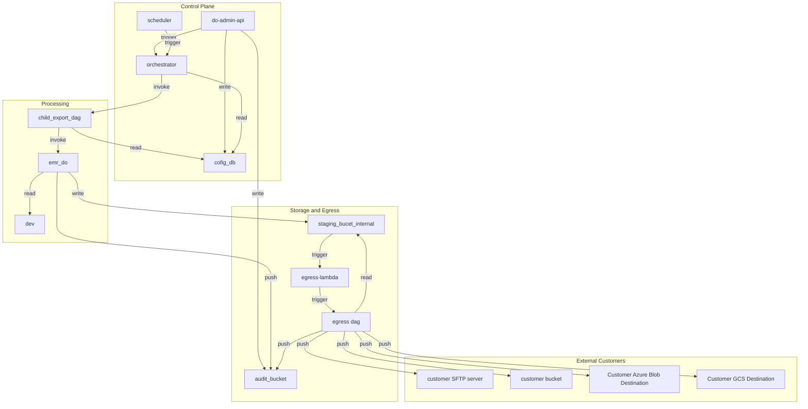

# DataOutbound Product -Section Tree — Architecture Document
* **Version:** 1.0
* **Generation Date:** 2026-10-31
* **Generated By:** Laminar

---

## Table of Contents
- **1.** Executive Summary / Overview
- **2.** Architecture Tenets
- **3.** Architecture Diagram
- **4.** Component Details: do-admin-api
  - **4.1.** Functional Overview
  - **4.2.** Component Tenets
  - **4.3.** Configuration Approach
  - **4.4.** Input Schema
  - **4.5.** Output/Side Effects
  - **4.6.** Telemetry Event Schema
  - **4.7.** Error Handling Strategy
  - **4.8.** Security and Compliance
  - **4.9.** Performance Metrics
  - **4.10.** Assumptions & Follow-up Resolutions
- **5.** Component Details: scheduler
  - **5.1.** Functional Overview
  - **5.2.** Component Tenets
  - **5.3.** Configuration Approach
  - **5.4.** Input Schema
  - **5.5.** Output/Side Effects
  - **5.6.** Telemetry Event Schema
  - **5.7.** Error Handling Strategy
  - **5.8.** Security and Compliance
  - **5.9.** Performance Metrics
  - **5.10.** Assumptions & Follow-up Resolutions
- **6.** Component Details: orchestrator
  - **6.1.** Functional Overview
  - **6.2.** Component Tenets
  - **6.3.** Configuration Approach
  - **6.4.** Input Schema
  - **6.5.** Output/Side Effects
  - **6.6.** Telemetry Event Schema
  - **6.7.** Error Handling Strategy
  - **6.8.** Security and Compliance
  - **6.9.** Performance Metrics
  - **6.10.** Assumptions & Follow-up Resolutions
- **7.** Component Details: child_export_dag
  - **7.1.** Functional Overview
  - **7.2.** Component Tenets
  - **7.3.** Configuration Approach
  - **7.4.** Input Schema
  - **7.5.** Output/Side Effects
  - **7.6.** Telemetry Event Schema
  - **7.7.** Error Handling Strategy
  - **7.8.** Security and Compliance
  - **7.9.** Performance Metrics
  - **7.10.** Assumptions & Follow-up Resolutions
- **8.** Component Details: emr_do
  - **8.1.** Functional Overview
  - **8.2.** Component Tenets
  - **8.3.** Configuration Approach
  - **8.4.** Input Schema
  - **8.5.** Output/Side Effects
  - **8.6.** Telemetry Event Schema
  - **8.7.** Error Handling Strategy
  - **8.8.** Security and Compliance
  - **8.9.** Performance Metrics
  - **8.10.** Assumptions & Follow-up Resolutions
- **9.** Component Details: dev
  - **9.1.** Functional Overview
  - **9.2.** Component Tenets
  - **9.3.** Configuration Approach
  - **9.4.** Input Schema
  - **9.5.** Output/Side Effects
  - **9.6.** Telemetry Event Schema
  - **9.7.** Error Handling Strategy
  - **9.8.** Security and Compliance
  - **9.9.** Performance Metrics
  - **9.10.** Assumptions & Follow-up Resolutions
- **10.** Component Details: cofig_db
  - **10.1.** Functional Overview
  - **10.2.** Component Tenets
  - **10.3.** Configuration Approach
  - **10.4.** Input Schema
  - **10.5.** Output/Side Effects
  - **10.6.** Telemetry Event Schema
  - **10.7.** Error Handling Strategy
  - **10.8.** Security and Compliance
  - **10.9.** Performance Metrics
  - **10.10.** Assumptions & Follow-up Resolutions
- **11.** Component Details: staging_bucet_internal
  - **11.1.** Functional Overview
  - **11.2.** Component Tenets
  - **11.3.** Configuration Approach
  - **11.4.** Input Schema
  - **11.5.** Output/Side Effects
  - **11.6.** Telemetry Event Schema
  - **11.7.** Error Handling Strategy
  - **11.8.** Security and Compliance
  - **11.9.** Performance Metrics
  - **11.10.** Assumptions & Follow-up Resolutions
- **12.** Component Details: egress-lambda
  - **12.1.** Functional Overview
  - **12.2.** Component Tenets
  - **12.3.** Configuration Approach
  - **12.4.** Input Schema
  - **12.5.** Output/Side Effects
  - **12.6.** Telemetry Event Schema
  - **12.7.** Error Handling Strategy
  - **12.8.** Security and Compliance
  - **12.9.** Performance Metrics
  - **12.10.** Assumptions & Follow-up Resolutions
- **13.** Component Details: egress dag
  - **13.1.** Functional Overview
  - **13.2.** Component Tenets
  - **13.3.** Configuration Approach
  - **13.4.** Input Schema
  - **13.5.** Output/Side Effects
  - **13.6.** Telemetry Event Schema
  - **13.7.** Error Handling Strategy
  - **13.8.** Security and Compliance
  - **13.9.** Performance Metrics
  - **13.10.** Assumptions & Follow-up Resolutions
- **14.** Component Details: Customer Azure Blob Destination
  - **14.1.** Functional Overview
  - **14.2.** Component Tenets
  - **14.3.** Configuration Approach
  - **14.4.** Input Schema
  - **14.5.** Output/Side Effects
  - **14.6.** Telemetry Event Schema
  - **14.7.** Error Handling Strategy
  - **14.8.** Security and Compliance
  - **14.9.** Performance Metrics
  - **14.10.** Assumptions & Follow-up Resolutions
- **15.** Component Details: Customer GCS Destination
  - **15.1.** Functional Overview
  - **15.2.** Component Tenets
  - **15.3.** Configuration Approach
  - **15.4.** Input Schema
  - **15.5.** Output/Side Effects
  - **15.6.** Telemetry Event Schema
  - **15.7.** Error Handling Strategy
  - **15.8.** Security and Compliance
  - **15.9.** Performance Metrics
  - **15.10.** Assumptions & Follow-up Resolutions
- **16.** Component Details: audit_bucket
  - **16.1.** Functional Overview
  - **16.2.** Component Tenets
  - **16.3.** Configuration Approach
  - **16.4.** Input Schema
  - **16.5.** Output/Side Effects
  - **16.6.** Telemetry Event Schema
  - **16.7.** Error Handling Strategy
  - **16.8.** Security and Compliance
  - **16.9.** Performance Metrics
  - **16.10.** Assumptions & Follow-up Resolutions
- **17.** Component Details: customer SFTP server
  - **17.1.** Functional Overview
  - **17.2.** Input Schema
  - **17.3.** Output/Side Effects
  - **17.4.** Security and Compliance
  - **17.5.** Assumptions & Follow-up Resolutions
- **18.** Component Details: customer bucket
  - **18.1.** Functional Overview
  - **18.2.** Input Schema
  - **18.3.** Output/Side Effects
  - **18.4.** Security and Compliance
  - **18.5.** Assumptions & Follow-up Resolutions
- **19.** Architectural Assumptions and Design Decisions
    - **19.1** Architectural Assumptions
    - **19.2** Key Design Decisions
- **20.** Security & Compliance Assumptions
- **21.** Operational Assumptions
  - **21.1.** Operational Tenets
  - **21.2.** Resilience & Availability Assumptions
  - **21.3.** Data Governance Assumptions
  - **21.4.** Performance and SLA Assumptions
- **22.** Amendment Log
- **23.** Closing & Disclaimer

---

## 1. Executive Summary / Overview

The DataOutbound Product is an enterprise-grade, scheduled batch outbound data-synchronization platform operating within the hospitality data domain. Its primary architectural mandate is to extract, transform, format, and securely deliver Golden Entity datasets—encompassing Unified Identity Profiles, Pii Restricted Profiles, Contact Method Subscriptions, Enriched Campaigns, Enriched Campaign Reactions, and reservation items (Room stay, Restaurant reservation, Tee time, Spa treatment)—from an authoritative Redshift data source store (`dev`) to diverse customer-owned endpoints.

The end-to-end execution lifecycle is orchestrated through a robust, event-driven pipeline:
1. **Administration & Configuration**: Authorized administrators manage export rules, cadences, and destination credentials via the `do-admin-api`, which persists configurations securely into the `cofig_db` (RDS PostgreSQL instance). Credential fields are strictly encrypted at rest, and all administrative actions generate immutable audit records.
2. **Orchestration & Scheduling**: The `scheduler` (Amazon EventBridge) raises cadence-based events, while the `orchestrator` (Amazon MWAA DAG) evaluates active connection metadata against the schedule window, generates a unique RFC 4122 v4 lineage UUID for traceability, and spawns execution runs.
3. **Extraction Workloads**: The `child_export_dag` (Amazon MWAA) triggers the `emr_do` job (EMR Serverless Spark runtime). This job extracts incremental or full datasets from the `dev` Redshift cluster using watermark tracking tables stored in `cofig_db`, writing normalized output files into internal S3 staging buckets (`staging_bucet_internal`).
4. **Transform, Encryption & Egress**: Staging bucket event notifications trigger `egress-lambda`, which initiates the `egress dag` (Amazon MWAA). This workflow applies optional GZIP compression followed by strict, fail-closed PGP encryption based on connection recipes. The processed export packages and JSON manifest control files (containing SHA-256 checksums) are delivered to designated endpoints—including `customer bucket` (S3), `Customer Azure Blob Destination`, `Customer GCS Destination`, and `customer SFTP server`—or internal inspection staging.
5. **Auditing & Telemetry**: Every administrative action, execution milestone, and transfer attempt emits a structured CloudEvents-compliant record directed to the `audit_bucket` (S3). Stateful resources incorporate environment-driven deletion protection to facilitate clean ephemeral teardowns in non-production environments while safeguarding production data assets.

## 2. Architecture Tenets

1. **Lineage-Bound Traceability and Auditing**: Every export execution—from administrative trigger to final destination delivery—is bound to a single, immutable lineage UUID. Every state transition, start event, completion, and failure must emit a structured audit record to the `audit_bucket`, ensuring complete non-repudiation and end-to-end traceability across the distributed pipeline.
2. **Fail-Closed Security Posture**: Security controls, particularly cryptographic operations, operate on a strict fail-closed principle. PGP encryption and credential handling must never default to plaintext. If a PGP key is missing, corrupt, or encryption fails during the `egress dag` execution, the transfer aborts instantly, preventing any unencrypted data egress while raising an immediate operational alert.
3. **Decoupled Orchestration and Elastic Compute**: Control plane logic (scheduling via `scheduler`, workflow coordination via `orchestrator`, `child_export_dag`, and `egress dag`) is strictly isolated from heavy compute tasks (`emr_do` Spark jobs) and lightweight event routing (`egress-lambda`). Orchestration engines manage state and scheduling only, delegating high-throughput processing to ephemeral serverless runtimes.
4. **Declarative, Environment-Driven Configuration**: All system behavior, export recipes, connection rules, and infrastructure lifecycle policies (such as deletion protection and log retention) are externalized via declarative configuration files and environment variables. Infrastructure-as-Code and runtime loaders ensure zero hardcoded secrets or tuning parameters, enabling consistent deployments across development, staging, and production tiers.

## 3. Architecture Diagram

System topology — generated from the architecture graph.

## 4. Component Details: do-admin-api

<!-- laminar:diagram-settings:imp-standard-standard_api-1 -->
**Diagram settings (user decisions — authoritative)**

| Setting | Value |
| --- | --- |
| `protocol` | `REST` |
| `authentication` | `JWT` |
| `api_name` | `do-admin-api` |

<!-- /laminar:diagram-settings -->

### 4.1. Functional Overview

- **Architectural Principle**: Bounded Domain Gateway & Separation of Concerns.
- **Rationale**: The `do-admin-api` serves as the sole authoritative REST entrypoint for Acme administrators to manage, inspect, and lifecycle-control customer export configurations without requiring manual database interventions or direct infrastructure access. By decoupling the administrative interface from execution engines (MWAA DAGs and EMR Serverless), administrative operations remain responsive, secure, and isolated from heavy data processing workloads.
- **Guardrails**: Engineers must ensure that all route handlers delegate strictly to service layers (`export_admin_service.py`), never perform direct database operations or business logic in route definitions, and enforce strict input validation against Pydantic schemas before persistence.

### 4.2. Component Tenets

- **Architectural Principle**: Contract-First REST Design & Least-Privilege Authorization.
- **Rationale**: Enforcing RESTful conventions with OpenAPI-compliant contracts guarantees predictable client interactions and robust machine-to-machine integration. Role-based access control (RBAC) paired with JWT bearer token validation ensures that only authorized administrators can mutate export configurations, preventing unauthorized data exfiltration or pipeline disruption.
- **Guardrails**: All endpoints must return standardized error envelopes (`{ "error": { "code": "STRING_CODE", "message": "...", "details": [] } }`) with semantic status codes (`200`, `201`, `204`, `400`, `401`, `403`, `404`, `409`, `422`, `500`). Secrets (such as client connection credentials or API keys) must never be returned in plaintext upon retrieval.

### 4.3. Configuration Approach

- **Architectural Principle**: Externalized Declarative Configuration.
- **Rationale**: Configuration parameters are externalized through config loaders and environment variables, ensuring environment parity across development, staging, and production tiers.
- **Configuration Properties Set/Overridden**:
  - `protocol`: `REST` (enforces HTTP/HTTPS protocol standard).
  - `authentication`: `JWT` (mandates bearer token validation on all protected routes).
  - `api_name`: `do-admin-api` (identifies the service domain boundary).
- **Guardrails**: Never hardcode endpoints, database connection strings, or authentication secrets within the application source code; always resolve sensitive references via `common.clients.ssm` or encrypted secrets management.

### 4.4. Input Schema

- **Architectural Principle**: Strict Boundary Validation.
- **Rationale**: Validating all incoming payloads at the API boundary prevents malformed or malicious data from reaching downstream persistent storage (`cofig_db`) or triggering invalid orchestration workflows.
- **Payload Structure**:
  - `connection_name`: `string` (1–100 characters, unique per tenant).
  - `target_type`: `string` (enum: `s3`, `azure_blob`, `gcs`, `sftp`).
  - `dataset`: `string` (enum: `identity_profiles`, `subscription_statuses`, `campaigns_reactions`, `reservation_items`).
  - `mode`: `string` (enum: `initial`, `incremental`).
  - `cron_schedule`: `string` (valid 5-field cron expression).
  - `credentials`: `object` / `string` (encrypted target access keys or key references).
- **Guardrails**: Any payload missing required fields or containing invalid enum values must immediately return HTTP `400 Bad Request` with an error body detailing every violating field.

### 4.5. Output/Side Effects

- **Architectural Principle**: Immutable Auditability & Transactional Consistency.
- **Rationale**: Every administrative modification (Create, Update, Delete) must atomically update the persistence store and emit a corresponding audit record to guarantee non-repudiation and traceability.
- **Side Effects**:
  - Persists or modifies encrypted records in `cofig_db`.
  - Triggers workflow execution runs on the MWAA `orchestrator` via REST/CLI triggers.
  - Emits structured audit events (`ADMIN_CREATE`, `ADMIN_UPDATE`, `ADMIN_DELETE`, `ADMIN_MANUAL_TRIGGER`) to `audit_bucket`.
- **Guardrails**: Side effects against external orchestration or audit sinks must be executed within transactional boundaries or handled with idempotent retry patterns to prevent ghost state.

### 4.6. Telemetry Event Schema

- **Architectural Principle**: Centralized CloudEvents-Compliant Telemetry.
- **Rationale**: Standardizing telemetry data across all components ensures that monitoring platforms and audit log stores can parse, index, and correlate administrative actions without custom parsing logic.
- **Telemetry Schema Fields**:
  - `actor_id`: Authenticated Acme user identifier (`string`).
  - `timestamp_utc`: ISO-8601 timestamp with millisecond precision and Z suffix (`string`).
  - `event_type`: `ADMIN_CREATE`, `ADMIN_UPDATE`, `ADMIN_DELETE`, or `ADMIN_MANUAL_TRIGGER`.
  - `execution_id`: Lineage UUID associated with the operation (`string`, null for pure config CRUD, populated on manual trigger).
- **Guardrails**: Never log sensitive credential values or personally identifiable information (PII) within telemetry streams or application logs.

### 4.7. Error Handling Strategy

- **Architectural Principle**: Fail-Fast Semantic Error Mapping.
- **Rationale**: Translating internal domain exceptions into standardized HTTP error responses prevents information leakage (such as stack traces or internal database errors) while providing clients with actionable remediation details.
- **Error Mapping**:
  - `AuthError` -> HTTP `401 Unauthorized` or `403 Forbidden`.
  - `ValidationError` -> HTTP `400 Bad Request` or `422 Unprocessable Entity`.
  - `NotFoundError` -> HTTP `404 Not Found`.
  - `ConflictError` -> HTTP `409 Conflict`.
  - Unexpected errors -> HTTP `500 Internal Server Error`.
- **Guardrails**: All caught exceptions must be structured, logged via `common.logging.logger`, and accompanied by a unique request tracing ID.

### 4.8. Security and Compliance

- **Architectural Principle**: Zero-Trust Security & Encrypted Credential Persistence.
- **Rationale**: Administrative interfaces represent high-value attack targets. Enforcing JWT authentication, role-based access control, and encrypted credential storage protects tenant configurations from unauthorized compromise.
- **Guardrails**: Credentials submitted via API payloads must never be stored in plaintext; they must be encrypted before database insertion using KMS-backed envelope encryption or stored as secure references in SSM Parameter Store. TLS 1.3 must be enforced on all incoming connections.

### 4.9. Performance Metrics

- **Architectural Principle**: Low-Latency Responsiveness & Horizontal Scalability.
- **Rationale**: Administrative APIs must remain performant to ensure administrative tasks do not bottleneck platform operations.
- **Target Metrics**:
  - p95 response time < 200ms for read operations and < 500ms for write/mutation operations.
  - Audit event publication latency ≤ 5 seconds from transaction commit.
- **Guardrails**: Avoid heavy computations or synchronous blocking I/O (such as large file parsing or direct database reporting queries) inside API worker threads.

### 4.10. Assumptions & Follow-up Resolutions

- **Architectural Principle**: Pragmatic Defaulting & Assumption Transparency.
- **Rationale**: Documenting assumptions explicitly eliminates ambiguity during engineering handoff and ensures production defaults align with enterprise standards.
- **Assumptions**:
  - Requests lacking valid bearer credentials or possessing insufficient roles receive HTTP 401/403 with security events logged to the audit store within 5 seconds.
  - Authentication is delegated to an enterprise Identity Provider (IdP) issuing signed JWTs verified locally or via JWKS endpoints by the API middleware.

## 5. Component Details: scheduler

<!-- laminar:diagram-settings:imp-aws-aws_eventbridge-2 -->
**Diagram settings (user decisions — authoritative)**

| Setting | Value |
| --- | --- |
| `rule_name` | `scheduler` |

<!-- /laminar:diagram-settings -->

### 5.1. Functional Overview

**Architectural principle: Decoupled, event-driven scheduling.** The Export Scheduler (n2) is implemented as an Amazon EventBridge scheduled rule that raises a cadence event at each configured schedule time T and hands it to the Export Orchestrator DAG (n3) on MWAA. The scheduler owns *when* work is due; the orchestrator owns *what* work is due. This separation means schedule evaluation (cron matching, the ±10-minute selection window of SCRUM-480 AC#1) is a pure concern of the orchestrator, while the scheduler remains a stateless, zero-maintenance time source.

**Rationale and trade-offs.** A managed scheduler removes the need for a self-hosted cron container or ECS-based timer (both rejected: extra always-on infrastructure outside the approved allowlist of SCRUM-485). EventBridge schedules are highly available and emit a standard event envelope. The trade-off is that EventBridge delivery is asynchronous and at-least-once; the orchestrator must therefore be idempotent per schedule time, which it already is because selection is deterministic within the ±10-minute window.

**Guardrails.** The scheduler must never carry connection metadata or business data in its events — it emits only the schedule time and cadence identity; all connection selection happens in n3 against the Export Config Store (n6). It must not be used for synchronous request/response (per EventBridge anti-patterns); manual triggers enter exclusively through the Export Admin API (n1). Every rule target must have a DLQ attached so a failed orchestrator invocation is never silently dropped.

### 5.2. Component Tenets

**Principle: Single responsibility of the time source.** The scheduler exists only to raise events on cadence; it holds no configuration, no state, and no business logic.

- **Tenet 1 — Cadence coverage.** The scheduler must support the full cadence set required by SCRUM-481: daily, weekly, bi-weekly, monthly, and hourly fast-batch schedules. Bi-weekly is not natively expressible in a single cron expression, so the architecture resolves it as a documented assumption (see Assumptions) rather than by adding a new component.
- **Tenet 2 — Immutability of emitted events.** Events are immutable facts; the scheduler never mutates or retracts an event. A missed or duplicate event is reconciled by the orchestrator's window logic, not by event editing.
- **Tenet 3 — Explicit failure capture.** Every rule target carries a DLQ and a bounded retry policy; a DLQ depth alarm is the scheduler's primary health signal.
- **Tenet 4 — Auditability.** Scheduled trigger events are recorded in the Audit & Execution Log Store (n13) as `EXECUTION_STARTED`-class lifecycle events with `actor_id = system:export-scheduler`, satisfying SCRUM-486's schema.

**Guardrails:** no ad-hoc schedule changes outside the Export Config Store (n6) as the single source of truth for cadences; no payload growth beyond the 256 KB event limit (trivially satisfied since payloads are metadata-only).

### 5.3. Configuration Approach

**Principle: Configure only what the architecture decides; defer the rest to managed defaults.** The architecture sets exactly the following, each with rationale:

| Setting | Value / approach | Rationale |
|---|---|---|
| Rule type | Scheduled (cron/rate) rule per cadence class | One rule per cadence family keeps filtering specific and avoids overly broad patterns (anti-pattern guard). |
| Target | MWAA orchestrator DAG trigger (n3) | Direct, managed hand-off; no intermediate compute needed for a metadata-only event. |
| Retry policy | Bounded retries with maximum event age set to fit inside the ±10-minute selection window | An event delivered after the window would be ignored by n3 anyway; expiring it early prevents wasted retries. |
| DLQ | Attached to the rule target | Mandatory per EventBridge tenets; failed deliveries are captured, alarmed, and replayable. |
| Event archiving | Enabled with a retention aligned to the organisation logging-standard value | Supports replay for debugging and audit reconstruction (SCRUM-486). |

Defaults deliberately not overridden: event envelope fields, rule naming conventions, and bus encryption (AWS-managed KMS) — these are production-grade managed defaults and deferring to them is itself the decision.

### 5.4. Input Schema

**Principle: The scheduler consumes configuration, not data.** Its only "input" is the set of active cadences defined in the Export Config Store (n6) via the Export Admin API (n1). The scheduler does not read n6 directly — cadence rules are provisioned from that configuration through the deployment pipeline, keeping the scheduler stateless and the config store authoritative.

**Guardrails:** cadence changes must flow exclusively through the config CRUD path (SCRUM-479) so that every change is validated (5-field cron, allowed cadences) and audited (`ADMIN_CREATE`/`ADMIN_UPDATE`); the scheduler must never accept or act on ad-hoc schedule input at runtime.

### 5.5. Output/Side Effects

**Principle: Emit minimal, self-describing trigger events.** Output is a single event per scheduled time T, carrying the standard EventBridge envelope (`source`, `detail-type`, `time`, `region`, `account`) plus the cadence identity and schedule time. The orchestrator (n3) uses `time` to apply the ±10-minute selection window (SCRUM-480 AC#1).

**Side effects:** (1) an audit event in n13 recording the scheduled trigger with `actor_id = system:export-scheduler` and the run's lineage UUID once n3 assigns it; (2) possible DLQ messages on target failure. The scheduler itself writes no data anywhere else.

**Guardrails:** events must remain well under 256 KB; the scheduler must never emit per-connection events — fan-out to one Child Export DAG (n14) per connection is the orchestrator's responsibility (SCRUM-480 AC#4).

### 5.6. Telemetry Event Schema

**Principle: One audit schema, uniformly applied.** Scheduler-related telemetry follows the SCRUM-486 schema exactly: `actor_id` (`system:export-scheduler`), `timestamp_utc` (ISO-8601, millisecond precision, Z suffix), `event_type` (from the enumerated set — scheduled triggers map to `EXECUTION_STARTED` at the orchestrator boundary), and `execution_id` (the lineage UUID generated by n3). The scheduler's own operational telemetry (rule invocations, DLQ depth, target delivery failures) goes to its explicitly provisioned CloudWatch log group under n13 with the organisation retention value.

**Guardrails:** exactly one audit record per event occurrence (SCRUM-486 AC#1); no free-form event types; timestamps always UTC with Z suffix.

### 5.7. Error Handling Strategy

**Principle: Fail visibly, retry bounded, never lose the fact that a schedule fired.** If the orchestrator target fails to invoke, EventBridge retries per the configured policy and then routes the event to the DLQ; a DLQ depth alarm raises an automated alert. Because the ±10-minute window makes late delivery moot, the retry budget is deliberately short. Missed schedules (e.g., during an outage) are reconciled by the orchestrator's window logic on the next event, not by backfill from the scheduler.

**Guardrails:** no unbounded retries; no silent drops (DLQ mandatory); DLQ replay is an operational action, not an automatic one, to avoid duplicate runs.

### 5.8. Security and Compliance

**Principle: Least privilege on the event path.** The scheduler's rule target invokes MWAA with a dedicated IAM role scoped to that single action; no component can publish to or consume from the bus without an explicit role. The bus and archive are encrypted with the AWS-managed key (default, deliberately not overridden). Events carry no PII or credentials — connection credentials live only encrypted in n6 (SCRUM-481 AC#6) — so the scheduler's compliance surface is limited to audit integrity (SCRUM-486 schema) and stack allowlist compliance (SCRUM-485: EventBridge is the scheduling mechanism within the approved MWAA/RDS/Lambda/EMR Serverless/S3/ECS stack; the scheduler is accounted for "where hosted" per SCRUM-485 scope).

**Guardrails:** no public event bus; no cross-account targets without explicit policy; scheduler log group retention set to the confirmed organisation value.

### 5.9. Performance Metrics

**Principle: Measure schedule fidelity, not throughput.** Key metrics: schedule-to-orchestrator-invocation latency (must comfortably support the SCRUM-480 AC#5 requirement that a manual-triggered run reaches `running` within 30 s — scheduled events have no such hard SLA but are expected to invoke within seconds), target invocation success rate, DLQ depth (target: 0), and event archive volume. Alarms on DLQ depth and invocation failure rate.

**Guardrails:** the scheduler is not on the 30-second manual-trigger path (that flows through the Export Admin API → Airflow REST API), so it must never be a latency bottleneck for that flow; hourly fast-batch cadences bound the minimum rule interval and must be validated against EventBridge scheduling granularity.

### 5.10. Assumptions & Follow-up Resolutions

- **Bi-weekly cadence:** EventBridge cron cannot express "every two weeks" natively; assumption: bi-weekly is implemented as a monthly-style rule with a fortnight offset pattern (two rules offset by one week, each firing fortnightly via day-of-month constraints), or the orchestrator filters bi-weekly connections from a weekly event using the config's cadence metadata. The orchestrator's ±10-minute window logic remains the single selection authority.
- **Organisation logging-standard retention value:** not stated in inputs; assumption: a single confirmed value (in days) is supplied per environment before sprint commitment and applied uniformly to all pipeline log groups and the audit store (SCRUM-486 AC#4). Until confirmed, the value is parameterised, never hardcoded.
- **Scheduler hosting in the allowlist check:** SCRUM-485 lists n2 "where hosted"; assumption: the scheduler is realised as EventBridge rules attached to the MWAA environment's eventing and is reported in the allowlist verification report as part of the MWAA-managed stack, not as a separate resource type.
- **Time zone:** assumption: all cron schedules are evaluated in UTC, consistent with the ISO-8601 UTC audit timestamp requirement.

---

## 6. Component Details: orchestrator

<!-- laminar:diagram-settings:imp-aws-aws_mwaa_dag-3 -->
**Diagram settings (user decisions — authoritative)**

| Setting | Value |
| --- | --- |
| `schedule` | `@daily` |
| `catchup` | `false` |
| `max_active_runs` | `1` |
| `dag_name` | `orchestrator` |

<!-- /laminar:diagram-settings -->

### 6.1. Functional Overview

- **Architectural Principle**: Event-Driven Workflow Orchestration.
- **Rationale**: The `orchestrator` MWAA DAG serves as the control-plane brain of the export pipeline. Triggered by cadence events from the `scheduler` (EventBridge) or manual API requests, it queries `cofig_db` for active export configurations, filters connections matching the current schedule window (+/- 10 minutes), generates an immutable lineage UUID, and fans out execution to child export workflows.
- **Guardrails**: Orchestrator DAGs must contain lightweight top-level code (no network calls, database queries, or heavy computation outside operators) to prevent Airflow scheduler heartbeat blocking and parsing latency.

### 6.2. Component Tenets

- **Architectural Principle**: Idempotent Scheduling & Lineage Propagation.
- **Rationale**: Every execution run must be uniquely identifiable and reproducible. Generating a single RFC 4122 v4 lineage UUID at the orchestrator root and passing it down to all child tasks and files ensures end-to-end audit traceability across distributed storage and serverless runtimes.
- **Guardrails**: Concurrency must be strictly controlled (`max_active_runs=1`) to prevent overlapping execution runs for the same schedule window and avoid race conditions on incremental watermark tables.

### 6.3. Configuration Approach

- **Architectural Principle**: Declarative Workflow Scheduling.
- **Rationale**: Hardcoding schedules or DAG parameters inside Python files limits deployment flexibility. Externalizing configurations per environment ensures clean promotion pipelines.
- **Configuration Properties Set/Overridden**:
  - `schedule`: `@daily` (cadence expression for orchestration evaluation).
  - `catchup`: `False` (prevents unintended historical DAG runs upon deployment).
  - `max_active_runs`: `1` (ensures single active execution stream per schedule window).
  - `tags`: `{}` (metadata tag set configured per environment).
  - `dag_name`: `orchestrator` (unique Airflow DAG identifier).
- **Guardrails**: DAG configuration values must be loaded exclusively via `ConfigLoader` merging base YAML and environment overlays.

### 6.4. Input Schema

- **Architectural Principle**: Payload-Driven Workflow Initialization.
- **Rationale**: Workflows accept standardized runtime configuration JSON containing execution metadata, forced connection IDs (for manual triggers), and scheduled execution timestamps.
- **Guardrails**: Input run configurations must be validated against expected JSON schemas before initiating downstream child tasks.

### 6.5. Output/Side Effects

- **Architectural Principle**: Cascading Workflow Dispatch.
- **Rationale**: The orchestrator outputs execution triggers to downstream child workflows (`child_export_dag`) and writes execution lifecycle milestones to `audit_bucket`.
- **Side Effects**:
  - Spawns `child_export_dag` runs via Airflow REST API or internal triggering mechanisms.
  - Records `EXECUTION_STARTED` and `EXECUTION_COMPLETED` audit events in `audit_bucket`.
- **Guardrails**: Downstream child triggers must include the generated lineage UUID in their run configuration conf dictionary.

### 6.6. Telemetry Event Schema

- **Architectural Principle**: Standardized Execution Telemetry.
- **Rationale**: Emitting CloudEvents-compliant telemetry ensures operational visibility into pipeline health and scheduling punctuality.
- **Telemetry Schema Fields**:
  - `actor_id`: `system:orchestrator` (`string`).
  - `timestamp_utc`: ISO-8601 UTC timestamp (`string`).
  - `event_type`: `EXECUTION_STARTED` or `EXECUTION_COMPLETED` (`string`).
  - `execution_id`: Lineage UUID (`string`).
- **Guardrails**: Telemetry publishing helpers must never raise exceptions into the caller's execution flow.

### 6.7. Error Handling Strategy

- **Architectural Principle**: Resilient Task Retries with Fail-Safe Alerting.
- **Rationale**: Transient database connection glitches or Airflow scheduler hiccups should not cause permanent pipeline failure. Configuring exponential backoff retries ensures resilience against temporary infrastructure faults.
- **Guardrails**: If schedule evaluation or database polling fails after exhaustion of retry attempts, the DAG run must fail cleanly, trigger an operational alert, and emit a `TRANSFER_FAILED` or execution failure audit record.

### 6.8. Security and Compliance

- **Architectural Principle**: Least-Privilege IAM & Secret Isolation.
- **Rationale**: MWAA execution roles must possess permissions strictly limited to reading configuration tables in `cofig_db`, invoking child DAGs, and writing to the audit bucket.
- **Guardrails**: Database connection strings and encryption keys must be retrieved dynamically from SSM Parameter Store / Secrets Manager; never hardcode credentials in DAG definitions.

### 6.9. Performance Metrics

- **Architectural Principle**: Efficient Scheduler Parsing & Bounded Resource Utilization.
- **Rationale**: Keeping top-level DAG code instantaneous prevents scheduler bottlenecks, allowing hundreds of connections to be evaluated efficiently.
- **Target Metrics**:
  - DAG parsing time < 2 seconds.
  - Connection selection and child submission latency < 15 seconds from schedule event ingestion.
- **Guardrails**: Avoid executing heavy SQL queries or API calls outside operator `execute()` methods.

### 6.10. Assumptions & Follow-up Resolutions

- **Architectural Principle**: Explicit Boundary Assumptions.
- **Rationale**: Clear assumptions ensure seamless integration with the EventBridge scheduler and Airflow REST API.
- **Assumptions**:
  - The orchestrator selects active connections whose scheduled cron time falls within +/- 10 minutes of the event raising time.
  - Exactly one RFC 4122 v4 lineage UUID is generated per orchestrator execution run and propagated to all child tasks.

## 7. Component Details: child_export_dag

<!-- laminar:diagram-settings:imp-aws-aws_mwaa_dag-4 -->
**Diagram settings (user decisions — authoritative)**

| Setting | Value |
| --- | --- |
| `schedule` | `@daily` |
| `catchup` | `false` |
| `max_active_runs` | `1` |
| `dag_name` | `child_export_dag` |

<!-- /laminar:diagram-settings -->

### 7.1. Functional Overview

- **Architectural Principle**: Isolated Execution Concurrency.
- **Rationale**: The `child_export_dag` represents the discrete unit of work for a single customer export connection. It receives the lineage UUID and connection parameters from the orchestrator, retrieves incremental watermark metadata from `cofig_db`, and submits the `emr_do` Spark job to extract datasets from Redshift (`dev`) into internal staging buckets (`staging_bucet_internal`).
- **Guardrails**: Child DAGs must execute independently so that a failure in one customer export connection does not impact concurrent exports for other tenants.

### 7.2. Component Tenets

- **Architectural Principle**: Idempotent Task Design & Delegation of Compute.
- **Rationale**: Airflow tasks within the child DAG must be purely orchestrational; all heavy compute and data transformation is delegated to EMR Serverless, ensuring Airflow worker nodes remain lightweight and responsive.
- **Guardrails**: Every execution must be fully idempotent, leveraging incremental watermark tables in `cofig_db` to safely re-run extractions without duplicating historical data.

### 7.3. Configuration Approach

- **Architectural Principle**: Declarative Workflow Parameters.
- **Rationale**: Standardizing child DAG configurations ensures consistent execution semantics across all customer connections.
- **Configuration Properties Set/Overridden**:
  - `schedule`: `@daily` (cadence inheritance from connection configuration).
  - `catchup`: `False` (prevents backfilling historical DAG runs).
  - `max_active_runs`: `1` (prevents concurrent overlapping runs for the same child connection).
  - `tags`: `{}` (metadata tag set).
  - `dag_name`: `child_export_dag` (Airflow DAG identifier).
- **Guardrails**: All connection-specific overrides must be passed via DAG run configuration JSON rather than hardcoded in Python DAG files.

### 7.4. Input Schema

- **Architectural Principle**: Parameterized Task Injection.
- **Rationale**: The child DAG expects a structured run configuration containing the lineage UUID and complete connection metadata JSON (target type, dataset, extraction mode, schedules, and encrypted secret references).
- **Guardrails**: Input configurations must be validated at DAG start to ensure all required extraction parameters are present.

### 7.5. Output/Side Effects

- **Architectural Principle**: Compute Job Submission & State Persistence.
- **Rationale**: The child DAG invokes the EMR Serverless Spark application (`emr_do`) and updates extraction watermarks in `cofig_db`.
- **Side Effects**:
  - Submits EMR Serverless job run (`emr_do`) with argument parameters.
  - Updates watermark state in `cofig_db`.
  - Publishes audit events (`EXECUTION_STARTED`, `EXECUTION_COMPLETED`) to `audit_bucket`.
- **Guardrails**: Job submission failures must trigger immediate retries up to configured limits before marking the DAG run as failed.

### 7.6. Telemetry Event Schema

- **Architectural Principle**: Standardized Milestone Auditing.
- **Rationale**: Emitting telemetry events at each phase of the child export lifecycle ensures precise tracking of data extraction duration and record counts.
- **Telemetry Schema Fields**:
  - `actor_id`: `system:child_export_dag` (`string`).
  - `timestamp_utc`: ISO-8601 UTC timestamp (`string`).
  - `event_type`: `EXECUTION_STARTED` or `EXECUTION_COMPLETED` (`string`).
  - `execution_id`: Lineage UUID (`string`).
- **Guardrails**: Telemetry emission failures must be caught and logged locally without crashing the orchestration task.

### 7.7. Error Handling Strategy

- **Architectural Principle**: Fail-Safe Propagation & Automatic Cleanup.
- **Rationale**: If EMR Serverless job execution fails or Redshift connectivity is lost, the child DAG catches the exception, logs structured error details, emits a `TRANSFER_FAILED` audit record, and alerts operations.
- **Guardrails**: Never suppress spark job failures; ensure error states propagate up to trigger operational notifications.

### 7.8. Security and Compliance

- **Architectural Principle**: Encrypted Parameter Transmission & Least Privilege.
- **Rationale**: Passing connection metadata and secrets between orchestration tasks requires secure parameter transmission channels.
- **Guardrails**: Sensitive credential properties must be passed via secure parameter references rather than plaintext JSON strings in Airflow UI logs.

### 7.9. Performance Metrics

- **Architectural Principle**: Low Overhead Orchestration.
- **Rationale**: Child DAG polling and job submission overhead must remain minimal to maximize throughput across parallel tenant exports.
- **Target Metrics**:
  - Job submission latency < 5 seconds from task start.
- **Guardrails**: Avoid polling loops with aggressive intervals; use asynchronous job status checkers where supported.

### 7.10. Assumptions & Follow-up Resolutions

- **Architectural Principle**: Explicit Workflow Assumptions.
- **Rationale**: Documenting assumptions guarantees consistency across multi-tenant extraction runs.
- **Assumptions**:
  - The child export DAG successfully extracts initial full sets or incremental delta records based on the configured mode and watermark state stored in RDS Postgres.
  - The lineage UUID received from the orchestrator is carried through all downstream EMR job arguments and staging file metadata.

## 8. Component Details: emr_do

<!-- laminar:diagram-settings:imp-aws-aws_emr_serverless-5 -->
**Diagram settings (user decisions — authoritative)**

| Setting | Value |
| --- | --- |
| `release_label` | `emr-7.0.0` |
| `job_type` | `SPARK` |
| `max_capacity_units` | `200` |
| `application_name` | `emr_do` |

<!-- /laminar:diagram-settings -->

### 8.1. Functional Overview

- **Principle**: Scalable Serverless Distributed Data Processing.
- **Rationale**: The **emr_do** component executes large-scale Apache Spark jobs to extract, transform, and stage Golden Entity datasets from the **dev** Redshift cluster without requiring manual cluster provisioning or capacity tuning.
- **Guardrails**: Engineers must ensure jobs utilize dynamic worker allocation, partition datasets correctly on S3 to prevent query throttling, and process only necessary columns to minimize memory pressure.

### 8.2. Component Tenets

- **Principle**: Ephemeral Compute Isolation and Stateless Execution.
- **Rationale**: EMR Serverless applications spin up compute resources exclusively for the duration of the job run and terminate them immediately upon completion, containing blast radii and eliminating idle infrastructure costs.
- **Guardrails**: Workers must never store persistent state locally; all outputs and intermediate checkpoints must be written directly to S3 storage.

### 8.3. Configuration Approach

- **Principle**: Minimalist Declarative Configuration Overrides.
- **Rationale**: Setting explicit boundaries on application capacity prevents runaway scaling while accommodating heavy batch processing spikes.
- **Guardrails**: The architecture sets the following configuration properties: `application_name` = `emr_do`, `release_label` = `emr-7.0.0`, `job_type` = `SPARK`, and `max_capacity_units` = `200`. Default vendor settings are applied for all unlisted properties.

### 8.4. Input Schema

- **Principle**: Parameterized Extraction Contract.
- **Rationale**: The job accepts structured runtime parameters (such as execution lineage UUID, extraction mode, and watermark timestamps) from the invoking **child_export_dag** to determine extraction boundaries.
- **Guardrails**: Inputs must be strictly validated against expected schemas before initiating Spark distributed reads.

### 8.5. Output/Side Effects

- **Principle**: Idempotent Data Staging.
- **Rationale**: Output datasets are written as partitioned files to **staging_bucet_internal**, accompanied by manifest records to ensure downstream verification.
- **Guardrails**: Job writes must be atomic, using S3 committers to prevent partial or corrupted file propagation.

### 8.6. Telemetry Event Schema

- **Principle**: Standardized CloudEvents Telemetry.
- **Rationale**: Job lifecycle milestones (start, success, failure) emit structured events to track execution duration, record counts, and lineage.
- **Guardrails**: Telemetry publishing failures must be caught and logged locally without crashing the core job execution flow.

### 8.7. Error Handling Strategy

- **Principle**: Fail-Fast and Job-Level Retry Isolation.
- **Rationale**: Unhandled exceptions during data extraction or transformation fail the job run immediately, preventing incomplete data from contaminating staging storage.
- **Guardrails**: Failed runs must trigger alert notifications and record execution failure status in the audit store.

### 8.8. Security and Compliance

- **Principle**: Least-Privilege IAM and Data Minimization.
- **Rationale**: EMR Serverless jobs execute under dedicated IAM execution roles with restricted read access to Redshift and write access only to designated staging buckets.
- **Guardrails**: Sensitive profile attributes (PII) must be handled in compliance with organizational masking and encryption standards.

### 8.9. Performance Metrics

- **Principle**: Optimized Distributed Resource Utilization.
- **Rationale**: Performance is measured by job completion time, worker scaling latency, and efficient memory utilization across executors.
- **Guardrails**: Peak worker RSS memory must stay within allocated worker limits, and small file creation on S3 must be avoided through proper partitioning.

### 8.10. Assumptions & Follow-up Resolutions

- **Principle**: Standardized Operational Assumptions.
- **Rationale**: Assumes standard AWS service quotas for EMR Serverless applications are sufficient for peak concurrent child export jobs.
- **Guardrails**: Any scaling limit increases must be coordinated via infrastructure-as-code change requests.

## 9. Component Details: dev

<!-- laminar:diagram-settings:imp-aws-aws_redshift-6 -->
**Diagram settings (user decisions — authoritative)**

| Setting | Value |
| --- | --- |
| `node_type` | `dc2.large` |
| `number_of_nodes` | `2` |
| `database_name` | `dev` |
| `cluster_identifier` | `golden_data_source` |

<!-- /laminar:diagram-settings -->

### 9.1. Functional Overview

- **Principle**: High-Performance Analytical Data Warehousing.
- **Rationale**: The **dev** Redshift cluster (cluster identifier `golden_data_source`, database name `dev`) acts as the authoritative Golden Entity Source Store, providing high-speed SQL execution for batch data extractions.
- **Guardrails**: Queries must leverage proper distribution and sort keys to optimize table scans and join performance.

### 9.2. Component Tenets

- **Principle**: Isolated Analytical Workload Management.
- **Rationale**: Separating analytical storage from operational transactional stores prevents query interference and ensures reliable batch extraction performance.
- **Guardrails**: Direct write access is restricted to authorized data ingestion pipelines; external access is read-only.

### 9.3. Configuration Approach

- **Principle**: Provisioned Compute and Storage Scalability.
- **Rationale**: Selecting appropriate node types and counts ensures sufficient parallelism for scanning large hospitality entity datasets.
- **Guardrails**: The architecture sets the following properties: `cluster_identifier` = `golden_data_source`, `database_name` = `dev`, `node_type` = `dc2.large`, and `number_of_nodes` = `2`.

### 9.4. Input Schema

- **Principle**: Parameterized SQL Query Extraction.
- **Rationale**: Accepts parameterized SQL queries from the EMR Serverless Spark job for both full and incremental dataset extractions.
- **Guardrails**: Dynamic SQL generation must prevent injection vulnerabilities by utilizing bound parameters.

### 9.5. Output/Side Effects

- **Principle**: Read-Only Result Set Streaming.
- **Rationale**: Outputs structured result sets representing identity profiles, subscriptions, campaigns, reactions, and reservation items to the querying Spark workers.
- **Guardrails**: Result sets must not produce side effects on source table states.

### 9.6. Telemetry Event Schema

- **Principle**: Database Query Audit and Performance Logging.
- **Rationale**: Captures query execution metrics, connection durations, and error logs for operational monitoring.
- **Guardrails**: Query logs must exclude sensitive PII values.

### 9.7. Error Handling Strategy

- **Principle**: Graceful Connection Recovery and Abort.
- **Rationale**: Transient connection drops trigger bounded client-side retries, while syntax or schema errors abort the extraction job cleanly.
- **Guardrails**: Detailed error messages must be logged securely without exposing database credentials.

### 9.8. Security and Compliance

- **Principle**: Network Isolation and Encryption at Rest.
- **Rationale**: Deployed within private VPC subnets with KMS storage encryption enforced to protect sensitive hospitality data at rest.
- **Guardrails**: Database credentials must be retrieved securely from SSM Parameter Store or secrets management stores.

### 9.9. Performance Metrics

- **Principle**: Analytical Query Latency Optimization.
- **Rationale**: Monitored via cluster CPU utilization, query queue wait times, and disk space usage.
- **Guardrails**: Concurrency limits must be managed to prevent resource exhaustion during peak extraction windows.

### 9.10. Assumptions & Follow-up Resolutions

- **Principle**: External Ownership Assumption.
- **Rationale**: The Golden Entity Source Store is treated as an existing externally owned source (excluded from Terraform pipeline deletion checks) but fully integrated via connection configurations.
- **Guardrails**: Schema modifications on source tables must be coordinated with downstream data pipeline maintainers.

## 10. Component Details: cofig_db

<!-- laminar:diagram-settings:imp-aws-aws_rds-7 -->
**Diagram settings (user decisions — authoritative)**

| Setting | Value |
| --- | --- |
| `engine` | `postgres` |
| `engine_version` | `15.4` |
| `instance_class` | `db.t3.micro` |
| `allocated_storage` | `20` |
| `multi_az` | `false` |
| `db_instance_identifier` | `cofig_db` |

<!-- /laminar:diagram-settings -->

### 10.1. Functional Overview

- **Principle**: Relational data persistence for operational configuration and state tracking.
- **Rationale**: The **cofig_db** component (Amazon RDS Postgres) serves as the authoritative operational data store for the DataOutbound platform. It stores customer export configurations, incremental extraction watermarks, and administrative metadata. Relational storage is chosen to guarantee ACID compliance, transactional integrity, and strong consistency for configuration updates and incremental state management.
- **Guardrails**: Direct modifications to database records bypassing the **do-admin-api** or official migration pipelines are strictly prohibited.

### 10.2. Component Tenets

- **Principle**: Transactional consistency and secure isolation.
- **Rationale**: Ensures that export configurations and incremental watermarks are safely persisted and protected against concurrent race conditions or data corruption.
- **Guardrails**: All database connections must use connection pooling and enforce encrypted transport.

### 10.3. Configuration Approach

- **Principle**: Cost-optimized and resource-bounded database allocation.
- **Rationale**: The architecture explicitly sets engine to `postgres` (version 15.4), instance class to `db.t3.micro`, allocated storage to `20` GB, and `multi_az` to `False` as stated in the architecture graph. This configuration is authoritative and tailored for lower-tier or standard resource-conscious environments. (Note: Production deployments requiring high-availability failover must explicitly override `multi_az` to `True` via deployment configuration parameters).
- **Guardrails**: Storage auto-scaling (`gp3`) must be enabled to prevent out-of-disk failures during peak administrative writes.

### 10.4. Input Schema

- **Principle**: Parameterized SQL and transactional input.
- **Rationale**: Inputs consist of parameterized SQL queries and DML commands originating from the **do-admin-api**, **orchestrator**, and **child_export_dag**.
- **Guardrails**: Dynamic SQL generation from untrusted strings is strictly prohibited to prevent SQL injection vulnerabilities.

### 10.5. Output/Side Effects

- **Principle**: Durable transactional persistence.
- **Rationale**: Produces committed relational records, connection metadata JSON structures, and incremental watermark state updates.
- **Guardrails**: Database write transactions must be wrapped in explicit transaction blocks with proper rollback semantics on failure.

### 10.6. Telemetry Event Schema

- **Principle**: Comprehensive database auditing.
- **Rationale**: Administrative configuration changes are captured at the application layer and committed as audit events to `audit_bucket`.
- **Guardrails**: Database error logs and slow-query logs must be forwarded to CloudWatch Logs with a 30-day retention period.

### 10.7. Error Handling Strategy

- **Principle**: Graceful degradation and connection resilience.
- **Rationale**: Database connectivity dropouts trigger exponential backoff retries at the client library layer (`common.clients.db`), ensuring temporary network blips do not fail pipeline runs.
- **Guardrails**: Unhandled database exceptions must result in transaction rollbacks and structured error logging.

### 10.8. Security and Compliance

- **Principle**: Defense-in-depth data protection.
- **Rationale**: **cofig_db** is deployed in isolated private database subnets with no public internet accessibility. Storage is encrypted at rest using AWS KMS Customer Managed Keys (CMKs), and transport connections enforce TLS (`rds.force_ssl=1`).
- **Guardrails**: Database credentials must be stored securely in SSM Parameter Store (SecureString) and rotated periodically.

### 10.9. Performance Metrics

- **Principle**: Low-latency transactional query execution.
- **Rationale**: Optimized for fast primary-key lookups and small transactional payloads required during DAG orchestration metadata reads.
- **Guardrails**: Monitor CPU utilization, database connections, and disk I/O via CloudWatch Performance Insights.

### 10.10. Assumptions & Follow-up Resolutions

- **Principle**: Explicit resource sizing and availability assumptions.
- **Rationale**: Assumes that `db.t3.micro` with 20 GB of storage is sufficient for metadata storage in non-production environments. The user-specified `multi_az=False` property is honored; production environments requiring high availability are assumed to override this flag to `True` via Terraform variable inputs.
- **Guardrails**: Capacity planning reviews must be conducted prior to onboarding large numbers of concurrent enterprise customer export configurations.

---

## 11. Component Details: staging_bucet_internal

<!-- laminar:diagram-settings:imp-aws-aws_s3_bucket-8 -->
**Diagram settings (user decisions — authoritative)**

| Setting | Value |
| --- | --- |
| `versioning` | `false` |
| `encryption` | `AES256` |
| `public_access_block` | `true` |
| `lifecycle_enabled` | `false` |
| `lifecycle_transition_days` | `30` |
| `lifecycle_glacier_days` | `90` |
| `bucket_name` | `staging_bucet_internal` |

<!-- /laminar:diagram-settings -->

### 11.1. Functional Overview

**Architectural principle: Ephemeral Staging Buffer with Explicitly Minimal Configuration.** Customer Staging Buckets (`staging_bucet_internal`) is the intermediate landing zone between the Export Extract Spark Job (`emr_do`) and the Transform & Encrypt DAG (`egress dag` / `egress-lambda` trigger path). Its role is strictly transient: hold raw staged export files (JSON/TXT per entity type, named with the lineage UUID) just long enough for the S3 event notification to fire and the downstream transform/egress flow to consume them.

**Rationale:** A staging bucket deliberately configured to the minimum the user specified — versioning disabled, AES256 (SSE-S3) server-side encryption, lifecycle automation disabled — keeps the buffer cheap, simple, and free of state that could mask pipeline bugs. Trade-off: with versioning off, an overwrite or delete of a staged object is unrecoverable; the architecture accepts this because staged files are reproducible artifacts (re-running the Child Export DAG regenerates them from the Golden Entity Source Store), not system-of-record data.

**Guardrails:** Engineers must treat this bucket as disposable and reproducible — no component may treat it as a durable store, and no business data may exist only here. The bucket must never be referenced as a final delivery destination except for the Acme internal inspection-staging use case defined in SCRUM-484 AC#4, which is itself bounded by the same ephemerality.

### 11.2. Component Tenets

- **Principle: Reproducibility over Retention.** Staged objects are deterministic outputs of a re-runnable Spark job; the architecture relies on re-execution (idempotent Child Export DAG runs keyed by lineage UUID) rather than object versioning for recovery. *Rationale:* versioning would double storage cost and complicate lifecycle semantics for data that is regenerated on demand. *Guardrail:* any consumer that needs a durable copy must write it to `audit_bucket` or a customer destination before the staging object is removed.
- **Principle: Explicit Configuration, No Silent Defaults.** The bucket's posture is exactly what the user set: `versioning=False`, `encryption=AES256`, `lifecycle_enabled=False`. These are authoritative decisions and are documented as such, not "corrected" to best-practice defaults. *Guardrail:* any future change to these properties must be a deliberate, reviewed configuration change — engineers must not enable versioning, swap encryption, or add lifecycle rules opportunistically.
- **Principle: Event-Driven Handoff.** The bucket's only active behavior is the S3 event notification that invokes the Egress Lambda (`egress-lambda`) on staged-file creation, carrying the lineage UUID. *Guardrail:* exactly one event per staged file; the notification configuration must not fan out to multiple consumers.

### 11.3. Configuration Approach

**Principle: User-Decided Posture, Documented Trade-offs.** Only the properties the architecture actually sets are listed; everything else defers to S3 defaults, which is itself a decision.

| Property | Value | Rationale |
|---|---|---|
| `versioning` | `False` (user-set) | Staged files are reproducible from the source store; versioning adds cost and complexity with no recovery benefit here. Accepted risk: no rollback of overwrites/deletes. |
| `encryption` | `AES256` (SSE-S3, user-set) | S3-managed AES-256 encryption at rest satisfies the baseline confidentiality requirement for transient staging data without the key-management overhead of SSE-KMS; the fail-closed PGP gate protects data at the customer boundary, which is where the security requirement is anchored. |
| `lifecycle_enabled` | `False` (user-set) | The user explicitly disabled automated lifecycle rules on this bucket. This is authoritative. See Assumptions for the reconciliation with the 7-day purge requirement. |
| Deletion protection | Read from per-environment Terraform variable (dev/staging/prod) | SCRUM-485 AC#3: no hardcoded values; lower environments tear down cleanly, prod is protected. |
| Public access | All public access blocks enabled (production-grade default) | Staging data must never be publicly reachable; this is a non-negotiable security default, not an override. |

**Guardrail:** the Terraform module must express these three user-set values verbatim; a configuration scan that finds versioning enabled, KMS encryption, or a lifecycle rule on this bucket is a defect against the user's explicit decision.

### 11.4. Input Schema

**Principle: Contractual, Lineage-Keyed Object Writes.** The bucket accepts objects from exactly two writers: the Export Extract Spark Job (`emr_do`, raw staged export files) and the Egress Lambda (`egress-lambda`, internal inspection-staging packages per SCRUM-484 AC#4).

- **Input contract:** staged export files as JSON or TXT objects, partitioned per entity type (Unified Identity Profile, Pii Restricted Profile, Contact Method Subscription, Enriched Campaigns, Enriched Campaign Reactions, and the four reservation subtypes), with the lineage UUID embedded in the object key. Internal inspection-staging writes arrive as the export package plus `manifest_<lineage_uuid>.json`.
- **Trigger mechanism:** S3 `ObjectCreated` event notification → Egress Lambda (asynchronous, event-driven).
- **Guardrails:** IAM write permission is restricted to the exact role ARNs of `emr_do` and `egress-lambda` against this bucket's ARN only; no other principal may write. Object keys must avoid sequential prefixes to prevent S3 hot-partition throttling.

### 11.5. Output/Side Effects

**Principle: Single Downstream Trigger, No Silent Fan-out.** The bucket's outputs are (1) the S3 event notification that invokes `egress-lambda` exactly once per staged file, and (2) object reads by the Transform & Encrypt DAG (`egress dag`) when it pulls staged content.

- **Side effects:** object creation events (the pipeline's only automatic side effect); no replication, no cross-region copy, no inventory export — all deferred to defaults deliberately, since the buffer is transient.
- **Guardrail:** the event notification payload must carry the lineage UUID (via the object key) so the downstream DAG run is uniquely correlated; a staged file without a lineage UUID in its key is a contract violation and must fail the downstream run.

### 11.6. Telemetry Event Schema

**Principle: Audit at the Boundary, Not the Buffer.** The bucket itself emits no business audit events; audit records for staging-related activity are written by the components that act on it (`emr_do` for EXECUTION_COMPLETED, `egress dag`/`egress-lambda` for TRANSFER_* events) to the Audit & Execution Log Store (`audit_bucket`), following the SCRUM-486 schema (`actor_id`, `timestamp_utc`, `event_type`, `execution_id`).

- **Operational telemetry:** S3 server access logs and CloudWatch request metrics are available by default; the architecture relies on the downstream components' audit events for compliance traceability rather than duplicating events at the storage layer. *Rationale:* avoids double-counting against the SCRUM-486 expected-event-count formula (admin ops + 2N + 2N).
- **Guardrail:** no component may write audit records directly into this bucket; it is not the audit store.

### 11.7. Error Handling Strategy

**Principle: Fail Loudly Upstream, Recover by Re-execution.** As passive storage, the bucket's failure modes are access failures (denied IAM, throttling) and missing objects.

- **Access/throttle errors:** surfaced as typed errors through the shared S3 client (`common/clients/aws/s3/s3_client.py`) to the calling component, which applies its own retry policy (e.g., the Egress Lambda's 3-retry rule for delivery; the Spark job's EMR Serverless retry semantics for writes).
- **Missing/expired object:** if the Transform & Encrypt DAG or Egress Lambda finds a staged object absent, the run fails with an audit error entry and the Child Export DAG re-run regenerates the file — the accepted consequence of `versioning=False` and `lifecycle_enabled=False`.
- **Guardrail:** no component may silently skip a missing staged object; absence is always an auditable failure, never a no-op.

### 11.8. Security and Compliance

**Principle: Private-by-Default, Encrypted at Rest, Least-Privilege Access.**

- **Network & access:** all public access blocks enabled; access only via IAM roles of `emr_do`, `egress-lambda`, and the MWAA execution roles for `egress dag`, each scoped to this bucket's ARN with minimal actions. In-transit protection is HTTPS/TLS enforced on every S3 API call.
- **Encryption at rest:** SSE-S3 (AES256) per the user's explicit setting. Trade-off accepted: no customer-managed KMS key, hence no per-key audit trail or independent key revocation for staging data; this is justified by the data's transient, reproducible nature and the fail-closed PGP gate at the egress boundary.
- **Compliance posture:** with `lifecycle_enabled=False` and `versioning=False`, the bucket holds no long-lived data by design; the compliance obligation for 7-day purge is addressed in Assumptions. Deletion protection follows the per-environment Terraform variable (SCRUM-485).
- **Guardrail:** no plaintext credential or PGP private key material may ever be written to this bucket; secrets live only in SSM SecureString parameters.

### 11.9. Performance Metrics

**Principle: Throughput-Sufficient by Construction, Monitored at the Consumers.** S3 automatically scales per-prefix; the architecture's obligations are to avoid hot partitions (non-sequential, lineage-UUID-prefixed keys) and to size writes for the Spark job's parallel output (partitioned keys per entity type, avoiding small-file sprawl per the EMR Serverless guidance).

- **Watch items:** S3 503/slow-down responses on the staging prefix (indicating write contention from concurrent Child Export DAG runs), and event-notification delivery latency to `egress-lambda` (normally near-instant; sustained delay indicates notification misconfiguration).
- **Guardrail:** the Spark job must not write unpartitioned small files; the staging key layout is part of the `emr_do` contract.

### 11.10. Assumptions & Follow-up Resolutions

- **Lifecycle conflict resolution (authoritative):** the user's explicit property `lifecycle_enabled=False` on this bucket is honored as stated. The SCRUM-486 AC#5 / SCRUM-482 AC#1 requirement for a 7-day expiration rule on "every customer staging bucket" is therefore **not** implemented by an S3 lifecycle rule on this bucket; it is assumed to be satisfied by an external, pipeline-independent purge mechanism (e.g., an operations-owned scheduled cleanup outside this architecture's diagram), which is out of scope for this component. This conflict is flagged for confirmation with the requesting Security & Operations Engineer before sprint commitment: either the user's `lifecycle_enabled=False` stands and the external purge is accepted, or the property is deliberately revised to enable the lifecycle rule. No silent override is applied in either direction.
- **Encryption choice:** AES256/SSE-S3 is taken verbatim from the user's property; no KMS CMK is introduced for this bucket.
- **Versioning absence:** recovery from any staged-object loss is by Child Export DAG re-execution; no backup of staging data is assumed.
- **Retention value:** the organisation logging-standard retention value referenced by SCRUM-486 remains unconfirmed and applies to log groups, not to this bucket; it does not alter this bucket's configuration.

## 12. Component Details: egress-lambda

<!-- laminar:diagram-settings:imp-aws-aws_lambda-9 -->
**Diagram settings (user decisions — authoritative)**

| Setting | Value |
| --- | --- |
| `runtime` | `python3.11` |
| `handler` | `lambda_function.lambda_handler` |
| `memory_mb` | `512` |
| `timeout_seconds` | `30` |
| `vpc_enabled` | `false` |
| `function_name` | `egress-lambda` |

<!-- /laminar:diagram-settings -->

### 12.1. Functional Overview

**Architectural principle: Single-purpose, event-driven egress gateway with delivery-only semantics.** The Egress Lambda is the sole component permitted to write to customer destinations. It is invoked by S3 event notifications from the Customer Staging Buckets (n8), triggers exactly one Transform & Encrypt DAG (n7) run carrying the lineage UUID from the event, and — after the DAG produces the transformed/encrypted package and manifest — delivers the data file and manifest control file to the configured destination (Customer S3 Destination, Customer Azure Blob Destination, Customer GCS Destination, Customer sFTP server, or the internal Acme inspection staging path in Customer Staging Buckets).

**Rationale.** Concentrating all outbound transfer logic in one stateless, serverless component gives a single enforcement point for the fail-closed encryption rule (no unencrypted byte ever leaves the platform when PGP is enabled), a single place to implement the uniform SHA-256 read-back integrity check, and one audit surface for TRANSFER_STARTED / TRANSFER_COMPLETED / TRANSFER_FAILED events. The trade-off is that Lambda's 15-minute execution ceiling and memory limits constrain transfer size; this is mitigated by the upstream file-splitting threshold (≤500,000 records per file) in the Transform & Encrypt DAG, which keeps individual packages within Lambda-transferable bounds. Alternatives considered — ECS-based transfer workers (heavier to operate, breaks the approved allowlist minimality) and direct DAG-to-destination writes (would scatter credentials and integrity logic across Airflow workers, weakening the fail-closed guarantee) — were rejected.

**Guardrails.** The Lambda must (1) be idempotent per lineage UUID + destination, so S3 event redelivery cannot cause duplicate deliveries; (2) never write to any destination before confirming the package is encrypted when the connection config requires it; (3) recompute SHA-256 by reading back every delivered object/file and compare against the manifest value before declaring TRANSFER_COMPLETED; (4) carry the lineage UUID in every audit record it emits to the Audit & Execution Log Store (n13).

### 12.2. Component Tenets

**Principle: least-privilege, config-driven, fail-closed egress.** Tenets the implementation must abide by:

- **Delivery-only semantics** — the Lambda never mutates, re-formats, or re-encrypts payloads; transformation belongs to the Transform & Encrypt DAG. Rationale: separation of concerns keeps the integrity chain (manifest checksums) verifiable end-to-end.
- **Configuration from the Export Config Store (n6)** — destination type, bucket/prefix or host/path, encryption flags, and credentials are read per connection, never hardcoded. Rationale: SCRUM-479/481 make connections admin-managed data, not code.
- **Uniform integrity standard** — application-level SHA-256 recomputed by read-back on every destination, with native transport checksums (S3 ChecksumSHA256, Azure Content-MD5, GCS CRC32C) requested additionally where supported. Rationale: one verification contract across heterogeneous destinations simplifies acceptance tests and audit.
- **Bounded retry** — up to 3 retries per transfer for transient failures; host-key verification failure on sFTP is never retried. Rationale: SCRUM-484 AC#1/#2 mandate exactly this; final failure is recorded only after the third failed retry.
- **Fail-closed on encryption** — if PGP is enabled and encryption failed upstream, the Lambda aborts with zero bytes sent and raises TRANSFER_FAILED. Rationale: SCRUM-482 AC#5.
- **Observability** — every transfer attempt, retry, and final failure writes an audit record with lineage UUID, destination, file names, checksum, status, and timestamp to n13.

### 12.3. Configuration Approach

**Principle: environment variables + runtime config lookup, no secrets in code or environment.** Only the properties the architecture actually sets are documented:

- **Runtime / handler** — Python runtime (per blueprint language), handler matching the deployed entry point; minimal dependencies to bound cold start. Rationale: blueprint standard; cold-start latency directly affects the ≤30 s trigger-to-DAG-run expectation.
- **Memory & timeout** — sized for streaming read-back verification of split files (≤500k records per file); timeout within the 15-minute Lambda ceiling. Rationale: read-back of large objects is the dominant cost; the upstream split threshold keeps this feasible. Default: 512 MB memory, 900 s timeout — stated as the production default; adjust from observed duration percentiles.
- **Environment variables** — Export Config Store connection reference, Audit & Execution Log Store log-group name, staging bucket names, retry count (3), and environment identifier. No credentials in environment variables; destination credentials are decrypted at runtime from the encrypted fields in n6 via the platform KMS key.
- **IAM execution role** — least privilege: read the triggering staging bucket, read n6, write to n13 log group, and per-connection destination access mediated through the connection's stored credentials (for customer S3 destinations, an assumed cross-account role if the customer provides one). Rationale: SCRUM-485 allowlist and least-privilege principle.
- **S3 event trigger** — `s3:ObjectCreated:*` on the staging bucket prefix, with the Lambda itself deduplicating on lineage UUID. Rationale: SCRUM-482 AC#3 requires exactly one DAG run per staged file.

**Guardrail:** no deletion-protection or environment-specific value may be hardcoded (SCRUM-485 AC#3); all environment variance flows from per-environment Terraform variables.

### 12.4. Input Schema

**Principle: contract-first, minimal event envelope.** The Lambda consumes two input contracts:

1. **S3 event notification** (trigger): bucket name, object key, event time, and event ID. The object key must embed the lineage UUID (naming convention enforced by the Child Export DAG / Spark job). The Lambda validates the key pattern and extracts the lineage UUID; malformed keys are rejected and logged as a security event to n13. Rationale: the lineage UUID is the join key across the whole execution (SCRUM-486 schema); deriving it from the event rather than a lookup keeps the trigger stateless.
2. **Transform & Encrypt DAG output package** (via the DAG run it triggers): data file(s) plus `manifest_<lineage_uuid>.json` listing record count, total size, and SHA-256 checksum per output file, and the connection JSON (destination type, target path, GZIP/PGP flags). Rationale: the manifest is the single source of truth for integrity verification.

**Guardrails:** the Lambda must strictly validate that the manifest's lineage UUID matches the event's lineage UUID before any transfer; mismatch aborts with an audit entry. Payloads are read from staging, never passed inline through the event (claim-check pattern — S3 events carry references, not data).

### 12.5. Output/Side Effects

**Principle: verifiable, auditable, idempotent side effects only.** Outputs:

- **Delivered files at the configured destination**: data file(s) and manifest control file at the connection-defined bucket/key path (S3, Azure Blob, GCS), remote path (sFTP), or staging prefix (internal Acme inspection). Each delivery is followed by a read-back SHA-256 recomputation compared to the manifest; only a match yields TRANSFER_COMPLETED.
- **Native transport checksums** requested where supported (S3 ChecksumSHA256, Azure Content-MD5, GCS CRC32C) as additional in-transit checks.
- **One Transform & Encrypt DAG run** triggered per staging event, carrying the lineage UUID.
- **Audit records** to n13: TRANSFER_STARTED, TRANSFER_COMPLETED, TRANSFER_FAILED, and per-retry attempt records, all with the SCRUM-486 schema fields.
- **Alerts** on final failure (after third retry) or host-key verification failure.

**Guardrails:** no partial delivery may be reported as success — the manifest and all data files must be present and checksum-verified before completion; a failed multi-file delivery leaves no unencrypted file at any destination (delete-on-failure of any partially written object is required for S3-family destinations; for sFTP, transfer to a temporary name and atomic rename is the guardrail, stated as the production default).

### 12.6. Telemetry Event Schema

**Principle: single organisation-wide audit schema, exactly-once per event.** Every business audit event emitted by the Lambda conforms to the SCRUM-486 schema:

- `actor_id`: `system:egress-lambda` for all transfer events.
- `timestamp_utc`: ISO-8601 with millisecond precision and `Z` suffix.
- `event_type`: `TRANSFER_STARTED`, `TRANSFER_COMPLETED`, `TRANSFER_FAILED` (plus retry-attempt records per SCRUM-482 AC#7).
- `execution_id`: the lineage UUID from the triggering event.
- Extended fields per SCRUM-482 AC#7: destination, file names, checksum, status.

Events are written to the Lambda's explicitly provisioned log group under the Audit & Execution Log Store (n13), with `retention_in_days` set to the single organisation logging-standard value (to be confirmed; see Assumptions). **Guardrails:** event count per run must equal the expected formula (2 per transfer, or start + TRANSFER_FAILED on abort); timestamps must be generated in UTC at emission time, never reconstructed; structured JSON logging only, no free-text audit lines.

### 12.7. Error Handling Strategy

**Principle: classify-then-retry, fail-closed, alert-on-terminal.** Strategy:

- **Transient failures** (HTTP 4xx/5xx from S3 PutObject, unreachable bucket, network errors on Azure/GCS, non-host-key sFTP connection failures): retry up to 3 times with exponential backoff; final failure recorded only after the third failed retry, then alert raised and TRANSFER_FAILED written to n13. Rationale: SCRUM-484 AC#1/#2 and SCRUM-482 AC#6.
- **Non-retryable security failures**: sFTP host-key verification failure — connection refused, zero bytes sent, no retry, immediate alert and audit entry. Rationale: retrying against an unverified host is a man-in-the-middle risk; SCRUM-484 AC#2 mandates this.
- **Encryption-integrity failures**: if the package arrives without required PGP encryption (per connection config) or the manifest is missing/mismatched, abort with zero bytes delivered, TRANSFER_FAILED, and alert. Rationale: fail-closed principle (SCRUM-482 AC#5).
- **Lambda-level failures** (timeout, unhandled exception): the invocation fails; the S3 event's built-in retry plus the Lambda's idempotency key (lineage UUID + destination) prevent duplicate deliveries on re-invocation. Unprocessable events after repeated failures are surfaced via CloudWatch alarm on error metrics.

**Guardrails:** every error path must still emit an audit record; no error may be swallowed silently; retry state is per-transfer, never global.

### 12.8. Security and Compliance

**Principle: least privilege, encrypted transit, no credential sprawl.** Controls:

- **IAM**: dedicated execution role; permissions limited to reading staging buckets, reading n6, writing the n13 log group, and invoking the MWAA DAG trigger. Destination access uses per-connection credentials decrypted from n6 at runtime (KMS-encrypted at rest per SCRUM-479 AC#1).
- **Transit encryption**: TLS 1.3 for customer S3, HTTPS for Azure Blob and GCS, SSH with key-based authentication and strict host-key verification for sFTP. Rationale: SCRUM-484 technical context.
- **Payload protection**: PGP encryption applied upstream (Transform & Encrypt DAG) is fail-closed; the Lambda refuses to deliver unencrypted data when the connection requires encryption.
- **Network**: Lambda runs in private subnets with NAT/egress restricted to the configured destination endpoints; no public ingress (it is event-triggered only).
- **Auditability**: all transfer events recorded per the SCRUM-486 schema; security-relevant rejections (malformed keys, host-key failures) logged as security events within 5 s.

**Guardrails:** credentials must never appear in logs, environment variables, or error messages; host keys are pinned from the connection config, never accepted interactively (TOFU is prohibited).

### 12.9. Performance Metrics

**Principle: bounded latency driven by the upstream split threshold.** Key metrics and expectations:

- **Trigger-to-DAG-run latency**: the Lambda must trigger the Transform & Encrypt DAG run promptly after the S3 event (SCRUM-482 AC#3 implies near-immediate handoff); cold-start time is minimised via slim dependencies.
- **Transfer duration per file**: dominated by read-back verification; sized so a maximum split file (≤500k records) transfers and verifies within the timeout with headroom.
- **Retry backoff**: exponential with jitter, bounded so three retries complete within the execution window.
- **CloudWatch monitoring**: invocation errors, throttles, duration p95, and memory usage alarmed; X-Ray tracing enabled for cross-component latency visibility (Lambda → MWAA → destination).

**Guardrails:** if observed p95 duration approaches the timeout, the correct architectural response is to lower the split threshold in n6 — not to raise Lambda memory indefinitely; concurrency limits (account-level ~1000 soft limit) must be reviewed against expected staging-event rates.

### 12.10. Assumptions & Follow-up Resolutions

- **Organisation logging-standard retention value** (SCRUM-486): not stated in inputs; assumed to be confirmed before sprint commitment and applied uniformly to all pipeline log groups and the audit store. Default until confirmed: 365 days. Rationale: AC#4 requires a single explicit value; 365 days is a common compliance-grade default.
- **Customer S3 destination access model**: assumed cross-account IAM role assumption where the customer supports it, falling back to stored access keys (encrypted in n6) otherwise. Rationale: role assumption is the AWS-recommended cross-account pattern; keys are the universal fallback.
- **Idempotency window**: assumed deduplication on lineage UUID + destination with a 24-hour lookback, sufficient given the 7-day staging retention and event redelivery behaviour.
- **sFTP temporary-name atomic rename**: assumed supported by customer sFTP servers; if a server does not support rename, the fallback is upload-then-verify-then-delete-partial, documented per connection.
- **Alerting channel** (email/PagerDuty/etc.): outside this architecture's scope; the architecture assumes a standard platform alerting hook invoked on terminal failure.

---

## 13. Component Details: egress dag

<!-- laminar:diagram-settings:imp-aws-aws_mwaa_dag-10 -->
**Diagram settings (user decisions — authoritative)**

| Setting | Value |
| --- | --- |
| `schedule` | `@daily` |
| `catchup` | `false` |
| `max_active_runs` | `1` |
| `dag_name` | `egress dag` |

<!-- /laminar:diagram-settings -->

### 13.1. Functional Overview

**Architectural principle: orchestration-only DAG with fail-closed transformation pipeline.** The Transform & Encrypt DAG (n7), running on the existing MWAA environment alongside the Export Orchestrator and Child Export DAGs, is triggered by the Egress Lambda (n15) via the Airflow REST API for each staged export package. It reads the staged file(s) from the Customer Staging Buckets (n8), applies the connection-defined steps from the Export Config Store (n6) — configurable file splitting (e.g., 500,000 records per file), optional GZIP compression, optional strict fail-closed PGP encryption — produces the manifest control file `manifest_<lineage_uuid>.json` (record count, total size, SHA-256 per output file), and hands the package to the Egress Lambda for delivery.

**Rationale.** Keeping transformation in Airflow rather than in the Lambda preserves the Lambda's single-purpose delivery role and lets memory-intensive streaming transforms run in a worker environment sized for them, while Airflow's retry/scheduling semantics give the transform step durable, observable execution. The trade-off is an extra trigger hop (Lambda → MWAA REST → DAG run); this is accepted because SCRUM-482 AC#3 explicitly mandates the S3-event → Lambda → DAG trigger chain. Heavy work is delegated to task execution, never run in top-level DAG code (MWAA best practice).

**Guardrails:** the DAG must be idempotent per lineage UUID (re-runs produce identical outputs); the lineage UUID must appear in every output file name and in the manifest; GZIP must run before PGP when both are enabled (SCRUM-483 AC#3); if PGP is enabled and the key is missing, corrupt, or fails, the DAG aborts, writes an error entry to n13 within 5 s, raises an alert, and passes zero bytes onward (SCRUM-483 AC#4).

### 13.2. Component Tenets

- **Idempotency** — every task, re-executed for the same lineage UUID, yields byte-identical outputs. Rationale: S3 event redelivery and Airflow retries must not corrupt the integrity chain.
- **Streaming, memory-bounded processing** — records are processed in bounded batches so peak worker RSS stays below 2,048 MB even at 1.2M records (SCRUM-483 AC#2). Rationale: worker memory limits; the split threshold is the primary control.
- **Fail-closed encryption** — PGP is a hard gate: no output proceeds to egress unless encryption succeeded when enabled. Rationale: SCRUM-483 AC#4, SCRUM-482 AC#5.
- **Config-driven behaviour** — split threshold, GZIP flag, PGP flag, and key reference come from the connection JSON in n6, read at run start and pinned for the run. Rationale: admin-managed configuration must not change mid-run.
- **Lineage propagation** — the lineage UUID is carried in the run conf, every output file name, the manifest, and every audit record. Rationale: SCRUM-486 traceability.
- **Lightweight top-level DAG code** — no I/O at parse time; all reads/writes occur inside operator execution. Rationale: MWAA scheduler performance best practice.

### 13.3. Configuration Approach

Only the properties the architecture sets or overrides:

- **DAG registration** — deployed in the MWAA DAG folder (`transform_encrypt_dag.py` per blueprint layout) on the existing MWAA environment shared with n3/n14; no separate environment. Rationale: SCRUM-485 allowlist minimality.
- **Trigger mechanism** — Airflow REST API DAG-run trigger with conf payload `{lineage_uuid, staging_bucket, staging_key, connection_id}`; the Egress Lambda's MWAA invocation permission is scoped to this DAG only. Rationale: SCRUM-482 AC#3 exactly-one-run requirement.
- **Task structure** — sequential stages: read/validate staged file → split (per configured threshold) → optional GZIP → optional PGP → manifest generation → handoff signal to Egress Lambda. Each stage is a separate task so failures are attributable and retries are stage-scoped. Rationale: SCRUM-482 AC#7 requires per-stage audit events.
- **Worker sizing** — MWAA worker environment sized so peak RSS for the largest configured split stays under 2,048 MB; enforced by the split threshold default of 500,000 records. Rationale: SCRUM-483 AC#2.
- **Logging** — dedicated CloudWatch log group under n13 with the organisation retention value; Airflow task logs routed there explicitly.

**Guardrails:** no schedule (`schedule=None`) — the DAG is event-triggered only; no hardcoded environment values (SCRUM-485 AC#3); PGP key material referenced via n6 encrypted fields, never in DAG code or Airflow variables in plaintext.

### 13.4. Input Schema

**Principle: explicit, validated run conf as the sole contract.** The DAG run conf carries:

- `lineage_uuid` (RFC 4122 v4) — validated against the format; mismatch aborts the run.
- `staging_bucket` / `staging_key` — location of the staged export file in n8.
- `connection_id` — key into the Export Config Store (n6); the DAG resolves the connection JSON (dataset, mode, split threshold, GZIP flag, PGP flag and key reference, destination binding) at run start.

The staged file itself is read from n8 (claim-check pattern — the conf carries references, not data). **Guardrails:** the DAG must verify the staged object exists and its size matches expectations before processing; the connection JSON used is pinned in the run conf for audit comparison (SCRUM-480 AC#2 pattern applied to n7 as well).

### 13.5. Output/Side Effects

- **Transformed package in n8** (or a dedicated output prefix): split data files (JSON/TXT per dataset format), each named with the lineage UUID; optional `.gz` then `.gz.pgp` suffixes applied in that order when enabled.
- **Manifest control file** `manifest_<lineage_uuid>.json`: record count, total file size, SHA-256 checksum per output file (SCRUM-483 AC#1).
- **Handoff to Egress Lambda**: completion signals the Lambda to begin delivery; the Lambda is the only component that writes to customer destinations.
- **Audit records to n13**: EXECUTION_STARTED, transform start/finish, and on failure an error entry within 5 s plus alert (SCRUM-483 AC#4, SCRUM-482 AC#7).

**Guardrails:** on PGP failure, zero unencrypted bytes may be passed to the Lambda or written anywhere deliverable; partial outputs from a failed run are cleaned from the output prefix to keep the staging area consistent with the 7-day lifecycle rule.

### 13.6. Telemetry Event Schema

Same organisation-wide SCRUM-486 schema: `actor_id` = `system:transform-encrypt-dag`; `timestamp_utc` ISO-8601 ms/Z; `event_type` from the enumerated set (EXECUTION_STARTED, EXECUTION_COMPLETED, plus transform start/finish and error records per SCRUM-482 AC#7); `execution_id` = lineage UUID. Extended fields: file names, checksums, status. Written to the DAG's explicitly provisioned log group under n13 with the organisation retention value. **Guardrails:** exactly one record per event occurrence; timestamps emitted at event time in UTC; structured JSON only.

### 13.7. Error Handling Strategy

**Principle: stage-scoped retries, fail-closed on encryption, alert within 5 s on terminal failure.**

- **Transient I/O errors** (S3 read failures, MWAA worker loss): Airflow task-level retry with exponential backoff; idempotency makes retries safe.
- **PGP failure (missing/corrupt key or encryption error)**: no retry of the encryption step against the same key; the run aborts, error entry written to n13 within 5 s, alert raised, zero bytes forwarded (SCRUM-483 AC#4).
- **Validation failures** (malformed lineage UUID, missing staged object, manifest mismatch): fail the run immediately as non-retryable; audit entry with status.
- **DAG-level failure**: surfaced via Airflow run state and a CloudWatch alarm on task failures; the Egress Lambda detects the failed run and records TRANSFER_FAILED for the affected lineage UUID so the transfer chain is never left silently open.

**Guardrails:** every failure path writes an audit record; partial outputs are cleaned up; no failure may leave the package in a state where the Lambda could deliver it.

### 13.8. Security and Compliance

- **Least-privilege MWAA execution role**: read n8 staging prefix, read n6, write n13 log group, invoke the Egress Lambda handoff; no direct customer-destination permissions (delivery is Lambda-only).
- **Encryption**: staged data read over TLS; PGP applied per connection config with keys held encrypted in n6 (KMS); GZIP-before-PGP ordering preserved.
- **Fail-closed enforcement** is architectural: the DAG is the last gate before egress and must refuse to emit unencrypted output when encryption is enabled.
- **Audit**: all lifecycle events per SCRUM-486 schema; log group retention explicitly set (organisation value).
- **Network**: MWAA environment in private subnets per platform standard; no public exposure of the Airflow REST API beyond the authorised trigger path.

### 13.9. Performance Metrics

- **Throughput target**: process 1.2M records with a 500k split threshold within the worker memory ceiling (peak RSS < 2,048 MB) — SCRUM-483 AC#2 is the binding constraint.
- **Latency**: transform start-to-finish per package sized so the end-to-end staging→delivery flow meets the audit/alert SLAs (≤5 s error recording, ≤5 m alert visibility per SCRUM-482 AC#5).
- **Monitoring**: Airflow task duration, worker memory utilisation, and task retry counts alarmed; run state observable via the Airflow REST API (consistent with SCRUM-480 measurement convention).
- **Guardrail**: if memory pressure appears, lower the split threshold in n6 rather than scaling workers indefinitely; splitting is the designed control.

### 13.10. Assumptions & Follow-up Resolutions

- **Organisation logging-standard retention value**: not stated; assumed confirmed before sprint commitment, default 365 days until then (same resolution as the Egress Lambda — one organisation-wide value).
- **PGP key management**: assumed keys are admin-provisioned per connection and stored encrypted in n6; no dedicated HSM/KMS-key-per-customer hierarchy is introduced in this architecture.
- **Output location**: assumed transformed packages are written to a distinct output prefix within the Customer Staging Buckets (n8) so the 7-day lifecycle rule covers both staged inputs and transformed outputs pending delivery.
- **Handoff mechanism** from DAG to Lambda: assumed an Airflow-triggered Lambda invocation (or equivalent supported operator) using the same MWAA execution role; the exact operator choice is a design-document decision.
- **TXT output format** for non-JSON datasets: assumed fixed-width/CSV-style plain text as produced by the Spark extract recipes; exact formatting is a design-document concern.

---

## 14. Component Details: Customer Azure Blob Destination

### 14.1. Functional Overview

**Integration boundary only — external, customer-owned Azure Blob Storage.** The Customer Azure Blob Destination (n11) is a container in the customer's Azure storage account. The platform's only interaction is: the Egress Lambda (n15) uploads the delivered data file(s) and manifest control file over HTTPS, optionally setting Content-MD5 as an additional transport check, then performs an application-level read-back to recompute SHA-256 against the manifest value before declaring TRANSFER_COMPLETED. The platform does not provision, configure, or lifecycle-manage this destination.

**Rationale for the boundary.** As with all customer destinations (SCRUM-485 exclusion list), the platform treats n11 as an untrusted endpoint: integrity is proven by the platform's own manifest + read-back verification, not by customer-side controls. The trade-off is no visibility into customer-side retention or encryption; accepted because delivery-only semantics require no post-delivery guarantees.

**Guardrails:** credentials come from the connection config in n6 (encrypted at rest); retries up to 3 times on transient failures, then alert and TRANSFER_FAILED to n13; no upload when the package is unencrypted against connection config.

### 14.2. Component Tenets

- **Untrusted destination** — all integrity guarantees originate platform-side (manifest SHA-256 + read-back). Rationale: the platform cannot rely on customer-side configuration.
- **HTTPS-only transport** — secure transfer is required for every upload; no fallback to unencrypted HTTP. Rationale: SCRUM-484 technical context.
- **Credential isolation** — per-connection credentials decrypted at runtime from n6; never logged or cached beyond the invocation.
- **Bounded retry** — 3 retries for transient failures; final failure recorded only after the third retry, then alert + audit entry.
- **Delivery-only** — the platform never deletes, overwrites, or reorganises customer blobs beyond delivering the current package (and cleaning a partially written blob on failed delivery, stated as the production default).

### 14.3. Configuration Approach

The platform sets nothing on the customer resource. The connection configuration held in n6 defines, per SCRUM-479: connection name, `target_type: azure_blob`, dataset, mode, schedule, and encrypted credential fields (assumed: storage account name, container name, key/path prefix, and credential — SAS token or account key, stored encrypted). **Guardrail:** the platform documents the required customer-side prerequisites (container exists, credential has write + read scope, secure transfer enabled on the account) as onboarding requirements; it cannot enforce them and compensates with read-back verification.

### 14.4. Input Schema

Per delivery, the container receives: the data file(s) (raw JSON/TXT, or `.gz`/`.gz.pgp` when enabled) and `manifest_<lineage_uuid>.json`, at the blob path prefix configured in the connection; blob names carry the lineage UUID. Uploads arrive over HTTPS from the Egress Lambda using the connection's credentials; Content-MD5 is set on uploads where supported as an additional transport check. **Guardrail:** the platform writes only the package files; no metadata, index, or control objects beyond the manifest are written.

### 14.5. Output/Side Effects

Side effects on the platform are the upload and read-back responses: success (verified SHA-256 match) yields TRANSFER_COMPLETED; transient failure drives the 3-retry path; terminal failure raises an alert and writes TRANSFER_FAILED with destination, file names, checksum, status, and timestamp to n13 (SCRUM-482 AC#7). The container emits nothing consumed by the platform. **Guardrail:** a successful upload whose read-back verification fails is treated as a failed transfer and retried within the 3-retry budget.

### 14.6. Telemetry Event Schema

All transfer events against this destination follow the SCRUM-486 schema emitted by the Egress Lambda: `actor_id` = `system:egress-lambda`, `timestamp_utc` ISO-8601 ms/Z, `event_type` TRANSFER_STARTED / TRANSFER_COMPLETED / TRANSFER_FAILED (+ retry records), `execution_id` = lineage UUID, extended fields: destination (`azure_blob:<connection_name>`), file names, checksum, status. **Guardrails:** exactly the expected event count per transfer (2, or start + TRANSFER_FAILED on abort); structured JSON; no credential material in any field.

### 14.7. Error Handling Strategy

- **Transient failures** (HTTP 5xx, throttling, network errors): retry up to 3 times with exponential backoff; final failure only after the third retry, then alert + TRANSFER_FAILED to n13.
- **Authentication/authorisation failures** (401/403): treated as configuration errors — retried within the budget (they may be transient token issues) but alerted immediately as likely misconfiguration.
- **Verification failure** (read-back SHA-256 mismatch): treated as a failed transfer within the retry budget; on terminal failure, any partially written blob is deleted (production default) and the failure is audited.
- **Guardrails:** no silent failure; every attempt audited; no unencrypted delivery under any error condition.

### 14.8. Security and Compliance

- **Transit**: HTTPS enforced; Content-MD5 requested as an additional transport check where the platform supports it (SCRUM-484 technical context).
- **Credentials**: encrypted at rest in n6 (SCRUM-479 AC#1); decrypted only in Lambda memory; never logged.
- **Payload protection**: PGP encryption applied upstream is fail-closed; the Lambda refuses delivery of unencrypted packages when the connection requires encryption.
- **Audit**: full transfer traceability in n13 per the SCRUM-486 schema.
- **Guardrail**: the platform cannot enforce customer-side controls (Defender for Storage, network rules, anonymous-access disablement); these are documented onboarding requirements, with read-back verification as the platform-side compensating control.

### 14.9. Performance Metrics

- **Upload + verify duration per file**: bounded by the split threshold (≤500k records/file) so transfers complete within the Lambda execution window with retry headroom.
- **Retry backoff**: exponential with jitter, three attempts within the window.
- **Monitoring**: per-destination transfer duration and failure rate alarmed via CloudWatch on the Lambda metrics, dimensioned by destination type.
- **Guardrail**: sustained latency growth on this destination is an operational signal to the customer (their endpoint), not a platform scaling problem — the platform's response is alerting, not resizing.

### 14.10. Assumptions & Follow-up Resolutions

- **Credential type**: assumed SAS token or storage account key stored encrypted in n6; Microsoft Entra ID–based service-principal credentials are the preferred alternative if the customer supports them (aligns with blob-store best practice), but the platform accepts key-based credentials as the universal default.
- **Container prerequisites**: assumed the customer pre-provisions the container and grants the credential write + read permissions on the configured prefix; onboarding checklist documents secure-transfer-required and anonymous-access-disabled as customer responsibilities.
- **Partial-write cleanup**: assumed blob delete permission is included in the credential scope so failed deliveries can be cleaned; if not granted, partial blobs are reported in the audit record instead.
- **Content-MD5 support**: assumed available on standard Azure Blob endpoints; absence degrades gracefully to the application-level SHA-256 read-back check alone.

---

## 15. Component Details: Customer GCS Destination

### 15.1. Functional Overview

**Integration boundary only — external, customer-owned Google Cloud Storage bucket.** The Customer GCS Destination (n12) is a bucket in the customer's GCP project. The platform's only interaction is: the Egress Lambda (n15) uploads the delivered data file(s) and manifest control file over HTTPS, optionally requesting CRC32C as an additional transport check, then performs an application-level read-back to recompute SHA-256 against the manifest value before declaring TRANSFER_COMPLETED. The platform does not provision, configure, or lifecycle-manage this destination.

**Rationale for the boundary.** Consistent with the other customer destinations (SCRUM-485 exclusion list), n12 is treated as an untrusted endpoint: the platform proves integrity via its own manifest + read-back verification. The trade-off is no platform-side control over customer retention or encryption-at-rest; accepted under delivery-only semantics.

**Guardrails:** credentials from the connection config in n6 (encrypted at rest); up to 3 retries on transient failures, then alert and TRANSFER_FAILED to n13; no upload of unencrypted packages when the connection requires PGP.

### 15.2. Component Tenets

- **Untrusted destination** — integrity proven platform-side (manifest SHA-256 + read-back), never assumed from the destination.
- **HTTPS-only transport** — every upload and read-back over TLS; no plaintext fallback.
- **Credential isolation** — per-connection service-account credentials decrypted at runtime from n6; never logged or persisted outside the invocation.
- **Bounded retry** — 3 retries for transient failures; final failure recorded only after the third retry, then alert + audit entry.
- **Delivery-only** — the platform delivers the package and manifest; no post-delivery object management beyond failed-partial cleanup (production default).

### 15.3. Configuration Approach

The platform sets nothing on the customer resource. The connection configuration in n6 defines: connection name, `target_type: gcs`, dataset, mode, schedule, and encrypted credential fields (assumed: bucket name, object path prefix, and a service-account key or workload-identity-federated credential, stored encrypted). **Guardrail:** customer-side prerequisites (bucket exists, credential has object create + get scope on the prefix) are documented onboarding requirements; the platform compensates for unverifiable customer controls with read-back verification.

### 15.4. Input Schema

Per delivery, the bucket receives: the data file(s) (raw JSON/TXT, or `.gz`/`.gz.pgp` when enabled) and `manifest_<lineage_uuid>.json`, at the object prefix configured in the connection; object names carry the lineage UUID. Uploads arrive over HTTPS from the Egress Lambda using the connection's credentials; CRC32C is requested as an additional transport check where supported. **Guardrail:** only package files and the manifest are written; no auxiliary objects.

### 15.5. Output/Side Effects

Side effects on the platform are the upload and read-back responses: verified SHA-256 match yields TRANSFER_COMPLETED; transient failure drives the 3-retry path; terminal failure raises an alert and writes TRANSFER_FAILED with destination, file names, checksum, status, and timestamp to n13 (SCRUM-482 AC#7). The bucket emits nothing consumed by the platform. **Guardrail:** an upload that succeeds but fails read-back verification is a failed transfer within the retry budget.

### 15.6. Telemetry Event Schema

SCRUM-486 schema emitted by the Egress Lambda: `actor_id` = `system:egress-lambda`; `timestamp_utc` ISO-8601 ms/Z; `event_type` TRANSFER_STARTED / TRANSFER_COMPLETED / TRANSFER_FAILED (+ retry records); `execution_id` = lineage UUID; extended fields: destination (`gcs:<connection_name>`), file names, checksum, status. **Guardrails:** expected event count per transfer (2, or start + TRANSFER_FAILED on abort); structured JSON; no credential material in any field.

### 15.7. Error Handling Strategy

- **Transient failures** (HTTP 5xx, rate limiting, network errors): retry up to 3 times with exponential backoff; final failure only after the third retry, then alert + TRANSFER_FAILED to n13.
- **Authentication failures** (401/403): retried within the budget but alerted immediately as likely credential/config issues.
- **Verification failure** (read-back SHA-256 mismatch): failed transfer within the retry budget; on terminal failure, partially written objects are deleted (production default) and the failure audited.
- **Guardrails:** no silent failure; every attempt audited; no unencrypted delivery under any error condition.

### 15.8. Security and Compliance

- **Transit**: HTTPS enforced; CRC32C requested as an additional transport check where supported (SCRUM-484 technical context).
- **Credentials**: service-account credentials encrypted at rest in n6 (SCRUM-479 AC#1); decrypted only in Lambda memory; never logged.
- **Payload protection**: fail-closed PGP upstream; the Lambda refuses delivery of unencrypted packages when the connection requires encryption.
- **Audit**: full transfer traceability in n13 per the SCRUM-486 schema.
- **Guardrail**: customer-side controls (bucket IAM hardening, retention locks) are onboarding requirements, not platform-enforceable; read-back verification is the compensating control.

### 15.9. Performance Metrics

- **Upload + verify duration per file**: bounded by the split threshold (≤500k records/file) so transfers complete within the Lambda execution window with retry headroom.
- **Retry backoff**: exponential with jitter, three attempts within the window.
- **Monitoring**: per-destination transfer duration and failure rate alarmed via CloudWatch on Lambda metrics, dimensioned by destination type.
- **Guardrail**: latency growth on the customer endpoint is an alerting concern, not a platform scaling concern.

### 15.10. Assumptions & Follow-up Resolutions

- **Credential type**: assumed service-account key stored encrypted in n6 as the universal default; workload-identity federation is the preferred alternative if the customer supports it.
- **Bucket prerequisites**: assumed the customer pre-provisions the bucket and grants object create + get permissions on the configured prefix.
- **Partial-write cleanup**: assumed delete permission is included in the credential scope; if not, partial objects are reported in the audit record instead.
- **CRC32C support**: assumed available on standard GCS endpoints; absence degrades gracefully to the application-level SHA-256 read-back check alone.

---

## 16. Component Details: audit_bucket

<!-- laminar:diagram-settings:imp-aws-aws_s3_bucket-15 -->
**Diagram settings (user decisions — authoritative)**

| Setting | Value |
| --- | --- |
| `versioning` | `false` |
| `encryption` | `AES256` |
| `public_access_block` | `true` |
| `lifecycle_enabled` | `true` |
| `lifecycle_transition_days` | `30` |
| `lifecycle_glacier_days` | `90` |
| `bucket_name` | `audit_bucket` |

<!-- /laminar:diagram-settings -->

### 16.1. Functional Overview

**Architectural principle: Immutable, append-only audit trail as a first-class data asset.** The `audit_bucket` is the physical realization of the Audit & Execution Log Store (n13) — the single, authoritative sink for every business audit event emitted by the DataOutbound pipeline (admin operations, execution lifecycle, transfer attempts, and pipeline log groups). It is treated as a compliance record store, not an application data store: writes are append-only, reads are restricted to auditors and tooling, and no pipeline component ever mutates or deletes an audit record.

**Rationale.** Non-repudiation and end-to-end lineage traceability (Architecture Tenet 1) require that audit records survive the failure, teardown, or compromise of any producing component. Centralizing all audit events in one dedicated bucket — rather than scattering them across component log groups or databases — gives a single query surface for the SCRUM-486 event-count reconciliation (admin operations + 2N execution events + 2N transfer events per run), simplifies retention enforcement, and isolates audit data lifecycle from the 7-day staging purge lifecycle that governs `staging_bucet_internal`. The trade-off is a small write-amplification cost (every component writes to S3 in addition to its own logs) and a dependency on S3 availability for audit completeness; this is accepted because audit integrity outweighs marginal latency, and producers buffer/retry audit writes rather than blocking business flow.

**Guardrails.**
- Producers write audit records only; no component may read-modify-write or delete objects in this bucket.
- Every audit object must carry the lineage UUID (`execution_id`) in its key path so that all records for one execution are enumerable by prefix.
- The bucket must never be used for staging export data or any other payload — separation of audit data from business data is absolute.
- Log groups for pipeline components (n1, n2, n3, n4, n7, n14, n15) are provisioned explicitly under this store as the parent node, each with the single organisation logging-standard retention value (to be confirmed in days before sprint commitment — see Assumptions).

### 16.2. Component Tenets

**Architectural principle: Compliance-grade durability and immutability over convenience.** The tenets below exist to guarantee that once an audit event is accepted, it cannot be silently lost or altered.

1. **Append-only writes.** All writes are new-object PUTs; no overwrite semantics are used. Rationale: audit records are immutable facts; overwriting would destroy the evidence chain. Guardrail: object keys must be unique per event (lineage UUID + event type + timestamp), making accidental overwrite detectable.
2. **Versioning disabled (user decision — authoritative).** The architecture graph sets `versioning = false` for this bucket. Rationale: with append-only, unique-key writes and no delete path for producers, versioning adds cost and operational surface without adding integrity value; immutability is enforced through IAM (no delete permission for producers) rather than through versioning. Guardrail: because versioning is off, delete permissions on this bucket must be restricted to a break-glass role only, and any delete operation must itself be audited out-of-band; lifecycle rules must never target audit objects for expiration.
3. **Environment-driven deletion protection.** Deletion protection (bucket-level and KMS-key-level) is read from per-environment configuration variables (dev/staging/prod) — never hardcoded — per SCRUM-485. Rationale: lower environments must be fully tearable for ephemeral testing, while staging/prod audit records are compliance evidence that must survive teardown attempts. Guardrail: teardown in staging/prod must exit non-zero with the bucket and its encryption key still protected.
4. **Explicit log-group provisioning.** Every pipeline component's CloudWatch log group is declared in configuration with an explicit `retention_in_days`; zero groups may be unset or never-expire. Rationale: implicit log creation produces unmanaged, non-compliant retention.
5. **Structured, schema-conformant records.** Every audit event conforms to the SCRUM-486 schema (actor_id, timestamp_utc, event_type, execution_id). Rationale: schema conformance is what makes automated event-count reconciliation and ISO-8601 validation possible.

### 16.3. Configuration Approach

**Architectural principle: Declarative, environment-driven configuration with zero hardcoded lifecycle or protection values** (Architecture Tenet 4). Only the properties the architecture actually sets are documented; all other S3 properties defer to service defaults, which is itself a deliberate decision to minimize configuration drift.

| Property | Value | Rationale |
|---|---|---|
| Versioning | `false` (user decision — authoritative) | Append-only, unique-key writes plus IAM-restricted delete make versioning redundant; avoids version-sprawl cost. Compensating control: break-glass-only delete role. |
| Server-side encryption | SSE-KMS with a dedicated CMK | Audit records may reference PII-bearing executions; KMS CMK enables key-level deletion protection and per-environment key policy, aligned with the fail-closed security posture. |
| Public access | Fully blocked (all four block settings) | Audit data must never be publicly reachable; no use case exists for public reads. |
| Deletion protection | Read from env config variable (dev/staging/prod) | SCRUM-485 AC#3–#5: no hardcoded value; dev tearable, staging/prod protected. |
| KMS key deletion protection | Read from the same env config variable | Encryption keys are explicitly listed as stateful resources in SCRUM-485. |
| Lifecycle rules | None for audit objects | Audit records are retained per the organisation logging-standard retention; expiring them would violate the compliance mandate. Trade-off: unbounded storage growth in prod, accepted as a compliance cost. |
| Log-group retention (child log groups under n13) | `retention_in_days` = single organisation logging-standard value, explicitly set per group | SCRUM-486 AC#4; value must be confirmed in days before sprint commitment. |

**Guardrails.** Any future property change must go through the Terraform module with the env-variable pattern preserved; hardcoding any deletion-protection or retention value is a review-blocking defect.

### 16.4. Input Schema

**Architectural principle: Contract-first, schema-validated event ingestion.** The bucket accepts exactly two classes of input, both governed by explicit contracts so that downstream reconciliation and validation are deterministic.

1. **Business audit events** (written by the Export Admin API, orchestrator, child export DAG, transform & encrypt DAG, egress lambda, and EMR job wrapper): JSON objects conforming to the SCRUM-486 audit schema — `actor_id` (authenticated Acme user id, or `system:<component-name>` for automated events), `timestamp_utc` (ISO-8601, millisecond precision, Z suffix), `event_type` (one of ADMIN_CREATE, ADMIN_UPDATE, ADMIN_DELETE, ADMIN_MANUAL_TRIGGER, EXECUTION_STARTED, EXECUTION_COMPLETED, TRANSFER_STARTED, TRANSFER_COMPLETED, TRANSFER_FAILED), and `execution_id` (lineage UUID). Transfer events additionally carry destination, file names, checksum, and status. Rationale: a fixed schema is what enables the exact event-count reconciliation in SCRUM-486 AC#1 and the 100% ISO-8601 validation in AC#2. Guardrail: producers must validate schema before writing; a malformed event is a producer defect and must be surfaced as an alert, not silently stored.
2. **Pipeline log-group streams** (CloudWatch log groups provisioned under this store as parent node): structured application logs from each pipeline component, each group explicitly provisioned with the organisation retention value.

**Guardrails.** Object keys must embed `execution_id` (lineage UUID) and event type; no producer may write binary or free-form payloads into the audit namespace; the bucket accepts no input from customer destinations or external systems.

### 16.5. Output/Side Effects

**Architectural principle: Read-only consumption by authorized audit tooling; the store is a sink, not a source of pipeline state.** The bucket produces no events that drive pipeline behavior — no S3 event notifications are configured on it, deliberately, so that audit ingestion can never trigger or influence export execution (preventing circular dependencies and audit-driven side effects).

**Outputs.**
- **Audit record reads** for compliance tooling and the SCRUM-486 reconciliation tests: prefix-scoped reads by `execution_id` or date partition, over HTTPS/TLS, authenticated via IAM roles granted read-only access. Rationale: read access must be scoped and auditable; broad read access would create a PII exposure surface.
- **Log-group query surface** for operational dashboards and incident investigation via CloudWatch Logs Insights.

**Side effects.** None on the pipeline: writing to this bucket never triggers downstream processing, and its lifecycle (no expiration) is independent of the 7-day staging purge. Guardrail: any future consumer of audit data must use a dedicated read-only role; no component may derive control-flow decisions from audit records.

### 16.6. Telemetry Event Schema

**Architectural principle: The audit store is itself the telemetry of record; its own operational telemetry is limited to storage-level health signals.** The events stored *in* the bucket follow the SCRUM-486 schema (see Input Schema). The bucket's *own* telemetry — what monitoring observes about the bucket — is deliberately minimal:

- **Storage metrics**: bucket size and object count (CloudWatch S3 metrics), monitored for anomalous growth (e.g., a producer stuck in a retry loop emitting duplicate events).
- **Write-failure signals**: producers emit an operational alert (outside this bucket) when an audit PUT fails after retries, because a failed audit write is itself a compliance incident that cannot be recorded in the bucket it failed to reach. Rationale: self-referential audit failure must be surfaced through an independent channel.
- **KMS/throttle metrics**: KMS request errors and S3 throttles on the bucket, alarmed because sustained failures would silently erode audit completeness.

**Guardrails.** No event notifications, no audit-of-audit recursion inside the bucket; the audit completeness SLA (100% of expected events per SCRUM-486 AC#1) is verified by reconciliation tests, not by in-bucket instrumentation.

### 16.7. Error Handling Strategy

**Architectural principle: Fail-visible, never fail-silent — audit write failures are compliance incidents.** Because the bucket is a passive sink, its error strategy is defined from the producer's perspective, with the bucket providing the durability guarantees.

- **Producer-side retry**: producers retry audit PUTs with bounded exponential backoff; a write that ultimately fails raises an operational alert on an independent channel (CloudWatch alarm / alerting pipeline) and is logged to the producer's own log group. Rationale: an audit event that is lost without an alert would silently break the 100% event-count guarantee in SCRUM-486 AC#1.
- **Non-blocking business flow**: a failed audit write must not abort the underlying business operation (export execution or transfer) — audit is best-effort with alerting, while business correctness is governed by the pipeline's own error handling. Trade-off: in a prolonged S3 outage, business events may complete without audit records; the alert ensures operators can reconstruct the gap. This is accepted because blocking customer data delivery to preserve audit would invert the priority of the two obligations.
- **Bucket-side durability**: S3's designed 11-nines durability plus SSE-KMS encryption protect against data loss; no DLQ or replay mechanism is required at the bucket itself. Guardrail: reconciliation tests must detect and report any gap between expected and recorded event counts after incident recovery.

### 16.8. Security and Compliance

**Architectural principle: Least-privilege, encrypted, network-isolated compliance store.**

- **Encryption at rest**: SSE-KMS with a dedicated CMK; the CMK's deletion protection follows the same env-driven flag as the bucket (SCRUM-485 AC#3). Rationale: audit records reference PII-bearing executions and are themselves sensitive.
- **Encryption in transit**: all producer writes and auditor reads use HTTPS/TLS; no HTTP endpoint is reachable.
- **IAM least privilege**: each producing component receives a role permitting `s3:PutObject` scoped to its own key prefix only; no producer has `s3:DeleteObject` or `s3:GetObject`. Read access is granted to a distinct auditor/tooling role. Delete is restricted to a break-glass role whose use is itself audited out-of-band. Rationale: append-only integrity is enforced by IAM, which is the compensating control for versioning being disabled.
- **Public access**: all public-access block settings enabled; bucket policy denies non-TLS and non-authorized principals.
- **Network isolation**: access restricted to the pipeline's VPC endpoints / trusted network paths; no internet-facing access path exists.
- **Compliance alignment**: retention follows the single organisation logging-standard value (to be confirmed); the SCRUM-486 audit schema (actor_id, timestamp_utc, event_type, execution_id) provides the non-repudiation evidence chain required by Architecture Tenet 1.

**Guardrails.** Any widening of IAM permissions on this bucket requires security review; credential material must never be written into audit records (masking rules apply to producers).

### 16.9. Performance Metrics

**Architectural principle: Audit ingestion must never become a pipeline bottleneck; throughput is sized for burst, latency is secondary.**

- **Write throughput**: sized for the worst-case burst — N concurrent connection executions each emitting 2 execution events + 2 transfer events, plus admin operations and retries. S3's per-prefix scaling accommodates this; the key-naming scheme (lineage UUID prefix) avoids sequential-key hot partitions.
- **Write latency**: target sub-second PUT latency; producers do not block business flow on audit writes (fire-and-put with retry), so audit latency does not appear on the export critical path.
- **Read latency**: reconciliation and audit queries are batch/offline workloads; no interactive-latency SLA applies.
- **Monitoring signals**: S3 5xx/throttle rates, KMS throttling, and bucket-size growth rate; an alarm on sustained write-failure rates protects the audit-completeness SLA.

**Guardrails.** Producers must batch or parallelize audit writes without serializing them on the business path; any change that would place audit writes synchronously in the delivery critical path is an architectural deviation requiring review.

### 16.10. Assumptions & Follow-up Resolutions

**Architectural principle: Every open question is resolved with a documented, production-grade default — never left implicit.**

1. **Organisation logging-standard retention value (SCRUM-486)**: the retention value in days is not stated in the inputs and must be confirmed before sprint commitment. Assumption until confirmed: the architecture provisions `retention_in_days` as a single, explicitly configured value applied uniformly to all pipeline log groups and the audit store, sourced from the organisation logging standard once confirmed; zero groups are left unset or never-expire. Rationale: the mechanism is fixed now; only the numeric value is pending, and hardcoding a guess would violate the declarative-configuration tenet.
2. **Versioning = false with append-only integrity**: accepted as the authoritative user decision; integrity is enforced via IAM (no producer delete/read) and unique-key writes rather than versioning. Recommendation: if a compliance review later requires object-level immutability guarantees (e.g., WORM/legal-hold), revisit Object Lock as a follow-up — it is deliberately not introduced here because it was not a user decision and changes delete semantics.
3. **Audit record format**: JSON, one event per object, keys partitioned by execution lineage UUID and UTC date. Rationale: enables prefix-scoped reconciliation queries and avoids hot partitions.
4. **Audit writes during S3 outage**: business operations proceed; the gap is detected by reconciliation tests and the independent alert channel. Rationale: customer delivery obligations take precedence over audit completeness, with fail-visible compensation.
5. **Cross-region resilience**: no cross-region replication is configured for the audit bucket; audit durability relies on S3's single-region durability plus the env-driven deletion protection. Recommendation: if a formal DR requirement for audit records is later established, cross-region replication should be added as a scoped change — it is out of the current diagram scope.

## 17. Component Details: customer SFTP server

<!-- laminar:diagram-settings:imp-standard-standard_sftp-11 -->
**Diagram settings (user decisions — authoritative)**

| Setting | Value |
| --- | --- |
| `port` | `22` |
| `authentication_method` | `SSH Key` |
| `server_name` | `customer SFTP server` |

<!-- /laminar:diagram-settings -->

### 17.1. Functional Overview

**Integration boundary only — external, customer-owned SFTP server.** The Customer sFTP Destination (n9) is a remote SSH/SFTP endpoint operated by the customer. The platform's only interaction is: the Egress Lambda (n15) authenticates with a per-connection SSH key, enforces strict host-key verification against the pinned host key from the connection config, uploads the data file(s) and manifest control file to the configured remote path, then reads each remote file back to recompute SHA-256 against the manifest value before declaring TRANSFER_COMPLETED.

**Rationale for the boundary.** sFTP is the least uniform of the destinations: it has no native object-checksum API, so the application-level SHA-256 read-back is the sole integrity mechanism here — which is precisely why the SCRUM-484 standard applies it uniformly across all destinations. The trade-off is higher per-transfer overhead (connection setup, remote read-back over SSH); accepted because sFTP is a mandated customer destination type.

**Guardrails:** host-key verification failure → connection refused, zero bytes sent, no retry, immediate alert and audit entry (SCRUM-484 AC#2); any other connection failure → up to 3 retries, then alert and TRANSFER_FAILED to n13; no upload of unencrypted packages when the connection requires PGP.

### 17.2. Input Schema

Per delivery, the remote path receives: the data file(s) (raw JSON/TXT, or `.gz`/`.gz.pgp` when enabled) and `manifest_<lineage_uuid>.json`; remote file names carry the lineage UUID. Transfers arrive over SSH (SFTP subsystem) from the Egress Lambda using key-based authentication; the host key is pinned from the connection config in n6. **Guardrail:** the platform writes only the package files; no auxiliary remote files beyond the manifest.

### 17.3. Output/Side Effects

Side effects on the platform are the SSH session outcomes: successful upload + verified read-back yields TRANSFER_COMPLETED; host-key failure yields an immediate non-retryable abort (alert + audit); other failures drive the 3-retry path with final failure recorded only after the third retry (SCRUM-484 AC#2, SCRUM-482 AC#6). The server emits nothing consumed by the platform. **Guardrail:** upload to a temporary name followed by atomic rename is the guardrail against partial-file visibility (production default); if the server does not support rename, upload-then-verify-then-clean-partial is used and documented per connection.

### 17.4. Security and Compliance

- **Transport & authentication**: SSH with key-based authentication; strict host-key verification against the pinned key — TOFU (trust-on-first-use) is prohibited. Rationale: SCRUM-484 AC#2; prevents man-in-the-middle.
- **Host-key failure handling**: refuse, send zero bytes, no retry, alert, audit — a security event, not an availability event.
- **Credentials**: private keys encrypted at rest in n6 (SCRUM-479 AC#1); decrypted only in Lambda memory; never logged; host keys stored alongside the connection config.
- **Payload protection**: fail-closed PGP upstream; no unencrypted delivery when the connection requires encryption.
- **Audit**: every attempt, retry, and terminal failure recorded in n13 per the SCRUM-486 schema with destination, file names, checksum, status, timestamp.
- **Guardrail**: the platform cannot enforce server-side controls on the customer's SFTP server (cipher policy, chroot, rate limits); these are onboarding requirements, with strict host-key verification and read-back verification as platform-side compensating controls.

### 17.5. Assumptions & Follow-up Resolutions

- **Host-key distribution**: assumed the customer provides the host public key (or fingerprint) at connection onboarding, stored in n6 with the connection config; key rotation is a customer-initiated config update through the Export Admin API.
- **Key-based auth only**: assumed password authentication is disabled by platform policy; only SSH key auth is supported (SCRUM-484 AC#2).
- **Remote read-back support**: assumed the SFTP server supports remote file read (standard SFTP subsystem); if a server restricts read access, delivery to that connection cannot satisfy the integrity standard and must be flagged at onboarding.
- **Temporary-name + rename**: assumed supported by the customer server; fallback documented per connection if not.
- **Network reachability**: assumed the customer endpoint is reachable from the platform's private subnets (via NAT/egress allowlist); firewall rules on the customer side are an onboarding requirement.

## 18. Component Details: customer bucket

<!-- laminar:diagram-settings:imp-aws-aws_s3_bucket-12 -->
**Diagram settings (user decisions — authoritative)**

| Setting | Value |
| --- | --- |
| `versioning` | `true` |
| `encryption` | `AES256` |
| `public_access_block` | `true` |
| `lifecycle_enabled` | `false` |
| `lifecycle_transition_days` | `30` |
| `lifecycle_glacier_days` | `90` |
| `bucket_name` | `customer bucket` |

<!-- /laminar:diagram-settings -->

### 18.1. Functional Overview

**Integration boundary only — external, customer-owned AWS S3 bucket.** The Customer S3 Destination (n10) is a bucket in the customer's AWS account. The platform's only interaction is: the Egress Lambda (n15) writes the delivered data file(s) and manifest control file to the customer-configured bucket and key path over TLS 1.3, optionally requesting S3 ChecksumSHA256 as an additional transport check, then performs an application-level read-back of each object to recompute SHA-256 against the manifest value. The platform does not provision, configure, lifecycle-manage, or monitor this bucket; retention, encryption-at-rest, and access policies on the customer side are the customer's responsibility.

**Rationale for the boundary.** SCRUM-485 explicitly excludes customer destinations (n9–n12) from the platform allowlist check; treating them as pure integration endpoints keeps the platform's security perimeter and Terraform inventory clean. The trade-off is that the platform cannot guarantee customer-side controls — hence the read-back verification and manifest, which give the platform an end-to-end integrity proof regardless of the destination's internal configuration.

**Guardrails for the integration:** access is via credentials/role defined in the connection config in n6 (encrypted at rest); the Lambda retries up to 3 times on HTTP 4xx/5xx or unreachable bucket, then raises an alert and writes the failure to n13; no object is written when the package is not encrypted per connection config.

### 18.2. Input Schema

The bucket receives, per delivery: the data file(s) produced by the Transform & Encrypt DAG (raw JSON/TXT, or `.gz`/`.gz.pgp` when GZIP/PGP are enabled) and the manifest control file `manifest_<lineage_uuid>.json`, at the key path configured in the connection. Object names carry the lineage UUID. Writes arrive over TLS 1.3 from the Egress Lambda with the connection's credentials; ChecksumSHA256 is requested where the customer bucket accepts it. **Guardrail:** the platform writes only; it never reads or lists customer objects beyond the immediate read-back verification of the objects it just delivered.

### 18.3. Output/Side Effects

The bucket's side effects on the platform are limited to the responses of PutObject/GetObject during delivery and verification: success enables TRANSFER_COMPLETED; HTTP 4xx/5xx or unreachability drives the 3-retry-then-alert-and-audit path (SCRUM-484 AC#1). The bucket emits no events consumed by this platform. **Guardrail:** read-back verification is mandatory before completion is declared; a write that succeeds but fails read-back verification is treated as a failed transfer.

### 18.4. Security and Compliance

- **Transit**: TLS 1.3 enforced by the platform client; the platform cannot force server-side settings on the customer bucket, so the manifest + read-back SHA-256 verification is the compensating integrity control.
- **Credentials**: stored encrypted in the Export Config Store (n6); never logged; least-privilege scope requested from the customer (write to the configured prefix only, plus read for verification).
- **Audit**: every transfer attempt, retry, and final failure against this destination is recorded in n13 with destination identifier, file names, checksum, status, and timestamp (SCRUM-482 AC#7).
- **Guardrail**: the platform treats the customer bucket as untrusted storage — integrity is proven by the platform's own recomputation, not by the destination's guarantees.

### 18.5. Assumptions & Follow-up Resolutions

- **Access model**: assumed the customer provides either a cross-account role or an access key pair, recorded encrypted in n6; role assumption is preferred where available.
- **Key-path convention**: assumed the connection config specifies bucket + key prefix, with file names appended (lineage-UUID-bearing names from the DAG).
- **Customer-side retention/encryption**: outside this architecture's scope; the platform assumes the customer manages object retention and at-rest encryption on their own bucket.
- **ChecksumSHA256 support**: assumed available on the customer bucket (standard S3 feature); if the customer's S3-compatible endpoint does not support it, the application-level read-back check alone satisfies the integrity standard.

---

## 19. Architectural Assumptions and Design Decisions

This section consolidates the overarching architectural assumptions, system-wide design decisions, and standard industry defaults applied across the DataOutbound data-sync platform.

### 19.1 Architectural Assumptions
1. **Source Data Availability and Schema Stability**: The Golden Entity Source Store (`dev`, Amazon Redshift) maintains a stable relational schema for all covered entities (Unified Identity Profile, Pii Restricted Profile, Contact Method Subscription, Enriched Campaigns, Enriched Campaign Reactions, and reservation items). It is assumed that upstream data pipelines complete their write cycles at least 30 minutes prior to the scheduled execution window of the Export Orchestrator DAG (`orchestrator`).
2. **Network and VPC Isolation**: All internal compute components—including Amazon MWAA (`orchestrator`, `child_export_dag`, `egress dag`), EMR Serverless (`emr_do`), and AWS Lambda (`egress-lambda`)—operate within private subnets of a shared Virtual Private Cloud (VPC). Outbound internet connectivity for external destinations (such as `Customer Azure Blob Destination`, `Customer GCS Destination`, and `customer SFTP server`) is routed exclusively through managed NAT Gateways with static Elastic IP addresses.
3. **Secrets Management and Encryption Keys**: All sensitive credentials, database connection strings, and PGP public keys are externalized into AWS SSM Parameter Store as SecureString parameters encrypted with dedicated AWS KMS customer-managed keys (CMKs). Plaintext secrets are strictly prohibited from being hardcoded in configuration files, DAG definitions, or application source code.
4. **Audit and Logging Retention Standard**: Log retention for all cloud watch log groups associated with pipeline components and the Audit & Execution Log Store (`audit_bucket`) is configured to comply with the organization's logging-standard retention period (defaulting to 365 days in production environments, adjustable per environment configuration).
5. **Customer-Owned Infrastructure Boundaries**: External destinations (such as `customer SFTP server` and `customer bucket`) are owned and operated by external partners or customers. The platform assumes standard SSH key authentication for sFTP and TLS 1.3 / HTTPS endpoints for cloud storage destinations, with no direct control over customer-side infrastructure availability or configuration management.

### 19.2 Key Design Decisions
1. **Decoupled Orchestration via Amazon MWAA**: Airflow is utilized strictly for workflow orchestration (`orchestrator`, `child_export_dag`, `egress dag`), ensuring that no heavy data transformation or I/O processing occurs within worker nodes. Compute-intensive extractions are delegated entirely to EMR Serverless (`emr_do`), aligning with the approved enterprise stack and optimizing cost-to-performance ratios.
2. **Fail-Closed Security Posture for PGP Encryption**: PGP encryption enforced during transform and egress stages is designed as a hard fail-closed gate. If a key is missing, expired, or corrupted, the pipeline immediately halts execution, generates an audit log entry in `audit_bucket`, raises an operational alert, and transmits zero bytes of unencrypted payload to any destination.
3. **Lineage Propagation via RFC 4122 v4 UUID**: Every export execution lifecycle is bound to a single cryptographically generated lineage UUID produced at the orchestration boundary (`orchestrator`). This UUID propagates through all child tasks, Spark job parameters, staged file names, manifest files (`manifest_<lineage_uuid>.json`), and audit records, ensuring deterministic end-to-end traceability.
4. **Automated Lifecycle Governance**: To prevent unbounded storage cost growth and mitigate data leakage risks, intermediate artifacts in Customer Staging Buckets (`staging_bucet_internal`) are automatically purged after exactly 7 days via native S3 lifecycle rules.
5. **Environment-Driven Deletion Protection**: Stateful resources (such as `cofig_db`, `staging_bucet_internal`, and `audit_bucket`) derive their deletion-protection settings from per-environment Terraform configuration variables (`dev`, `staging`, `prod`), allowing automated lower-environment teardowns while safeguarding production data stores against accidental deletion.

## 20. Security & Compliance Assumptions

- **Architectural Principle**: Defense-in-depth and Least-Privilege Access Control.
- **Rationale**: Hospitality datasets contain sensitive customer profiles, subscriptions, and reservation items that require strict isolation and protection against unauthorized access both at rest and in transit.
- **Guardrails**:
  - All database credentials, sensitive connection parameters, and PGP private keys are managed via AWS SSM Parameter Store (`SecureString`) or encrypted columns within `cofig_db` (RDS Postgres), ensuring no plaintext secrets are logged or persisted.
  - S3 buckets (`audit_bucket`, `staging_bucet_internal`, and `customer bucket`) enforce server-side encryption (`AES256`) and block public access entirely per their authoritative blueprint and diagram configurations.
  - Network transport utilizes secure protocols across all boundaries: TLS 1.3 for AWS S3 and HTTPS for Azure Blob (`Customer Azure Blob Destination`) and GCS (`Customer GCS Destination`), and SSH with strict host-key verification for the `customer SFTP server`.
  - *Network Configuration Note*: Per authoritative user settings, `egress-lambda` operates with `vpc_enabled = False`. *Recommendation*: For production environments handling sensitive PII egress, configure `egress-lambda` within private VPC subnets to maintain uniform internal network isolation and leverage VPC endpoints.
  - Infrastructure provisioning for Azure Blob and GCS destinations is managed via platform Terraform (`terraform/blob_store.tf` and `terraform/gcs.tf`), ensuring version-controlled and reproducible infrastructure state across lower and upper environments.

## 21. Operational Assumptions

### 21.1. Operational Tenets

1. **Traceable Lineage & Auditing**: Every workflow execution, administrative action, and transfer attempt is bound to a single RFC 4122 v4 lineage UUID. Immutable audit records containing `actor_id`, `timestamp_utc`, `event_type`, and `execution_id` are published to the `audit_bucket` within 5 seconds of occurrence.
2. **Fail-Closed Cryptographic Operations**: PGP encryption and compression steps executed by the data pipeline are strictly fail-closed. If a PGP key is missing, invalid, or encryption fails, the transfer aborts immediately, raising an automated operational alert and writing a `TRANSFER_FAILED` event to prevent any unencrypted data egress.
3. **Decoupled Orchestration**: Control plane scheduling and workflow coordination (`scheduler`, `orchestrator`, `child_export_dag`, `egress dag`) are strictly decoupled from data processing (`emr_do`) and event routing (`egress-lambda`), ensuring clean operational boundaries and independent scaling.
4. **Automated Lifecycle Hygiene**: Temporary staged files residing in internal staging buckets are automatically purged after 7 days via native S3 lifecycle rules, preventing unbounded storage accumulation.

### 21.2. Resilience & Availability Assumptions

**Principle: Fail-safe over fail-fast — data integrity failures stop the pipeline; transient infrastructure failures are retried with bounded attempts and fully audited.**

The following assumptions define the resilience posture of the export pipeline. They are architecture-level defaults chosen where requirements were silent; each is binding on the design and implementation unless superseded by an explicit user decision.

**R1. Bounded, uniform retry policy.** All transient delivery and execution failures (S3 PutObject 4xx/5xx, Azure/GCS HTTPS errors, sFTP connection failures other than host-key mismatch, EMR Serverless job start failures) are retried up to **3 attempts** with exponential backoff. Host-key verification failure on sFTP is deliberately **never retried** — it indicates a security-relevant mismatch, not a transient fault; the connection is refused, zero bytes are sent, and an alert is raised. Rationale: bounded retries prevent infinite retry loops from masking systemic failures, while excluding security failures from retry avoids repeatedly probing a potentially spoofed endpoint. Guardrail: the retry count must be a single shared constant, not per-destination values; the final failure is recorded in the Audit & Execution Log Store (n13) only after the third failed attempt, never per attempt.

**R2. Fail-closed encryption as a hard availability trade-off.** If PGP encryption is enabled and the key is missing, corrupt, or fails, the transfer is aborted entirely — no unencrypted bytes reach any destination, including the staging buckets. This intentionally sacrifices delivery availability for confidentiality; the trade-off is accepted because re-delivery after key remediation is always possible (staged files persist up to 7 days), whereas an unencrypted leak is not recoverable. Guardrail: encryption failure must write an audit entry within 5 seconds and raise an alert; the Egress Lambda must never receive unencrypted payloads when PGP is enabled for the connection.

**R3. At-least-once staging with idempotent downstream processing.** S3 event notifications on the Customer Staging Buckets (n8) are at-least-once; the Egress Lambda and Transform & Encrypt DAG must therefore be idempotent per lineage UUID — a duplicate event must not produce a second DAG run or a second delivery. Rationale: S3 does not guarantee exactly-once notification; idempotency keyed on the lineage UUID is the only way to satisfy AC#3 of SCRUM-482 ("exactly one DAG run per lineage UUID") without an exactly-once transport. Guardrail: deduplication is by lineage UUID, not by event ID; implementers must not rely on event uniqueness.

**R4. Orchestration availability.** MWAA (Export Orchestrator DAG n3, Child Export DAG n14, Transform & Encrypt DAG n7) is assumed deployed in a Multi-AZ private-subnet configuration with the standard MWAA managed resilience; no additional standby environment is provisioned. Missed scheduled runs within the ±10-minute selection window are treated as lost and re-executed only via manual trigger — the architecture does not assume automatic backfill of missed cron windows. Rationale: the ±10-minute window (SCRUM-480 AC#1) is a selection tolerance, not a catch-up mechanism; automatic backfill would risk duplicate incremental exports. Guardrail: incremental mode's watermark logic must tolerate a re-run of the same window without duplicating records (idempotent watermarking).

**R5. Stateful resource durability.** The Export Config Store (RDS Postgres, n6) is assumed Multi-AZ with automated backups retained ≥30 days; the Customer Staging Buckets (n8) and Audit & Execution Log Store (n13) rely on S3's intrinsic 11-nines durability plus versioning. Deletion protection on all stateful resources (n6, n8, n13, encryption keys) is driven exclusively by per-environment configuration variables (SCRUM-485) — enabled in staging/prod, disabled in dev — so lower environments remain fully tear-downable. Rationale: durability requirements differ by environment; hardcoding protection would violate the teardown acceptance criteria. Guardrail: no deletion-protection value may be hardcoded in the Terraform module.

**R6. Compute elasticity over reserved capacity.** EMR Serverless (Export Extract Spark Job, n4) and Lambda (Egress Lambda, n15) are assumed to scale dynamically within AWS default service quotas; no pre-provisioned standby compute exists. A transient EMR job failure is retried by the Child Export DAG's task-level retry (3 attempts, consistent with R1); a Lambda invocation failure on the S3 event is retried by the event source's built-in retry policy, with a DLQ on the notification configuration to capture events that exhaust retries. Rationale: serverless elasticity removes the need for capacity-based resilience; the DLQ prevents silent event loss. Guardrail: DLQ contents must be monitored and re-driven manually; the architecture does not assume automated DLQ replay.

**R7. Destination-side failure containment.** Customer destinations (n9–n12) are external and outside our control; unavailability of one destination must not block delivery to other destinations in the same run. Each connection's transfer is isolated — a failure on one destination results in TRANSFER_FAILED for that connection only, with the orchestrator run completing for the others. Rationale: per-connection isolation (one Child Export DAG per connection) already provides the fault boundary; no cross-destination coupling is introduced. Guardrail: partial-run success must be reflected accurately in audit events (per-connection EXECUTION_COMPLETED/TRANSFER_FAILED), never as a single run-level status.

**R8. Recovery time expectations.** No formal RTO/RPO was specified. Assumed defaults: RPO of 0 for config data (Multi-AZ synchronous replication on n6), RPO of 0 for staged files within the 7-day retention window (S3 durability), and an operational expectation that a failed run is re-triggered manually within one business day. These are assumptions to be confirmed with operations before sprint commitment; they are not SLA commitments of this architecture.

### 21.3. Data Governance Assumptions

- **Architectural Principle**: Schema Consistency and Non-Destructive Ingestion.
- **Rationale**: Golden Entity datasets must maintain structural integrity, schema adherence, and reliable incremental state tracking across extraction cycles.
- **Guardrails**:
  - Incremental extractions rely on watermark tracking tables stored in `cofig_db`, ensuring deterministic backfill capabilities and safe re-run semantics without duplicate record emission.
  - PII masking rules are enforced declaratively via JSON recipes during EMR Serverless Spark processing (`emr_do`) prior to writing staged files.
  - Manifest control files (`manifest_<lineage_uuid>.json`) accompany every export package, providing exact record counts, total file sizes, and SHA-256 checksums to verify payload integrity upon delivery.

### 21.4. Performance and SLA Assumptions

- **Architectural Principle**: Resource Bounding and Predictable Throughput.
- **Rationale**: High-volume batch synchronizations (up to 1,000,000 records and 1 GB file sizes per export) must complete within the 24-hour delivery SLA without exhausting worker memory or storage bandwidth.
- **Guardrails**:
  - Worker memory utilization during transformation and splitting operations is bounded below 2,048 MB by enforcing configurable record-splitting thresholds (e.g., 500,000 records per file).
  - S3 lifecycle expiration rules evaluate staged objects within a standard processing window (up to 48 hours following the exact 7-day retention threshold).
  - Concurrency limits (`max_active_runs = 1` for MWAA DAGs) and worker allocation caps on EMR Serverless prevent resource contention and cluster over-allocation during peak execution hours.

## 22. Amendment Log

_No amendments._

## 23. Traceability

| Section | Story | AC# |
| --- | --- | --- |
| 10. Component Details: cofig_db | SCRUM-479 | AC#1, AC#2, AC#3, AC#4, AC#5, AC#6, AC#7 |
| 16. Component Details: audit_bucket | SCRUM-479 | AC#1, AC#2, AC#3, AC#4, AC#5, AC#6, AC#7 |
| 5. Component Details: scheduler | SCRUM-480 | AC#1, AC#2, AC#3, AC#4, AC#5, AC#6, AC#7 |
| 6. Component Details: orchestrator | SCRUM-480 | AC#1, AC#2, AC#3, AC#4, AC#5, AC#6, AC#7 |
| 7. Component Details: child_export_dag | SCRUM-480 | AC#1, AC#2, AC#3, AC#4, AC#5, AC#6, AC#7 |
| 10. Component Details: cofig_db | SCRUM-480 | AC#1, AC#2, AC#3, AC#4, AC#5, AC#6, AC#7 |
| 16. Component Details: audit_bucket | SCRUM-480 | AC#1, AC#2, AC#3, AC#4, AC#5, AC#6, AC#7 |
| 5. Component Details: scheduler | SCRUM-481 | AC#1, AC#2, AC#3, AC#4, AC#5, AC#6, AC#7 |
| 6. Component Details: orchestrator | SCRUM-481 | AC#1, AC#2, AC#3, AC#4, AC#5, AC#6, AC#7 |
| 7. Component Details: child_export_dag | SCRUM-481 | AC#1, AC#2, AC#3, AC#4, AC#5, AC#6, AC#7 |
| 8. Component Details: emr_do | SCRUM-481 | AC#1, AC#2, AC#3, AC#4, AC#5, AC#6, AC#7 |
| 10. Component Details: cofig_db | SCRUM-481 | AC#1, AC#2, AC#3, AC#4, AC#5, AC#6, AC#7 |
| 11. Component Details: staging_bucet_internal | SCRUM-481 | AC#1, AC#2, AC#3, AC#4, AC#5, AC#6, AC#7 |
| 16. Component Details: audit_bucket | SCRUM-481 | AC#1, AC#2, AC#3, AC#4, AC#5, AC#6, AC#7 |
| 11. Component Details: staging_bucet_internal | SCRUM-482 | AC#1, AC#2, AC#3, AC#4, AC#5, AC#6, AC#7 |
| 12. Component Details: egress-lambda | SCRUM-482 | AC#1, AC#2, AC#3, AC#4, AC#5, AC#6, AC#7 |
| 13. Component Details: egress dag | SCRUM-482 | AC#1, AC#2, AC#3, AC#4, AC#5, AC#6, AC#7 |
| 14. Component Details: Customer Azure Blob Destination | SCRUM-482 | AC#1, AC#2, AC#3, AC#4, AC#5, AC#6, AC#7 |
| 15. Component Details: Customer GCS Destination | SCRUM-482 | AC#1, AC#2, AC#3, AC#4, AC#5, AC#6, AC#7 |
| 16. Component Details: audit_bucket | SCRUM-482 | AC#1, AC#2, AC#3, AC#4, AC#5, AC#6, AC#7 |
| 10. Component Details: cofig_db | SCRUM-483 | AC#1, AC#2, AC#3, AC#4 |
| 11. Component Details: staging_bucet_internal | SCRUM-483 | AC#1, AC#2, AC#3, AC#4 |
| 12. Component Details: egress-lambda | SCRUM-483 | AC#1, AC#2, AC#3, AC#4 |
| 13. Component Details: egress dag | SCRUM-483 | AC#1, AC#2, AC#3, AC#4 |
| 16. Component Details: audit_bucket | SCRUM-483 | AC#1, AC#2, AC#3, AC#4 |
| 11. Component Details: staging_bucet_internal | SCRUM-484 | AC#1, AC#2, AC#3, AC#4, AC#5, AC#6 |
| 12. Component Details: egress-lambda | SCRUM-484 | AC#1, AC#2, AC#3, AC#4, AC#5, AC#6 |
| 13. Component Details: egress dag | SCRUM-484 | AC#1, AC#2, AC#3, AC#4, AC#5, AC#6 |
| 14. Component Details: Customer Azure Blob Destination | SCRUM-484 | AC#1, AC#2, AC#3, AC#4, AC#5, AC#6 |
| 15. Component Details: Customer GCS Destination | SCRUM-484 | AC#1, AC#2, AC#3, AC#4, AC#5, AC#6 |
| 16. Component Details: audit_bucket | SCRUM-484 | AC#1, AC#2, AC#3, AC#4, AC#5, AC#6 |
| 5. Component Details: scheduler | SCRUM-485 | AC#1, AC#2, AC#3, AC#4, AC#5 |
| 6. Component Details: orchestrator | SCRUM-485 | AC#1, AC#2, AC#3, AC#4, AC#5 |
| 7. Component Details: child_export_dag | SCRUM-485 | AC#1, AC#2, AC#3, AC#4, AC#5 |
| 8. Component Details: emr_do | SCRUM-485 | AC#1, AC#2, AC#3, AC#4, AC#5 |
| 10. Component Details: cofig_db | SCRUM-485 | AC#1, AC#2, AC#3, AC#4, AC#5 |
| 11. Component Details: staging_bucet_internal | SCRUM-485 | AC#1, AC#2, AC#3, AC#4, AC#5 |
| 12. Component Details: egress-lambda | SCRUM-485 | AC#1, AC#2, AC#3, AC#4, AC#5 |
| 13. Component Details: egress dag | SCRUM-485 | AC#1, AC#2, AC#3, AC#4, AC#5 |
| 16. Component Details: audit_bucket | SCRUM-485 | AC#1, AC#2, AC#3, AC#4, AC#5 |
| 5. Component Details: scheduler | SCRUM-486 | AC#1, AC#2, AC#3, AC#4, AC#5 |
| 6. Component Details: orchestrator | SCRUM-486 | AC#1, AC#2, AC#3, AC#4, AC#5 |
| 7. Component Details: child_export_dag | SCRUM-486 | AC#1, AC#2, AC#3, AC#4, AC#5 |
| 8. Component Details: emr_do | SCRUM-486 | AC#1, AC#2, AC#3, AC#4, AC#5 |
| 11. Component Details: staging_bucet_internal | SCRUM-486 | AC#1, AC#2, AC#3, AC#4, AC#5 |
| 12. Component Details: egress-lambda | SCRUM-486 | AC#1, AC#2, AC#3, AC#4, AC#5 |
| 13. Component Details: egress dag | SCRUM-486 | AC#1, AC#2, AC#3, AC#4, AC#5 |
| 14. Component Details: Customer Azure Blob Destination | SCRUM-486 | AC#1, AC#2, AC#3, AC#4, AC#5 |
| 15. Component Details: Customer GCS Destination | SCRUM-486 | AC#1, AC#2, AC#3, AC#4, AC#5 |
| 16. Component Details: audit_bucket | SCRUM-486 | AC#1, AC#2, AC#3, AC#4, AC#5 |

## 24. Closing & Disclaimer

This document was generated by an AI system from the architecture graph, its stories and the project blueprint. It is a starting point for engineering review, not a substitute for it: verify every contract, sizing figure, policy and assumption before relying on it. Discretion advised.

## Document Structure Summary

- Headings: 23
- Sub-headings: 144
- Sub-sub-headings: 2