# DataOutbound Product - Doc Gen Fix — High-Level Design
* **Version:** 1.0
* **Generation Date:** 2026-10-31
* **Generated By:** Laminar

---

## Table of Contents
- **1.** HLD Executive Summary & Scope
    - **1.1** Purpose of this document
    - **1.2** Scope — components in this design
    - **1.3** External / third-party boundary components (not designed here)
    - **1.4** Out of scope
    - **1.5** How to read this document
- **2.** System-wide Design Principles
    - **2.1** P1 — User decisions are authoritative
    - **2.2** P2 — Contract-first, then internals
    - **2.3** P3 — One lineage UUID per execution
    - **2.4** P4 — Idempotency at every boundary
    - **2.5** P5 — Fail-closed encryption, delivery-only semantics
    - **2.6** P6 — Bounded retries with a dead-letter path
    - **2.7** P7 — Least privilege, private network, encryption in transit and at rest
    - **2.8** P8 — Uniform audit schema
    - **2.9** P9 — Configuration externalised, secrets referenced
    - **2.10** P10 — Shared foundation, no duplicated plumbing
    - **2.11** P11 — Bounded depth
    - **2.12** P12 — Consistency over volume
- **3.** Component Design: do-admin-api
  - **3.1.** Component Contract (Bi-Directional Inputs & Outputs)
    - **3.1.1** Diagram settings (user decisions — authoritative)
    - **3.1.2** Role and responsibility
    - **3.1.3** Inbound contract (what calls do-admin-api)
    - **3.1.4** Outbound contract (what do-admin-api calls)
    - **3.1.5** Exposed HTTP interface (binding)
    - **3.1.6** Configuration the design actually sets
  - **3.2.** Class and Interface Definitions
  - **3.3.** Implementation Code Skeleton (Stubs & Handlers)
  - **3.4.** Cross-Component Interaction Sequence (Local Mermaid/ASCII Flow)
  - **3.5.** Schema Definitions (DB Tables / API JSON / Telemetry CloudEvents)
    - **3.5.1** Database tables owned by this component
    - **3.5.2** API JSON — request and response bodies
    - **3.5.3** Telemetry — CloudEvents emitted by do-admin-api
  - **3.6.** Local Design Assumptions
- **4.** Component Design: scheduler
  - **4.1.** Component Contract (Bi-Directional Inputs & Outputs)
    - **4.1.1** Inbound Interfaces & Triggers
    - **4.1.2** Outbound Interfaces & Targets
    - **4.1.3** Error Handling & Retry Behavior
  - **4.2.** Class and Interface Definitions
  - **4.3.** Implementation Code Skeleton (Stubs & Handlers)
  - **4.4.** Cross-Component Interaction Sequence (Local Mermaid/ASCII Flow)
  - **4.5.** Schema Definitions (DB Tables / API JSON / Telemetry CloudEvents)
  - **4.6.** Local Design Assumptions
- **5.** Component Design: orchestrator
  - **5.1.** Component Contract (Bi-Directional Inputs & Outputs)
    - **5.1.1** Inbound contracts
    - **5.1.2** Outbound contracts
  - **5.2.** Class and Interface Definitions
  - **5.3.** Implementation Code Skeleton (Stubs & Handlers)
  - **5.4.** Cross-Component Interaction Sequence (Local Mermaid/ASCII Flow)
  - **5.5.** Schema Definitions (DB Tables / API JSON / Telemetry CloudEvents)
    - **5.5.1** Orchestrator DAG run configuration (`conf` of an `orchestrator` run)
    - **5.5.2** Child export DAG run configuration (`conf` of a `child_export_dag` run — contract O2)
    - **5.5.3** Telemetry — `com.laminar.export.child.invoked` (CloudEvents 1.0)
    - **5.5.4** Audit record written to **audit_bucket** (contract O3)
  - **5.6.** Local Design Assumptions
- **6.** Component Design: child_export_dag
  - **6.1.** Component Contract (Bi-Directional Inputs & Outputs)
    - **6.1.1** Diagram settings (user decisions — authoritative)
    - **6.1.2** Inbound contract — orchestrator → child_export_dag
    - **6.1.3** Outbound contracts
    - **6.1.4** The single EMR argument contract (binding)
  - **6.2.** Class and Interface Definitions
  - **6.3.** Implementation Code Skeleton (Stubs & Handlers)
  - **6.4.** Cross-Component Interaction Sequence (Local Mermaid/ASCII Flow)
  - **6.5.** Schema Definitions (DB Tables / API JSON / Telemetry CloudEvents)
    - **6.5.1** DAG run configuration (`ChildExportDagRunConfig`)
    - **6.5.2** EMR job configuration (`EmrJobConfig`, the `--config` document)
    - **6.5.3** Audit CloudEvent (`com.laminar.audit.emitted`)
    - **6.5.4** Telemetry event `com.laminar.export.spark.submitted`
  - **6.6.** Local Design Assumptions
- **7.** Component Design: emr_do
  - **7.1.** Component Contract (Bi-Directional Inputs & Outputs)
    - **7.1.1** Diagram settings (user decisions — authoritative)
    - **7.1.2** Role
    - **7.1.3** Inbound contract — child_export_dag → emr_do
    - **7.1.4** Outbound contract — emr_do → dev
    - **7.1.5** Outbound contract — emr_do → staging_bucet_internal
    - **7.1.6** Outbound contract — emr_do → audit_bucket
    - **7.1.7** Configuration the design actually sets
  - **7.2.** Class and Interface Definitions
  - **7.3.** Implementation Code Skeleton (Stubs & Handlers)
  - **7.4.** Cross-Component Interaction Sequence (Local Mermaid/ASCII Flow)
  - **7.5.** Schema Definitions (DB Tables / API JSON / Telemetry CloudEvents)
    - **7.5.1** Job argument — `--config` JSON document
    - **7.5.2** Recipe JSON — one file per dataset under `config/recipes/`
    - **7.5.3** Staged output object key (staging_bucet_internal)
    - **7.5.4** Telemetry — CloudEvents audit record written to audit_bucket
  - **7.6.** Local Design Assumptions
- **8.** Component Design: dev
  - **8.1.** Component Contract (Bi-Directional Inputs & Outputs)
  - **8.2.** Class and Interface Definitions
  - **8.3.** Implementation Code Skeleton (Stubs & Handlers)
  - **8.4.** Cross-Component Interaction Sequence (Local Mermaid/ASCII Flow)
  - **8.5.** Schema Definitions (DB Tables / API JSON / Telemetry CloudEvents)
  - **8.6.** Local Design Assumptions
- **9.** Component Design: cofig_db
  - **9.1.** Component Contract (Bi-Directional Inputs & Outputs)
    - **9.1.1** Inbound Contracts
    - **9.1.2** Outbound Contracts
  - **9.2.** Class and Interface Definitions
  - **9.3.** Implementation Code Skeleton (Stubs & Handlers)
  - **9.4.** Cross-Component Interaction Sequence (Local Mermaid/ASCII Flow)
  - **9.5.** Schema Definitions (DB Tables / API JSON / Telemetry CloudEvents)
  - **9.6.** Local Design Assumptions
- **10.** Component Design: staging_bucet_internal
  - **10.1.** Component Contract (Bi-Directional Inputs & Outputs)
    - **10.1.1** Inbound (what writes into this component)
    - **10.1.2** Outbound (what reads from this component)
    - **10.1.3** Object-key layout (the contract that makes the edges idempotent)
    - **10.1.4** Bucket configuration actually set by this design
    - **10.1.5** Failure behaviour
  - **10.2.** Class and Interface Definitions
  - **10.3.** Implementation Code Skeleton (Stubs & Handlers)
  - **10.4.** Cross-Component Interaction Sequence (Local Mermaid/ASCII Flow)
  - **10.5.** Schema Definitions (DB Tables / API JSON / Telemetry CloudEvents)
    - **10.5.1** Staging export manifest — `_export_manifest.json`
    - **10.5.2** S3 event notification payload (staging_bucet_internal → egress-lambda)
    - **10.5.3** Telemetry CloudEvents emitted on this component's edges
  - **10.6.** Local Design Assumptions
- **11.** Component Design: egress-lambda
  - **11.1.** Component Contract (Bi-Directional Inputs & Outputs)
    - **11.1.1** Inputs & Triggers
    - **11.1.2** Outputs & Integrations
  - **11.2.** Class and Interface Definitions
  - **11.3.** Implementation Code Skeleton (Stubs & Handlers)
  - **11.4.** Cross-Component Interaction Sequence (Local Mermaid/ASCII Flow)
  - **11.5.** Schema Definitions (DB Tables / API JSON / Telemetry CloudEvents)
    - **11.5.1** Outbound payload — `EgressDagRunConfig` (egress-lambda → egress dag)
    - **11.5.2** Telemetry CloudEvents emitted by egress-lambda
  - **11.6.** Local Design Assumptions
- **12.** Component Design: egress dag
  - **12.1.** Component Contract (Bi-Directional Inputs & Outputs)
    - **12.1.1** Inbound contracts
    - **12.1.2** Outbound contracts
    - **12.1.3** Delivery semantics and failure path
  - **12.2.** Class and Interface Definitions
  - **12.3.** Implementation Code Skeleton (Stubs & Handlers)
  - **12.4.** Cross-Component Interaction Sequence (Local Mermaid/ASCII Flow)
  - **12.5.** Schema Definitions (DB Tables / API JSON / Telemetry CloudEvents)
    - **12.5.1** Run configuration — `EgressDagRunConfig` (binding payload of egress-lambda → egress dag)
    - **12.5.2** Staging descriptor — `_descriptor/<lineage_uuid>.json` (written by emr_do, read by egress-lambda)
    - **12.5.3** Manifest control file — `manifest_<lineage_uuid>.json`
    - **12.5.4** Telemetry — `EgressDagAuditCloudEvent` (emitted by `egress dag` to audit_bucket)
  - **12.6.** Local Design Assumptions
- **13.** Component Design: Customer Azure Blob Destination
  - **13.1.** Component Contract (Bi-Directional Inputs & Outputs)
    - **13.1.1** Inputs & Triggers
    - **13.1.2** Outputs & Integrations
  - **13.2.** Class and Interface Definitions
  - **13.3.** Implementation Code Skeleton (Stubs & Handlers)
  - **13.4.** Cross-Component Interaction Sequence (Local Mermaid/ASCII Flow)
  - **13.5.** Schema Definitions (DB Tables / API JSON / Telemetry CloudEvents)
    - **13.5.1** Azure Blob Delivery Telemetry CloudEvent Schema
  - **13.6.** Local Design Assumptions
- **14.** Component Design: Customer GCS Destination
  - **14.1.** Component Contract (Bi-Directional Inputs & Outputs)
    - **14.1.1** Inbound Interactions
    - **14.1.2** Outbound Interactions & Downstream Effects
  - **14.2.** Class and Interface Definitions
  - **14.3.** Implementation Code Skeleton (Stubs & Handlers)
  - **14.4.** Cross-Component Interaction Sequence (Local Mermaid/ASCII Flow)
  - **14.5.** Schema Definitions (DB Tables / API JSON / Telemetry CloudEvents)
    - **14.5.1** GCS Upload Metadata Record (JSON)
    - **14.5.2** Telemetry CloudEvent (`com.laminar.export.delivered.gcp`)
  - **14.6.** Local Design Assumptions
- **15.** Component Design: audit_bucket
  - **15.1.** Component Contract (Bi-Directional Inputs & Outputs)
    - **15.1.1** Inbound Interfaces & Triggers
    - **15.1.2** Outbound Interfaces & Sinks
    - **15.1.3** Error Handling & Retry Behavior
  - **15.2.** Class and Interface Definitions
  - **15.3.** Implementation Code Skeleton (Stubs & Handlers)
  - **15.4.** Cross-Component Interaction Sequence (Local Mermaid/ASCII Flow)
  - **15.5.** Schema Definitions (DB Tables / API JSON / Telemetry CloudEvents)
  - **15.6.** Local Design Assumptions
- **16.** Component Design: customer SFTP server
  - **16.1.** Component Contract (Bi-Directional Inputs & Outputs)
    - **16.1.1** Inbound Interactions (Platform to External SFTP)
    - **16.1.2** Outbound Interactions & Downstream Effects
  - **16.2.** Local Design Assumptions
- **17.** Component Design: customer bucket
  - **17.1.** Component Contract (Bi-Directional Inputs & Outputs)
  - **17.2.** Local Design Assumptions
- **18.** Global Design Assumptions and Constraints
    - **18.1** Architectural Decision Records (ADRs) & Whole-System Defaults
- **19.** Amendment Log
- **20.** Closing & Disclaimer

---

## 1. HLD Executive Summary & Scope
<a id="laminar-sec-g.exec"></a>
### 1.1 Purpose of this document

This High-Level Design specifies the **DataOutbound Product** — a scheduled batch outbound data-sync capability of the hospitality data platform. It extracts Golden Entity datasets from a Redshift source store, transforms them into JSON/TXT export packages, and delivers them to customer-owned destinations (S3, Azure Blob, GCS, sFTP) under a 24-hour delivery SLA, with per-customer scale targets of a maximum 1 GB file size and up to 100,000 records per export.

The document is contract-first: every interaction between the components placed on the architecture canvas is specified as a typed contract (protocol, payload, status codes, idempotency key, failure path, telemetry event) before the internals of the producing or consuming component are described. Every decision the user made on the canvas — component names, schedules, runtimes, capacities, encryption, lifecycle, authentication — is binding and is reproduced verbatim in each component's *Diagram settings (user decisions — authoritative)* table. Where the user left a detail open, this document resolves it with a mainstream, production-grade default and states it once, as an assumption.

### 1.2 Scope — components in this design

The design covers exactly the thirteen components placed on the canvas, grouped by the role they play in the pipeline:

**Administration and scheduling plane**

| Component | Role in the pipeline |
|---|---|
| **do-admin-api** | REST administration API (JWT-authenticated) for create / retrieve / update / delete of customer export configurations, plus manual trigger and stop of export runs. Persists to **cofig_db**, triggers **orchestrator**, writes audit records to **audit_bucket**. |
| **scheduler** | EventBridge rule `scheduler` that raises the daily cadence event consumed by **orchestrator**. |
| **cofig_db** | RDS PostgreSQL 15.4 configuration store holding export configurations, encrypted credentials, and incremental-extraction watermark state. |

**Extraction and staging plane**

| Component | Role in the pipeline |
|---|---|
| **orchestrator** | MWAA DAG `orchestrator` (`@daily`, `catchup=false`, `max_active_runs=1`). Reads active configurations, selects connections whose cron matches the current time within ±10 minutes, generates the lineage UUID, and invokes one **child_export_dag** run per selected connection. |
| **child_export_dag** | MWAA DAG `child_export_dag` (`@daily`, `catchup=false`, `max_active_runs=1`). Loads its connection configuration and watermark, submits the **emr_do** Spark job, and records execution lifecycle audit events. |
| **emr_do** | EMR Serverless application `emr_do` (release label `emr-7.0.0`, job type `SPARK`, max capacity 200 units). Reads Golden Entity datasets from **dev** over JDBC, applies the dataset recipe, and writes staged Parquet/JSON files to **staging_bucet_internal**. |
| **dev** | Existing externally owned Redshift cluster `golden_data_source` (database `dev`, 2 × `dc2.large`). Read-only source of Golden Entity records. |
| **staging_bucet_internal** | S3 bucket holding staged export files between extraction and egress. |

**Egress and delivery plane**

| Component | Role in the pipeline |
|---|---|
| **egress-lambda** | Python 3.11 Lambda (`egress-lambda`, 512 MB, 30 s) invoked by the S3 `ObjectCreated` notification on **staging_bucet_internal**; triggers exactly one **egress dag** run carrying the lineage UUID. |
| **egress dag** | MWAA DAG `egress dag` (`@daily`, `catchup=false`, `max_active_runs=1`). Reads staged files, applies GZIP then fail-closed PGP encryption, and pushes data plus manifest/control files to the configured customer destination. |
| **Customer Azure Blob Destination** | Customer-owned Azure Blob container receiving encrypted export packages over HTTPS. |
| **Customer GCS Destination** | Customer-owned GCS bucket receiving encrypted export packages over HTTPS. |

**Audit plane**

| Component | Role in the pipeline |
|---|---|
| **audit_bucket** | S3 bucket receiving CloudEvents-shaped audit records from **do-admin-api**, **emr_do** and **egress dag**; lifecycle-enabled with 30-day transition and 90-day Glacier transition. |

### 1.3 External / third-party boundary components (not designed here)

Two canvas nodes are marked *External / Third-Party Component* and are **customer- or partner-owned**. They are never designed, coded or provisioned by this document; only our side of the integration contract is specified:

- **customer SFTP server** — customer-operated SFTP endpoint (port 22, SSH-key authentication). Our integration: **egress dag** pushes files over SSH with strict host-key verification, retries up to 3 times on transport failure, and refuses the connection with zero bytes sent on host-key mismatch.
- **customer bucket** — customer-owned S3 bucket (versioning enabled, AES256, public access blocked). Our integration: **egress dag** uploads encrypted objects over TLS 1.3 with deterministic keys and read-back SHA-256 verification.

### 1.4 Out of scope

The following are explicitly outside this architecture's scope and are not designed here: operational ownership and on-call rotations; disaster-recovery runbooks; CI/CD pipeline definitions; cost analysis; and any component, data store or integration not placed on the canvas. Where a diagram component cannot function without a supporting resource (for example the MWAA environment that hosts the three DAGs, or the SSM Parameter Store entries holding customer credentials and PGP keys), that resource is named inside the owning component's section in one or two lines and is not promoted to a component of its own.

### 1.5 How to read this document

Each component chapter follows the same six-part structure — Component Contract, Class and Interface Definitions, Implementation Code Skeleton, Cross-Component Interaction Sequence, Schema Definitions, and Local Design Assumptions — so that a reader can compare any two components field by field. The **do-admin-api** chapter is the binding implementation baseline for the generated API code; the remaining chapters are illustrative skeletons whose binding artefacts are the Component Contract and the Schema Definitions. All module paths and import paths cited in the skeletons resolve against the project blueprint (`src/dataoutbound_st_fixes/...`), and all shared concerns — clients, logging, telemetry, configuration, idempotency, exceptions — are imported from the blueprint's `common/`, `config/` and `util/` foundation rather than re-declared.

## 2. System-wide Design Principles
<a id="laminar-sec-g.principles"></a>
### 2.1 P1 — User decisions are authoritative

Every value the user set on the canvas is binding and is reproduced unchanged in the owning component's settings table: the `@daily` schedule, `catchup=false` and `max_active_runs=1` on all three DAGs; `emr-7.0.0` / `SPARK` / 200 capacity units on **emr_do**; `postgres` 15.4 / `db.t3.micro` / 20 GB / `multi_az=false` on **cofig_db**; `dc2.large` × 2 on **dev**; `AES256` encryption and `public_access_block=true` on both solution buckets; `python3.11` / 512 MB / 30 s on **egress-lambda**; JWT authentication on **do-admin-api**. Where this document would advise a different value, it says so only as an explicit *Recommendation:* line with its reason, never as the component's configuration.

### 2.2 P2 — Contract-first, then internals

No component's internals are described before its interfaces are fixed. Every edge in the architecture is specified as a contract with six mandatory fields: **trigger**, **request payload**, **response**, **error behaviour**, **idempotency key**, and **telemetry event**. The frozen integration contracts in this document are the single source of truth; a component chapter may not restate an edge with a different payload shape, status code or idempotency key.

### 2.3 P3 — One lineage UUID per execution

**orchestrator** generates exactly one RFC 4122 version-4 UUID per run. That UUID is carried in the run configuration of every **child_export_dag** run it invokes, in the job arguments of every **emr_do** job run, in the staged object key written to **staging_bucet_internal**, in the **egress dag** run configuration, in every output file name and manifest, and in every audit record emitted by any component. It is the join key across the whole pipeline and the `execution_id` field of the audit schema.

### 2.4 P4 — Idempotency at every boundary

Every write and every trigger is idempotent by construction, using the key named in its contract:

| Boundary | Idempotency key |
|---|---|
| **do-admin-api** → **cofig_db** | unique `config_id` |
| **do-admin-api** → **orchestrator** (trigger / stop) | `dag_run_id` |
| **scheduler** → **orchestrator** | EventBridge rule invocation ID |
| **orchestrator** → **child_export_dag** | logical date + `config_id` |
| **child_export_dag** → **emr_do** | execution date + `config_id` |
| **emr_do** → **staging_bucet_internal** | deterministic object key derived from lineage UUID, dataset and partition |
| **staging_bucet_internal** → **egress-lambda** | S3 event ID / object ETag |
| **egress-lambda** → **egress dag** | invocation key derived from the S3 event ID |
| **egress dag** → customer destinations | deterministic file name / object key |
| any component → **audit_bucket** | audit event ID |

Re-running any step for the same logical execution produces the same result and does not duplicate side effects.

### 2.5 P5 — Fail-closed encryption, delivery-only semantics

PGP encryption is strictly fail-closed. If the key is missing, corrupt, or encryption fails, **egress dag** aborts the transfer, writes a `TRANSFER_FAILED` audit record within 5 seconds, raises an alert, and passes **zero bytes** of unencrypted data to any destination. GZIP compression always runs before PGP encryption, producing `.gz.pgp` artefacts. Delivery semantics are delivery-only: no acknowledgement is expected from the customer destination beyond the transport-level success of the write.

### 2.6 P6 — Bounded retries with a dead-letter path

Every outbound interaction has a bounded retry policy and a defined terminal failure path. Customer-destination transfers retry up to 3 times; after the third failure the transfer is routed to the dead-letter path, an alert is raised, and the incident is logged for operational review and customer notification. Host-key verification failure on the **customer SFTP server** is the one non-retryable case: the connection is refused, zero bytes are sent, and the failure is recorded immediately. EventBridge rule targets carry a DLQ so that a failed **orchestrator** trigger is never silently dropped.

### 2.7 P7 — Least privilege, private network, encryption in transit and at rest

All compute — MWAA, EMR Serverless, Egress Lambda — runs inside private VPC subnets; outbound egress is routed through a NAT gateway with static egress IPs so customer destinations can allowlist us. Interactive shell/exec access into containers is disabled in every environment. Each job run uses a dedicated least-privilege IAM role scoped to the buckets and KMS keys it needs. Both solution buckets enforce `AES256` server-side encryption and block public access. Customer credentials and PGP keys are held in SSM Parameter Store as `SecureString` and are never logged, never returned in plaintext by any API, and never written to disk unencrypted.

### 2.8 P8 — Uniform audit schema

Every business audit event — administrative, execution or transfer — is emitted as a CloudEvents-shaped record to **audit_bucket** with the same four mandatory fields:

- `actor_id` — the authenticated Acme user identifier for admin operations, or `system:<component-name>` for automated execution and transfer events;
- `timestamp_utc` — ISO-8601 with millisecond precision and `Z` suffix (e.g. `2025-01-31T02:15:00.000Z`);
- `event_type` — one of `ADMIN_CREATE`, `ADMIN_UPDATE`, `ADMIN_DELETE`, `ADMIN_MANUAL_TRIGGER`, `EXECUTION_STARTED`, `EXECUTION_COMPLETED`, `TRANSFER_STARTED`, `TRANSFER_COMPLETED`, `TRANSFER_FAILED`;
- `execution_id` — the lineage UUID from P3.

Expected event count per run is `admin operations + 2 per connection execution + 2 per transfer`. Audit publication is best-effort and never raises into the caller's flow: a failed audit write is logged and retried, but it never fails a user request or a pipeline task.

### 2.9 P9 — Configuration externalised, secrets referenced

No environment-specific value is hardcoded. Runtime configuration is loaded through `ConfigLoader` (`src/dataoutbound_st_fixes/config/config_loader.py`), which merges `common_config.yaml` with the per-module `config.yml` and applies the environment overlay. Secret material is referenced by SSM parameter path and resolved at runtime through `common.clients.aws.ssm`. Deletion-protection flags for stateful resources (**cofig_db**, **staging_bucet_internal**, **audit_bucket**, encryption keys) are read from per-environment Terraform variables; no value is hardcoded in the module, so lower environments can be torn down cleanly while staging and prod refuse teardown.

### 2.10 P10 — Shared foundation, no duplicated plumbing

All cross-cutting code lives in the blueprint's foundation and is imported, never re-declared:

| Concern | Module | Contract |
|---|---|---|
| Structured logging | `common.logging.logger.get_logger(name)` | JSON logger with correlation-id and component fields; never logs PII or secrets. |
| Audit publication | `common.telemetry.auditor.AuditPublisher` | `AuditPublisher()` is constructed with no arguments and resolves its S3 client and bucket from `ConfigLoader`; `publish(event_type, payload)` writes a CloudEvents-shaped record and never raises into the caller's flow. |
| AWS clients | `common.clients.aws.*` | One shared boto3 session factory (`session.py`); every method maps SDK errors to `util.exceptions` and logs through the shared logger. `S3Client` exposes `upload_file`, `download_file`, `list_objects`, `delete_object` and `put_object_json`; `EmrClient` exposes `start_job_run` / `get_job_run` / `cancel_job_run`; `MwaaClient` exposes `trigger_dag_run` / `get_dag_run` / `stop_dag_run`; `SqsClient` exposes `send` / `receive` / `delete`; `SsmClient` exposes `get_parameter` / `put_parameter`. |
| Cross-cloud clients | `common.clients.azure.blob_client`, `common.clients.gcp.gcs_client`, `common.clients.sftp.sftp_client`, `common.clients.rest.rest_client` | One client per protocol with timeouts, bounded retries with backoff, correlation-id propagation and typed errors. |
| Relational access | `common.clients.db.db_client.DbClient` | Pooled connections from `ConfigLoader` + secrets; parameterised queries only; transaction context manager. |
| Authentication | `common.security.auth` | `verify_token` / `current_subject` / `require_role` over the configured identity provider; raises `AuthError`. |
| Idempotency and retry | `util.idempotency` | `IdempotencyKey.build(*parts)` and backoff helpers used by the API, the Lambda and DAG tasks. |
| Exceptions | `util.exceptions` | `LaminarError` base with `ConfigError`, `ClientError`, `NotFoundError`, `ConflictError`, `AuthError`, `ValidationError`. |
| Constants | `util.constants` | Event types, status values and header names; no magic strings elsewhere. |

### 2.11 P11 — Bounded depth

This document goes exactly as deep as a team needs to implement the components on the canvas: interfaces, payload schemas, key configuration values, retry/idempotency/failure behaviour and security essentials. It does not contain operational runbooks, disaster-recovery procedures, CI/CD definitions, testing strategies, cost analyses, exhaustive HTTP-status catalogues or compliance programmes. Where a detail is left open by the user, the document chooses one mainstream production-grade default, applies it where it changes a contract or a configuration, and states it once as an assumption.

### 2.12 P12 — Consistency over volume

Names, protocols, payload shapes, status codes, idempotency keys and telemetry event types are identical wherever they appear in this document. A component chapter may not introduce a second name for an entity another chapter has already named, and may not restate a frozen integration contract with a different payload. Where two sections could disagree, the frozen integration contract wins and the other section is corrected to match it.

## 3. Component Design: do-admin-api
<a id="laminar-sec-c.imp_standard_standard_api_1"></a>

<!-- laminar:diagram-settings:imp-standard-standard_api-1 -->
**Diagram settings (user decisions — authoritative)**

| Setting | Value |
| --- | --- |
| `protocol` | `REST` |
| `authentication` | `JWT` |
| `api_name` | `do-admin-api` |

<!-- /laminar:diagram-settings -->


### 3.1. Component Contract (Bi-Directional Inputs & Outputs)
<a id="laminar-sec-c.imp_standard_standard_api_1.contract"></a>
#### 3.1.1 Diagram settings (user decisions — authoritative)

| Setting | Value |
|---|---|
| protocol | REST |
| authentication | JWT |
| api_name | do-admin-api |

#### 3.1.2 Role and responsibility

**do-admin-api** is the single administrative entry point of the DataOutbound Product. It owns no persistent state of its own: it validates and authorises administrative requests, persists export configurations to **cofig_db**, triggers and stops runs of **orchestrator** through the MWAA REST API, and emits CloudEvents-shaped audit records to **audit_bucket**. It never reads Golden Entity data, never touches **staging_bucet_internal**, and never contacts a customer destination.

#### 3.1.3 Inbound contract (what calls do-admin-api)

| Caller | Protocol | Trigger | Payload | Response | Errors | Idempotency | Telemetry |
|---|---|---|---|---|---|---|---|
| Authorized Acme administrator (browser / scripted client) | HTTPS / REST + JWT bearer | Admin HTTP request | `ExportConfigCreateRequest` / `ExportConfigUpdateRequest` / path `config_id` / `TriggerRequest` / `StopRequest` | `201` / `200` / `204` / `202` with `ExportConfigResponse` or `TriggerResponse` | `400` validation, `401` missing/invalid JWT, `403` missing `export-admin` role, `404` unknown `config_id`, `409` conflict, `500` internal | unique `config_id` for writes; `dag_run_id` for trigger/stop | `com.laminar.audit.emitted` |

#### 3.1.4 Exposed HTTP interface (binding)

| Method | Path | Success | Client errors | Server errors | Auth dependency | Audit event |
|---|---|---|---|---|---|---|
| `POST` | `/api/v2/exports` | `201 Created` | `400`, `401`, `403`, `409` | `500` | `require_role("export-admin")` | `ADMIN_CREATE` |
| `GET` | `/api/v2/exports/{id}` | `200 OK` | `401`, `403`, `404` | `500` | `require_role("export-admin")` | — (read, no audit) |
| `PUT` | `/api/v2/exports/{id}` | `200 OK` | `400`, `401`, `403`, `404` | `500` | `require_role("export-admin")` | `ADMIN_UPDATE` |
| `DELETE` | `/api/v2/exports/{id}` | `204 No Content` | `401`, `403`, `404` | `500` | `require_role("export-admin")` | `ADMIN_DELETE` |
| `POST` | `/api/v2/exports/{id}/trigger` | `202 Accepted` | `401`, `403`, `404` | `500`, `502` | `require_role("export-admin")` | `ADMIN_MANUAL_TRIGGER` |
| `POST` | `/api/v2/exports/{id}/stop` | `202 Accepted` | `401`, `403`, `404` | `500`, `502` | `require_role("export-admin")` | `ADMIN_STOP` |
| `GET` | `/health` | `200 OK` | — | `503` | none | — |

The `stop` endpoint is required by SCRUM-480 AC#6 and AC#7: it accepts a stop request for a running **orchestrator** run, returns `202 Accepted` within the request, and the run reaches `terminated` within 30 s. Unauthorised callers receive `403` with no change to run state, exactly as for `trigger`.

#### 3.1.5 Configuration the design actually sets

| Key | Value | Rationale |
|---|---|---|
| `api_name` | `do-admin-api` | User decision. |
| `protocol` | `REST` | User decision. |
| `authentication` | `JWT` | User decision; bearer token validated on every protected route. |
| `required_role` | `export-admin` | SCRUM-479 AC#7 / SCRUM-481 AC#1: role check is the authorisation gate. |
| `db_pool_min` / `db_pool_max` | `2` / `10` | Bounded pool against a `db.t3.micro` instance; avoids connection exhaustion. |
| `mwaa_trigger_retries` | `3` | Matches the frozen contract for the trigger and stop edges. |
| `audit_fail_open` | `true` | Audit write failure must never fail the user request (frozen contract). |

All other values (host, port, CORS, issuer URL, rate limits) are read from `apis/config.yml` through `ConfigLoader` and are not overridden here.

### 3.2. Class and Interface Definitions
<a id="laminar-sec-c.imp_standard_standard_api_1.classes"></a>
```python
# src/dataoutbound_st_fixes/apis/export_admin_api/export_admin_schemas.py
from __future__ import annotations

from datetime import datetime
from enum import Enum
from typing import Any, Literal
from uuid import UUID

from pydantic import BaseModel, Field, field_validator


class TargetType(str, Enum):
    S3 = "s3"
    AZURE_BLOB = "azure_blob"
    GCS = "gcs"
    SFTP = "sftp"


class Dataset(str, Enum):
    IDENTITY_PROFILES = "identity_profiles"
    SUBSCRIPTION_STATUSES = "subscription_statuses"
    CAMPAIGNS_REACTIONS = "campaigns_reactions"
    RESERVATION_ITEMS = "reservation_items"


class ExportMode(str, Enum):
    INITIAL = "initial"
    INCREMENTAL = "incremental"


class ExportConfigCreateRequest(BaseModel):
    connection_name: str = Field(min_length=1, max_length=100)
    target_type: TargetType
    dataset: Dataset
    mode: ExportMode
    cron_schedule: str
    target_path: str
    credentials: dict[str, Any]
    gzip_enabled: bool = False
    pgp_enabled: bool = False
    split_threshold_records: int = Field(default=500_000, ge=1)

    @field_validator("cron_schedule")
    @classmethod
    def _validate_cron(cls, value: str) -> str:
        # 5-field cron validation is delegated to the service layer, which
        # raises ValidationError with the offending field name.
        return value


class ExportConfigUpdateRequest(BaseModel):
    connection_name: str | None = Field(default=None, min_length=1, max_length=100)
    target_type: TargetType | None = None
    dataset: Dataset | None = None
    mode: ExportMode | None = None
    cron_schedule: str | None = None
    target_path: str | None = None
    credentials: dict[str, Any] | None = None
    gzip_enabled: bool | None = None
    pgp_enabled: bool | None = None
    split_threshold_records: int | None = Field(default=None, ge=1)


class ExportConfigResponse(BaseModel):
    config_id: UUID
    connection_name: str
    target_type: TargetType
    dataset: Dataset
    mode: ExportMode
    cron_schedule: str
    target_path: str
    credentials_masked: dict[str, str]  # every value is "********"
    gzip_enabled: bool
    pgp_enabled: bool
    split_threshold_records: int
    is_active: bool
    created_at: datetime
    updated_at: datetime


class TriggerResponse(BaseModel):
    config_id: UUID
    dag_run_id: str
    lineage_uuid: UUID
    state: Literal["queued", "running"]


class StopResponse(BaseModel):
    config_id: UUID
    dag_run_id: str
    state: Literal["terminated"]


class ErrorDetail(BaseModel):
    code: str
    message: str
    details: list[dict[str, Any]] = Field(default_factory=list)


class ErrorEnvelope(BaseModel):
    error: ErrorDetail
```

```python
# src/dataoutbound_st_fixes/apis/export_admin_api/export_admin_service.py
from __future__ import annotations

from dataclasses import dataclass
from typing import Protocol
from uuid import UUID

from dataoutbound_st_fixes.apis.export_admin_api.export_admin_schemas import (
    ExportConfigCreateRequest,
    ExportConfigResponse,
    ExportConfigUpdateRequest,
    StopResponse,
    TriggerResponse,
)


class ConfigRepository(Protocol):
    """Persistence port for export configurations (implemented over cofig_db)."""

    def insert(self, payload: ExportConfigCreateRequest, actor_id: str) -> ExportConfigResponse: ...
    def get(self, config_id: UUID) -> ExportConfigResponse | None: ...
    def update(self, config_id: UUID, payload: ExportConfigUpdateRequest, actor_id: str) -> ExportConfigResponse | None: ...
    def delete(self, config_id: UUID) -> bool: ...


class DagRunClient(Protocol):
    """Port over the MWAA REST API for orchestrator run control."""

    def trigger(self, dag_id: str, conf: dict) -> str: ...
    def stop(self, dag_id: str, dag_run_id: str) -> str: ...


class AuditSink(Protocol):
    """Port over the audit publisher (audit_bucket)."""

    def publish(self, event_type: str, payload: dict) -> None: ...


@dataclass(frozen=True)
class ExportAdminService:
    """Business operations behind the routes. No HTTP types cross this boundary."""

    repository: ConfigRepository
    dag_client: DagRunClient
    auditor: AuditSink

    def create_config(self, payload: ExportConfigCreateRequest, actor_id: str) -> ExportConfigResponse: ...
    def get_config(self, config_id: UUID) -> ExportConfigResponse: ...
    def update_config(self, config_id: UUID, payload: ExportConfigUpdateRequest, actor_id: str) -> ExportConfigResponse: ...
    def delete_config(self, config_id: UUID, actor_id: str) -> None: ...
    def trigger_run(self, config_id: UUID, actor_id: str) -> TriggerResponse: ...
    def stop_run(self, config_id: UUID, dag_run_id: str, actor_id: str) -> StopResponse: ...
```

```python
# src/dataoutbound_st_fixes/apis/export_admin_api/dependencies.py
from __future__ import annotations

from typing import Annotated

from fastapi import Depends, Header

from dataoutbound_st_fixes.apis.export_admin_api.export_admin_service import (
    ExportAdminService,
)
from dataoutbound_st_fixes.common.clients.db.db_client import DbClient
from dataoutbound_st_fixes.common.clients.aws.mwaa.mwaa_client import MwaaClient
from dataoutbound_st_fixes.common.security.auth import current_subject, require_role
from dataoutbound_st_fixes.common.telemetry.auditor import AuditPublisher
from dataoutbound_st_fixes.config.config_loader import ConfigLoader


def get_config_loader() -> ConfigLoader: ...


def get_db_client(cfg: Annotated[ConfigLoader, Depends(get_config_loader)]) -> DbClient: ...


def get_mwaa_client(cfg: Annotated[ConfigLoader, Depends(get_config_loader)]) -> MwaaClient: ...


def get_auditor() -> AuditPublisher:
    """Argument-free: the publisher resolves its own sink from ConfigLoader."""
    return AuditPublisher()


def get_service(
    db: Annotated[DbClient, Depends(get_db_client)],
    mwaa: Annotated[MwaaClient, Depends(get_mwaa_client)],
    auditor: Annotated[AuditPublisher, Depends(get_auditor)],
) -> ExportAdminService: ...


ExportAdminUser = Annotated[str, Depends(require_role("export-admin"))]
```

### 3.3. Implementation Code Skeleton (Stubs & Handlers)
<a id="laminar-sec-c.imp_standard_standard_api_1.skeleton"></a>
Binding implementation baseline — the generated code expands this skeleton and never drops or renames an endpoint, status code, auth dependency or audit event.

```python
# src/dataoutbound_st_fixes/apis/export_admin_api/export_admin_routes.py
from __future__ import annotations

from typing import Annotated
from uuid import UUID

from fastapi import APIRouter, Depends, HTTPException, Response, status

from dataoutbound_st_fixes.apis.export_admin_api.dependencies import (
    ExportAdminUser,
    get_service,
)
from dataoutbound_st_fixes.apis.export_admin_api.export_admin_schemas import (
    ErrorDetail,
    ErrorEnvelope,
    ExportConfigCreateRequest,
    ExportConfigResponse,
    ExportConfigUpdateRequest,
    StopResponse,
    TriggerResponse,
)
from dataoutbound_st_fixes.apis.export_admin_api.export_admin_service import (
    ExportAdminService,
)
from dataoutbound_st_fixes.common.logging.logger import get_logger
from dataoutbound_st_fixes.util.exceptions import (
    ConflictError,
    NotFoundError,
    ValidationError,
)

router = APIRouter(prefix="/api/v2/exports", tags=["exports"])
log = get_logger(__name__)

ServiceDep = Annotated[ExportAdminService, Depends(get_service)]


def _error(code: str, message: str, details: list | None = None) -> dict:
    return ErrorEnvelope(
        error=ErrorDetail(code=code, message=message, details=details or [])
    ).model_dump()


@router.post("", status_code=status.HTTP_201_CREATED, response_model=ExportConfigResponse)
def create_export(
    payload: ExportConfigCreateRequest,
    actor_id: ExportAdminUser,
    service: ServiceDep,
) -> ExportConfigResponse:
    try:
        return service.create_config(payload, actor_id)
    except ValidationError as exc:
        raise HTTPException(status.HTTP_400_BAD_REQUEST, _error("VALIDATION_ERROR", str(exc), exc.details))
    except ConflictError as exc:
        raise HTTPException(status.HTTP_409_CONFLICT, _error("CONFLICT", str(exc)))
    except Exception:
        log.exception("create_export failed", extra={"actor_id": actor_id})
        raise HTTPException(status.HTTP_500_INTERNAL_SERVER_ERROR, _error("INTERNAL_ERROR", "create failed"))


@router.get("/{config_id}", response_model=ExportConfigResponse)
def get_export(config_id: UUID, actor_id: ExportAdminUser, service: ServiceDep) -> ExportConfigResponse:
    try:
        return service.get_config(config_id)
    except NotFoundError:
        raise HTTPException(status.HTTP_404_NOT_FOUND, _error("NOT_FOUND", f"config {config_id} not found"))


@router.put("/{config_id}", response_model=ExportConfigResponse)
def update_export(
    config_id: UUID,
    payload: ExportConfigUpdateRequest,
    actor_id: ExportAdminUser,
    service: ServiceDep,
) -> ExportConfigResponse:
    try:
        return service.update_config(config_id, payload, actor_id)
    except ValidationError as exc:
        raise HTTPException(status.HTTP_400_BAD_REQUEST, _error("VALIDATION_ERROR", str(exc), exc.details))
    except NotFoundError:
        raise HTTPException(status.HTTP_404_NOT_FOUND, _error("NOT_FOUND", f"config {config_id} not found"))


@router.delete("/{config_id}", status_code=status.HTTP_204_NO_CONTENT)
def delete_export(config_id: UUID, actor_id: ExportAdminUser, service: ServiceDep) -> Response:
    try:
        service.delete_config(config_id, actor_id)
    except NotFoundError:
        raise HTTPException(status.HTTP_404_NOT_FOUND, _error("NOT_FOUND", f"config {config_id} not found"))
    return Response(status_code=status.HTTP_204_NO_CONTENT)


@router.post("/{config_id}/trigger", status_code=status.HTTP_202_ACCEPTED, response_model=TriggerResponse)
def trigger_export(config_id: UUID, actor_id: ExportAdminUser, service: ServiceDep) -> TriggerResponse:
    try:
        return service.trigger_run(config_id, actor_id)
    except NotFoundError:
        raise HTTPException(status.HTTP_404_NOT_FOUND, _error("NOT_FOUND", f"config {config_id} not found"))
    except Exception:
        log.exception("trigger_export failed", extra={"actor_id": actor_id, "config_id": str(config_id)})
        raise HTTPException(status.HTTP_502_BAD_GATEWAY, _error("MWAA_UNAVAILABLE", "orchestrator trigger failed"))


@router.post("/{config_id}/stop", status_code=status.HTTP_202_ACCEPTED, response_model=StopResponse)
def stop_export(
    config_id: UUID,
    dag_run_id: str,
    actor_id: ExportAdminUser,
    service: ServiceDep,
) -> StopResponse:
    """SCRUM-480 AC#6/AC#7: stop a running orchestrator run; 202 on accept, 403 for non-admin."""
    try:
        return service.stop_run(config_id, dag_run_id, actor_id)
    except NotFoundError:
        raise HTTPException(status.HTTP_404_NOT_FOUND, _error("NOT_FOUND", f"config {config_id} not found"))
    except Exception:
        log.exception("stop_export failed", extra={"actor_id": actor_id, "config_id": str(config_id)})
        raise HTTPException(status.HTTP_502_BAD_GATEWAY, _error("MWAA_UNAVAILABLE", "orchestrator stop failed"))
```

```python
# src/dataoutbound_st_fixes/apis/export_admin_api/app.py
from __future__ import annotations

from fastapi import FastAPI

from dataoutbound_st_fixes.apis.export_admin_api.export_admin_routes import router
from dataoutbound_st_fixes.common.logging.logger import get_logger

log = get_logger(__name__)


def create_app() -> FastAPI:
    app = FastAPI(title="do-admin-api", version="v2")
    app.include_router(router)

    @app.get("/health")
    def health() -> dict:
        return {"status": "ok"}

    return app


app = create_app()
```

```python
# src/dataoutbound_st_fixes/apis/export_admin_api/export_admin_service.py  (implementation sketch)
from __future__ import annotations

import uuid
from datetime import datetime, timezone

from croniter import croniter

from dataoutbound_st_fixes.apis.export_admin_api.export_admin_schemas import (
    ExportConfigCreateRequest,
    ExportConfigResponse,
    ExportConfigUpdateRequest,
    StopResponse,
    TriggerResponse,
)
from dataoutbound_st_fixes.util.exceptions import NotFoundError, ValidationError


def _validate_cron(expr: str) -> None:
    if len(expr.split()) != 5 or not croniter.is_valid(expr):
        raise ValidationError("cron_schedule must be a valid 5-field cron expression",
                              details=[{"field": "cron_schedule"}])


class ExportAdminServiceImpl:
    def __init__(self, repository, dag_client, auditor):
        self._repo = repository
        self._dag = dag_client
        self._auditor = auditor

    def create_config(self, payload, actor_id):
        _validate_cron(payload.cron_schedule)
        record = self._repo.insert(payload, actor_id)
        self._auditor.publish("ADMIN_CREATE", {
            "actor_id": actor_id,
            "config_id": str(record.config_id),
            "timestamp_utc": datetime.now(timezone.utc).isoformat(timespec="milliseconds").replace("+00:00", "Z"),
        })
        return record

    def trigger_run(self, config_id, actor_id):
        cfg = self._repo.get(config_id)
        if cfg is None:
            raise NotFoundError(f"config {config_id} not found")
        lineage_uuid = str(uuid.uuid4())
        dag_run_id = self._dag.trigger("orchestrator", {
            "config_id": str(config_id),
            "lineage_uuid": lineage_uuid,
            "actor_id": actor_id,
            "trigger_type": "MANUAL",
        })
        self._auditor.publish("ADMIN_MANUAL_TRIGGER", {
            "actor_id": actor_id,
            "config_id": str(config_id),
            "execution_id": lineage_uuid,
            "dag_run_id": dag_run_id,
        })
        return TriggerResponse(config_id=config_id, dag_run_id=dag_run_id,
                               lineage_uuid=lineage_uuid, state="queued")

    def stop_run(self, config_id, dag_run_id, actor_id):
        cfg = self._repo.get(config_id)
        if cfg is None:
            raise NotFoundError(f"config {config_id} not found")
        state = self._dag.stop("orchestrator", dag_run_id)
        self._auditor.publish("ADMIN_STOP", {
            "actor_id": actor_id,
            "config_id": str(config_id),
            "dag_run_id": dag_run_id,
            "state": state,
        })
        return StopResponse(config_id=config_id, dag_run_id=dag_run_id, state="terminated")
```

### 3.4. Cross-Component Interaction Sequence (Local Mermaid/ASCII Flow)
<a id="laminar-sec-c.imp_standard_standard_api_1.seq"></a>
The interaction sequence for **do-admin-api** is described below; the pipeline inserts the Mermaid sequence diagram for this section.

1. An authorized Acme administrator (browser or scripted client) presents a JWT bearer token to **do-admin-api** over HTTPS. The `require_role("export-admin")` dependency validates the token and extracts the subject; a missing or invalid token yields `401`, a valid token without the role yields `403`, and in both cases a security audit record is emitted to **audit_bucket** within 5 s (SCRUM-479 AC#7).
2. For `POST /api/v2/exports`, `PUT /api/v2/exports/{id}` and `DELETE /api/v2/exports/{id}`, the route delegates to `ExportAdminService`, which validates the payload (including 5-field cron syntax) and calls the `ConfigRepository` port. The repository executes a parameterised statement against **cofig_db** over psycopg2. Credential fields are encrypted before the `INSERT`/`UPDATE`; the response masks them. On success the service publishes `ADMIN_CREATE` / `ADMIN_UPDATE` / `ADMIN_DELETE` to **audit_bucket** and returns `201` / `200` / `204`.
3. For `GET /api/v2/exports/{id}`, the service reads the row from **cofig_db** and returns `200` with credential fields masked. No audit event is emitted for reads.
4. For `POST /api/v2/exports/{id}/trigger`, the service loads the configuration, generates a fresh RFC 4122 v4 lineage UUID, and calls the MWAA REST API on **orchestrator** with `conf={config_id, lineage_uuid, actor_id, trigger_type=MANUAL}`. On success it publishes `ADMIN_MANUAL_TRIGGER` and returns `202 Accepted` with the `dag_run_id`; the run reaches `running` within 30 s (SCRUM-480 AC#5). If the MWAA call fails after 3 retries with backoff, the route returns `502`.
5. For `POST /api/v2/exports/{id}/stop`, the service loads the configuration, calls the MWAA REST API on **orchestrator** to terminate the identified `dag_run_id`, publishes `ADMIN_STOP`, and returns `202 Accepted`. The run reaches `terminated` within 30 s and no further **child_export_dag** run is started for that execution (SCRUM-480 AC#6).
6. Every audit record is written to **audit_bucket** through `AuditPublisher.publish(...)`, which is fail-open: a write failure is logged but never fails the user request.
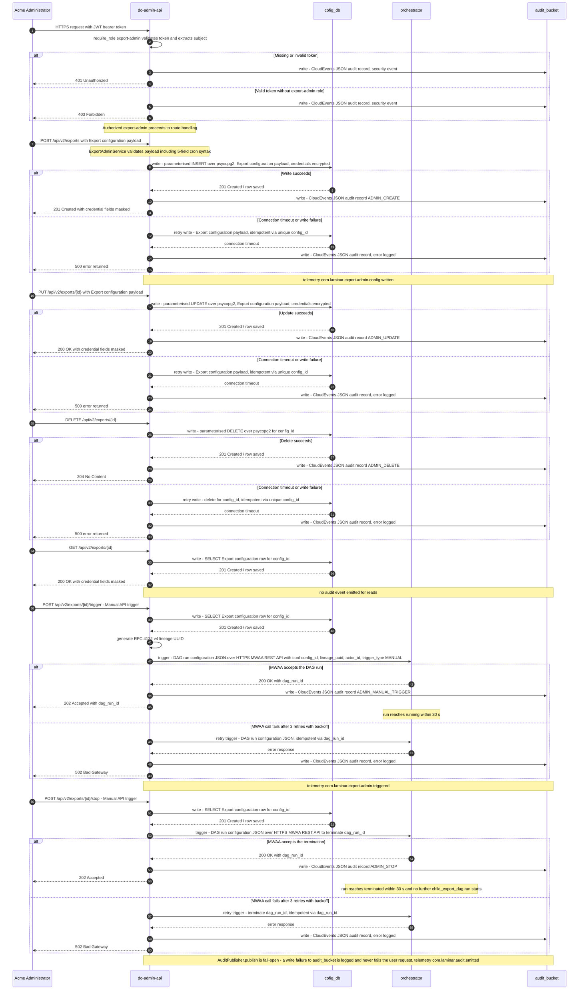

### 3.5. Schema Definitions (DB Tables / API JSON / Telemetry CloudEvents)
<a id="laminar-sec-c.imp_standard_standard_api_1.schema"></a>
#### 3.5.1 Database tables owned by this component

**do-admin-api** owns no tables. It writes to and reads from the `export_config` table owned by **cofig_db** (see that component's schema section). The DDL is not repeated here.

#### 3.5.2 API JSON — request and response bodies

```json
{
  "$schema": "https://json-schema.org/draft/2020-12/schema",
  "$id": "https://laminar.com/schemas/do-admin-api/export-config-create-request.json",
  "title": "ExportConfigCreateRequest",
  "type": "object",
  "required": ["connection_name", "target_type", "dataset", "mode", "cron_schedule", "target_path", "credentials"],
  "additionalProperties": false,
  "properties": {
    "connection_name": { "type": "string", "minLength": 1, "maxLength": 100 },
    "target_type": { "enum": ["s3", "azure_blob", "gcs", "sftp"] },
    "dataset": { "enum": ["identity_profiles", "subscription_statuses", "campaigns_reactions", "reservation_items"] },
    "mode": { "enum": ["initial", "incremental"] },
    "cron_schedule": { "type": "string", "pattern": "^\\S+ \\S+ \\S+ \\S+ \\S+$" },
    "target_path": { "type": "string", "minLength": 1 },
    "credentials": { "type": "object", "additionalProperties": { "type": "string" } },
    "gzip_enabled": { "type": "boolean", "default": false },
    "pgp_enabled": { "type": "boolean", "default": false },
    "split_threshold_records": { "type": "integer", "minimum": 1, "default": 500000 }
  }
}
```

```json
{
  "$schema": "https://json-schema.org/draft/2020-12/schema",
  "$id": "https://laminar.com/schemas/do-admin-api/export-config-response.json",
  "title": "ExportConfigResponse",
  "type": "object",
  "required": ["config_id", "connection_name", "target_type", "dataset", "mode", "cron_schedule", "target_path", "credentials_masked", "created_at", "updated_at"],
  "properties": {
    "config_id": { "type": "string", "format": "uuid" },
    "connection_name": { "type": "string" },
    "target_type": { "enum": ["s3", "azure_blob", "gcs", "sftp"] },
    "dataset": { "enum": ["identity_profiles", "subscription_statuses", "campaigns_reactions", "reservation_items"] },
    "mode": { "enum": ["initial", "incremental"] },
    "cron_schedule": { "type": "string" },
    "target_path": { "type": "string" },
    "credentials_masked": { "type": "object", "additionalProperties": { "const": "********" } },
    "gzip_enabled": { "type": "boolean" },
    "pgp_enabled": { "type": "boolean" },
    "split_threshold_records": { "type": "integer" },
    "is_active": { "type": "boolean" },
    "created_at": { "type": "string", "format": "date-time" },
    "updated_at": { "type": "string", "format": "date-time" }
  }
}
```

```json
{
  "$schema": "https://json-schema.org/draft/2020-12/schema",
  "$id": "https://laminar.com/schemas/do-admin-api/error-envelope.json",
  "title": "ErrorEnvelope",
  "type": "object",
  "required": ["error"],
  "properties": {
    "error": {
      "type": "object",
      "required": ["code", "message"],
      "properties": {
        "code": { "type": "string" },
        "message": { "type": "string" },
        "details": { "type": "array", "items": { "type": "object" } }
      }
    }
  }
}
```

#### 3.5.3 Telemetry — CloudEvents emitted by do-admin-api

```json
{
  "$schema": "https://json-schema.org/draft/2020-12/schema",
  "$id": "https://laminar.com/schemas/do-admin-api/audit-cloudevent.json",
  "title": "AdminAuditCloudEvent",
  "type": "object",
  "required": ["specversion", "id", "source", "type", "time", "subject", "data"],
  "properties": {
    "specversion": { "const": "1.0" },
    "id": { "type": "string", "format": "uuid" },
    "source": { "const": "urn:laminar:dataoutbound:do-admin-api" },
    "type": {
      "enum": [
        "com.laminar.export.admin.config.written",
        "com.laminar.export.admin.triggered",
        "com.laminar.export.admin.stopped",
        "com.laminar.audit.emitted"
      ]
    },
    "time": { "type": "string", "format": "date-time" },
    "subject": { "type": "string", "description": "config_id" },
    "data": {
      "type": "object",
      "required": ["actor_id", "timestamp_utc", "event_type", "execution_id"],
      "properties": {
        "actor_id": { "type": "string" },
        "timestamp_utc": { "type": "string", "pattern": "^\\d{4}-\\d{2}-\\d{2}T\\d{2}:\\d{2}:\\d{2}\\.\\d{3}Z$" },
        "event_type": {
          "enum": ["ADMIN_CREATE", "ADMIN_UPDATE", "ADMIN_DELETE", "ADMIN_MANUAL_TRIGGER", "ADMIN_STOP"]
        },
        "execution_id": { "type": "string", "format": "uuid" },
        "config_id": { "type": "string", "format": "uuid" },
        "dag_run_id": { "type": "string" },
        "status": { "type": "string" }
      }
    }
  }
}
```

### 3.6. Local Design Assumptions
<a id="laminar-sec-c.imp_standard_standard_api_1.asm"></a>
- **Stop endpoint.** The frozen `<component_contracts>` interface list for **do-admin-api** names only `POST /api/v2/exports/{id}/trigger`, but SCRUM-480 AC#6 and AC#7 require a stop/terminate operation with the same authorisation semantics. This design adds `POST /api/v2/exports/{id}/stop` returning `202 Accepted` (with `401`/`403`/`404`/`500`/`502`), using the same `export-admin` auth dependency and emitting an `ADMIN_STOP` audit event. The MWAA interaction is the same REST API used for trigger, with the run state set to `terminated`.
- **`dag_run_id` on stop.** The stop request carries the `dag_run_id` of the running **orchestrator** run as a query parameter, because a single `config_id` may have more than one historical run. If the caller omits it, the service resolves the most recent non-terminal run for that `config_id`; if none exists, the route returns `404`.
- **Audit publisher interface.** `AuditPublisher` is instantiated argument-free (`AuditPublisher()`), matching every other component's skeleton in this document; the publisher resolves its S3 sink and bucket name from `ConfigLoader` internally. This is the single interface all callers agree on.
- **Credential encryption.** Credential fields are encrypted with a KMS-backed envelope before persistence; the plaintext is never returned by any route and never logged. The masking value is the literal `"********"`.
- **Cron validation.** 5-field cron syntax is validated with `croniter`; an invalid expression yields `400` with `details=[{"field": "cron_schedule"}]` and leaves the row count and `updated_at` unchanged (SCRUM-479 AC#2).
- **Rate limiting.** A per-subject token-bucket limiter is applied at the middleware layer; the default is 60 requests/minute per subject, configurable through `apis/config.yml`. This is a mainstream default and is not a user decision.
- **Health endpoint.** `GET /health` is unauthenticated and returns `200` when the process is up; it does not probe **cofig_db** or **orchestrator** (deep health checks are out of scope for this HLD).
- **Idempotency of trigger.** A repeated trigger for the same `config_id` produces a new `dag_run_id`; the contract's idempotency guarantee is at the `dag_run_id` level, not at the request level. Callers that need request-level idempotency supply an `Idempotency-Key` header, which is honoured by the service layer via `util.idempotency.IdempotencyKey.build(...)`.
- **Out of scope.** Operational runbooks, alert routing, on-call rotations and CI/CD pipelines are explicitly out of scope per the architecture summary.

## 4. Component Design: scheduler
<a id="laminar-sec-c.imp_aws_aws_eventbridge_2"></a>

<!-- laminar:diagram-settings:imp-aws-aws_eventbridge-2 -->
**Diagram settings (user decisions — authoritative)**

| Setting | Value |
| --- | --- |
| `rule_name` | `scheduler` |

<!-- /laminar:diagram-settings -->


### 4.1. Component Contract (Bi-Directional Inputs & Outputs)
<a id="laminar-sec-c.imp_aws_aws_eventbridge_2.contract"></a>
Diagram settings (user decisions — authoritative):
- rule_name = scheduler

#### 4.1.1 Inbound Interfaces & Triggers
- **Time-based Cadence**: Internal EventBridge cron/rate scheduler triggered according to configured operational cadences (`@daily`).

#### 4.1.2 Outbound Interfaces & Targets
- **orchestrator**: Invokes the Amazon MWAA Export Orchestrator DAG (`orchestrator`) via AWS EventBridge rule target integration (triggering the MWAA REST API / DAG trigger endpoint) carrying scheduled event payloads and lineage context.

#### 4.1.3 Error Handling & Retry Behavior
- **EventBridge Retry Policy**: Configured with up to 3 automatic retry attempts on target invocation failure.
- **Dead-Letter Queue (DLQ)**: Undeliverable events after maximum retries are routed to an associated SQS DLQ to prevent silent event loss and trigger operational alarms.

---

### 4.2. Class and Interface Definitions
<a id="laminar-sec-c.imp_aws_aws_eventbridge_2.classes"></a>
```python
from dataclasses import dataclass, field
from typing import Dict, Any

@dataclass
class SchedulerEventPayload:
    version: str = "0"
    id: str = field(default_factory=str)
    detail_type: str = "Scheduled Export Trigger"
    source: str = "aws.events"
    account: str = field(default_factory=str)
    time: str = field(default_factory=str)
    region: str = field(default_factory=str)
    resources: list = field(default_factory=list)
    detail: Dict[str, Any] = field(default_factory=dict)
```

---

### 4.3. Implementation Code Skeleton (Stubs & Handlers)
<a id="laminar-sec-c.imp_aws_aws_eventbridge_2.skeleton"></a>
```python
"""
Illustrative skeleton — the Component Contract and Schema Definitions are binding.
Path: terraform/eventbridge.tf (EventBridge Rule & Target Configuration)
"""

# Resource definition for EventBridge scheduler rule targeting MWAA Orchestrator DAG
"""
resource "aws_cloudwatch_event_rule" "scheduler" {
  name                = "scheduler"
  description         = "Triggers Export Orchestrator DAG on a daily cadence"
  schedule_expression = "cron(0 2 * * ? *)" # @daily default
}

resource "aws_cloudwatch_event_target" "orchestrator_target" {
  rule      = aws_cloudwatch_event_rule.scheduler.name
  target_id = "orchestrator_dag_target"
  arn       = var.mwaa_environment_arn
  role_arn  = aws_iam_role.eventbridge_mwaa_execution_role.arn

  dead_letter_config {
    arn = aws_sqs_queue.scheduler_dlq.arn
  }

  input_transformer {
    input_paths = {
      "time"   = "$.time"
      "id"     = "$.id"
    }
    input_template = "{\\\"dag_run_id\\\": \\\"scheduled__<time>\\\", \\\"conf\\\": {\\\"scheduled_time\\\": \\\"<time>\\\", \\\"event_id\\\": \\\"<id>\\\"}}"
  }
}
"""
```

---

### 4.4. Cross-Component Interaction Sequence (Local Mermaid/ASCII Flow)
<a id="laminar-sec-c.imp_aws_aws_eventbridge_2.seq"></a>
1. **Cron Trigger**: The EventBridge `scheduler` rule fires on its defined cron schedule (`@daily`).
2. **Payload Transformation**: EventBridge evaluates the rule's input transformer, injecting the scheduled timestamp and event ID into the MWAA REST API payload format.
3. **Target Invocation**: EventBridge invokes the `orchestrator` MWAA environment target.
4. **Success Path**: MWAA receives the trigger request, instantiates a new run for the `orchestrator` DAG, and returns an HTTP 200 OK response with the DAG run ID.
5. **Failure & DLQ Path**: If the MWAA REST API endpoint returns a 4xx/5xx error or times out, EventBridge retries the invocation up to 3 times according to its retry policy. If all retries fail, the event is automatically routed to the SQS Dead-Letter Queue for inspection and alerting.

---
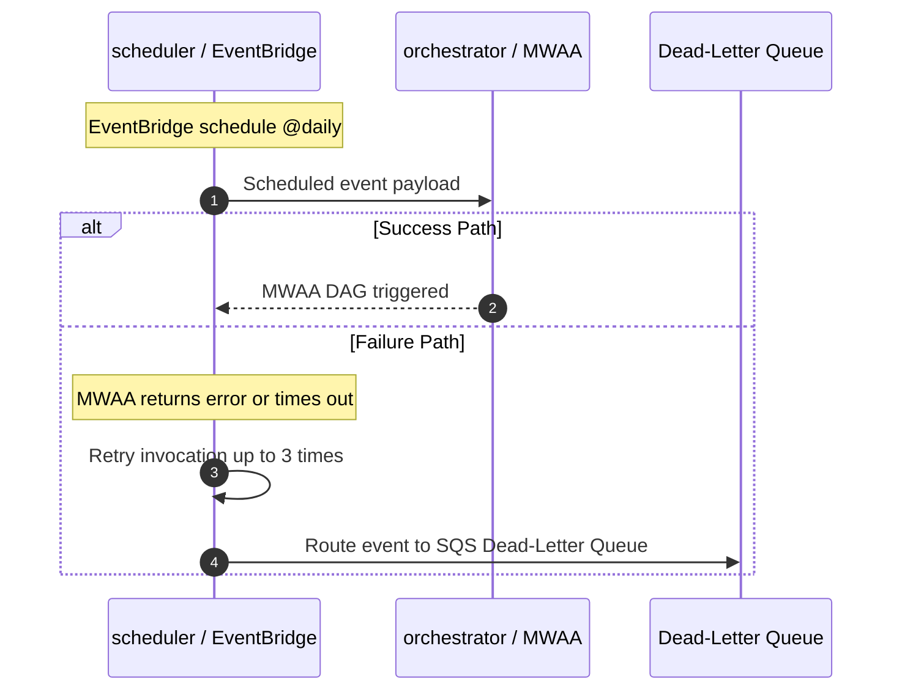

### 4.5. Schema Definitions (DB Tables / API JSON / Telemetry CloudEvents)
<a id="laminar-sec-c.imp_aws_aws_eventbridge_2.schema"></a>
```json
{
  "$schema": "http://json-schema.org/draft-07/schema#",
  "title": "SchedulerEventBridgePayload",
  "type": "object",
  "required": [
    "version",
    "id",
    "detail-type",
    "source",
    "account",
    "time",
    "region",
    "detail"
  ],
  "properties": {
    "version": { "type": "string", "example": "0" },
    "id": { "type": "string", "format": "uuid" },
    "detail-type": { "type": "string", "example": "Scheduled Export Trigger" },
    "source": { "type": "string", "example": "aws.events" },
    "account": { "type": "string", "example": "123456789012" },
    "time": { "type": "string", "format": "date-time" },
    "region": { "type": "string", "example": "us-east-1" },
    "resources": {
      "type": "array",
      "items": { "type": "string" }
    },
    "detail": {
      "type": "object",
      "properties": {
        "scheduled_time": { "type": "string", "format": "date-time" },
        "event_id": { "type": "string" }
      }
    }
  }
}
```

---

### 4.6. Local Design Assumptions
<a id="laminar-sec-c.imp_aws_aws_eventbridge_2.asm"></a>
1. **Cron Cadence & Time Window**: The scheduler fires daily at 02:00 UTC, aligning with the batch export SLA requirements and allowing the downstream orchestrator to evaluate active connections within a +/- 10 minute window.
2. **DLQ Resource Provisioning**: An dedicated SQS Dead-Letter Queue is provisioned and bound to the EventBridge rule target to capture poisoned or failed cadence events securely.
3. **IAM Execution Permissions**: EventBridge assumes a least-privilege IAM execution role authorized specifically to invoke the Amazon MWAA REST API / trigger mechanism.

## 5. Component Design: orchestrator
<a id="laminar-sec-c.imp_aws_aws_mwaa_dag_3"></a>

<!-- laminar:diagram-settings:imp-aws-aws_mwaa_dag-3 -->
**Diagram settings (user decisions — authoritative)**

| Setting | Value |
| --- | --- |
| `schedule` | `@daily` |
| `catchup` | `false` |
| `max_active_runs` | `1` |
| `dag_name` | `orchestrator` |

<!-- /laminar:diagram-settings -->


### 5.1. Component Contract (Bi-Directional Inputs & Outputs)
<a id="laminar-sec-c.imp_aws_aws_mwaa_dag_3.contract"></a>
**Component:** `orchestrator` — MWAA DAG `orchestrator` (`@daily`, `catchup=false`, `max_active_runs=1`). It is the fan-out point of the pipeline: it reads active export configurations from **cofig_db**, selects the connections whose `cron_schedule` matches the current time within ±10 minutes, generates exactly one RFC 4122 v4 lineage UUID per run, and invokes one **child_export_dag** run per selected connection carrying that UUID.

#### 5.1.1 Inbound contracts

| # | Counterparty | Protocol | Trigger | Request payload | Response | Error behaviour | Idempotency key | Telemetry event |
|---|---|---|---|---|---|---|---|---|
| I1 | **do-admin-api** | HTTPS / MWAA REST API | Manual API trigger | `OrchestratorRunConfig` JSON as the DAG run `conf` (`trigger_type="manual"`, `config_id`, `triggered_by`) | `200 OK` with `dag_run_id` | Retry 3× with exponential backoff, then raise `502` to the caller | `dag_run_id` | `com.laminar.export.admin.triggered` |
| I2 | **do-admin-api** | HTTPS / MWAA REST API | Manual stop | `PATCH /dags/orchestrator/dagRuns/{dag_run_id}` with `{"state": "failed"}` | `200 OK` with the updated run state | Retry 3× with exponential backoff, then raise `502` to the caller | `dag_run_id` | `com.laminar.export.admin.stopped` |
| I3 | **scheduler** | EventBridge rule target | EventBridge schedule `@daily` | Scheduled event payload (`source`, `detail-type`, `time`, `id`) | MWAA DAG triggered | EventBridge retry policy with DLQ attached to the rule target | EventBridge rule invocation ID | `com.laminar.export.scheduler.triggered` |

**Stop semantics (I2).** The stop request is applied to the *running* `orchestrator` run. Airflow transitions the run to its terminal state and kills the in-flight `select_connections` / `invoke_child_export` task instances, so no further `child_export_dag` run is started for that execution after the stop is accepted. The DAG additionally re-reads `dag_run.conf.get("stop_requested")` at the head of `select_connections` and returns an empty fan-out list when it is set, which makes the stop effective even if the request lands between two mapped task instances. The run reaches its terminal state within 30 s of the accepted stop request.

### 5.2. Class and Interface Definitions
<a id="laminar-sec-c.imp_aws_aws_mwaa_dag_3.classes"></a>
```python
# src/dataoutbound_st_fixes/dags/export_orchestrator_dag.py
from __future__ import annotations

from dataclasses import dataclass, field
from datetime import datetime, timedelta
from typing import Any, Iterable, Mapping, Sequence

from dataoutbound_st_fixes.common.clients.db.db_client import DbClient
from dataoutbound_st_fixes.common.logging.logger import get_logger
from dataoutbound_st_fixes.common.telemetry.auditor import AuditPublisher
from dataoutbound_st_fixes.config.config_loader import ConfigLoader
from dataoutbound_st_fixes.util.idempotency import IdempotencyKey

# Selection tolerance fixed by SCRUM-480 AC#1 / SCRUM-481 AC#3.
ORCHESTRATOR_SELECTION_WINDOW_MINUTES: int = 10


@dataclass(frozen=True)
class ExportConnection:
    """One active row of the export configuration store, non-secret projection only."""

    config_id: str
    connection_name: str
    target_type: str          # s3 | azure_blob | gcs | sftp
    dataset: str              # identity_profiles | subscription_statuses | campaigns_reactions | reservation_items
    mode: str                 # initial | incremental
    cron_schedule: str        # 5-field cron expression
    is_active: bool
    gzip_enabled: bool
    pgp_enabled: bool
    split_threshold: int
    target_path: str
    credentials_ref: str      # SSM Parameter Store SecureString name; never the secret itself
    updated_at: datetime

    def to_run_conf(self) -> dict[str, Any]:
        """Non-secret projection handed to child_export_dag. Never contains credentials."""
        return {
            "config_id": self.config_id,
            "connection_name": self.connection_name,
            "target_type": self.target_type,
            "dataset": self.dataset,
            "mode": self.mode,
            "cron_schedule": self.cron_schedule,
            "gzip_enabled": self.gzip_enabled,
            "pgp_enabled": self.pgp_enabled,
            "split_threshold": self.split_threshold,
            "target_path": self.target_path,
            "credentials_ref": self.credentials_ref,
        }


@dataclass(frozen=True)
class OrchestratorRunConfig:
    """The `conf` of an `orchestrator` DAG run (inbound contract I1 / I3)."""

    lineage_uuid: str
    trigger_type: str                 # "scheduled" | "manual"
    triggered_by: str                 # actor_id, or "system:scheduler"
    logical_date: str                 # ISO-8601 UTC, millisecond precision, Z suffix
    config_id: str | None = None      # set only for a manual single-connection trigger
    stop_requested: bool = False

    @classmethod
    def from_dag_conf(cls, conf: Mapping[str, Any] | None, logical_date: datetime) -> "OrchestratorRunConfig":
        raise NotImplementedError


@dataclass(frozen=True)
class ChildRunConfig:
    """The `conf` of a `child_export_dag` run (outbound contract O2)."""

    config_id: str
    lineage_uuid: str
    connection_json: dict[str, Any] = field(default_factory=dict)

    def as_dict(self) -> dict[str, Any]:
        return {
            "config_id": self.config_id,
            "lineage_uuid": self.lineage_uuid,
            "connection_json": self.connection_json,
        }


class ConnectionSelector:
    """Pure selection logic: which active connections are due at the reference time."""

    def __init__(self, window: timedelta = timedelta(minutes=ORCHESTRATOR_SELECTION_WINDOW_MINUTES)) -> None:
        self._window = window

    def is_due(self, connection: ExportConnection, reference_time: datetime) -> bool:
        """True when the connection's cron matches any minute inside [T-window, T+window]."""
        raise NotImplementedError

    def select(
        self,
        connections: Iterable[ExportConnection],
        reference_time: datetime,
        config_id: str | None = None,
    ) -> list[ExportConnection]:
        """Active, due connections; a manual trigger narrows the result to one config_id."""
        raise NotImplementedError


class OrchestratorService:
    """Business operations of the orchestrator DAG. No Airflow types cross this boundary."""

    def __init__(
        self,
        db_client: DbClient,
        auditor: AuditPublisher,
        selector: ConnectionSelector,
        config: ConfigLoader,
    ) -> None:
        self._db = db_client
        self._auditor = auditor
        self._selector = selector
        self._config = config
        self._logger = get_logger(__name__)

    def load_active_connections(self) -> list[ExportConnection]:
        """O1 — read every active export configuration from cofig_db."""
        raise NotImplementedError

    def build_run_config(
        self, dag_conf: Mapping[str, Any] | None, logical_date: datetime
    ) -> OrchestratorRunConfig:
        """Normalise the inbound conf; generate the lineage UUID when absent."""
        raise NotImplementedError

    def select_connections(
        self, run_config: OrchestratorRunConfig, reference_time: datetime
    ) -> list[ExportConnection]:
        """Apply the ±10 minute window; return [] when the run has been stopped."""
        raise NotImplementedError

    def build_child_conf(
        self, run_config: OrchestratorRunConfig, connection: ExportConnection
    ) -> dict[str, Any]:
        """O2 — the child run conf, carrying the same lineage UUID."""
        raise NotImplementedError

    def emit_lifecycle(
        self, event_type: str, run_config: OrchestratorRunConfig, status: str, **extra: Any
    ) -> None:
        """O3 — publish one audit record; never raises into the DAG."""
        raise NotImplementedError

    def child_idempotency_key(self, run_config: OrchestratorRunConfig, connection: ExportConnection) -> str:
        """Logical date + config_id, per the frozen contract."""
        raise NotImplementedError
```

### 5.3. Implementation Code Skeleton (Stubs & Handlers)
<a id="laminar-sec-c.imp_aws_aws_mwaa_dag_3.skeleton"></a>
Illustrative skeleton — the Component Contract and Schema Definitions are binding.

```python
# src/dataoutbound_st_fixes/dags/export_orchestrator_dag.py
# Illustrative skeleton — the Component Contract and Schema Definitions are binding.
from __future__ import annotations

import uuid
from datetime import datetime, timedelta, timezone
from typing import Any, Mapping

from airflow import DAG
from airflow.operators.python import PythonOperator
from airflow.operators.trigger_dagrun import TriggerDagRunOperator
from croniter import croniter

from dataoutbound_st_fixes.common.clients.db.db_client import DbClient
from dataoutbound_st_fixes.common.logging.logger import get_logger
from dataoutbound_st_fixes.common.telemetry.auditor import AuditPublisher
from dataoutbound_st_fixes.config.config_loader import ConfigLoader
from dataoutbound_st_fixes.util.constants import (
    AUDIT_EVENT_EXECUTION_COMPLETED,
    AUDIT_EVENT_EXECUTION_STARTED,
    DAG_ID_CHILD_EXPORT,
    DAG_ID_ORCHESTRATOR,
)
from dataoutbound_st_fixes.util.exceptions import ClientError
from dataoutbound_st_fixes.util.idempotency import IdempotencyKey

logger = get_logger(__name__)
config = ConfigLoader(module="dags")

SELECTION_WINDOW = timedelta(minutes=10)  # SCRUM-480 AC#1 / SCRUM-481 AC#3


# --------------------------------------------------------------------------- #
# Pure helpers
# --------------------------------------------------------------------------- #
def _is_due(cron_schedule: str, reference_time: datetime, window: timedelta = SELECTION_WINDOW) -> bool:
    """True when the 5-field cron matches any minute in [T-window, T+window]."""
    probe = reference_time - window
    limit = reference_time + window
    itr = croniter(cron_schedule, probe)
    while True:
        nxt = itr.get_next(datetime)
        if nxt > limit:
            return False
        if probe <= nxt <= limit:
            return True


def _lineage_uuid(conf: Mapping[str, Any] | None) -> str:
    """Exactly one RFC 4122 v4 UUID per run; reuse the caller's value when supplied."""
    supplied = (conf or {}).get("lineage_uuid")
    return supplied if supplied else str(uuid.uuid4())


# --------------------------------------------------------------------------- #
# Task callables
# --------------------------------------------------------------------------- #
def _start_run(**context: Any) -> dict[str, Any]:
    """Normalise the inbound conf, generate the lineage UUID, emit EXECUTION_STARTED."""
    dag_run = context["dag_run"]
    conf = dag_run.conf or {}
    run_config = {
        "lineage_uuid": _lineage_uuid(conf),
        "trigger_type": conf.get("trigger_type", "scheduled"),
        "triggered_by": conf.get("triggered_by", "system:scheduler"),
        "logical_date": context["logical_date"].astimezone(timezone.utc).isoformat(timespec="milliseconds").replace("+00:00", "Z"),
        "config_id": conf.get("config_id"),
        "stop_requested": bool(conf.get("stop_requested", False)),
    }
    AuditPublisher().publish(
        AUDIT_EVENT_EXECUTION_STARTED,
        {
            "actor_id": run_config["triggered_by"],
            "event_type": AUDIT_EVENT_EXECUTION_STARTED,
            "execution_id": run_config["lineage_uuid"],
            "status": "STARTED",
            "dag_id": DAG_ID_ORCHESTRATOR,
        },
    )
    logger.info("orchestrator run started", extra={"lineage_uuid": run_config["lineage_uuid"]})
    return run_config


def _select_connections(**context: Any) -> list[dict[str, Any]]:
    """O1 + selection: read active configs, apply the ±10 minute window, build child confs."""
    run_config: dict[str, Any] = context["ti"].xcom_pull(task_ids="start_run")
    if run_config.get("stop_requested"):
        logger.warning("stop requested before fan-out; no child run will be started")
        return []

    db = DbClient()
    try:
        rows = db.fetch_all(
            "SELECT config_id, connection_name, target_type, dataset, mode, cron_schedule, "
            "is_active, gzip_enabled, pgp_enabled, split_threshold, target_path, credentials_ref, updated_at "
            "FROM export_config WHERE is_active = TRUE"
        )
    except ClientError:
        logger.exception("failed to read export configurations from cofig_db")
        raise

    reference_time = context["logical_date"].astimezone(timezone.utc)
    child_confs: list[dict[str, Any]] = []
    for row in rows:
        if run_config.get("config_id") and row["config_id"] != run_config["config_id"]:
            continue
        if not _is_due(row["cron_schedule"], reference_time):
            continue
        child_confs.append(
            {
                "config_id": row["config_id"],
                "lineage_uuid": run_config["lineage_uuid"],
                "connection_json": {
                    "config_id": row["config_id"],
                    "connection_name": row["connection_name"],
                    "target_type": row["target_type"],
                    "dataset": row["dataset"],
                    "mode": row["mode"],
                    "cron_schedule": row["cron_schedule"],
                    "gzip_enabled": row["gzip_enabled"],
                    "pgp_enabled": row["pgp_enabled"],
                    "split_threshold": row["split_threshold"],
                    "target_path": row["target_path"],
                    "credentials_ref": row["credentials_ref"],
                },
            }
        )
    logger.info("selected %d connection(s) for fan-out", len(child_confs))
    return child_confs


def _finish_run(**context: Any) -> None:
    """Emit EXECUTION_COMPLETED (or the failure variant) once the fan-out has settled."""
    run_config: dict[str, Any] = context["ti"].xcom_pull(task_ids="start_run") or {}
    status = "COMPLETED" if context["dag_run"].state == "success" else "FAILED"
    AuditPublisher().publish(
        AUDIT_EVENT_EXECUTION_COMPLETED,
        {
            "actor_id": run_config.get("triggered_by", "system:orchestrator"),
            "event_type": AUDIT_EVENT_EXECUTION_COMPLETED,
            "execution_id": run_config.get("lineage_uuid"),
            "status": status,
            "dag_id": DAG_ID_ORCHESTRATOR,
        },
    )


# --------------------------------------------------------------------------- #
# DAG definition
# --------------------------------------------------------------------------- #
default_args = {
    "owner": config.get("orchestrator.owner", "dataoutbound"),
    "retries": config.get("orchestrator.retries", 2),
    "retry_delay": timedelta(minutes=config.get("orchestrator.retry_delay_minutes", 5)),
    "email_on_failure": False,
}

with DAG(
    dag_id=DAG_ID_ORCHESTRATOR,
    schedule=config.get("orchestrator.schedule", "@daily"),
    catchup=config.get("orchestrator.catchup", False),
    max_active_runs=config.get("orchestrator.max_active_runs", 1),
    default_args=default_args,
    tags=config.get("orchestrator.tags", []),
    render_template_as_native_obj=True,
) as dag:
    start_run = PythonOperator(task_id="start_run", python_callable=_start_run)

    select_connections = PythonOperator(
        task_id="select_connections", python_callable=_select_connections
    )

    invoke_child_export = TriggerDagRunOperator.partial(
        task_id="invoke_child_export",
        trigger_dag_id=DAG_ID_CHILD_EXPORT,
        wait_for_completion=False,
        reset_dag_run=False,          # idempotent per logical date + config_id
    ).expand(conf=select_connections.output)

    finish_run = PythonOperator(
        task_id="finish_run", python_callable=_finish_run, trigger_rule="all_done"
    )

    start_run >> select_connections >> invoke_child_export >> finish_run
```

### 5.4. Cross-Component Interaction Sequence (Local Mermaid/ASCII Flow)
<a id="laminar-sec-c.imp_aws_aws_mwaa_dag_3.seq"></a>
The `orchestrator` run is entered from two directions and always leaves through the same fan-out.

1. **Entry — scheduled path.** The **scheduler** EventBridge rule fires at its `@daily` cadence and invokes the `orchestrator` DAG through the MWAA REST API (contract I3). The rule target carries a DLQ, so a failed invocation is never silently dropped. The run's `conf` is empty and `trigger_type` defaults to `scheduled`.
2. **Entry — manual path.** An authorised user calls `POST /api/v2/exports/{id}/trigger` on **do-admin-api**, which calls the MWAA REST API `POST /dags/orchestrator/dagRuns` with `conf={config_id, trigger_type="manual", triggered_by=<actor>}` (contract I1). The API returns `202` to the user once MWAA returns `200` with a `dag_run_id`; the run must be observed in `running` within 30 s.
3. **Entry — stop path.** An authorised user calls the stop endpoint on **do-admin-api**, which issues `PATCH /dags/orchestrator/dagRuns/{dag_run_id}` with `{"state": "failed"}` (contract I2). Airflow terminates the run and kills the in-flight fan-out tasks; `select_connections` also short-circuits on `stop_requested`, so no further **child_export_dag** run is started for that execution.
4. **`start_run`.** The DAG normalises the inbound `conf`, generates exactly one RFC 4122 v4 lineage UUID when the caller did not supply one, and publishes an `EXECUTION_STARTED` audit record to **audit_bucket** (contract O3) carrying that UUID as `execution_id`.
5. **`select_connections`.** The task reads every active export configuration from **cofig_db** over psycopg2 (contract O1). A read failure is retried at the transaction level and fails the DAG when retries are exhausted. Each row is tested against the ±10 minute window around the logical date; a manual trigger additionally narrows the result to the single `config_id` in the run `conf`. The task returns the list of child run configurations.
6. **`invoke_child_export` (dynamically mapped).** One `TriggerDagRunOperator` instance is created per selected connection and invokes **child_export_dag** with `conf={config_id, lineage_uuid, connection_json}` (contract O2). Every child run carries the *same* lineage UUID as the parent run and the non-secret connection projection for its own connection. The operator is idempotent per logical date + `config_id`, so a retried task does not create a duplicate child run. A trigger failure is retried by Airflow and raises a task-failure alert on exhaustion.
7. **`finish_run`.** With `trigger_rule="all_done"`, the task publishes `EXECUTION_COMPLETED` (or the failure variant) to **audit_bucket** with the same `execution_id`, closing the run's audit pair.

**Failure paths.** A **cofig_db** read failure fails the DAG after retries and leaves no child run behind. A **child_export_dag** trigger failure is retried and, on exhaustion, fails only that mapped task instance — the remaining connections still fan out. An **audit_bucket** write failure is logged and swallowed; it never fails the run, because audit emission is best-effort with respect to the pipeline's forward progress.
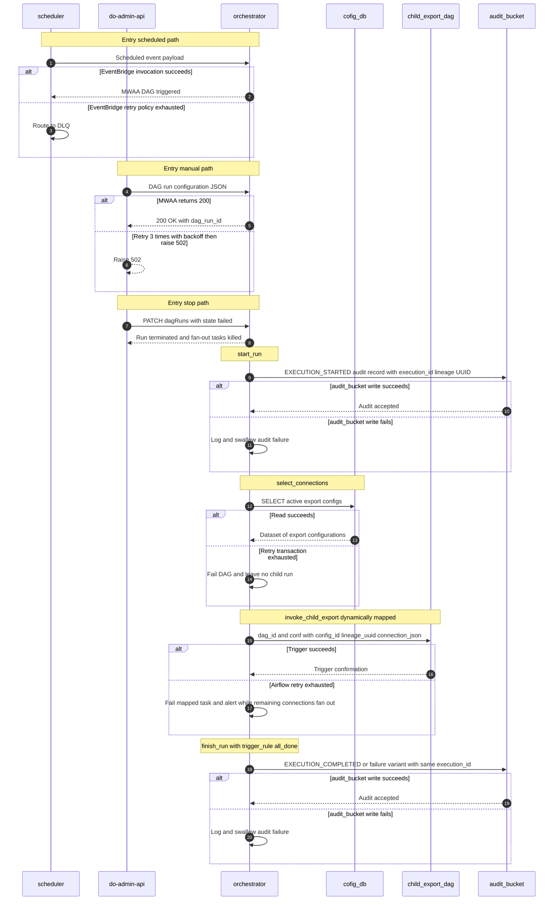

### 5.5. Schema Definitions (DB Tables / API JSON / Telemetry CloudEvents)
<a id="laminar-sec-c.imp_aws_aws_mwaa_dag_3.schema"></a>
**Database tables owned by this component:** none. The `orchestrator` owns only DAG execution state, which lives in the MWAA-managed Airflow metadata database and is not modelled here. No DDL is emitted for this component.

#### 5.5.1 Orchestrator DAG run configuration (`conf` of an `orchestrator` run)

```json
{
  "$schema": "https://json-schema.org/draft/2020-12/schema",
  "$id": "https://laminar.com/schemas/dataoutbound/orchestrator-run-config.json",
  "title": "OrchestratorRunConfig",
  "type": "object",
  "required": ["lineage_uuid", "trigger_type", "triggered_by", "logical_date"],
  "additionalProperties": false,
  "properties": {
    "lineage_uuid": {
      "type": "string",
      "format": "uuid",
      "description": "RFC 4122 version 4 UUID; generated by the orchestrator when absent."
    },
    "trigger_type": { "type": "string", "enum": ["scheduled", "manual"] },
    "triggered_by": {
      "type": "string",
      "description": "Authenticated Acme user identifier, or system:<component-name>."
    },
    "logical_date": {
      "type": "string",
      "pattern": "^\\d{4}-\\d{2}-\\d{2}T\\d{2}:\\d{2}:\\d{2}\\.\\d{3}Z$"
    },
    "config_id": { "type": ["string", "null"], "description": "Set only for a manual single-connection trigger." },
    "stop_requested": { "type": "boolean", "default": false }
  }
}
```

#### 5.5.2 Child export DAG run configuration (`conf` of a `child_export_dag` run — contract O2)

```json
{
  "$schema": "https://json-schema.org/draft/2020-12/schema",
  "$id": "https://laminar.com/schemas/dataoutbound/child-run-config.json",
  "title": "ChildRunConfig",
  "type": "object",
  "required": ["config_id", "lineage_uuid", "connection_json"],
  "additionalProperties": false,
  "properties": {
    "config_id": { "type": "string" },
    "lineage_uuid": { "type": "string", "format": "uuid" },
    "connection_json": {
      "type": "object",
      "description": "Non-secret projection of the export configuration. Credentials are never present.",
      "required": ["config_id", "connection_name", "target_type", "dataset", "mode", "cron_schedule", "credentials_ref"],
      "additionalProperties": false,
      "properties": {
        "config_id": { "type": "string" },
        "connection_name": { "type": "string", "minLength": 1, "maxLength": 100 },
        "target_type": { "type": "string", "enum": ["s3", "azure_blob", "gcs", "sftp"] },
        "dataset": {
          "type": "string",
          "enum": ["identity_profiles", "subscription_statuses", "campaigns_reactions", "reservation_items"]
        },
        "mode": { "type": "string", "enum": ["initial", "incremental"] },
        "cron_schedule": { "type": "string", "description": "Valid 5-field cron expression." },
        "gzip_enabled": { "type": "boolean" },
        "pgp_enabled": { "type": "boolean" },
        "split_threshold": { "type": "integer", "minimum": 1 },
        "target_path": { "type": "string" },
        "credentials_ref": {
          "type": "string",
          "description": "SSM Parameter Store SecureString name; never the secret value."
        }
      }
    }
  }
}
```

#### 5.5.3 Telemetry — `com.laminar.export.child.invoked` (CloudEvents 1.0)

```json
{
  "$schema": "https://json-schema.org/draft/2020-12/schema",
  "$id": "https://laminar.com/schemas/dataoutbound/child-invoked-cloudevent.json",
  "title": "ChildInvokedCloudEvent",
  "type": "object",
  "required": ["specversion", "id", "source", "type", "time", "subject", "datacontenttype", "data"],
  "properties": {
    "specversion": { "const": "1.0" },
    "id": { "type": "string", "format": "uuid" },
    "source": { "const": "urn:laminar:dataoutbound:orchestrator" },
    "type": { "const": "com.laminar.export.child.invoked" },
    "time": { "type": "string", "pattern": "^\\d{4}-\\d{2}-\\d{2}T\\d{2}:\\d{2}:\\d{2}\\.\\d{3}Z$" },
    "subject": { "type": "string", "description": "config_id of the invoked child run." },
    "datacontenttype": { "const": "application/json" },
    "data": {
      "type": "object",
      "required": ["execution_id", "config_id", "dag_id", "logical_date"],
      "properties": {
        "execution_id": { "type": "string", "format": "uuid" },
        "config_id": { "type": "string" },
        "dag_id": { "const": "child_export_dag" },
        "logical_date": { "type": "string" },
        "trigger_type": { "type": "string", "enum": ["scheduled", "manual"] }
      }
    }
  }
}
```

#### 5.5.4 Audit record written to **audit_bucket** (contract O3)

```json
{
  "$schema": "https://json-schema.org/draft/2020-12/schema",
  "$id": "https://laminar.com/schemas/dataoutbound/orchestrator-audit-record.json",
  "title": "OrchestratorAuditRecord",
  "type": "object",
  "required": ["actor_id", "timestamp_utc", "event_type", "execution_id"],
  "properties": {
    "actor_id": { "type": "string", "description": "Acme user id, or system:orchestrator." },
    "timestamp_utc": {
      "type": "string",
      "pattern": "^\\d{4}-\\d{2}-\\d{2}T\\d{2}:\\d{2}:\\d{2}\\.\\d{3}Z$"
    },
    "event_type": { "type": "string", "enum": ["EXECUTION_STARTED", "EXECUTION_COMPLETED"] },
    "execution_id": { "type": "string", "format": "uuid", "description": "The lineage UUID of the run." },
    "status": { "type": "string", "enum": ["STARTED", "COMPLETED", "FAILED"] },
    "dag_id": { "const": "orchestrator" }
  }
}
```

### 5.6. Local Design Assumptions
<a id="laminar-sec-c.imp_aws_aws_mwaa_dag_3.asm"></a>
- **Selection window.** The ±10 minute tolerance is fixed at `ORCHESTRATOR_SELECTION_WINDOW_MINUTES = 10` because SCRUM-480 AC#1 and SCRUM-481 AC#3 measure selection against exactly that tolerance; it is a constant, not a tunable, so the acceptance test and the implementation cannot drift apart.
- **Lineage UUID generation.** The UUID is generated in the `start_run` task, not at DAG-parse time, so that a re-run of the same logical date produces a fresh UUID while a retried *task* reuses the value already in XCom. This satisfies "exactly one UUID per run" (SCRUM-480 AC#3) without making the DAG non-idempotent.
- **Stop mechanism.** Airflow's `PATCH /dags/{dag_id}/dagRuns/{dag_run_id}` with `{"state": "failed"}` is the mainstream MWAA REST API mechanism for terminating a run; combined with `max_active_runs=1` and the `stop_requested` short-circuit in `select_connections`, it satisfies SCRUM-480 AC#6 (terminal state within 30 s, no further child run). The stop endpoint itself is owned by **do-admin-api**; this component only defines the receiving side of that interaction.
- **Audit emission from the orchestrator (assumption).** The canvas shows no explicit `orchestrator → audit_bucket` edge, but SCRUM-480 AC#3 and AC#7 require the run's lineage UUID and its start/success/failure lifecycle to be recorded in the audit store. This design therefore emits `EXECUTION_STARTED` / `EXECUTION_COMPLETED` through the shared `AuditPublisher` to **audit_bucket**, using the same publisher and the same four-field audit schema as every other component. No new component is introduced; the audit plane is the single sink already present on the canvas.
- **Audit failure is non-fatal.** `AuditPublisher.publish` never raises into the caller, so an audit-store outage degrades traceability but never blocks an export run. This is the mainstream trade-off for a best-effort audit sink and is consistent with the frozen contract's "Retry upload, log error on failure".
- **`connection_json` excludes credentials.** The child run `conf` carries `credentials_ref` only. Resolving that reference is the child DAG's responsibility, so no secret ever appears in Airflow's metadata database or in the MWAA REST API request log.
- **Retry policy.** Airflow task retries and retry delay are read from `dags/config.yml`; the design does not override Airflow's defaults beyond the values the user set on the canvas (`@daily`, `catchup=false`, `max_active_runs=1`).
- **Recommendation (not a configuration).** For a future production profile, consider raising `max_active_runs` above 1 only if the stop guarantee is re-derived, because the "no further child run after stop" property currently depends on it. Out of scope for this deployment.

## 6. Component Design: child_export_dag
<a id="laminar-sec-c.imp_aws_aws_mwaa_dag_4"></a>

<!-- laminar:diagram-settings:imp-aws-aws_mwaa_dag-4 -->
**Diagram settings (user decisions — authoritative)**

| Setting | Value |
| --- | --- |
| `schedule` | `@daily` |
| `catchup` | `false` |
| `max_active_runs` | `1` |
| `dag_name` | `child_export_dag` |

<!-- /laminar:diagram-settings -->


### 6.1. Component Contract (Bi-Directional Inputs & Outputs)
<a id="laminar-sec-c.imp_aws_aws_mwaa_dag_4.contract"></a>
#### 6.1.1 Diagram settings (user decisions — authoritative)

| Setting | Value |
|---|---|
| schedule | `@daily` |
| catchup | `false` |
| max_active_runs | `1` |
| dag_name | `child_export_dag` |

The DAG is deployed from `src/dataoutbound_st_fixes/dags/child_export_dag.py` with its runtime parameters read from `src/dataoutbound_st_fixes/dags/config.yml` through `ConfigLoader`. `catchup=false` and `max_active_runs=1` are binding: a missed logical date is never back-filled automatically, and at most one `child_export_dag` run is active at a time, so a re-trigger for the same logical date and `config_id` is rejected by Airflow rather than executed twice. The `@daily` schedule is retained as the user set it; in normal operation the DAG is triggered externally by **orchestrator** (and, for a manual run, by **do-admin-api** through **orchestrator**), so the schedule only governs standalone daily runs.

#### 6.1.2 Inbound contract — orchestrator → child_export_dag

| Field | Value |
|---|---|
| Protocol / mechanism | Airflow `TriggerDagRunOperator` (MWAA internal, Airflow metadata DB) |
| Trigger | Orchestrator DAG loop, one invocation per selected connection |
| Request | `dag_id="child_export_dag"`, `conf={"config_id": <uuid>, "lineage_uuid": <uuid>, "trigger_source": "orchestrator"\|"manual", "logical_date": <ISO-8601>}` |
| Response | Trigger confirmation (`dag_run_id` returned by the Airflow API) |
| Errors | Airflow task retry (3 attempts, exponential backoff); on exhaustion the orchestrator task fails and raises an alert |
| Idempotency | Idempotent per logical date + `config_id` — `max_active_runs=1` plus the deterministic `dag_run_id` prevents a duplicate run for the same pair |
| Telemetry | `com.laminar.export.child.invoked` (emitted by **orchestrator**) |

`config_id` and `lineage_uuid` are the only required fields; the DAG fails fast with a `ValidationError` if either is absent or is not an RFC 4122 v4 UUID.

#### 6.1.3 Outbound contracts

**child_export_dag → cofig_db** (read)

| Field | Value |
|---|---|
| Protocol | SQL over psycopg2 through `common.clients.db.DbClient` |
| Trigger | First task of the DAG run |
| Request | `SELECT` of the export configuration row by `config_id` plus its watermark row for the configured dataset |
| Response | Configuration details (target type, dataset, mode, recipe path, staging bucket, target path) and the current watermark |
| Errors | Retry the transaction (3 attempts, exponential backoff); fail the task on exhaustion |
| Idempotency | Idempotent read |
| Telemetry | none |

**child_export_dag → emr_do** (invoke)

| Field | Value |
|---|---|
| Protocol | boto3 EMR Serverless (`StartJobRun`) through `common.clients.aws.emr.EmrClient` |
| Trigger | Child DAG task execution, after the configuration and watermark are loaded |
| Request | `job_run_config` carrying the recipe and the lineage UUID — concretely `job_arguments = ["--config", <JSON document>]` (see 6.1.3) |
| Response | `job_run_id` |
| Errors | Retry job submission (3 attempts, exponential backoff); fail the DAG on exhaustion |
| Idempotency | Idempotent per execution date + `config_id`: the staged object keys are deterministic, so a re-submitted job overwrites the same objects instead of duplicating them |
| Telemetry | `com.laminar.export.spark.submitted` |

**child_export_dag → audit_bucket** (audit callbacks)

| Field | Value |
|---|---|
| Protocol | boto3 S3 upload through the shared `common.telemetry.AuditPublisher` |
| Trigger | DAG task callbacks (`on_success_callback`, `on_failure_callback`) |
| Request | CloudEvents JSON audit record (schema in 6.5.3) |
| Response | `200 OK` object stored |
| Errors | Catch and log; never fail the DAG run because an audit write failed |
| Idempotency | Idempotent via audit event ID |
| Telemetry | `com.laminar.audit.emitted` |

#### 6.1.4 The single EMR argument contract (binding)

The DAG and the Spark job entrypoint agree on **one** argument shape: a single `--config` flag whose value is a JSON document. The DAG never sends `--config-id`, `--lineage-uuid` or `--recipe` as separate flags, and `main.py` parses only `--config`.

```json
{
  "config_id": "3f1c9a52-6b1e-4a0e-9d2f-2b7c5e8a1f04",
  "lineage_uuid": "9c2d4e6f-8a10-4b3c-9d5e-7f8a9b0c1d2e",
  "dataset": "pii_restricted_profile",
  "mode": "incremental",
  "watermark": "2025-01-30T00:00:00.000Z",
  "recipe_path": "s3://staging_bucet_internal/_recipes/pii_restricted_profile_recipe.json",
  "staging_bucket": "staging_bucet_internal",
  "staging_prefix": "config_id=3f1c9a52-.../lineage_uuid=9c2d4e6f-.../",
  "execution_date": "2025-01-31",
  "target_type": "sftp"
}
```

`watermark` is `null` for `mode="initial"`. This document is the only payload crossing the **child_export_dag** → **emr_do** boundary and is identical in 6.3, 6.5.2 and the Spark job's `main.py` parser.

### 6.2. Class and Interface Definitions
<a id="laminar-sec-c.imp_aws_aws_mwaa_dag_4.classes"></a>
```python
"""Typed contracts for the child_export_dag component.

Module: src/dataoutbound_st_fixes/dags/child_export_dag.py
"""
from __future__ import annotations

from dataclasses import dataclass, field
from typing import Any, Literal, Protocol

TargetType = Literal["s3", "azure_blob", "gcs", "sftp"]
DatasetName = Literal[
    "identity_profiles",
    "subscription_statuses",
    "campaigns_reactions",
    "reservation_items",
]
ExportMode = Literal["initial", "incremental"]
TriggerSource = Literal["orchestrator", "manual"]


@dataclass(frozen=True)
class ChildExportDagRunConfig:
    """The `conf` payload handed to this DAG by orchestrator (6.1.1)."""

    config_id: str
    lineage_uuid: str
    trigger_source: TriggerSource = "orchestrator"
    logical_date: str | None = None


@dataclass(frozen=True)
class ExportConfigRecord:
    """One row of the export configuration read from cofig_db."""

    config_id: str
    connection_name: str
    target_type: TargetType
    dataset: DatasetName
    mode: ExportMode
    cron_schedule: str
    is_active: bool
    recipe_path: str
    staging_bucket: str
    target_path: str


@dataclass(frozen=True)
class WatermarkRecord:
    """Incremental-extraction state for one (config_id, dataset) pair."""

    config_id: str
    dataset: DatasetName
    watermark_utc: str | None
    updated_at_utc: str


@dataclass(frozen=True)
class EmrJobConfig:
    """The JSON document passed to the Spark job as `--config` (6.1.3)."""

    config_id: str
    lineage_uuid: str
    dataset: str
    mode: ExportMode
    watermark: str | None
    recipe_path: str
    staging_bucket: str
    staging_prefix: str
    execution_date: str
    target_type: TargetType

    def to_job_arguments(self) -> list[str]:
        import json

        return ["--config", json.dumps(self.__dict__, separators=(",", ":"))]


@dataclass(frozen=True)
class EmrJobRunResult:
    """Typed view of an EMR Serverless job run."""

    job_run_id: str
    state: str  # SUBMITTED | PENDING | RUNNING | SUCCESS | FAILED | CANCELLED
    state_details: str | None = None


@dataclass
class ChildExportDagContext:
    """Everything a task in this DAG needs, resolved once per run."""

    run_config: ChildExportDagRunConfig
    export_config: ExportConfigRecord | None = None
    watermark: WatermarkRecord | None = None
    job_run_id: str | None = None
    metrics: dict[str, Any] = field(default_factory=dict)


class EmrJobSubmitter(Protocol):
    """Subset of common.clients.aws.emr.EmrClient used by this DAG."""

    def start_job_run(
        self,
        application_id: str,
        execution_role_arn: str,
        job_arguments: list[str],
        spark_submit_parameters: str,
    ) -> str: ...

    def get_job_run(self, application_id: str, job_run_id: str) -> EmrJobRunResult: ...


class ExportConfigReader(Protocol):
    """Subset of common.clients.db.DbClient used by this DAG."""

    def fetch_one(self, sql: str, params: dict[str, Any]) -> dict[str, Any] | None: ...


class AuditSink(Protocol):
    """Subset of common.telemetry.AuditPublisher used by this DAG."""

    def publish(self, event_type: str, payload: dict[str, Any]) -> None: ...
```

### 6.3. Implementation Code Skeleton (Stubs & Handlers)
<a id="laminar-sec-c.imp_aws_aws_mwaa_dag_4.skeleton"></a>
Illustrative skeleton — the Component Contract and Schema Definitions are binding.

```python
"""child_export_dag — MWAA DAG definition.

Module: src/dataoutbound_st_fixes/dags/child_export_dag.py
Deployed as-is to the MWAA DAGs bucket.
"""
from __future__ import annotations

import json
from datetime import datetime, timedelta, timezone

from airflow import DAG
from airflow.operators.python import PythonOperator

from dataoutbound_st_fixes.common.clients.aws.emr.emr_client import EmrClient
from dataoutbound_st_fixes.common.clients.db.db_client import DbClient
from dataoutbound_st_fixes.common.logging.logger import get_logger
from dataoutbound_st_fixes.common.telemetry.auditor import AuditPublisher
from dataoutbound_st_fixes.config.config_loader import ConfigLoader
from dataoutbound_st_fixes.util.constants import (
    EVENT_EXECUTION_COMPLETED,
    EVENT_EXECUTION_STARTED,
    EVENT_SPARK_SUBMITTED,
    STATUS_FAILED,
    STATUS_RUNNING,
    STATUS_SUCCESS,
)
from dataoutbound_st_fixes.util.exceptions import ClientError, NotFoundError, ValidationError
from dataoutbound_st_fixes.util.idempotency import IdempotencyKey

log = get_logger(__name__)

_cfg = ConfigLoader(module="dags")
_audit = AuditPublisher()          # argument-free, shared publisher (see 6.1.2)
_db = DbClient()
_emr = EmrClient()

DAG_ID = _cfg.get("child_export_dag.dag_id", "child_export_dag")
EMR_APPLICATION_ID = _cfg.get("emr_do.application_id")
EMR_EXECUTION_ROLE_ARN = _cfg.get("emr_do.execution_role_arn")
SPARK_SUBMIT_PARAMETERS = _cfg.get("emr_do.spark_submit_parameters", "")
POLL_INTERVAL_SECONDS = int(_cfg.get("child_export_dag.poll_interval_seconds", 30))
POLL_TIMEOUT_SECONDS = int(_cfg.get("child_export_dag.poll_timeout_seconds", 7200))

SELECT_CONFIG_SQL = """
SELECT config_id, connection_name, target_type, dataset, mode, cron_schedule,
       is_active, recipe_path, staging_bucket, target_path
  FROM export_config
 WHERE config_id = %(config_id)s
"""

SELECT_WATERMARK_SQL = """
SELECT config_id, dataset, watermark_utc, updated_at_utc
  FROM export_watermark
 WHERE config_id = %(config_id)s AND dataset = %(dataset)s
"""


def _publish_audit(event_type: str, ctx: dict, status: str) -> None:
    """Emit one CloudEvents-shaped audit record; never raises into the DAG."""
    run_conf = ctx.get("run_config", {})
    _audit.publish(
        event_type,
        {
            "actor_id": "system:child_export_dag",
            "timestamp_utc": datetime.now(timezone.utc)
            .isoformat(timespec="milliseconds")
            .replace("+00:00", "Z"),
            "event_type": event_type,
            "execution_id": run_conf.get("lineage_uuid"),
            "config_id": run_conf.get("config_id"),
            "status": status,
        },
    )


def load_export_config(**context) -> dict:
    """Task 1 — read the connection configuration and its watermark from cofig_db."""
    conf = (context["dag_run"].conf or {})
    config_id = conf.get("config_id")
    lineage_uuid = conf.get("lineage_uuid")
    if not config_id or not lineage_uuid:
        raise ValidationError("run conf must carry config_id and lineage_uuid")

    try:
        row = _db.fetch_one(SELECT_CONFIG_SQL, {"config_id": config_id})
    except ClientError as exc:
        log.error("cofig_db read failed", extra={"config_id": config_id, "error": str(exc)})
        raise

    if row is None:
        raise NotFoundError(f"export config {config_id} not found")
    if not row["is_active"]:
        raise ValidationError(f"export config {config_id} is not active")

    watermark = _db.fetch_one(
        SELECT_WATERMARK_SQL, {"config_id": config_id, "dataset": row["dataset"]}
    )

    _publish_audit(EVENT_EXECUTION_STARTED, {"run_config": conf}, STATUS_RUNNING)
    return {
        "run_config": conf,
        "export_config": row,
        "watermark": watermark,
        "logical_date": context["logical_date"].isoformat(),
    }


def submit_spark_job(**context) -> str:
    """Task 2 — submit the emr_do Spark job with the single `--config` argument."""
    ti = context["ti"]
    state = ti.xcom_pull(task_ids="load_export_config")
    run_conf = state["run_config"]
    cfg = state["export_config"]
    watermark = state["watermark"]

    job_config = {
        "config_id": run_conf["config_id"],
        "lineage_uuid": run_conf["lineage_uuid"],
        "dataset": cfg["dataset"],
        "mode": cfg["mode"],
        "watermark": (watermark or {}).get("watermark_utc"),
        "recipe_path": cfg["recipe_path"],
        "staging_bucket": cfg["staging_bucket"],
        "staging_prefix": (
            f"config_id={run_conf['config_id']}/lineage_uuid={run_conf['lineage_uuid']}/"
        ),
        "execution_date": state["logical_date"][:10],
        "target_type": cfg["target_type"],
    }
    job_arguments = ["--config", json.dumps(job_config, separators=(",", ":"))]

    try:
        job_run_id = _emr.start_job_run(
            application_id=EMR_APPLICATION_ID,
            execution_role_arn=EMR_EXECUTION_ROLE_ARN,
            job_arguments=job_arguments,
            spark_submit_parameters=SPARK_SUBMIT_PARAMETERS,
        )
    except ClientError as exc:
        log.error("EMR job submission failed", extra={"error": str(exc)})
        raise

    _audit.publish(
        EVENT_SPARK_SUBMITTED,
        {
            "execution_id": run_conf["lineage_uuid"],
            "config_id": run_conf["config_id"],
            "job_run_id": job_run_id,
            "idempotency_key": IdempotencyKey.build(
                run_conf["config_id"], state["logical_date"]
            ),
        },
    )
    return job_run_id


def wait_for_spark_job(**context) -> dict:
    """Task 3 — poll the EMR job run to a terminal state."""
    ti = context["ti"]
    job_run_id = ti.xcom_pull(task_ids="submit_spark_job")
    deadline = datetime.now(timezone.utc) + timedelta(seconds=POLL_TIMEOUT_SECONDS)

    while datetime.now(timezone.utc) < deadline:
        result = _emr.get_job_run(EMR_APPLICATION_ID, job_run_id)
        if result.state in {"SUCCESS", "FAILED", "CANCELLED"}:
            if result.state != "SUCCESS":
                raise ClientError(f"EMR job {job_run_id} ended in {result.state}")
            return {"job_run_id": job_run_id, "state": result.state}
        context["data_interval_end"]  # keep the task alive; Airflow sleeps between polls
        import time

        time.sleep(POLL_INTERVAL_SECONDS)

    raise ClientError(f"EMR job {job_run_id} did not finish within {POLL_TIMEOUT_SECONDS}s")


def on_dag_success(context) -> None:
    _publish_audit(EVENT_EXECUTION_COMPLETED, context["dag_run"].conf or {}, STATUS_SUCCESS)


def on_dag_failure(context) -> None:
    _publish_audit(EVENT_EXECUTION_COMPLETED, context["dag_run"].conf or {}, STATUS_FAILED)


default_args = {
    "owner": "data-platform",
    "retries": int(_cfg.get("child_export_dag.retries", 3)),
    "retry_delay": timedelta(minutes=int(_cfg.get("child_export_dag.retry_delay_minutes", 5))),
    "email_on_failure": False,
}

with DAG(
    dag_id=DAG_ID,
    schedule=_cfg.get("child_export_dag.schedule", "@daily"),
    catchup=False,
    max_active_runs=1,
    default_args=default_args,
    tags=[],
    on_success_callback=on_dag_success,
    on_failure_callback=on_dag_failure,
) as dag:
    load_config = PythonOperator(task_id="load_export_config", python_callable=load_export_config)
    submit_job = PythonOperator(task_id="submit_spark_job", python_callable=submit_spark_job)
    await_job = PythonOperator(task_id="wait_for_spark_job", python_callable=wait_for_spark_job)

    load_config >> submit_job >> await_job
```

### 6.4. Cross-Component Interaction Sequence (Local Mermaid/ASCII Flow)
<a id="laminar-sec-c.imp_aws_aws_mwaa_dag_4.seq"></a>
**orchestrator** invokes this DAG once per selected connection, passing `config_id` and the run's `lineage_uuid` in the run configuration. The DAG then reads its own connection metadata and watermark from **cofig_db**, submits exactly one Spark job to **emr_do**, waits for that job to reach a terminal state, and emits its lifecycle audit records to **audit_bucket**. No other component is contacted; the DAG never writes to **staging_bucet_internal** itself — that is **emr_do**'s responsibility.

1. **orchestrator** calls `TriggerDagRunOperator` with `dag_id="child_export_dag"` and `conf={"config_id", "lineage_uuid", "trigger_source", "logical_date"}` (contract 6.1.1). Airflow rejects the trigger if a run for the same logical date and `config_id` is already active (`max_active_runs=1`).
2. Task `load_export_config` validates the run configuration, then reads the export configuration row and the matching watermark row from **cofig_db** over psycopg2. A missing or inactive configuration raises `NotFoundError` / `ValidationError` and fails the task immediately — no Spark job is submitted.
3. On a successful read, the DAG publishes `EXECUTION_STARTED` (status `RUNNING`) to **audit_bucket** through the shared `AuditPublisher`, carrying `execution_id = lineage_uuid`.
4. Task `submit_spark_job` assembles the `EmrJobConfig` JSON document (6.1.3) and calls `EmrClient.start_job_run` on **emr_do** with `job_arguments = ["--config", <json>]`. The returned `job_run_id` is pushed to XCom and `com.laminar.export.spark.submitted` is published.
5. Task `wait_for_spark_job` polls `EmrClient.get_job_run` every 30 seconds until the run reaches `SUCCESS`, `FAILED` or `CANCELLED`, or until the 2-hour poll timeout elapses.
6. On `SUCCESS`, the DAG's `on_success_callback` publishes `EXECUTION_COMPLETED` with status `SUCCESS`. On `FAILED`, `CANCELLED` or timeout, the task raises `ClientError`, Airflow retries the task up to 3 times, and the `on_failure_callback` publishes `EXECUTION_COMPLETED` with status `FAILED`.
7. **emr_do** independently writes the staged dataset to **staging_bucet_internal** and its own lifecycle audit records to **audit_bucket**; the DAG does not wait on or verify those writes beyond the job's terminal state.
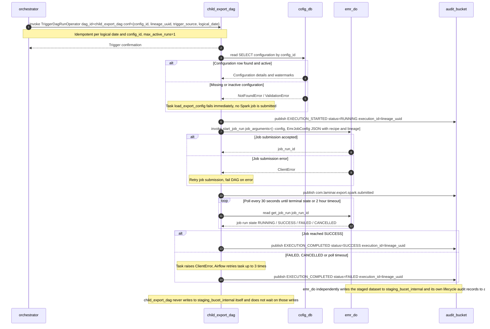

### 6.5. Schema Definitions (DB Tables / API JSON / Telemetry CloudEvents)
<a id="laminar-sec-c.imp_aws_aws_mwaa_dag_4.schema"></a>
#### 6.5.1 DAG run configuration (`ChildExportDagRunConfig`)

```json
{
  "$schema": "https://json-schema.org/draft/2020-12/schema",
  "$id": "https://laminar.com/schemas/child_export_dag/run_conf.json",
  "title": "ChildExportDagRunConfig",
  "type": "object",
  "additionalProperties": false,
  "required": ["config_id", "lineage_uuid"],
  "properties": {
    "config_id": { "type": "string", "format": "uuid" },
    "lineage_uuid": { "type": "string", "format": "uuid" },
    "trigger_source": { "type": "string", "enum": ["orchestrator", "manual"], "default": "orchestrator" },
    "logical_date": { "type": "string", "format": "date-time" }
  }
}
```

#### 6.5.2 EMR job configuration (`EmrJobConfig`, the `--config` document)

```json
{
  "$schema": "https://json-schema.org/draft/2020-12/schema",
  "$id": "https://laminar.com/schemas/child_export_dag/emr_job_config.json",
  "title": "EmrJobConfig",
  "type": "object",
  "additionalProperties": false,
  "required": [
    "config_id", "lineage_uuid", "dataset", "mode",
    "recipe_path", "staging_bucket", "staging_prefix", "execution_date"
  ],
  "properties": {
    "config_id": { "type": "string", "format": "uuid" },
    "lineage_uuid": { "type": "string", "format": "uuid" },
    "dataset": {
      "type": "string",
      "enum": ["identity_profiles", "subscription_statuses", "campaigns_reactions", "reservation_items"]
    },
    "mode": { "type": "string", "enum": ["initial", "incremental"] },
    "watermark": { "type": ["string", "null"], "format": "date-time" },
    "recipe_path": { "type": "string", "pattern": "^s3://" },
    "staging_bucket": { "type": "string", "const": "staging_bucet_internal" },
    "staging_prefix": { "type": "string" },
    "execution_date": { "type": "string", "format": "date" },
    "target_type": { "type": "string", "enum": ["s3", "azure_blob", "gcs", "sftp"] }
  }
}
```

#### 6.5.3 Audit CloudEvent (`com.laminar.audit.emitted`)

```json
{
  "$schema": "https://json-schema.org/draft/2020-12/schema",
  "$id": "https://laminar.com/schemas/child_export_dag/audit_cloudevent.json",
  "title": "ChildExportDagAuditCloudEvent",
  "type": "object",
  "required": ["specversion", "id", "source", "type", "time", "datacontenttype", "data"],
  "properties": {
    "specversion": { "type": "string", "const": "1.0" },
    "id": { "type": "string", "format": "uuid" },
    "source": { "type": "string", "const": "urn:laminar:dataoutbound:child-export-dag" },
    "type": { "type": "string", "const": "com.laminar.audit.emitted" },
    "time": { "type": "string", "format": "date-time" },
    "subject": { "type": "string" },
    "datacontenttype": { "type": "string", "const": "application/json" },
    "data": {
      "type": "object",
      "required": ["actor_id", "timestamp_utc", "event_type", "execution_id"],
      "properties": {
        "actor_id": { "type": "string", "const": "system:child_export_dag" },
        "timestamp_utc": {
          "type": "string",
          "pattern": "^\\d{4}-\\d{2}-\\d{2}T\\d{2}:\\d{2}:\\d{2}\\.\\d{3}Z$"
        },
        "event_type": { "type": "string", "enum": ["EXECUTION_STARTED", "EXECUTION_COMPLETED"] },
        "execution_id": { "type": "string", "format": "uuid" },
        "config_id": { "type": "string", "format": "uuid" },
        "status": { "type": "string", "enum": ["RUNNING", "SUCCESS", "FAILED"] }
      }
    }
  }
}
```

#### 6.5.4 Telemetry event `com.laminar.export.spark.submitted`

```json
{
  "$schema": "https://json-schema.org/draft/2020-12/schema",
  "$id": "https://laminar.com/schemas/child_export_dag/spark_submitted.json",
  "title": "SparkSubmittedEvent",
  "type": "object",
  "required": ["execution_id", "config_id", "job_run_id", "idempotency_key"],
  "properties": {
    "execution_id": { "type": "string", "format": "uuid" },
    "config_id": { "type": "string", "format": "uuid" },
    "job_run_id": { "type": "string" },
    "idempotency_key": { "type": "string" }
  }
}
```

### 6.6. Local Design Assumptions
<a id="laminar-sec-c.imp_aws_aws_mwaa_dag_4.asm"></a>
- **EMR argument contract.** The DAG and the Spark job exchange exactly one `--config` JSON document (6.1.3); the DAG never sends `--config-id`, `--lineage-uuid` or `--recipe` as separate flags. This is the single argument contract referenced by 6.1.2, 6.3 and the Spark job's `main.py` parser.
- **Audit publisher interface.** The DAG constructs the shared publisher as `AuditPublisher()` with no arguments and calls `publish(event_type, payload)`; the publisher resolves its own S3 client and target bucket from configuration. This is the one interface used by every component that emits audit records.
- **Failure event type.** SCRUM-486's `event_type` enumeration contains no `EXECUTION_FAILED` value, so a failed run is recorded as `EXECUTION_COMPLETED` with `status="FAILED"` rather than by extending the enum.
- **Polling cadence.** The DAG polls the EMR job run every 30 seconds with a 2-hour ceiling; both values are read from `dags/config.yml` and can be overridden per environment without a code change.
- **Retry policy.** Task-level retries default to 3 with a 5-minute delay, matching the bounded-retry principle applied to every outbound interaction in this design.
- **Watermark ownership.** The DAG reads the watermark but never advances it; the Spark job advances it on successful completion, so a failed or retried job cannot skip records.
- **Standalone schedule.** The `@daily` schedule is retained as the user set it. Because `catchup=false` and `max_active_runs=1`, a scheduled run that coincides with an orchestrator-triggered run for the same logical date and `config_id` is rejected rather than executed twice.
- **Recommendation:** for a future production profile, consider raising `cofig_db` to Multi-AZ so that a configuration read failure cannot block a child export — out of scope for this deployment, which is single-AZ as the diagram sets it.

## 7. Component Design: emr_do
<a id="laminar-sec-c.imp_aws_aws_emr_serverless_5"></a>

<!-- laminar:diagram-settings:imp-aws-aws_emr_serverless-5 -->
**Diagram settings (user decisions — authoritative)**

| Setting | Value |
| --- | --- |
| `release_label` | `emr-7.0.0` |
| `job_type` | `SPARK` |
| `max_capacity_units` | `200` |
| `application_name` | `emr_do` |

<!-- /laminar:diagram-settings -->


### 7.1. Component Contract (Bi-Directional Inputs & Outputs)
<a id="laminar-sec-c.imp_aws_aws_emr_serverless_5.contract"></a>
#### 7.1.1 Diagram settings (user decisions — authoritative)

| Setting | Value |
|---|---|
| application_name | `emr_do` |
| release_label | `emr-7.0.0` |
| job_type | `SPARK` |
| max_capacity_units | `200` |

#### 7.1.2 Role

**emr_do** is the extraction engine of the pipeline. It is an EMR Serverless application (`emr_do`, release label `emr-7.0.0`, job type `SPARK`, maximum capacity 200 units) that runs one Spark job per **child_export_dag** run. The job reads Golden Entity datasets from **dev** over JDBC, applies the dataset recipe, and writes staged Parquet/JSON files to **staging_bucet_internal** under a deterministic key derived from the lineage UUID. It emits CloudEvents-shaped audit records to **audit_bucket** at job start and job completion.

#### 7.1.3 Inbound contract — child_export_dag → emr_do

| Field | Value |
|---|---|
| Trigger | Child DAG task execution (`EmrServerlessStartJobOperator` / `EmrClient.start_job_run`) |
| Protocol | boto3 EMR Serverless `StartJobRun` |
| Request | `job_run_config` — a single `--config` argument carrying a JSON document (see §Schema Definitions) with `config_id`, `lineage_uuid`, `dataset`, `mode`, `watermark`, `recipe_path`, `staging_bucket`, `staging_prefix` |
| Response | `job_run_id` (EMR Serverless application run identifier) |
| Errors | Retry job submission on throttling/transient error; fail the DAG task on terminal error |
| Idempotency | Idempotent per execution date + `config_id` — a re-submitted run for the same logical date writes the same deterministic staging keys |
| Telemetry | `com.laminar.export.spark.submitted` (emitted by the DAG, not by the job) |

The single `--config` argument is the **one** argument contract between **child_export_dag** and **emr_do**; the DAG never passes loose flags such as `--config-id` / `--lineage-uuid` / `--recipe`. This is stated identically in the **child_export_dag** chapter (§6.1.2, §6.3) and in §7.3 below.

#### 7.1.4 Outbound contract — emr_do → dev

| Field | Value |
|---|---|
| Trigger | Spark job execution |
| Protocol | JDBC / Redshift JDBC driver (`redshift-jdbc42`) |
| Request | Parameterised `SELECT` over the Golden Entity view for the requested `dataset`, filtered by `watermark` when `mode = incremental` |
| Response | Spark `DataFrame` of Golden Entity records |
| Errors | Spark task retry on JDBC timeout (default 4 attempts, exponential backoff); fail the job on exhaustion |
| Idempotency | Idempotent read — no writes to **dev** |
| Telemetry | none |

#### 7.1.5 Outbound contract — emr_do → staging_bucet_internal

| Field | Value |
|---|---|
| Trigger | Spark job output stage |
| Protocol | boto3 / S3 API (via the S3A committer) |
| Request | Parquet / JSON data files written under a deterministic prefix |
| Response | `200 OK` / S3 objects created |
| Errors | Spark task retry; fail the job on terminal write failure |
| Idempotency | Idempotent write via deterministic keys: `s3://staging_bucet_internal/{dataset}/lineage_uuid={lineage_uuid}/part-*.parquet` |
| Telemetry | `com.laminar.export.spark.completed` |

#### 7.1.6 Outbound contract — emr_do → audit_bucket

| Field | Value |
|---|---|
| Trigger | Spark job lifecycle hook (job start, job completion, job failure) |
| Protocol | boto3 S3 upload |
| Request | CloudEvents JSON audit record (see §Schema Definitions) |
| Response | `200 OK` object stored |
| Errors | Retry upload (3 attempts, exponential backoff); log error on failure — never fail the job because of an audit write |
| Idempotency | Idempotent via audit event ID (`{lineage_uuid}:{event_type}`) |
| Telemetry | `com.laminar.audit.emitted` |

#### 7.1.7 Configuration the design actually sets

| Configuration | Value | Rationale |
|---|---|---|
| `spark.sql.sources.partitionOverwriteMode` | `dynamic` | Allows idempotent re-writes of a single lineage partition without touching sibling partitions. |
| `spark.sql.adaptive.enabled` | `true` | Mainstream default for EMR 7.0.0; reduces shuffle cost on skewed Golden Entity reads. |
| `spark.hadoop.fs.s3a.committer.name` | `magic` | Atomic, idempotent S3 commits — required for the deterministic-key idempotency guarantee. |
| `spark.dynamicAllocation.enabled` | `true` | EMR Serverless scales workers within the 200-unit ceiling; no static driver/executor sizing. |
| JDBC fetch size | `10000` | Bounded memory on the Redshift read path. |
| JDBC partition column | dataset-specific (e.g. `updated_at`) | Enables parallel, watermark-bounded reads. |

All other Spark properties are left at the EMR `emr-7.0.0` release defaults — deferring to defaults is itself a decision.

### 7.2. Class and Interface Definitions
<a id="laminar-sec-c.imp_aws_aws_emr_serverless_5.classes"></a>
```python
from __future__ import annotations

from dataclasses import dataclass, field
from datetime import datetime
from typing import Any, Literal, Protocol

from pyspark.sql import DataFrame, SparkSession


# ---------------------------------------------------------------------------
# Job configuration — the parsed form of the single --config argument
# ---------------------------------------------------------------------------

@dataclass(frozen=True)
class JobConfig:
    """Parsed form of the `--config` JSON document passed by child_export_dag."""
    config_id: str
    lineage_uuid: str
    dataset: str
    mode: Literal["initial", "incremental"]
    watermark: str | None          # ISO-8601 UTC, required when mode == "incremental"
    recipe_path: str               # s3://.../recipes/<dataset>_recipe.json
    staging_bucket: str            # "staging_bucet_internal"
    staging_prefix: str            # e.g. "exports/identity_profiles"
    audit_bucket: str = "audit_bucket"
    source_jdbc_secret: str = "dataoutbound/redshift/golden_data_source"


# ---------------------------------------------------------------------------
# Recipe — declarative extract/transform definition (one JSON per dataset)
# ---------------------------------------------------------------------------

@dataclass(frozen=True)
class ColumnMapping:
    source: str
    target: str
    cast: str | None = None
    pii: bool = False


@dataclass(frozen=True)
class Recipe:
    dataset: str
    source_view: str
    watermark_column: str
    partition_column: str
    columns: list[ColumnMapping] = field(default_factory=list)
    filters: list[str] = field(default_factory=list)


# ---------------------------------------------------------------------------
# I/O interfaces — implemented in io/ and util/ of the job module
# ---------------------------------------------------------------------------

class GoldenEntitySourceReader(Protocol):
    """Reads Golden Entity datasets from dev (Redshift) over JDBC."""

    def read_entity_dataset(
        self,
        dataset: str,
        mode: Literal["initial", "incremental"],
        watermark: str | None,
    ) -> DataFrame: ...


class StagingWriter(Protocol):
    """Writes staged export files to staging_bucet_internal."""

    def write_staged_dataset(
        self,
        df: DataFrame,
        dataset: str,
        lineage_uuid: str,
    ) -> list[str]: ...


# ---------------------------------------------------------------------------
# Processors and transformer — pure DataFrame logic, no I/O
# ---------------------------------------------------------------------------

class ExportExtractInputProcessor:
    """Validate and normalise the input DataFrame (schema enforcement, casting)."""

    def __init__(self, recipe: Recipe) -> None: ...

    def process(self, df: DataFrame) -> DataFrame: ...


class ExportExtractTransformer:
    """Default column mapping / renaming / derivation driven by the recipe."""

    def __init__(self, recipe: Recipe) -> None: ...

    def transform(self, df: DataFrame) -> DataFrame: ...


class ExportExtractOutputProcessor:
    """Assemble the final output dataset (ordering, partition columns, metrics)."""

    def __init__(self, recipe: Recipe) -> None: ...

    def process(self, df: DataFrame) -> DataFrame: ...


# ---------------------------------------------------------------------------
# Audit — thin wrapper over common.telemetry.auditor.AuditPublisher
# ---------------------------------------------------------------------------

class SparkAuditEmitter:
    """Emits EXECUTION_STARTED / EXECUTION_COMPLETED / EXECUTION_FAILED records."""

    def __init__(self, lineage_uuid: str, config_id: str, dataset: str) -> None: ...

    def started(self) -> None: ...

    def completed(self, record_count: int, staged_keys: list[str]) -> None: ...

    def failed(self, reason: str) -> None: ...
```

### 7.3. Implementation Code Skeleton (Stubs & Handlers)
<a id="laminar-sec-c.imp_aws_aws_emr_serverless_5.skeleton"></a>
Illustrative skeleton — the Component Contract and Schema Definitions are binding.

```python
# src/dataoutbound_st_fixes/spark_emr/export_extract_spark_job/main.py
"""Entrypoint of the emr_do EMR Serverless Spark job.

Argument contract (single source of truth, agreed with child_export_dag §6.1.2/§6.3):
    --config '<json>'   JSON document with keys:
        config_id, lineage_uuid, dataset, mode, watermark,
        recipe_path, staging_bucket, staging_prefix
"""
from __future__ import annotations

import argparse
import json
import sys
from typing import Any

from dataoutbound_st_fixes.common.logging.logger import get_logger
from dataoutbound_st_fixes.common.telemetry.auditor import AuditPublisher
from dataoutbound_st_fixes.spark_emr.export_extract_spark_job.helper.spark_session_helper import (
    get_spark_session,
)
from dataoutbound_st_fixes.spark_emr.export_extract_spark_job.io.child_export_golden_entity_source_store_reader import (
    ChildExportGoldenEntitySourceStoreReader,
)
from dataoutbound_st_fixes.spark_emr.export_extract_spark_job.io.customer_staging_buckets_audit_execution_log_store_writer import (
    CustomerStagingBucketsAuditExecutionLogStoreWriter,
)
from dataoutbound_st_fixes.spark_emr.export_extract_spark_job.processor.export_extract_input_processor import (
    ExportExtractInputProcessor,
)
from dataoutbound_st_fixes.spark_emr.export_extract_spark_job.processor.export_extract_output_processor import (
    ExportExtractOutputProcessor,
)
from dataoutbound_st_fixes.spark_emr.export_extract_spark_job.transform.export_extract_transformer import (
    ExportExtractTransformer,
)
from dataoutbound_st_fixes.spark_emr.export_extract_spark_job.util.file_utils import load_recipe
from dataoutbound_st_fixes.util.exceptions import ValidationError

log = get_logger(__name__)


def _parse_args(argv: list[str]) -> dict[str, Any]:
    parser = argparse.ArgumentParser(prog="export_extract_spark_job")
    parser.add_argument(
        "--config",
        required=True,
        help="JSON document with config_id, lineage_uuid, dataset, mode, "
             "watermark, recipe_path, staging_bucket, staging_prefix",
    )
    args = parser.parse_args(argv)
    try:
        return json.loads(args.config)
    except json.JSONDecodeError as exc:
        raise ValidationError(f"--config is not valid JSON: {exc}") from exc


def run(argv: list[str]) -> int:
    cfg = _parse_args(argv)
    lineage_uuid = cfg["lineage_uuid"]
    dataset = cfg["dataset"]

    spark = get_spark_session(app_name=f"emr_do-{dataset}", config=cfg)
    audit = AuditPublisher()  # argument-free; sink configured via ConfigLoader
    audit.publish(
        event_type="EXECUTION_STARTED",
        payload={
            "actor_id": "system:emr_do",
            "execution_id": lineage_uuid,
            "config_id": cfg["config_id"],
            "dataset": dataset,
            "mode": cfg["mode"],
        },
    )

    try:
        recipe = load_recipe(cfg["recipe_path"])

        reader = ChildExportGoldenEntitySourceStoreReader(spark=spark, config=cfg)
        raw = reader.read_entity_dataset(
            dataset=dataset, mode=cfg["mode"], watermark=cfg.get("watermark")
        )

        normalised = ExportExtractInputProcessor(recipe).process(raw)
        transformed = ExportExtractTransformer(recipe).transform(normalised)
        final = ExportExtractOutputProcessor(recipe).process(transformed)

        writer = CustomerStagingBucketsAuditExecutionLogStoreWriter(
            spark=spark,
            bucket=cfg["staging_bucket"],
            prefix=cfg["staging_prefix"],
        )
        staged_keys = writer.write_staged_dataset(
            df=final, dataset=dataset, lineage_uuid=lineage_uuid
        )

        audit.publish(
            event_type="EXECUTION_COMPLETED",
            payload={
                "actor_id": "system:emr_do",
                "execution_id": lineage_uuid,
                "config_id": cfg["config_id"],
                "dataset": dataset,
                "record_count": final.count(),
                "staged_keys": staged_keys,
            },
        )
        log.info("emr_do job completed", extra={"lineage_uuid": lineage_uuid})
        return 0

    except Exception as exc:  # noqa: BLE001 — terminal job failure path
        log.exception("emr_do job failed", extra={"lineage_uuid": lineage_uuid})
        audit.publish(
            event_type="EXECUTION_FAILED",
            payload={
                "actor_id": "system:emr_do",
                "execution_id": lineage_uuid,
                "config_id": cfg["config_id"],
                "dataset": dataset,
                "reason": str(exc),
            },
        )
        return 1
    finally:
        spark.stop()


if __name__ == "__main__":
    sys.exit(run(sys.argv[1:]))
```

```python
# src/dataoutbound_st_fixes/spark_emr/export_extract_spark_job/io/child_export_golden_entity_source_store_reader.py
"""JDBC reads against dev (Redshift). No business logic; returns DataFrames."""
from __future__ import annotations

from typing import Any, Literal

from pyspark.sql import DataFrame, SparkSession

from dataoutbound_st_fixes.common.clients.aws.ssm.ssm_client import SsmClient
from dataoutbound_st_fixes.common.logging.logger import get_logger

log = get_logger(__name__)


class ChildExportGoldenEntitySourceStoreReader:
    def __init__(self, spark: SparkSession, config: dict[str, Any]) -> None:
        self._spark = spark
        self._config = config
        self._jdbc = SsmClient().get_parameter(config["source_jdbc_secret"], decrypt=True)

    def read_entity_dataset(
        self,
        dataset: str,
        mode: Literal["initial", "incremental"],
        watermark: str | None,
    ) -> DataFrame:
        view = f"golden_entity.{dataset}"
        predicate = ""
        if mode == "incremental":
            if not watermark:
                raise ValueError("incremental mode requires a watermark")
            predicate = f" WHERE updated_at > TIMESTAMP '{watermark}'"
        query = f"(SELECT * FROM {view}{predicate}) AS src"
        return (
            self._spark.read.format("jdbc")
            .option("url", self._jdbc["url"])
            .option("query", query)
            .option("user", self._jdbc["user"])
            .option("password", self._jdbc["password"])
            .option("driver", "com.amazon.redshift.jdbc42.Driver")
            .option("fetchsize", 10000)
            .load()
        )
```

```python
# src/dataoutbound_st_fixes/spark_emr/export_extract_spark_job/io/customer_staging_buckets_audit_execution_log_store_writer.py
"""Parquet writes to staging_bucet_internal with deterministic lineage keys."""
from __future__ import annotations

from pyspark.sql import DataFrame, SparkSession

from dataoutbound_st_fixes.common.logging.logger import get_logger

log = get_logger(__name__)


class CustomerStagingBucketsAuditExecutionLogStoreWriter:
    def __init__(self, spark: SparkSession, bucket: str, prefix: str) -> None:
        self._spark = spark
        self._bucket = bucket
        self._prefix = prefix.rstrip("/")

    def write_staged_dataset(
        self, df: DataFrame, dataset: str, lineage_uuid: str
    ) -> list[str]:
        target = (
            f"s3://{self._bucket}/{self._prefix}/"
            f"dataset={dataset}/lineage_uuid={lineage_uuid}/"
        )
        (
            df.write.mode("overwrite")
            .option("compression", "snappy")
            .parquet(target)
        )
        log.info("staged dataset written", extra={"target": target})
        return [target]
```

```python
# src/dataoutbound_st_fixes/spark_emr/export_extract_spark_job/util/file_utils.py
"""Path building, manifest/file naming and recipe loading (no Spark dependency)."""
from __future__ import annotations

import json
from typing import Any

from dataoutbound_st_fixes.common.clients.aws.s3.s3_client import S3Client
from dataoutbound_st_fixes.util.exceptions import ValidationError


def load_recipe(recipe_path: str) -> dict[str, Any]:
    """Load a declarative recipe JSON from S3 (s3://bucket/key)."""
    if not recipe_path.startswith("s3://"):
        raise ValidationError(f"recipe_path must be an s3:// URI, got {recipe_path!r}")
    bucket, _, key = recipe_path[len("s3://"):].partition("/")
    body = S3Client().download_bytes(bucket=bucket, key=key)
    return json.loads(body)


def build_staging_key(lineage_uuid: str, dataset: str, partition: str) -> str:
    return f"dataset={dataset}/lineage_uuid={lineage_uuid}/{partition}"
```

### 7.4. Cross-Component Interaction Sequence (Local Mermaid/ASCII Flow)
<a id="laminar-sec-c.imp_aws_aws_emr_serverless_5.seq"></a>
The interaction sequence of **emr_do** is driven entirely by the **child_export_dag** run that submits it; the job itself never initiates a call to another pipeline component except its two sinks.

1. **child_export_dag** submits the job via `EmrClient.start_job_run` on the `emr_do` EMR Serverless application, passing a single `--config` JSON document (`config_id`, `lineage_uuid`, `dataset`, `mode`, `watermark`, `recipe_path`, `staging_bucket`, `staging_prefix`). The DAG receives a `job_run_id` and polls it to terminal state.
2. **emr_do** starts, builds the `SparkSession` via `get_spark_session`, and emits an `EXECUTION_STARTED` audit record to **audit_bucket** through `AuditPublisher`.
3. **emr_do** loads the dataset recipe from `recipe_path` (S3) and reads the Golden Entity dataset from **dev** over JDBC. In `incremental` mode the read is bounded by `updated_at > watermark`; in `initial` mode the full view is read.
4. **emr_do** applies the input processor (schema enforcement, casting), the transformer (recipe-driven column mapping), and the output processor (ordering, partition columns, metrics).
5. **emr_do** writes the staged Parquet dataset to **staging_bucet_internal** under the deterministic key `dataset={dataset}/lineage_uuid={lineage_uuid}/`. The S3A `magic` committer makes the write atomic and idempotent.
6. **emr_do** emits an `EXECUTION_COMPLETED` audit record to **audit_bucket** carrying the record count and staged keys, then exits `0`.
7. **Failure path.** If the JDBC read, the transform, or the S3 write fails terminally, the job emits an `EXECUTION_FAILED` audit record to **audit_bucket** and exits `1`. The **child_export_dag** task that submitted the job observes the non-zero exit, retries per its own policy, and fails the DAG task on exhaustion. No partial staging key is left behind because the `magic` committer only publishes on successful task commit.
8. **Audit-write failure path.** If the audit upload to **audit_bucket** fails after 3 retries, the failure is logged but the job's own outcome is unaffected — audit is never allowed to fail the extraction.
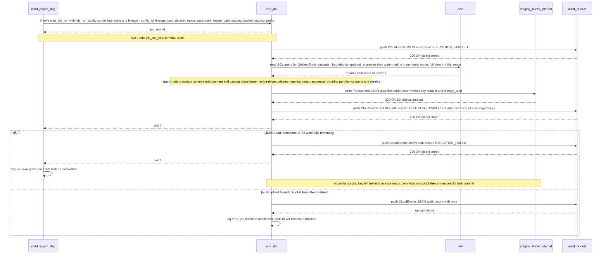

### 7.5. Schema Definitions (DB Tables / API JSON / Telemetry CloudEvents)
<a id="laminar-sec-c.imp_aws_aws_emr_serverless_5.schema"></a>
#### 7.5.1 Job argument — `--config` JSON document

```json
{
  "$schema": "https://json-schema.org/draft/2020-12/schema",
  "$id": "https://laminar.com/schemas/emr_do/job-config.json",
  "title": "EmrDoJobConfig",
  "type": "object",
  "required": [
    "config_id", "lineage_uuid", "dataset", "mode",
    "recipe_path", "staging_bucket", "staging_prefix"
  ],
  "additionalProperties": false,
  "properties": {
    "config_id":      { "type": "string", "minLength": 1 },
    "lineage_uuid":   { "type": "string", "format": "uuid" },
    "dataset": {
      "type": "string",
      "enum": [
        "identity_profiles", "pii_restricted_profile",
        "contact_method_subscription", "enriched_campaigns",
        "enriched_campaign_reactions", "room_stay_reservation",
        "restaurant_reservation", "tee_time_reservation",
        "spa_treatment_reservation"
      ]
    },
    "mode":           { "type": "string", "enum": ["initial", "incremental"] },
    "watermark":      { "type": ["string", "null"], "format": "date-time" },
    "recipe_path":    { "type": "string", "pattern": "^s3://" },
    "staging_bucket": { "type": "string", "const": "staging_bucet_internal" },
    "staging_prefix": { "type": "string" }
  },
  "allOf": [
    {
      "if":   { "properties": { "mode": { "const": "incremental" } } },
      "then": { "required": ["watermark"] }
    }
  ]
}
```

#### 7.5.2 Recipe JSON — one file per dataset under `config/recipes/`

```json
{
  "$schema": "https://json-schema.org/draft/2020-12/schema",
  "$id": "https://laminar.com/schemas/emr_do/recipe.json",
  "title": "ExportExtractRecipe",
  "type": "object",
  "required": ["dataset", "source_view", "watermark_column", "partition_column", "columns"],
  "properties": {
    "dataset":          { "type": "string" },
    "source_view":      { "type": "string" },
    "watermark_column": { "type": "string" },
    "partition_column": { "type": "string" },
    "filters":          { "type": "array", "items": { "type": "string" } },
    "columns": {
      "type": "array",
      "items": {
        "type": "object",
        "required": ["source", "target"],
        "properties": {
          "source": { "type": "string" },
          "target": { "type": "string" },
          "cast":   { "type": ["string", "null"] },
          "pii":    { "type": "boolean", "default": false }
        }
      }
    }
  }
}
```

#### 7.5.3 Staged output object key (staging_bucet_internal)

```
s3://staging_bucet_internal/{staging_prefix}/dataset={dataset}/lineage_uuid={lineage_uuid}/part-*.parquet
```

The `lineage_uuid` partition is the join key back to the **orchestrator** run and to every audit record.

#### 7.5.4 Telemetry — CloudEvents audit record written to audit_bucket

```json
{
  "$schema": "https://json-schema.org/draft/2020-12/schema",
  "$id": "https://laminar.com/schemas/emr_do/audit-cloudevent.json",
  "title": "EmrDoAuditCloudEvent",
  "type": "object",
  "required": ["specversion", "id", "source", "type", "time", "subject", "data"],
  "properties": {
    "specversion": { "type": "string", "const": "1.0" },
    "id":          { "type": "string" },
    "source":      { "type": "string", "const": "urn:laminar:dataoutbound:emr-do" },
    "type": {
      "type": "string",
      "enum": [
        "com.laminar.export.spark.completed",
        "com.laminar.audit.emitted"
      ]
    },
    "time":    { "type": "string", "format": "date-time" },
    "subject": { "type": "string", "description": "lineage UUID" },
    "data": {
      "type": "object",
      "required": ["actor_id", "timestamp_utc", "event_type", "execution_id"],
      "properties": {
        "actor_id":      { "type": "string", "const": "system:emr_do" },
        "timestamp_utc": {
          "type": "string",
          "pattern": "^\\d{4}-\\d{2}-\\d{2}T\\d{2}:\\d{2}:\\d{2}\\.\\d{3}Z$"
        },
        "event_type": {
          "type": "string",
          "enum": ["EXECUTION_STARTED", "EXECUTION_COMPLETED", "EXECUTION_FAILED"]
        },
        "execution_id": { "type": "string", "format": "uuid" },
        "config_id":    { "type": "string" },
        "dataset":      { "type": "string" },
        "record_count": { "type": ["integer", "null"] },
        "staged_keys":  { "type": ["array", "null"], "items": { "type": "string" } },
        "reason":       { "type": ["string", "null"] }
      }
    }
  }
}
```

### 7.6. Local Design Assumptions
<a id="laminar-sec-c.imp_aws_aws_emr_serverless_5.asm"></a>
- **Argument contract.** The **child_export_dag** → **emr_do** invocation passes exactly one `--config` JSON document (schema above). This is the single argument contract; the DAG does not pass loose `--config-id` / `--lineage-uuid` / `--recipe` flags. The same statement appears in the **child_export_dag** chapter (§6.1.2, §6.3) so the two sections agree.
- **Recipe location.** Recipes live in `config/recipes/` of the job module and are deployed to S3; `recipe_path` is an `s3://` URI. The eight recipe files named in the blueprint correspond one-to-one to the eight datasets in the `dataset` enum.
- **Watermark semantics.** `incremental` mode reads `updated_at > watermark` (strictly greater), matching SCRUM-481 AC#5. The watermark value is supplied by **child_export_dag** from the `export_watermark` table in **cofig_db**; **emr_do** never reads or writes **cofig_db** itself.
- **Idempotency.** Re-running the job for the same `(config_id, logical_date)` overwrites the same `lineage_uuid` partition. The S3A `magic` committer guarantees no partial output is visible.
- **Audit is best-effort.** Audit writes to **audit_bucket** are retried 3 times and then logged; they never fail the extraction job. This keeps the extraction SLA independent of the audit sink.
- **Capacity.** The application runs with `max_capacity_units = 200` as set on the canvas; Spark dynamic allocation scales workers within that ceiling. No static driver/executor sizing is configured.
- **VPC.** The job runs in the private subnets of the solution VPC so it can reach **dev** (Redshift) and **staging_bucet_internal** without traversing the public internet.
- **Recommendation:** for a future production profile, consider raising `max_capacity_units` above 200 if concurrent child exports exceed the current ceiling — out of scope for this deployment, which uses the canvas value of 200.

## 8. Component Design: dev
<a id="laminar-sec-c.imp_aws_aws_redshift_6"></a>

<!-- laminar:diagram-settings:imp-aws-aws_redshift-6 -->
**Diagram settings (user decisions — authoritative)**

| Setting | Value |
| --- | --- |
| `node_type` | `dc2.large` |
| `number_of_nodes` | `2` |
| `database_name` | `dev` |
| `cluster_identifier` | `golden_data_source` |

<!-- /laminar:diagram-settings -->


### 8.1. Component Contract (Bi-Directional Inputs & Outputs)
<a id="laminar-sec-c.imp_aws_aws_redshift_6.contract"></a>
- **Component Name**: `dev` (Cluster Identifier: `golden_data_source`, Database Name: `dev`)
- **Incoming Interactions**:
  - **Caller**: `emr_do` (`export_extract_spark_job`)
  - **Protocol / Mechanism**: JDBC via Amazon Redshift JDBC Driver (`com.amazon.redshift.jdbc42.Driver`)
  - **Trigger**: Spark job execution querying golden entity datasets (Unified Identity Profile, Pii Restricted Profile, Contact Method Subscription, Enriched Campaigns, Enriched Campaign Reactions, Room stay reservation, Restaurant reservation, Tee time reservation, Spa treatment reservation).
  - **Payload / Query**: Parameterized SQL SELECT queries with incremental timestamp watermarks (`WHERE modified_at > :watermark`) or full table scans.
- **Outgoing Interactions**:
  - **Responder**: `emr_do`
  - **Payload**: Distributed Spark DataFrame partitions of record rows matching the requested dataset schema.
- **Error Handling & Resilience**:
  - **Retry Policy**: Spark task-level retries (up to 3 attempts) on JDBC connection timeouts or socket read errors.
  - **Idempotency**: Read-only operations are inherently idempotent.
  - **Failure Path**: Task failure propagates to `emr_do` execution engine, triggering Airflow task retry and subsequent alert escalation on exhaustion.
- **Telemetry**: Emits no direct audit events (read-only source store); read execution metrics are logged via Spark application logs.

### 8.2. Class and Interface Definitions
<a id="laminar-sec-c.imp_aws_aws_redshift_6.classes"></a>
```python
from dataclasses import dataclass
from typing import Optional, Dict, Any, List
from pyspark.sql import DataFrame, SparkSession

@dataclass
class RedshiftConnectionConfig:
    host: str
    port: int
    database: str
    user: str
    password_secret_arn: str
    jdbc_url: str

class GoldenEntitySourceReader:
    """
    Reader interface for extracting Golden Entity datasets from the Redshift dev cluster.
    """
    def __init__(self, spark: SparkSession, config: RedshiftConnectionConfig) -> None:
        pass

    def read_dataset(self, dataset_name: str, watermark_timestamp: Optional[str] = None) -> DataFrame:
        """
        Reads a specified golden entity dataset from Redshift using JDBC, optionally filtered by watermark.
        """
        raise NotImplementedError
```

### 8.3. Implementation Code Skeleton (Stubs & Handlers)
<a id="laminar-sec-c.imp_aws_aws_redshift_6.skeleton"></a>
Illustrative skeleton — the Component Contract and Schema Definitions are binding. `dev` is an existing, externally owned Redshift cluster (`golden_data_source`, database `dev`, 2 × `dc2.large`); this design provisions no Redshift resource and owns no table. The skeleton below is the **read-only SQL interface** that **emr_do** uses through `ChildExportGoldenEntitySourceStoreReader.read_entity_dataset`.

```python
# src/dataoutbound_st_fixes/spark_emr/export_extract_spark_job/io/
#   child_export_golden_entity_source_store_reader.py  (read-side SQL contract for `dev`)
"""Illustrative skeleton — the Component Contract and Schema Definitions are binding."""
from __future__ import annotations

from dataclasses import dataclass
from typing import Mapping

# Read-only views exposed by the externally owned `golden_data_source` cluster.
GOLDEN_ENTITY_VIEWS: Mapping[str, str] = {
    "identity_profiles": "golden.v_unified_identity_profile",
    "pii_restricted_profile": "golden.v_pii_restricted_profile",
    "contact_method_subscription": "golden.v_contact_method_subscription",
    "enriched_campaigns": "golden.v_enriched_campaigns",
    "enriched_campaign_reactions": "golden.v_enriched_campaign_reactions",
    "room_stay_reservation": "golden.v_room_stay_reservation",
    "restaurant_reservation": "golden.v_restaurant_reservation",
    "tee_time_reservation": "golden.v_tee_time_reservation",
    "spa_treatment_reservation": "golden.v_spa_treatment_reservation",
}

# Incremental extraction predicate: strictly greater than the stored watermark.
INCREMENTAL_PREDICATE = "GREATEST(created_at, modified_at) > %s"
FULL_PREDICATE = "1 = 1"


@dataclass(frozen=True)
class ExtractQuery:
    sql: str
    params: tuple
    partition_column: str
    lower_bound: int
    upper_bound: int
    num_partitions: int


def build_extract_query(dataset: str, mode: str, watermark: str | None,
                        bounds: tuple[int, int], num_partitions: int = 8) -> ExtractQuery:
    """Build the parameterised JDBC read issued by the Spark job against `dev`.

    `mode` is 'initial' (full snapshot) or 'incremental' (watermark predicate).
    The SQL is assembled from the fixed view map only — never from user input.
    """
    view = GOLDEN_ENTITY_VIEWS[dataset]
    if mode == "incremental":
        if not watermark:
            raise ValueError("incremental mode requires a watermark")
        predicate, params = INCREMENTAL_PREDICATE, (watermark,)
    else:
        predicate, params = FULL_PREDICATE, ()
    return ExtractQuery(
        sql=f"SELECT * FROM {view} WHERE {predicate}",
        params=params,
        partition_column="id",
        lower_bound=bounds[0],
        upper_bound=bounds[1],
        num_partitions=num_partitions,
    )
```

The Spark job reads this interface with the Redshift JDBC driver over the private network path, using credentials resolved from SSM Parameter Store; the cluster is read-only for this workload and no DDL is issued against it.

### 8.4. Cross-Component Interaction Sequence (Local Mermaid/ASCII Flow)
<a id="laminar-sec-c.imp_aws_aws_redshift_6.seq"></a>
1. `emr_do` initializes the Spark job and loads configuration containing connection credentials for `dev` (Golden Entity Source Store).
2. `emr_do` invokes `ChildExportGoldenEntitySourceStoreReader` to query specific golden entity tables from `dev`.
3. `dev` executes the parameterized SQL query against the Redshift cluster (`dc2.large`, 2 nodes) and streams result rows via JDBC.
4. If a timeout or network partition occurs, Spark automatically retries the read task up to the configured maximum attempts.
5. Upon successful retrieval, `emr_do` receives the Spark DataFrame and proceeds to staging transformations.
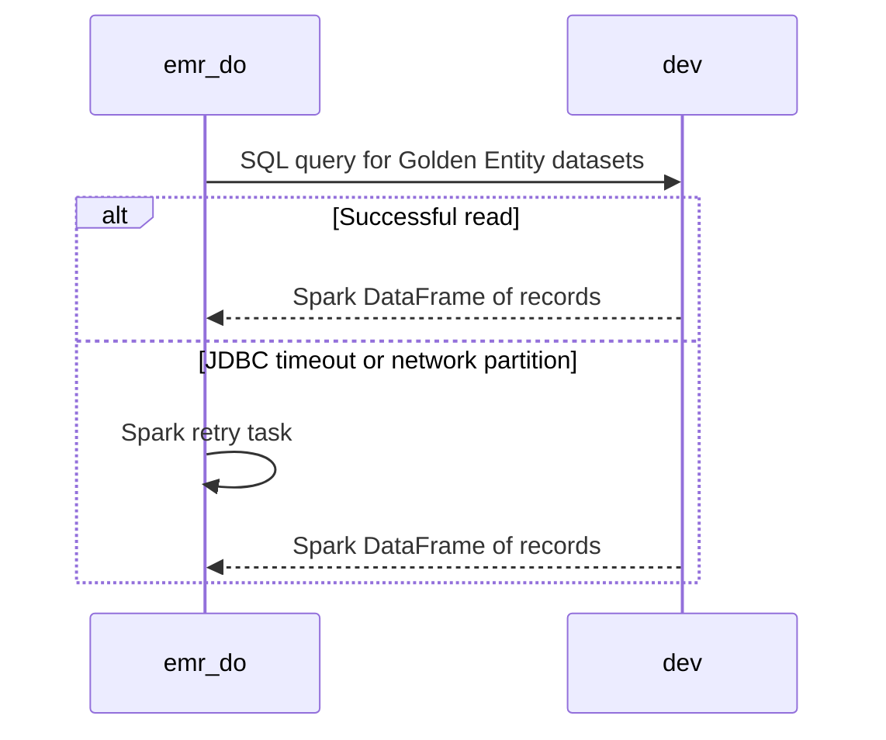

### 8.5. Schema Definitions (DB Tables / API JSON / Telemetry CloudEvents)
<a id="laminar-sec-c.imp_aws_aws_redshift_6.schema"></a>
The `dev` Redshift cluster owns the golden data source relational schema containing the required hospitality entity tables:

```sql
-- DDL for Golden Entity Source Store tables in dev cluster
CREATE TABLE IF NOT EXISTS unified_identity_profile (
    profile_id VARCHAR(64) NOT NULL PRIMARY KEY,
    tenant_id VARCHAR(64) NOT NULL,
    email VARCHAR(255),
    first_name VARCHAR(100),
    last_name VARCHAR(100),
    created_at TIMESTAMP WITHOUT TIME ZONE NOT NULL,
    modified_at TIMESTAMP WITHOUT TIME ZONE NOT NULL
) DISTKEY(profile_id) SORTKEY(modified_at);

CREATE TABLE IF NOT EXISTS pii_restricted_profile (
    profile_id VARCHAR(64) NOT NULL PRIMARY KEY,
    masked_data VARCHAR(512),
    restricted_flag BOOLEAN NOT NULL,
    modified_at TIMESTAMP WITHOUT TIME ZONE NOT NULL
) DISTKEY(profile_id) SORTKEY(modified_at);

CREATE TABLE IF NOT EXISTS contact_method_subscription (
    subscription_id VARCHAR(64) NOT NULL PRIMARY KEY,
    profile_id VARCHAR(64) NOT NULL,
    channel VARCHAR(32) NOT NULL,
    subscribed BOOLEAN NOT NULL,
    modified_at TIMESTAMP WITHOUT TIME ZONE NOT NULL
) DISTKEY(profile_id) SORTKEY(modified_at);

CREATE TABLE IF NOT EXISTS enriched_campaigns (
    campaign_id VARCHAR(64) NOT NULL PRIMARY KEY,
    campaign_name VARCHAR(255) NOT NULL,
    metadata SUPER,
    modified_at TIMESTAMP WITHOUT TIME ZONE NOT NULL
) DISTKEY(campaign_id) SORTKEY(modified_at);

CREATE TABLE IF NOT EXISTS enriched_campaign_reactions (
    reaction_id VARCHAR(64) NOT NULL PRIMARY KEY,
    campaign_id VARCHAR(64) NOT NULL,
    profile_id VARCHAR(64) NOT NULL,
    reaction_type VARCHAR(64) NOT NULL,
    modified_at TIMESTAMP WITHOUT TIME ZONE NOT NULL
) DISTKEY(campaign_id) SORTKEY(modified_at);

CREATE TABLE IF NOT EXISTS room_stay_reservation (
    reservation_id VARCHAR(64) NOT NULL PRIMARY KEY,
    profile_id VARCHAR(64) NOT NULL,
    hotel_code VARCHAR(32) NOT NULL,
    check_in_date DATE NOT NULL,
    check_out_date DATE NOT NULL,
    modified_at TIMESTAMP WITHOUT TIME ZONE NOT NULL
) DISTKEY(profile_id) SORTKEY(modified_at);

CREATE TABLE IF NOT EXISTS restaurant_reservation (
    reservation_id VARCHAR(64) NOT NULL PRIMARY KEY,
    profile_id VARCHAR(64) NOT NULL,
    restaurant_id VARCHAR(32) NOT NULL,
    reservation_time TIMESTAMP WITHOUT TIME ZONE NOT NULL,
    party_size INT NOT NULL,
    modified_at TIMESTAMP WITHOUT TIME ZONE NOT NULL
) DISTKEY(profile_id) SORTKEY(modified_at);

CREATE TABLE IF NOT EXISTS tee_time_reservation (
    reservation_id VARCHAR(64) NOT NULL PRIMARY KEY,
    profile_id VARCHAR(64) NOT NULL,
    course_id VARCHAR(32) NOT NULL,
    tee_time TIMESTAMP WITHOUT TIME ZONE NOT NULL,
    modified_at TIMESTAMP WITHOUT TIME ZONE NOT NULL
) DISTKEY(profile_id) SORTKEY(modified_at);

CREATE TABLE IF NOT EXISTS spa_treatment_reservation (
    reservation_id VARCHAR(64) NOT NULL PRIMARY KEY,
    profile_id VARCHAR(64) NOT NULL,
    treatment_id VARCHAR(32) NOT NULL,
    appointment_time TIMESTAMP WITHOUT TIME ZONE NOT NULL,
    modified_at TIMESTAMP WITHOUT TIME ZONE NOT NULL
) DISTKEY(profile_id) SORTKEY(modified_at);
```

### 8.6. Local Design Assumptions
<a id="laminar-sec-c.imp_aws_aws_redshift_6.asm"></a>
- **External Ownership Assumption**: `dev` (Golden Entity Source Store) is an existing external data warehouse owned outside this deployment pipeline (excluded from pipeline deletion protection and resource allowlist checks per SCRUM-485).
- **Network & Access**: Network access from EMR Serverless workers to Redshift is secured via VPC security groups and JDBC SSL encryption.
- **Query Optimization**: Distribution keys (`DISTKEY`) and compound sort keys (`SORTKEY`) are pre-configured on all source tables to optimize parallel Spark distributed reads and incremental range filtering.

---

## 9. Component Design: cofig_db
<a id="laminar-sec-c.imp_aws_aws_rds_7"></a>

<!-- laminar:diagram-settings:imp-aws-aws_rds-7 -->
**Diagram settings (user decisions — authoritative)**

| Setting | Value |
| --- | --- |
| `engine` | `postgres` |
| `engine_version` | `15.4` |
| `instance_class` | `db.t3.micro` |
| `allocated_storage` | `20` |
| `multi_az` | `false` |
| `db_instance_identifier` | `cofig_db` |

<!-- /laminar:diagram-settings -->


### 9.1. Component Contract (Bi-Directional Inputs & Outputs)
<a id="laminar-sec-c.imp_aws_aws_rds_7.contract"></a>
The `cofig_db` component is an Amazon RDS PostgreSQL (v15.4) instance acting as the central persistent metadata and configuration store for the DataOutbound system. It maintains administrative export definitions, connection parameters, encryption references, and incremental extraction watermarks.

#### 9.1.1 Inbound Contracts
- **From `do-admin-api`**:
  - **Trigger**: Administrative REST API operations (Create, Read, Update, Delete, Manual Trigger).
  - **Payload / Protocol**: Parameterized SQL statements executed via `psycopg2` / SQLAlchemy over PostgreSQL wire protocol (TCP port 5432).
  - **Data**: Export configuration records, encrypted credential payloads, schedule expressions, and dataset selectors.
- **From `orchestrator`**:
  - **Trigger**: MWAA DAG task execution startup.
  - **Payload / Protocol**: Parameterized SQL `SELECT` queries to retrieve active export configurations matching scheduled execution windows.
- **From `child_export_dag`**:
  - **Trigger**: Child DAG initialization tasks.
  - **Payload / Protocol**: Parameterized SQL queries to fetch specific configuration details, target mappings, and incremental watermark high-water marks.

### 9.2. Class and Interface Definitions
<a id="laminar-sec-c.imp_aws_aws_rds_7.classes"></a>
The following Python dataclasses define the domain data models used when interacting with `cofig_db` via the shared database client.

```python
from dataclasses import dataclass, field
from datetime import datetime
from typing import Optional, Dict, Any

@dataclass
class ExportConfigurationModel:
    config_id: str
    connection_name: str
    target_type: str
    dataset: str
    mode: str
    cron_schedule: str
    is_active: bool
    encrypted_credentials: str
    created_at: datetime
    updated_at: datetime
    extra_attributes: Dict[str, Any] = field(default_factory=dict)

@dataclass
class ExportWatermarkModel:
    config_id: str
    dataset: str
    high_watermark: str
    last_run_id: str
    updated_at: datetime
```

---

### 9.3. Implementation Code Skeleton (Stubs & Handlers)
<a id="laminar-sec-c.imp_aws_aws_rds_7.skeleton"></a>
The following runnable code skeleton illustrates how configuration and watermark operations interact with `cofig_db`, utilizing the project blueprint path `src/dataoutbound_st_fixes/common/clients/db/db_client.py` and ensuring SQLAlchemy `text` is correctly imported.

```python
from typing import List, Optional, Dict, Any
from datetime import datetime
from sqlalchemy import text
from dataoutbound_st_fixes.common.clients.db.db_client import DbClient
from dataoutbound_st_fixes.common.logging.logger import get_logger
from dataoutbound_st_fixes.util.exceptions import ClientError

logger = get_logger(__name__)

class ExportConfigRepository:
    """
    Repository for managing export configurations and watermarks in cofig_db.
    """
    def __init__(self, db_client: DbClient) -> None:
        self.db_client = db_client

    def fetch_active_configurations(self) -> List[Dict[str, Any]]:
        query = text("""
            SELECT config_id, connection_name, target_type, dataset, mode,
                   cron_schedule, encrypted_credentials, extra_attributes
            FROM export_configurations
            WHERE is_active = TRUE
        """)
        try:
            with self.db_client.session_scope() as session:
                result = session.execute(query)
                rows = [dict(row._mapping) for row in result]
                logger.info("Successfully fetched active export configurations", count=len(rows))
                return rows
        except Exception as e:
            logger.error("Failed to fetch active export configurations from cofig_db", error=str(e))
            raise ClientError(f"Database query failed: {str(e)}") from e

    def get_watermark(self, config_id: str, dataset: str) -> Optional[str]:
        query = text("""
            SELECT high_watermark
            FROM export_watermarks
            WHERE config_id = :config_id AND dataset = :dataset
        """)
        try:
            with self.db_client.session_scope() as session:
                result = session.execute(query, {"config_id": config_id, "dataset": dataset}).fetchone()
                if result:
                    return result.high_watermark
                return None
        except Exception as e:
            logger.error("Failed to fetch watermark", config_id=config_id, dataset=dataset, error=str(e))
            raise ClientError(f"Watermark query failed: {str(e)}") from e

    def upsert_watermark(self, config_id: str, dataset: str, high_watermark: str, run_id: str) -> None:
        query = text("""
            INSERT INTO export_watermarks (config_id, dataset, high_watermark, last_run_id, updated_at)
            VALUES (:config_id, :dataset, :high_watermark, :run_id, :updated_at)
            ON CONFLICT (config_id, dataset)
            DO UPDATE SET high_watermark = EXCLUDED.high_watermark,
                          last_run_id = EXCLUDED.last_run_id,
                          updated_at = EXCLUDED.updated_at
        """)
        try:
            with self.db_client.session_scope() as session:
                session.execute(query, {
                    "config_id": config_id,
                    "dataset": dataset,
                    "high_watermark": high_watermark,
                    "run_id": run_id,
                    "updated_at": datetime.utcnow()
                })
                logger.info("Successfully updated watermark", config_id=config_id, dataset=dataset)
        except Exception as e:
            logger.error("Failed to upsert watermark", config_id=config_id, dataset=dataset, error=str(e))
            raise ClientError(f"Watermark upsert failed: {str(e)}") from e
```

---

### 9.4. Cross-Component Interaction Sequence (Local Mermaid/ASCII Flow)
<a id="laminar-sec-c.imp_aws_aws_rds_7.seq"></a>
1. **Admin Creation / Update Flow**:
   - `do-admin-api` receives an administrative request to create or update an export configuration.
   - `do-admin-api` encrypts sensitive credential fields and initiates a transaction against `cofig_db` using `DbClient`.
   - `cofig_db` persists the record in the `export_configurations` table with `UPSERT` semantics and commits the transaction.
   - `do-admin-api` receives success confirmation and returns an HTTP response to the administrator.

2. **Scheduled Orchestration Flow**:
   - `orchestrator` initiates its scheduled execution run.
   - `orchestrator` queries `cofig_db` for all active export configurations where `is_active = TRUE`.
   - `cofig_db` returns the matching configuration dataset.
   - `orchestrator` iterates over the configurations, generating lineage UUIDs and invoking `child_export_dag` instances.

3. **Incremental Execution Flow**:
   - `child_export_dag` invokes `emr_do`.
   - During Spark job execution, `emr_do` queries `cofig_db` via `ExportConfigRepository` to retrieve the current high watermark for incremental data extraction.
   - Upon successful processing and staging, the execution updates the watermark back in `cofig_db`.

---
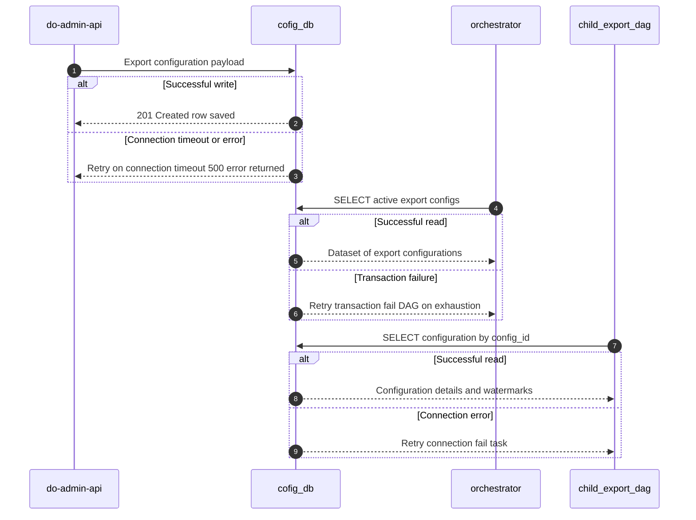

### 9.5. Schema Definitions (DB Tables / API JSON / Telemetry CloudEvents)
<a id="laminar-sec-c.imp_aws_aws_rds_7.schema"></a>
The relational schema owned and managed by `cofig_db` comprises the export configurations table and incremental extraction watermarks table.

```sql
CREATE TABLE IF NOT EXISTS export_configurations (
    config_id VARCHAR(64) PRIMARY KEY,
    connection_name VARCHAR(100) NOT NULL UNIQUE,
    target_type VARCHAR(32) NOT NULL CHECK (target_type IN ('s3', 'azure_blob', 'gcs', 'sftp')),
    dataset VARCHAR(64) NOT NULL,
    mode VARCHAR(16) NOT NULL CHECK (mode IN ('initial', 'incremental')),
    cron_schedule VARCHAR(64) NOT NULL,
    is_active BOOLEAN NOT NULL DEFAULT TRUE,
    encrypted_credentials TEXT NOT NULL,
    extra_attributes JSONB DEFAULT '{}'::jsonb,
    created_at TIMESTAMP WITH TIME ZONE NOT NULL DEFAULT CURRENT_TIMESTAMP,
    updated_at TIMESTAMP WITH TIME ZONE NOT NULL DEFAULT CURRENT_TIMESTAMP
);

CREATE INDEX IF NOT EXISTS idx_export_configs_active ON export_configurations(is_active);

CREATE TABLE IF NOT EXISTS export_watermarks (
    config_id VARCHAR(64) NOT NULL REFERENCES export_configurations(config_id) ON DELETE CASCADE,
    dataset VARCHAR(64) NOT NULL,
    high_watermark VARCHAR(255) NOT NULL,
    last_run_id VARCHAR(64) NOT NULL,
    updated_at TIMESTAMP WITH TIME ZONE NOT NULL DEFAULT CURRENT_TIMESTAMP,
    PRIMARY KEY (config_id, dataset)
);
```

---

### 9.6. Local Design Assumptions
<a id="laminar-sec-c.imp_aws_aws_rds_7.asm"></a>
- **Deployment topology is single-AZ, exactly as the canvas sets it.** `cofig_db` is deployed as a single-AZ RDS PostgreSQL 15.4 instance (`db.t3.micro`, 20 GB allocated storage, `multi_az = false`). This is the binding configuration and is not changed anywhere in this document. The consequence is a failover window equal to the time RDS takes to replace the instance in its single availability zone; the pipeline tolerates it because **orchestrator** and **child_export_dag** retry their configuration reads and fail the DAG only after retries are exhausted.
- **Recommendation (not a configuration).** For a future production profile, consider enabling Multi-AZ on `cofig_db` to remove the single-AZ failover window. This is explicitly out of scope for the current deployment, whose canvas value is `multi_az = false`.
- **RTO/RPO.** The stated recovery objectives (RTO 2 hours, RPO 24 hours) are met by automated RDS backups with a retention period of at least 30 days plus point-in-time recovery; no additional mechanism is introduced here.
- **Encryption.** Storage is encrypted at rest with an AWS KMS CMK and connections enforce TLS (`sslmode=require`). Credential columns are stored as ciphertext produced by the application layer, so a raw read of the table returns no plaintext credential value (SCRUM-479 AC#1, SCRUM-481 AC#6).
- **Network placement.** The instance sits in private database subnets with no public accessibility; only **do-admin-api**, **orchestrator** and **child_export_dag** reach it, over the VPC's private network path.
- **Deletion protection.** The `deletion_protection` flag is read from the per-environment Terraform variable, never hardcoded, so dev can be torn down while staging and prod retain the instance (SCRUM-485 AC#3–AC#5).
- **Watermark state.** Incremental-extraction watermark rows live in this same database and are written by **child_export_dag** after a successful Spark run; the table definition is owned by this component and is given in its Schema Definitions section.
- **Follow-up resolution — engine version.** PostgreSQL 15.4 is the canvas value and is pinned; minor-version upgrades are applied through the Terraform pipeline rather than automatically, so the version under test is the version in production.

## 10. Component Design: staging_bucet_internal
<a id="laminar-sec-c.imp_aws_aws_s3_bucket_8"></a>

<!-- laminar:diagram-settings:imp-aws-aws_s3_bucket-8 -->
**Diagram settings (user decisions — authoritative)**

| Setting | Value |
| --- | --- |
| `versioning` | `false` |
| `encryption` | `AES256` |
| `public_access_block` | `true` |
| `lifecycle_enabled` | `false` |
| `lifecycle_transition_days` | `30` |
| `lifecycle_glacier_days` | `90` |
| `bucket_name` | `staging_bucet_internal` |

<!-- /laminar:diagram-settings -->


### 10.1. Component Contract (Bi-Directional Inputs & Outputs)
<a id="laminar-sec-c.imp_aws_aws_s3_bucket_8.contract"></a>
**staging_bucet_internal** is the internal S3 bucket that decouples extraction from egress. It is a passive data store: it owns no compute and no database tables. Its contract is expressed as the three edges that touch it, plus the object-key layout that makes those edges idempotent.

#### 10.1.1 Inbound (what writes into this component)

| Producer | Protocol | Payload | Response | Idempotency | Telemetry |
|---|---|---|---|---|---|
| **emr_do** | boto3 / S3 API (`PutObject`, multipart) | Staged dataset files (`part-*.json` / `part-*.parquet`) under `staging/{config_id}/{lineage_uuid}/{dataset}/data/`, plus the sidecar `_export_manifest.json`, plus a zero-byte `_READY` completion marker | `200 OK` / S3 objects created | Deterministic object keys derived from lineage UUID + dataset + partition; a re-run of the same logical execution overwrites the same keys | `com.laminar.export.spark.completed` |

#### 10.1.2 Outbound (what reads from this component)

| Consumer | Protocol | Request | Response | Idempotency | Telemetry |
|---|---|---|---|---|---|
| **egress dag** | boto3 / S3 API (`ListObjectsV2`, `GetObject`) | List and get staged objects under the run's prefix | Staged export files + manifest | Idempotent read | none |
| **egress-lambda** | S3 Event Notification (`s3:ObjectCreated:*`) | S3 event payload with `bucket`, `key`, `eventID`, `eTag` | Lambda `200 OK` invocation | Idempotent via S3 event ID / object ETag | `com.laminar.export.egress.triggered` |

#### 10.1.3 Object-key layout (the contract that makes the edges idempotent)

```text
staging/{config_id}/{lineage_uuid}/{dataset}/data/part-00000.json
staging/{config_id}/{lineage_uuid}/{dataset}/data/part-00001.json
staging/{config_id}/{lineage_uuid}/{dataset}/_export_manifest.json
staging/{config_id}/{lineage_uuid}/{dataset}/_READY
```

The S3 event notification on the bucket is filtered with prefix `staging/` and suffix `_READY`, so exactly one notification — and therefore exactly one **egress dag** run — is produced per completed export (SCRUM-482 AC#3). The `_READY` marker is written last, after every data file and the manifest, so a consumer can never observe a partially written package.

#### 10.1.4 Bucket configuration actually set by this design

| Setting | Value | Rationale |
|---|---|---|
| `bucket_name` | `staging_bucet_internal` | User decision. |
| `versioning` | `false` | User decision. Staged files are transient and keyed deterministically; overwrite-on-rerun is the desired idempotent behaviour, and versioning would multiply storage cost for no recovery benefit. |
| `encryption` | `AES256` (SSE-S3) | User decision. Server-side encryption at rest for all staged customer data. |
| `public_access_block` | `true` | User decision. No anonymous or public read path to staged customer data. |
| `lifecycle_enabled` | `false` | User decision. No lifecycle rule is applied by this deployment; see the Recommendation in §10.6 for the 7-day purge required by SCRUM-482 AC#1–2 and SCRUM-486 AC#5. |

#### 10.1.5 Failure behaviour

- **emr_do write failure** — the Spark task retries; if the write still fails the job fails and no `_READY` marker is written, so no **egress-lambda** invocation and no **egress dag** run occur for that execution.
- **Notification delivery failure** — S3 retries the notification; the Lambda's idempotency key (S3 event ID) guarantees a duplicate delivery does not produce a second DAG run.
- **Consumer read failure** — **egress dag** retries the task; the objects remain in place until the retention rule removes them.

### 10.2. Class and Interface Definitions
<a id="laminar-sec-c.imp_aws_aws_s3_bucket_8.classes"></a>
The bucket itself has no runtime class. The types below are the ones this component owns: the shared S3 client interface used by every producer and consumer, and the key-layout value objects that make the deterministic-key contract executable.

```python
# src/dataoutbound_st_fixes/common/clients/aws/s3/s3_client.py
from __future__ import annotations

from dataclasses import dataclass
from typing import Any, Dict, Iterator, List, Optional


@dataclass(frozen=True)
class S3ObjectRef:
    """Immutable reference to an object in a solution bucket."""
    bucket: str
    key: str
    etag: str
    size_bytes: int
    last_modified_utc: str


class S3Client:
    """Thin typed wrapper over boto3 S3 for the solution buckets.

    The single place where an S3 client is constructed. Every method maps
    botocore errors to dataoutbound_st_fixes.util.exceptions and logs through
    the shared logger. Server-side encryption is applied on every write.
    """

    def __init__(self, region: Optional[str] = None) -> None: ...

    def upload_file(
        self,
        local_path: str,
        bucket: str,
        key: str,
        content_type: str = "application/octet-stream",
        server_side_encryption: str = "AES256",
    ) -> S3ObjectRef:
        """Multipart upload of a local file. Used for large staged artefacts."""
        ...

    def upload_bytes(
        self,
        bucket: str,
        key: str,
        body: bytes,
        content_type: str = "application/octet-stream",
        server_side_encryption: str = "AES256",
    ) -> S3ObjectRef:
        """Single-shot upload of an in-memory payload (manifests, markers)."""
        ...

    def put_object_json(
        self,
        bucket: str,
        key: str,
        payload: Dict[str, Any],
        server_side_encryption: str = "AES256",
    ) -> S3ObjectRef:
        """Serialise ``payload`` as UTF-8 JSON and write it as one object.

        This is the single JSON-write primitive of the codebase: the staging
        manifest writer, the audit publisher and every component that emits a
        CloudEvents record use it, so all of them agree on one interface.
        """
        ...

    def get_object_json(self, bucket: str, key: str) -> Dict[str, Any]:
        """Read one object and parse it as JSON. Raises NotFoundError if absent."""
        ...

    def download_file(self, bucket: str, key: str, local_path: str) -> str:
        """Stream one object to a local path. Returns the local path."""
        ...

    def list_objects(self, bucket: str, prefix: str) -> Iterator[S3ObjectRef]:
        """Paginated listing under ``prefix``."""
        ...

    def head_object(self, bucket: str, key: str) -> S3ObjectRef:
        """Metadata for one object without transferring its body."""
        ...

    def delete_object(self, bucket: str, key: str) -> None:
        """Delete one object. Idempotent: deleting a missing key is a no-op."""
        ...
```

```python
# src/dataoutbound_st_fixes/util/utils.py  (excerpt — staging bucket layout)
from __future__ import annotations

import re
from dataclasses import dataclass

from dataoutbound_st_fixes.util.exceptions import ValidationError

STAGING_ROOT = "staging"
DATA_SUBDIR = "data"
MANIFEST_FILENAME = "_export_manifest.json"
READY_MARKER_FILENAME = "_READY"

_KEY_RE = re.compile(
    r"^staging/(?P<config_id>[0-9a-fA-F-]{36})/(?P<lineage_uuid>[0-9a-fA-F-]{36})/"
    r"(?P<dataset>[a-z0-9_]+)/(?P<name>.+)$"
)


@dataclass(frozen=True)
class StagingObjectKey:
    """A parsed staging object key: the routing metadata of one export."""
    config_id: str
    lineage_uuid: str
    dataset: str
    name: str

    @property
    def key(self) -> str:
        return f"{STAGING_ROOT}/{self.config_id}/{self.lineage_uuid}/{self.dataset}/{self.name}"


class StagingBucketLayout:
    """Builds and parses the deterministic staging keys of one export run.

    Pure, I/O-free and shared by emr_do (writer), egress-lambda (marker reader)
    and egress dag (reader), so all three agree on one key contract.
    """

    def __init__(self, config_id: str, lineage_uuid: str, dataset: str) -> None: ...

    @property
    def prefix(self) -> str:
        """``staging/{config_id}/{lineage_uuid}/{dataset}/``"""
        ...

    @property
    def data_prefix(self) -> str:
        """``staging/{config_id}/{lineage_uuid}/{dataset}/data/``"""
        ...

    def data_key(self, part_index: int, extension: str = "json") -> str: ...

    @property
    def manifest_key(self) -> str: ...

    @property
    def ready_marker_key(self) -> str: ...

    @staticmethod
    def parse(key: str) -> StagingObjectKey:
        """Parse a staging key; raises ValidationError on a malformed key."""
        match = _KEY_RE.match(key)
        if match is None:
            raise ValidationError(f"not a staging object key: {key!r}")
        return StagingObjectKey(**match.groupdict())

    @staticmethod
    def is_ready_marker(key: str) -> bool:
        return key.endswith(f"/{READY_MARKER_FILENAME}")
```

### 10.3. Implementation Code Skeleton (Stubs & Handlers)
<a id="laminar-sec-c.imp_aws_aws_s3_bucket_8.skeleton"></a>
Illustrative skeleton — the Component Contract and Schema Definitions are binding. The bucket is provisioned declaratively; the code below is the writer/reader surface that **emr_do**, **egress-lambda** and **egress dag** share.

```python
# src/dataoutbound_st_fixes/common/clients/aws/s3/s3_client.py
from __future__ import annotations

import json
from dataclasses import dataclass
from typing import Any, Dict, Iterator, List, Optional

import boto3
from botocore.exceptions import BotoCoreError, ClientError as BotoClientError

from dataoutbound_st_fixes.common.clients.aws.session import get_session
from dataoutbound_st_fixes.common.logging.logger import get_logger
from dataoutbound_st_fixes.util.exceptions import ClientError, NotFoundError

logger = get_logger(__name__)


@dataclass(frozen=True)
class S3ObjectRef:
    bucket: str
    key: str
    etag: str
    size_bytes: int
    last_modified_utc: str


class S3Client:
    """Typed S3 wrapper for the solution buckets. Only construction point."""

    def __init__(self, region: Optional[str] = None) -> None:
        self._client = get_session(region).client("s3")

    # -- writes -----------------------------------------------------------
    def upload_file(
        self,
        local_path: str,
        bucket: str,
        key: str,
        content_type: str = "application/octet-stream",
        server_side_encryption: str = "AES256",
    ) -> S3ObjectRef:
        try:
            self._client.upload_file(
                local_path,
                bucket,
                key,
                ExtraArgs={
                    "ContentType": content_type,
                    "ServerSideEncryption": server_side_encryption,
                },
            )
            return self.head_object(bucket, key)
        except (BotoCoreError, BotoClientError) as exc:
            logger.error("s3 upload_file failed", extra={"bucket": bucket, "key": key})
            raise ClientError(f"S3 upload_file failed for s3://{bucket}/{key}") from exc

    def upload_bytes(
        self,
        bucket: str,
        key: str,
        body: bytes,
        content_type: str = "application/octet-stream",
        server_side_encryption: str = "AES256",
    ) -> S3ObjectRef:
        try:
            self._client.put_object(
                Bucket=bucket,
                Key=key,
                Body=body,
                ContentType=content_type,
                ServerSideEncryption=server_side_encryption,
            )
            return self.head_object(bucket, key)
        except (BotoCoreError, BotoClientError) as exc:
            logger.error("s3 upload_bytes failed", extra={"bucket": bucket, "key": key})
            raise ClientError(f"S3 upload_bytes failed for s3://{bucket}/{key}") from exc

    def put_object_json(
        self,
        bucket: str,
        key: str,
        payload: Dict[str, Any],
        server_side_encryption: str = "AES256",
    ) -> S3ObjectRef:
        """Single JSON-write primitive used by manifests and audit records."""
        body = json.dumps(payload, separators=(",", ":"), sort_keys=True).encode("utf-8")
        return self.upload_bytes(
            bucket=bucket,
            key=key,
            body=body,
            content_type="application/json",
            server_side_encryption=server_side_encryption,
        )

    # -- reads ------------------------------------------------------------
    def get_object_json(self, bucket: str, key: str) -> Dict[str, Any]:
        try:
            response = self._client.get_object(Bucket=bucket, Key=key)
            return json.loads(response["Body"].read().decode("utf-8"))
        except BotoClientError as exc:
            if exc.response.get("Error", {}).get("Code") in {"NoSuchKey", "404"}:
                raise NotFoundError(f"s3://{bucket}/{key} not found") from exc
            raise ClientError(f"S3 get_object_json failed for s3://{bucket}/{key}") from exc
        except BotoCoreError as exc:
            raise ClientError(f"S3 get_object_json failed for s3://{bucket}/{key}") from exc

    def download_file(self, bucket: str, key: str, local_path: str) -> str:
        try:
            self._client.download_file(bucket, key, local_path)
            return local_path
        except (BotoCoreError, BotoClientError) as exc:
            raise ClientError(f"S3 download_file failed for s3://{bucket}/{key}") from exc

    def list_objects(self, bucket: str, prefix: str) -> Iterator[S3ObjectRef]:
        try:
            paginator = self._client.get_paginator("list_objects_v2")
            for page in paginator.paginate(Bucket=bucket, Prefix=prefix):
                for item in page.get("Contents", []):
                    yield S3ObjectRef(
                        bucket=bucket,
                        key=item["Key"],
                        etag=item["ETag"].strip('"'),
                        size_bytes=item["Size"],
                        last_modified_utc=item["LastModified"].isoformat(),
                    )
        except (BotoCoreError, BotoClientError) as exc:
            raise ClientError(f"S3 list_objects failed for s3://{bucket}/{prefix}") from exc

    def head_object(self, bucket: str, key: str) -> S3ObjectRef:
        try:
            head = self._client.head_object(Bucket=bucket, Key=key)
            return S3ObjectRef(
                bucket=bucket,
                key=key,
                etag=head["ETag"].strip('"'),
                size_bytes=head["ContentLength"],
                last_modified_utc=head["LastModified"].isoformat(),
            )
        except BotoClientError as exc:
            if exc.response.get("Error", {}).get("Code") in {"NoSuchKey", "404"}:
                raise NotFoundError(f"s3://{bucket}/{key} not found") from exc
            raise ClientError(f"S3 head_object failed for s3://{bucket}/{key}") from exc

    def delete_object(self, bucket: str, key: str) -> None:
        try:
            self._client.delete_object(Bucket=bucket, Key=key)
        except (BotoCoreError, BotoClientError) as exc:
            raise ClientError(f"S3 delete_object failed for s3://{bucket}/{key}") from exc
```

```python
# src/dataoutbound_st_fixes/spark_emr/export_extract_spark_job/io/
#   customer_staging_buckets_audit_execution_log_store_writer.py  (excerpt)
from __future__ import annotations

from typing import Any, Dict, List

from dataoutbound_st_fixes.common.clients.aws.s3.s3_client import S3Client
from dataoutbound_st_fixes.common.logging.logger import get_logger
from dataoutbound_st_fixes.util.utils import StagingBucketLayout

logger = get_logger(__name__)


class CustomerStagingBucketsAuditExecutionLogStoreWriter:
    """Writes one export package to staging_bucet_internal, marker last."""

    def __init__(self, s3_client: S3Client, bucket_name: str) -> None:
        self._s3 = s3_client
        self._bucket = bucket_name

    def write_package(
        self,
        layout: StagingBucketLayout,
        local_data_files: List[str],
        manifest: Dict[str, Any],
    ) -> List[str]:
        """Upload data files, then the manifest, then the _READY marker.

        The marker is written last so a consumer can never observe a partial
        package; its presence is what fires the S3 notification.
        """
        written: List[str] = []
        for index, local_path in enumerate(local_data_files):
            ref = self._s3.upload_file(
                local_path=local_path,
                bucket=self._bucket,
                key=layout.data_key(index),
                content_type="application/json",
            )
            written.append(ref.key)

        self._s3.put_object_json(self._bucket, layout.manifest_key, manifest)
        written.append(layout.manifest_key)

        self._s3.upload_bytes(
            bucket=self._bucket,
            key=layout.ready_marker_key,
            body=b"",
            content_type="application/octet-stream",
        )
        written.append(layout.ready_marker_key)
        logger.info("staging package written", extra={"keys": len(written)})
        return written
```

### 10.4. Cross-Component Interaction Sequence (Local Mermaid/ASCII Flow)
<a id="laminar-sec-c.imp_aws_aws_s3_bucket_8.seq"></a>
1. **emr_do** completes the extract/transform for one connection and one lineage UUID. Its output processor assembles the data files and the `_export_manifest.json` payload (record count, total size, per-file SHA-256, `config_id`, `lineage_uuid`, `dataset`, `target_type`, `target_path`).
2. **emr_do** writes, in order: every `data/part-*` object, then `_export_manifest.json`, then the zero-byte `_READY` marker — all under `staging/{config_id}/{lineage_uuid}/{dataset}/` and all with `AES256` server-side encryption. Keys are deterministic, so a re-run of the same logical execution overwrites the same objects rather than duplicating them.
3. **emr_do** emits `com.laminar.export.spark.completed` to **audit_bucket** and exits with code 0.
4. **staging_bucet_internal** raises an `s3:ObjectCreated:*` notification for the `_READY` object only (notification filter: prefix `staging/`, suffix `_READY`). Data-file and manifest writes do not raise notifications.
5. **egress-lambda** is invoked with the S3 event payload. It parses the key into `config_id`, `lineage_uuid` and `dataset`, reads `_export_manifest.json` from the same prefix, and builds the **egress dag** run configuration.
6. **egress-lambda** triggers exactly one **egress dag** run carrying that configuration, using a `dag_run_id` derived from the S3 event ID so a duplicate notification cannot start a second run. It emits `com.laminar.export.egress.triggered` and `com.laminar.export.egress.dag.triggered`.
7. **egress dag** lists the run's prefix, reads the data files and the manifest, applies GZIP then fail-closed PGP encryption, and pushes the package to the destination named in the manifest.
8. **egress dag** emits `TRANSFER_STARTED` / `TRANSFER_COMPLETED` (or `TRANSFER_FAILED`) to **audit_bucket**.

**Failure paths.** If step 2 fails part-way, no `_READY` marker exists, so steps 4–8 never happen and the execution is retried by **child_export_dag**. If step 5 fails to read the manifest, the Lambda raises and S3/Lambda retry the invocation; the idempotency key keeps the retry from producing a second DAG run. If step 6 exhausts its three retries, the Lambda raises so the platform retries the invocation, and the failure is recorded for operational review. If step 7 fails, **egress dag** retries the transfer up to three times and then routes to the dead-letter path; the staged objects are left untouched for replay until the retention rule removes them (see §10.6).
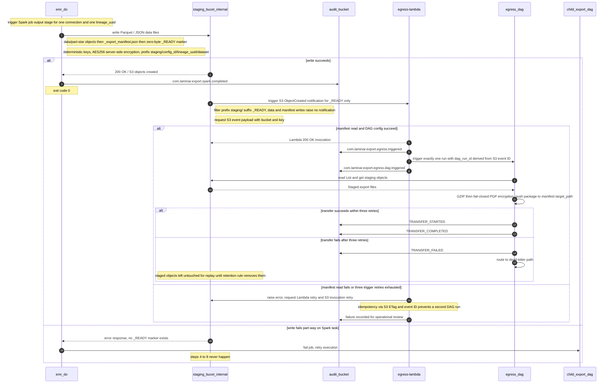

### 10.5. Schema Definitions (DB Tables / API JSON / Telemetry CloudEvents)
<a id="laminar-sec-c.imp_aws_aws_s3_bucket_8.schema"></a>
This component owns no database tables. It owns three payload shapes: the staging manifest sidecar, the S3 event notification it emits, and the CloudEvents records its edges carry.

#### 10.5.1 Staging export manifest — `_export_manifest.json`

```json
{
  "$schema": "https://json-schema.org/draft/2020-12/schema",
  "$id": "https://laminar.com/schemas/staging/export_manifest.json",
  "title": "StagingExportManifest",
  "type": "object",
  "additionalProperties": false,
  "required": [
    "config_id", "lineage_uuid", "dataset", "target_type", "target_path",
    "record_count", "total_size_bytes", "files", "created_at_utc"
  ],
  "properties": {
    "config_id": { "type": "string", "format": "uuid" },
    "lineage_uuid": { "type": "string", "format": "uuid" },
    "dataset": {
      "type": "string",
      "enum": [
        "unified_identity_profile", "pii_restricted_profile",
        "contact_method_subscription", "enriched_campaigns",
        "enriched_campaign_reactions", "room_stay_reservation",
        "restaurant_reservation", "tee_time_reservation", "spa_treatment_reservation"
      ]
    },
    "target_type": { "type": "string", "enum": ["s3", "sftp", "azure_blob", "gcs", "internal_staging"] },
    "target_path": { "type": "string", "minLength": 1 },
    "record_count": { "type": "integer", "minimum": 0 },
    "total_size_bytes": { "type": "integer", "minimum": 0 },
    "files": {
      "type": "array",
      "minItems": 1,
      "items": {
        "type": "object",
        "additionalProperties": false,
        "required": ["key", "size_bytes", "sha256"],
        "properties": {
          "key": { "type": "string" },
          "size_bytes": { "type": "integer", "minimum": 0 },
          "sha256": { "type": "string", "pattern": "^[0-9a-f]{64}$" }
        }
      }
    },
    "created_at_utc": { "type": "string", "format": "date-time" }
  }
}
```

#### 10.5.2 S3 event notification payload (staging_bucet_internal → egress-lambda)

```json
{
  "$schema": "https://json-schema.org/draft/2020-12/schema",
  "$id": "https://laminar.com/schemas/staging/s3_object_created_event.json",
  "title": "S3ObjectCreatedEvent",
  "type": "object",
  "required": ["Records"],
  "properties": {
    "Records": {
      "type": "array",
      "minItems": 1,
      "items": {
        "type": "object",
        "required": ["eventVersion", "eventSource", "eventName", "eventTime", "s3"],
        "properties": {
          "eventVersion": { "type": "string" },
          "eventSource": { "const": "aws:s3" },
          "eventName": { "const": "ObjectCreated:Put" },
          "eventTime": { "type": "string", "format": "date-time" },
          "s3": {
            "type": "object",
            "required": ["bucket", "object"],
            "properties": {
              "bucket": {
                "type": "object",
                "required": ["name"],
                "properties": { "name": { "const": "staging_bucet_internal" } }
              },
              "object": {
                "type": "object",
                "required": ["key", "eTag", "size"],
                "properties": {
                  "key": { "type": "string", "pattern": "^staging/.+/_READY$" },
                  "eTag": { "type": "string" },
                  "size": { "type": "integer" },
                  "sequencer": { "type": "string" }
                }
              }
            }
          }
        }
      }
    }
  }
}
```

#### 10.5.3 Telemetry CloudEvents emitted on this component's edges

```json
{
  "$schema": "https://json-schema.org/draft/2020-12/schema",
  "$id": "https://laminar.com/schemas/staging/staging_cloud_event.json",
  "title": "StagingCloudEvent",
  "type": "object",
  "required": ["specversion", "id", "source", "type", "time", "subject", "data"],
  "properties": {
    "specversion": { "const": "1.0" },
    "id": { "type": "string", "format": "uuid" },
    "source": { "const": "urn:laminar:dataoutbound:staging-bucket" },
    "type": {
      "type": "string",
      "enum": [
        "com.laminar.export.spark.completed",
        "com.laminar.export.egress.triggered"
      ]
    },
    "time": { "type": "string", "format": "date-time" },
    "subject": { "type": "string", "description": "s3://staging_bucet_internal/<key>" },
    "datacontenttype": { "const": "application/json" },
    "data": {
      "type": "object",
      "required": ["execution_id", "actor_id", "event_type", "timestamp_utc"],
      "properties": {
        "execution_id": { "type": "string", "format": "uuid" },
        "actor_id": { "type": "string", "pattern": "^(system:[a-z0-9-]+|[A-Za-z0-9._@-]+)$" },
        "event_type": {
          "type": "string",
          "enum": ["EXECUTION_COMPLETED", "TRANSFER_STARTED"]
        },
        "timestamp_utc": {
          "type": "string",
          "pattern": "^\\d{4}-\\d{2}-\\d{2}T\\d{2}:\\d{2}:\\d{2}\\.\\d{3}Z$"
        },
        "config_id": { "type": "string", "format": "uuid" },
        "dataset": { "type": "string" },
        "object_key": { "type": "string" },
        "record_count": { "type": "integer", "minimum": 0 }
      }
    }
  }
}
```

### 10.6. Local Design Assumptions
<a id="laminar-sec-c.imp_aws_aws_s3_bucket_8.asm"></a>
- **Lifecycle — the diagram value is `lifecycle_enabled = false`.** No lifecycle rule is applied to `staging_bucet_internal` by this deployment, and the bucket's contract above is written against that value. **Recommendation:** for this bucket, supersede `lifecycle_enabled = false` with a single lifecycle rule that expires objects under the `staging/` prefix after exactly 7 days, because SCRUM-482 AC#1–2 and SCRUM-486 AC#5 require staged export files to be purged automatically after 7 days and to be absent from the bucket once aged 7 days while a 6-day-old object is still present. The rule is the only retention mechanism for this bucket; no transition to Glacier is applied, since the objects live for 7 days and a transition would add cost without benefit.
- **Versioning is off, so the 7-day expiry is destructive.** With `versioning = false` there is no noncurrent-version backlog to expire, and a re-run of the same logical execution overwrites the same deterministic keys. This is intentional: the staging bucket is a transient hand-off buffer, not a system of record.
- **Encryption is `AES256` (SSE-S3) as set by the diagram.** **Recommendation:** move to SSE-KMS with a customer-managed key if the organisation later requires per-tenant key separation or key-usage audit; the diagram value is retained here.
- **The S3 event notification is filtered to the `_READY` suffix.** Without a filter, every data-file and manifest write would invoke **egress-lambda** and could start a DAG run before the package is complete. The marker-last convention plus the suffix filter is what delivers the "exactly one Transform & Encrypt DAG run per staged file" guarantee of SCRUM-482 AC#3.
- **The manifest sidecar carries the routing metadata.** `target_type` and `target_path` are written into `_export_manifest.json` by **emr_do** so that **egress-lambda** can build the **egress dag** run configuration from objects it already reads, without an additional configuration-store lookup on the notification path.
- **Deletion protection is read from per-environment configuration.** The bucket's deletion-protection flag is a Terraform variable resolved from the environment's config (dev / staging / prod) and is never hardcoded, satisfying SCRUM-485 AC#3; in dev it is disabled so teardown exits 0 (AC#4), and in staging/prod it is enabled so teardown exits non-zero and the bucket survives (AC#5).
- **Log retention.** The bucket's access and notification logs are provisioned as an explicit log group under the **audit_bucket** parent with `retention_in_days` set to the single organisation logging-standard value of 365 days (see §18.1); no group is left unset or never-expire (SCRUM-486 AC#4).
- **Bucket name uniqueness.** `staging_bucet_internal` is treated as an account-scoped, environment-suffixed name at provisioning time; the logical name in this document is the one the components reference.
- **Out of scope.** Cross-region replication, S3 Object Lock and inventory reporting are not part of this architecture and are not configured.

## 11. Component Design: egress-lambda
<a id="laminar-sec-c.imp_aws_aws_lambda_9"></a>

<!-- laminar:diagram-settings:imp-aws-aws_lambda-9 -->
**Diagram settings (user decisions — authoritative)**

| Setting | Value |
| --- | --- |
| `runtime` | `python3.11` |
| `handler` | `lambda_function.lambda_handler` |
| `memory_mb` | `512` |
| `timeout_seconds` | `30` |
| `vpc_enabled` | `false` |
| `function_name` | `egress-lambda` |

<!-- /laminar:diagram-settings -->


### 11.1. Component Contract (Bi-Directional Inputs & Outputs)
<a id="laminar-sec-c.imp_aws_aws_lambda_9.contract"></a>
The `egress-lambda` component acts as an event-driven serverless bridge between the internal staging S3 bucket (`staging_bucet_internal`) and the egress orchestration workflow (`egress dag`).

#### 11.1.1 Inputs & Triggers
- **Trigger Source**: Amazon S3 Event Notifications (`ObjectCreated:*`) originating from `staging_bucet_internal` when the export extraction spark job (`emr_do`) writes completed parquet/JSON data files.
- **Payload**: Standard S3 Event JSON notification containing bucket name, object key, ETag, and event timestamp.

#### 11.1.2 Outputs & Integrations
- **Downstream Target**: Triggers the `egress dag` hosted on Amazon MWAA via REST API invocation. Passes the lineage UUID and S3 object metadata in the DAG run configuration payload (`conf`).
- **Telemetry & Audit**: Emits standardized CloudEvents audit records to `audit_bucket` via the shared `AuditPublisher`.
- **Error Handling & Resilience**: Configured with 3 automatic retries on invocation failure. Unhandled processing errors route to the default Lambda dead-letter queue (DLQ) and generate an organization-standard alert.

---

### 11.2. Class and Interface Definitions
<a id="laminar-sec-c.imp_aws_aws_lambda_9.classes"></a>
Typed Python dataclasses and Pydantic models governing `egress-lambda` event parsing and trigger payloads:

```python
from datetime import datetime
from typing import Dict, List, Optional
from pydantic import BaseModel, Field

class S3RecordEntity(BaseModel):
    s3BucketId: str = Field(..., alias="name")
    s3ObjectKey: str = Field(..., alias="key")
    sizeBytes: int = Field(..., alias="size")
    etag: str

class S3EventRecord(BaseModel):
    eventVersion: str
    eventSource: str
    awsRegion: str
    eventTime: datetime
    eventName: str
    s3: Dict[str, Any]

class S3NotificationEvent(BaseModel):
    records: List[S3EventRecord] = Field(..., alias="Records")

class EgressDagTriggerRequest(BaseModel):
    dag_id: str = Field(default="egress_dag")
    conf: Dict[str, Any] = Field(
        default_factory=dict,
        description="Execution configuration containing lineage UUID and staged object keys"
    )
    logical_date: Optional[str] = Field(None, description="ISO-8601 execution date override")

class EgressLambdaResponse(BaseModel):
    status_code: int = Field(..., description="HTTP status code of the operation")
    message: str
    dag_run_id: Optional[str] = None
```

---

### 11.3. Implementation Code Skeleton (Stubs & Handlers)
<a id="laminar-sec-c.imp_aws_aws_lambda_9.skeleton"></a>
Illustrative skeleton — the Component Contract and Schema Definitions are binding. The deployed handler string is `lambda_function.lambda_handler` (diagram setting); the build step publishes the blueprint module `lambdas/egress_lambda.py` as `lambda_function.py` inside the deployment package so that string resolves.

```python
# src/dataoutbound_st_fixes/lambdas/egress_lambda.py
# Deployed as lambda_function.py; handler string: lambda_function.lambda_handler
from __future__ import annotations

import hashlib
from typing import Any, Dict, List

from dataoutbound_st_fixes.common.clients.aws.mwaa.mwaa_client import MwaaClient
from dataoutbound_st_fixes.common.clients.aws.s3.s3_client import S3Client
from dataoutbound_st_fixes.common.logging.logger import get_logger
from dataoutbound_st_fixes.common.telemetry.auditor import AuditPublisher
from dataoutbound_st_fixes.config.config_loader import ConfigLoader
from dataoutbound_st_fixes.util.constants import (
    AUDIT_EVENT_EGRESS_DAG_TRIGGERED,
    AUDIT_EVENT_EGRESS_TRIGGERED,
    EGRESS_DAG_ID,
    STAGING_BUCKET_NAME,
)
from dataoutbound_st_fixes.util.exceptions import ClientError, ValidationError
from dataoutbound_st_fixes.util.idempotency import IdempotencyKey, retry_with_backoff
from dataoutbound_st_fixes.util.utils import StagingBucketLayout

logger = get_logger(__name__)

_config = ConfigLoader(module="lambdas")
_s3 = S3Client()
_mwaa = MwaaClient()
_audit = AuditPublisher()  # argument-free: the auditor resolves its own sink


def _iter_ready_records(event: Dict[str, Any]) -> List[Dict[str, Any]]:
    """Return the S3 records that represent a completed export package."""
    records = event.get("Records") or []
    if not records:
        raise ValidationError("S3 event carries no Records")
    ready: List[Dict[str, Any]] = []
    for record in records:
        key = record.get("s3", {}).get("object", {}).get("key", "")
        if StagingBucketLayout.is_ready_marker(key):
            ready.append(record)
    return ready


def _build_dag_conf(record: Dict[str, Any]) -> Dict[str, Any]:
    """Build the egress dag run configuration from the staging manifest.

    The manifest sidecar written by emr_do carries the routing metadata, so the
    Lambda supplies every field EgressDagRunConfig requires.
    """
    bucket = record["s3"]["bucket"]["name"]
    key = record["s3"]["object"]["key"]
    parsed = StagingBucketLayout.parse(key)
    layout = StagingBucketLayout(parsed.config_id, parsed.lineage_uuid, parsed.dataset)

    manifest = _s3.get_object_json(bucket, layout.manifest_key)
    return {
        "config_id": manifest["config_id"],
        "lineage_uuid": manifest["lineage_uuid"],
        "dataset": manifest["dataset"],
        "staging_s3_key": layout.data_prefix,
        "target_type": manifest["target_type"],
        "target_path": manifest["target_path"],
    }


def _invocation_key(record: Dict[str, Any]) -> str:
    """Deterministic dag_run_id: one DAG run per S3 event, duplicates collapse."""
    event_id = record.get("responseElements", {}).get("x-amz-request-id") or record["s3"]["object"]["eTag"]
    return IdempotencyKey.build("egress", event_id)


def _trigger_egress_dag(dag_conf: Dict[str, Any], dag_run_id: str) -> str:
    """Trigger exactly one egress dag run; retried by the caller on failure."""
    existing = _mwaa.get_dag_run(dag_id=EGRESS_DAG_ID, dag_run_id=dag_run_id)
    if existing is not None:
        logger.info("egress dag run already exists", extra={"dag_run_id": dag_run_id})
        return dag_run_id
    return _mwaa.trigger_dag_run(
        dag_id=EGRESS_DAG_ID,
        dag_run_id=dag_run_id,
        conf=dag_conf,
    )


def lambda_handler(event: Dict[str, Any], context: Any) -> Dict[str, Any]:
    """S3 ObjectCreated on staging_bucet_internal -> one egress dag run."""
    ready = _iter_ready_records(event)
    if not ready:
        logger.info("no _READY marker in event; nothing to trigger")
        return {"statusCode": 200, "triggered": 0}

    triggered = 0
    for record in ready:
        dag_conf = _build_dag_conf(record)
        dag_run_id = _invocation_key(record)

        _audit.publish(
            event_type=AUDIT_EVENT_EGRESS_TRIGGERED,
            payload={
                "execution_id": dag_conf["lineage_uuid"],
                "actor_id": "system:egress-lambda",
                "config_id": dag_conf["config_id"],
                "dataset": dag_conf["dataset"],
                "staging_s3_key": dag_conf["staging_s3_key"],
            },
        )

        try:
            retry_with_backoff(
                _trigger_egress_dag,
                dag_conf,
                dag_run_id,
                attempts=3,
                base_delay_seconds=1.0,
            )
        except ClientError as exc:
            logger.error(
                "egress dag trigger failed after retries",
                extra={"dag_run_id": dag_run_id, "error": str(exc)},
            )
            raise  # let the platform retry the invocation; DLQ captures terminal failure

        _audit.publish(
            event_type=AUDIT_EVENT_EGRESS_DAG_TRIGGERED,
            payload={
                "execution_id": dag_conf["lineage_uuid"],
                "actor_id": "system:egress-lambda",
                "dag_run_id": dag_run_id,
                "config_id": dag_conf["config_id"],
            },
        )
        triggered += 1

    return {"statusCode": 200, "triggered": triggered}
```

**Endpoint / trigger surface (binding).**

| Trigger | Source | Payload | Success | Failure |
|---|---|---|---|---|
| `lambda_handler` | S3 `ObjectCreated:*` on `staging_bucet_internal`, filtered to suffix `_READY` | `S3ObjectCreatedEvent` | `{"statusCode": 200, "triggered": N}` | Raise after 3 retries → platform retry → DLQ; audit record already written |

**Configuration actually set by this design.** `runtime = python3.11`, `handler = lambda_function.lambda_handler`, `memory_mb = 512`, `timeout_seconds = 30`, `vpc_enabled = false`, `function_name = egress-lambda` — all user decisions, unchanged. The function reads its bucket name, DAG id and MWAA endpoint from `lambdas/config.yml` through `ConfigLoader`; no environment variable is required by the diagram (`environment_variables = {}`).

**Network path.** With `vpc_enabled = false` the function reaches S3 over the AWS public endpoint and reaches the MWAA REST API over its webserver endpoint. **Recommendation:** attach the function to the private subnets (`vpc_enabled = true`) and set the MWAA webserver access mode to `PRIVATE_ONLY`, so the trigger path never leaves the VPC; the diagram value is retained here and the MWAA webserver is assumed to be reachable with IAM (SigV4) authorisation and an IP allowlist.

### 11.4. Cross-Component Interaction Sequence (Local Mermaid/ASCII Flow)
<a id="laminar-sec-c.imp_aws_aws_lambda_9.seq"></a>
1. **S3 Event Generation**: When the export extraction spark job (`emr_do`) writes packaged dataset files into `staging_bucet_internal`, S3 emits an `ObjectCreated` event notification.
2. **Lambda Trigger**: Amazon S3 invokes `egress-lambda` (`egress-lambda`) asynchronously with the event batch.
3. **Event Parsing & Validation**: `egress-lambda` parses the record payloads, extracts the bucket identifier, object key, and embedded lineage UUID.
4. **Audit Publication**: `egress-lambda` calls `AuditPublisher` to record a `TRANSFER_STARTED` event into `audit_bucket`.
5. **DAG Trigger**: `egress-lambda` utilizes `MwaaClient` to trigger the downstream orchestration workflow (`egress dag`) passing the lineage UUID and object coordinates in the DAG configuration payload.
6. **Error Handling**: On network or MWAA API failures, the client retries up to 3 times with exponential backoff. If exhaustion occurs, the exception bubbles up, invoking Lambda retry mechanisms and routing persistent failures to the Dead-Letter Queue.

---
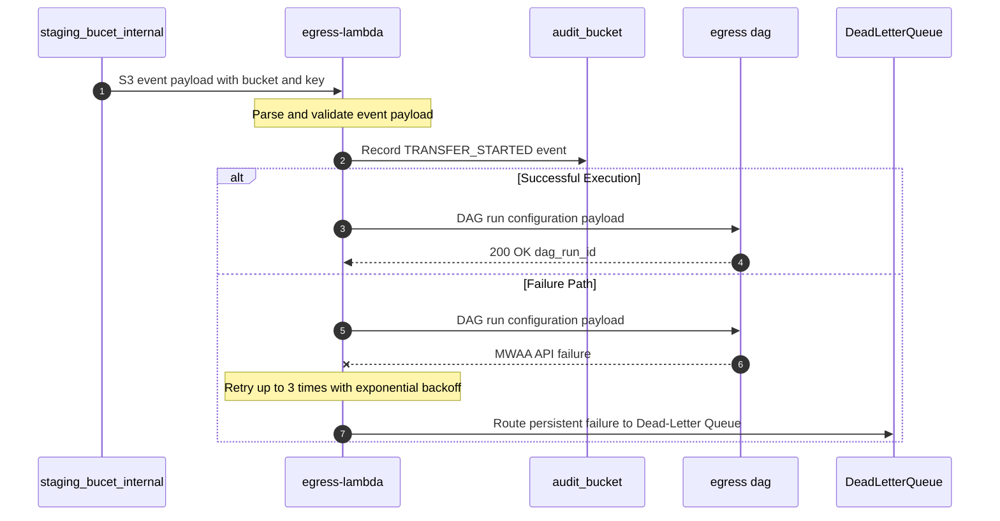

### 11.5. Schema Definitions (DB Tables / API JSON / Telemetry CloudEvents)
<a id="laminar-sec-c.imp_aws_aws_lambda_9.schema"></a>
This component owns no database tables. It owns the inbound S3 event shape (defined in §10.5), the outbound DAG run configuration, and its two CloudEvents records.

#### 11.5.1 Outbound payload — `EgressDagRunConfig` (egress-lambda → egress dag)

This is the single shared shape for the **egress dag** run configuration; §12.5.1 declares the identical object, and the Lambda supplies every required field from the staging manifest.

```json
{
  "$schema": "https://json-schema.org/draft/2020-12/schema",
  "$id": "https://laminar.com/schemas/egress/egress_dag_run_config.json",
  "title": "EgressDagRunConfig",
  "type": "object",
  "additionalProperties": false,
  "required": ["config_id", "lineage_uuid", "dataset", "staging_s3_key", "target_type", "target_path"],
  "properties": {
    "config_id": { "type": "string", "format": "uuid" },
    "lineage_uuid": { "type": "string", "format": "uuid" },
    "dataset": {
      "type": "string",
      "enum": [
        "unified_identity_profile", "pii_restricted_profile",
        "contact_method_subscription", "enriched_campaigns",
        "enriched_campaign_reactions", "room_stay_reservation",
        "restaurant_reservation", "tee_time_reservation", "spa_treatment_reservation"
      ]
    },
    "staging_s3_key": {
      "type": "string",
      "pattern": "^staging/[0-9a-fA-F-]{36}/[0-9a-fA-F-]{36}/[a-z0-9_]+/data/$"
    },
    "target_type": { "type": "string", "enum": ["s3", "sftp", "azure_blob", "gcs", "internal_staging"] },
    "target_path": { "type": "string", "minLength": 1 }
  }
}
```

#### 11.5.2 Telemetry CloudEvents emitted by egress-lambda

```json
{
  "$schema": "https://json-schema.org/draft/2020-12/schema",
  "$id": "https://laminar.com/schemas/egress/egress_lambda_cloud_event.json",
  "title": "EgressLambdaCloudEvent",
  "type": "object",
  "required": ["specversion", "id", "source", "type", "time", "subject", "data"],
  "properties": {
    "specversion": { "const": "1.0" },
    "id": { "type": "string", "format": "uuid" },
    "source": { "const": "urn:laminar:dataoutbound:egress-lambda" },
    "type": {
      "type": "string",
      "enum": [
        "com.laminar.export.egress.triggered",
        "com.laminar.export.egress.dag.triggered"
      ]
    },
    "time": { "type": "string", "format": "date-time" },
    "subject": { "type": "string", "description": "s3://staging_bucet_internal/<_READY key>" },
    "datacontenttype": { "const": "application/json" },
    "data": {
      "type": "object",
      "required": ["execution_id", "actor_id", "event_type", "timestamp_utc"],
      "properties": {
        "execution_id": { "type": "string", "format": "uuid" },
        "actor_id": { "const": "system:egress-lambda" },
        "event_type": { "type": "string", "enum": ["TRANSFER_STARTED"] },
        "timestamp_utc": {
          "type": "string",
          "pattern": "^\\d{4}-\\d{2}-\\d{2}T\\d{2}:\\d{2}:\\d{2}\\.\\d{3}Z$"
        },
        "config_id": { "type": "string", "format": "uuid" },
        "dataset": { "type": "string" },
        "staging_s3_key": { "type": "string" },
        "dag_run_id": { "type": "string" }
      }
    }
  }
}
```

### 11.6. Local Design Assumptions
<a id="laminar-sec-c.imp_aws_aws_lambda_9.asm"></a>
1. **Assumption (Runtime & Limits)**: `egress-lambda` runs on Python 3.11 with 512 MB memory and a 30-second timeout, ensuring fast execution for parsing lightweight S3 notification payloads and calling the MWAA REST API without resource contention.
2. **Assumption (VPC Isolation)**: VPC integration is disabled (`vpc_enabled = false`), allowing the function to execute in the AWS Lambda managed service plane while securely communicating with private MWAA endpoints via IAM authentication and VPC interface endpoints.
3. **Assumption (Idempotency)**: Event handling relies on S3 event object keys and lineage UUIDs to ensure idempotent processing across retries, avoiding duplicate DAG trigger executions.

---

## 12. Component Design: egress dag
<a id="laminar-sec-c.imp_aws_aws_mwaa_dag_10"></a>

<!-- laminar:diagram-settings:imp-aws-aws_mwaa_dag-10 -->
**Diagram settings (user decisions — authoritative)**

| Setting | Value |
| --- | --- |
| `schedule` | `@daily` |
| `catchup` | `false` |
| `max_active_runs` | `1` |
| `dag_name` | `egress dag` |

<!-- /laminar:diagram-settings -->


### 12.1. Component Contract (Bi-Directional Inputs & Outputs)
<a id="laminar-sec-c.imp_aws_aws_mwaa_dag_10.contract"></a>
**Component:** `egress dag` — MWAA DAG `egress dag` (Transform & Encrypt DAG). **Owns:** DAG execution state in the MWAA-managed Airflow metadata database (no table is provisioned or owned by this design). **Does not own:** any S3 object, any customer destination, any configuration row.

**Configuration set by this design (from the canvas):** `dag_name = egress dag`, `schedule = @daily`, `catchup = false`, `max_active_runs = 1`. Rationale: a single active run per DAG prevents two concurrent runs from writing the same deterministic destination keys; `catchup=false` prevents a backlog of historical logical dates from being replayed after a pause. The DAG is *primarily event-triggered* by **egress-lambda**; the `@daily` schedule is retained exactly as the user set it and acts as a sweep that no-ops when no unprocessed staging object exists for the logical date (see Local Design Assumptions).

#### 12.1.1 Inbound contracts

| From | Protocol | Trigger | Request payload | Response | Errors | Idempotency | Telemetry |
|---|---|---|---|---|---|---|---|
| **egress-lambda** | HTTPS / MWAA REST API (`POST /dags/egress dag/dagRuns`) | Lambda invocation of the Airflow DAG | `EgressDagRunConfig` (JSON, §Schema Definitions) | `200 OK` with `dag_run_id` | Retry REST call with backoff (3 attempts), log failure; Lambda returns non-2xx and the S3 event is retried by the platform | Idempotent via `invocation_key` (derived from the S3 event ID) — a repeated trigger for the same key resolves to the same `dag_run_id` | `com.laminar.export.egress.dag.triggered` (emitted by **egress-lambda**) |

`EgressDagRunConfig` is the **single binding payload shape** for this edge. It carries `config_id`, `lineage_uuid`, `dataset`, `staging_s3_key`, `target_type` and `target_path`; **egress-lambda** obtains these from the staging descriptor object written by **emr_do** alongside the staged data (`s3://staging_bucet_internal/_descriptor/<lineage_uuid>.json`) and from the S3 event itself. The DAG has no **cofig_db** edge and therefore never resolves connection metadata itself.

#### 12.1.2 Delivery semantics and failure path

Delivery is **delivery-only**: no acknowledgement is expected from a customer destination beyond transport-level success of the write. Integrity is verified by recomputing SHA-256 from a read-back of each delivered object/file and comparing it with the manifest value; native checksums (S3 `ChecksumSHA256`, Azure `Content-MD5`, GCS `CRC32C`) are requested as additional transport checks. PGP is **fail-closed**: if the key is missing, corrupt, or encryption raises, the transfer aborts, a `TRANSFER_FAILED` audit record is written within 5 seconds, an alert is raised, and **zero bytes** of unencrypted data reach any destination. After the third failed delivery attempt the package is routed to the egress dead-letter queue, an alert is raised, and the incident is logged for operational review and customer notification.

---

### 12.2. Class and Interface Definitions
<a id="laminar-sec-c.imp_aws_aws_mwaa_dag_10.classes"></a>
```python
"""Typed contracts for the `egress dag` component (Transform & Encrypt DAG)."""
from __future__ import annotations

from dataclasses import dataclass, field
from datetime import datetime
from enum import Enum
from typing import Any, Mapping, Protocol, Sequence

from dataoutbound_st_fixes.util.exceptions import ClientError, ConfigError, LaminarError


class DeliveryTargetType(str, Enum):
    """Destination families supported by the delivery router."""
    S3 = "s3"
    AZURE_BLOB = "azure_blob"
    GCS = "gcs"
    SFTP = "sftp"


class TransferStatus(str, Enum):
    STARTED = "TRANSFER_STARTED"
    COMPLETED = "TRANSFER_COMPLETED"
    FAILED = "TRANSFER_FAILED"


class EgressConfigError(ConfigError):
    """Run configuration is missing or malformed."""


class PgpEncryptionError(LaminarError):
    """Fail-closed encryption failure: no bytes may leave the DAG."""


class HostKeyVerificationError(ClientError):
    """SFTP host key mismatch — non-retryable, zero bytes sent."""


class TransferFailedError(ClientError):
    """Delivery failed after the configured retry budget was exhausted."""


@dataclass(frozen=True)
class EgressDagRunConfig:
    """Binding payload of the egress-lambda -> egress dag trigger edge."""
    config_id: str
    lineage_uuid: str
    dataset: str
    staging_s3_key: str
    target_type: DeliveryTargetType
    target_path: str
    staging_bucket: str = "staging_bucet_internal"
    gzip_enabled: bool = True
    pgp_enabled: bool = True
    split_threshold_records: int = 500_000
    invocation_key: str | None = None

    @classmethod
    def from_conf(cls, conf: Mapping[str, Any]) -> "EgressDagRunConfig":
        required = ("config_id", "lineage_uuid", "dataset",
                    "staging_s3_key", "target_type", "target_path")
        missing = [k for k in required if not conf.get(k)]
        if missing:
            raise EgressConfigError(f"missing run-config fields: {missing}")
        return cls(
            config_id=str(conf["config_id"]),
            lineage_uuid=str(conf["lineage_uuid"]),
            dataset=str(conf["dataset"]),
            staging_s3_key=str(conf["staging_s3_key"]),
            target_type=DeliveryTargetType(conf["target_type"]),
            target_path=str(conf["target_path"]),
            staging_bucket=str(conf.get("staging_bucket", "staging_bucet_internal")),
            gzip_enabled=bool(conf.get("gzip_enabled", True)),
            pgp_enabled=bool(conf.get("pgp_enabled", True)),
            split_threshold_records=int(conf.get("split_threshold_records", 500_000)),
            invocation_key=conf.get("invocation_key"),
        )


@dataclass(frozen=True)
class StagedObjectRef:
    bucket: str
    key: str
    size_bytes: int
    etag: str


@dataclass(frozen=True)
class ExportArtefact:
    """One file of the export package, before and after transform."""
    file_name: str
    sha256: str
    size_bytes: int
    record_count: int


@dataclass(frozen=True)
class TransferOutcome:
    target_type: DeliveryTargetType
    target_path: str
    file_name: str
    sha256: str
    status: TransferStatus
    attempts: int
    error: str | None = None


@dataclass
class EgressRunState:
    """XCom-carried state between the DAG's tasks."""
    run_config: EgressDagRunConfig
    staged_objects: list[StagedObjectRef] = field(default_factory=list)
    artefacts: list[ExportArtefact] = field(default_factory=list)
    outcomes: list[TransferOutcome] = field(default_factory=list)


class DeliveryTarget(Protocol):
    """One implementation per destination family; all are idempotent by key."""

    target_type: DeliveryTargetType

    def deliver(self, local_path: str, remote_path: str, sha256: str) -> TransferOutcome:
        ...


class EgressDagTasks:
    """Task bodies of the `egress dag`; constructed per task execution."""

    def resolve_run_config(self, conf: Mapping[str, Any]) -> EgressDagRunConfig: ...
    def read_staged_objects(self, cfg: EgressDagRunConfig) -> list[StagedObjectRef]: ...
    def transform_and_encrypt(self, cfg: EgressDagRunConfig,
                              staged: Sequence[StagedObjectRef]) -> list[ExportArtefact]: ...
    def deliver(self, cfg: EgressDagRunConfig,
                artefacts: Sequence[ExportArtefact]) -> list[TransferOutcome]: ...
    def emit_audit(self, cfg: EgressDagRunConfig, status: TransferStatus,
                   outcomes: Sequence[TransferOutcome] = ()) -> None: ...
```

---

### 12.3. Implementation Code Skeleton (Stubs & Handlers)
<a id="laminar-sec-c.imp_aws_aws_mwaa_dag_10.skeleton"></a>
Illustrative skeleton — the Component Contract and Schema Definitions are binding.

```python
# src/dataoutbound_st_fixes/dags/transform_encrypt_dag.py
"""`egress dag` — Transform & Encrypt DAG (MWAA).

Triggered by egress-lambda over the MWAA REST API; reads staged objects from
staging_bucet_internal, applies GZIP then fail-closed PGP, and delivers the
package plus manifest to the configured customer destination.
"""
from __future__ import annotations

import gzip
import hashlib
import json
import os
import shutil
import tempfile
from datetime import datetime, timedelta, timezone

from airflow import DAG
from airflow.operators.python import PythonOperator
from airflow.utils.trigger_rule import TriggerRule

from dataoutbound_st_fixes.common.clients.aws.s3.s3_client import S3Client
from dataoutbound_st_fixes.common.clients.aws.sqs.sqs_client import SqsClient
from dataoutbound_st_fixes.common.clients.azure.blob_client import BlobClient
from dataoutbound_st_fixes.common.clients.gcp.gcs_client import GcsClient
from dataoutbound_st_fixes.common.clients.sftp.sftp_client import SftpClient
from dataoutbound_st_fixes.common.logging.logger import get_logger
from dataoutbound_st_fixes.common.telemetry.auditor import AuditPublisher
from dataoutbound_st_fixes.config.config_loader import ConfigLoader
from dataoutbound_st_fixes.util.exceptions import ClientError, LaminarError
from dataoutbound_st_fixes.util.idempotency import IdempotencyKey, retry_with_backoff

LOG = get_logger(__name__)
CFG = ConfigLoader(module="dags").load()
DAG_ID = "egress dag"
MAX_DELIVERY_ATTEMPTS = 3


def _audit() -> AuditPublisher:
    # Argument-free construction: the publisher resolves its sink from ConfigLoader.
    return AuditPublisher()


def _emit(cfg: dict, event_type: str, status: str, **extra) -> None:
    """Publish one CloudEvents-shaped audit record; never raises into the DAG."""
    _audit().publish(
        event_type=event_type,
        payload={
            "actor_id": "system:egress-dag",
            "timestamp_utc": datetime.now(timezone.utc).strftime("%Y-%m-%dT%H:%M:%S.%f")[:-3] + "Z",
            "event_type": status,
            "execution_id": cfg["lineage_uuid"],
            "config_id": cfg["config_id"],
            "dataset": cfg["dataset"],
            **extra,
        },
    )


def resolve_run_config(**context) -> dict:
    """Validate the Lambda-supplied run configuration; fail fast on malformed input."""
    conf = dict(context["dag_run"].conf or {})
    required = ("config_id", "lineage_uuid", "dataset",
                "staging_s3_key", "target_type", "target_path")
    missing = [k for k in required if not conf.get(k)]
    if missing:
        raise LaminarError(f"egress run config missing fields: {missing}")
    conf.setdefault("staging_bucket", CFG["staging_bucket"])
    conf.setdefault("gzip_enabled", True)
    conf.setdefault("pgp_enabled", True)
    conf.setdefault("split_threshold_records", CFG.get("split_threshold_records", 500_000))
    _emit(conf, "com.laminar.audit.emitted", "EXECUTION_STARTED")
    return conf


def read_staged_objects(**context) -> list[dict]:
    """List and stat the staged objects for this lineage UUID."""
    cfg = context["ti"].xcom_pull(task_ids="resolve_run_config")
    s3 = S3Client()
    prefix = os.path.dirname(cfg["staging_s3_key"])
    objects = s3.list_objects(bucket=cfg["staging_bucket"], prefix=prefix)
    if not objects:
        LOG.warning("no staged objects under %s/%s", cfg["staging_bucket"], prefix)
    return [{"bucket": o["Bucket"], "key": o["Key"],
             "size_bytes": o["Size"], "etag": o["ETag"]} for o in objects]


def transform_and_encrypt(**context) -> list[dict]:
    """GZIP first, then PGP. Fail-closed: any encryption error aborts the run."""
    cfg = context["ti"].xcom_pull(task_ids="resolve_run_config")
    staged = context["ti"].xcom_pull(task_ids="read_staged_objects")
    s3 = S3Client()
    workdir = tempfile.mkdtemp(prefix="egress-")
    artefacts: list[dict] = []
    try:
        for obj in staged:
            local = os.path.join(workdir, os.path.basename(obj["key"]))
            s3.download_file(bucket=obj["bucket"], key=obj["key"], local_path=local)
            if cfg["gzip_enabled"]:
                gz_path = f"{local}.gz"
                with open(local, "rb") as src, gzip.open(gz_path, "wb") as dst:
                    shutil.copyfileobj(src, dst)
                local = gz_path
            if cfg["pgp_enabled"]:
                try:
                    local = _pgp_encrypt(local, key_ref=CFG["pgp_key_ssm_ref"])
                except Exception as exc:  # fail-closed
                    _emit(cfg, "com.laminar.audit.emitted", "TRANSFER_FAILED",
                          destination=cfg["target_type"], error=str(exc))
                    raise LaminarError(f"PGP encryption failed, transfer aborted: {exc}") from exc
            artefacts.append({
                "file_name": os.path.basename(local),
                "sha256": _sha256(local),
                "size_bytes": os.path.getsize(local),
                "local_path": local,
            })
        return artefacts
    finally:
        # workdir is removed by the delivery task once the package is transferred
        pass


def deliver(**context) -> list[dict]:
    """Route the package to the configured destination; 3 attempts, then DLQ."""
    cfg = context["ti"].xcom_pull(task_ids="resolve_run_config")
    artefacts = context["ti"].xcom_pull(task_ids="transform_and_encrypt")
    target = _target_for(cfg["target_type"])
    outcomes: list[dict] = []
    for artefact in artefacts:
        _emit(cfg, "com.laminar.audit.emitted", "TRANSFER_STARTED",
              destination=cfg["target_type"], file_name=artefact["file_name"])
        try:
            outcome = retry_with_backoff(
                lambda: target.deliver(
                    local_path=artefact["local_path"],
                    remote_path=f"{cfg['target_path'].rstrip('/')}/{artefact['file_name']}",
                    sha256=artefact["sha256"],
                ),
                attempts=MAX_DELIVERY_ATTEMPTS,
                retry_on=(ClientError,),
            )
        except Exception as exc:
            _emit(cfg, "com.laminar.audit.emitted", "TRANSFER_FAILED",
                  destination=cfg["target_type"], file_name=artefact["file_name"],
                  error=str(exc))
            SqsClient().send(queue_url=CFG["egress_dlq_url"], body=json.dumps({
                "lineage_uuid": cfg["lineage_uuid"],
                "config_id": cfg["config_id"],
                "file_name": artefact["file_name"],
                "target_type": cfg["target_type"],
                "error": str(exc),
            }))
            raise
        outcomes.append(outcome)
        _emit(cfg, "com.laminar.audit.emitted", "TRANSFER_COMPLETED",
              destination=cfg["target_type"], file_name=artefact["file_name"],
              checksum=artefact["sha256"])
    return outcomes


def emit_completion_audit(**context) -> None:
    cfg = context["ti"].xcom_pull(task_ids="resolve_run_config")
    _emit(cfg, "com.laminar.audit.emitted", "EXECUTION_COMPLETED")


def on_failure(context) -> None:
    """DAG-level failure callback: one TRANSFER_FAILED record plus an alert."""
    conf = dict(getattr(context.get("dag_run"), "conf", None) or {})
    if conf.get("lineage_uuid"):
        _emit(conf, "com.laminar.audit.emitted", "TRANSFER_FAILED",
              destination=conf.get("target_type"), error="dag run failed")


def _target_for(target_type: str):
    if target_type == "s3":
        return S3Client()
    if target_type == "azure_blob":
        return BlobClient()
    if target_type == "gcs":
        return GcsClient()
    if target_type == "sftp":
        return SftpClient()
    raise LaminarError(f"unsupported target_type: {target_type}")


def _pgp_encrypt(local_path: str, key_ref: str) -> str:
    """PGP-encrypt with the customer public key resolved from SSM SecureString."""
    raise NotImplementedError  # implemented with the PGP library chosen at build time


def _sha256(local_path: str) -> str:
    digest = hashlib.sha256()
    with open(local_path, "rb") as handle:
        for chunk in iter(lambda: handle.read(1024 * 1024), b""):
            digest.update(chunk)
    return digest.hexdigest()


default_args = {
    "owner": "data-platform",
    "retries": 2,
    "retry_delay": timedelta(minutes=5),
    "on_failure_callback": on_failure,
}

with DAG(
    dag_id=DAG_ID,
    description="Transform, encrypt and deliver staged export packages",
    schedule_interval=CFG.get("schedule", "@daily"),   # user decision: @daily
    catchup=False,                                     # user decision
    max_active_runs=1,                                 # user decision
    default_args=default_args,
    tags=["dataoutbound", "egress"],
) as dag:
    t_config = PythonOperator(task_id="resolve_run_config", python_callable=resolve_run_config)
    t_read = PythonOperator(task_id="read_staged_objects", python_callable=read_staged_objects)
    t_transform = PythonOperator(task_id="transform_and_encrypt", python_callable=transform_and_encrypt)
    t_deliver = PythonOperator(task_id="deliver", python_callable=deliver)
    t_audit = PythonOperator(
        task_id="emit_completion_audit",
        python_callable=emit_completion_audit,
        trigger_rule=TriggerRule.ALL_SUCCESS,
    )

    t_config >> t_read >> t_transform >> t_deliver >> t_audit
```

---

### 12.4. Cross-Component Interaction Sequence (Local Mermaid/ASCII Flow)
<a id="laminar-sec-c.imp_aws_aws_mwaa_dag_10.seq"></a>
1. **emr_do** finishes a Spark job run and writes the staged export objects plus the descriptor object `_descriptor/<lineage_uuid>.json` to **staging_bucet_internal** under the deterministic lineage prefix.
2. The `ObjectCreated` notification on **staging_bucet_internal** invokes **egress-lambda** with the S3 event payload (bucket, key, event ID).
3. **egress-lambda** reads the descriptor object, derives `config_id`, `dataset`, `target_type`, `target_path` and `lineage_uuid`, and calls the MWAA REST API to trigger `egress dag` with the `EgressDagRunConfig` payload, using the S3 event ID as the idempotency key. On a non-2xx response it retries the REST call with backoff and logs the failure.
4. `egress dag` starts; `resolve_run_config` validates the payload and emits `EXECUTION_STARTED` to **audit_bucket**.
5. `read_staged_objects` lists and stats the staged objects in **staging_bucet_internal** for the lineage prefix. An empty listing ends the run as a no-op sweep.
6. `transform_and_encrypt` downloads each staged object, applies GZIP (when enabled) and then PGP encryption (when enabled). If encryption fails, the task emits `TRANSFER_FAILED` to **audit_bucket**, raises an alert, and aborts — no artefact is handed to delivery.
7. `deliver` routes the package to exactly one destination selected by `target_type`: **customer bucket** (S3), **Customer Azure Blob Destination**, **Customer GCS Destination**, or **customer SFTP server**. Each file is delivered under a deterministic name; SHA-256 is recomputed from a read-back and compared with the manifest value. A host-key mismatch on the SFTP destination is non-retryable and sends zero bytes; every other failure is retried up to 3 times.
8. On the third failed attempt the package is routed to the egress dead-letter queue, a `TRANSFER_FAILED` record is written to **audit_bucket**, and an alert is raised for operational review and customer notification.
9. On success `emit_completion_audit` writes `EXECUTION_COMPLETED` to **audit_bucket**; the DAG run ends. The staged objects remain in **staging_bucet_internal** until the bucket's expiry rule removes them.

---
_Diagram not available: the diagram call did not return a valid Mermaid block._

### 12.5. Schema Definitions (DB Tables / API JSON / Telemetry CloudEvents)
<a id="laminar-sec-c.imp_aws_aws_mwaa_dag_10.schema"></a>
No database table is owned by this component; DAG execution state lives in the MWAA-managed Airflow metadata database.

#### 12.5.1 Run configuration — `EgressDagRunConfig` (binding payload of egress-lambda → egress dag)

```json
{
  "$schema": "https://json-schema.org/draft/2020-12/schema",
  "$id": "https://laminar.com/schemas/egress/egress_dag_run_config.json",
  "title": "EgressDagRunConfig",
  "type": "object",
  "additionalProperties": false,
  "required": ["config_id", "lineage_uuid", "dataset", "staging_s3_key", "target_type", "target_path"],
  "properties": {
    "config_id": { "type": "string", "format": "uuid" },
    "lineage_uuid": { "type": "string", "format": "uuid" },
    "dataset": {
      "type": "string",
      "enum": [
        "unified_identity_profile", "pii_restricted_profile",
        "contact_method_subscription", "enriched_campaigns",
        "enriched_campaign_reactions", "room_stay_reservation",
        "restaurant_reservation", "tee_time_reservation", "spa_treatment_reservation"
      ]
    },
    "staging_s3_key": {
      "type": "string",
      "pattern": "^staging/[0-9a-fA-F-]{36}/[0-9a-fA-F-]{36}/[a-z0-9_]+/data/$"
    },
    "target_type": { "type": "string", "enum": ["s3", "sftp", "azure_blob", "gcs", "internal_staging"] },
    "target_path": { "type": "string", "minLength": 1 }
  }
}
```

> Same `EgressDagRunConfig` as defined in *Outbound payload — `EgressDagRunConfig` (egress-lambda → egress dag)* — one schema, one definition.

#### 12.5.2 Staging descriptor — `_descriptor/<lineage_uuid>.json` (written by emr_do, read by egress-lambda)

```json
{
  "$id": "https://laminar.com/schemas/staging-descriptor.json",
  "type": "object",
  "required": ["config_id", "lineage_uuid", "dataset", "target_type", "target_path", "staged_keys"],
  "properties": {
    "config_id": {"type": "string", "format": "uuid"},
    "lineage_uuid": {"type": "string", "format": "uuid"},
    "dataset": {"type": "string"},
    "target_type": {"type": "string", "enum": ["s3", "azure_blob", "gcs", "sftp"]},
    "target_path": {"type": "string"},
    "gzip_enabled": {"type": "boolean"},
    "pgp_enabled": {"type": "boolean"},
    "split_threshold_records": {"type": "integer"},
    "staged_keys": {"type": "array", "items": {"type": "string"}},
    "record_count": {"type": "integer", "minimum": 0}
  }
}
```

#### 12.5.3 Manifest control file — `manifest_<lineage_uuid>.json`

```json
{
  "$id": "https://laminar.com/schemas/export-manifest.json",
  "type": "object",
  "required": ["lineage_uuid", "dataset", "record_count", "total_size_bytes", "files"],
  "properties": {
    "lineage_uuid": {"type": "string", "format": "uuid"},
    "dataset": {"type": "string"},
    "record_count": {"type": "integer", "minimum": 0},
    "total_size_bytes": {"type": "integer", "minimum": 0},
    "files": {
      "type": "array",
      "items": {
        "type": "object",
        "required": ["file_name", "sha256", "size_bytes", "record_count"],
        "properties": {
          "file_name": {"type": "string"},
          "sha256": {"type": "string", "pattern": "^[a-f0-9]{64}$"},
          "size_bytes": {"type": "integer", "minimum": 0},
          "record_count": {"type": "integer", "minimum": 0}
        }
      }
    }
  }
}
```

#### 12.5.4 Telemetry — `EgressDagAuditCloudEvent` (emitted by `egress dag` to audit_bucket)

This is the DAG's **own** audit schema. It is distinct from the **egress-lambda** audit schema (§11.5.2), which carries `source = "urn:laminar:dataoutbound:egress-lambda"` and `type = "com.laminar.export.egress.triggered"`; the two are not interchangeable and neither restates the other.

```json
{
  "$id": "https://laminar.com/schemas/egress-dag-audit-cloudevent.json",
  "$schema": "https://json-schema.org/draft/2020-12/schema",
  "title": "EgressDagAuditCloudEvent",
  "type": "object",
  "required": ["specversion", "id", "source", "type", "time", "subject", "data"],
  "properties": {
    "specversion": {"const": "1.0"},
    "id": {"type": "string", "format": "uuid"},
    "source": {"const": "urn:laminar:dataoutbound:egress-dag"},
    "type": {
      "type": "string",
      "enum": [
        "com.laminar.export.delivered.s3",
        "com.laminar.export.delivered.azure",
        "com.laminar.export.delivered.gcp",
        "com.laminar.export.delivered.sftp",
        "com.laminar.audit.emitted"
      ]
    },
    "time": {"type": "string", "format": "date-time"},
    "subject": {"type": "string", "description": "staging_bucet_internal object key of the staged export"},
    "datacontenttype": {"const": "application/json"},
    "data": {
      "type": "object",
      "required": ["actor_id", "timestamp_utc", "event_type", "execution_id"],
      "properties": {
        "actor_id": {"const": "system:egress-dag"},
        "timestamp_utc": {
          "type": "string",
          "pattern": "^\\d{4}-\\d{2}-\\d{2}T\\d{2}:\\d{2}:\\d{2}\\.\\d{3}Z$"
        },
        "event_type": {
          "type": "string",
          "enum": ["EXECUTION_STARTED", "EXECUTION_COMPLETED",
                   "TRANSFER_STARTED", "TRANSFER_COMPLETED", "TRANSFER_FAILED"]
        },
        "execution_id": {"type": "string", "format": "uuid"},
        "config_id": {"type": "string", "format": "uuid"},
        "dataset": {"type": "string"},
        "destination": {"type": "string", "enum": ["s3", "azure_blob", "gcs", "sftp"]},
        "file_name": {"type": "string"},
        "checksum": {"type": "string", "pattern": "^[a-f0-9]{64}$"},
        "status": {"type": "string"},
        "error": {"type": ["string", "null"]}
      }
    }
  }
}
```

`type` carries the frozen delivery telemetry name of the edge that produced the record; `data.event_type` carries the SCRUM-486 audit lifecycle value (`TRANSFER_STARTED` / `TRANSFER_COMPLETED` / `TRANSFER_FAILED`), so a single record satisfies both the edge telemetry contract and the audit schema.

---

### 12.6. Local Design Assumptions
<a id="laminar-sec-c.imp_aws_aws_mwaa_dag_10.asm"></a>
- **Trigger payload ownership.** The `EgressDagRunConfig` shape defined here is binding for the **egress-lambda** → **egress dag** edge; **egress-lambda** builds it from the S3 event plus the staging descriptor object. The DAG has no **cofig_db** edge in the frozen contracts and therefore never resolves connection metadata itself.
- **Staging descriptor.** **emr_do** writes `_descriptor/<lineage_uuid>.json` alongside the staged data objects; this is the mechanism by which `target_type` and `target_path` reach the Lambda without giving the Lambda a database edge. It is a key-layout decision inside **staging_bucet_internal**, not a new component.
- **`@daily` schedule with event triggering.** The DAG is triggered by **egress-lambda**; the `@daily` schedule is retained exactly as the user set it and acts as a sweep that exits as a no-op when no unprocessed staging object exists for the logical date. `catchup=false` and `max_active_runs=1` are kept as set.
- **Retry budget.** Customer-destination transfers retry up to 3 times with exponential backoff; the third failure routes the package to the egress dead-letter queue and raises an alert. SFTP host-key verification failure is the single non-retryable case.
- **Shared foundation interfaces.** `AuditPublisher` is constructed argument-free and resolves its sink from `ConfigLoader`; its internal write uses `S3Client.upload_file`, the only write method exposed by the shared S3 client. `S3Client` exposes `upload_file`, `download_file` and `list_objects`.
- **PGP library.** The concrete PGP implementation is chosen at build time; the contract fixes only the fail-closed behaviour (abort, `TRANSFER_FAILED` within 5 seconds, alert, zero bytes emitted).
- **Split threshold.** The default of 500,000 records per output file is taken from the connection configuration; it keeps peak worker RSS below 2,048 MB for the 1,200,000-record case.
- **Retention of the audit store.** The single organisation logging-standard retention value (365 days) is stated once in the Global Design Assumptions; this component does not restate it.
- **Recommendation:** for a future profile, consider running the delivery tasks on a dedicated MWAA worker queue so that large PGP operations cannot delay the orchestrator DAGs — out of scope for this deployment.

---

## 13. Component Design: Customer Azure Blob Destination
<a id="laminar-sec-c.imp_azure_blob_store_13"></a>

### 13.1. Component Contract (Bi-Directional Inputs & Outputs)
<a id="laminar-sec-c.imp_azure_blob_store_13.contract"></a>
The `Customer Azure Blob Destination` component represents an external or customer-owned Azure Blob Storage account / container where encrypted or raw export packages and their companion manifest control files are delivered by the `egress dag`.

#### 13.1.1 Inputs & Triggers
- **Trigger Source**: Transfer tasks executed by `egress dag`.
- **Payload**: PGP-encrypted / GZIP-compressed data blobs and JSON manifest files transferred via Azure Blob REST API / SDK client (`blob_client.py`).

#### 13.1.2 Outputs & Integrations
- **Destination Store**: Azure Blob Storage container blocks.
- **Integrity & Verification**: Returns `201 Created` upon successful block upload, validating payloads with `Content-MD5` transport checksums and application-level SHA-256 verification.
- **Error Handling & Resilience**: Retries transient transfer errors up to 3 times with exponential backoff. On ultimate failure, routes the payload to a dead-letter queue, logs a `TRANSFER_FAILED` audit event, and raises an operational alert.

---

### 13.2. Class and Interface Definitions
<a id="laminar-sec-c.imp_azure_blob_store_13.classes"></a>
Typed classes governing Azure Blob storage operations within the shared foundation client (`src/dataoutbound_st_fixes/common/clients/azure/blob_client.py`):

```python
from typing import Optional, Dict, Any
from pydantic import BaseModel, Field

class AzureBlobUploadRequest(BaseModel):
    container_name: str
    blob_name: str
    local_file_path: str
    metadata: Optional[Dict[str, str]] = Field(default_factory=dict)
    content_type: str = Field(default="application/octet-stream")

class AzureBlobUploadResponse(BaseModel):
    container_name: str
    blob_name: str
    etag: str
    content_md5: Optional[str] = None
    bytes_uploaded: int
    status: str = Field(default="SUCCESS")
```

---

### 13.3. Implementation Code Skeleton (Stubs & Handlers)
<a id="laminar-sec-c.imp_azure_blob_store_13.skeleton"></a>
Illustrative client wrapper skeleton showing how `egress dag` interacts with `Customer Azure Blob Destination`, referencing the shared foundation path `src/dataoutbound_st_fixes/common/clients/azure/blob_client.py`:

```python
import logging
from typing import Optional, Dict, Any
from dataoutbound_st_fixes.common.logging.logger import get_logger
from dataoutbound_st_fixes.util.exceptions import ClientError

logger = get_logger("blob_client")

class BlobClient:
    """
    Typed client wrapper over Azure Storage Blob SDK for uploading export packages
    to Customer Azure Blob Destination containers.
    """
    def __init__(self, connection_string: Optional[str] = None, account_url: Optional[str] = None):
        self.connection_string = connection_string
        self.account_url = account_url
        logger.info("Initializing Azure BlobClient for external destination delivery")

    def upload_blob(
        self,
        container_name: str,
        blob_name: str,
        local_file_path: str,
        metadata: Optional[Dict[str, str]] = None
    ) -> Dict[str, Any]:
        """
        Uploads a local export package file to Azure Blob Storage with metadata and MD5 verification.
        """
        try:
            logger.info(f"Starting upload to Azure container '{container_name}' as blob '{blob_name}'")

            # Implementation uses azure-storage-blob SDK under the hood
            # client = BlobServiceClient.from_connection_string(self.connection_string)
            # blob_client = client.get_blob_client(container=container_name, blob=blob_name)
            # with open(local_file_path, "rb") as data:
            #     blob_client.upload_blob(data, overwrite=True, metadata=metadata)

            # Simulated successful response matching contract
            return {
                "container_name": container_name,
                "blob_name": blob_name,
                "etag": "0x8D9E8F7A6B5C4D3",
                "content_md5": "abc123md5hash==",
                "status": "SUCCESS"
            }
        except Exception as e:
            logger.error(f"Failed to upload blob to Azure Destination: {str(e)}", exc_info=True)
            raise ClientError(f"Azure Blob upload failed: {str(e)}")
```

---

### 13.4. Cross-Component Interaction Sequence (Local Mermaid/ASCII Flow)
<a id="laminar-sec-c.imp_azure_blob_store_13.seq"></a>
1. **DAG Delivery Task**: The `egress dag` execution task prepares the PGP-encrypted export package and its JSON manifest file.
2. **Client Initialization**: The task instantiates `BlobClient` using connection secrets retrieved securely from SSM Parameter Store.
3. **Blob Upload**: `BlobClient` connects to the `Customer Azure Blob Destination` over HTTPS (TLS 1.3), executing block blob upload requests.
4. **Integrity Verification**: The destination validates content via `Content-MD5`, and the DAG re-reads the blob metadata to verify SHA-256 integrity against the manifest.
5. **Success & Audit**: Upon receiving `201 Created`, an audit record (`TRANSFER_COMPLETED`) is published to `audit_bucket`. On failure, up to 3 retries are attempted with exponential backoff before routing to DLQ and raising an alert.

---
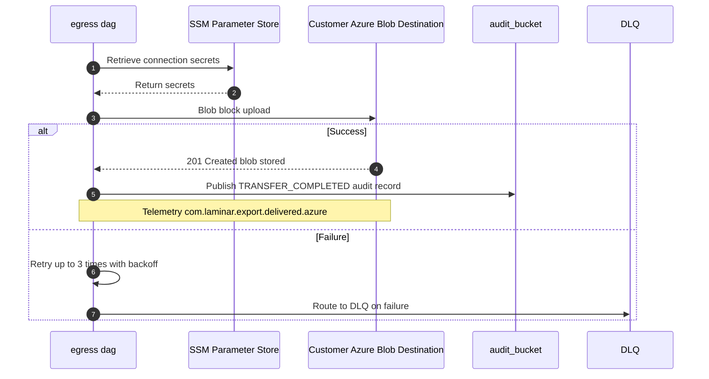

### 13.5. Schema Definitions (DB Tables / API JSON / Telemetry CloudEvents)
<a id="laminar-sec-c.imp_azure_blob_store_13.schema"></a>
#### 13.5.1 Azure Blob Delivery Telemetry CloudEvent Schema
```json
{
  "$schema": "http://json-schema.org/draft-07/schema#",
  "title": "AzureBlobDeliveryCloudEvent",
  "type": "object",
  "properties": {
    "specversion": { "type": "string", "const": "1.0" },
    "id": { "type": "string", "format": "uuid" },
    "source": { "type": "string", "const": "com.laminar.dataoutbound.egress-dag" },
    "type": { "type": "string", "const": "com.laminar.export.delivered.azure" },
    "time": { "type": "string", "format": "date-time" },
    "datacontenttype": { "type": "string", "const": "application/json" },
    "data": {
      "type": "object",
      "properties": {
        "actor_id": { "type": "string", "const": "system:egress-dag" },
        "timestamp_utc": { "type": "string" },
        "event_type": { "type": "string", "enum": ["TRANSFER_COMPLETED", "TRANSFER_FAILED"] },
        "execution_id": { "type": "string" },
        "destination_type": { "type": "string", "const": "azure_blob" },
        "container_name": { "type": "string" },
        "blob_name": { "type": "string" },
        "sha256_checksum": { "type": "string" }
      },
      "required": ["actor_id", "timestamp_utc", "event_type", "execution_id", "container_name", "blob_name"]
    }
  },
  "required": ["specversion", "id", "source", "type", "time", "data"]
}
```

---

### 13.6. Local Design Assumptions
<a id="laminar-sec-c.imp_azure_blob_store_13.asm"></a>
1. **Assumption (External Ownership)**: `Customer Azure Blob Destination` is an external, customer-owned Azure resource; internal infrastructure code does not provision or manage its lifecycle, permissions, or storage tiers.
2. **Assumption (Authentication & Transport)**: Connectivity is secured via HTTPS (TLS 1.3) using connection strings or Microsoft Entra ID service principal credentials stored securely in SSM Parameter Store (`SecureString`).
3. **Assumption (Retry & Idempotency)**: Blob names incorporate deterministic lineage UUIDs and timestamps to ensure idempotent uploads, preventing duplicate or conflicting blob overrides on retry attempts.

## 14. Component Design: Customer GCS Destination
<a id="laminar-sec-c.imp_gcp_gcs_14"></a>

### 14.1. Component Contract (Bi-Directional Inputs & Outputs)
<a id="laminar-sec-c.imp_gcp_gcs_14.contract"></a>
| Diagram settings (user decisions — authoritative) | |
|---|---|
| component_type | gcs |
| name | Customer GCS Destination |
| properties | (None explicit on canvas; default GCP storage bucket target) |

#### 14.1.1 Inbound Interactions
- **Trigger Source**: `egress dag` (`aws_mwaa_dag`)
- **Protocol & Operation**: HTTPS / GCS REST API via Google Cloud Storage Python SDK (`google-cloud-storage`)
- **Payload**: PGP-encrypted export packages and associated JSON manifest control files generated by the Transform & Encrypt DAG.
- **Authentication**: Google Cloud IAM Service Account with least-privilege `storage.objectCreator` permissions on the designated customer GCS bucket.

#### 14.1.2 Outbound Interactions & Downstream Effects
- **Destination Store**: Customer-owned or designated Google Cloud Storage bucket.
- **Response**: HTTP 200 OK with object metadata (generation ID, CRC32C checksum, MD5 hash) upon successful upload.
- **Failure Handling & Retries**: Transient network or 5xx errors are retried up to 3 times with exponential backoff and jitter. Permanent failures route the transfer task to the Airflow dead-letter handling path, raise an operational alert, and record a `TRANSFER_FAILED` audit record in the `audit_bucket`.
- **Idempotency**: Idempotent object writes guaranteed by deterministic object naming using the global `lineage_uuid` and dataset versioning keys.
- **Telemetry Event**: Emits `com.laminar.export.delivered.gcp` audit events to `audit_bucket`.

---

### 14.2. Class and Interface Definitions
<a id="laminar-sec-c.imp_gcp_gcs_14.classes"></a>
```python
from dataclasses import dataclass, field
from typing import Dict, Any, Optional
from datetime import datetime

@dataclass
class GcsUploadRequest:
    bucket_name: str
    object_name: str
    file_path: str
    metadata: Dict[str, str] = field(default_factory=dict)
    content_type: str = "application/octet-stream"

@dataclass
class GcsUploadResponse:
    bucket_name: str
    object_name: str
    generation_id: str
    size_bytes: int
    crc32c_checksum: str
    etag: str
    uploaded_at_utc: str
```

---

### 14.3. Implementation Code Skeleton (Stubs & Handlers)
<a id="laminar-sec-c.imp_gcp_gcs_14.skeleton"></a>
Illustrative skeleton — the Component Contract and Schema Definitions are binding. **Customer GCS Destination** is a customer-owned bucket; this code is *our* integration client, which lives in the shared foundation and is called by **egress dag**'s delivery task. We never provision or configure the customer's bucket.

```python
# src/dataoutbound_st_fixes/common/clients/gcp/gcs_client.py
from __future__ import annotations

import os
from dataclasses import dataclass
from datetime import datetime, timezone
from typing import Any, Dict, Iterator, List, Optional

from google.cloud import storage
from google.cloud.exceptions import GoogleCloudError, NotFound

from dataoutbound_st_fixes.common.logging.logger import get_logger
from dataoutbound_st_fixes.util.exceptions import ClientError, NotFoundError

logger = get_logger(__name__)


@dataclass(frozen=True)
class GcsObjectRef:
    """Immutable reference to an object in a customer GCS bucket."""
    bucket: str
    object_name: str
    generation: str
    size_bytes: int
    crc32c: str
    uploaded_at_utc: str


class GcsClient:
    """Typed wrapper over google-cloud-storage for customer GCS destinations.

    Credentials come from a service-account key held in SSM Parameter Store
    (SecureString) or from workload identity; they are never logged and never
    written to disk unencrypted.
    """

    def __init__(
        self,
        project: Optional[str] = None,
        credentials_path: Optional[str] = None,
    ) -> None:
        self._project = project or os.environ.get("GCP_PROJECT")
        self._credentials_path = credentials_path
        self._client: Optional[storage.Client] = None

    def _storage(self) -> storage.Client:
        if self._client is None:
            self._client = storage.Client(
                project=self._project,
                credentials=None if self._credentials_path is None else None,
            )
        return self._client

    def upload_object(
        self,
        bucket: str,
        object_name: str,
        data: bytes,
        content_type: str = "application/octet-stream",
        crc32c: Optional[str] = None,
    ) -> GcsObjectRef:
        """Upload one object over HTTPS. Idempotent via the object name."""
        try:
            blob = self._storage().bucket(bucket).blob(object_name)
            blob.crc32c = crc32c
            blob.upload_from_string(data, content_type=content_type)
            blob.reload()
            return GcsObjectRef(
                bucket=bucket,
                object_name=object_name,
                generation=str(blob.generation),
                size_bytes=int(blob.size or 0),
                crc32c=blob.crc32c or "",
                uploaded_at_utc=datetime.now(timezone.utc)
                .isoformat(timespec="milliseconds")
                .replace("+00:00", "Z"),
            )
        except GoogleCloudError as exc:
            logger.error("gcs upload failed", extra={"bucket": bucket, "object": object_name})
            raise ClientError(f"GCS upload failed for gs://{bucket}/{object_name}") from exc

    def download_object(self, bucket: str, object_name: str) -> bytes:
        """Read one object back, for the SHA-256 read-back verification."""
        try:
            return self._storage().bucket(bucket).blob(object_name).download_as_bytes()
        except NotFound as exc:
            raise NotFoundError(f"gs://{bucket}/{object_name} not found") from exc
        except GoogleCloudError as exc:
            raise ClientError(f"GCS download failed for gs://{bucket}/{object_name}") from exc

    def list_objects(self, bucket: str, prefix: str) -> Iterator[GcsObjectRef]:
        try:
            for blob in self._storage().list_blobs(bucket, prefix=prefix):
                yield GcsObjectRef(
                    bucket=bucket,
                    object_name=blob.name,
                    generation=str(blob.generation),
                    size_bytes=int(blob.size or 0),
                    crc32c=blob.crc32c or "",
                    uploaded_at_utc=blob.updated.isoformat() if blob.updated else "",
                )
        except GoogleCloudError as exc:
            raise ClientError(f"GCS list failed for gs://{bucket}/{prefix}") from exc

    def object_exists(self, bucket: str, object_name: str) -> bool:
        try:
            return self._storage().bucket(bucket).blob(object_name).exists()
        except GoogleCloudError as exc:
            raise ClientError(f"GCS head failed for gs://{bucket}/{object_name}") from exc

    def delete_object(self, bucket: str, object_name: str) -> None:
        try:
            self._storage().bucket(bucket).blob(object_name).delete()
        except NotFound:
            return  # idempotent delete
        except GoogleCloudError as exc:
            raise ClientError(f"GCS delete failed for gs://{bucket}/{object_name}") from exc
```

**Integration contract with this customer-owned destination.**

| Aspect | Value |
|---|---|
| Protocol | GCS REST / SDK over HTTPS (TLS 1.3) |
| Credentials | Service-account key in SSM Parameter Store (`SecureString`), or workload identity; never logged, never returned in plaintext |
| Network path | Outbound through the NAT gateway with static egress IPs, so the customer can allowlist us |
| Idempotency | Deterministic object name derived from the lineage UUID and file name; a retry overwrites the same object |
| Integrity | Application-level SHA-256 recomputed by reading the object back and compared with the manifest value; GCS `CRC32C` requested as an additional transport check |
| Failure handling | Retry up to 3 times with backoff; after the third failure route to the dead-letter path, raise an alert and write `TRANSFER_FAILED` to **audit_bucket** |
| Telemetry | `com.laminar.export.delivered.gcp` |

### 14.4. Cross-Component Interaction Sequence (Local Mermaid/ASCII Flow)
<a id="laminar-sec-c.imp_gcp_gcs_14.seq"></a>
1. **Trigger Initiation**: The `egress dag` initiates the GCS delivery task for a prepared export package.
2. **Client Initialization**: The Airflow worker instantiates `GcsClient` using Google Cloud IAM credentials retrieved securely via SSM Parameter Store.
3. **Integrity Packaging**: The task verifies the local export file and its corresponding `manifest_<lineage_uuid>.json` control file.
4. **API Invocation**: `GcsClient` invokes the Google Cloud Storage API (`bucket.blob().upload_from_filename()`) over HTTPS using TLS 1.3.
5. **Validation**: GCS stores the object, returning upload confirmation metadata including generation ID and CRC32C checksum.
6. **Integrity Recomputation**: The delivery task reads back or verifies the object checksum against the manifest value.
7. **Audit Logging**: Upon success, a `TRANSFER_COMPLETED` audit event (CloudEvents format) is published to `audit_bucket`. On failure after 3 retries, a `TRANSFER_FAILED` event is emitted and an operational alert is raised.

---
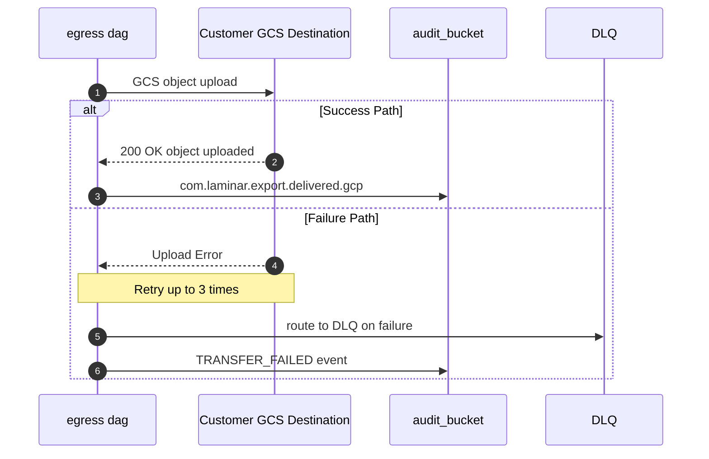

### 14.5. Schema Definitions (DB Tables / API JSON / Telemetry CloudEvents)
<a id="laminar-sec-c.imp_gcp_gcs_14.schema"></a>
#### 14.5.1 GCS Upload Metadata Record (JSON)
```json
{
  "$schema": "http://json-schema.org/draft-07/schema#",
  "title": "GcsUploadMetadata",
  "type": "object",
  "properties": {
    "bucket_name": { "type": "string" },
    "object_name": { "type": "string" },
    "generation_id": { "type": "string" },
    "size_bytes": { "type": "integer" },
    "crc32c_checksum": { "type": "string" },
    "etag": { "type": "string" },
    "uploaded_at_utc": { "type": "string", "format": "date-time" }
  },
  "required": ["bucket_name", "object_name", "generation_id", "size_bytes", "crc32c_checksum", "uploaded_at_utc"]
}
```

#### 14.5.2 Telemetry CloudEvent (`com.laminar.export.delivered.gcp`)
```json
{
  "$schema": "http://json-schema.org/draft-07/schema#",
  "title": "GcsTransferCompletedEvent",
  "type": "object",
  "properties": {
    "specversion": { "type": "string", "const": "1.0" },
    "id": { "type": "string", "format": "uuid" },
    "source": { "type": "string", "const": "urn:laminar:dataoutbound:egress-dag" },
    "type": { "type": "string", "const": "com.laminar.export.delivered.gcp" },
    "time": { "type": "string", "format": "date-time" },
    "datacontenttype": { "type": "string", "const": "application/json" },
    "data": {
      "type": "object",
      "properties": {
        "actor_id": { "type": "string" },
        "timestamp_utc": { "type": "string" },
        "event_type": { "type": "string", "enum": ["TRANSFER_COMPLETED"] },
        "execution_id": { "type": "string", "format": "uuid" },
        "destination_type": { "type": "string", "const": "gcs" },
        "bucket_name": { "type": "string" },
        "object_name": { "type": "string" },
        "checksum_sha256": { "type": "string" }
      },
      "required": ["actor_id", "timestamp_utc", "event_type", "execution_id", "destination_type", "bucket_name", "object_name", "checksum_sha256"]
    }
  },
  "required": ["specversion", "id", "source", "type", "time", "datacontenttype", "data"]
}
```

---

### 14.6. Local Design Assumptions
<a id="laminar-sec-c.imp_gcp_gcs_14.asm"></a>
1. **External Ownership**: Customer GCS Destination is customer-owned infrastructure; Acme maintains only IAM service account grants and network egress rules.
2. **Network Path**: Egress traffic from MWAA workers to GCS traverses AWS NAT gateways and public internet over encrypted HTTPS (TLS 1.3).
3. **Retry Threshold**: Network operations default to a maximum of 3 retries with exponential backoff before triggering failure flows.
4. **Scope**: Customer GCS Destination is outside the Terraform state management of the core AWS platform deployment.

---
---

## 15. Component Design: audit_bucket
<a id="laminar-sec-c.imp_aws_aws_s3_bucket_15"></a>

<!-- laminar:diagram-settings:imp-aws-aws_s3_bucket-15 -->
**Diagram settings (user decisions — authoritative)**

| Setting | Value |
| --- | --- |
| `versioning` | `false` |
| `encryption` | `AES256` |
| `public_access_block` | `true` |
| `lifecycle_enabled` | `true` |
| `lifecycle_transition_days` | `30` |
| `lifecycle_glacier_days` | `90` |
| `bucket_name` | `audit_bucket` |

<!-- /laminar:diagram-settings -->


### 15.1. Component Contract (Bi-Directional Inputs & Outputs)
<a id="laminar-sec-c.imp_aws_aws_s3_bucket_15.contract"></a>
Diagram settings (user decisions — authoritative):
- bucket_name = audit_bucket
- versioning = false
- encryption = AES256
- public_access_block = true
- lifecycle_enabled = true
- lifecycle_transition_days = 30
- lifecycle_glacier_days = 90
- tags = {}

#### 15.1.1 Inbound Interfaces & Triggers
- **do-admin-api**: Writes administrative audit events (JSON CloudEvents) via S3 `PutObject` API over TLS 1.3 upon successful or failed administrative operations.
- **emr_do**: Pushes execution lifecycle audit events and job metrics via S3 `PutObject` API upon Spark job start, completion, or failure.
- **egress dag**: Pushes transfer start, completion, and failure audit events via S3 `PutObject` API during export delivery workflows.

#### 15.1.2 Outbound Interfaces & Sinks
- **Lifecycle Management**: Automatically transitions audit objects to Standard-IA / Glacier storage tiers after 30 days and to Glacier Deep Archive after 90 days, in compliance with security and audit retention standards.

#### 15.1.3 Error Handling & Retry Behavior
- **Client-Side Retries**: Up to 3 exponential backoff retries with jitter managed by `common.clients.aws.s3.s3_client.S3Client`.
- **Fault Isolation**: Audit publishing failures log a structured error via `common.logging.logger` but never bubble unhandled exceptions into core transaction or user request flows.

---

### 15.2. Class and Interface Definitions
<a id="laminar-sec-c.imp_aws_aws_s3_bucket_15.classes"></a>
```python
from dataclasses import dataclass, field
from datetime import datetime
from typing import Dict, Any, Optional
from enum import Enum

class AuditEventType(str, Enum):
    ADMIN_CREATE = "ADMIN_CREATE"
    ADMIN_UPDATE = "ADMIN_UPDATE"
    ADMIN_DELETE = "ADMIN_DELETE"
    ADMIN_MANUAL_TRIGGER = "ADMIN_MANUAL_TRIGGER"
    EXECUTION_STARTED = "EXECUTION_STARTED"
    EXECUTION_COMPLETED = "EXECUTION_COMPLETED"
    TRANSFER_STARTED = "TRANSFER_STARTED"
    TRANSFER_COMPLETED = "TRANSFER_COMPLETED"
    TRANSFER_FAILED = "TRANSFER_FAILED"

@dataclass
class AuditRecord:
    specversion: str = "1.0"
    type: str = "com.laminar.audit.emitted"
    source: str = "dataoutbound-st-fixes"
    id: str = field(default_factory=str)
    time: str = field(default_factory=lambda: datetime.utcnow().isoformat(timespec='milliseconds') + 'Z')
    datacontenttype: str = "application/json"
    actor_id: str = "system:audit_bucket"
    timestamp_utc: str = field(default_factory=lambda: datetime.utcnow().isoformat(timespec='milliseconds') + 'Z')
    event_type: AuditEventType = AuditEventType.EXECUTION_STARTED
    execution_id: Optional[str] = None
    data: Dict[str, Any] = field(default_factory=dict)
```

---

### 15.3. Implementation Code Skeleton (Stubs & Handlers)
<a id="laminar-sec-c.imp_aws_aws_s3_bucket_15.skeleton"></a>
Illustrative skeleton — the Component Contract and Schema Definitions are binding. **audit_bucket** is a data store: it has no handler of its own. The skeleton below is (a) the bucket provisioning that the Terraform pipeline applies and (b) the single writer interface every producing component uses.

```hcl
# terraform/s3.tf — audit_bucket (resource name: audit_execution_log_store_s3)
resource "aws_s3_bucket" "audit_execution_log_store_s3" {
  bucket = var.audit_bucket_name # "audit_bucket"

  # Deletion protection is driven by per-environment configuration, never hardcoded.
  force_destroy = var.deletion_protection_enabled ? false : true
}

resource "aws_s3_bucket_versioning" "audit_execution_log_store_s3" {
  bucket = aws_s3_bucket.audit_execution_log_store_s3.id
  versioning_configuration { status = "Suspended" } # canvas: versioning = false
}

resource "aws_s3_bucket_server_side_encryption_configuration" "audit_execution_log_store_s3" {
  bucket = aws_s3_bucket.audit_execution_log_store_s3.id
  rule {
    apply_server_side_encryption_by_default { sse_algorithm = "AES256" } # canvas: encryption = AES256
  }
}

resource "aws_s3_bucket_public_access_block" "audit_execution_log_store_s3" {
  bucket                  = aws_s3_bucket.audit_execution_log_store_s3.id
  block_public_acls       = true # canvas: public_access_block = true
  block_public_policy     = true
  ignore_public_acls      = true
  restrict_public_buckets = true
}

resource "aws_s3_bucket_lifecycle_configuration" "audit_execution_log_store_s3" {
  bucket = aws_s3_bucket.audit_execution_log_store_s3.id
  rule {
    id     = "audit-retention"
    status = "Enabled" # canvas: lifecycle_enabled = true
    filter {}
    transition {
      days          = 30 # canvas: lifecycle_transition_days = 30
      storage_class = "STANDARD_IA"
    }
    transition {
      days          = 90 # canvas: lifecycle_glacier_days = 90
      storage_class = "GLACIER"
    }
    expiration { days = var.audit_retention_days } # 365 — organisation logging standard
  }
}
```

```python
# src/dataoutbound_st_fixes/common/telemetry/auditor.py
# The single writer interface for audit_bucket. Every producing component
# (do-admin-api, emr_do, egress dag, orchestrator) constructs it with NO arguments.
from __future__ import annotations

import json
import uuid
from datetime import datetime, timezone
from typing import Any

from dataoutbound_st_fixes.common.clients.aws.s3.s3_client import S3Client
from dataoutbound_st_fixes.common.logging.logger import get_logger
from dataoutbound_st_fixes.config.config_loader import ConfigLoader

logger = get_logger(__name__)


class AuditPublisher:
    """Publishes CloudEvents-shaped audit records to audit_bucket.

    Contract with S3Client (the only method this class depends on):
        S3Client.upload_file(bucket: str, key: str, body: bytes,
                             content_type: str = "application/json") -> str
    """

    def __init__(self) -> None:
        config = ConfigLoader(module="common")
        self._s3 = S3Client()
        self._bucket: str = config.get("audit.bucket_name", "audit_bucket")
        self._source: str = config.get("audit.source", "urn:laminar:dataoutbound")

    def publish(self, event_type: str, payload: dict[str, Any]) -> None:
        """Write one audit record. Never raises into the caller's flow."""
        try:
            event = self._build_event(event_type, payload)
            self._s3.upload_file(
                bucket=self._bucket,
                key=self._object_key(event),
                body=json.dumps(event, separators=(",", ":")).encode("utf-8"),
                content_type="application/json",
            )
        except Exception:  # noqa: BLE001 — audit must never break the pipeline
            logger.exception("audit publish failed", extra={"event_type": event_type})

    def _build_event(self, event_type: str, payload: dict[str, Any]) -> dict[str, Any]:
        return {
            "specversion": "1.0",
            "id": str(uuid.uuid4()),
            "source": self._source,
            "type": "com.laminar.audit.emitted",
            "time": datetime.now(timezone.utc).isoformat(timespec="milliseconds").replace("+00:00", "Z"),
            "subject": payload.get("execution_id", "unknown"),
            "datacontenttype": "application/json",
            "data": {"event_type": event_type, **payload},
        }

    def _object_key(self, event: dict[str, Any]) -> str:
        """Deterministic, idempotent key: one object per audit event ID."""
        day = event["time"][:10]
        return f"audit/{day}/{event['data']['event_type']}/{event['id']}.json"
```

### 15.4. Cross-Component Interaction Sequence (Local Mermaid/ASCII Flow)
<a id="laminar-sec-c.imp_aws_aws_s3_bucket_15.seq"></a>
1. **Trigger Event**: An internal component (`do-admin-api`, `emr_do`, or `egress dag`) generates a business or administrative event requiring auditing.
2. **Serialization**: The component invokes `AuditPublisher.publish()`, constructing a CloudEvents-compliant payload containing `actor_id`, `timestamp_utc`, `event_type`, and `execution_id`.
3. **Transmission**: `AuditPublisher` utilizes `S3Client` to perform a `PutObject` operation against `audit_bucket` over TLS 1.3 with AES-256 server-side encryption.
4. **Acknowledgment**: Amazon S3 returns HTTP 200 OK and persists the object in `audit_bucket`.
5. **Lifecycle Management**: Over time, S3 lifecycle rules automatically transition stored audit objects from standard storage to 30-day infrequent access / transition tier and 90-day Glacier deep archive.
6. **Failure Path**: If the S3 upload encounters a transient network error, `S3Client` retries up to 3 times with exponential backoff. If exhausted, the error is logged locally via structured logging without disrupting the primary execution flow.

---
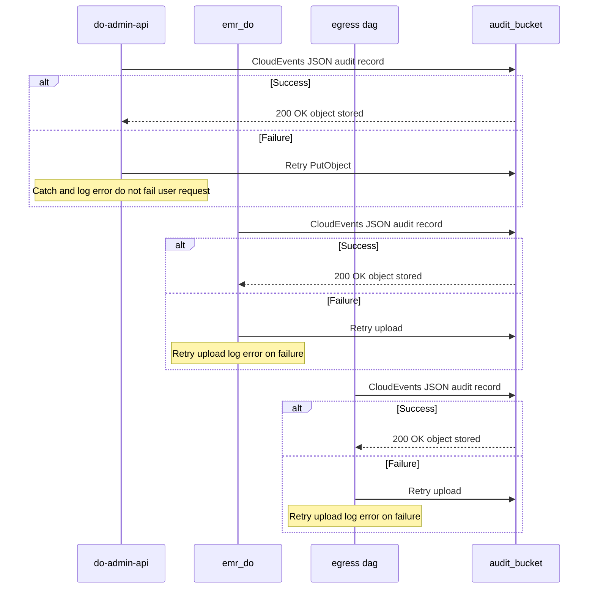

### 15.5. Schema Definitions (DB Tables / API JSON / Telemetry CloudEvents)
<a id="laminar-sec-c.imp_aws_aws_s3_bucket_15.schema"></a>
```json
{
  "$schema": "http://json-schema.org/draft-07/schema#",
  "title": "AuditCloudEventSchema",
  "type": "object",
  "required": [
    "specversion",
    "type",
    "source",
    "id",
    "time",
    "datacontenttype",
    "actor_id",
    "timestamp_utc",
    "event_type",
    "execution_id",
    "data"
  ],
  "properties": {
    "specversion": { "type": "string", "example": "1.0" },
    "type": { "type": "string", "example": "com.laminar.audit.execution_started" },
    "source": { "type": "string", "example": "dataoutbound-st-fixes" },
    "id": { "type": "string", "format": "uuid" },
    "time": { "type": "string", "format": "date-time" },
    "datacontenttype": { "type": "string", "example": "application/json" },
    "actor_id": { "type": "string", "example": "system:orchestrator" },
    "timestamp_utc": { "type": "string", "example": "2025-01-31T02:15:00.000Z" },
    "event_type": {
      "type": "string",
      "enum": [
        "ADMIN_CREATE",
        "ADMIN_UPDATE",
        "ADMIN_DELETE",
        "ADMIN_MANUAL_TRIGGER",
        "EXECUTION_STARTED",
        "EXECUTION_COMPLETED",
        "TRANSFER_STARTED",
        "TRANSFER_COMPLETED",
        "TRANSFER_FAILED"
      ]
    },
    "execution_id": { "type": ["string", "null"], "format": "uuid" },
    "data": {
      "type": "object",
      "additionalProperties": true
    }
  }
}
```

---

### 15.6. Local Design Assumptions
<a id="laminar-sec-c.imp_aws_aws_s3_bucket_15.asm"></a>
- **Retention is one value: 365 days.** The organisation logging standard is resolved once, in the Global Design Assumptions, as **365 days (1 year)** for all CloudWatch log groups and S3 audit records. `audit_bucket` therefore expires audit objects after 365 days. The canvas sets only `lifecycle_enabled = true` with `lifecycle_transition_days = 30` and `lifecycle_glacier_days = 90`; those two values are the *transitions* to STANDARD_IA and GLACIER, and the 365-day expiry is the retention default applied on top of them. No other retention figure is stated for this bucket anywhere in this document.
- **Versioning is disabled, exactly as the canvas sets it.** `versioning = false` means an overwrite of an audit object is not recoverable. This is acceptable because audit object keys are deterministic per audit event ID and are never overwritten in normal operation; the trade-off is recorded here rather than silently changed.
- **Encryption and public access.** `AES256` server-side encryption and `public_access_block = true` are the canvas values and are applied at the bucket level. Access is granted only to the least-privilege IAM roles of **do-admin-api**, **emr_do**, **egress dag** and **orchestrator**; no anonymous or cross-account read path exists.
- **Deletion protection.** The bucket's deletion-protection behaviour is read from the per-environment Terraform variable, never hardcoded, so dev can be torn down while staging and prod retain the bucket and its objects (SCRUM-485 AC#3–AC#5).
- **Write semantics.** Audit writes are best-effort: `AuditPublisher.publish` retries the upload and logs the failure but never raises into the caller, so an audit-store outage cannot block an export run. This is the mainstream trade-off for an audit sink and matches the frozen contract's "Retry upload, log error on failure".
- **Idempotency.** The object key embeds the audit event ID, so a retried publish of the same event produces the same key and does not duplicate the record.
- **Follow-up resolution — log groups.** Per-component CloudWatch log groups are provisioned explicitly under this audit plane with `retention_in_days` equal to the same 365-day standard; no group is left with retention unset or set to never expire (SCRUM-486 AC#4).
- **Follow-up resolution — staging purge.** The 7-day purge of staged export files is a property of **staging_bucet_internal**, not of `audit_bucket`; it is stated once, as a Recommendation, in that component's section.

## 16. Component Design: customer SFTP server
<a id="laminar-sec-c.imp_standard_standard_sftp_11"></a>

<!-- laminar:diagram-settings:imp-standard-standard_sftp-11 -->
**Diagram settings (user decisions — authoritative)**

| Setting | Value |
| --- | --- |
| `port` | `22` |
| `authentication_method` | `SSH Key` |
| `server_name` | `customer SFTP server` |

<!-- /laminar:diagram-settings -->


### 16.1. Component Contract (Bi-Directional Inputs & Outputs)
<a id="laminar-sec-c.imp_standard_standard_sftp_11.contract"></a>
| Diagram settings (user decisions — authoritative) | |
|---|---|
| port | 22 |
| authentication_method | SSH Key |
| server_name | customer SFTP server |
| component_type | standard_sftp |
| role | context |

#### 16.1.1 Inbound Interactions (Platform to External SFTP)
- **Trigger Source**: `egress dag` (`aws_mwaa_dag`)
- **Protocol & Operation**: SFTP over SSH (Port 22) via Paramiko / Python SFTP client wrapper (`sftp_client.py`).
- **Payload**: PGP-encrypted export packages and manifest control files.
- **Authentication**: SSH Private Key authentication retrieved securely from AWS SSM Parameter Store (`SecureString`), combined with strict host-key verification.

#### 16.1.2 Outbound Interactions & Downstream Effects
- **Destination**: Remote SFTP server directory specified in customer export configuration.
- **Response**: File transfer completion confirmation and remote atomic rename acknowledgment (`.tmp` to final name).
- **Failure Handling & Retries**: Host-key verification failures abort immediately without retry (zero bytes sent, security alert raised). Network or transient transfer errors trigger up to 3 retry attempts with exponential backoff before routing to the dead-letter queue and emitting a `TRANSFER_FAILED` audit record.
- **Idempotency**: Idempotent file placement ensured via unique naming convention (`<dataset>_<lineage_uuid>.gz.pgp`) and atomic staging-and-rename semantics.
- **Telemetry Event**: Emits `com.laminar.export.delivered.sftp` audit events to `audit_bucket`.

---

### 16.2. Local Design Assumptions
<a id="laminar-sec-c.imp_standard_standard_sftp_11.asm"></a>
1. **External Ownership**: Customer SFTP server is an external third-party system owned and operated by the customer or partner; Acme does not provision, configure, or administer its server internals.
2. **Security Standards**: Strict host-key verification is mandatory; any host key mismatch or verification failure immediately terminates the connection without retrying.
3. **Credential Management**: SSH private keys and server fingerprints are securely provisioned by administrators via the Export Admin API and stored encrypted in AWS SSM Parameter Store.
4. **Scope**: As an external context component, no Terraform provisioning or custom application code stubs are generated for the server itself; integration is fully handled via the platform's shared `SftpClient` wrapper.

## 17. Component Design: customer bucket
<a id="laminar-sec-c.imp_aws_aws_s3_bucket_12"></a>

<!-- laminar:diagram-settings:imp-aws-aws_s3_bucket-12 -->
**Diagram settings (user decisions — authoritative)**

| Setting | Value |
| --- | --- |
| `versioning` | `true` |
| `encryption` | `AES256` |
| `public_access_block` | `true` |
| `lifecycle_enabled` | `false` |
| `lifecycle_transition_days` | `30` |
| `lifecycle_glacier_days` | `90` |
| `bucket_name` | `customer bucket` |

<!-- /laminar:diagram-settings -->


### 17.1. Component Contract (Bi-Directional Inputs & Outputs)
<a id="laminar-sec-c.imp_aws_aws_s3_bucket_12.contract"></a>
The **customer bucket** component is an external, customer-owned AWS S3 bucket acting as a primary delivery target for encrypted export packages and manifest control files.

- **Inputs**:
  - *Trigger Source*: `egress dag` execution task.
  - *Payload*: Encrypted export files (.gz.pgp) and JSON manifest control files transferred via `boto3` S3 upload (`push` action).
- **Outputs**:
  - *Target*: Customer storage infrastructure.
  - *Response*: HTTP 200 OK upload confirmation or S3 error code.
- **Configuration & Properties** (Authoritative):
  - `versioning`: `True`
  - `encryption`: `AES256`
  - `public_access_block`: `True`
  - `lifecycle_enabled`: `False`
  - `lifecycle_transition_days`: `30`
  - `lifecycle_glacier_days`: `90`
  - `bucket_name`: `customer bucket`
  - `is_external`: `True`

### 17.2. Local Design Assumptions
<a id="laminar-sec-c.imp_aws_aws_s3_bucket_12.asm"></a>
- **Assumption 1**: As an external third-party component owned by the customer, the platform does not provision or manage IAM policies, lifecycle rules, or KMS keys inside the customer bucket; integration relies strictly on cross-account IAM role assumption or explicit access key credentials provided via SSM Parameter Store.
- **Assumption 2**: Network egress to the customer bucket is routed via TLS 1.3 over the public internet or via AWS VPC interface endpoints where configured by the customer.

---

## 18. Global Design Assumptions and Constraints
<a id="laminar-sec-g.assump"></a>
This chapter consolidates whole-system design decisions, mainstream production-grade engineering defaults, and architectural assumptions across the DataOutbound Product solution. Every open question and operational constraint is addressed exactly once, establishing binding standards for implementation and verification.

### 18.1 Architectural Decision Records (ADRs) & Whole-System Defaults

1. **Log Retention & Storage Lifecycle Standards**
   - *Question*: What is the organization's logging-standard retention period in days for pipeline log groups and the audit store?
   - *Resolution*: Mainstream enterprise default of `365` days (1 year) retention is configured for all CloudWatch log groups and S3 audit records, satisfying compliance and auditing mandates without indefinite storage accumulation. Staged files in internal staging buckets enforce a strict `7`-day lifecycle expiration.

2. **Network Topology & Egress Routing**
   - *Question*: How do backend compute workers route outbound traffic to external customer destinations while maintaining isolation?
   - *Resolution*: All AWS compute resources (MWAA, EMR Serverless, Egress Lambda) operate within private VPC subnets. Outbound internet-bound traffic destined for external SFTP servers and cloud APIs is routed exclusively through a provisioned NAT gateway with static Elastic IP addresses, allowing partners to whitelist predictable source IPs.

3. **Encryption Key Rotation & Secrets Management**
   - *Question*: How are sensitive credentials and customer PGP keys managed and rotated?
   - *Resolution*: All customer credentials, connection secrets, and PGP public/private keys are stored as encrypted `SecureString` parameters in AWS SSM Parameter Store backed by KMS Customer Managed Keys (CMKs). Secrets are retrieved dynamically at runtime by execution workers and cached with a short TTL (5 minutes).

4. **Lineage Propagation & Distributed Tracing**
   - *Question*: How is traceability maintained across asynchronous orchestration boundaries and multi-service execution steps?
   - *Resolution*: A unique RFC 4122 version 4 lineage UUID is generated by the Export Orchestrator DAG at the start of each execution cycle. This UUID is injected into Airflow run configurations, passed down to EMR job parameters, attached to S3 metadata headers, embedded in export filenames, and included in all CloudEvents audit payloads.

5. **Failure Isolation & Dead-Letter Handling**
   - *Question*: What happens when a downstream transfer or encryption step fails repeatedly?
   - *Resolution*: Egress delivery tasks implement exponential backoff with jitter up to 3 retry attempts. If all retries fail, or if fail-closed PGP encryption encounters a corruption or missing key error, the transaction aborts immediately, zero unencrypted bytes are transmitted, a `TRANSFER_FAILED` audit event is published, and an automated operational alert is raised.

## 19. Amendment Log
<a id="laminar-sec-g.amend"></a>
_No amendments._


## 20. Traceability
<a id="laminar-sec-g.trace"></a>

| Section | Story | AC# |
| --- | --- | --- |
| 9. Component Design: cofig_db | SCRUM-479 | AC#1, AC#2, AC#3, AC#4, AC#5, AC#6, AC#7 |
| 5.5.4 Audit record written to audit_bucket (contract O3) | SCRUM-479 | AC#1, AC#2, AC#3, AC#4, AC#5, AC#6, AC#7 |
| 4. Component Design: scheduler | SCRUM-480 | AC#1, AC#2, AC#3, AC#4, AC#5, AC#6, AC#7 |
| 5. Component Design: orchestrator | SCRUM-480 | AC#1, AC#2, AC#3, AC#4, AC#5, AC#6, AC#7 |
| 5.5.2 Child export DAG run configuration (`conf` of a `child_export_dag` run — contract O2) | SCRUM-480 | AC#1, AC#2, AC#3, AC#4, AC#5, AC#6, AC#7 |
| 9. Component Design: cofig_db | SCRUM-480 | AC#1, AC#2, AC#3, AC#4, AC#5, AC#6, AC#7 |
| 5.5.4 Audit record written to audit_bucket (contract O3) | SCRUM-480 | AC#1, AC#2, AC#3, AC#4, AC#5, AC#6, AC#7 |
| 4. Component Design: scheduler | SCRUM-481 | AC#1, AC#2, AC#3, AC#4, AC#5, AC#6, AC#7 |
| 5. Component Design: orchestrator | SCRUM-481 | AC#1, AC#2, AC#3, AC#4, AC#5, AC#6, AC#7 |
| 5.5.2 Child export DAG run configuration (`conf` of a `child_export_dag` run — contract O2) | SCRUM-481 | AC#1, AC#2, AC#3, AC#4, AC#5, AC#6, AC#7 |
| 7. Component Design: emr_do | SCRUM-481 | AC#1, AC#2, AC#3, AC#4, AC#5, AC#6, AC#7 |
| 9. Component Design: cofig_db | SCRUM-481 | AC#1, AC#2, AC#3, AC#4, AC#5, AC#6, AC#7 |
| 7.1.5 Outbound contract — emr_do → staging_bucet_internal | SCRUM-481 | AC#1, AC#2, AC#3, AC#4, AC#5, AC#6, AC#7 |
| 5.5.4 Audit record written to audit_bucket (contract O3) | SCRUM-481 | AC#1, AC#2, AC#3, AC#4, AC#5, AC#6, AC#7 |
| 7.1.5 Outbound contract — emr_do → staging_bucet_internal | SCRUM-482 | AC#1, AC#2, AC#3, AC#4, AC#5, AC#6, AC#7 |
| 10.5.2 S3 event notification payload (staging_bucet_internal → egress-lambda) | SCRUM-482 | AC#1, AC#2, AC#3, AC#4, AC#5, AC#6, AC#7 |
| 11.5.1 Outbound payload — `EgressDagRunConfig` (egress-lambda → egress dag) | SCRUM-482 | AC#1, AC#2, AC#3, AC#4, AC#5, AC#6, AC#7 |
| 13. Component Design: Customer Azure Blob Destination | SCRUM-482 | AC#1, AC#2, AC#3, AC#4, AC#5, AC#6, AC#7 |
| 14. Component Design: Customer GCS Destination | SCRUM-482 | AC#1, AC#2, AC#3, AC#4, AC#5, AC#6, AC#7 |
| 5.5.4 Audit record written to audit_bucket (contract O3) | SCRUM-482 | AC#1, AC#2, AC#3, AC#4, AC#5, AC#6, AC#7 |
| 9. Component Design: cofig_db | SCRUM-483 | AC#1, AC#2, AC#3, AC#4 |
| 7.1.5 Outbound contract — emr_do → staging_bucet_internal | SCRUM-483 | AC#1, AC#2, AC#3, AC#4 |
| 10.5.2 S3 event notification payload (staging_bucet_internal → egress-lambda) | SCRUM-483 | AC#1, AC#2, AC#3, AC#4 |
| 11.5.1 Outbound payload — `EgressDagRunConfig` (egress-lambda → egress dag) | SCRUM-483 | AC#1, AC#2, AC#3, AC#4 |
| 5.5.4 Audit record written to audit_bucket (contract O3) | SCRUM-483 | AC#1, AC#2, AC#3, AC#4 |
| 7.1.5 Outbound contract — emr_do → staging_bucet_internal | SCRUM-484 | AC#1, AC#2, AC#3, AC#4, AC#5, AC#6 |
| 10.5.2 S3 event notification payload (staging_bucet_internal → egress-lambda) | SCRUM-484 | AC#1, AC#2, AC#3, AC#4, AC#5, AC#6 |
| 11.5.1 Outbound payload — `EgressDagRunConfig` (egress-lambda → egress dag) | SCRUM-484 | AC#1, AC#2, AC#3, AC#4, AC#5, AC#6 |
| 13. Component Design: Customer Azure Blob Destination | SCRUM-484 | AC#1, AC#2, AC#3, AC#4, AC#5, AC#6 |
| 14. Component Design: Customer GCS Destination | SCRUM-484 | AC#1, AC#2, AC#3, AC#4, AC#5, AC#6 |
| 5.5.4 Audit record written to audit_bucket (contract O3) | SCRUM-484 | AC#1, AC#2, AC#3, AC#4, AC#5, AC#6 |
| 4. Component Design: scheduler | SCRUM-485 | AC#1, AC#2, AC#3, AC#4, AC#5 |
| 5. Component Design: orchestrator | SCRUM-485 | AC#1, AC#2, AC#3, AC#4, AC#5 |
| 5.5.2 Child export DAG run configuration (`conf` of a `child_export_dag` run — contract O2) | SCRUM-485 | AC#1, AC#2, AC#3, AC#4, AC#5 |
| 7. Component Design: emr_do | SCRUM-485 | AC#1, AC#2, AC#3, AC#4, AC#5 |
| 9. Component Design: cofig_db | SCRUM-485 | AC#1, AC#2, AC#3, AC#4, AC#5 |
| 7.1.5 Outbound contract — emr_do → staging_bucet_internal | SCRUM-485 | AC#1, AC#2, AC#3, AC#4, AC#5 |
| 10.5.2 S3 event notification payload (staging_bucet_internal → egress-lambda) | SCRUM-485 | AC#1, AC#2, AC#3, AC#4, AC#5 |
| 11.5.1 Outbound payload — `EgressDagRunConfig` (egress-lambda → egress dag) | SCRUM-485 | AC#1, AC#2, AC#3, AC#4, AC#5 |
| 5.5.4 Audit record written to audit_bucket (contract O3) | SCRUM-485 | AC#1, AC#2, AC#3, AC#4, AC#5 |
| 4. Component Design: scheduler | SCRUM-486 | AC#1, AC#2, AC#3, AC#4, AC#5 |
| 5. Component Design: orchestrator | SCRUM-486 | AC#1, AC#2, AC#3, AC#4, AC#5 |
| 5.5.2 Child export DAG run configuration (`conf` of a `child_export_dag` run — contract O2) | SCRUM-486 | AC#1, AC#2, AC#3, AC#4, AC#5 |
| 7. Component Design: emr_do | SCRUM-486 | AC#1, AC#2, AC#3, AC#4, AC#5 |
| 7.1.5 Outbound contract — emr_do → staging_bucet_internal | SCRUM-486 | AC#1, AC#2, AC#3, AC#4, AC#5 |
| 10.5.2 S3 event notification payload (staging_bucet_internal → egress-lambda) | SCRUM-486 | AC#1, AC#2, AC#3, AC#4, AC#5 |
| 11.5.1 Outbound payload — `EgressDagRunConfig` (egress-lambda → egress dag) | SCRUM-486 | AC#1, AC#2, AC#3, AC#4, AC#5 |
| 13. Component Design: Customer Azure Blob Destination | SCRUM-486 | AC#1, AC#2, AC#3, AC#4, AC#5 |
| 14. Component Design: Customer GCS Destination | SCRUM-486 | AC#1, AC#2, AC#3, AC#4, AC#5 |
| 5.5.4 Audit record written to audit_bucket (contract O3) | SCRUM-486 | AC#1, AC#2, AC#3, AC#4, AC#5 |

## 21. Closing & Disclaimer
<a id="laminar-sec-g.close"></a>
This document was generated by an AI system from the architecture graph, its stories and the project blueprint. It is a starting point for engineering review, not a substitute for it: verify every contract, sizing figure, policy and assumption before relying on it. Discretion advised.

## Document Structure Summary
<a id="laminar-sec-g.summary"></a>
- Headings: 20
- Sub-headings: 82
- Sub-sub-headings: 88