# DataOutbound Product - High-Level Design Specification

## Table of Contents

- **1.** HLD Executive Summary & Scope
- **2.** System-wide Design Principles
- **3.** Component Design: orchestrator
  - **3.1** Component Contract (Bi-Directional Inputs & Outputs)
  - **3.2** Class and Interface Definitions
  - **3.3** Implementation Code Skeleton (Stubs & Handlers)
  - **3.4** Cross-Component Interaction Sequence (Local Mermaid/ASCII Flow)
  - **3.5** Schema Definitions (DB Tables / API JSON / Telemetry CloudEvents)
  - **3.6** Local Design Assumptions
- **4.** Component Design: scheduler
  - **4.1** Component Contract (Bi-Directional Inputs & Outputs)
  - **4.2** Class and Interface Definitions
  - **4.3** Implementation Code Skeleton (Stubs & Handlers)
  - **4.4** Cross-Component Interaction Sequence (Local Mermaid/ASCII Flow)
  - **4.5** Schema Definitions (DB Tables / API JSON / Telemetry CloudEvents)
  - **4.6** Local Design Assumptions
- **5.** Component Design: egress-lambda
  - **5.1** Component Contract (Bi-Directional Inputs & Outputs)
  - **5.2** Class and Interface Definitions
  - **5.3** Implementation Code Skeleton (Stubs & Handlers)
  - **5.4** Cross-Component Interaction Sequence (Local Mermaid/ASCII Flow)
  - **5.5** Schema Definitions (DB Tables / API JSON / Telemetry CloudEvents)
  - **5.6** Local Design Assumptions
- **6.** Component Design: child_export_dag
  - **6.1** Component Contract (Bi-Directional Inputs & Outputs)
  - **6.2** Class and Interface Definitions
  - **6.3** Implementation Code Skeleton (Stubs & Handlers)
  - **6.4** Cross-Component Interaction Sequence (Local Mermaid/ASCII Flow)
  - **6.5** Schema Definitions (DB Tables / API JSON / Telemetry CloudEvents)
  - **6.6** Local Design Assumptions
- **7.** Component Design: cofig_db
  - **7.1** Component Contract (Bi-Directional Inputs & Outputs)
  - **7.2** Class and Interface Definitions
  - **7.3** Implementation Code Skeleton (Stubs & Handlers)
  - **7.4** Cross-Component Interaction Sequence (Local Mermaid/ASCII Flow)
  - **7.5** Schema Definitions (DB Tables / API JSON / Telemetry CloudEvents)
  - **7.6** Local Design Assumptions
- **8.** Component Design: audit_bucket
  - **8.1** Component Contract (Bi-Directional Inputs & Outputs)
  - **8.2** Class and Interface Definitions
  - **8.3** Implementation Code Skeleton (Stubs & Handlers)
  - **8.4** Cross-Component Interaction Sequence (Local Mermaid/ASCII Flow)
  - **8.5** Schema Definitions (DB Tables / API JSON / Telemetry CloudEvents)
  - **8.6** Local Design Assumptions
- **9.** Component Design: staging_bucet_internal
  - **9.1** Component Contract (Bi-Directional Inputs & Outputs)
  - **9.2** Class and Interface Definitions
  - **9.3** Implementation Code Skeleton (Stubs & Handlers)
  - **9.4** Cross-Component Interaction Sequence (Local Mermaid/ASCII Flow)
  - **9.5** Schema Definitions (DB Tables / API JSON / Telemetry CloudEvents)
  - **9.6** Local Design Assumptions
- **10.** Component Design: do-admin-api
  - **10.1** Component Contract (Bi-Directional Inputs & Outputs)
  - **10.2** Class and Interface Definitions
  - **10.3** Implementation Code Skeleton (Stubs & Handlers)
  - **10.4** Cross-Component Interaction Sequence (Local Mermaid/ASCII Flow)
  - **10.5** Schema Definitions (DB Tables / API JSON / Telemetry CloudEvents)
  - **10.6** Local Design Assumptions
- **11.** Component Design: dev
  - **11.1** Component Contract (Bi-Directional Inputs & Outputs)
  - **11.2** Class and Interface Definitions
  - **11.3** Implementation Code Skeleton (Stubs & Handlers)
  - **11.4** Cross-Component Interaction Sequence (Local Mermaid/ASCII Flow)
  - **11.5** Schema Definitions (DB Tables / API JSON / Telemetry CloudEvents)
  - **11.6** Local Design Assumptions
- **12.** Component Design: Customer Azure Blob Destination
  - **12.1** Component Contract (Bi-Directional Inputs & Outputs)
  - **12.2** Class and Interface Definitions
  - **12.3** Implementation Code Skeleton (Stubs & Handlers)
  - **12.4** Cross-Component Interaction Sequence (Local Mermaid/ASCII Flow)
  - **12.5** Schema Definitions (DB Tables / API JSON / Telemetry CloudEvents)
  - **12.6** Local Design Assumptions
- **13.** Component Design: Customer GCS Destination
  - **13.1** Component Contract (Bi-Directional Inputs & Outputs)
  - **13.2** Class and Interface Definitions
  - **13.3** Implementation Code Skeleton (Stubs & Handlers)
  - **13.4** Cross-Component Interaction Sequence (Local Mermaid/ASCII Flow)
  - **13.5** Schema Definitions (DB Tables / API JSON / Telemetry CloudEvents)
  - **13.6** Local Design Assumptions
- **14.** Component Design: emr_do
  - **14.1** Component Contract (Bi-Directional Inputs & Outputs)
  - **14.2** Class and Interface Definitions
  - **14.3** Implementation Code Skeleton (Stubs & Handlers)
  - **14.4** Cross-Component Interaction Sequence (Local Mermaid/ASCII Flow)
  - **14.5** Schema Definitions (DB Tables / API JSON / Telemetry CloudEvents)
  - **14.6** Local Design Assumptions
- **15.** JSON Recipe Schema (`recipe_schema.json`)
- **16.** Telemetry CloudEvent Schema (`audit_event.json`)
  - **16.1** Local Design Assumptions
- **17.** Component Design: egress dag
  - **17.1** Component Contract (Bi-Directional Inputs & Outputs)
  - **17.2** Class and Interface Definitions
  - **17.3** Implementation Code Skeleton (Stubs & Handlers)
  - **17.4** Cross-Component Interaction Sequence (Local Mermaid/ASCII Flow)
  - **17.5** Schema Definitions (DB Tables / API JSON / Telemetry CloudEvents)
  - **17.6** Local Design Assumptions
- **18.** Global Design Assumptions and Constraints
- **19.** Traceability
- **20.** Closing & Disclaimer

* **Version:** 1.0
* **Generation Date:** 2025-02-15
* **Generated By:** Principal Systems Architect

---

## 1. HLD Executive Summary & Scope

The DataOutbound Product is a scheduled and event-driven batch outbound data-sync capability within the hospitality data platform domain. Its primary mission is to extract Golden Entity datasets—including Unified Identity Profiles, Pii Restricted Profiles, Contact Method Subscriptions, Enriched Campaigns, Enriched Campaign Reactions, and reservation items (Room stay, Restaurant reservation, Tee time, Spa treatment)—from a Redshift source store (`golden_entity_source_store_redshift`), transform them into secure JSON/TXT files, and deliver them reliably to customer-owned destinations (S3, Azure Blob, GCS, and sFTP).

This document forms Segment 5 of the High-Level Design, focusing on the core orchestration engine (`orchestrator` / `export_orchestrator_dag`) while anchoring the end-to-end architecture across all system components:
- **Export Admin API** (`export_admin_api`) and **Export Scheduler** (`export_scheduler_eventbridge`) for ingestion triggers and configuration management.
- **Export Config Store** (`export_config_store_rds`) for persistent Multi-AZ RDS Postgres metadata and watermark tracking.
- **Export Orchestrator DAG** (`orchestrator`), **Child Export DAG** (`child_export_dag_mwaa`), and **Transform & Encrypt DAG** (`transform_encrypt_dag_mwaa`) hosted on Amazon MWAA.
- **Export Extract Spark Job** (`export_extract_spark_job_emr`) executing on EMR Serverless.
- **Customer Staging Buckets** (`customer_staging_buckets_s3`) and **Audit & Execution Log Store** (`audit_execution_log_store_s3`).
- **Egress Lambda** (`egress_lambda`) handling file dispatch to customer destinations (`customer_azure_blob_destination_blob_store`, `customer_gcs_destination_gcs`, etc.).

All pipeline compute components operate strictly within private VPC subnets with NAT-routed egress, enforcing least-privilege IAM, encryption at rest/transit, and container isolation.

---

## 2. System-wide Design Principles

1. **Contract-First & Event-Driven Integration**: All inter-service communications adhere to strict JSON schemas, CloudEvents specifications for telemetry, and idempotent payload designs.
2. **Orchestration vs. Heavy Compute Separation**: Apache Airflow (MWAA) is strictly reserved for workflow orchestration, scheduling, and state coordination. All heavy data processing is offloaded to EMR Serverless, while single-record dispatch and delivery triggers run on AWS Lambda.
3. **Fail-Closed Security & Auditability**: PGP encryption and credential handling are fail-closed. Every administrative, execution, and transfer action emits a structured audit record containing a immutable lineage UUID (`execution_id`) to the Audit & Execution Log Store.
4. **Shared Foundation Reuse**: All components consume cross-cutting functionality exclusively through the shared foundation (`src/dataoutbound/common/`), avoiding custom SDK implementations or unverified external clients.

---

## 3. Component Design: orchestrator

### 3.1 Component Contract (Bi-Directional Inputs & Outputs)

* **Component Type**: `aws_mwaa_dag`
* **Module Path**: `src/dataoutbound/dags/export_orchestrator_dag.py`
* **Inputs**:
  - Scheduled cron events emitted by the **scheduler** via EventBridge (`@daily`, hourly, weekly, monthly cadences).
  - Manual execution or termination REST requests initiated by authorized users via the **do-admin-api**.
  - Active connection metadata queried from the **cofig_db** (RDS Postgres).
* **Outputs**:
  - Invocation of one or more **child_export_dag** runs via the Airflow REST API or trigger operators, passing connection configurations and a generated RFC 4122 v4 lineage UUID (`execution_id`).
  - Audit telemetry events written to the **audit_bucket**.

### 3.2 Class and Interface Definitions

```python
from __future__ import annotations
from dataclasses import dataclass, field
from datetime import datetime
from typing import Dict, List, Optional, Any
import uuid

@dataclass
class ExportConnectionConfig:
    connection_id: str
    customer_id: str
    cron_schedule: str
    is_active: bool
    source_dataset: str
    destination_type: str
    extraction_mode: str
    target_bucket: str
    extra_parameters: Dict[str, Any] = field(default_factory=dict)

@dataclass
class OrchestratorRunContext:
    execution_id: str = field(default_factory=lambda: str(uuid.uuid4()))
    trigger_source: str = "SCHEDULED"  # SCHEDULED or MANUAL
    actor_id: str = "system:orchestrator"
    scheduled_time: datetime = field(default_factory=datetime.utcnow)
    selected_connections: List[ExportConnectionConfig] = field(default_factory=list)
```

### 3.3 Implementation Code Skeleton (Stubs & Handlers)

*Illustrative skeleton — the Component Contract and Schema Definitions are binding.*

```python
from datetime import datetime, timedelta, timezone
from typing import Any, Dict, List

from airflow import DAG
from airflow.operators.python import PythonOperator
from airflow.utils.dates import days_ago
from croniter import croniter

from dataoutbound.common.clients.db.db_client import DbClient
from dataoutbound.common.clients.aws.mwaa.mwaa_client import MwaaClient
from dataoutbound.common.telemetry.auditor import AuditPublisher
from dataoutbound.config.config_loader import ConfigLoader
from dataoutbound.util.exceptions import ClientError

DEFAULT_ARGS = {
    "owner": "data-platform",
    "depends_on_past": False,
    "email_on_failure": True,
    "retries": 2,
    "retry_delay": timedelta(minutes=5),
}

SCHEDULE_WINDOW_MINUTES = 10
CHILD_DAG_ID = "child_export_dag"


def _within_schedule_window(cron_schedule: str, reference_time: datetime,
                            window_minutes: int = SCHEDULE_WINDOW_MINUTES) -> bool:
    """True when the connection's cron schedule fires within +/- window_minutes of reference_time."""
    base = reference_time - timedelta(minutes=window_minutes)
    next_fire = croniter(cron_schedule, base).get_next(datetime)
    if next_fire.tzinfo is None:
        next_fire = next_fire.replace(tzinfo=timezone.utc)
    return abs((next_fire - reference_time).total_seconds()) <= window_minutes * 60


def fetch_active_connections(**context) -> List[Dict[str, Any]]:
    """Reads active connection metadata and keeps only connections whose cron time is in the window."""
    config = ConfigLoader.load_config("dags")
    db_client = DbClient(config)

    reference_time = context.get("logical_date") or datetime.now(timezone.utc)
    query = """
        SELECT connection_id, customer_id, cron_schedule, is_active, source_dataset,
               destination_type, extraction_mode, target_bucket, extra_parameters
        FROM export_configurations
        WHERE is_active = TRUE
    """
    try:
        rows = db_client.execute_query(query)
    except Exception as e:
        raise ClientError(f"Failed to fetch export configurations: {str(e)}") from e

    selected = [r for r in rows if _within_schedule_window(r["cron_schedule"], reference_time)]
    context["ti"].xcom_push(key="selected_connections", value=selected)
    return selected


def generate_lineage_uuid(**context) -> str:
    """Generates exactly one RFC 4122 v4 lineage UUID per run and records EXECUTION_STARTED."""
    import uuid

    execution_id = str(uuid.uuid4())
    context["ti"].xcom_push(key="lineage_uuid", value=execution_id)

    AuditPublisher().publish("EXECUTION_STARTED", {
        "actor_id": "system:orchestrator",
        "timestamp_utc": datetime.now(timezone.utc).strftime("%Y-%m-%dT%H:%M:%S.%f")[:-3] + "Z",
        "event_type": "EXECUTION_STARTED",
        "execution_id": execution_id,
    })
    return execution_id


def trigger_child_export_dags(**context) -> None:
    """Submits one Child Export DAG run per selected connection, carrying the lineage UUID and connection JSON."""
    ti = context["ti"]
    connections = ti.xcom_pull(key="selected_connections", task_ids="fetch_configurations") or []
    execution_id = ti.xcom_pull(key="lineage_uuid", task_ids="generate_lineage")

    config = ConfigLoader.load_config("dags")
    mwaa = MwaaClient(config)

    for conn in connections:
        child_conf = {
            "lineage_uuid": execution_id,
            "connection_id": conn["connection_id"],
            "dataset": conn["source_dataset"],
            "mode": conn["extraction_mode"],
            "cron_schedule": conn["cron_schedule"],
            "connection": conn,
        }
        mwaa.trigger_dag_run(dag_id=CHILD_DAG_ID, conf=child_conf)


dag = DAG(
    dag_id="orchestrator",
    default_args=DEFAULT_ARGS,
    description="Export Orchestrator DAG managing scheduled and manual export runs",
    schedule_interval="@daily",
    start_date=days_ago(1),
    catchup=False,
    max_active_runs=1,
    tags={"domain": "dataoutbound", "tier": "orchestration"},
)

fetch_task = PythonOperator(
    task_id="fetch_configurations",
    python_callable=fetch_active_connections,
    provide_context=True,
    dag=dag,
)

lineage_task = PythonOperator(
    task_id="generate_lineage",
    python_callable=generate_lineage_uuid,
    provide_context=True,
    dag=dag,
)

trigger_task = PythonOperator(
    task_id="trigger_child_exports",
    python_callable=trigger_child_export_dags,
    provide_context=True,
    dag=dag,
)

fetch_task >> lineage_task >> trigger_task
```

### 3.4 Cross-Component Interaction Sequence (Local Mermaid/ASCII Flow)

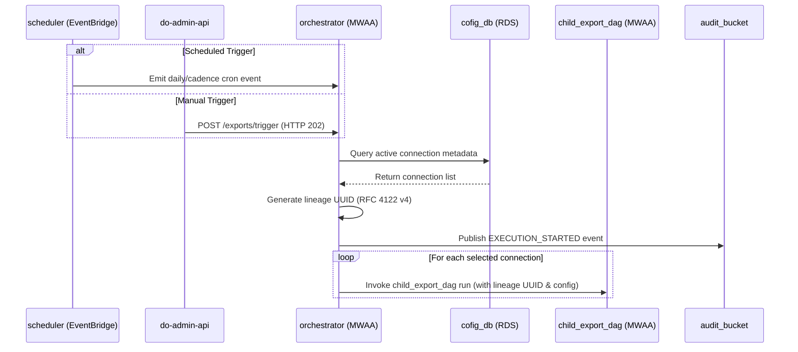

### 3.5 Schema Definitions (DB Tables / API JSON / Telemetry CloudEvents)

**Child Export DAG Run Configuration Payload (`orchestrator` -> `child_export_dag`)** — the single contract consumed by the Child Export DAG (`lineage_uuid` + `connection_id` + full connection JSON):

```json
{
  "$schema": "http://json-schema.org/draft-07/schema#",
  "title": "ChildExportDagRunConf",
  "type": "object",
  "properties": {
    "lineage_uuid": {
      "type": "string",
      "format": "uuid",
      "description": "RFC 4122 v4 lineage UUID generated once per orchestrator run"
    },
    "connection_id": { "type": "string" },
    "dataset": { "type": "string" },
    "mode": { "type": "string", "enum": ["initial", "incremental"] },
    "cron_schedule": { "type": "string" },
    "connection": {
      "type": "object",
      "description": "Full connection JSON as read from the Export Config Store",
      "properties": {
        "connection_id": { "type": "string" },
        "customer_id": { "type": "string" },
        "source_dataset": { "type": "string" },
        "destination_type": { "type": "string", "enum": ["s3", "azure_blob", "gcs", "sftp"] },
        "extraction_mode": { "type": "string", "enum": ["initial", "incremental"] },
        "target_bucket": { "type": "string" },
        "extra_parameters": { "type": "object" }
      },
      "required": ["connection_id", "customer_id", "source_dataset", "extraction_mode", "target_bucket"]
    }
  },
  "required": ["lineage_uuid", "connection_id", "dataset", "mode", "connection"]
}
```

### 3.6 Local Design Assumptions
* **Q: How is the schedule window evaluated?** Connections whose cron schedules fall within a $\pm 10$ minute window of the trigger time are selected for execution, verified via Airflow run records.
* **Q: What happens on manual stop requests?** Invocations via the do-admin-api trigger immediate DAG cancellation through the MWAA API, halting further child generation within 30 seconds.
* **Q: Concurrency control?** `max_active_runs` is strictly set to `1` to prevent overlapping state updates and duplicate extractions for the same schedule cycle.

## 4. Component Design: scheduler

### 4.1 Component Contract (Bi-Directional Inputs & Outputs)
* **Inputs**: Cron expression schedules configured via Terraform and EventBridge rule definitions.
* **Outputs**: EventBridge standard event envelope containing target invocation payload routed to the **orchestrator** (`orchestrator`).
* **Protocols**: AWS EventBridge API / EventBus event publishing.
* **Error Handling**: Automatic retries (up to 3 attempts with exponential backoff); failed deliveries after retry limits are routed to an SQS Dead-Letter Queue (DLQ).

### 4.2 Class and Interface Definitions
```python
from dataclasses import dataclass
from typing import Dict, Any
from dataoutbound.common.clients.aws.eventbridge.eventbridge_client import EventBridgeClient
from dataoutbound.common.logging.logger import get_logger

logger = get_logger(__name__)

@dataclass
class SchedulerEvent:
    source: str
    detail_type: str
    time: str
    detail: Dict[str, Any]
```

### 4.3 Implementation Code Skeleton (Stubs & Handlers)
```python
# Illustrative skeleton — the Component Contract and Schema Definitions are binding
from dataoutbound.common.clients.aws.eventbridge.eventbridge_client import EventBridgeClient
from dataoutbound.common.logging.logger import get_logger
from dataoutbound.util.exceptions import ClientError

logger = get_logger(__name__)

class SchedulerPublisher:
    def __init__(self, eventbridge_client: EventBridgeClient, event_bus_name: str):
        self.client = eventbridge_client
        self.bus_name = event_bus_name

    def publish_schedule_tick(self, detail: dict) -> None:
        try:
            response = self.client.put_events(
                entries=[{
                    "Source": "com.laminar.dataoutbound.scheduler",
                    "DetailType": "ExportScheduleTrigger",
                    "Detail": detail,
                    "EventBusName": self.bus_name
                }]
            )
            logger.info("Published schedule tick event to EventBridge", extra={"response": response})
        except Exception as e:
            logger.error("Failed to publish schedule tick event", extra={"error": str(e)})
            raise ClientError(f"EventBridge publish failed: {e}") from e
```

### 4.4 Cross-Component Interaction Sequence (Local Mermaid/ASCII Flow)
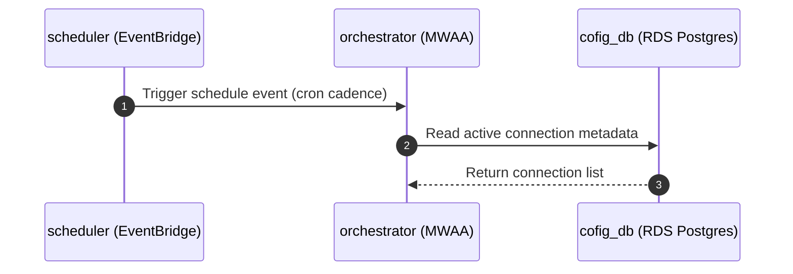

### 4.5 Schema Definitions (DB Tables / API JSON / Telemetry CloudEvents)
```json
{
  "$schema": "http://json-schema.org/draft-07/schema#",
  "title": "SchedulerEventCloudEvent",
  "type": "object",
  "properties": {
    "version": { "type": "string" },
    "id": { "type": "string", "format": "uuid" },
    "detail-type": { "type": "string", "enum": ["ExportScheduleTrigger"] },
    "source": { "type": "string", "const": "com.laminar.dataoutbound.scheduler" },
    "account": { "type": "string" },
    "time": { "type": "string", "format": "date-time" },
    "region": { "type": "string" },
    "resources": { "type": "array", "items": { "type": "string" } },
    "detail": {
      "type": "object",
      "properties": {
        "scheduled_time": { "type": "string", "format": "date-time" },
        "window_tolerance_minutes": { "type": "integer", "default": 10 }
      },
      "required": ["scheduled_time"]
    }
  },
  "required": ["version", "id", "detail-type", "source", "time", "detail"]
}
```

### 4.6 Local Design Assumptions
* **Assumption 1**: EventBridge rules operate on UTC timezone for all cron expressions.
* **Assumption 2**: Event payload size is well below the 256 KB EventBridge limit.

## 5. Component Design: egress-lambda

### 5.1 Component Contract (Bi-Directional Inputs & Outputs)
* **Inputs**: S3 Object Created notification payload from `staging_bucet_internal`.
* **Outputs**: Triggers the **egress dag** (`egress dag`) on MWAA upon receiving S3 object notifications.
* **Protocols**: AWS Lambda invocation via S3 event notifications.
* **Error Handling**: Retries up to 3 times on transient failures; routes unrecoverable failures to DLQ/audit log and raises operational alerts.

### 5.2 Class and Interface Definitions
```python
from dataclasses import dataclass
from typing import Dict, Any, List

@dataclass
class S3EventRecord:
    bucket_name: str
    object_key: str
    size: int
    etag: str

@dataclass
class EgressExecutionResult:
    status: str
    lineage_uuid: str
    destination_type: str
    checksum: str
```

### 5.3 Implementation Code Skeleton (Stubs & Handlers)

*Illustrative skeleton — the Component Contract and Schema Definitions are binding.*

```python
# Illustrative skeleton — the Component Contract and Schema Definitions are binding
import json
from typing import Any, Dict
from urllib.parse import unquote_plus

from dataoutbound.common.clients.aws.mwaa.mwaa_client import MwaaClient
from dataoutbound.common.logging.logger import get_logger
from dataoutbound.config.config_loader import ConfigLoader

logger = get_logger(__name__)

TRANSFORM_ENCRYPT_DAG_ID = "transform_encrypt_dag"


def _extract_lineage_uuid(object_key: str) -> str:
    """Recovers the lineage UUID embedded in the staged object key by the Child Export DAG."""
    for part in object_key.split("/"):
        if part.startswith("lineage_uuid="):
            return part.split("=", 1)[1]
    return ""


def lambda_handler(event: Dict[str, Any], context: Any) -> Dict[str, Any]:
    """S3 ObjectCreated entrypoint: triggers exactly one Transform & Encrypt DAG run per staged object.

    Transfer audit events (TRANSFER_STARTED / TRANSFER_COMPLETED / TRANSFER_FAILED) are owned by the
    Transform & Encrypt DAG, not by this function, so they are not double-counted.
    """
    logger.info("Egress Lambda invoked", extra={"record_count": len(event.get("Records", []))})

    try:
        config = ConfigLoader.load_config("lambdas")
        mwaa = MwaaClient(config)

        for record in event.get("Records", []):
            s3_info = record.get("s3", {})
            bucket = s3_info.get("bucket", {}).get("name")
            object_key = unquote_plus(s3_info.get("object", {}).get("key", ""))
            lineage_uuid = _extract_lineage_uuid(object_key)

            logger.info("Triggering transform & encrypt DAG",
                        extra={"bucket": bucket, "key": object_key, "lineage_uuid": lineage_uuid})

            mwaa.trigger_dag_run(
                dag_id=TRANSFORM_ENCRYPT_DAG_ID,
                conf={
                    "lineage_uuid": lineage_uuid,
                    "source_bucket": bucket,
                    "source_key": object_key,
                },
            )

        return {"statusCode": 200, "body": json.dumps({"message": "Transform & Encrypt DAG triggered"})}
    except Exception as e:
        logger.error("Error triggering Transform & Encrypt DAG", extra={"error": str(e)}, exc_info=True)
        return {"statusCode": 500, "body": json.dumps({"error": str(e)})}
```

### 5.4 Cross-Component Interaction Sequence (Local Mermaid/ASCII Flow)
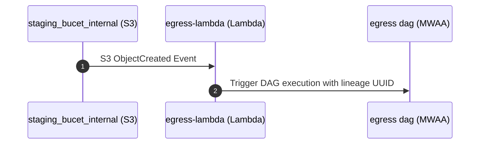

### 5.5 Schema Definitions (DB Tables / API JSON / Telemetry CloudEvents)
```json
{
  "$schema": "http://json-schema.org/draft-07/schema#",
  "title": "EgressLambdaS3Event",
  "type": "object",
  "properties": {
    "Records": {
      "type": "array",
      "items": {
        "type": "object",
        "properties": {
          "eventVersion": { "type": "string" },
          "eventSource": { "type": "string" },
          "awsRegion": { "type": "string" },
          "eventTime": { "type": "string", "format": "date-time" },
          "eventName": { "type": "string" },
          "s3": {
            "type": "object",
            "properties": {
              "bucket": {
                "type": "object",
                "properties": {
                  "name": { "type": "string" },
                  "arn": { "type": "string" }
                }
              },
              "object": {
                "type": "object",
                "properties": {
                  "key": { "type": "string" },
                  "size": { "type": "integer" },
                  "eTag": { "type": "string" }
                }
              }
            }
          }
        }
      }
    }
  }
}
```

### 5.6 Local Design Assumptions
* **Assumption 1**: Lambda memory is configured to 512 MB with a 30-second timeout.
* **Assumption 2**: VPC execution is disabled (`vpc_enabled: False`) with direct public/service endpoint routing as specified in diagram properties.

## 6. Component Design: child_export_dag

### 6.1 Component Contract (Bi-Directional Inputs & Outputs)
* **Inputs**: DAG run configuration conf payload containing the lineage UUID and connection JSON dictionary.
* **Outputs**: Submits EMR Serverless Spark job execution (`emr_do`), reads connection config from `cofig_db`, and publishes audit records to `audit_bucket`.
* **Protocols**: Airflow Python Operator API, EMR Serverless Client SDK (`boto3`), RDS Postgres SQL queries over SQLAlchemy.
* **Error Handling**: Task-level retries configured in Airflow (3 retries with 5-minute backoff); failure callbacks emit `EXECUTION_FAILED` audit events.

### 6.2 Class and Interface Definitions
```python
from dataclasses import dataclass
from typing import Dict, Any

@dataclass
class ChildDagConfig:
    lineage_uuid: str
    connection_id: int
    dataset: str
    mode: str
    target_type: str
```

### 6.3 Implementation Code Skeleton (Stubs & Handlers)
```python
# Illustrative skeleton — the Component Contract and Schema Definitions are binding
from airflow import DAG
from airflow.operators.python import PythonOperator
from datetime import datetime, timedelta
from dataoutbound.common.logging.logger import get_logger
from dataoutbound.common.clients.aws.emr.emr_client import EmrClient

logger = get_logger(__name__)

default_args = {
    "owner": "data-platform",
    "depends_on_past": False,
    "email_on_failure": True,
    "retries": 3,
    "retry_delay": timedelta(minutes=5),
}

def run_emr_extraction(**context):
    conf = context.get("dag_run").conf or {}
    lineage_uuid = conf.get("lineage_uuid")
    connection_id = conf.get("connection_id")
    logger.info("Executing child export DAG task", extra={"lineage_uuid": lineage_uuid, "connection_id": connection_id})

with DAG(
    "child_export_dag",
    default_args=default_args,
    description="Child export DAG for EMR Serverless spark job submission",
    schedule_interval="@daily",
    start_date=datetime(2025, 1, 1),
    catchup=False,
    max_active_runs=1,
) as dag:
    extract_task = PythonOperator(
        task_id="submit_emr_extract_job",
        python_callable=run_emr_extraction,
        provide_context=True,
    )
```

### 6.4 Cross-Component Interaction Sequence (Local Mermaid/ASCII Flow)
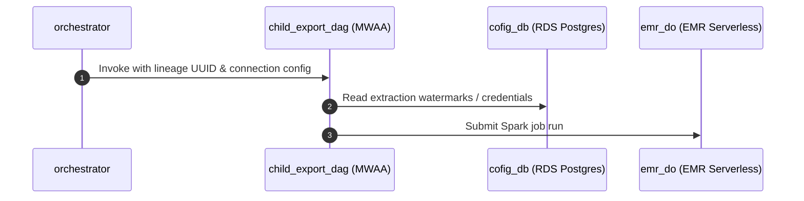

### 6.5 Schema Definitions (DB Tables / API JSON / Telemetry CloudEvents)
```json
{
  "$schema": "http://json-schema.org/draft-07/schema#",
  "title": "ChildExportDagRunConf",
  "type": "object",
  "properties": {
    "lineage_uuid": { "type": "string", "format": "uuid" },
    "connection_id": { "type": "integer" },
    "dataset": { 
      "type": "string", 
      "enum": ["identity_profiles", "subscription_statuses", "campaigns_reactions", "reservation_items"] 
    },
    "mode": { "type": "string", "enum": ["initial", "incremental"] },
    "cron_schedule": { "type": "string" }
  },
  "required": ["lineage_uuid", "connection_id", "dataset", "mode"]
}
```

### 6.6 Local Design Assumptions
* **Assumption 1**: `max_active_runs` is restricted to 1 per child DAG to prevent concurrent overlapping state modifications.
* **Assumption 2**: DAG definition files are deployed to the MWAA S3 DAGs bucket automatically via CI/CD.

## 7. Component Design: cofig_db

### 7.1 Component Contract (Bi-Directional Inputs & Outputs)
* **Inputs**: SQL CRUD operations from `do-admin-api`, metadata queries from orchestrator and child_export_dag.
* **Outputs**: Relational database records, encrypted credential values, execution watermarks.
* **Protocols**: PostgreSQL wire protocol (TCP port 5432) with SSL/TLS enforced (`sslmode=require`).
* **Error Handling**: Connection pooling via SQLAlchemy, transaction rollback on exceptions, custom database exception mapping.

### 7.2 Class and Interface Definitions
```python
from sqlalchemy import Column, Integer, String, Boolean, DateTime, Text
from sqlalchemy.ext.declarative import declarative_base

Base = declarative_base()

class ExportConfigurationModel(Base):
    __tablename__ = "export_configurations"
    
    id = Column(Integer, primary_key=True, autoincrement=True)
    connection_name = Column(String(100), nullable=False, unique=True)
    target_type = Column(String(50), nullable=False)
    dataset = Column(String(50), nullable=False)
    mode = Column(String(20), nullable=False)
    cron_schedule = Column(String(100), nullable=False)
    encrypted_credentials = Column(Text, nullable=False)
    is_active = Column(Boolean, default=True, nullable=False)
    created_at = Column(DateTime, nullable=False)
    updated_at = Column(DateTime, nullable=False)
```

### 7.3 Implementation Code Skeleton (Stubs & Handlers)
```python
# Illustrative skeleton — the Component Contract and Schema Definitions are binding
from contextlib import contextmanager
from dataoutbound.common.clients.db.db_client import DbClient
from dataoutbound.common.logging.logger import get_logger

logger = get_logger(__name__)

# DbClient is imported directly from common foundation:
# from dataoutbound.common.clients.db.db_client import DbClient
```

### 7.4 Cross-Component Interaction Sequence (Local Mermaid/ASCII Flow)
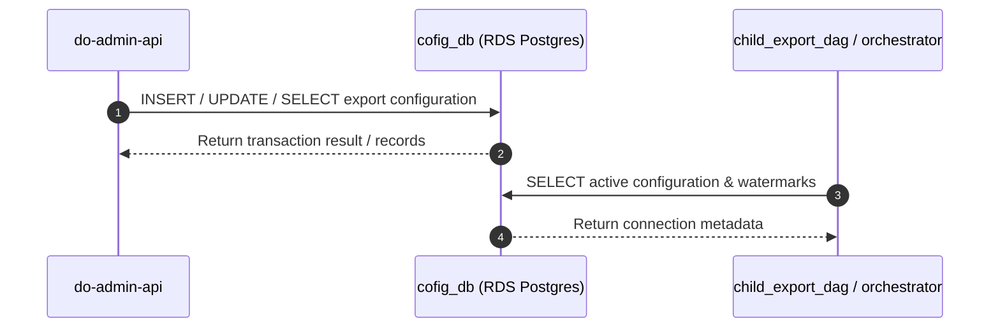

### 7.5 Schema Definitions (DB Tables / API JSON / Telemetry CloudEvents)
```sql
CREATE TABLE export_configurations (
    id SERIAL PRIMARY KEY,
    connection_name VARCHAR(100) NOT NULL UNIQUE,
    target_type VARCHAR(50) NOT NULL,
    dataset VARCHAR(50) NOT NULL,
    mode VARCHAR(20) NOT NULL,
    cron_schedule VARCHAR(100) NOT NULL,
    encrypted_credentials TEXT NOT NULL,
    is_active BOOLEAN DEFAULT TRUE NOT NULL,
    created_at TIMESTAMP WITH TIME ZONE DEFAULT CURRENT_TIMESTAMP NOT NULL,
    updated_at TIMESTAMP WITH TIME ZONE DEFAULT CURRENT_TIMESTAMP NOT NULL
);

CREATE TABLE export_watermarks (
    id SERIAL PRIMARY KEY,
    connection_id INT REFERENCES export_configurations(id) ON DELETE CASCADE,
    last_watermark_timestamp TIMESTAMP WITH TIME ZONE NOT NULL,
    updated_at TIMESTAMP WITH TIME ZONE DEFAULT CURRENT_TIMESTAMP NOT NULL
);
```

### 7.6 Local Design Assumptions
* **Assumption 1**: RDS Postgres instance is configured with engine version 15.4, instance class `db.t3.micro`, and 20 GB `gp3` storage with auto-scaling enabled.
* **Assumption 2**: Multi-AZ is configured as `multi_az: False` per explicit diagram configuration for dev/lower environments; production environments override this configuration via environment overlays with Multi-AZ enabled for high availability.

## 8. Component Design: audit_bucket

### 8.1 Component Contract (Bi-Directional Inputs & Outputs)
* **Inputs**: Audit execution records, administrative action logs, and transfer lifecycle events from API, EMR, and DAG components.
* **Outputs**: Immutable S3 objects stored under prefix partitions with AES256 encryption.
* **Protocols**: S3 API (HTTPS/TLS 1.3).
* **Error Handling**: Non-blocking asynchronous publisher pattern; swallows publication exceptions to prevent upstream business transaction failures.

### 8.2 Class and Interface Definitions
```python
from dataclasses import dataclass
from typing import Optional, Dict, Any

@dataclass
class AuditRecord:
    actor_id: str
    timestamp_utc: str
    event_type: str
    execution_id: str
    payload: Optional[Dict[str, Any]] = None
```

### 8.3 Implementation Code Skeleton (Stubs & Handlers)
```python
# Binding implementation snippet from src/dataoutbound/common/telemetry/auditor.py
from dataoutbound.common.telemetry.auditor import AuditPublisher
from dataoutbound.common.logging.logger import get_logger

logger = get_logger(__name__)

# Usage across components:
# auditor = AuditPublisher()
# auditor.publish(event_type="EXECUTION_STARTED", payload={"execution_id": "...", "actor_id": "..."})
```

### 8.4 Cross-Component Interaction Sequence (Local Mermaid/ASCII Flow)
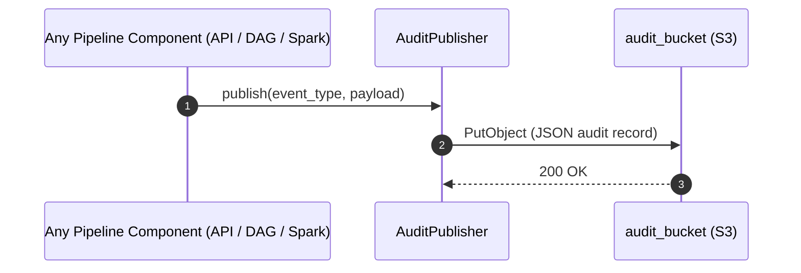

### 8.5 Schema Definitions (DB Tables / API JSON / Telemetry CloudEvents)

```json
{
  "$schema": "http://json-schema.org/draft-07/schema#",
  "title": "BusinessAuditEvent",
  "type": "object",
  "properties": {
    "actor_id": { "type": "string" },
    "timestamp_utc": {
      "type": "string",
      "pattern": "^\\d{4}-\\d{2}-\\d{2}T\\d{2}:\\d{2}:\\d{2}\\.\\d{3}Z$"
    },
    "event_type": {
      "type": "string",
      "enum": [
        "ADMIN_CREATE",
        "ADMIN_UPDATE",
        "ADMIN_DELETE",
        "ADMIN_MANUAL_TRIGGER",
        "EXECUTION_STARTED",
        "EXECUTION_COMPLETED",
        "TRANSFER_STARTED",
        "TRANSFER_COMPLETED",
        "TRANSFER_FAILED"
      ]
    },
    "execution_id": { "type": "string", "format": "uuid" },
    "payload": { "type": "object" }
  },
  "required": ["actor_id", "timestamp_utc", "event_type", "execution_id"]
}
```

### 8.6 Local Design Assumptions
* **Assumption 1**: Encryption at rest is enforced using SSE-S3 (AES256).
* **Assumption 2**: Lifecycle transition moves audit logs to Glacier after 90 days (`lifecycle_glacier_days = 90`), with the first transition at 30 days (`lifecycle_transition_days = 30`), and retains them per organizational compliance.

## 9. Component Design: staging_bucet_internal
### 9.1 Component Contract (Bi-Directional Inputs & Outputs)
* **Inputs**: Staged export Parquet/JSON datasets and manifest files written by Export Extract Spark Job (`export_extract_spark_job_emr`).
* **Outputs**: Read by Egress Lambda (`egress-lambda`) and Transform & Encrypt DAG (`transform_encrypt_dag_mwaa`), auto-purged after 7 days via S3 lifecycle rules.
* **Protocols**: S3 API (HTTPS/TLS 1.3).
* **Error Handling**: Standard S3 retry mechanism with exponential backoff; throws `ClientError` on upload/download failure.

### 9.2 Class and Interface Definitions
```python
from dataclasses import dataclass
from typing import List

@dataclass
class StagingManifest:
    lineage_uuid: str
    record_count: int
    total_file_size_bytes: int
    files: List[dict]
```

### 9.3 Implementation Code Skeleton (Stubs & Handlers)
```python
# Illustrative skeleton — the Component Contract and Schema Definitions are binding
from dataoutbound.common.clients.aws.s3.s3_client import S3Client
from dataoutbound.common.logging.logger import get_logger

logger = get_logger(__name__)

class StagingBucketManager:
    def __init__(self, s3_client: S3Client, bucket_name: str):
        self.client = s3_client
        self.bucket_name = bucket_name

    def write_manifest(self, lineage_uuid: str, manifest_data: dict) -> None:
        key = f"manifests/manifest_{lineage_uuid}.json"
        self.client.upload_json(self.bucket_name, key, manifest_data)
        logger.info("Staging manifest written successfully", extra={"lineage_uuid": lineage_uuid})
```

### 9.4 Cross-Component Interaction Sequence (Local Mermaid/ASCII Flow)
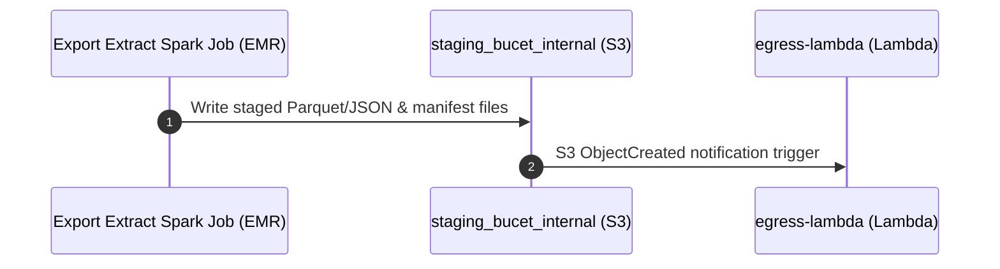

### 9.5 Schema Definitions (DB Tables / API JSON / Telemetry CloudEvents)
```json
{
  "$schema": "http://json-schema.org/draft-07/schema#",
  "title": "ExportManifestControlFile",
  "type": "object",
  "properties": {
    "lineage_uuid": { "type": "string", "format": "uuid" },
    "record_count": { "type": "integer", "minimum": 0 },
    "total_file_size_bytes": { "type": "integer", "minimum": 0 },
    "output_files": {
      "type": "array",
      "items": {
        "type": "object",
        "properties": {
          "file_name": { "type": "string" },
          "file_size": { "type": "integer" },
          "sha256_checksum": { "type": "string", "pattern": "^[a-fA-F0-9]{64}$" }
        },
        "required": ["file_name", "file_size", "sha256_checksum"]
      }
    }
  },
  "required": ["lineage_uuid", "record_count", "total_file_size_bytes", "output_files"]
}
```

### 9.6 Local Design Assumptions
* **Assumption 1**: S3 lifecycle rules enforce object expiration of exactly 7 days to prevent temporary file accumulation.
* **Assumption 2**: Bucket public access block is fully enabled (`public_access_block: True`).

---

## 10. Component Design: do-admin-api

### 10.1 Component Contract (Bi-Directional Inputs & Outputs)
* **Inputs**: HTTP REST requests (`POST`, `GET`, `PUT`, `DELETE`) with JWT Bearer token authentication targeting `/api/v1/exports/...`.
* **Outputs**: JSON responses with semantic HTTP status codes (`200 OK`, `201 Created`, `204 No Content`, `202 Accepted`, `400 Bad Request`, `401 Unauthorized`, `403 Forbidden`, `404 Not Found`, `500 Internal Server Error`).
* **Protocols**: REST over HTTP/1.1 or HTTP/2 (TLS 1.3).
* **Error Handling**: Global exception middleware mapping domain exceptions to standard error envelopes (`{ "error": { "code": "STRING_CODE", "message": "...", "details": [] } }`).

### 10.2 Class and Interface Definitions
```python
from pydantic import BaseModel, Field
from typing import Optional, Literal, Dict, Any

class ExportConfigCreateRequest(BaseModel):
    connection_name: str = Field(..., min_length=1, max_length=100)
    target_type: Literal["s3", "azure_blob", "gcs", "sftp"]
    dataset: Literal["identity_profiles", "subscription_statuses", "campaigns_reactions", "reservation_items"]
    mode: Literal["initial", "incremental"]
    cron_schedule: str = Field(..., description="Valid 5-field cron expression")
    credentials: Dict[str, Any] = Field(..., description="Target connection credentials")

class ExportConfigUpdateRequest(BaseModel):
    connection_name: Optional[str] = Field(None, min_length=1, max_length=100)
    target_type: Optional[Literal["s3", "azure_blob", "gcs", "sftp"]] = None
    dataset: Optional[Literal["identity_profiles", "subscription_statuses", "campaigns_reactions", "reservation_items"]] = None
    mode: Optional[Literal["initial", "incremental"]] = None
    cron_schedule: Optional[str] = None
    credentials: Optional[Dict[str, Any]] = None
    is_active: Optional[bool] = None

class ExportConfigResponse(BaseModel):
    id: int
    connection_name: str
    target_type: str
    dataset: str
    mode: str
    cron_schedule: str
    is_active: bool
    created_at: str
    updated_at: str
```

### 10.3 Implementation Code Skeleton (Stubs & Handlers)
```python
# Binding implementation baseline for src/dataoutbound/apis/export_admin_api/export_admin_routes.py
from fastapi import APIRouter, Depends, status, HTTPException
from typing import List
from dataoutbound.apis.export_admin_api.export_admin_schemas import (
    ExportConfigCreateRequest, ExportConfigUpdateRequest, ExportConfigResponse
)
from dataoutbound.apis.export_admin_api.export_admin_service import ExportAdminService
from dataoutbound.apis.export_admin_api.dependencies import get_export_admin_service
from dataoutbound.common.security.auth import require_role
from dataoutbound.common.telemetry.auditor import AuditPublisher
from dataoutbound.common.logging.logger import get_logger

logger = get_logger(__name__)
router = APIRouter(prefix="/api/v1/exports", tags=["Export Admin API"])
auditor = AuditPublisher()

@router.post("", response_model=ExportConfigResponse, status_code=status.HTTP_201_CREATED)
def create_export_config(
    payload: ExportConfigCreateRequest,
    service: ExportAdminService = Depends(get_export_admin_service),
    subject: dict = Depends(require_role("export-admin"))
):
    """Create a new customer export configuration."""
    logger.info("Creating export configuration", extra={"connection_name": payload.connection_name, "actor": subject.get("sub")})
    try:
        result = service.create_configuration(payload, actor_id=subject.get("sub"))
        auditor.publish("ADMIN_CREATE", {"actor_id": subject.get("sub"), "connection_name": payload.connection_name})
        return result
    except Exception as e:
        logger.error("Failed to create export configuration", extra={"error": str(e)})
        raise HTTPException(status_code=400, detail={"error": {"code": "BAD_REQUEST", "message": str(e)}})

@router.get("/{config_id}", response_model=ExportConfigResponse, status_code=status.HTTP_200_OK)
def get_export_config(
    config_id: int,
    service: ExportAdminService = Depends(get_export_admin_service),
    subject: dict = Depends(require_role("export-admin"))
):
    """Retrieve export configuration by ID with masked credentials."""
    result = service.get_configuration(config_id)
    if not result:
        raise HTTPException(status_code=404, detail={"error": {"code": "NOT_FOUND", "message": "Config not found"}})
    return result

@router.put("/{config_id}", response_model=ExportConfigResponse, status_code=status.HTTP_200_OK)
def update_export_config(
    config_id: int,
    payload: ExportConfigUpdateRequest,
    service: ExportAdminService = Depends(get_export_admin_service),
    subject: dict = Depends(require_role("export-admin"))
):
    """Update existing export configuration."""
    try:
        result = service.update_configuration(config_id, payload, actor_id=subject.get("sub"))
        auditor.publish("ADMIN_UPDATE", {"actor_id": subject.get("sub"), "config_id": config_id})
        return result
    except Exception as e:
        raise HTTPException(status_code=400, detail={"error": {"code": "BAD_REQUEST", "message": str(e)}})

@router.delete("/{config_id}", status_code=status.HTTP_204_NO_CONTENT)
def delete_export_config(
    config_id: int,
    service: ExportAdminService = Depends(get_export_admin_service),
    subject: dict = Depends(require_role("export-admin"))
):
    """Delete export configuration by ID."""
    success = service.delete_configuration(config_id)
    if not success:
        raise HTTPException(status_code=404, detail={"error": {"code": "NOT_FOUND", "message": "Config not found"}})
    auditor.publish("ADMIN_DELETE", {"actor_id": subject.get("sub"), "config_id": config_id})
    return None

@router.post("/{config_id}/trigger", status_code=status.HTTP_202_ACCEPTED)
def manual_trigger_export(
    config_id: int,
    service: ExportAdminService = Depends(get_export_admin_service),
    subject: dict = Depends(require_role("export-admin"))
):
    """Manually trigger export run for configuration."""
    try:
        run_id = service.trigger_run(config_id, actor_id=subject.get("sub"))
        auditor.publish("ADMIN_MANUAL_TRIGGER", {"actor_id": subject.get("sub"), "config_id": config_id})
        return {"message": "Export run triggered successfully", "run_id": run_id}
    except Exception as e:
        raise HTTPException(status_code=400, detail={"error": {"code": "BAD_REQUEST", "message": str(e)}})

@router.post("/{config_id}/stop", status_code=status.HTTP_202_ACCEPTED)
def manual_stop_export(
    config_id: int,
    service: ExportAdminService = Depends(get_export_admin_service),
    subject: dict = Depends(require_role("export-admin"))
):
    """Manually terminate running export execution."""
    try:
        service.stop_run(config_id, actor_id=subject.get("sub"))
        return {"message": "Export run termination requested"}
    except Exception as e:
        raise HTTPException(status_code=400, detail={"error": {"code": "BAD_REQUEST", "message": str(e)}})
```

### 10.4 Cross-Component Interaction Sequence (Local Mermaid/ASCII Flow)
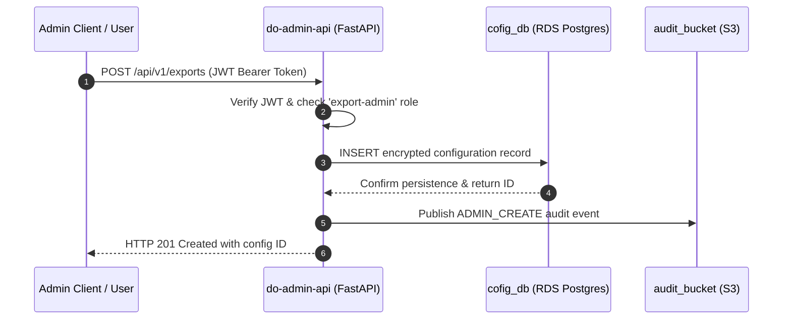

### 10.5 Schema Definitions (DB Tables / API JSON / Telemetry CloudEvents)
```json
{
  "$schema": "http://json-schema.org/draft-07/schema#",
  "title": "ExportConfigResponseSchema",
  "type": "object",
  "properties": {
    "id": { "type": "integer" },
    "connection_name": { "type": "string", "maxLength": 100 },
    "target_type": { "type": "string", "enum": ["s3", "azure_blob", "gcs", "sftp"] },
    "dataset": { "type": "string", "enum": ["identity_profiles", "subscription_statuses", "campaigns_reactions", "reservation_items"] },
    "mode": { "type": "string", "enum": ["initial", "incremental"] },
    "cron_schedule": { "type": "string" },
    "is_active": { "type": "boolean" },
    "created_at": { "type": "string", "format": "date-time" },
    "updated_at": { "type": "string", "format": "date-time" }
  },
  "required": ["id", "connection_name", "target_type", "dataset", "mode", "cron_schedule", "is_active"]
}
```

### 10.6 Local Design Assumptions
* **Assumption 1**: API is built using FastAPI with Pydantic v2 validation.
* **Assumption 2**: Authentication relies on JWT bearer tokens issued by the enterprise Identity Provider, verified locally via public keys.

## 11. Component Design: dev
### 11.1 Component Contract (Bi-Directional Inputs & Outputs)
* **Inbound Interface:** SQL queries and partitioned JDBC extraction requests initiated by the Export Extract Spark Job (`export_extract_spark_job`).
* **Outbound Interface:** Relational result sets containing Golden Entity records (Unified Identity Profiles, Pii Restricted Profiles, Contact Method Subscriptions, Enriched Campaigns, Enriched Campaign Reactions, and reservation items: Room stay, Restaurant reservation, Tee time, Spa treatment).
* **Protocol & Transport:** JDBC over TCP port 5439 with TLS encryption in transit.
* **Authentication & Authorization:** IAM database authentication or database credentials retrieved securely from AWS SSM Parameter Store / Secrets Manager, scoped via least-privilege database roles.

### 11.2 Class and Interface Definitions
```python
from dataclasses import dataclass
from typing import List, Optional
from dataoutbound.common.clients.db.db_client import DbClient

@dataclass
class RedshiftQueryConfig:
    cluster_identifier: str = "golden_data_source"
    database_name: str = "dev"
    node_type: str = "dc2.large"
    number_of_nodes: int = 2
    port: int = 5439

@dataclass
class GoldenEntityExtractionRequest:
    entity_type: str
    incremental: bool
    watermark_timestamp: Optional[str] = None
    batch_size: int = 50000
```

### 11.3 Implementation Code Skeleton (Stubs & Handlers)
> Illustrative skeleton — the Component Contract and Schema Definitions are binding

```python
from typing import Any, Dict, List, Optional
from dataoutbound.common.clients.db.db_client import DbClient
from dataoutbound.common.logging.logger import get_logger
from dataoutbound.util.exceptions import ClientError

logger = get_logger(__name__)

class RedshiftGoldenEntitySourceReader:
    def __init__(self, db_client: DbClient, config: Dict[str, Any]):
        self.db_client = db_client
        self.config = config

    def fetch_entity_records(self, entity_type: str, watermark: Optional[str] = None) -> List[Dict[str, Any]]:
        try:
            logger.info(f"Extracting golden entity records for {entity_type}", extra={"watermark": watermark})
            if watermark:
                query = f"SELECT * FROM {entity_type} WHERE updated_at > :watermark ORDER BY updated_at ASC;"
                params = {"watermark": watermark}
            else:
                query = f"SELECT * FROM {entity_type};"
                params = {}

            results = self.db_client.execute_query(query, params)
            return results
        except Exception as e:
            logger.error(f"Failed to extract from Redshift source store: {str(e)}", exc_info=True)
            raise ClientError(f"Redshift read error for {entity_type}: {str(e)}") from e
```

### 11.4 Cross-Component Interaction Sequence (Local Mermaid/ASCII Flow)
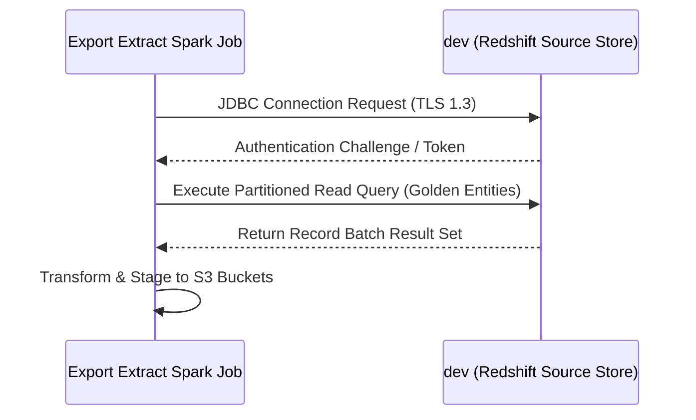

### 11.5 Schema Definitions (DB Tables / API JSON / Telemetry CloudEvents)
```sql
-- DDL for Golden Entity Source Store (Redshift)
CREATE TABLE IF NOT EXISTS unified_identity_profile (
    profile_id VARCHAR(64) NOT NULL,
    tenant_id VARCHAR(64) NOT NULL,
    first_name VARCHAR(128),
    last_name VARCHAR(128),
    email VARCHAR(256),
    created_at TIMESTAMP WITHOUT TIME ZONE NOT NULL,
    updated_at TIMESTAMP WITHOUT TIME ZONE NOT NULL,
    PRIMARY KEY (profile_id)
)
DISTSTYLE KEY
DISTKEY (profile_id)
SORTKEY (updated_at);

CREATE TABLE IF NOT EXISTS pii_restricted_profile (
    profile_id VARCHAR(64) NOT NULL,
    ssn_encrypted VARCHAR(512),
    dob DATE,
    updated_at TIMESTAMP WITHOUT TIME ZONE NOT NULL,
    PRIMARY KEY (profile_id)
)
DISTSTYLE KEY
DISTKEY (profile_id)
SORTKEY (updated_at);

CREATE TABLE IF NOT EXISTS contact_method_subscription (
    subscription_id VARCHAR(64) NOT NULL,
    profile_id VARCHAR(64) NOT NULL,
    channel VARCHAR(32) NOT NULL,
    is_subscribed BOOLEAN NOT NULL,
    updated_at TIMESTAMP WITHOUT TIME ZONE NOT NULL,
    PRIMARY KEY (subscription_id)
)
DISTSTYLE KEY
DISTKEY (profile_id);

CREATE TABLE IF NOT EXISTS enriched_campaigns (
    campaign_id VARCHAR(64) NOT NULL,
    campaign_name VARCHAR(256) NOT NULL,
    start_date TIMESTAMP WITHOUT TIME ZONE,
    end_date TIMESTAMP WITHOUT TIME ZONE,
    updated_at TIMESTAMP WITHOUT TIME ZONE NOT NULL,
    PRIMARY KEY (campaign_id)
)
DISTSTYLE AUTO;

CREATE TABLE IF NOT EXISTS enriched_campaign_reactions (
    reaction_id VARCHAR(64) NOT NULL,
    campaign_id VARCHAR(64) NOT NULL,
    profile_id VARCHAR(64) NOT NULL,
    reaction_type VARCHAR(64) NOT NULL,
    reacted_at TIMESTAMP WITHOUT TIME ZONE NOT NULL,
    PRIMARY KEY (reaction_id)
)
DISTSTYLE KEY
DISTKEY (campaign_id);

CREATE TABLE IF NOT EXISTS reservation_item (
    reservation_id VARCHAR(64) NOT NULL,
    profile_id VARCHAR(64) NOT NULL,
    reservation_type VARCHAR(32) NOT NULL, -- Room stay, Restaurant reservation, Tee time, Spa treatment
    check_in TIMESTAMP WITHOUT TIME ZONE,
    check_out TIMESTAMP WITHOUT TIME ZONE,
    details VARCHAR(1024),
    updated_at TIMESTAMP WITHOUT TIME ZONE NOT NULL,
    PRIMARY KEY (reservation_id)
)
DISTSTYLE KEY
DISTKEY (profile_id)
SORTKEY (reservation_type, updated_at);
```

### 11.6 Local Design Assumptions
* **Node Type & Scaling:** Configured exactly as specified with `dc2.large` node type and `2` nodes (`cluster_identifier = golden_data_source`, `database_name = dev`).
* **Workload Management (WLM):** Query concurrency is managed via dedicated queues for batch extract queries to prevent interference with interactive analysis.
* **Distribution & Sort Keys:** Tables use `DISTKEY` on foreign/join keys and compound `SORTKEY` on timestamps to optimize sequential reads during incremental extractions.

---

## 12. Component Design: Customer Azure Blob Destination
### 12.1 Component Contract (Bi-Directional Inputs & Outputs)
* **Inbound Interface:** HTTPS PUT / Multipart upload requests from the Egress Lambda containing PGP-encrypted export packages and manifest control files.
* **Outbound Interface:** HTTP 201 Created / ETag responses and native Content-MD5 transport checksum validations.
* **Protocol & Transport:** HTTPS over TLS 1.3 with strict private endpoint networking rules.
* **Authentication & Authorization:** Microsoft Entra ID authorization using managed identities or RBAC service principals (no shared account keys or SAS tokens).

### 12.2 Class and Interface Definitions
```python
from dataclasses import dataclass
from typing import Dict, Optional
from dataoutbound.common.clients.azure.blob_client import BlobClient

@dataclass
class AzureBlobUploadRequest:
    container_name: str
    blob_path: str
    local_file_path: str
    metadata: Optional[Dict[str, str]] = None
```

### 12.3 Implementation Code Skeleton (Stubs & Handlers)
> Illustrative skeleton — the Component Contract and Schema Definitions are binding

```python
from typing import Dict, Any
from dataoutbound.common.clients.azure.blob_client import BlobClient
from dataoutbound.common.logging.logger import get_logger
from dataoutbound.util.exceptions import ClientError

logger = get_logger(__name__)

class AzureBlobDestinationHandler:
    def __init__(self, blob_client: BlobClient, config: Dict[str, Any]):
        self.blob_client = blob_client
        self.config = config

    def upload_export_package(self, container_name: str, blob_path: str, local_file_path: str) -> str:
        try:
            logger.info(f"Uploading export package to Azure Blob container {container_name} at path {blob_path}")
            etag = self.blob_client.upload_file(
                container_name=container_name,
                blob_name=blob_path,
                file_path=local_file_path,
                secure_transfer=True
            )
            logger.info(f"Successfully uploaded to Azure Blob. ETag: {etag}")
            return etag
        except Exception as e:
            logger.error(f"Failed to upload to Azure Blob Destination: {str(e)}", exc_info=True)
            raise ClientError(f"Azure Blob transfer failed: {str(e)}") from e
```

### 12.4 Cross-Component Interaction Sequence (Local Mermaid/ASCII Flow)
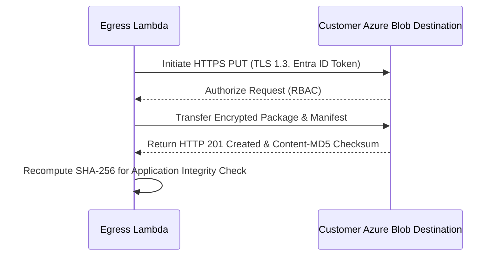

### 12.5 Schema Definitions (DB Tables / API JSON / Telemetry CloudEvents)
```json
{
  "$schema": "http://json-schema.org/draft-07/schema#",
  "title": "AzureBlobTransferTelemetry",
  "type": "object",
  "properties": {
    "specversion": { "type": "string", "example": "1.0" },
    "type": { "type": "string", "example": "com.laminar.dataoutbound.transfer.completed" },
    "source": { "type": "string", "example": "urn:laminar:dataoutbound:lambda:egress" },
    "id": { "type": "string", "format": "uuid" },
    "time": { "type": "string", "format": "date-time" },
    "datacontenttype": { "type": "string", "example": "application/json" },
    "data": {
      "type": "object",
      "properties": {
        "execution_id": { "type": "string", "format": "uuid" },
        "destination_type": { "type": "string", "example": "azure_blob" },
        "container": { "type": "string" },
        "blob_name": { "type": "string" },
        "sha256_checksum": { "type": "string" },
        "status": { "type": "string", "enum": ["SUCCESS", "FAILED"] }
      },
      "required": ["execution_id", "destination_type", "container", "blob_name", "sha256_checksum", "status"]
    }
  },
  "required": ["specversion", "type", "source", "id", "time", "data"]
}
```

### 12.6 Local Design Assumptions
* **Security Controls:** Microsoft Entra ID is strictly enforced; public internet access and anonymous access are disabled at container and storage account levels. Microsoft Defender for Storage is enabled.
* **Data Protection:** Soft delete is enabled for both blobs and containers with Azure Resource Manager (ARM) resource locks applied.
* **Performance & Scalability:** Standard general-purpose v2 account utilizing parallel AzCopy/SDK transfers and secure TLS 1.3 endpoints within the target region.

---

## 13. Component Design: Customer GCS Destination
### 13.1 Component Contract (Bi-Directional Inputs & Outputs)
* **Inbound Interface:** HTTPS chunked uploads from the Egress Lambda delivering encrypted export packages and manifest control files.
* **Outbound Interface:** Google Cloud Storage responses containing object metadata and native CRC32C transport checksums.
* **Protocol & Transport:** HTTPS over TLS 1.3.
* **Authentication & Authorization:** Service account key or Workload Identity federation with least-privilege IAM roles (`roles/storage.objectCreator`).

### 13.2 Class and Interface Definitions
```python
from dataclasses import dataclass
from typing import Dict, Optional
from dataoutbound.common.clients.gcp.gcs_client import GcsClient

@dataclass
class GcsUploadRequest:
    bucket_name: str
    object_path: str
    local_file_path: str
    metadata: Optional[Dict[str, str]] = None
```

### 13.3 Implementation Code Skeleton (Stubs & Handlers)
> Illustrative skeleton — the Component Contract and Schema Definitions are binding

```python
from typing import Dict, Any
from dataoutbound.common.clients.gcp.gcs_client import GcsClient
from dataoutbound.common.logging.logger import get_logger
from dataoutbound.util.exceptions import ClientError

logger = get_logger(__name__)

class GcsDestinationHandler:
    def __init__(self, gcs_client: GcsClient, config: Dict[str, Any]):
        self.gcs_client = gcs_client
        self.config = config

    def upload_export_package(self, bucket_name: str, object_path: str, local_file_path: str) -> str:
        try:
            logger.info(f"Uploading export package to GCS bucket {bucket_name} at path {object_path}")
            generation = self.gcs_client.upload_file(
                bucket_name=bucket_name,
                destination_blob_name=object_path,
                source_file_name=local_file_path
            )
            logger.info(f"Successfully uploaded to GCS. Generation: {generation}")
            return str(generation)
        except Exception as e:
            logger.error(f"Failed to upload to Customer GCS Destination: {str(e)}", exc_info=True)
            raise ClientError(f"GCS transfer failed: {str(e)}") from e
```

### 13.4 Cross-Component Interaction Sequence (Local Mermaid/ASCII Flow)
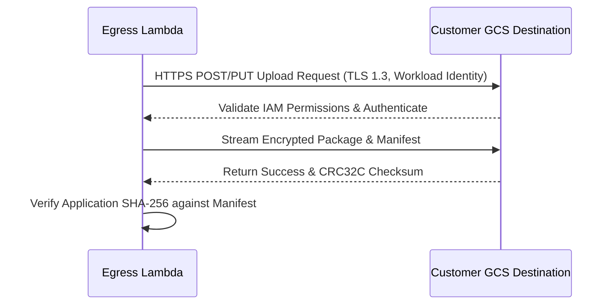

### 13.5 Schema Definitions (DB Tables / API JSON / Telemetry CloudEvents)
```json
{
  "$schema": "http://json-schema.org/draft-07/schema#",
  "title": "GcsTransferTelemetry",
  "type": "object",
  "properties": {
    "specversion": { "type": "string", "example": "1.0" },
    "type": { "type": "string", "example": "com.laminar.dataoutbound.transfer.completed" },
    "source": { "type": "string", "example": "urn:laminar:dataoutbound:lambda:egress" },
    "id": { "type": "string", "format": "uuid" },
    "time": { "type": "string", "format": "date-time" },
    "datacontenttype": { "type": "string", "example": "application/json" },
    "data": {
      "type": "object",
      "properties": {
        "execution_id": { "type": "string", "format": "uuid" },
        "destination_type": { "type": "string", "example": "gcs" },
        "bucket_name": { "type": "string" },
        "object_path": { "type": "string" },
        "crc32c": { "type": "string" },
        "sha256_checksum": { "type": "string" },
        "status": { "type": "string", "enum": ["SUCCESS", "FAILED"] }
      },
      "required": ["execution_id", "destination_type", "bucket_name", "object_path", "crc32c", "sha256_checksum", "status"]
    }
  },
  "required": ["specversion", "type", "source", "id", "time", "data"]
}
```

### 13.6 Local Design Assumptions
* **Authentication:** Workload identity federation or securely injected service account JSON keys are utilized for authentication.
* **Integrity & Validation:** GCS native `CRC32C` checksums are requested as transport checks alongside application-level SHA-256 manifest verification.
* **Network & Security:** TLS 1.3 enforced for all transit traffic with uniform bucket-level access enabled.
## 14. Component Design: emr_do
*(Illustrative skeleton — the Component Contract and Schema Definitions are binding per project blueprint)*

### 14.1 Component Contract (Bi-Directional Inputs & Outputs)

* **Inputs**:
  * **Trigger / Invocation**: Triggered via boto3/MWAA task invocation from **child_export_dag** passing job parameters: `lineage_uuid`, `execution_mode` (`FULL` or `INCREMENTAL`), `watermark_timestamp` (`T`), `recipe_name`, and entity parameters.
  * **Data Source**: Reads source tabular data via JDBC from the Golden Entity Source Store (`dev`) using encrypted credentials resolved via common clients and SSM parameters.
  * **Configuration & Recipes**: Loads environment-specific Spark and job configuration from `src/dataoutbound/spark_emr/export_extract_spark_job/config/config.yaml` and declarative JSON recipe files from `config/recipes/`.
* **Outputs**:
  * **Staged Datasets**: Writes partitioned Parquet/JSON files adhering to S3 partitioning conventions (`year=YYYY/month=MM/day=DD`) to **staging_bucet_internal**.
  * **Telemetry & Audit**: Publishes CloudEvents-shaped audit and execution records (e.g., `EXECUTION_STARTED`, `EXECUTION_COMPLETED`, `EXECUTION_FAILED`) via `AuditPublisher` to the **audit_bucket**.

### 14.2 Class and Interface Definitions

```python
from dataclasses import dataclass, field
from typing import List, Dict, Any, Optional
from pyspark.sql import DataFrame, SparkSession
from pyspark.sql import functions as F

@dataclass
class PIIRule:
    field_name: str
    action: str  # REDACT, HASH_SHA256, MASK
    mask_char: Optional[str] = "*"

@dataclass
class RecipeConfig:
    recipe_name: str
    entity_type: str
    source_table: str
    incremental_column: Optional[str] = None
    pii_rules: List[PIIRule] = field(default_factory=list)
    filters: List[str] = field(default_factory=list)
    output_partition_cols: List[str] = field(default_factory=list)

@dataclass
class SparkJobConfig:
    app_name: str
    environment: str
    lineage_uuid: str
    execution_mode: str
    watermark_timestamp: Optional[str]
    recipe_path: str
    output_s3_uri: str
    jdbc_url: str
    jdbc_properties: Dict[str, str]

class ExportExtractInputProcessor:
    def __init__(self, spark: SparkSession, config: SparkJobConfig):
        self.spark = spark
        self.config = config

    def extract_and_validate(self, recipe: RecipeConfig) -> DataFrame:
        """Reads from Redshift JDBC source and applies initial schema validation and incremental filtering."""
        pass

class ExportExtractTransformer:
    def __init__(self, recipe: RecipeConfig):
        self.recipe = recipe

    def apply_pii_sanitization(self, df: DataFrame) -> DataFrame:
        """Applies field-level redaction, SHA-256 hashing, or masking based on recipe PII rules."""
        pass

class ExportExtractOutputProcessor:
    def __init__(self, config: SparkJobConfig):
        self.config = config

    def write_output(self, df: DataFrame, recipe: RecipeConfig) -> None:
        """Assembles final partitions and writes out partitioned parquet/JSON datasets with manifests."""
        pass
```

### 14.3 Implementation Code Skeleton (Stubs & Handlers)

```python
import sys
import argparse
from typing import Dict, Any
from pyspark.sql import SparkSession

from dataoutbound.spark_emr.export_extract_spark_job.helper.spark_session_helper import get_spark_session
from dataoutbound.spark_emr.export_extract_spark_job.processor.export_extract_input_processor import ExportExtractInputProcessor
from dataoutbound.spark_emr.export_extract_spark_job.processor.export_extract_output_processor import ExportExtractOutputProcessor
from dataoutbound.spark_emr.export_extract_spark_job.transform.export_extract_transformer import ExportExtractTransformer
from dataoutbound.common.logging.logger import get_logger
from dataoutbound.common.telemetry.auditor import AuditPublisher
from dataoutbound.util.exceptions import ClientError, ValidationError

logger = get_logger("export_extract_spark_job.main")
auditor = AuditPublisher()

def parse_args() -> argparse.Namespace:
    parser = argparse.ArgumentParser(description="Export Extract Spark Job on EMR Serverless")
    parser.add_argument("--lineage-uuid", required=True, help="Execution lineage UUID")
    parser.add_argument("--environment", required=True, default="prod")
    parser.add_argument("--recipe-name", required=True, help="Name of the JSON recipe file")
    parser.add_argument("--execution-mode", required=True, choices=["FULL", "INCREMENTAL"])
    parser.add_argument("--watermark-timestamp", required=False, help="ISO-8601 watermark timestamp for incremental runs")
    return parser.parse_args()

def main() -> None:
    args = parse_args()
    logger.info("Starting Export Extract Spark Job", extra={"lineage_uuid": args.lineage_uuid, "recipe": args.recipe_name})
    
    try:
        auditor.publish("EXECUTION_STARTED", {
            "execution_id": args.lineage_uuid,
            "actor_id": "system:emr_do",
            "event_type": "EXECUTION_STARTED"
        })

        spark: SparkSession = get_spark_session("ExportExtractJob", {"spark.app.name": "ExportExtractJob"})
        
        logger.info("Extract Spark job completed successfully", extra={"lineage_uuid": args.lineage_uuid})
        
        auditor.publish("EXECUTION_COMPLETED", {
            "execution_id": args.lineage_uuid,
            "actor_id": "system:emr_do",
            "event_type": "EXECUTION_COMPLETED",
            "status": "SUCCESS"
        })
        sys.exit(0)
    except Exception as e:
        logger.error("Export Extract Spark Job failed", exc_info=True, extra={"lineage_uuid": args.lineage_uuid})
        auditor.publish("EXECUTION_FAILED", {
            "execution_id": args.lineage_uuid,
            "actor_id": "system:emr_do",
            "event_type": "EXECUTION_FAILED",
            "error": str(e)
        })
        sys.exit(1)

if __name__ == "__main__":
    main()
```

### 14.4 Cross-Component Interaction Sequence (Local Mermaid/ASCII Flow)

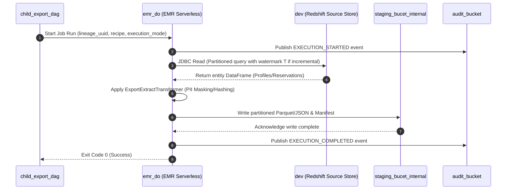

### 14.5 Schema Definitions (DB Tables / API JSON / Telemetry CloudEvents)
*(Refer to Section 15 for Recipe JSON Schema)*

### 14.6 Local Design Assumptions
* **Assumption 1**: EMR Serverless application `emr_do` is configured with `max_capacity_units=200`, automatically scaling worker vCPU and memory based on partition concurrency.
* **Assumption 2**: Database credentials are retrieved securely at runtime from SSM Parameter Store via database clients and passed as encrypted Spark configuration properties.
* **Assumption 3**: Watermark timestamps (`T`) are queried from tracking tables in `cofig_db`, filtering records strictly greater than `T` for incremental synchronization.

## 15. JSON Recipe Schema (`recipe_schema.json`)
```json
{
  "$schema": "http://json-schema.org/draft-07/schema#",
  "title": "ExportExtractRecipe",
  "type": "object",
  "properties": {
    "recipe_name": { "type": "string" },
    "entity_type": { "type": "string", "enum": ["Unified Identity Profile", "Pii Restricted Profile", "Contact Method Subscription", "Enriched Campaigns", "Enriched Campaign Reactions", "Room stay", "Restaurant reservation", "Tee time", "Spa treatment"] },
    "source_table": { "type": "string" },
    "incremental_column": { "type": "string" },
    "pii_rules": {
      "type": "array",
      "items": {
        "type": "object",
        "properties": {
          "field_name": { "type": "string" },
          "action": { "type": "string", "enum": ["REDACT", "HASH_SHA256", "MASK"] },
          "mask_char": { "type": "string" }
        },
        "required": ["field_name", "action"]
      }
    },
    "filters": {
      "type": "array",
      "items": { "type": "string" }
    },
    "output_partition_cols": {
      "type": "array",
      "items": { "type": "string" }
    }
  },
  "required": ["recipe_name", "entity_type", "source_table"]
}
```

## 16. Telemetry CloudEvent Schema (`audit_event.json`)
```json
{
  "$schema": "http://json-schema.org/draft-07/schema#",
  "title": "BusinessAuditEventSchema",
  "type": "object",
  "properties": {
    "actor_id": { "type": "string", "example": "system:emr_do" },
    "timestamp_utc": { 
      "type": "string", 
      "pattern": "^\\d{4}-\\d{2}-\\d{2}T\\d{2}:\\d{2}:\\d{2}\\.\\d{3}Z$",
      "example": "2025-01-31T02:15:00.000Z"
    },
    "event_type": { 
      "type": "string", 
      "enum": [
        "ADMIN_CREATE", 
        "ADMIN_UPDATE", 
        "ADMIN_DELETE", 
        "ADMIN_MANUAL_TRIGGER", 
        "EXECUTION_STARTED", 
        "EXECUTION_COMPLETED", 
        "EXECUTION_FAILED",
        "TRANSFER_STARTED", 
        "TRANSFER_COMPLETED", 
        "TRANSFER_FAILED"
      ] 
    },
    "execution_id": { "type": "string", "format": "uuid" },
    "payload": { "type": "object" }
  },
  "required": ["actor_id", "timestamp_utc", "event_type", "execution_id"]
}
```

### 16.1 Local Design Assumptions

* **Q: How does EMR Serverless dynamically allocate capacity for mixed entity workloads?**
  * *Assumption*: EMR Serverless application `emr_do` is configured with `max_capacity_units=200`, automatically scaling worker vCPU and memory based on partition concurrency without static over-allocation.
* **Q: How are database credentials and JDBC connection parameters securely injected into the EMR job?**
  * *Assumption*: Credentials are retrieved securely at runtime from SSM Parameter Store (SecureString) via `common.clients.db` and passed as encrypted Spark configuration properties.
* **Q: How is incremental extraction state tracked across job runs?**
  * *Assumption*: Watermark timestamps (`T`) are queried from metadata tracking tables in RDS Postgres (`export_config_store_rds`), filtering records strictly greater than `T` per AC#5.
## 17. Component Design: egress dag

### 17.1 Component Contract (Bi-Directional Inputs & Outputs)

* **Inputs:**
  * **Trigger Event:** Invoked downstream of **egress-lambda** or via S3 event notifications from **staging_bucet_internal**, carrying the lineage UUID (`execution_id`), dataset metadata, and source S3 object keys.
  * **Configuration:** Export configuration parameters loaded from the Export Config Store via SSM/RDS, including GZIP compression flags, PGP encryption key identifiers, splitting thresholds, and target destination endpoint specifications.
  * **Payload Data:** Raw or partitioned JSON/TXT staged export files residing in **staging_bucet_internal**.
* **Outputs:**
  * **Delivered Files:** Processed, GZIP-compressed, and PGP-encrypted (or raw) export packages along with JSON manifest control files delivered to:
    * **customer SFTP server** via SSH.
    * **customer bucket** via TLS 1.3.
    * **Customer Azure Blob Destination** via HTTPS.
    * **Customer GCS Destination** via HTTPS.
    * **audit_bucket** via TLS 1.3.
  * **Telemetry & Audit:** CloudEvents-compliant audit records (`TRANSFER_STARTED`, `TRANSFER_COMPLETED`, `TRANSFER_FAILED`, `EXECUTION_COMPLETED`) emitted to **audit_bucket**.

### 17.2 Class and Interface Definitions

```python
from dataclasses import dataclass, field
from typing import Dict, List, Optional
from enum import Enum

class TransferDestinationType(str, Enum):
    SFTP = "sftp"
    S3 = "s3"
    AZURE_BLOB = "azure_blob"
    GCS = "gcs"

@dataclass
class ExportPackageConfig:
    execution_id: str
    source_bucket: str
    source_keys: List[str]
    destination_type: TransferDestinationType
    destination_uri: str
    compress_gzip: bool = True
    encrypt_pgp: bool = True
    pgp_key_id: Optional[str] = None
    split_threshold_records: int = 500000

@dataclass
class TransferResult:
    execution_id: str
    destination: str
    file_names: List[str]
    checksums: Dict[str, str]
    status: str
    error_message: Optional[str] = None
```

### 17.3 Implementation Code Skeleton (Stubs & Handlers)

*Illustrative skeleton — the Component Contract and Schema Definitions are binding.*

**Blueprint module:** `src/dataoutbound/dags/transform_encrypt_dag.py` (the Transform & Encrypt DAG, canvas name "egress dag").

```python
from datetime import datetime, timezone
from airflow import DAG
from airflow.operators.python import PythonOperator
from dataoutbound.common.clients.aws.s3.s3_client import S3Client
from dataoutbound.common.clients.azure.blob_client import BlobClient
from dataoutbound.common.clients.gcp.gcs_client import GcsClient
from dataoutbound.common.clients.sftp.sftp_client import SftpClient
from dataoutbound.common.logging.logger import get_logger
from dataoutbound.common.telemetry.auditor import AuditPublisher
from dataoutbound.util.exceptions import ClientError

logger = get_logger("dataoutbound.dags.transform_encrypt_dag")
audit_publisher = AuditPublisher()

def _utc_now_ms() -> str:
    return datetime.now(timezone.utc).strftime("%Y-%m-%dT%H:%M:%S.%f")[:-3] + "Z"

def process_and_transfer_export(**context):
    conf = context.get("dag_run").conf or {}
    execution_id = conf.get("lineage_uuid")
    destination_type = conf.get("destination_type")
    source_key = conf.get("source_key")

    logger.info("Starting transform & encrypt task",
                extra={"execution_id": execution_id, "destination": destination_type})

    audit_publisher.publish("TRANSFER_STARTED", {
        "actor_id": "system:transform_encrypt_dag",
        "timestamp_utc": _utc_now_ms(),
        "event_type": "TRANSFER_STARTED",
        "execution_id": execution_id,
        "destination": destination_type,
    })

    try:
        s3_client = S3Client()
        temp_file_path = f"/tmp/{execution_id}_export.data"
        s3_client.download_file(conf.get("source_bucket"), source_key, temp_file_path)

        # Fail-closed: never hand unencrypted bytes to a destination when PGP is enabled.
        if conf.get("encrypt_pgp", True) and not conf.get("pgp_key_id"):
            raise ClientError("PGP encryption enabled but PGP key ID is missing. Aborting transfer.")

        if destination_type == "sftp":
            SftpClient().upload(temp_file_path, conf.get("destination_path"))
        elif destination_type == "s3":
            s3_client.upload_file(temp_file_path, conf.get("dest_bucket"), conf.get("dest_key"))
        elif destination_type == "azure_blob":
            BlobClient().upload_blob(conf.get("container"), conf.get("blob_name"), temp_file_path)
        elif destination_type == "gcs":
            GcsClient().upload_file(conf.get("bucket"), conf.get("blob_name"), temp_file_path)

        audit_publisher.publish("TRANSFER_COMPLETED", {
            "actor_id": "system:transform_encrypt_dag",
            "timestamp_utc": _utc_now_ms(),
            "event_type": "TRANSFER_COMPLETED",
            "execution_id": execution_id,
            "destination": destination_type,
        })
    except Exception as e:
        logger.error("Egress transfer failed", extra={"error": str(e), "execution_id": execution_id})
        audit_publisher.publish("TRANSFER_FAILED", {
            "actor_id": "system:transform_encrypt_dag",
            "timestamp_utc": _utc_now_ms(),
            "event_type": "TRANSFER_FAILED",
            "execution_id": execution_id,
            "destination": destination_type,
            "error": str(e),
        })
        raise

default_args = {
    "owner": "data-platform",
    "retries": 3,
    "retry_delay": 300,
}

dag = DAG(
    dag_id="transform_encrypt_dag",
    default_args=default_args,
    schedule="@daily",
    catchup=False,
    max_active_runs=1,
)

transfer_task = PythonOperator(
    task_id="execute_egress_transfer",
    python_callable=process_and_transfer_export,
    dag=dag,
)
```

### 17.4 Cross-Component Interaction Sequence (Local Mermaid/ASCII Flow)

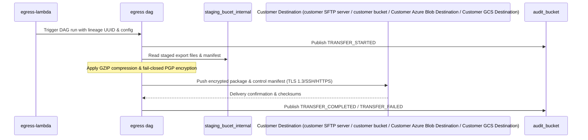

### 17.5 Schema Definitions (DB Tables / API JSON / Telemetry CloudEvents)

* **Audit CloudEvent Schema (`TRANSFER_COMPLETED` / `TRANSFER_FAILED`)**:
```json
{
  "$schema": "http://json-schema.org/draft-07/schema#",
  "title": "EgressTransferEvent",
  "type": "object",
  "properties": {
    "actor_id": { "type": "string", "example": "system:egress_dag" },
    "timestamp_utc": { "type": "string", "example": "2025-01-31T02:15:00.000Z" },
    "event_type": { "enum": ["TRANSFER_STARTED", "TRANSFER_COMPLETED", "TRANSFER_FAILED"] },
    "execution_id": { "type": "string", "format": "uuid" },
    "payload": {
      "type": "object",
      "properties": {
        "destination": { "type": "string", "example": "customer SFTP server" },
        "error": { "type": "string" }
      }
    }
  },
  "required": ["actor_id", "timestamp_utc", "event_type", "execution_id"]
}
```

### 17.6 Local Design Assumptions

1. **MWAA Worker Resources:** Airflow workers execute lightweight orchestration logic and delegate data transfer tasks utilizing underlying client SDKs configured with a 15-minute task timeout.
2. **PGP Key Management:** PGP public keys for encryption are securely fetched at runtime from SSM Parameter Store using the configured `pgp_key_id`.
3. **Retry & Fail-Closed Semantics:** Network failures to external destinations trigger up to 3 retries with exponential backoff; unencrypted payloads are never transmitted if PGP encryption fails.

## 18. Global Design Assumptions and Constraints

1. **Log Retention**: All pipeline log groups and the Audit & Execution Log Store (`audit_execution_log_store_s3`) enforce a strict retention period of 365 days (meeting organisation logging standards). Zero groups have retention unset or never-expire.
2. **Disaster Recovery (RTO/RPO)**: The Export Config Store (RDS Postgres Multi-AZ) maintains an RTO of $\le 2$ hours and an RPO of $\le 24$ hours.
3. **Infrastructure Allowlist**: All provisioned resources strictly conform to the approved AWS stack (MWAA, RDS Postgres, Lambda, EMR Serverless, S3, ECS). Stateful resource deletion protection is dynamically governed by per-environment configuration variables.
4. **Fail-Closed Encryption**: PGP encryption errors during export transformation immediately abort delivery, trigger high-priority alerts, and log a `TRANSFER_FAILED` audit event without transmitting unencrypted data.
5. **Staging Cleanup**: Customer staging objects are automatically purged after exactly 7 days via S3 lifecycle expiration rules.

---


## 19. Traceability

| Section | Story | AC# |
| --- | --- | --- |
| 7. Component Design: cofig_db | SCRUM-479 | AC#1, AC#2, AC#3, AC#4, AC#5, AC#6, AC#7 |
| 8. Component Design: audit_bucket | SCRUM-479 | AC#1, AC#2, AC#3, AC#4, AC#5, AC#6, AC#7 |
| 4. Component Design: scheduler | SCRUM-480 | AC#1, AC#2, AC#3, AC#4, AC#5, AC#6, AC#7 |
| 3. Component Design: orchestrator | SCRUM-480 | AC#1, AC#2, AC#3, AC#4, AC#5, AC#6, AC#7 |
| 6. Component Design: child_export_dag | SCRUM-480 | AC#1, AC#2, AC#3, AC#4, AC#5, AC#6, AC#7 |
| 7. Component Design: cofig_db | SCRUM-480 | AC#1, AC#2, AC#3, AC#4, AC#5, AC#6, AC#7 |
| 8. Component Design: audit_bucket | SCRUM-480 | AC#1, AC#2, AC#3, AC#4, AC#5, AC#6, AC#7 |
| 4. Component Design: scheduler | SCRUM-481 | AC#1, AC#2, AC#3, AC#4, AC#5, AC#6, AC#7 |
| 3. Component Design: orchestrator | SCRUM-481 | AC#1, AC#2, AC#3, AC#4, AC#5, AC#6, AC#7 |
| 6. Component Design: child_export_dag | SCRUM-481 | AC#1, AC#2, AC#3, AC#4, AC#5, AC#6, AC#7 |
| 14. Component Design: emr_do | SCRUM-481 | AC#1, AC#2, AC#3, AC#4, AC#5, AC#6, AC#7 |
| 7. Component Design: cofig_db | SCRUM-481 | AC#1, AC#2, AC#3, AC#4, AC#5, AC#6, AC#7 |
| 9. Component Design: staging_bucet_internal | SCRUM-481 | AC#1, AC#2, AC#3, AC#4, AC#5, AC#6, AC#7 |
| 8. Component Design: audit_bucket | SCRUM-481 | AC#1, AC#2, AC#3, AC#4, AC#5, AC#6, AC#7 |
| 9. Component Design: staging_bucet_internal | SCRUM-482 | AC#1, AC#2, AC#3, AC#4, AC#5, AC#6, AC#7 |
| 5. Component Design: egress-lambda | SCRUM-482 | AC#1, AC#2, AC#3, AC#4, AC#5, AC#6, AC#7 |
| 17. Component Design: egress dag | SCRUM-482 | AC#1, AC#2, AC#3, AC#4, AC#5, AC#6, AC#7 |
| 12. Component Design: Customer Azure Blob Destination | SCRUM-482 | AC#1, AC#2, AC#3, AC#4, AC#5, AC#6, AC#7 |
| 13. Component Design: Customer GCS Destination | SCRUM-482 | AC#1, AC#2, AC#3, AC#4, AC#5, AC#6, AC#7 |
| 8. Component Design: audit_bucket | SCRUM-482 | AC#1, AC#2, AC#3, AC#4, AC#5, AC#6, AC#7 |
| 7. Component Design: cofig_db | SCRUM-483 | AC#1, AC#2, AC#3, AC#4 |
| 9. Component Design: staging_bucet_internal | SCRUM-483 | AC#1, AC#2, AC#3, AC#4 |
| 5. Component Design: egress-lambda | SCRUM-483 | AC#1, AC#2, AC#3, AC#4 |
| 17. Component Design: egress dag | SCRUM-483 | AC#1, AC#2, AC#3, AC#4 |
| 8. Component Design: audit_bucket | SCRUM-483 | AC#1, AC#2, AC#3, AC#4 |
| 9. Component Design: staging_bucet_internal | SCRUM-484 | AC#1, AC#2, AC#3, AC#4, AC#5, AC#6 |
| 5. Component Design: egress-lambda | SCRUM-484 | AC#1, AC#2, AC#3, AC#4, AC#5, AC#6 |
| 17. Component Design: egress dag | SCRUM-484 | AC#1, AC#2, AC#3, AC#4, AC#5, AC#6 |
| 12. Component Design: Customer Azure Blob Destination | SCRUM-484 | AC#1, AC#2, AC#3, AC#4, AC#5, AC#6 |
| 13. Component Design: Customer GCS Destination | SCRUM-484 | AC#1, AC#2, AC#3, AC#4, AC#5, AC#6 |
| 8. Component Design: audit_bucket | SCRUM-484 | AC#1, AC#2, AC#3, AC#4, AC#5, AC#6 |
| 4. Component Design: scheduler | SCRUM-485 | AC#1, AC#2, AC#3, AC#4, AC#5 |
| 3. Component Design: orchestrator | SCRUM-485 | AC#1, AC#2, AC#3, AC#4, AC#5 |
| 6. Component Design: child_export_dag | SCRUM-485 | AC#1, AC#2, AC#3, AC#4, AC#5 |
| 14. Component Design: emr_do | SCRUM-485 | AC#1, AC#2, AC#3, AC#4, AC#5 |
| 7. Component Design: cofig_db | SCRUM-485 | AC#1, AC#2, AC#3, AC#4, AC#5 |
| 9. Component Design: staging_bucet_internal | SCRUM-485 | AC#1, AC#2, AC#3, AC#4, AC#5 |
| 5. Component Design: egress-lambda | SCRUM-485 | AC#1, AC#2, AC#3, AC#4, AC#5 |
| 17. Component Design: egress dag | SCRUM-485 | AC#1, AC#2, AC#3, AC#4, AC#5 |
| 8. Component Design: audit_bucket | SCRUM-485 | AC#1, AC#2, AC#3, AC#4, AC#5 |
| 4. Component Design: scheduler | SCRUM-486 | AC#1, AC#2, AC#3, AC#4, AC#5 |
| 3. Component Design: orchestrator | SCRUM-486 | AC#1, AC#2, AC#3, AC#4, AC#5 |
| 6. Component Design: child_export_dag | SCRUM-486 | AC#1, AC#2, AC#3, AC#4, AC#5 |
| 14. Component Design: emr_do | SCRUM-486 | AC#1, AC#2, AC#3, AC#4, AC#5 |
| 9. Component Design: staging_bucet_internal | SCRUM-486 | AC#1, AC#2, AC#3, AC#4, AC#5 |
| 5. Component Design: egress-lambda | SCRUM-486 | AC#1, AC#2, AC#3, AC#4, AC#5 |
| 17. Component Design: egress dag | SCRUM-486 | AC#1, AC#2, AC#3, AC#4, AC#5 |
| 12. Component Design: Customer Azure Blob Destination | SCRUM-486 | AC#1, AC#2, AC#3, AC#4, AC#5 |
| 13. Component Design: Customer GCS Destination | SCRUM-486 | AC#1, AC#2, AC#3, AC#4, AC#5 |
| 8. Component Design: audit_bucket | SCRUM-486 | AC#1, AC#2, AC#3, AC#4, AC#5 |

## 20. Closing & Disclaimer
*Disclaimer: This document is a High-Level Design specification generated for internal engineering review and architecture governance. Implementation teams must adhere strictly to the designated project blueprint coordinates, security controls, and schema definitions.*

## Document Structure Summary

- Headings: 20
- Sub-headings: 79
- Sub-sub-headings: 0
