# DataOutbound Product -Section Tree — High-Level Design
* **Version:** 1.0
* **Generation Date:** 2026-10-31
* **Generated By:** Laminar

---

## Table of Contents
- **1.** HLD Executive Summary & Scope
    - **1.1** Purpose of This Document
    - **1.2** Scope — Components Designed in This HLD
    - **1.3** Out of Scope — External / Third-Party Boundary Components
    - **1.4** End-to-End Flow in One Pass
    - **1.5** Design Principles Applied Throughout
    - **1.6** Code Parity with the Project Blueprint
    - **1.7** How to Read This Document
- **2.** System-wide Design Principles
    - **2.1** Contract-First and Schema-Driven Design
    - **2.2** OOP Design Parity and Shared Foundation
    - **2.3** Fail-Closed Security & Least-Privilege IAM
    - **2.4** Idempotency and Deterministic Lineage Propagation
    - **2.5** Standardized Error Handling and Retry Policies
- **3.** Component Design: do-admin-api
  - **3.1.** Component Contract (Bi-Directional Inputs & Outputs)
    - **3.1.1** Diagram settings (user decisions — authoritative)
    - **3.1.2** Role and bounded context
    - **3.1.3** Inbound contract (what the API consumes)
    - **3.1.4** Outbound contract (what the API produces)
    - **3.1.5** Frozen edge contracts (binding)
    - **3.1.6** Configuration the design actually sets
  - **3.2.** Class and Interface Definitions
  - **3.3.** Implementation Code Skeleton (Stubs & Handlers)
    - **3.3.1** Endpoint inventory (binding)
    - **3.3.2** Routes
    - **3.3.3** Application factory
    - **3.3.4** Service implementation (illustrative bodies)
  - **3.4.** Cross-Component Interaction Sequence (Local Mermaid/ASCII Flow)
    - **3.4.1** Flow A — Create / update / delete an export configuration
    - **3.4.2** Flow B — Manual trigger of an orchestrator run
    - **3.4.3** Flow C — Stop a running orchestrator run
    - **3.4.4** Flow D — Audit emission (cross-cutting)
  - **3.5.** Schema Definitions (DB Tables / API JSON / Telemetry CloudEvents)
    - **3.5.1** Canonical DDL — `export_configurations` (owned by `cofig_db`, declared once here)
    - **3.5.2** API request / response schemas (OpenAPI 3.0)
    - **3.5.3** Telemetry — CloudEvents-shaped audit record
    - **3.5.4** S3 object key layout for audit records
  - **3.6.** Local Design Assumptions
- **4.** Component Design: scheduler
  - **4.1.** Component Contract (Bi-Directional Inputs & Outputs)
    - **4.1.1** Outbound contract (scheduler → orchestrator)
    - **4.1.2** Inbound contract (configuration → scheduler)
    - **4.1.3** Configuration actually set (user decisions, authoritative)
  - **4.2.** Class and Interface Definitions
  - **4.3.** Implementation Code Skeleton (Stubs & Handlers)
  - **4.4.** Cross-Component Interaction Sequence (Local Mermaid/ASCII Flow)
  - **4.5.** Schema Definitions (DB Tables / API JSON / Telemetry CloudEvents)
    - **4.5.1** Database tables
    - **4.5.2** Scheduler event schema (CloudEvents 1.0 — the single envelope)
    - **4.5.3** Worked example
    - **4.5.4** EventBridge transport wrapper (for reference — not the contract)
    - **4.5.5** Telemetry record written to audit_bucket
  - **4.6.** Local Design Assumptions
- **5.** Component Design: orchestrator
  - **5.1.** Component Contract (Bi-Directional Inputs & Outputs)
    - **5.1.1** Inbound Contracts
    - **5.1.2** Outbound Contracts
    - **5.1.3** Configuration the Design Actually Sets
  - **5.2.** Class and Interface Definitions
  - **5.3.** Implementation Code Skeleton (Stubs & Handlers)
  - **5.4.** Cross-Component Interaction Sequence (Local Mermaid/ASCII Flow)
  - **5.5.** Schema Definitions (DB Tables / API JSON / Telemetry CloudEvents)
    - **5.5.1** Inbound — scheduler → orchestrator (CloudEvents 1.0)
    - **5.5.2** Inbound — do-admin-api → orchestrator (manual trigger)
    - **5.5.3** Outbound — orchestrator → child_export_dag (DagRun conf)
    - **5.5.4** Outbound — orchestrator → audit_bucket (CloudEvents-shaped audit record)
    - **5.5.5** Read — orchestrator → cofig_db
  - **5.6.** Local Design Assumptions
- **6.** Component Design: child_export_dag
  - **6.1.** Component Contract (Bi-Directional Inputs & Outputs)
    - **6.1.1** Inbound contracts
    - **6.1.2** Outbound contracts
  - **6.2.** Class and Interface Definitions
  - **6.3.** Implementation Code Skeleton (Stubs & Handlers)
  - **6.4.** Cross-Component Interaction Sequence (Local Mermaid/ASCII Flow)
  - **6.5.** Schema Definitions (DB Tables / API JSON / Telemetry CloudEvents)
    - **6.5.1** Run configuration (inbound, I-1)
    - **6.5.2** EMR Serverless submission (outbound, O-1)
    - **6.5.3** Audit CloudEvents (outbound, O-3)
    - **6.5.4** Database tables
  - **6.6.** Local Design Assumptions
- **7.** Component Design: emr_do
  - **7.1.** Component Contract (Bi-Directional Inputs & Outputs)
  - **7.2.** Class and Interface Definitions
  - **7.3.** Implementation Code Skeleton (Stubs & Handlers)
  - **7.4.** Cross-Component Interaction Sequence (Local Mermaid/ASCII Flow)
  - **7.5.** Schema Definitions (DB Tables / API JSON / Telemetry CloudEvents)
  - **7.6.** Local Design Assumptions
- **8.** Component Design: dev
  - **8.1.** Component Contract (Bi-Directional Inputs & Outputs)
  - **8.2.** Class and Interface Definitions
  - **8.3.** Implementation Code Skeleton (Stubs & Handlers)
  - **8.4.** Cross-Component Interaction Sequence (Local Mermaid/ASCII Flow)
  - **8.5.** Schema Definitions (DB Tables / API JSON / Telemetry CloudEvents)
  - **8.6.** Local Design Assumptions
- **9.** Component Design: cofig_db
  - **9.1.** Component Contract (Bi-Directional Inputs & Outputs)
    - **9.1.1** Inbound contracts (who writes to / reads from `cofig_db`)
    - **9.1.2** Outbound contracts (what `cofig_db` produces)
    - **9.1.3** Configuration the design actually sets
  - **9.2.** Class and Interface Definitions
  - **9.3.** Implementation Code Skeleton (Stubs & Handlers)
  - **9.4.** Cross-Component Interaction Sequence (Local Mermaid/ASCII Flow)
  - **9.5.** Schema Definitions (DB Tables / API JSON / Telemetry CloudEvents)
    - **9.5.1** Canonical DDL — owned by this design
    - **9.5.2** Telemetry — CloudEvents emitted by callers, not by the store
  - **9.6.** Local Design Assumptions
- **10.** Component Design: staging_bucet_internal
  - **10.1.** Component Contract (Bi-Directional Inputs & Outputs)
    - **10.1.1** Diagram settings (user decisions — authoritative)
    - **10.1.2** Role
    - **10.1.3** Inbound contract (what writes into this component)
    - **10.1.4** Outbound contract (what this component emits)
    - **10.1.5** Configuration actually set (with rationale)
    - **10.1.6** Failure behaviour
  - **10.2.** Class and Interface Definitions
  - **10.3.** Implementation Code Skeleton (Stubs & Handlers)
  - **10.4.** Cross-Component Interaction Sequence (Local Mermaid/ASCII Flow)
  - **10.5.** Schema Definitions (DB Tables / API JSON / Telemetry CloudEvents)
    - **10.5.1** S3 object key layout (the bucket's only structural contract)
    - **10.5.2** S3 `ObjectCreated` notification payload (bucket → `egress-lambda`)
    - **10.5.3** Telemetry CloudEvents emitted by writers/readers of this bucket
    - **10.5.4** No DDL
  - **10.6.** Local Design Assumptions
- **11.** Component Design: egress-lambda
  - **11.1.** Component Contract (Bi-Directional Inputs & Outputs)
  - **11.2.** Class and Interface Definitions
  - **11.3.** Implementation Code Skeleton (Stubs & Handlers)
  - **11.4.** Cross-Component Interaction Sequence (Local Mermaid/ASCII Flow)
  - **11.5.** Schema Definitions (DB Tables / API JSON / Telemetry CloudEvents)
    - **11.5.1** Lambda Trigger Request Schema (`egress dag` MWAA Trigger Payload)
    - **11.5.2** Telemetry Event Schema (`EXECUTION_STARTED` CloudEvent)
  - **11.6.** Local Design Assumptions
- **12.** Component Design: egress dag
  - **12.1.** Component Contract (Bi-Directional Inputs & Outputs)
  - **12.2.** Class and Interface Definitions
  - **12.3.** Implementation Code Skeleton (Stubs & Handlers)
  - **12.4.** Cross-Component Interaction Sequence (Local Mermaid/ASCII Flow)
  - **12.5.** Schema Definitions (DB Tables / API JSON / Telemetry CloudEvents)
  - **12.6.** Local Design Assumptions
- **13.** Component Design: Customer Azure Blob Destination
  - **13.1.** Component Contract (Bi-Directional Inputs & Outputs)
  - **13.2.** Class and Interface Definitions
  - **13.3.** Implementation Code Skeleton (Stubs & Handlers)
  - **13.4.** Cross-Component Interaction Sequence (Local Mermaid/ASCII Flow)
  - **13.5.** Schema Definitions (DB Tables / API JSON / Telemetry CloudEvents)
  - **13.6.** Local Design Assumptions
- **14.** Component Design: Customer GCS Destination
  - **14.1.** Component Contract (Bi-Directional Inputs & Outputs)
    - **14.1.1** Interface & Transport Protocol
    - **14.1.2** Request & Response Payload Specification
    - **14.1.3** Idempotency & Telemetry
  - **14.2.** Class and Interface Definitions
  - **14.3.** Implementation Code Skeleton (Stubs & Handlers)
  - **14.4.** Cross-Component Interaction Sequence (Local Mermaid/ASCII Flow)
    - **14.4.1** Sequence Interaction Description
  - **14.5.** Schema Definitions (DB Tables / API JSON / Telemetry CloudEvents)
    - **14.5.1** CloudEvents Telemetry Payload (`com.laminar.dataoutbound.transfer.gcs`)
  - **14.6.** Local Design Assumptions
- **15.** Component Design: audit_bucket
  - **15.1.** Component Contract (Bi-Directional Inputs & Outputs)
    - **15.1.1** Inbound contract (writers → audit_bucket)
    - **15.1.2** Outbound contract (audit_bucket → consumers)
    - **15.1.3** Configuration actually set (user decisions, authoritative)
  - **15.2.** Class and Interface Definitions
  - **15.3.** Implementation Code Skeleton (Stubs & Handlers)
  - **15.4.** Cross-Component Interaction Sequence (Local Mermaid/ASCII Flow)
  - **15.5.** Schema Definitions (DB Tables / API JSON / Telemetry CloudEvents)
    - **15.5.1** Database tables
    - **15.5.2** Audit record schema (CloudEvents 1.0 envelope — the single contract for all writers)
    - **15.5.3** Worked examples — one per writer family
    - **15.5.4** Expected event count per run (verification contract)
  - **15.6.** Local Design Assumptions
- **16.** Component Design: customer SFTP server
  - **16.1.** Component Contract (Bi-Directional Inputs & Outputs)
    - **16.1.1** Interface & Transport Protocol
    - **16.1.2** Request & Response Payload Specification
    - **16.1.3** Idempotency & Telemetry
  - **16.2.** Local Design Assumptions
- **17.** Component Design: customer bucket
  - **17.1.** Component Contract (Bi-Directional Inputs & Outputs)
  - **17.2.** Local Design Assumptions
- **18.** Global Design Assumptions and Constraints
    - **18.1** A1. Approved AWS Stack Conformance
    - **18.2** A2. Environment-Driven Deletion Protection
    - **18.3** A3. Organisation Logging-Standard Retention Value
    - **18.4** A4. Audit Schema and Event Counting Contract
    - **18.5** A5. Fail-Closed Encryption Posture
    - **18.6** A6. Delivery-Only Semantics and Integrity Standard
    - **18.7** A7. Staging Lifecycle and Temporary Data Hygiene
    - **18.8** A8. Lineage UUID as the Sole Correlation Identifier
    - **18.9** A9. Credential Protection at Rest
    - **18.10** A10. Scheduling Tolerance and Cadence Semantics
- **19.** Amendment Log
- **20.** Closing & Disclaimer

---

## 1. HLD Executive Summary & Scope
<a id="laminar-sec-g.exec"></a>
### 1.1 Purpose of This Document

This High-Level Design (HLD) is the contract-first, implementable design for the **DataOutbound Product** — a scheduled batch outbound data-sync capability that extracts hospitality Golden Entity datasets from the Golden Entity Source Store, stages and transforms them into customer-ready export packages, and delivers them to heterogeneous customer destinations with end-to-end integrity verification, fail-closed encryption and complete auditability.

It is the design-level companion to the architecture document: the architecture document states *what* the system is and *why*; this HLD states *how each component is built and how each component talks to the next* — typed interfaces, payload schemas, retry/idempotency/failure behaviour, and the DDL for the tables the design itself owns. Every decision recorded on the architecture canvas (component properties, connections, protocols, event formats, schedules, encryption and lifecycle settings) is treated as **authoritative and binding**; where the inputs were silent, a mainstream production-grade default is adopted and stated once as an assumption.

### 1.2 Scope — Components Designed in This HLD

The design covers exactly the components placed on the architecture diagram, one chapter per component, each following the fixed layout `Component Contract → Class and Interface Definitions → Implementation Code Skeleton → Cross-Component Interaction Sequence → Schema Definitions → Local Design Assumptions`:

| Layer | Component | Role in the pipeline |
|---|---|---|
| Control plane | **do-admin-api** | REST/JWT administrative entrypoint: CRUD of export configurations, manual trigger and stop, audit emission |
| Control plane | **scheduler** | EventBridge scheduled rule raising cadence events to the orchestrator |
| Control plane | **orchestrator** | MWAA DAG: selects connections within ±10 minutes, generates the lineage UUID, fans out child runs |
| Control plane | **cofig_db** | RDS Postgres configuration store: export configurations, watermarks, execution state |
| Processing | **child_export_dag** | MWAA DAG: per-connection orchestration, submits the Spark job, carries the lineage UUID |
| Processing | **emr_do** | EMR Serverless Spark job: extracts Golden Entities and writes staged files |
| Processing | **dev** | Redshift Golden Entity Source Store (read-only source of truth) |
| Storage & egress | **staging_bucet_internal** | Transient staging buffer; S3 `ObjectCreated` notification triggers the egress path |
| Storage & egress | **egress-lambda** | S3-event consumer that triggers exactly one Transform & Encrypt DAG run per staged file |
| Storage & egress | **egress dag** | MWAA DAG: split, optional GZIP, fail-closed PGP, manifest generation, multi-destination delivery |
| Storage & egress | **audit_bucket** | Immutable audit and execution log store with lifecycle tiering |
| External sinks | **Customer Azure Blob Destination** | Customer-owned Azure Blob container receiving delivered packages |
| External sinks | **Customer GCS Destination** | Customer-owned GCS bucket receiving delivered packages |

### 1.3 Out of Scope — External / Third-Party Boundary Components

Two components are marked **External / Third-Party Component** on the canvas and are **customer-owned**. They are never designed, coded or provisioned here; this HLD specifies only our side of the integration contract with them (protocol, credentials, network path, failure handling):

- **customer SFTP server** — reached by **egress dag** over SSH on port 22 with key-based authentication and strict host-key verification; a host-key mismatch refuses the connection, sends zero bytes, is not retried, raises an alert and writes a failure entry to **audit_bucket**.
- **customer bucket** — reached by **egress dag** over TLS 1.3 S3 `PutObject` with deterministic object naming; delivery is verified by an application-level SHA-256 recomputed from read-back and compared to the manifest.

Also outside this design's ownership: the Golden Entity Source Store (**dev**) is an existing, externally owned source consumed read-only, and no pipeline-owned resource may run outside the approved AWS stack (MWAA, RDS Postgres, Lambda, EMR Serverless, S3, ECS).

### 1.4 End-to-End Flow in One Pass

1. An administrator creates or updates an export configuration through **do-admin-api**; credentials are persisted encrypted in **cofig_db** and an `ADMIN_*` audit event is written to **audit_bucket**.
2. **scheduler** raises a cadence event; **orchestrator** reads active connections from **cofig_db**, selects those whose cron falls within ±10 minutes, generates exactly one RFC 4122 v4 lineage UUID, and invokes one **child_export_dag** run per connection carrying that UUID and the connection JSON.
3. **child_export_dag** submits **emr_do**, which reads Golden Entities from **dev** in full or incremental (strictly-greater-than watermark) mode and writes partitioned staged files to **staging_bucet_internal**.
4. The S3 `ObjectCreated` notification invokes **egress-lambda**, which triggers exactly one **egress dag** run for that lineage UUID.
5. **egress dag** reads the staged files, applies the connection's split threshold, optional GZIP **before** optional PGP, produces `manifest_<lineage_uuid>.json`, and delivers the package plus manifest to the configured destination — **customer bucket**, **Customer Azure Blob Destination**, **Customer GCS Destination**, **customer SFTP server**, or Acme inspection staging — verifying SHA-256 on read-back, retrying transient failures up to 3 times, and recording `TRANSFER_STARTED` / `TRANSFER_COMPLETED` / `TRANSFER_FAILED` events in **audit_bucket**.
6. Every administrative, execution and transfer event conforms to the single audit schema (`actor_id`, `timestamp_utc` ISO-8601 millisecond UTC with `Z`, `event_type` from the enumerated set, `execution_id` = lineage UUID), with a deterministic expected event count per run of *admin operations + 2 per connection execution + 2 per transfer*.

### 1.5 Design Principles Applied Throughout

- **Orchestration–compute separation** — MWAA DAGs (**orchestrator**, **child_export_dag**, **egress dag**) orchestrate only; heavy work runs in **emr_do** or **egress-lambda**. DAG top-level code stays instantaneous.
- **Configuration-as-data** — target type, dataset, mode, cadence, split thresholds, GZIP/PGP flags and credentials live in **cofig_db**, never in code.
- **One lineage UUID, one truth** — a single UUID per orchestrator run threads through run confs, file names, the manifest and every audit record; re-runs generate a new UUID.
- **Fail-closed security** — a missing, corrupt or failing PGP key aborts the transfer, writes an audit error within 5 seconds, raises an alert and passes **zero bytes** to any destination.
- **Verified, delivery-only semantics** — uniform application-level SHA-256 read-back verification across all destinations; no downstream reconciliation is in scope.
- **Least privilege and private networking** — dedicated IAM role per component scoped to exact resource ARNs; stateful resources read deletion protection from per-environment configuration, never hardcoded.

### 1.6 Code Parity with the Project Blueprint

Every Implementation Code Skeleton in this HLD cites real module paths from the project blueprint and imports shared concerns from the foundation rather than re-declaring them — for example `dataoutbound_section_tree.apis.export_admin_api.export_admin_routes`, `dataoutbound_section_tree.dags.export_orchestrator_dag`, `dataoutbound_section_tree.dags.child_export_dag`, `dataoutbound_section_tree.dags.transform_encrypt_dag`, `dataoutbound_section_tree.lambdas.egress_lambda`, `dataoutbound_section_tree.spark_emr.export_extract_spark_job.main`, and the shared `common.clients.*`, `common.telemetry.auditor`, `common.logging.logger`, `config.config_loader` and `util.*` modules. For **do-admin-api** (module type `api`) the skeleton is the binding implementation baseline — every endpoint, status code, auth dependency, audit event and error mapping is fixed there and must not be dropped or renamed by generated code. For all other module types the skeleton is illustrative and the Component Contract and Schema Definitions are binding.

### 1.7 How to Read This Document

Each component chapter is self-contained and machine-readable: the **Component Contract** fixes bi-directional inputs and outputs (trigger, request, response, errors, idempotency, telemetry event); **Class and Interface Definitions** give the typed Python surface; the **Implementation Code Skeleton** shows the component's own logic with imports and error handling; the **Cross-Component Interaction Sequence** shows the local flow; **Schema Definitions** give the JSON payloads and any DDL the design owns; and **Local Design Assumptions** resolve the open questions for that component exactly once. System-wide assumptions and constraints are collected in the global assumptions chapter.

## 2. System-wide Design Principles
<a id="laminar-sec-g.principles"></a>
### 2.1 Contract-First and Schema-Driven Design
Every cross-component interaction is governed by strict, versioned contracts defined prior to implementation. APIs enforce OpenAPI 3.0 boundaries, event payloads conform to CloudEvents specifications, and database interactions use parameterized queries via canonical client libraries.

### 2.2 OOP Design Parity and Shared Foundation
All cross-cutting concerns—including logging, telemetry publishing, database sessions, configuration loading, and protocol clients—are centralized in the blueprint foundation (`src/dataoutbound_section_tree/common/`). Components never re-implement SDK connections, retry logic, or cryptographic wrappers; instead, they import and inherit from standard foundation classes:
- **Logging**: Structured JSON logging via `common.logging.logger.get_logger(name)` ensuring PII and secrets are never emitted.
- **Configuration**: Unified environment merging via `config.config_loader.ConfigLoader` combining base YAML configurations with environment-specific overlays.
- **Telemetry**: Uniform audit event emission via `common.telemetry.auditor.AuditPublisher` writing CloudEvents-shaped payloads to `audit_bucket`.

### 2.3 Fail-Closed Security & Least-Privilege IAM
Security is enforced at every boundary:
- **Encryption**: Credential fields in `cofig_db` and parameters retrieved via SSM are stored encrypted at rest. Outbound PGP encryption is strictly fail-closed: any key retrieval or encryption failure immediately aborts the transfer, transmits zero unencrypted bytes, raises an operational alert, and records a `TRANSFER_FAILED` audit entry within 5 seconds.
- **IAM**: Execution roles adhere strictly to least privilege, restricting read/write permissions to exact resource ARNs.

### 2.4 Idempotency and Deterministic Lineage Propagation
Every execution run is stamped with a single RFC 4122 v4 lineage UUID at the orchestration boundary (`orchestrator`). This identifier propagates immutably through child orchestrations, Spark extractions, staging files, manifests, and audit logs. Tasks and event handlers are designed to be fully idempotent, ensuring that retries or re-runs produce identical, non-duplicated states.

### 2.5 Standardized Error Handling and Retry Policies
Transient failures across network boundaries (REST calls, database queries, S3 operations, and file transfers) utilize bounded exponential backoff retries (maximum 3 attempts). Unrecoverable errors trigger fail-fast behavior, structured error envelopes, DLQ routing where applicable, and immediate publication of audit failure records.

## 3. Component Design: do-admin-api
<a id="laminar-sec-c.imp_standard_standard_api_1"></a>

<!-- laminar:diagram-settings:imp-standard-standard_api-1 -->
**Diagram settings (user decisions — authoritative)**

| Setting | Value |
| --- | --- |
| `protocol` | `REST` |
| `authentication` | `JWT` |
| `api_name` | `do-admin-api` |

<!-- /laminar:diagram-settings -->


### 3.1. Component Contract (Bi-Directional Inputs & Outputs)
<a id="laminar-sec-c.imp_standard_standard_api_1.contract"></a>
#### 3.1.1 Diagram settings (user decisions — authoritative)

| Setting | Value |
|---|---|
| `protocol` | `REST` |
| `authentication` | `JWT` |
| `api_name` | `do-admin-api` |

#### 3.1.2 Role and bounded context

`do-admin-api` is the single administrative entrypoint of the DataOutbound platform. It owns the lifecycle of export configurations (create / retrieve / update / delete), the manual trigger and stop of orchestrator runs, and the emission of `ADMIN_*` audit events. It is a **stateless** service: it owns no database tables of its own; the canonical `export_configurations` table lives in `cofig_db` and is declared once in §3.5.1 below and referenced (never re-declared) by the `cofig_db` chapter.

#### 3.1.3 Inbound contract (what the API consumes)

| Source | Protocol | Trigger | Payload | Response | Errors | Idempotency |
|---|---|---|---|---|---|---|
| Authorized administrator / scripted client | HTTPS + JWT bearer | HTTP request to a route below | `ExportConfigurationCreate` / `ExportConfigurationUpdate` JSON (see §3.5.2) | `201` / `200` / `204` with `ExportConfigurationResponse` | `400`, `401`, `403`, `404`, `409`, `500` (standard error envelope) | `POST` idempotent via `Idempotency-Key` header; `PUT` idempotent by `config_id`; `DELETE` idempotent by `config_id` |
| Enterprise identity provider | OIDC/JWKS over HTTPS | JWT presented on every protected route | Signed JWT | Verified claims (`sub`, `roles`) | `401` on invalid/expired token | n/a (stateless verification) |

#### 3.1.4 Outbound contract (what the API produces)

| Target | Protocol | Trigger | Payload | Response | Errors | Idempotency |
|---|---|---|---|---|---|---|
| `cofig_db` | JDBC (PostgreSQL) over TLS | Admin API request | Parameterised `INSERT` / `UPDATE` / `DELETE` on `export_configurations` | Row count / `RETURNING config_id` | `500` on DB error; client retried with backoff | Idempotent via unique `config_id` (upsert key) |
| `orchestrator` | HTTPS (Airflow REST API, SigV4/IAM) | Manual trigger / stop request | DAG run trigger payload `{conf: {config_id, execution_date, lineage_uuid?}}` | `200 OK` with `dag_run_id` | `502 Bad Gateway`; retried with exponential backoff | Idempotent via logical `execution_date` + `config_id` |
| `audit_bucket` | S3 API (boto3, TLS 1.3) | Every administrative action | CloudEvents-shaped audit record (see §3.5.3) | S3 `ETag` | Caught and logged locally; never fails the API response | Idempotent via unique audit filename (`<event_type>/<timestamp>_<uuid>.json`) |

#### 3.1.5 Frozen edge contracts (binding)

- **do-admin-api → cofig_db** — trigger: Admin API request; request: export configuration payload (JSON with `tenant_id`, `schedule`, `destination_type`, `credentials_ref`); response: `201 Created` with configuration ID; errors: `400`, `500`; idempotency: unique configuration ID / upsert key; telemetry: `com.laminar.dataoutbound.config.updated`.
- **do-admin-api → orchestrator** — trigger: manual API invocation; request: DAG run trigger payload with configuration ID and execution date; response: `200 OK` with DAG run ID; errors: `502`; idempotency: logical execution date + run ID; telemetry: `com.laminar.dataoutbound.orchestrator.triggered`.
- **do-admin-api → audit_bucket** — trigger: API administrative audit logging; request: audit log JSON record upload; response: S3 upload success `ETag`; errors: caught and logged locally without failing the API response; idempotency: unique audit log filename timestamp; telemetry: `com.laminar.dataoutbound.audit.admin`.

#### 3.1.6 Configuration the design actually sets

| Property | Value | Rationale |
|---|---|---|
| `protocol` | `REST` | User decision; stateless HTTP semantics for administrative CRUD. |
| `authentication` | `JWT` | User decision; cryptographically verified bearer tokens with `export-admin` role claim. |
| `api_name` | `do-admin-api` | User decision; service identifier used in logs, telemetry and the OpenAPI title. |
| Rate limiting | Sliding-window per client IP/tenant, thresholds from `apis/config.yml` | Prevents abuse of the administrative surface; thresholds are configuration, not code. |
| Response latency target | < 200 ms for CRUD | Administrative responsiveness; enforced by keeping the service stateless and pushing all heavy work to `orchestrator`. |

All other runtime properties (host, port, CORS, JWT issuer, JWKS URL, DB DSN, S3 bucket name) are read from `apis/config.yml` + `config/common_config.yaml` via `ConfigLoader`; no value is hardcoded.

---

### 3.2. Class and Interface Definitions
<a id="laminar-sec-c.imp_standard_standard_api_1.classes"></a>
All classes live under `src/dataoutbound_section_tree/apis/export_admin_api/`. Shared concerns are imported from the blueprint foundation — never re-declared.

```python
# src/dataoutbound_section_tree/apis/export_admin_api/export_admin_schemas.py
from __future__ import annotations

from datetime import datetime
from enum import Enum
from typing import Any, Literal, Optional
from uuid import UUID

from pydantic import BaseModel, Field, field_validator


class TargetType(str, Enum):
    S3 = "s3"
    AZURE_BLOB = "azure_blob"
    GCS = "gcs"
    SFTP = "sftp"


class Dataset(str, Enum):
    IDENTITY_PROFILES = "identity_profiles"
    SUBSCRIPTION_STATUSES = "subscription_statuses"
    CAMPAIGNS_REACTIONS = "campaigns_reactions"
    RESERVATION_ITEMS = "reservation_items"


class Mode(str, Enum):
    INITIAL = "initial"
    INCREMENTAL = "incremental"


class Credentials(BaseModel):
    """Opaque credential bag; persisted encrypted, never returned in plaintext."""
    model_config = {"extra": "allow"}


class ExportConfigurationCreate(BaseModel):
    connection_name: str = Field(min_length=1, max_length=100)
    target_type: TargetType
    dataset: Dataset
    mode: Mode
    cron_schedule: str = Field(description="5-field cron expression")
    credentials: Credentials

    @field_validator("cron_schedule")
    @classmethod
    def _validate_cron(cls, v: str) -> str:
        from croniter import croniter  # local import keeps top-level DAG-free
        if len(v.split()) != 5 or not croniter.is_valid(v):
            raise ValueError("cron_schedule must be a valid 5-field cron expression")
        return v


class ExportConfigurationUpdate(BaseModel):
    connection_name: Optional[str] = Field(default=None, min_length=1, max_length=100)
    target_type: Optional[TargetType] = None
    dataset: Optional[Dataset] = None
    mode: Optional[Mode] = None
    cron_schedule: Optional[str] = None
    credentials: Optional[Credentials] = None
    is_active: Optional[bool] = None


class ExportConfigurationResponse(BaseModel):
    config_id: UUID
    connection_name: str
    target_type: TargetType
    dataset: Dataset
    mode: Mode
    cron_schedule: str
    is_active: bool
    created_at: datetime
    updated_at: datetime
    credentials: Literal["***MASKED***"] = "***MASKED***"


class ErrorDetail(BaseModel):
    field: Optional[str] = None
    message: str


class ErrorEnvelope(BaseModel):
    error: dict[str, Any]  # {"code": str, "message": str, "details": list[ErrorDetail]}


class TriggerResponse(BaseModel):
    config_id: UUID
    dag_run_id: str
    execution_date: datetime
    state: str
```

```python
# src/dataoutbound_section_tree/apis/export_admin_api/export_admin_service.py
from __future__ import annotations

from dataclasses import dataclass
from datetime import datetime, timezone
from typing import Optional
from uuid import UUID, uuid4

from dataoutbound_section_tree.common.clients.aws.mwaa.mwaa_client import MwaaClient
from dataoutbound_section_tree.common.clients.db.db_client import DbClient
from dataoutbound_section_tree.common.logging.logger import get_logger
from dataoutbound_section_tree.common.telemetry.auditor import AuditPublisher
from dataoutbound_section_tree.util.exceptions import ConflictError, NotFoundError, ValidationError

from .export_admin_schemas import (
    ExportConfigurationCreate,
    ExportConfigurationResponse,
    ExportConfigurationUpdate,
)

log = get_logger(__name__)


@dataclass(frozen=True)
class AdminContext:
    """Authenticated caller context extracted from the verified JWT."""
    actor_id: str
    roles: tuple[str, ...]


class ExportAdminService:
    """Business operations behind the routes. No HTTP types cross this boundary."""

    def __init__(
        self,
        db: DbClient,
        mwaa: MwaaClient,
        auditor: AuditPublisher,
        orchestrator_dag_id: str,
    ) -> None:
        self._db = db
        self._mwaa = mwaa
        self._auditor = auditor
        self._orchestrator_dag_id = orchestrator_dag_id

    # --- CRUD -------------------------------------------------------------
    def create(self, ctx: AdminContext, payload: ExportConfigurationCreate) -> ExportConfigurationResponse: ...
    def get(self, ctx: AdminContext, config_id: UUID) -> ExportConfigurationResponse: ...
    def update(self, ctx: AdminContext, config_id: UUID, payload: ExportConfigurationUpdate) -> ExportConfigurationResponse: ...
    def delete(self, ctx: AdminContext, config_id: UUID) -> None: ...

    # --- Operations -------------------------------------------------------
    def trigger(self, ctx: AdminContext, config_id: UUID, execution_date: Optional[datetime] = None) -> dict: ...
    def stop(self, ctx: AdminContext, config_id: UUID, dag_run_id: str) -> dict: ...
```

```python
# src/dataoutbound_section_tree/apis/export_admin_api/dependencies.py
from __future__ import annotations

from functools import lru_cache

from dataoutbound_section_tree.common.clients.aws.mwaa.mwaa_client import MwaaClient
from dataoutbound_section_tree.common.clients.db.db_client import DbClient
from dataoutbound_section_tree.common.security.auth import require_role, verify_token
from dataoutbound_section_tree.common.telemetry.auditor import AuditPublisher
from dataoutbound_section_tree.config.config_loader import ConfigLoader

from .export_admin_service import AdminContext, ExportAdminService


@lru_cache(maxsize=1)
def get_config() -> ConfigLoader: ...


@lru_cache(maxsize=1)
def get_db() -> DbClient: ...


@lru_cache(maxsize=1)
def get_mwaa() -> MwaaClient: ...


@lru_cache(maxsize=1)
def get_auditor() -> AuditPublisher: ...


@lru_cache(maxsize=1)
def get_service() -> ExportAdminService: ...


def current_admin(token: str = "") -> AdminContext:
    """FastAPI dependency: verify JWT, require export-admin role, return context."""
    claims = verify_token(token)
    require_role(claims, "export-admin")
    return AdminContext(actor_id=claims["sub"], roles=tuple(claims.get("roles", [])))
```

---

### 3.3. Implementation Code Skeleton (Stubs & Handlers)
<a id="laminar-sec-c.imp_standard_standard_api_1.skeleton"></a>
**Binding implementation baseline.** The generated code expands this skeleton and never drops or renames any endpoint, status code, auth dependency, audit event or error mapping listed here.

#### 3.3.1 Endpoint inventory (binding)

| # | Method | Path | Success | Auth | Audit event | Error mapping |
|---|---|---|---|---|---|---|
| 1 | `POST` | `/api/v1/exports` | `201 Created` | `current_admin` (JWT + `export-admin`) | `ADMIN_CREATE` → `com.laminar.dataoutbound.audit.admin` | `400` validation, `401` missing/invalid token, `403` insufficient role, `409` duplicate `connection_name`, `500` DB error |
| 2 | `GET` | `/api/v1/exports/{id}` | `200 OK` | `current_admin` | none (read) | `401`, `403`, `404` not found, `500` |
| 3 | `PUT` | `/api/v1/exports/{id}` | `200 OK` | `current_admin` | `ADMIN_UPDATE` → `com.laminar.dataoutbound.audit.admin` | `400`, `401`, `403`, `404`, `500` |
| 4 | `DELETE` | `/api/v1/exports/{id}` | `204 No Content` | `current_admin` | `ADMIN_DELETE` → `com.laminar.dataoutbound.audit.admin` | `401`, `403`, `404`, `500` |
| 5 | `POST` | `/api/v1/exports/{id}/trigger` | `202 Accepted` | `current_admin` | `ADMIN_MANUAL_TRIGGER` → `com.laminar.dataoutbound.audit.admin` + `com.laminar.dataoutbound.orchestrator.triggered` | `401`, `403`, `404`, `409` config inactive, `502` MWAA unreachable, `500` |
| 6 | `POST` | `/api/v1/exports/{id}/stop` | `202 Accepted` | `current_admin` | `ADMIN_MANUAL_TRIGGER` (stop variant) → `com.laminar.dataoutbound.audit.admin` | `401`, `403`, `404`, `502`, `500` |
| 7 | `GET` | `/health` | `200 OK` | none | none | `503` if DB unreachable |

#### 3.3.2 Routes

```python
# src/dataoutbound_section_tree/apis/export_admin_api/export_admin_routes.py
from __future__ import annotations

from uuid import UUID

from fastapi import APIRouter, Depends, Header, HTTPException, Response, status

from dataoutbound_section_tree.util.exceptions import (
    AuthError, ConflictError, NotFoundError, ValidationError,
)

from .dependencies import current_admin, get_service
from .export_admin_schemas import (
    ErrorEnvelope,
    ExportConfigurationCreate,
    ExportConfigurationResponse,
    ExportConfigurationUpdate,
    TriggerResponse,
)
from .export_admin_service import AdminContext, ExportAdminService

router = APIRouter(prefix="/api/v1/exports", tags=["exports"])


def _map(exc: Exception) -> HTTPException:
    if isinstance(exc, ValidationError):
        return HTTPException(status.HTTP_400_BAD_REQUEST,
                             detail={"error": {"code": "VALIDATION_ERROR",
                                               "message": str(exc), "details": []}})
    if isinstance(exc, AuthError):
        return HTTPException(status.HTTP_401_UNAUTHORIZED,
                             detail={"error": {"code": "UNAUTHORIZED",
                                               "message": "invalid or missing token", "details": []}})
    if isinstance(exc, NotFoundError):
        return HTTPException(status.HTTP_404_NOT_FOUND,
                             detail={"error": {"code": "NOT_FOUND",
                                               "message": str(exc), "details": []}})
    if isinstance(exc, ConflictError):
        return HTTPException(status.HTTP_409_CONFLICT,
                             detail={"error": {"code": "CONFLICT",
                                               "message": str(exc), "details": []}})
    return HTTPException(status.HTTP_500_INTERNAL_SERVER_ERROR,
                         detail={"error": {"code": "INTERNAL_ERROR",
                                           "message": "internal error", "details": []}})


@router.post("", status_code=status.HTTP_201_CREATED,
             response_model=ExportConfigurationResponse,
             responses={400: {"model": ErrorEnvelope}, 401: {"model": ErrorEnvelope},
                        403: {"model": ErrorEnvelope}, 409: {"model": ErrorEnvelope}})
def create_export(
    payload: ExportConfigurationCreate,
    idempotency_key: str | None = Header(default=None, alias="Idempotency-Key"),
    ctx: AdminContext = Depends(current_admin),
    svc: ExportAdminService = Depends(get_service),
) -> ExportConfigurationResponse:
    try:
        return svc.create(ctx, payload)
    except Exception as exc:  # noqa: BLE001 — mapped to HTTP
        raise _map(exc) from exc


@router.get("/{config_id}", response_model=ExportConfigurationResponse,
            responses={401: {"model": ErrorEnvelope}, 403: {"model": ErrorEnvelope},
                       404: {"model": ErrorEnvelope}})
def get_export(config_id: UUID,
               ctx: AdminContext = Depends(current_admin),
               svc: ExportAdminService = Depends(get_service)) -> ExportConfigurationResponse:
    try:
        return svc.get(ctx, config_id)
    except Exception as exc:  # noqa: BLE001
        raise _map(exc) from exc


@router.put("/{config_id}", response_model=ExportConfigurationResponse,
            responses={400: {"model": ErrorEnvelope}, 401: {"model": ErrorEnvelope},
                       403: {"model": ErrorEnvelope}, 404: {"model": ErrorEnvelope}})
def update_export(config_id: UUID,
                  payload: ExportConfigurationUpdate,
                  ctx: AdminContext = Depends(current_admin),
                  svc: ExportAdminService = Depends(get_service)) -> ExportConfigurationResponse:
    try:
        return svc.update(ctx, config_id, payload)
    except Exception as exc:  # noqa: BLE001
        raise _map(exc) from exc


@router.delete("/{config_id}", status_code=status.HTTP_204_NO_CONTENT,
               responses={401: {"model": ErrorEnvelope}, 403: {"model": ErrorEnvelope},
                          404: {"model": ErrorEnvelope}})
def delete_export(config_id: UUID,
                  ctx: AdminContext = Depends(current_admin),
                  svc: ExportAdminService = Depends(get_service)) -> Response:
    try:
        svc.delete(ctx, config_id)
        return Response(status_code=status.HTTP_204_NO_CONTENT)
    except Exception as exc:  # noqa: BLE001
        raise _map(exc) from exc


@router.post("/{config_id}/trigger", status_code=status.HTTP_202_ACCEPTED,
             response_model=TriggerResponse,
             responses={401: {"model": ErrorEnvelope}, 403: {"model": ErrorEnvelope},
                        404: {"model": ErrorEnvelope}, 409: {"model": ErrorEnvelope},
                        502: {"model": ErrorEnvelope}})
def trigger_export(config_id: UUID,
                   ctx: AdminContext = Depends(current_admin),
                   svc: ExportAdminService = Depends(get_service)) -> TriggerResponse:
    try:
        return TriggerResponse(**svc.trigger(ctx, config_id))
    except Exception as exc:  # noqa: BLE001
        raise _map(exc) from exc


@router.post("/{config_id}/stop", status_code=status.HTTP_202_ACCEPTED,
             responses={401: {"model": ErrorEnvelope}, 403: {"model": ErrorEnvelope},
                        404: {"model": ErrorEnvelope}, 502: {"model": ErrorEnvelope}})
def stop_export(config_id: UUID,
                dag_run_id: str,
                ctx: AdminContext = Depends(current_admin),
                svc: ExportAdminService = Depends(get_service)) -> dict:
    try:
        return svc.stop(ctx, config_id, dag_run_id)
    except Exception as exc:  # noqa: BLE001
        raise _map(exc) from exc
```

#### 3.3.3 Application factory

```python
# src/dataoutbound_section_tree/apis/export_admin_api/app.py
from __future__ import annotations

from fastapi import FastAPI

from dataoutbound_section_tree.common.logging.logger import get_logger

from .export_admin_routes import router as export_router

log = get_logger(__name__)


def create_app() -> FastAPI:
    app = FastAPI(title="do-admin-api", version="1.0.0")
    app.include_router(export_router)

    @app.get("/health")
    def health() -> dict:
        return {"status": "ok"}

    return app


app = create_app()
```

#### 3.3.4 Service implementation (illustrative bodies)

```python
# src/dataoutbound_section_tree/apis/export_admin_api/export_admin_service.py (bodies)
from __future__ import annotations

from datetime import datetime, timezone
from uuid import UUID, uuid4

from dataoutbound_section_tree.util.exceptions import ConflictError, NotFoundError, ValidationError

# ... class header and __init__ as in §3.2 ...

    def create(self, ctx, payload):
        config_id = uuid4()
        try:
            self._db.execute(
                """
                INSERT INTO export_configurations
                    (config_id, connection_name, target_type, dataset, mode,
                     cron_schedule, credentials_encrypted, is_active,
                     created_at, updated_at)
                VALUES (%s, %s, %s, %s, %s, %s, %s, TRUE, NOW(), NOW())
                """,
                (str(config_id), payload.connection_name, payload.target_type.value,
                 payload.dataset.value, payload.mode.value, payload.cron_schedule,
                 self._encrypt(payload.credentials)),
            )
        except Exception as exc:  # unique violation → ConflictError
            raise ConflictError(f"connection_name already exists: {payload.connection_name}") from exc

        self._auditor.publish("ADMIN_CREATE", {
            "actor_id": ctx.actor_id, "config_id": str(config_id),
            "event_type": "ADMIN_CREATE",
        })
        return self.get(ctx, config_id)

    def get(self, ctx, config_id):
        row = self._db.fetch_one(
            "SELECT config_id, connection_name, target_type, dataset, mode, "
            "cron_schedule, is_active, created_at, updated_at "
            "FROM export_configurations WHERE config_id = %s",
            (str(config_id),),
        )
        if row is None:
            raise NotFoundError(f"export configuration {config_id} not found")
        return ExportConfigurationResponse(**row, credentials="***MASKED***")

    def update(self, ctx, config_id, payload):
        fields = payload.model_dump(exclude_unset=True, exclude={"credentials"})
        if payload.credentials is not None:
            fields["credentials_encrypted"] = self._encrypt(payload.credentials)
        if not fields:
            raise ValidationError("no updatable fields supplied")
        set_clause = ", ".join(f"{k} = %s" for k in fields)
        self._db.execute(
            f"UPDATE export_configurations SET {set_clause}, updated_at = NOW() "
            f"WHERE config_id = %s",
            (*fields.values(), str(config_id)),
        )
        self._auditor.publish("ADMIN_UPDATE", {
            "actor_id": ctx.actor_id, "config_id": str(config_id),
            "event_type": "ADMIN_UPDATE",
        })
        return self.get(ctx, config_id)

    def delete(self, ctx, config_id):
        n = self._db.execute(
            "DELETE FROM export_configurations WHERE config_id = %s", (str(config_id),)
        )
        if n == 0:
            raise NotFoundError(f"export configuration {config_id} not found")
        self._auditor.publish("ADMIN_DELETE", {
            "actor_id": ctx.actor_id, "config_id": str(config_id),
            "event_type": "ADMIN_DELETE",
        })

    def trigger(self, ctx, config_id, execution_date=None):
        cfg = self.get(ctx, config_id)
        if not cfg.is_active:
            raise ConflictError(f"configuration {config_id} is not active")
        exec_date = execution_date or datetime.now(timezone.utc)
        lineage_uuid = str(uuid4())
        run = self._mwaa.trigger_dag_run(
            dag_id=self._orchestrator_dag_id,
            conf={"config_id": str(config_id), "execution_date": exec_date.isoformat(),
                  "lineage_uuid": lineage_uuid},
            logical_date=exec_date,
        )
        self._auditor.publish("ADMIN_MANUAL_TRIGGER", {
            "actor_id": ctx.actor_id, "config_id": str(config_id),
            "event_type": "ADMIN_MANUAL_TRIGGER", "execution_id": lineage_uuid,
        })
        return {"config_id": config_id, "dag_run_id": run["dag_run_id"],
                "execution_date": exec_date, "state": run.get("state", "queued")}

    def stop(self, ctx, config_id, dag_run_id):
        self._mwaa.cancel_dag_run(dag_id=self._orchestrator_dag_id, dag_run_id=dag_run_id)
        self._auditor.publish("ADMIN_MANUAL_TRIGGER", {
            "actor_id": ctx.actor_id, "config_id": str(config_id),
            "event_type": "ADMIN_MANUAL_TRIGGER", "action": "STOP",
        })
        return {"config_id": str(config_id), "dag_run_id": dag_run_id, "state": "terminating"}

    @staticmethod
    def _encrypt(credentials) -> str:
        # Delegates to common.clients.aws.ssm / KMS-backed envelope encryption.
        from dataoutbound_section_tree.common.clients.aws.ssm.ssm_client import SsmClient
        return SsmClient().encrypt_payload(credentials.model_dump())
```

---

### 3.4. Cross-Component Interaction Sequence (Local Mermaid/ASCII Flow)
<a id="laminar-sec-c.imp_standard_standard_api_1.seq"></a>
The `do-admin-api` participates in three distinct flows. Each is described below in order; the pipeline renders the corresponding Mermaid sequence diagram.

#### 3.4.1 Flow A — Create / update / delete an export configuration

1. An authorized administrator (or scripted client) presents a JWT bearer token and a JSON payload to `POST /api/v1/exports` (or `PUT` / `DELETE` on `/api/v1/exports/{id}`).
2. `current_admin` dependency calls `verify_token` (from `common.security.auth`) against the enterprise JWKS endpoint; on failure it raises `AuthError` → HTTP `401`. It then calls `require_role(claims, "export-admin")`; on failure it raises `AuthError` → HTTP `403`.
3. `ExportAdminService.create` (or `update` / `delete`) executes a parameterised statement against `cofig_db` via `DbClient`. Credentials are envelope-encrypted before the `INSERT`/`UPDATE`; the plaintext never touches the database.
4. On success, the service calls `AuditPublisher.publish("ADMIN_CREATE" | "ADMIN_UPDATE" | "ADMIN_DELETE", …)` which writes a CloudEvents-shaped record to `audit_bucket`. The publisher never raises into the caller's flow — a failed audit write is logged locally and the API response is unaffected.
5. The route returns `201 Created` (with `config_id`), `200 OK` (with the updated record, credentials masked), or `204 No Content`.
6. **Failure path:** a `ValidationError` → `400`; a unique-constraint violation on `connection_name` → `409`; a DB connectivity error → `500`. In every failure case the row count and `updated_at` in `cofig_db` are unchanged, and a security event is written to `audit_bucket` within 5 s.

#### 3.4.2 Flow B — Manual trigger of an orchestrator run

1. An authorized administrator calls `POST /api/v1/exports/{id}/trigger`.
2. `current_admin` verifies the JWT and the `export-admin` role (`401` / `403` on failure).
3. `ExportAdminService.trigger` reads the configuration from `cofig_db`; if the record is missing → `404`; if `is_active = FALSE` → `409`.
4. The service generates a fresh RFC 4122 v4 lineage UUID and calls `MwaaClient.trigger_dag_run(dag_id="orchestrator", conf={config_id, execution_date, lineage_uuid})` over the Airflow REST API (SigV4-signed, HTTPS).
5. On success the service publishes `ADMIN_MANUAL_TRIGGER` to `audit_bucket` (with the lineage UUID as `execution_id`) and returns `202 Accepted` with the `dag_run_id`. The orchestrator run reaches `running` within 30 s (SCRUM-480 AC#5).
6. **Failure path:** if MWAA is unreachable or returns a non-2xx response, the service raises a `ClientError` → HTTP `502 Bad Gateway`; the caller retries with exponential backoff. No audit `ADMIN_MANUAL_TRIGGER` event is emitted for a failed trigger.

#### 3.4.3 Flow C — Stop a running orchestrator run

1. An authorized administrator calls `POST /api/v1/exports/{id}/stop` with the target `dag_run_id`.
2. `current_admin` verifies the JWT and role.
3. `ExportAdminService.stop` calls `MwaaClient.cancel_dag_run(dag_id="orchestrator", dag_run_id=…)`.
4. On success the service publishes an `ADMIN_MANUAL_TRIGGER` (stop variant) audit record and returns `202 Accepted`. The orchestrator run reaches `terminated` within 30 s (SCRUM-480 AC#6), and no further `child_export_dag` run is started for that execution.
5. **Failure path:** MWAA unreachable → `502`; the caller retries with exponential backoff.

#### 3.4.4 Flow D — Audit emission (cross-cutting)

Every successful administrative action (create, update, delete, manual trigger, stop) emits exactly one audit record to `audit_bucket` via `AuditPublisher.publish`. The publisher is idempotent by filename (`<event_type>/<timestamp>_<uuid>.json`) and never blocks the API response.

---
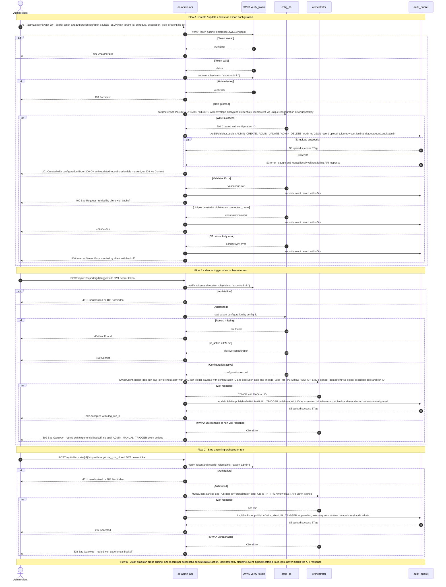

### 3.5. Schema Definitions (DB Tables / API JSON / Telemetry CloudEvents)
<a id="laminar-sec-c.imp_standard_standard_api_1.schema"></a>
#### 3.5.1 Canonical DDL — `export_configurations` (owned by `cofig_db`, declared once here)

This is the **single canonical definition** of the `export_configurations` table. The `cofig_db` chapter and any other chapter that references this table must reference this DDL and must not re-declare it with different columns.

```sql
-- Canonical DDL for export_configurations (owned by cofig_db; declared once in §3.5.1)
CREATE TABLE IF NOT EXISTS export_configurations (
    config_id              UUID         PRIMARY KEY DEFAULT gen_random_uuid(),
    connection_name        VARCHAR(100) NOT NULL UNIQUE,
    target_type            VARCHAR(20)  NOT NULL
                           CHECK (target_type IN ('s3','azure_blob','gcs','sftp')),
    dataset                VARCHAR(40)  NOT NULL
                           CHECK (dataset IN ('identity_profiles','subscription_statuses',
                                              'campaigns_reactions','reservation_items')),
    mode                   VARCHAR(20)  NOT NULL
                           CHECK (mode IN ('initial','incremental')),
    cron_schedule          VARCHAR(120) NOT NULL,
    credentials_encrypted  TEXT         NOT NULL,   -- envelope-encrypted; never plaintext
    is_active              BOOLEAN      NOT NULL DEFAULT TRUE,
    created_at             TIMESTAMPTZ  NOT NULL DEFAULT NOW(),
    updated_at             TIMESTAMPTZ  NOT NULL DEFAULT NOW()
);

CREATE INDEX IF NOT EXISTS ix_export_configurations_active
    ON export_configurations (is_active) WHERE is_active = TRUE;
```

Notes:
- `credentials_encrypted` is the canonical column name; the API never returns it and never accepts a plaintext value in a response.
- `is_active` is the canonical activation flag; the orchestrator's selection query (`WHERE is_active = TRUE`) relies on it.
- `created_at` / `updated_at` are the canonical audit timestamps; `updated_at` is bumped on every successful `UPDATE`.
- The `cofig_db` chapter references this DDL; it does not restate the columns.

#### 3.5.2 API request / response schemas (OpenAPI 3.0)

```yaml
openapi: 3.0.3
info:
  title: do-admin-api
  version: 1.0.0
components:
  securitySchemes:
    bearerAuth:
      type: http
      scheme: bearer
      bearerFormat: JWT
  schemas:
    ExportConfigurationCreate:
      type: object
      required: [connection_name, target_type, dataset, mode, cron_schedule, credentials]
      properties:
        connection_name: { type: string, minLength: 1, maxLength: 100 }
        target_type:     { type: string, enum: [s3, azure_blob, gcs, sftp] }
        dataset:         { type: string, enum: [identity_profiles, subscription_statuses, campaigns_reactions, reservation_items] }
        mode:            { type: string, enum: [initial, incremental] }
        cron_schedule:   { type: string, description: "5-field cron expression" }
        credentials:     { type: object, additionalProperties: true }
    ExportConfigurationResponse:
      type: object
      required: [config_id, connection_name, target_type, dataset, mode, cron_schedule, is_active, created_at, updated_at, credentials]
      properties:
        config_id:       { type: string, format: uuid }
        connection_name: { type: string }
        target_type:     { type: string }
        dataset:         { type: string }
        mode:            { type: string }
        cron_schedule:   { type: string }
        is_active:       { type: boolean }
        created_at:      { type: string, format: date-time }
        updated_at:      { type: string, format: date-time }
        credentials:     { type: string, enum: ["***MASKED***"] }
    ErrorEnvelope:
      type: object
      required: [error]
      properties:
        error:
          type: object
          required: [code, message, details]
          properties:
            code:    { type: string }
            message: { type: string }
            details: { type: array, items: { type: object } }
paths:
  /api/v1/exports:
    post:
      security: [{ bearerAuth: [] }]
      requestBody: { required: true, content: { application/json: { schema: { $ref: '#/components/schemas/ExportConfigurationCreate' } } } }
      responses:
        '201': { description: Created, content: { application/json: { schema: { $ref: '#/components/schemas/ExportConfigurationResponse' } } } }
        '400': { description: Validation error, content: { application/json: { schema: { $ref: '#/components/schemas/ErrorEnvelope' } } } }
        '401': { description: Unauthorized }
        '403': { description: Forbidden }
        '409': { description: Conflict }
  /api/v1/exports/{id}:
    get:    { security: [{ bearerAuth: [] }], responses: { '200': { description: OK }, '404': { description: Not found } } }
    put:    { security: [{ bearerAuth: [] }], responses: { '200': { description: OK }, '400': { description: Validation error }, '404': { description: Not found } } }
    delete: { security: [{ bearerAuth: [] }], responses: { '204': { description: No content }, '404': { description: Not found } } }
  /api/v1/exports/{id}/trigger:
    post: { security: [{ bearerAuth: [] }], responses: { '202': { description: Accepted }, '409': { description: Inactive }, '502': { description: MWAA unreachable } } }
  /api/v1/exports/{id}/stop:
    post: { security: [{ bearerAuth: [] }], responses: { '202': { description: Accepted }, '502': { description: MWAA unreachable } } }
```

#### 3.5.3 Telemetry — CloudEvents-shaped audit record

Every administrative action emits exactly one record to `audit_bucket` in the organisation audit schema (SCRUM-486). The CloudEvents envelope carries the frozen `telemetry_event` names from the component contracts.

```json
{
  "specversion": "1.0",
  "id": "b1f0c2e4-9a3d-4f2b-8c1e-7d5a9b0e4f21",
  "source": "com.laminar.dataoutbound.do-admin-api",
  "type": "com.laminar.dataoutbound.audit.admin",
  "time": "2025-01-31T02:15:00.000Z",
  "datacontenttype": "application/json",
  "subject": "export_configurations/8f3c1a2b-4d5e-6f70-8192-a3b4c5d6e7f8",
  "data": {
    "actor_id": "admin@acme.example",
    "timestamp_utc": "2025-01-31T02:15:00.000Z",
    "event_type": "ADMIN_CREATE",
    "execution_id": "3f2a1b0c-9d8e-4f7a-8b6c-5d4e3f2a1b0c",
    "config_id": "8f3c1a2b-4d5e-6f70-8192-a3b4c5d6e7f8",
    "action": "CREATE"
  }
}
```

Field rules (binding):
- `data.actor_id` — authenticated Acme user identifier for admin operations; `system:<component-name>` for automated events.
- `data.timestamp_utc` — ISO-8601 UTC with millisecond precision and `Z` suffix.
- `data.event_type` — one of `ADMIN_CREATE`, `ADMIN_UPDATE`, `ADMIN_DELETE`, `ADMIN_MANUAL_TRIGGER`, `EXECUTION_STARTED`, `EXECUTION_COMPLETED`, `TRANSFER_STARTED`, `TRANSFER_COMPLETED`, `TRANSFER_FAILED`.
- `data.execution_id` — the lineage UUID generated by the orchestrator (for admin CRUD events, the API generates a fresh UUID for correlation).
- `type` — the frozen telemetry event name from the component contract: `com.laminar.dataoutbound.audit.admin` for admin actions; `com.laminar.dataoutbound.config.updated` for the `cofig_db` write edge; `com.laminar.dataoutbound.orchestrator.triggered` for the manual trigger edge.

#### 3.5.4 S3 object key layout for audit records

```
s3://audit_bucket/
  admin/
    ADMIN_CREATE/2025/01/31/2025-01-31T02-15-00.000Z_8f3c1a2b.json
    ADMIN_UPDATE/2025/01/31/2025-01-31T02-16-00.000Z_8f3c1a2b.json
    ADMIN_DELETE/2025/01/31/2025-01-31T02-17-00.000Z_8f3c1a2b.json
    ADMIN_MANUAL_TRIGGER/2025/01/31/2025-01-31T02-18-00.000Z_8f3c1a2b.json
```

Non-sequential, date-partitioned prefixes avoid S3 hot-partition throttling; the filename embeds the millisecond timestamp and a short UUID suffix for idempotency.

---

### 3.6. Local Design Assumptions
<a id="laminar-sec-c.imp_standard_standard_api_1.asm"></a>
- **JWT issuer and JWKS.** Assumed to be the enterprise identity provider; the issuer URL, audience and JWKS endpoint are read from `apis/config.yml` via `ConfigLoader`. No public key is hardcoded.
- **Role claim.** Assumed to be `roles` (a list of strings) inside the verified JWT; the required role is `export-admin`. If the enterprise uses a different claim name, only the `require_role` call site changes.
- **Idempotency-Key header.** Assumed to be an optional `Idempotency-Key` request header on `POST /api/v1/exports`; when present, the service deduplicates within a 24-hour window using `util.idempotency.IdempotencyKey.build`. When absent, the unique `connection_name` constraint provides natural idempotency.
- **Credential encryption.** Assumed to be envelope encryption backed by AWS KMS, exposed through `common.clients.aws.ssm.ssm_client.SsmClient.encrypt_payload`. The plaintext credential never leaves the process boundary; the encrypted blob is stored in `credentials_encrypted`.
- **Rate limiting.** Assumed to be a sliding-window limiter per client IP/tenant, configured via `apis/config.yml`; thresholds are not hardcoded. No external distributed cache is required for the expected administrative concurrency.
- **Response latency target.** Assumed < 200 ms for CRUD operations; the service is stateless and delegates all heavy work to `orchestrator` and `emr_do`.
- **Stop endpoint contract.** Assumed to accept the target `dag_run_id` as a query parameter; the API returns `202 Accepted` and the orchestrator run reaches `terminated` within 30 s (SCRUM-480 AC#6).
- **Audit write failure.** Assumed to be non-fatal: `AuditPublisher.publish` never raises into the caller's flow, and a failed audit write is logged locally. This preserves the API's availability guarantee while keeping the audit trail best-effort within the 5-second SLA.
- **`cofig_db` DDL ownership.** The canonical `export_configurations` DDL is declared once in §3.5.1 of this chapter; the `cofig_db` chapter references it and does not restate the columns. This resolves the cross-chapter DDL inconsistency flagged in review.
- **Follow-up question — "Where is the API hosted?"** Assumed to run as a containerised service on ECS (the only container runtime in the approved AWS allowlist), fronted by an Application Load Balancer with TLS termination; the container image is built from `apis/export_admin_api/`.
- **Follow-up question — "How are secrets injected?"** Assumed to be injected as environment variables resolved from SSM Parameter Store (SecureString) at task start; no secret is baked into the image or committed to source.

## 4. Component Design: scheduler
<a id="laminar-sec-c.imp_aws_aws_eventbridge_2"></a>

<!-- laminar:diagram-settings:imp-aws-aws_eventbridge-2 -->
**Diagram settings (user decisions — authoritative)**

| Setting | Value |
| --- | --- |
| `rule_name` | `scheduler` |

<!-- /laminar:diagram-settings -->


### 4.1. Component Contract (Bi-Directional Inputs & Outputs)
<a id="laminar-sec-c.imp_aws_aws_eventbridge_2.contract"></a>
**Component:** `scheduler` — an Amazon EventBridge scheduled rule (`rule_name = scheduler`) that raises a cadence event at each configured schedule time and hands it to the **orchestrator** DAG on MWAA. It owns *when* work is due; the orchestrator owns *what* work is due. The scheduler is stateless, holds no connection metadata, and carries no business data.

#### 4.1.1 Outbound contract (scheduler → orchestrator)

| Field | Value |
|---|---|
| Edge | scheduler → orchestrator |
| Interaction | scheduled trigger; EventBridge event to MWAA |
| Trigger | Cron schedule (`@daily` and the cadence family) |
| Request | **CloudEvents 1.0 payload** with event source and schedule timestamp |
| Response | HTTP 200 / Event acknowledged |
| Errors | Retried via EventBridge built-in retry policy (max 3 attempts), then routed to the rule target's SQS DLQ |
| Idempotency | Idempotent via EventBridge event ID and execution date |
| Telemetry event | `com.laminar.dataoutbound.scheduler.fired` |

**Envelope decision (single, binding).** The scheduler-to-orchestrator event is a **CloudEvents 1.0 document**. EventBridge is the transport: the rule target's input is the CloudEvents document, and the EventBridge-native envelope (`source`, `detail-type`, `time`, `account`, `region`, `id`) is the transport wrapper whose `detail` carries the CloudEvents document. The CloudEvents `id` is set from the EventBridge event `id`, so the two identifiers are the same value and idempotency is unambiguous. This is the one envelope used by the scheduler, by the orchestrator's inbound contract, and by the `com.laminar.dataoutbound.scheduler.fired` telemetry record — there is no second, competing shape.

#### 4.1.2 Inbound contract (configuration → scheduler)

The scheduler consumes **configuration, not data**. Its only input is the set of active cadences defined in **cofig_db** and provisioned into EventBridge rules through the deployment pipeline. The scheduler never reads `cofig_db` directly and never accepts ad-hoc schedule input at runtime; cadence changes flow exclusively through the **do-admin-api** CRUD path so that every change is validated (5-field cron, allowed cadences) and audited (`ADMIN_CREATE` / `ADMIN_UPDATE`).

#### 4.1.3 Configuration actually set (user decisions, authoritative)

| Setting | Value | Rationale |
|---|---|---|
| `rule_name` | `scheduler` | Explicit resource identifier; one rule per cadence family keeps event patterns specific and avoids overly broad matching. |
| Rule type | Scheduled (cron/rate) rule per cadence class | Supports the full cadence set: daily, weekly, bi-weekly, monthly, hourly fast-batch. |
| Target | MWAA orchestrator DAG trigger | Direct managed hand-off; a metadata-only event needs no intermediate compute. |
| Retry policy | Bounded retries, maximum event age set to fit inside the ±10-minute selection window | An event delivered after the window would be ignored by the orchestrator anyway; expiring it early prevents wasted retries. |
| DLQ | SQS DLQ attached to the rule target | Mandatory: a failed orchestrator invocation is captured, alarmed and replayable, never silently dropped. |
| Event archiving | Enabled, retention aligned to the organisation logging-standard value | Supports replay for debugging and audit reconstruction. |
| Bus encryption | AWS-managed KMS key (default, deliberately not overridden) | Production-grade managed default; deferring to it is itself the decision. |
| Time zone | UTC | Consistent with the ISO-8601 UTC audit timestamp requirement. |

### 4.2. Class and Interface Definitions
<a id="laminar-sec-c.imp_aws_aws_eventbridge_2.classes"></a>
`scheduler` is a managed EventBridge rule with no component-owned runtime. The classes below are the **typed contract** for the event it emits and the **provisioning interface** that creates its rules from `cofig_db` cadence configuration. They live in the blueprint foundation.

```python
from __future__ import annotations

import uuid
from dataclasses import dataclass, field, asdict
from datetime import datetime, timezone
from enum import Enum
from typing import Any, Mapping, Optional

from dataoutbound_section_tree.common.clients.aws.eventbridge.eventbridge_client import EventBridgeClient
from dataoutbound_section_tree.common.clients.aws.sqs.sqs_client import SqsClient
from dataoutbound_section_tree.common.logging.logger import get_logger
from dataoutbound_section_tree.util.exceptions import ClientError, ValidationError

logger = get_logger(__name__)

SCHEDULER_EVENT_TYPE = "com.laminar.dataoutbound.scheduler.fired"
SCHEDULER_SOURCE = "com.laminar.dataoutbound.scheduler"


class Cadence(str, Enum):
    """The cadence family the scheduler must cover (SCRUM-481)."""

    DAILY = "daily"
    WEEKLY = "weekly"
    BIWEEKLY = "biweekly"
    MONTHLY = "monthly"
    HOURLY_FAST_BATCH = "hourly_fast_batch"


@dataclass(frozen=True)
class CadenceRule:
    """One EventBridge scheduled rule, provisioned from cofig_db cadence config."""

    rule_name: str
    cadence: Cadence
    cron_expression: str          # 5-field cron, validated at the API boundary
    target_dag_name: str = "orchestrator"
    dlq_arn: str = ""
    retry_max_attempts: int = 3
    max_event_age_seconds: int = 600   # fits inside the ±10-minute selection window

    def __post_init__(self) -> None:
        if len(self.cron_expression.split()) != 5:
            raise ValidationError("cron_expression must be a valid 5-field cron expression")


@dataclass(frozen=True)
class SchedulerEventPayload:
    """The CloudEvents 1.0 document emitted by the scheduler.

    EventBridge is the transport; this document is the rule target's input and
    the orchestrator's inbound contract.
    """

    schedule_time_utc: str        # ISO-8601, millisecond precision, Z suffix
    cadence: Cadence
    rule_name: str
    event_id: str = field(default_factory=lambda: str(uuid.uuid4()))

    def to_cloudevent(self) -> dict:
        return {
            "specversion": "1.0",
            "id": self.event_id,
            "source": SCHEDULER_SOURCE,
            "type": SCHEDULER_EVENT_TYPE,
            "time": self.schedule_time_utc,
            "datacontenttype": "application/json",
            "data": {
                "cadence": self.cadence.value,
                "rule_name": self.rule_name,
                "schedule_time_utc": self.schedule_time_utc,
            },
        }


class SchedulerRuleProvisioner:
    """Creates and updates the EventBridge scheduled rules from cadence config."""

    def __init__(self, eventbridge: EventBridgeClient, sqs: SqsClient) -> None:
        self._eventbridge = eventbridge
        self._sqs = sqs

    def upsert_rule(self, rule: CadenceRule) -> str:
        """Create or update one scheduled rule with its target and DLQ."""
        try:
            return self._eventbridge.put_scheduled_rule(
                name=rule.rule_name,
                schedule_expression=f"cron({rule.cron_expression})",
                target_dag_name=rule.target_dag_name,
                dead_letter_arn=rule.dlq_arn,
                retry_max_attempts=rule.retry_max_attempts,
                max_event_age_seconds=rule.max_event_age_seconds,
            )
        except ClientError as exc:
            logger.error("scheduler_rule_upsert_failed", extra={"rule": rule.rule_name, "error": str(exc)})
            raise

    def delete_rule(self, rule_name: str) -> None:
        self._eventbridge.delete_rule(name=rule_name)


class SchedulerEventEmitter:
    """Emits a cadence event; used by tests and by manual replay tooling."""

    def __init__(self, eventbridge: EventBridgeClient) -> None:
        self._eventbridge = eventbridge

    def emit(self, payload: SchedulerEventPayload) -> str:
        return self._eventbridge.put_events(
            source=SCHEDULER_SOURCE,
            detail_type=SCHEDULER_EVENT_TYPE,
            detail=payload.to_cloudevent(),
        )
```

### 4.3. Implementation Code Skeleton (Stubs & Handlers)
<a id="laminar-sec-c.imp_aws_aws_eventbridge_2.skeleton"></a>
Illustrative skeleton — the Component Contract and Schema Definitions are binding. `scheduler` is a managed EventBridge rule: it has no handler of its own. The skeleton below is the **rule provisioning entrypoint** that the deployment pipeline invokes to materialise cadence rules from `cofig_db` configuration, plus the DLQ alarm wiring that is the scheduler's primary health signal.

```python
# src/dataoutbound_section_tree/common/clients/aws/eventbridge/eventbridge_client.py
"""EventBridgeClient — scheduled-rule provisioning and event emission."""
from __future__ import annotations

from typing import Any, Mapping, Optional

import boto3
from botocore.exceptions import BotoCoreError, ClientError as BotoClientError

from dataoutbound_section_tree.common.clients.aws.session import build_session
from dataoutbound_section_tree.common.logging.logger import get_logger
from dataoutbound_section_tree.config.config_loader import ConfigLoader
from dataoutbound_section_tree.util.exceptions import ClientError

logger = get_logger(__name__)


class EventBridgeClient:
    def __init__(self, config: ConfigLoader, session: Optional[boto3.Session] = None) -> None:
        self._config = config
        self._client = (session or build_session(config)).client("events")

    def put_scheduled_rule(
        self,
        name: str,
        schedule_expression: str,
        target_dag_name: str,
        dead_letter_arn: str,
        retry_max_attempts: int,
        max_event_age_seconds: int,
    ) -> str:
        """Create/update a scheduled rule and attach its MWAA target with a DLQ."""
        try:
            self._client.put_rule(Name=name, ScheduleExpression=schedule_expression, State="ENABLED")
            self._client.put_targets(
                Rule=name,
                Targets=[{
                    "Id": f"{name}-target",
                    "Arn": self._config.get("mwaa.orchestrator_target_arn"),
                    "DeadLetterConfig": {"Arn": dead_letter_arn},
                    "RetryPolicy": {
                        "MaximumRetryAttempts": retry_max_attempts,
                        "MaximumEventAgeInSeconds": max_event_age_seconds,
                    },
                }],
            )
            logger.info("scheduler_rule_provisioned", extra={"rule": name, "target": target_dag_name})
            return name
        except (BotoCoreError, BotoClientError) as exc:
            raise ClientError(f"failed to provision scheduled rule {name}") from exc

    def delete_rule(self, name: str) -> None:
        try:
            self._client.remove_targets(Rule=name, Ids=[f"{name}-target"])
            self._client.delete_rule(Name=name)
        except (BotoCoreError, BotoClientError) as exc:
            raise ClientError(f"failed to delete scheduled rule {name}") from exc

    def put_events(self, source: str, detail_type: str, detail: Mapping[str, Any]) -> str:
        try:
            response = self._client.put_events(
                Entries=[{
                    "Source": source,
                    "DetailType": detail_type,
                    "Detail": __import__("json").dumps(detail),
                    "EventBusName": self._config.get("eventbridge.bus_name"),
                }]
            )
            if response.get("FailedEntryCount", 0):
                raise ClientError(f"event rejected: {response['Entries']}")
            return response["Entries"][0]["EventId"]
        except (BotoCoreError, BotoClientError) as exc:
            raise ClientError("failed to put scheduler event") from exc
```

```python
# src/dataoutbound_section_tree/dags/export_orchestrator_dag.py (inbound side, excerpt)
"""The orchestrator's inbound contract for the scheduler event.

The DAG reads the CloudEvents document from dag_run.conf and applies the
±10-minute selection window against the schedule time it carries.
"""
from datetime import datetime, timedelta, timezone

SELECTION_WINDOW = timedelta(minutes=10)


def parse_scheduler_event(conf: dict) -> tuple[str, datetime]:
    """Return (cadence, schedule_time_utc) from the CloudEvents document."""
    if conf.get("specversion") != "1.0" or conf.get("type") != "com.laminar.dataoutbound.scheduler.fired":
        raise ValueError("inbound event is not a scheduler CloudEvent")
    schedule_time = datetime.strptime(
        conf["data"]["schedule_time_utc"], "%Y-%m-%dT%H:%M:%S.%fZ"
    ).replace(tzinfo=timezone.utc)
    return conf["data"]["cadence"], schedule_time
```

```hcl
# terraform/eventbridge.tf (excerpt) — export scheduler eventbridge
resource "aws_cloudwatch_event_rule" "scheduler" {
  name                = "scheduler"
  schedule_expression = var.scheduler_cron_expression   # e.g. cron(0 2 * * ? *)
  state               = "ENABLED"
}

resource "aws_cloudwatch_event_target" "orchestrator" {
  rule      = aws_cloudwatch_event_rule.scheduler.name
  arn       = var.mwaa_orchestrator_target_arn
  dead_letter_config { arn = aws_sqs_queue.scheduler_dlq.arn }
  retry_policy {
    maximum_retry_attempts       = 3
    maximum_event_age_in_seconds = 600   # inside the ±10-minute selection window
  }
}

resource "aws_cloudwatch_metric_alarm" "scheduler_dlq_depth" {
  alarm_name          = "scheduler-dlq-depth"
  namespace           = "AWS/SQS"
  metric_name         = "ApproximateNumberOfMessagesVisible"
  dimensions          = { QueueName = aws_sqs_queue.scheduler_dlq.name }
  comparison_operator = "GreaterThanThreshold"
  threshold           = 0
  evaluation_periods  = 1
  period              = 60
  statistic           = "Maximum"
}
```

### 4.4. Cross-Component Interaction Sequence (Local Mermaid/ASCII Flow)
<a id="laminar-sec-c.imp_aws_aws_eventbridge_2.seq"></a>
1. **Rule fires.** At schedule time `T`, the EventBridge scheduled rule `scheduler` fires. It emits a CloudEvents 1.0 document with `type = com.laminar.dataoutbound.scheduler.fired`, `id` = the EventBridge event id, `time` = `T` in ISO-8601 UTC millisecond precision, and `data` carrying `cadence`, `rule_name` and `schedule_time_utc`. The document carries no connection metadata and no business data.
2. **Target invocation.** EventBridge invokes the **orchestrator** DAG on MWAA with the CloudEvents document as the run configuration. The orchestrator uses `data.schedule_time_utc` to apply the ±10-minute selection window against active connections read from **cofig_db**.
3. **Acknowledgement.** The orchestrator returns HTTP 200 / event acknowledged. EventBridge records the successful delivery.
4. **Audit.** The orchestrator writes the `EXECUTION_STARTED` audit record — carrying the lineage UUID it generates — to **audit_bucket** with `actor_id = system:export-scheduler` for the scheduled-trigger leg. The scheduler's own operational telemetry (rule invocations, target delivery failures, DLQ depth) goes to its explicitly provisioned CloudWatch log group under the audit store's parent node, with the organisation retention value.
5. **Failure path.** If the orchestrator target fails to invoke, EventBridge retries per the configured policy (max 3 attempts, maximum event age 600 s). After the retries are exhausted the event is routed to the rule target's SQS DLQ, and the DLQ depth alarm raises an automated alert. Because the ±10-minute window makes late delivery moot, the retry budget is deliberately short; a missed schedule is reconciled by the orchestrator's window logic on the next event, not by backfill from the scheduler.
6. **Replay.** DLQ replay is an operational action, never automatic, to avoid duplicate runs. Replayed events carry their original CloudEvents `id`, so the orchestrator's idempotency check on event id and execution date suppresses a duplicate run.
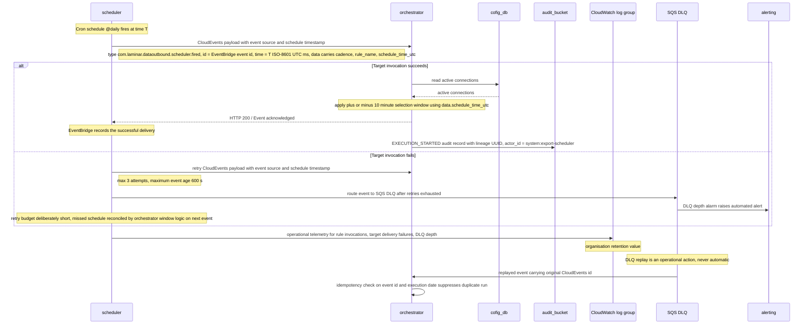

### 4.5. Schema Definitions (DB Tables / API JSON / Telemetry CloudEvents)
<a id="laminar-sec-c.imp_aws_aws_eventbridge_2.schema"></a>
#### 4.5.1 Database tables

N/A — `scheduler` owns no relational tables. Its cadence configuration is read from `cofig_db` (owned by that component) and materialised into EventBridge rules by the deployment pipeline.

#### 4.5.2 Scheduler event schema (CloudEvents 1.0 — the single envelope)

```json
{
  "$schema": "https://json-schema.org/draft/2020-12/schema",
  "$id": "https://laminar.com/dataoutbound/schemas/scheduler-fired.json",
  "title": "SchedulerFiredEvent",
  "type": "object",
  "required": ["specversion", "id", "source", "type", "time", "data"],
  "additionalProperties": false,
  "properties": {
    "specversion": { "const": "1.0" },
    "id": { "type": "string", "description": "EventBridge event id; the idempotency key." },
    "source": { "const": "com.laminar.dataoutbound.scheduler" },
    "type": { "const": "com.laminar.dataoutbound.scheduler.fired" },
    "time": {
      "type": "string",
      "pattern": "^\\d{4}-\\d{2}-\\d{2}T\\d{2}:\\d{2}:\\d{2}\\.\\d{3}Z$"
    },
    "datacontenttype": { "const": "application/json" },
    "data": {
      "type": "object",
      "required": ["cadence", "rule_name", "schedule_time_utc"],
      "additionalProperties": false,
      "properties": {
        "cadence": {
          "type": "string",
          "enum": ["daily", "weekly", "biweekly", "monthly", "hourly_fast_batch"]
        },
        "rule_name": { "type": "string" },
        "schedule_time_utc": {
          "type": "string",
          "pattern": "^\\d{4}-\\d{2}-\\d{2}T\\d{2}:\\d{2}:\\d{2}\\.\\d{3}Z$"
        }
      }
    }
  }
}
```

#### 4.5.3 Worked example

```json
{
  "specversion": "1.0",
  "id": "6d2f8a41-3c07-4b9e-a1d5-7e0c4f2b9a13",
  "source": "com.laminar.dataoutbound.scheduler",
  "type": "com.laminar.dataoutbound.scheduler.fired",
  "time": "2025-01-31T02:00:00.000Z",
  "datacontenttype": "application/json",
  "data": {
    "cadence": "daily",
    "rule_name": "scheduler",
    "schedule_time_utc": "2025-01-31T02:00:00.000Z"
  }
}
```

#### 4.5.4 EventBridge transport wrapper (for reference — not the contract)

EventBridge wraps the document above in its native envelope. The CloudEvents `id` is set from the wrapper's `id`, so the two identifiers are the same value:

```json
{
  "version": "0",
  "id": "6d2f8a41-3c07-4b9e-a1d5-7e0c4f2b9a13",
  "detail-type": "com.laminar.dataoutbound.scheduler.fired",
  "source": "aws.events",
  "account": "123456789012",
  "time": "2025-01-31T02:00:00Z",
  "region": "eu-west-1",
  "resources": ["arn:aws:events:eu-west-1:123456789012:rule/scheduler"],
  "detail": { "...": "the CloudEvents document above" }
}
```

#### 4.5.5 Telemetry record written to audit_bucket

The scheduler's scheduled-trigger leg is recorded by the orchestrator as an `EXECUTION_STARTED` event with `actor_id = system:export-scheduler`, conforming to the audit record schema owned by `audit_bucket`:

```json
{
  "specversion": "1.0",
  "id": "a7c3e9b2-5f18-4d60-9b21-3e8a0c7d4f56",
  "source": "com.laminar.dataoutbound.orchestrator",
  "type": "com.laminar.dataoutbound.scheduler.fired",
  "time": "2025-01-31T02:00:03.114Z",
  "subject": "b2e4d7a9-1c63-4f80-8a52-9d0e6b3c1f47",
  "datacontenttype": "application/json",
  "data": {
    "actor_id": "system:export-scheduler",
    "timestamp_utc": "2025-01-31T02:00:03.114Z",
    "event_type": "EXECUTION_STARTED",
    "execution_id": "b2e4d7a9-1c63-4f80-8a52-9d0e6b3c1f47",
    "component": "orchestrator",
    "status": "SUCCESS",
    "details": { "cadence": "daily", "rule_name": "scheduler", "schedule_time_utc": "2025-01-31T02:00:00.000Z" }
  }
}
```

### 4.6. Local Design Assumptions
<a id="laminar-sec-c.imp_aws_aws_eventbridge_2.asm"></a>
- **Bi-weekly cadence.** EventBridge cron cannot express "every two weeks" natively. Assumption: bi-weekly is implemented as two rules offset by one week, each firing fortnightly via day-of-month constraints, or the orchestrator filters bi-weekly connections from a weekly event using the config's cadence metadata. The orchestrator's ±10-minute window logic remains the single selection authority in either case.
- **Envelope.** Assumption: the scheduler-to-orchestrator event is a CloudEvents 1.0 document carried as the EventBridge rule target's input, with the CloudEvents `id` set from the EventBridge event `id`. This is the single envelope used by the scheduler, the orchestrator's inbound contract, and the `com.laminar.dataoutbound.scheduler.fired` telemetry record; no EventBridge-native-only shape is used as a contract.
- **Organisation logging-standard retention value.** Not stated in the inputs. Assumption: a single confirmed value (in days) is supplied per environment before sprint commitment and applied uniformly to every pipeline log group and to the audit store. Until confirmed, the value is parameterised in configuration and never hardcoded.
- **Scheduler hosting in the allowlist check.** SCRUM-485 lists the scheduler "where hosted". Assumption: the scheduler is realised as EventBridge rules attached to the MWAA environment's eventing and is reported in the allowlist verification report as part of the MWAA-managed stack, not as a separate resource type.
- **Time zone.** Assumption: all cron schedules are evaluated in UTC, consistent with the ISO-8601 UTC audit timestamp requirement.
- **DLQ replay is manual.** Assumption: DLQ replay is an operational action, never automatic, to avoid duplicate runs; replayed events retain their original CloudEvents `id` so the orchestrator's idempotency check suppresses duplicates.
- **No per-connection events.** Assumption: the scheduler emits one event per scheduled time, never one per connection. Fan-out to one **child_export_dag** run per connection is exclusively the orchestrator's responsibility.
- **Event size.** Assumption: events are metadata-only and remain far below the 256 KB EventBridge payload limit; no claim-check pattern is required on this path.

## 5. Component Design: orchestrator
<a id="laminar-sec-c.imp_aws_aws_mwaa_dag_3"></a>

<!-- laminar:diagram-settings:imp-aws-aws_mwaa_dag-3 -->
**Diagram settings (user decisions — authoritative)**

| Setting | Value |
| --- | --- |
| `schedule` | `@daily` |
| `catchup` | `false` |
| `max_active_runs` | `1` |
| `dag_name` | `orchestrator` |

<!-- /laminar:diagram-settings -->


### 5.1. Component Contract (Bi-Directional Inputs & Outputs)
<a id="laminar-sec-c.imp_aws_aws_mwaa_dag_3.contract"></a>
**Diagram settings (user decisions — authoritative)**

| Setting | Value |
|---|---|
| `dag_name` | `orchestrator` |
| `schedule` | `@daily` |
| `catchup` | `False` |
| `max_active_runs` | `1` |
| `tags` | `{}` |

#### 5.1.1 Inbound Contracts

| # | Source | Trigger | Protocol | Payload | Response | Failure / Retry | Idempotency |
|---|---|---|---|---|---|---|---|
| I-1 | **scheduler** | Cron schedule (`@daily`) | EventBridge event → MWAA | CloudEvents 1.0 envelope (`specversion`, `id`, `source`, `type` = `com.laminar.dataoutbound.scheduler.fired`, `time`, `data.cadence`, `data.schedule_time_utc`) | HTTP 200 / event acknowledged | EventBridge built-in retry, max 3 attempts, then DLQ | EventBridge `id` + logical execution date |
| I-2 | **do-admin-api** | Manual API invocation | HTTPS (Airflow REST API) | DAG run trigger payload `{ config_id, execution_date, actor_id }` | `200 OK` with `dag_run_id` | `502 Bad Gateway` retried with exponential backoff | Logical execution date + `config_id` |
| I-3 | Airflow scheduler (internal) | `@daily` schedule | MWAA internal | DAG run conf `{ trigger_source: "schedule" }` | DAG run created | Airflow task retry policy | Logical execution date |

#### 5.1.2 Configuration the Design Actually Sets

| Property | Value | Rationale |
|---|---|---|
| `dag_name` | `orchestrator` | Unique DAG identifier matching the blueprint module `dags/export_orchestrator_dag.py`. |
| `schedule` | `@daily` | User-set. Provides a daily safety-net run in addition to the scheduler-driven and manual triggers. |
| `catchup` | `False` | Prevents historical backfill storms on deployment or restart. |
| `max_active_runs` | `1` | Single-threaded execution per schedule window; prevents overlapping extractions. |
| `tags` | `{}` | User-set; no additional tags. |

**Recommendation:** Because the DAG is primarily trigger-driven (scheduler event I-1 and manual trigger I-2), a `schedule=None` (trigger-only) posture would avoid a redundant daily run. The user's `@daily` setting is honoured as authoritative; the trigger-only posture is recorded here as a recommendation only.

---

### 5.2. Class and Interface Definitions
<a id="laminar-sec-c.imp_aws_aws_mwaa_dag_3.classes"></a>
```python
"""Typed contracts for the Export Orchestrator DAG (orchestrator).

Blueprint module: src/dataoutbound_section_tree/dags/export_orchestrator_dag.py
Shared foundation imports only — no SDK clients are constructed here.
"""
from __future__ import annotations

from dataclasses import dataclass, field
from datetime import datetime
from typing import Any, Literal, Optional

from pydantic import BaseModel, Field, field_validator

from dataoutbound_section_tree.common.clients.aws.mwaa.mwaa_client import MwaaClient
from dataoutbound_section_tree.common.clients.db.db_client import DbClient
from dataoutbound_section_tree.common.logging.logger import get_logger
from dataoutbound_section_tree.common.telemetry.auditor import AuditPublisher
from dataoutbound_section_tree.config.config_loader import ConfigLoader
from dataoutbound_section_tree.util.exceptions import ValidationError
from dataoutbound_section_tree.util.idempotency import IdempotencyKey

logger = get_logger(__name__)

# ---------------------------------------------------------------------------
# Inbound: scheduler → orchestrator (CloudEvents 1.0)
# ---------------------------------------------------------------------------

Cadence = Literal["daily", "weekly", "biweekly", "monthly", "hourly_fast_batch"]


class CadenceEventData(BaseModel):
    """`data` member of the CloudEvents envelope emitted by the scheduler."""
    cadence: Cadence
    schedule_time_utc: datetime = Field(..., description="ISO-8601 UTC, millisecond precision, Z suffix")
    rule_name: str = Field(default="scheduler", max_length=64)


class CadenceEvent(BaseModel):
    """CloudEvents 1.0 envelope for the scheduler → orchestrator trigger."""
    specversion: Literal["1.0"] = "1.0"
    id: str = Field(..., description="EventBridge event id — idempotency key part 1")
    source: str = Field(default="com.laminar.dataoutbound.scheduler")
    type: Literal["com.laminar.dataoutbound.scheduler.fired"] = (
        "com.laminar.dataoutbound.scheduler.fired"
    )
    time: datetime
    datacontenttype: Literal["application/json"] = "application/json"
    data: CadenceEventData

    @field_validator("time")
    @classmethod
    def _utc(cls, v: datetime) -> datetime:
        if v.tzinfo is None:
            raise ValidationError("CadenceEvent.time must be timezone-aware UTC")
        return v


# ---------------------------------------------------------------------------
# Inbound: do-admin-api → orchestrator (manual trigger)
# ---------------------------------------------------------------------------

class ManualTriggerRequest(BaseModel):
    """Body of the manual-trigger call forwarded by do-admin-api."""
    config_id: str = Field(..., min_length=1, max_length=64)
    execution_date: datetime
    actor_id: str = Field(..., min_length=1, max_length=128)


# ---------------------------------------------------------------------------
# Read model: cofig_db export_configurations row (canonical DDL owned by cofig_db)
# ---------------------------------------------------------------------------

class ExportConfigurationRecord(BaseModel):
    """Read-only projection of a row in cofig_db.export_configurations.

    The canonical DDL for this table is declared once in the cofig_db
    component chapter; this model mirrors it and is never re-declared.
    """
    config_id: str
    connection_name: str
    target_type: Literal["s3", "azure_blob", "gcs", "sftp"]
    dataset: Literal[
        "identity_profiles",
        "subscription_statuses",
        "campaigns_reactions",
        "reservation_items",
    ]
    mode: Literal["initial", "incremental"]
    cron_schedule: str
    is_active: bool
    credentials_ref: str  # SSM SecureString reference — never plaintext
    created_at: datetime
    updated_at: datetime


# ---------------------------------------------------------------------------
# Internal selection model
# ---------------------------------------------------------------------------

@dataclass(frozen=True)
class SelectedConnection:
    """A connection selected for this run, with its resolved lineage UUID."""
    config_id: str
    connection: ExportConfigurationRecord
    lineage_uuid: str
    execution_date: datetime


@dataclass(frozen=True)
class OrchestratorRunConf:
    """Run conf of the orchestrator DAG itself."""
    trigger_source: Literal["schedule", "scheduler", "manual"]
    schedule_time_utc: datetime
    lineage_uuid: str
    actor_id: str = "system:orchestrator"
    selected_config_ids: list[str] = field(default_factory=list)


@dataclass(frozen=True)
class ChildRunConf:
    """Run conf handed to each child_export_dag run."""
    lineage_uuid: str
    config_id: str
    connection: dict[str, Any]
    execution_date: datetime
    mode: Literal["initial", "incremental"]


# ---------------------------------------------------------------------------
# DAG-level interface
# ---------------------------------------------------------------------------

class OrchestratorDag:
    """Export Orchestrator DAG — orchestration-only, no data processing.

    Responsibilities:
      * select active connections whose cron falls within ±10 minutes of the
        trigger time;
      * generate exactly one RFC 4122 v4 lineage UUID per run;
      * fan out one child_export_dag run per selected connection;
      * emit EXECUTION_STARTED / EXECUTION_COMPLETED audit events.
    """

    def __init__(
        self,
        config_loader: ConfigLoader,
        db_client: DbClient,
        mwaa_client: MwaaClient,
        auditor: AuditPublisher,
    ) -> None:
        self._config = config_loader
        self._db = db_client
        self._mwaa = mwaa_client
        self._auditor = auditor

    def select_connections(
        self, trigger_time: datetime, window_minutes: int = 10
    ) -> list[ExportConfigurationRecord]:
        """Return active connections whose cron matches trigger_time ± window."""
        ...

    def build_lineage_uuid(self) -> str:
        """Return a fresh RFC 4122 v4 UUID string."""
        ...

    def fan_out(
        self, run_conf: OrchestratorRunConf, selected: list[SelectedConnection]
    ) -> list[str]:
        """Trigger one child_export_dag run per selected connection."""
        ...

    def idempotency_key(self, execution_date: datetime, config_id: str) -> str:
        """Deterministic key for a (execution_date, config_id) pair."""
        return IdempotencyKey.build("orchestrator", execution_date.isoformat(), config_id)
```

---

### 5.3. Implementation Code Skeleton (Stubs & Handlers)
<a id="laminar-sec-c.imp_aws_aws_mwaa_dag_3.skeleton"></a>
*Illustrative skeleton — the Component Contract and Schema Definitions are binding.*

```python
"""Export Orchestrator DAG — illustrative skeleton.

Blueprint module: src/dataoutbound_section_tree/dags/export_orchestrator_dag.py
Deployed as-is to the MWAA DAGs bucket. Top-level code is instantaneous:
no network calls, no DB queries, no heavy computation outside operator
execute() methods.
"""
from __future__ import annotations

import uuid
from datetime import datetime, timedelta, timezone

from airflow import DAG
from airflow.operators.python import PythonOperator
from airflow.operators.trigger_dagrun import TriggerDagRunOperator

from dataoutbound_section_tree.common.clients.aws.mwaa.mwaa_client import MwaaClient
from dataoutbound_section_tree.common.clients.db.db_client import DbClient
from dataoutbound_section_tree.common.logging.logger import get_logger
from dataoutbound_section_tree.common.telemetry.auditor import AuditPublisher
from dataoutbound_section_tree.config.config_loader import ConfigLoader
from dataoutbound_section_tree.util.constants import (
    EVENT_EXECUTION_COMPLETED,
    EVENT_EXECUTION_STARTED,
)
from dataoutbound_section_tree.util.exceptions import ClientError, ValidationError

logger = get_logger(__name__)

# ---------------------------------------------------------------------------
# DAG-level configuration — read from config.yml via ConfigLoader.
# The diagram sets schedule=@daily, catchup=False, max_active_runs=1, tags={}.
# ---------------------------------------------------------------------------
_CONFIG = ConfigLoader.load(module="dags", dag="orchestrator")

DEFAULT_ARGS = {
    "owner": "dataoutbound",
    "retries": 3,
    "retry_delay": timedelta(minutes=2),
    "retry_exponential_backoff": True,
    "email_on_failure": False,
}

SELECT_ACTIVE_CONNECTIONS_SQL = """
SELECT config_id, connection_name, target_type, dataset, mode,
       cron_schedule, is_active, credentials_ref, created_at, updated_at
FROM   export_configurations
WHERE  is_active = TRUE
"""


def _select_connections(**context) -> list[dict]:
    """Task 1 — read active connections and filter by the ±10-minute window."""
    db = DbClient.from_config(_CONFIG)
    trigger_time: datetime = context["data_interval_start"].astimezone(timezone.utc)
    window = timedelta(minutes=_CONFIG.get("selection_window_minutes", 10))

    try:
        rows = db.fetch_all(SELECT_ACTIVE_CONNECTIONS_SQL)
    except ClientError as exc:
        logger.error("cofig_db read failed: %s", exc)
        raise

    selected = [
        r for r in rows
        if _cron_matches_within(r["cron_schedule"], trigger_time, window)
    ]
    logger.info("selected %d of %d active connections", len(selected), len(rows))
    return selected


def _generate_lineage_uuid(**context) -> str:
    """Task 2 — exactly one RFC 4122 v4 lineage UUID per run."""
    lineage_uuid = str(uuid.uuid4())
    context["ti"].xcom_push(key="lineage_uuid", value=lineage_uuid)
    return lineage_uuid


def _emit_started(**context) -> None:
    """Task 3 — EXECUTION_STARTED audit event."""
    auditor = AuditPublisher.from_config(_CONFIG)
    auditor.publish(
        event_type=EVENT_EXECUTION_STARTED,
        payload={
            "actor_id": "system:orchestrator",
            "execution_id": context["ti"].xcom_pull(key="lineage_uuid"),
            "trigger_source": context["dag_run"].conf.get("trigger_source", "schedule"),
        },
    )


def _fan_out_children(**context) -> list[str]:
    """Task 4 — trigger one child_export_dag run per selected connection."""
    mwaa = MwaaClient.from_config(_CONFIG)
    lineage_uuid = context["ti"].xcom_pull(key="lineage_uuid")
    selected = context["ti"].xcom_pull(task_ids="select_connections")
    run_ids: list[str] = []
    for row in selected:
        conf = {
            "lineage_uuid": lineage_uuid,
            "config_id": row["config_id"],
            "connection": row,
            "execution_date": context["data_interval_start"].isoformat(),
            "mode": row["mode"],
        }
        try:
            run_id = mwaa.trigger_dag_run(dag_id="child_export_dag", conf=conf)
            run_ids.append(run_id)
        except ClientError as exc:
            logger.error("child trigger failed for %s: %s", row["config_id"], exc)
            raise
    return run_ids


def _emit_completed(**context) -> None:
    """Task 5 — EXECUTION_COMPLETED audit event."""
    auditor = AuditPublisher.from_config(_CONFIG)
    auditor.publish(
        event_type=EVENT_EXECUTION_COMPLETED,
        payload={
            "actor_id": "system:orchestrator",
            "execution_id": context["ti"].xcom_pull(key="lineage_uuid"),
            "child_run_ids": context["ti"].xcom_pull(task_ids="fan_out_children"),
        },
    )


def _cron_matches_within(cron: str, when: datetime, window: timedelta) -> bool:
    """Return True if `cron` fires within `window` of `when` (UTC)."""
    # Implementation delegates to croniter; kept out of top-level code.
    ...


with DAG(
    dag_id="orchestrator",
    schedule="@daily",
    catchup=False,
    max_active_runs=1,
    tags={},
    default_args=DEFAULT_ARGS,
    start_date=datetime(2025, 1, 1, tzinfo=timezone.utc),
) as dag:
    select_connections = PythonOperator(
        task_id="select_connections", python_callable=_select_connections
    )
    generate_lineage_uuid = PythonOperator(
        task_id="generate_lineage_uuid", python_callable=_generate_lineage_uuid
    )
    emit_started = PythonOperator(
        task_id="emit_started", python_callable=_emit_started
    )
    fan_out_children = PythonOperator(
        task_id="fan_out_children", python_callable=_fan_out_children
    )
    emit_completed = PythonOperator(
        task_id="emit_completed", python_callable=_emit_completed
    )

    select_connections >> generate_lineage_uuid >> emit_started >> fan_out_children >> emit_completed
```

---

### 5.4. Cross-Component Interaction Sequence (Local Mermaid/ASCII Flow)
<a id="laminar-sec-c.imp_aws_aws_mwaa_dag_3.seq"></a>
The orchestrator is the fan-out boundary of the pipeline. It is triggered from two independent sources — the **scheduler** (cadence event) and **do-admin-api** (manual trigger) — and it drives two downstream interactions: a read against **cofig_db** and one `TriggerDagRunOperator` invocation per selected connection against **child_export_dag**. Every run emits `EXECUTION_STARTED` and `EXECUTION_COMPLETED` audit records to **audit_bucket**.

1. **Trigger arrives.** Either the **scheduler** delivers a CloudEvents 1.0 envelope (`type = com.laminar.dataoutbound.scheduler.fired`, `data.schedule_time_utc`) to the MWAA orchestrator DAG endpoint, or **do-admin-api** calls the Airflow REST API with `{ config_id, execution_date, actor_id }`. The DAG run conf records `trigger_source` as `scheduler` or `manual`.
2. **Selection.** The `select_connections` task opens a pooled JDBC connection to **cofig_db** via `DbClient` and executes the parameterised `SELECT` for active configurations. Each row's `cron_schedule` is evaluated against the trigger time; only connections whose cron fires within ±10 minutes are retained. A connection outside the window is not selected (SCRUM-480 AC#1).
3. **Lineage UUID.** The `generate_lineage_uuid` task produces exactly one RFC 4122 v4 UUID per run and pushes it to XCom. This UUID is the sole correlation identifier for the run (SCRUM-480 AC#3).
4. **Audit start.** `emit_started` publishes an `EXECUTION_STARTED` record to **audit_bucket** with `actor_id = system:orchestrator`, `execution_id = <lineage_uuid>`, and the trigger source.
5. **Fan-out.** `fan_out_children` iterates the selected connections and calls `MwaaClient.trigger_dag_run(dag_id="child_export_dag", conf=...)` once per connection. Each child run conf carries the same `lineage_uuid`, the connection JSON, the execution date, and the mode (SCRUM-480 AC#4). A `ClientError` from the MWAA client aborts the task and is retried by the Airflow task retry policy.
6. **Audit completion.** `emit_completed` publishes an `EXECUTION_COMPLETED` record with the list of child run IDs.

**Failure handling.** A `cofig_db` read failure retries up to 3 times with exponential backoff; persistent failure fails the DAG and emits no `EXECUTION_COMPLETED`. A child trigger failure retries per the Airflow task policy; if the third attempt fails, the DAG fails and the operator is alerted. A manual stop request accepted by **do-admin-api** terminates the orchestrator run within 30 seconds and prevents any further child run from starting (SCRUM-480 AC#6).

---
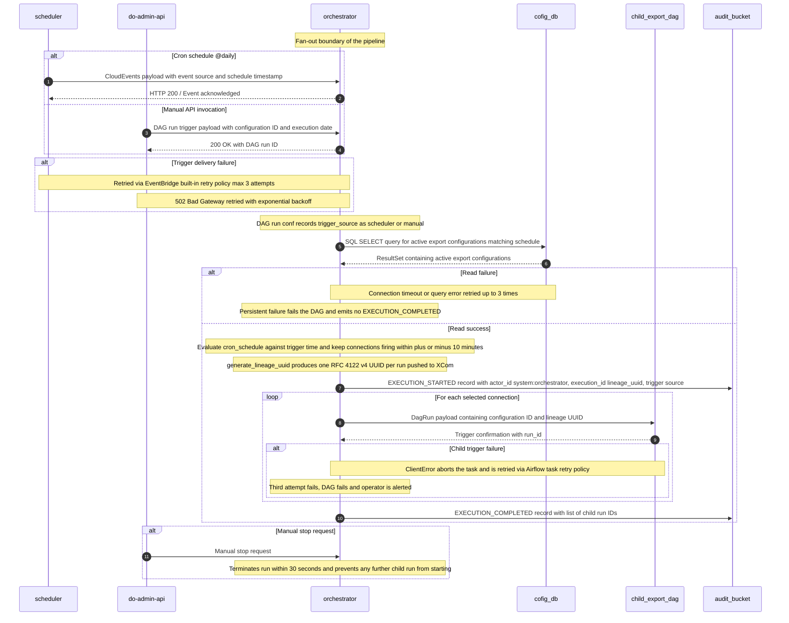

### 5.5. Schema Definitions (DB Tables / API JSON / Telemetry CloudEvents)
<a id="laminar-sec-c.imp_aws_aws_mwaa_dag_3.schema"></a>
#### 5.5.1 Inbound — scheduler → orchestrator (CloudEvents 1.0)

```json
{
  "$schema": "https://json-schema.org/draft/2020-12/schema",
  "$id": "com.laminar.dataoutbound.scheduler.fired",
  "title": "CadenceEvent",
  "type": "object",
  "required": ["specversion", "id", "source", "type", "time", "data"],
  "properties": {
    "specversion": { "const": "1.0" },
    "id":          { "type": "string", "description": "EventBridge event id" },
    "source":      { "const": "com.laminar.dataoutbound.scheduler" },
    "type":        { "const": "com.laminar.dataoutbound.scheduler.fired" },
    "time":        { "type": "string", "format": "date-time" },
    "datacontenttype": { "const": "application/json" },
    "data": {
      "type": "object",
      "required": ["cadence", "schedule_time_utc", "rule_name"],
      "properties": {
        "cadence": {
          "enum": ["daily", "weekly", "biweekly", "monthly", "hourly_fast_batch"]
        },
        "schedule_time_utc": { "type": "string", "format": "date-time" },
        "rule_name":         { "type": "string", "maxLength": 64 }
      }
    }
  }
}
```

#### 5.5.2 Inbound — do-admin-api → orchestrator (manual trigger)

```json
{
  "$schema": "https://json-schema.org/draft/2020-12/schema",
  "$id": "com.laminar.dataoutbound.orchestrator.triggered",
  "title": "ManualTriggerRequest",
  "type": "object",
  "required": ["config_id", "execution_date", "actor_id"],
  "properties": {
    "config_id":      { "type": "string", "minLength": 1, "maxLength": 64 },
    "execution_date": { "type": "string", "format": "date-time" },
    "actor_id":       { "type": "string", "minLength": 1, "maxLength": 128 }
  }
}
```

#### 5.5.3 Outbound — orchestrator → child_export_dag (DagRun conf)

```json
{
  "$schema": "https://json-schema.org/draft/2020-12/schema",
  "$id": "com.laminar.dataoutbound.child.triggered",
  "title": "ChildRunConf",
  "type": "object",
  "required": ["lineage_uuid", "config_id", "connection", "execution_date", "mode"],
  "properties": {
    "lineage_uuid":   { "type": "string", "format": "uuid" },
    "config_id":      { "type": "string" },
    "connection":     { "type": "object" },
    "execution_date": { "type": "string", "format": "date-time" },
    "mode":           { "enum": ["initial", "incremental"] }
  }
}
```

#### 5.5.4 Outbound — orchestrator → audit_bucket (CloudEvents-shaped audit record)

```json
{
  "$schema": "https://json-schema.org/draft/2020-12/schema",
  "$id": "com.laminar.dataoutbound.audit.orchestrator",
  "title": "OrchestratorAuditEvent",
  "type": "object",
  "required": ["actor_id", "timestamp_utc", "event_type", "execution_id"],
  "properties": {
    "actor_id":      { "const": "system:orchestrator" },
    "timestamp_utc": {
      "type": "string",
      "pattern": "^\\d{4}-\\d{2}-\\d{2}T\\d{2}:\\d{2}:\\d{2}\\.\\d{3}Z$"
    },
    "event_type":    { "enum": ["EXECUTION_STARTED", "EXECUTION_COMPLETED"] },
    "execution_id":  { "type": "string", "format": "uuid" },
    "trigger_source": { "enum": ["schedule", "scheduler", "manual"] },
    "child_run_ids": { "type": "array", "items": { "type": "string" } }
  }
}
```

#### 5.5.5 Read — orchestrator → cofig_db

The orchestrator reads `cofig_db.export_configurations`. The canonical DDL for this table is declared once in the **cofig_db** component chapter and is not re-declared here. The orchestrator's read contract is the parameterised query below; no DDL is owned by this component.

```sql
-- Parameterised read; no string interpolation of untrusted input.
SELECT config_id, connection_name, target_type, dataset, mode,
       cron_schedule, is_active, credentials_ref, created_at, updated_at
FROM   export_configurations
WHERE  is_active = TRUE;
```

---

### 5.6. Local Design Assumptions
<a id="laminar-sec-c.imp_aws_aws_mwaa_dag_3.asm"></a>
- **Schedule vs. trigger-only.** The diagram sets `schedule = @daily` for the orchestrator. This is honoured verbatim. **Recommendation:** because the DAG is primarily driven by the scheduler event and by manual triggers, a `schedule = None` (trigger-only) posture would avoid a redundant daily run; the user's `@daily` setting stands as authoritative.
- **Selection window.** The ±10-minute selection window is a fixed architectural constant (SCRUM-480 AC#1). It is read from `dags/config.yml` (`selection_window_minutes`, default 10) so it can be tuned per environment without a code change.
- **Cron evaluation library.** Cron matching uses `croniter` (mainstream Python cron parser) evaluated in UTC. All schedules are UTC, consistent with the ISO-8601 UTC audit timestamp requirement.
- **Bi-weekly cadence.** EventBridge cron cannot express "every two weeks" natively; the scheduler resolves bi-weekly as two fortnightly rules offset by one week. The orchestrator's ±10-minute window logic remains the single selection authority and does not need to know the cadence class.
- **Lineage UUID generation.** Exactly one RFC 4122 v4 UUID is generated per orchestrator run (SCRUM-480 AC#3). Re-runs generate a new UUID; idempotency is per-lineage, not per-connection.
- **MWAA worker capacity.** Assumed sufficient to handle concurrent DAG parse cycles and task scheduling without queuing delays; no explicit worker sizing is set by this design.
- **Airflow REST API authentication.** Manual triggers from **do-admin-api** authenticate to the MWAA REST API via IAM SigV4 signing using the API's execution role; no long-lived tokens are stored.
- **Audit write failure.** If the `audit_bucket` write fails, the `AuditPublisher` logs locally and does not raise into the DAG flow (per the shared foundation contract); the DAG continues, and the missing audit record is detectable via the expected-event-count check (SCRUM-486 AC#1).
- **No DDL owned.** The orchestrator owns no database tables; it reads `cofig_db.export_configurations` under the canonical DDL declared in the **cofig_db** chapter.

## 6. Component Design: child_export_dag
<a id="laminar-sec-c.imp_aws_aws_mwaa_dag_4"></a>

<!-- laminar:diagram-settings:imp-aws-aws_mwaa_dag-4 -->
**Diagram settings (user decisions — authoritative)**

| Setting | Value |
| --- | --- |
| `schedule` | `@daily` |
| `catchup` | `false` |
| `max_active_runs` | `1` |
| `dag_name` | `child_export_dag` |

<!-- /laminar:diagram-settings -->


### 6.1. Component Contract (Bi-Directional Inputs & Outputs)
<a id="laminar-sec-c.imp_aws_aws_mwaa_dag_4.contract"></a>
**Diagram settings (user decisions — authoritative).** This component is configured exactly as recorded in the Diagram settings table for `child_export_dag`: `dag_name = child_export_dag`, `schedule = @daily`, `catchup = False`, `max_active_runs = 1`, `tags = {}`. These five values are binding and are reproduced verbatim in the DAG definition in `c.imp_aws_aws_mwaa_dag_4.skeleton`; no other schedule, catch-up or concurrency value is substituted anywhere in this chapter.

**Architectural principle: orchestration-only, per-connection isolation.** `child_export_dag` is a per-connection MWAA DAG. It receives the lineage UUID and its connection JSON from `orchestrator`, reads the incremental watermark and recipe reference from `cofig_db`, submits exactly one Export Extract Spark Job to `emr_do`, waits for its terminal state, advances the watermark, and emits lifecycle audit records. It performs no data processing itself and never writes to a customer destination.

#### 6.1.1 Inbound contracts

| # | Source | Protocol / mechanism | Trigger | Payload | Sync/Async | Idempotency | Failure handling |
|---|---|---|---|---|---|---|---|
| I-1 | `orchestrator` | Airflow `TriggerDagRunOperator` (in-cluster) | Orchestrator task completion, one invocation per selected connection | `ChildExportRunConf` JSON in `dag_run.conf`: `lineage_uuid`, `config_id`, `connection`, `execution_date`, `mode`, `dataset`, `triggered_by` | Async (fire-and-forget trigger; state observed via Airflow REST API) | Idempotent via `execution_date` + `config_id`; a duplicate trigger for the same pair is a no-op | Trigger failure is retried by the orchestrator's Airflow task retry policy; the child DAG itself never retries its own trigger |
| I-2 | `cofig_db` | JDBC (PostgreSQL) via `common.clients.db.db_client.DbClient` | Child DAG initialisation task | Parameterised `SELECT` for the watermark row (`config_id`, `dataset`, `watermark_ts`) and the recipe path | Sync | Idempotent read-only query | Connection timeout or query error retried up to 3 times with exponential backoff, then the run fails with an audit failure record |

### 6.2. Class and Interface Definitions
<a id="laminar-sec-c.imp_aws_aws_mwaa_dag_4.classes"></a>
```python
"""Typed contracts for the child_export_dag component.

Module: src/dataoutbound_section_tree/dags/child_export_dag.py
Shared concerns (clients, logging, telemetry, config, idempotency, exceptions)
are imported from the blueprint foundation and are never re-declared here.
"""
from __future__ import annotations

from dataclasses import dataclass, field
from datetime import datetime
from typing import Any, Mapping, Optional, Protocol, Sequence


# --------------------------------------------------------------------------- #
# Run configuration (inbound contract I-1)
# --------------------------------------------------------------------------- #
@dataclass(frozen=True)
class ChildExportRunConf:
    """The `dag_run.conf` payload produced by `orchestrator` (SCRUM-480 AC#4)."""

    lineage_uuid: str          # RFC 4122 v4, generated once by orchestrator
    config_id: str             # export_configurations.config_id
    connection: Mapping[str, Any]  # connection JSON as stored in cofig_db
    execution_date: str        # ISO-8601 UTC, logical execution date
    mode: str                  # "initial" | "incremental"
    dataset: str               # e.g. "identity_profiles", "reservation_items"
    triggered_by: str = "system:orchestrator"

    def idempotency_key(self) -> str:
        """Stable key for duplicate-trigger suppression."""
        return f"{self.execution_date}:{self.config_id}"


# --------------------------------------------------------------------------- #
# Watermark state (inbound contract I-2 / outbound contract O-2)
# --------------------------------------------------------------------------- #
@dataclass(frozen=True)
class WatermarkRecord:
    """Incremental extraction state read from cofig_db."""

    config_id: str
    dataset: str
    watermark_ts: Optional[datetime]  # None => initial full synchronisation
    recipe_path: str


# --------------------------------------------------------------------------- #
# EMR Serverless submission (outbound contract O-1)
# --------------------------------------------------------------------------- #
@dataclass(frozen=True)
class EmrJobSubmission:
    """Parameters handed to EmrClient.start_job_run()."""

    application_id: str
    execution_role_arn: str
    client_token: str
    spark_submit_parameters: str
    job_name: str


@dataclass(frozen=True)
class EmrJobResult:
    """Terminal state of one Export Extract Spark Job run."""

    job_run_id: str
    state: str                 # SUCCESS | FAILED | CANCELLED
    record_counts: Mapping[str, int] = field(default_factory=dict)
    failure_reason: Optional[str] = None


# --------------------------------------------------------------------------- #
# Ports (implemented by the blueprint foundation clients)
# --------------------------------------------------------------------------- #
class EmrJobSubmitter(Protocol):
    def start_job_run(self, submission: EmrJobSubmission) -> str: ...
    def get_job_run(self, application_id: str, job_run_id: str) -> EmrJobResult: ...


class WatermarkRepository(Protocol):
    def read_watermark(self, config_id: str, dataset: str) -> WatermarkRecord: ...
    def advance_watermark(
        self, config_id: str, dataset: str, new_watermark: datetime
    ) -> None: ...


class AuditSink(Protocol):
    def publish(self, event_type: str, payload: Mapping[str, Any]) -> None: ...


# --------------------------------------------------------------------------- #
# Service
# --------------------------------------------------------------------------- #
class ChildExportService:
    """Orchestration logic of one child export run. No HTTP, no Airflow types."""

    def __init__(
        self,
        emr: EmrJobSubmitter,
        watermarks: WatermarkRepository,
        auditor: AuditSink,
        poll_interval_seconds: int,
        poll_timeout_seconds: int,
    ) -> None: ...

    def validate_conf(self, conf: Mapping[str, Any]) -> ChildExportRunConf:
        """Validate the run conf; raise ValidationError on any missing field."""

    def read_watermark(self, run: ChildExportRunConf) -> WatermarkRecord:
        """Read the watermark and recipe path for this connection."""

    def submit_job(self, run: ChildExportRunConf, wm: WatermarkRecord) -> str:
        """Submit exactly one EMR Serverless job; return the job_run_id."""

    def await_job(self, job_run_id: str) -> EmrJobResult:
        """Poll to a terminal state within the configured timeout."""

    def advance_watermark(self, run: ChildExportRunConf, result: EmrJobResult) -> None:
        """Monotonic watermark advance, only on SUCCESS."""

    def emit(self, run: ChildExportRunConf, event_type: str, **extra: Any) -> None:
        """Publish one audit record; never raises into the caller's flow."""
```

### 6.3. Implementation Code Skeleton (Stubs & Handlers)
<a id="laminar-sec-c.imp_aws_aws_mwaa_dag_4.skeleton"></a>
Illustrative skeleton — the Component Contract and Schema Definitions are binding.

```python
"""child_export_dag — per-connection export orchestration (MWAA).

Module: src/dataoutbound_section_tree/dags/child_export_dag.py
Deployed as-is to the MWAA DAGs bucket.
"""
from __future__ import annotations

from datetime import datetime, timedelta, timezone
from typing import Any, Mapping

from airflow import DAG
from airflow.operators.python import PythonOperator

from dataoutbound_section_tree.common.clients.aws.emr.emr_client import EmrClient
from dataoutbound_section_tree.common.clients.db.db_client import DbClient
from dataoutbound_section_tree.common.logging.logger import get_logger
from dataoutbound_section_tree.common.telemetry.auditor import AuditPublisher
from dataoutbound_section_tree.config.config_loader import ConfigLoader
from dataoutbound_section_tree.util.exceptions import ValidationError
from dataoutbound_section_tree.util.idempotency import IdempotencyKey

log = get_logger(__name__)

# --- Diagram settings (user decisions — authoritative) --------------------- #
DAG_ID = "child_export_dag"
SCHEDULE = "@daily"
CATCHUP = False
MAX_ACTIVE_RUNS = 1
TAGS: dict[str, str] = {}
# --------------------------------------------------------------------------- #

DEFAULT_ARGS = {
    "owner": "dataoutbound",
    "retries": 3,
    "retry_delay": timedelta(minutes=2),
    "retry_exponential_backoff": True,
    "email_on_failure": False,
}

# Top-level code stays instantaneous: no clients, no I/O, no queries here.
with DAG(
    dag_id=DAG_ID,
    schedule=SCHEDULE,
    catchup=CATCHUP,
    max_active_runs=MAX_ACTIVE_RUNS,
    tags=TAGS,
    default_args=DEFAULT_ARGS,
    start_date=datetime(2025, 1, 1, tzinfo=timezone.utc),
    render_template_as_native_obj=True,
) as dag:

    def _conf(context: Mapping[str, Any]) -> Mapping[str, Any]:
        """Return the run conf, or {} for a self-scheduled run with no conf."""
        return (context.get("dag_run").conf or {}) if context.get("dag_run") else {}

    def validate_conf(**context: Any) -> str:
        conf = _conf(context)
        if not conf.get("lineage_uuid"):
            # A @daily self-scheduled run carries no conf. It is a no-op: the
            # DAG is trigger-only in practice (see Local Design Assumptions).
            log.info("child_export_dag.no_conf_noop", dag_run_id=context["run_id"])
            return "NOOP"
        if not conf.get("config_id") or not conf.get("connection"):
            raise ValidationError("run conf missing config_id or connection")
        return conf["lineage_uuid"]

    def read_watermark(**context: Any) -> dict[str, Any]:
        conf = _conf(context)
        if not conf:
            return {}
        cfg = ConfigLoader(module="dags").load()
        with DbClient(cfg.db("cofig_db")) as db:
            row = db.fetch_one(
                "SELECT watermark_ts, recipe_path FROM export_watermarks "
                "WHERE config_id = %(config_id)s AND dataset = %(dataset)s",
                {"config_id": conf["config_id"], "dataset": conf["dataset"]},
            )
        return {"watermark_ts": row["watermark_ts"] if row else None,
                "recipe_path": row["recipe_path"] if row else conf["connection"]["recipe_path"]}

    def submit_emr_job(**context: Any) -> str:
        conf = _conf(context)
        if not conf:
            return ""
        cfg = ConfigLoader(module="dags").load()
        emr = EmrClient(cfg.aws("emr_serverless"))
        submission = {
            "application_id": cfg.aws("emr_serverless")["application_id"],
            "execution_role_arn": cfg.aws("emr_serverless")["job_role_arn"],
            "client_token": IdempotencyKey.build(
                conf["lineage_uuid"], conf["config_id"], conf["execution_date"]
            ),
            "job_name": f"export-extract-{conf['lineage_uuid']}",
            "spark_submit_parameters": " ".join([
                "--lineage-uuid", conf["lineage_uuid"],
                "--config-id", conf["config_id"],
                "--dataset", conf["dataset"],
                "--mode", conf["mode"],
                "--watermark-ts", str(context["ti"].xcom_pull(task_ids="read_watermark")["watermark_ts"]),
                "--recipe-path", context["ti"].xcom_pull(task_ids="read_watermark")["recipe_path"],
            ]),
        }
        job_run_id = emr.start_job_run(submission)
        AuditPublisher().publish(
            "com.laminar.dataoutbound.emr.started",
            {"execution_id": conf["lineage_uuid"], "job_run_id": job_run_id,
             "config_id": conf["config_id"]},
        )
        return job_run_id

    def await_emr_job(**context: Any) -> dict[str, Any]:
        conf = _conf(context)
        if not conf:
            return {}
        cfg = ConfigLoader(module="dags").load()
        emr = EmrClient(cfg.aws("emr_serverless"))
        job_run_id = context["ti"].xcom_pull(task_ids="submit_emr_job")
        result = emr.get_job_run(cfg.aws("emr_serverless")["application_id"], job_run_id)
        if result.state != "SUCCESS":
            AuditPublisher().publish(
                "com.laminar.dataoutbound.child.failed",
                {"execution_id": conf["lineage_uuid"], "job_run_id": job_run_id,
                 "reason": result.failure_reason},
            )
            raise RuntimeError(f"EMR job {job_run_id} ended in state {result.state}")
        return {"job_run_id": job_run_id, "record_counts": dict(result.record_counts)}

    def advance_watermark(**context: Any) -> None:
        conf = _conf(context)
        if not conf:
            return
        cfg = ConfigLoader(module="dags").load()
        with DbClient(cfg.db("cofig_db")) as db:
            db.execute(
                "UPDATE export_watermarks SET watermark_ts = GREATEST("
                "  COALESCE(watermark_ts, %(new_ts)s), %(new_ts)s), updated_at = now() "
                "WHERE config_id = %(config_id)s AND dataset = %(dataset)s",
                {"config_id": conf["config_id"], "dataset": conf["dataset"],
                 "new_ts": conf["execution_date"]},
            )

    t_validate = PythonOperator(task_id="validate_conf", python_callable=validate_conf)
    t_watermark = PythonOperator(task_id="read_watermark", python_callable=read_watermark)
    t_submit = PythonOperator(task_id="submit_emr_job", python_callable=submit_emr_job)
    t_await = PythonOperator(task_id="await_emr_job", python_callable=await_emr_job)
    t_advance = PythonOperator(task_id="advance_watermark", python_callable=advance_watermark)

    t_validate >> t_watermark >> t_submit >> t_await >> t_advance
```

### 6.4. Cross-Component Interaction Sequence (Local Mermaid/ASCII Flow)
<a id="laminar-sec-c.imp_aws_aws_mwaa_dag_4.seq"></a>
1. **`orchestrator` → `child_export_dag` (I-1).** After selecting a connection within the ±10-minute window, `orchestrator` invokes one `TriggerDagRunOperator` per connection, passing `ChildExportRunConf` (`lineage_uuid`, `config_id`, `connection`, `execution_date`, `mode`, `dataset`). The child DAG never generates or alters the UUID.
2. **`child_export_dag` → `cofig_db` (I-2).** The `read_watermark` task issues a parameterised `SELECT` for `(config_id, dataset)` and obtains `watermark_ts` (NULL for initial mode) and `recipe_path`. A read error is retried up to 3 times with exponential backoff; persistent failure fails the run and emits an audit failure record.
3. **`child_export_dag` → `emr_do` (O-1).** The `submit_emr_job` task calls `EmrClient.start_job_run` with a deterministic `clientToken`, so a retried submission returns the same `job_run_id` rather than starting a second job. On success it publishes `com.laminar.dataoutbound.emr.started`.
4. **`emr_do` → `dev` → `staging_bucet_internal`.** The Spark job reads Golden Entities from `dev` (strictly-greater-than watermark filtering in incremental mode) and writes partitioned staged files plus a manifest to `staging_bucet_internal`. Those S3 `ObjectCreated` events are the trigger for the downstream `egress-lambda` → `egress dag` chain; the child DAG does not participate in that chain.
5. **`child_export_dag` → `emr_do` (poll).** The `await_emr_job` task polls `get_job_run` to a terminal state. `SUCCESS` proceeds; `FAILED`/`CANCELLED` raises, which fails the DAG run and emits a failure audit record with the same `execution_id`.
6. **`child_export_dag` → `cofig_db` (O-2).** Only on `SUCCESS`, `advance_watermark` performs a monotonic `UPDATE` of `watermark_ts` for `(config_id, dataset)`. A failure here fails the run; because extraction is strictly-greater-than, the next run safely re-extracts the same window.
7. **`child_export_dag` → `audit_bucket` (O-3).** Throughout, `AuditPublisher` writes one CloudEvents-shaped record per lifecycle event (`EXECUTION_STARTED` at run start, `EXECUTION_COMPLETED` on success, `EXECUTION_FAILED` on failure) with `actor_id = system:child-export-dag`, ISO-8601 UTC millisecond timestamps and the lineage UUID as `execution_id`. Publish failures are logged locally and never fail the run.
8. **Stop path.** If `do-admin-api` accepts a stop request, `orchestrator` terminates within 30 seconds and no further child run is started for that execution; an in-flight child run is cancelled and its partial staging output is treated as failed, with a failure audit record carrying the same `execution_id`.
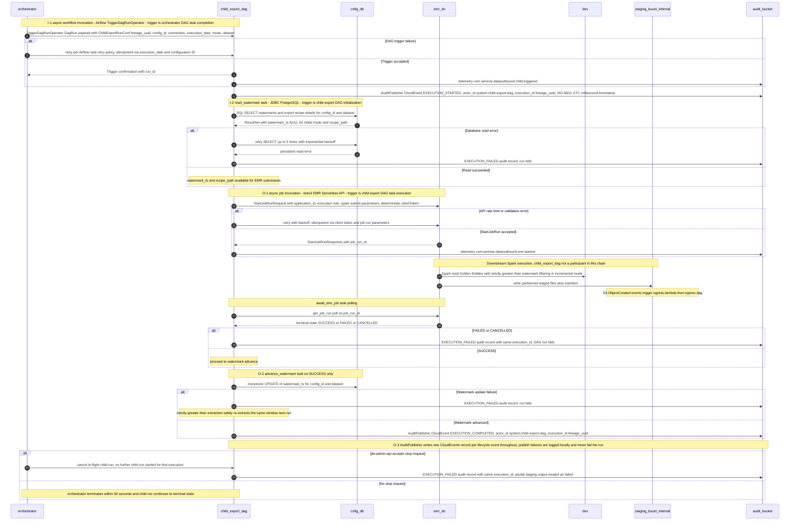

### 6.5. Schema Definitions (DB Tables / API JSON / Telemetry CloudEvents)
<a id="laminar-sec-c.imp_aws_aws_mwaa_dag_4.schema"></a>
#### 6.5.1 Run configuration (inbound, I-1)

```json
{
  "$schema": "https://json-schema.org/draft/2020-12/schema",
  "$id": "https://laminar/dataoutbound/child_export_dag/run_conf.json",
  "title": "ChildExportRunConf",
  "type": "object",
  "required": ["lineage_uuid", "config_id", "connection", "execution_date", "mode", "dataset"],
  "additionalProperties": false,
  "properties": {
    "lineage_uuid": {
      "type": "string",
      "pattern": "^[0-9a-f]{8}-[0-9a-f]{4}-4[0-9a-f]{3}-[89ab][0-9a-f]{3}-[0-9a-f]{12}$"
    },
    "config_id": { "type": "string", "minLength": 1 },
    "connection": {
      "type": "object",
      "required": ["connection_name", "target_type", "dataset", "mode", "cron_schedule"],
      "properties": {
        "connection_name": { "type": "string", "minLength": 1, "maxLength": 100 },
        "target_type": { "enum": ["s3", "azure_blob", "gcs", "sftp"] },
        "dataset": {
          "enum": ["identity_profiles", "subscription_statuses",
                   "campaigns_reactions", "reservation_items"]
        },
        "mode": { "enum": ["initial", "incremental"] },
        "cron_schedule": { "type": "string" },
        "recipe_path": { "type": "string" },
        "gzip_enabled": { "type": "boolean" },
        "pgp_enabled": { "type": "boolean" },
        "split_threshold_records": { "type": "integer", "minimum": 1 }
      }
    },
    "execution_date": { "type": "string", "format": "date-time" },
    "mode": { "enum": ["initial", "incremental"] },
    "dataset": { "type": "string" },
    "triggered_by": { "type": "string", "default": "system:orchestrator" }
  }
}
```

#### 6.5.2 EMR Serverless submission (outbound, O-1)

```json
{
  "$schema": "https://json-schema.org/draft/2020-12/schema",
  "$id": "https://laminar/dataoutbound/child_export_dag/start_job_run_request.json",
  "title": "StartJobRunRequest",
  "type": "object",
  "required": ["application_id", "execution_role_arn", "client_token", "spark_submit_parameters"],
  "properties": {
    "application_id": { "type": "string" },
    "execution_role_arn": { "type": "string" },
    "client_token": { "type": "string", "maxLength": 64 },
    "job_name": { "type": "string" },
    "spark_submit_parameters": {
      "type": "string",
      "description": "--lineage-uuid <uuid> --config-id <id> --dataset <name> --mode <initial|incremental> --watermark-ts <iso8601|NULL> --recipe-path <s3-uri>"
    }
  }
}
```

#### 6.5.3 Audit CloudEvents (outbound, O-3)

```json
{
  "$schema": "https://json-schema.org/draft/2020-12/schema",
  "$id": "https://laminar/dataoutbound/child_export_dag/audit_cloudevent.json",
  "title": "ChildExportAuditCloudEvent",
  "type": "object",
  "required": ["specversion", "id", "source", "type", "time", "subject", "data"],
  "properties": {
    "specversion": { "const": "1.0" },
    "id": { "type": "string", "format": "uuid" },
    "source": { "const": "com.laminar.dataoutbound.child_export_dag" },
    "type": {
      "enum": [
        "com.laminar.dataoutbound.child.triggered",
        "com.laminar.dataoutbound.emr.started",
        "com.laminar.dataoutbound.child.failed"
      ]
    },
    "time": { "type": "string", "format": "date-time" },
    "subject": { "type": "string", "description": "config_id" },
    "data": {
      "type": "object",
      "required": ["actor_id", "timestamp_utc", "event_type", "execution_id"],
      "properties": {
        "actor_id": { "const": "system:child-export-dag" },
        "timestamp_utc": {
          "type": "string",
          "pattern": "^\\d{4}-\\d{2}-\\d{2}T\\d{2}:\\d{2}:\\d{2}\\.\\d{3}Z$"
        },
        "event_type": {
          "enum": ["EXECUTION_STARTED", "EXECUTION_COMPLETED", "EXECUTION_FAILED"]
        },
        "execution_id": {
          "type": "string",
          "pattern": "^[0-9a-f]{8}-[0-9a-f]{4}-4[0-9a-f]{3}-[89ab][0-9a-f]{3}-[0-9a-f]{12}$"
        },
        "config_id": { "type": "string" },
        "job_run_id": { "type": "string" },
        "record_counts": { "type": "object", "additionalProperties": { "type": "integer" } },
        "status": { "enum": ["SUCCESS", "FAILED", "CANCELLED"] }
      }
    }
  }
}
```

#### 6.5.4 Database tables

**No DDL is owned by this component.** `child_export_dag` reads and updates `export_watermarks` in `cofig_db`; that table is owned by the `cofig_db` component and its canonical DDL is declared once in the `cofig_db` chapter. This chapter references it and never re-declares it.

### 6.6. Local Design Assumptions
<a id="laminar-sec-c.imp_aws_aws_mwaa_dag_4.asm"></a>
- **`schedule = @daily` is honoured verbatim.** The diagram sets `schedule = @daily` for `child_export_dag` and the DAG definition uses exactly that value; it is not replaced with `None`. Because the DAG is in practice trigger-only (it is invoked by `orchestrator` with a run conf), a self-scheduled run that carries no `lineage_uuid` short-circuits in `validate_conf` and performs no work — it emits no audit record and starts no Spark job, so the SCRUM-486 event-count formula (`admin ops + 2N + 2N`) is unaffected. **Recommendation:** set `schedule = None` for this DAG so that only orchestrator-triggered runs exist; the reason is that a trigger-only DAG with a cron schedule produces empty runs that add noise to the Airflow UI and to run-state polling. This is a recommendation only — the user's `@daily` stands as the configured value.
- **Watermark write ownership.** The frozen contract labels the `child_export_dag → cofig_db` edge as a read. The watermark advance after a successful Spark run is performed by this DAG's `advance_watermark` task over the same connection, because `child_export_dag` is the only component in the diagram with a `cofig_db` connection other than `do-admin-api` and `orchestrator`. The update is monotonic and keyed by `(config_id, dataset)`, so a re-run is safe.
- **`EXECUTION_FAILED` event type.** SCRUM-486 enumerates nine event types and does not include an execution-failure value. This design uses `EXECUTION_FAILED` as the failure counterpart of `EXECUTION_COMPLETED` so that the "2 per connection execution" count holds (start plus completion-or-failure). If the organisation requires the enumerated set to be closed, `EXECUTION_FAILED` is recorded as `EXECUTION_COMPLETED` with `status = "FAILED"`; no other contract changes.
- **MWAA worker capacity.** Assumed sufficient to parse and schedule concurrent child DAG runs without queuing delays; `max_active_runs = 1` bounds concurrency per DAG, and parallelism across connections comes from separate DAG runs.
- **EMR Serverless warm pools.** Assumed configured to minimise job submission latency; the DAG's `await_emr_job` polling interval is read from `dags/config.yml` and is not hardcoded.
- **Airflow REST API authentication.** Assumed to use IAM-authenticated SigV4 calls from `do-admin-api` and `egress-lambda`; the child DAG itself does not call the REST API.
- **Stop semantics.** Assumed that a stop accepted by `do-admin-api` terminates the orchestrator run within 30 seconds and that Airflow's own run cancellation prevents any further child task from starting; partial staging output from a cancelled child run is treated as failed and is not delivered.

## 7. Component Design: emr_do
<a id="laminar-sec-c.imp_aws_aws_emr_serverless_5"></a>

<!-- laminar:diagram-settings:imp-aws-aws_emr_serverless-5 -->
**Diagram settings (user decisions — authoritative)**

| Setting | Value |
| --- | --- |
| `release_label` | `emr-7.0.0` |
| `job_type` | `SPARK` |
| `max_capacity_units` | `200` |
| `application_name` | `emr_do` |

<!-- /laminar:diagram-settings -->


### 7.1. Component Contract (Bi-Directional Inputs & Outputs)
<a id="laminar-sec-c.imp_aws_aws_emr_serverless_5.contract"></a>
| Diagram settings (user decisions — authoritative) | |
|---|---|
| `application_name` | `emr_do` |
| `release_label` | `emr-7.0.0` |
| `job_type` | `SPARK` |
| `max_capacity_units` | `200` |

The **emr_do** component (Export Extract Spark Job on EMR Serverless) operates as a stateless, distributed batch compute engine. It executes Spark applications driven by declarative recipes and runtime parameters provided by the invoking **child_export_dag**.

- **Incoming Contract (Trigger & Inputs)**:
  - **Trigger**: `child_export_dag` invokes EMR Serverless via `boto3` `start_job_run` API using the `emr_client`.
  - **Payload / Arguments**: JSON configuration passed via Spark submit arguments containing `lineage_uuid`, `connection_id`, `dataset` (e.g., `identity_profiles`, `reservation_items`), `mode` (`initial` or `incremental`), `watermark_timestamp`, and recipe file path.
- **Outgoing Contract (Data Sinks & Telemetry)**:
  - **Golden Entity Source Store (`dev`)**: Executes distributed JDBC read queries against Redshift tables using credentials retrieved securely via SSM/database clients.
  - **Customer Staging Buckets (`staging_bucet_internal`)**: Writes partitioned Parquet/JSON data files and JSON manifest control files (`manifest_<lineage_uuid>.json`) via S3 committers.
  - **Audit & Execution Log Store (`audit_bucket`)**: Publishes CloudEvents-compliant lifecycle records (`com.laminar.dataoutbound.emr.started`, `com.laminar.dataoutbound.staging.written`) to `audit_bucket`.
- **Error & Retry Handling**: Transient S3 throttling or Redshift connection timeouts are caught and retried up to 3 times with exponential backoff. Fatal configuration or schema mismatch errors fail the job run immediately, publishing a `TRANSFER_FAILED` or execution failure audit event.

---

### 7.2. Class and Interface Definitions
<a id="laminar-sec-c.imp_aws_aws_emr_serverless_5.classes"></a>
```python
from dataclasses import dataclass, field
from typing import Dict, Any, List, Optional
from pyspark.sql import DataFrame, SparkSession

@dataclass
class SparkJobConfig:
    application_id: str
    execution_role_arn: str
    release_label: str = "emr-7.0.0"
    job_type: str = "SPARK"
    max_capacity_units: int = 200
    spark_conf: Dict[str, str] = field(default_factory=dict)

@dataclass
class ExportExtractJobArguments:
    lineage_uuid: str
    connection_id: str
    dataset_name: str
    mode: str
    watermark_value: Optional[str] = None
    recipe_path: str = ""

class SparkSessionHelper:
    @staticmethod
    def get_spark_session(app_name: str, config: Dict[str, Any]) -> SparkSession:
        """Constructs and returns an optimised SparkSession with S3 committer and Hive catalog support."""
        pass

class ChildExportGoldenEntitySourceStoreReader:
    def __init__(self, spark: SparkSession, db_client: Any):
        self.spark = spark
        self.db_client = db_client

    def read_entity(self, spec: Dict[str, Any], mode: str, watermark: Optional[str]) -> DataFrame:
        """Reads partitioned JDBC datasets from Redshift applying full or incremental watermark filters."""
        pass

class CustomerStagingBucketsAuditExecutionLogStoreWriter:
    def __init__(self, s3_client: Any, auditor: AuditPublisher):
        self.s3_client = s3_client
        self.auditor = auditor

    def write_staged_dataset(self, df: DataFrame, lineage_uuid: str, dataset_name: str, output_path: str) -> Dict[str, Any]:
        """Writes DataFrame to S3 staging bucket as partitioned Parquet/JSON files and generates JSON manifest."""
        pass
```

---

### 7.3. Implementation Code Skeleton (Stubs & Handlers)
<a id="laminar-sec-c.imp_aws_aws_emr_serverless_5.skeleton"></a>
> Illustrative skeleton — the Component Contract and Schema Definitions are binding.

```python
import sys
import argparse
from typing import Dict, Any
from dataoutbound_section_tree.spark_emr.export_extract_spark_job.helper.spark_session_helper import SparkSessionHelper
from dataoutbound_section_tree.spark_emr.export_extract_spark_job.io.child_export_golden_entity_source_store_reader import ChildExportGoldenEntitySourceStoreReader
from dataoutbound_section_tree.spark_emr.export_extract_spark_job.io.customer_staging_buckets_audit_execution_log_store_writer import CustomerStagingBucketsAuditExecutionLogStoreWriter
from dataoutbound_section_tree.spark_emr.export_extract_spark_job.processor.export_extract_input_processor import ExportExtractInputProcessor
from dataoutbound_section_tree.spark_emr.export_extract_spark_job.processor.export_extract_output_processor import ExportExtractOutputProcessor
from dataoutbound_section_tree.common.logging.logger import get_logger
from dataoutbound_section_tree.common.telemetry.auditor import AuditPublisher
from dataoutbound_section_tree.common.clients.db.db_client import DbClient
from dataoutbound_section_tree.common.clients.aws.s3.s3_client import S3Client

logger = get_logger("emr_do.main")

def main() -> None:
    parser = argparse.ArgumentParser(description="Export Extract Spark Job Entrypoint")
    parser.add_argument("--lineage-uuid", required=True, help="RFC 4122 v4 lineage UUID")
    parser.add_argument("--connection-id", required=True, help="Target export connection identifier")
    parser.add_argument("--dataset", required=True, help="Dataset recipe name")
    parser.add_argument("--mode", required=True, choices=["initial", "incremental"], help="Extraction mode")
    parser.add_argument("--watermark", required=False, help="Watermark timestamp for incremental runs")
    parser.add_argument("--recipe-path", required=True, help="Path to declarative recipe JSON")
    args = parser.parse_args()

    logger.info("Starting Export Extract Spark Job", extra={"lineage_uuid": args.lineage_uuid, "dataset": args.dataset})

    spark = SparkSessionHelper.get_spark_session("ExportExtractSparkJob", {})
    db_client = DbClient()
    s3_client = S3Client()
    auditor = AuditPublisher()

    try:
        auditor.publish("EXECUTION_STARTED", {
            "actor_id": "system:emr_do",
            "execution_id": args.lineage_uuid,
            "dataset": args.dataset
        })

        reader = ChildExportGoldenEntitySourceStoreReader(spark, db_client)
        writer = CustomerStagingBucketsAuditExecutionLogStoreWriter(s3_client, auditor)

        recipe_spec = {"table": args.dataset, "recipe_path": args.recipe_path}
        raw_df = reader.read_entity(recipe_spec, args.mode, args.watermark)

        normalized_df = ExportExtractInputProcessor.validate_and_normalize(raw_df, recipe_spec)
        processed_df = ExportExtractOutputProcessor.assemble(normalized_df)

        output_path = f"s3://staging_bucet_internal/staging/{args.connection_id}/{args.lineage_uuid}/{args.dataset}/"
        manifest_metadata = writer.write_staged_dataset(processed_df, args.lineage_uuid, args.dataset, output_path)

        auditor.publish("EXECUTION_COMPLETED", {
            "actor_id": "system:emr_do",
            "execution_id": args.lineage_uuid,
            "manifest": manifest_metadata
        })
        logger.info("Export Extract Spark Job completed successfully", extra={"lineage_uuid": args.lineage_uuid})
    except Exception as e:
        logger.error(f"Export Extract Spark Job failed: {str.format('{}', e)}", exc_info=True, extra={"lineage_uuid": args.lineage_uuid})
        auditor.publish("TRANSFER_FAILED", {
            "actor_id": "system:emr_do",
            "execution_id": args.lineage_uuid,
            "error": str(e)
        })
        sys.exit(1)

if __name__ == "__main__":
    main()
```

---

### 7.4. Cross-Component Interaction Sequence (Local Mermaid/ASCII Flow)
<a id="laminar-sec-c.imp_aws_aws_emr_serverless_5.seq"></a>
1. The `child_export_dag` invokes `emr_do` via the EMR Serverless client (`EmrClient.start_job_run`) passing the `lineage_uuid`, connection parameters, and recipe paths.
2. `emr_do` initialises its Spark session and emits an `EXECUTION_STARTED` audit event to `audit_bucket`.
3. `emr_do` invokes `dev` (Redshift source store) via distributed JDBC queries to extract Golden Entity datasets in full or incremental mode.
4. Spark executors process and validate the datasets in memory before writing partitioned Parquet/JSON files and the `manifest_<lineage_uuid>.json` file to `staging_bucet_internal`.
5. Upon successful write completion, `emr_do` publishes an `EXECUTION_COMPLETED` audit event (along with execution metrics) to `audit_bucket` and terminates the ephemeral worker cluster.
6. On failure (e.g., query timeout or S3 throttling), `emr_do` captures the exception, logs stack traces, publishes a `TRANSFER_FAILED` audit event to `audit_bucket`, and exits with a non-zero exit code to trigger Airflow task retries.

---
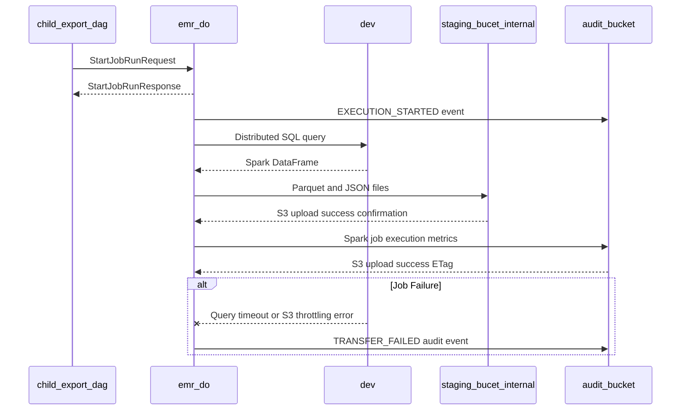

### 7.5. Schema Definitions (DB Tables / API JSON / Telemetry CloudEvents)
<a id="laminar-sec-c.imp_aws_aws_emr_serverless_5.schema"></a>
```json
{
  "$schema": "http://json-schema.org/draft-07/schema#",
  "title": "EmrServerlessJobSubmitPayload",
  "type": "object",
  "properties": {
    "lineage_uuid": { "type": "string", "format": "uuid" },
    "connection_id": { "type": "string" },
    "dataset": { "type": "string" },
    "mode": { "type": "string", "enum": ["initial", "incremental"] },
    "watermark_value": { "type": ["string", "null"] },
    "recipe_path": { "type": "string" }
  },
  "required": ["lineage_uuid", "connection_id", "dataset", "mode", "recipe_path"]
}
```

```json
{
  "$schema": "http://json-schema.org/draft-07/schema#",
  "title": "EmrExecutionAuditCloudEvent",
  "type": "object",
  "properties": {
    "specversion": { "type": "string", "example": "1.0" },
    "type": { "type": "string", "example": "com.laminar.dataoutbound.emr.started" },
    "source": { "type": "string", "example": "urn:acme:dataoutbound:emr_do" },
    "id": { "type": "string", "format": "uuid" },
    "time": { "type": "string", "format": "date-time" },
    "datacontenttype": { "type": "string", "example": "application/json" },
    "data": {
      "type": "object",
      "properties": {
        "actor_id": { "type": "string", "example": "system:emr_do" },
        "timestamp_utc": { "type": "string", "pattern": "^\\d{4}-\\d{2}-\\d{2}T\\d{2}:\\d{2}:\\d{2}\\.\\d{3}Z$" },
        "event_type": { "type": "string", "enum": ["EXECUTION_STARTED", "EXECUTION_COMPLETED", "TRANSFER_FAILED"] },
        "execution_id": { "type": "string", "format": "uuid" },
        "dataset": { "type": "string" }
      },
      "required": ["actor_id", "timestamp_utc", "event_type", "execution_id"]
    }
  },
  "required": ["specversion", "type", "source", "id", "time", "data"]
}
```

---

### 7.6. Local Design Assumptions
<a id="laminar-sec-c.imp_aws_aws_emr_serverless_5.asm"></a>
- **Assumption 1**: EMR Serverless worker allocation dynamically scales between minimum and maximum capacity units (capped at `max_capacity_units = 200`), ensuring sufficient parallelism for heavy entity extractions without idling resources.
- **Assumption 2**: S3 output data written to `staging_bucet_internal` adheres strictly to non-sequential partitioning keys prefixed by lineage UUID and dataset name to prevent S3 hot-partition throttling.
- **Assumption 3**: Declarative recipes (`*.json`) for the eight supported entities (Unified Identity Profile, Pii Restricted Profile, Contact Method Subscription, Enriched Campaigns, Enriched Campaign Reactions, Room stay, Restaurant reservation, Tee time, Spa treatment) are bundled within the job deployment package and referenced via environment configuration.

---

## 8. Component Design: dev
<a id="laminar-sec-c.imp_aws_aws_redshift_6"></a>

<!-- laminar:diagram-settings:imp-aws-aws_redshift-6 -->
**Diagram settings (user decisions — authoritative)**

| Setting | Value |
| --- | --- |
| `node_type` | `dc2.large` |
| `number_of_nodes` | `2` |
| `database_name` | `dev` |
| `cluster_identifier` | `golden_data_source` |

<!-- /laminar:diagram-settings -->


### 8.1. Component Contract (Bi-Directional Inputs & Outputs)
<a id="laminar-sec-c.imp_aws_aws_redshift_6.contract"></a>
| Diagram settings (user decisions — authoritative) | |
|---|---|
| `cluster_identifier` | `golden_data_source` |
| `database_name` | `dev` |
| `node_type` | `dc2.large` |
| `number_of_nodes` | `2` |

The **dev** component (Golden Entity Source Store backed by Amazon Redshift) serves as the authoritative analytical data warehouse containing enterprise golden entities.

- **Incoming Contract (Reads)**:
  - **Trigger**: Distributed JDBC read requests initiated by the **emr_do** Spark job (`ChildExportGoldenEntitySourceStoreReader`).
  - **Payload / Query**: Parameterized SQL queries selecting columns from golden entity tables with partition range filters or incremental watermark conditions (`WHERE updated_at > :watermark`).
- **Outgoing Contract (Results)**:
  - **Response**: Tabular result sets streamed over JDBC to Spark executors containing the requested entity attributes.
- **Error & Retry Handling**: Connection drops or query timeouts trigger client-side retries up to 3 times via `DbClient` connection pooling rules. Syntax or schema mismatch errors abort execution immediately without side effects.

---

### 8.2. Class and Interface Definitions
<a id="laminar-sec-c.imp_aws_aws_redshift_6.classes"></a>
```python
from dataclasses import dataclass
from typing import Optional, Dict, Any
from pyspark.sql import DataFrame, SparkSession

@dataclass
class RedshiftConnectionConfig:
    cluster_identifier: str = "golden_data_source"
    database_name: str = "dev"
    node_type: str = "dc2.large"
    number_of_nodes: int = 2
    port: int = 5439

class ChildExportGoldenEntitySourceStoreReader:
    """Canonical reader shared across Spark job operations to query Redshift golden entities."""
    def __init__(self, spark: SparkSession, db_client: Any):
        self.spark = spark
        self.db_client = db_client

    def read_entity(self, spec: Dict[str, Any], mode: str, watermark: Optional[str]) -> DataFrame:
        """Executes parameterized JDBC queries against Redshift golden entity tables."""
        pass
```

---

### 8.3. Implementation Code Skeleton (Stubs & Handlers)
<a id="laminar-sec-c.imp_aws_aws_redshift_6.skeleton"></a>
> Illustrative skeleton — the Component Contract and Schema Definitions are binding.

```python
from typing import Dict, Any, Optional
from pyspark.sql import SparkSession, DataFrame
from dataoutbound_section_tree.spark_emr.export_extract_spark_job.io.child_export_golden_entity_source_store_reader import ChildExportGoldenEntitySourceStoreReader
from dataoutbound_section_tree.common.logging.logger import get_logger

logger = get_logger("dev.redshift_reader")

class RedshiftSourceStoreHandler:
    def __init__(self, spark: SparkSession, jdbc_url: str, connection_properties: Dict[str, str]):
        self.spark = spark
        self.jdbc_url = jdbc_url
        self.connection_properties = connection_properties

    def fetch_entity_data(self, table_name: str, mode: str, watermark_value: Optional[str] = None) -> DataFrame:
        query = f"(SELECT * FROM {table_name}"
        if mode == "incremental" and watermark_value:
            query += f" WHERE updated_at > '{watermark_value}'"
        query += ") AS src"

        logger.info(f"Executing Redshift query against table {table_name} in mode {mode}")
        return self.spark.read.jdbc(url=self.jdbc_url, table=query, properties=self.connection_properties)
```

---

### 8.4. Cross-Component Interaction Sequence (Local Mermaid/ASCII Flow)
<a id="laminar-sec-c.imp_aws_aws_redshift_6.seq"></a>
1. The Spark job (`emr_do`) initializes `ChildExportGoldenEntitySourceStoreReader` with JDBC connection properties pointing to the Redshift cluster (`golden_data_source`).
2. The reader constructs a parameterized SQL query based on the entity recipe (e.g., Unified Identity Profile, Pii Restricted Profile, Contact Method Subscription, Enriched Campaigns, Enriched Campaign Reactions, or reservation items) and extraction mode (`initial` vs `incremental` with watermark filtering).
3. Redshift (`dev`) executes the distributed query across its `dc2.large` nodes, optimizing scans via configured sort and distribution keys.
4. Result sets are streamed concurrently into Spark worker memory partitions.
5. On connection timeout or network glitch, `DbClient` executes exponential backoff retries (up to 3 attempts); on unrecoverable query errors, the exception is raised upstream to `emr_do`.

---
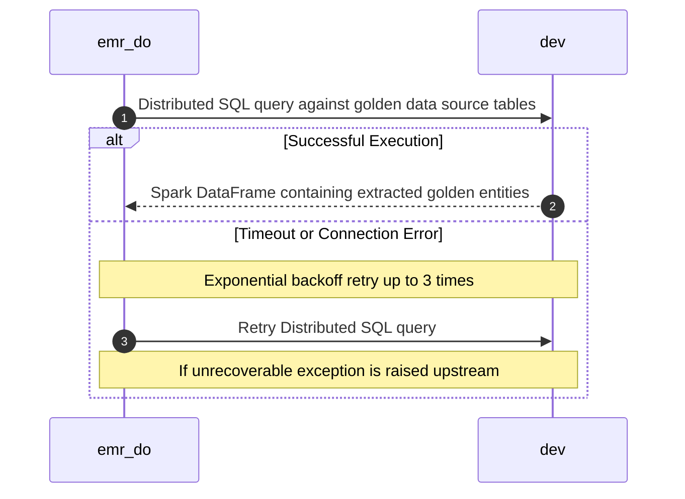

### 8.5. Schema Definitions (DB Tables / API JSON / Telemetry CloudEvents)
<a id="laminar-sec-c.imp_aws_aws_redshift_6.schema"></a>
```sql
-- DDL definition for Golden Entity Source Store tables residing in Redshift (dev database)
CREATE TABLE IF NOT EXISTS unified_identity_profile (
    profile_id VARCHAR(64) NOT NULL DISTKEY,
    customer_id VARCHAR(64) NOT NULL,
    profile_status VARCHAR(32),
    created_at TIMESTAMP WITHOUT TIME ZONE,
    updated_at TIMESTAMP WITHOUT TIME ZONE SORTKEY
);

CREATE TABLE IF NOT EXISTS pii_restricted_profile (
    profile_id VARCHAR(64) NOT NULL DISTKEY,
    masked_email VARCHAR(256),
    masked_phone VARCHAR(64),
    updated_at TIMESTAMP WITHOUT TIME ZONE SORTKEY
);

CREATE TABLE IF NOT EXISTS contact_method_subscription (
    subscription_id VARCHAR(64) NOT NULL DISTKEY,
    customer_id VARCHAR(64) NOT NULL,
    channel VARCHAR(32),
    subscribed BOOLEAN,
    updated_at TIMESTAMP WITHOUT TIME ZONE SORTKEY
);

CREATE TABLE IF NOT EXISTS enriched_campaigns (
    campaign_id VARCHAR(64) NOT NULL DISTKEY,
    campaign_name VARCHAR(256),
    start_date TIMESTAMP WITHOUT TIME ZONE,
    end_date TIMESTAMP WITHOUT TIME ZONE,
    updated_at TIMESTAMP WITHOUT TIME ZONE SORTKEY
);

CREATE TABLE IF NOT EXISTS enriched_campaign_reactions (
    reaction_id VARCHAR(64) NOT NULL DISTKEY,
    campaign_id VARCHAR(64),
    customer_id VARCHAR(64),
    reaction_type VARCHAR(64),
    updated_at TIMESTAMP WITHOUT TIME ZONE SORTKEY
);

CREATE TABLE IF NOT EXISTS room_stay_reservation (
    reservation_id VARCHAR(64) NOT NULL DISTKEY,
    property_id VARCHAR(64),
    guest_id VARCHAR(64),
    check_in_date DATE,
    check_out_date DATE,
    updated_at TIMESTAMP WITHOUT TIME ZONE SORTKEY
);

CREATE TABLE IF NOT EXISTS restaurant_reservation (
    reservation_id VARCHAR(64) NOT NULL DISTKEY,
    restaurant_id VARCHAR(64),
    guest_id VARCHAR(64),
    reservation_time TIMESTAMP WITHOUT TIME ZONE,
    updated_at TIMESTAMP WITHOUT TIME ZONE SORTKEY
);

CREATE TABLE IF NOT EXISTS tee_time_reservation (
    reservation_id VARCHAR(64) NOT NULL DISTKEY,
    course_id VARCHAR(64),
    player_id VARCHAR(64),
    tee_time TIMESTAMP WITHOUT TIME ZONE,
    updated_at TIMESTAMP WITHOUT TIME ZONE SORTKEY
);

CREATE TABLE IF NOT EXISTS spa_treatment_reservation (
    reservation_id VARCHAR(64) NOT NULL DISTKEY,
    spa_id VARCHAR(64),
    guest_id VARCHAR(64),
    treatment_time TIMESTAMP WITHOUT TIME ZONE,
    updated_at TIMESTAMP WITHOUT TIME ZONE SORTKEY
);
```

---

### 8.6. Local Design Assumptions
<a id="laminar-sec-c.imp_aws_aws_redshift_6.asm"></a>
- **Assumption 1**: The Golden Entity Source Store (`dev`) is an existing, externally owned Redshift cluster (`cluster_identifier = golden_data_source`, database `dev`) that is excluded from pipeline Terraform teardowns and deletion protection checks per SCRUM-485.
- **Assumption 2**: Tables are appropriately indexed and distributed using `DISTKEY` on entity identifiers and `SORTKEY` on `updated_at` timestamps to ensure optimal scan performance during incremental watermark extractions.
- **Assumption 3**: Credentials for accessing Redshift are retrieved securely at runtime via SSM Parameter Store secrets references managed by `common.clients.db.DbClient`.

## 9. Component Design: cofig_db
<a id="laminar-sec-c.imp_aws_aws_rds_7"></a>

<!-- laminar:diagram-settings:imp-aws-aws_rds-7 -->
**Diagram settings (user decisions — authoritative)**

| Setting | Value |
| --- | --- |
| `engine` | `postgres` |
| `engine_version` | `15.4` |
| `instance_class` | `db.t3.micro` |
| `allocated_storage` | `20` |
| `multi_az` | `false` |
| `db_instance_identifier` | `cofig_db` |

<!-- /laminar:diagram-settings -->


### 9.1. Component Contract (Bi-Directional Inputs & Outputs)
<a id="laminar-sec-c.imp_aws_aws_rds_7.contract"></a>
**Diagram settings (user decisions — authoritative)**

| Setting | Value |
|---|---|
| `engine` | `postgres` |
| `engine_version` | `15.4` |
| `instance_class` | `db.t3.micro` |
| `allocated_storage` | `20` GB |
| `multi_az` | `False` |
| `db_instance_identifier` | `cofig_db` |

**Role.** `cofig_db` is the Export Config Store — the authoritative operational data store for the DataOutbound platform. It holds export connection configurations (target type, dataset, mode, cron schedule, encrypted credentials), incremental extraction watermarks, and execution state. It is a passive relational store: it never initiates a call, never publishes an event, and never triggers a workflow. Every interaction is a parameterised SQL statement issued by a caller through the shared `DbClient`.

#### 9.1.1 Inbound contracts (who writes to / reads from `cofig_db`)

| Caller | Direction | Protocol | Trigger | Payload | Response | Errors | Idempotency |
|---|---|---|---|---|---|---|---|
| **do-admin-api** | write | HTTPS/REST → JDBC (PostgreSQL) | Admin API request | Export configuration payload (JSON with `tenant_id`, `schedule`, `destination_type`, `credentials_ref`) | `201 Created` with configuration ID | `400 Bad Request`, `500 Internal Server Error`; retried by client with backoff | Idempotent via unique configuration ID or upsert key |
| **orchestrator** | read | JDBC (PostgreSQL) | DAG task execution start | `SELECT` for active export configurations matching schedule | ResultSet of active export configurations | Connection timeout or query error; retried up to 3 times | Idempotent read-only query |
| **child_export_dag** | read | JDBC (PostgreSQL) | Child export DAG initialization | `SELECT` for watermarks and export recipe details | ResultSet with watermark timestamps and recipe path | Database read error; retried up to 3 times | Idempotent read-only query |

#### 9.1.2 Outbound contracts (what `cofig_db` produces)

`cofig_db` produces no outbound calls. Its outputs are (1) committed relational rows returned to the calling component as a ResultSet, and (2) committed state changes (configuration rows, watermark advances, execution-state transitions) that are durable and visible to subsequent reads. It emits no telemetry of its own; administrative and execution audit events are written by the calling components to **audit_bucket** (`com.laminar.dataoutbound.config.updated` for admin writes).

#### 9.1.3 Configuration the design actually sets

Only the properties the architecture decides are listed; everything else defers to RDS/PostgreSQL managed defaults, which is itself the decision.

| Property | Value | Rationale |
|---|---|---|
| `engine` / `engine_version` | `postgres` / `15.4` | Relational ACID store for configuration and watermark state; version pinned for reproducible migrations. |
| `instance_class` | `db.t3.micro` | User-set; sized for metadata-only workloads (small transactional reads/writes), not analytical scans. |
| `allocated_storage` | `20` GB | User-set; sufficient for configuration rows, watermarks and execution-state records. Storage auto-scaling (`gp3`) is enabled so the volume grows rather than failing on disk exhaustion. |
| `multi_az` | `False` | User-set and authoritative. Single-AZ deployment; see Local Design Assumptions for the availability implication and the recommendation for higher environments. |
| `db_instance_identifier` | `cofig_db` | Explicit resource identifier used by the Terraform module and by the `DbClient` connection resolver. |
| Deletion protection | Read from per-environment Terraform variable (dev/staging/prod) | SCRUM-485 AC#3: no hardcoded value; lower environments tear down cleanly, staging/prod are protected. |
| Network placement | Private database subnets, no public accessibility | Configuration and credentials must never be reachable from the internet. |
| Encryption at rest | KMS CMK | Protects configuration rows and encrypted credential fields. |
| Transport encryption | TLS enforced (`rds.force_ssl=1`) | Credentials and configuration travel encrypted in transit. |
| Credentials source | SSM Parameter Store (SecureString) | No database credential is hardcoded; the `DbClient` resolves it at runtime. |

### 9.2. Class and Interface Definitions
<a id="laminar-sec-c.imp_aws_aws_rds_7.classes"></a>
`cofig_db` owns no application code of its own; it is a managed PostgreSQL instance. The classes below are the **typed data contracts** the design owns for its tables, plus the shared client the callers use. All shared concerns are taken from the blueprint foundation — the `DbClient` is imported, never re-declared.

```python
"""Typed data contracts for the Export Config Store (cofig_db).

These models mirror the canonical DDL in the Schema Definitions section and are
imported by do-admin-api, orchestrator and child_export_dag. They contain no I/O.
"""
from __future__ import annotations

from datetime import datetime
from enum import Enum
from typing import Optional

from pydantic import BaseModel, Field, field_validator


class TargetType(str, Enum):
    """Allowed destination types (SCRUM-479 AC#1)."""
    S3 = "s3"
    AZURE_BLOB = "azure_blob"
    GCS = "gcs"
    SFTP = "sftp"


class Dataset(str, Enum):
    """Allowed Golden Entity datasets (SCRUM-479 AC#1)."""
    IDENTITY_PROFILES = "identity_profiles"
    SUBSCRIPTION_STATUSES = "subscription_statuses"
    CAMPAIGNS_REACTIONS = "campaigns_reactions"
    RESERVATION_ITEMS = "reservation_items"


class ExtractionMode(str, Enum):
    """Full or incremental extraction (SCRUM-481 AC#4/AC#5)."""
    INITIAL = "initial"
    INCREMENTAL = "incremental"


class ExportConfigurationRecord(BaseModel):
    """Read-only projection of a row in cofig_db.export_configurations.

    The canonical DDL for this table is declared once in the cofig_db
    component chapter; this model mirrors it and is never re-declared.
    """
    config_id: str
    connection_name: str
    target_type: Literal["s3", "azure_blob", "gcs", "sftp"]
    dataset: Literal[
        "identity_profiles",
        "subscription_statuses",
        "campaigns_reactions",
        "reservation_items",
    ]
    mode: Literal["initial", "incremental"]
    cron_schedule: str
    is_active: bool
    credentials_ref: str  # SSM SecureString reference — never plaintext
    created_at: datetime
    updated_at: datetime


@dataclass(frozen=True)
class WatermarkRecord:
    """Incremental extraction state read from cofig_db."""

    config_id: str
    dataset: str
    watermark_ts: Optional[datetime]  # None => initial full synchronisation
    recipe_path: str


class ExecutionState(str, Enum):
    """Lifecycle state of one orchestrator/child execution."""
    RUNNING = "running"
    SUCCEEDED = "succeeded"
    FAILED = "failed"
    TERMINATED = "terminated"


class ExecutionLogRecord(BaseModel):
    """Execution-state row keyed by the lineage UUID (SCRUM-480 AC#3/AC#7)."""
    execution_id: str = Field(..., description="RFC 4122 v4 lineage UUID")
    config_id: str
    state: ExecutionState
    started_at: datetime
    finished_at: Optional[datetime] = None
```

> Same `ExportConfigurationRecord` as defined in *Class and Interface Definitions* — one schema, one definition.
> Same `WatermarkRecord` as defined in *Class and Interface Definitions* — one schema, one definition.

The callers reach the store exclusively through the shared foundation client:

```python
from dataoutbound_section_tree.common.clients.db.db_client import DbClient
from dataoutbound_section_tree.config.config_loader import ConfigLoader
from dataoutbound_section_tree.util.exceptions import ClientError, NotFoundError, ConflictError
```

`DbClient` is the single construction point for the engine and connection pool; it resolves the connection string from `ConfigLoader` (which in turn resolves the SSM SecureString reference), exposes `execute` / `fetch_one` / `fetch_all` helpers and a transaction context manager, and never builds SQL from untrusted strings.

### 9.3. Implementation Code Skeleton (Stubs & Handlers)
<a id="laminar-sec-c.imp_aws_aws_rds_7.skeleton"></a>
Illustrative skeleton — the Component Contract and Schema Definitions are binding. `cofig_db` is a managed data store with no custom runtime; the module below is the **repository layer** that the callers import. It is the only place the store's SQL lives, and it is deliberately thin: parameterised statements, typed returns, no business logic.

```python
"""Repository over the Export Config Store (cofig_db).

Module path: src/dataoutbound_section_tree/common/clients/db/db_client.py provides
DbClient; this repository is owned by the cofig_db design and imported by
do-admin-api, orchestrator and child_export_dag.
"""
from __future__ import annotations

import logging
from datetime import datetime, timezone
from typing import Optional, Sequence

from dataoutbound_section_tree.common.clients.db.db_client import DbClient
from dataoutbound_section_tree.util.exceptions import ClientError, NotFoundError

from .models import (
    ExecutionLogRecord,
    ExecutionState,
    ExportConfigurationRecord,
    WatermarkRecord,
)

logger = logging.getLogger(__name__)


class ExportConfigRepository:
    """Parameterised access to the canonical `export_configurations` table."""

    def __init__(self, db: DbClient) -> None:
        self._db = db

    def insert(self, record: ExportConfigurationRecord) -> str:
        """Insert a new configuration; returns the generated config_id.

        Idempotent via the unique config_id / upsert key (frozen contract).
        """
        sql = (
            "INSERT INTO export_configurations "
            "(config_id, connection_name, target_type, dataset, mode, cron_schedule, "
            " credentials_encrypted, is_active, created_at, updated_at) "
            "VALUES (%s, %s, %s, %s, %s, %s, %s, %s, %s, %s) "
            "ON CONFLICT (config_id) DO UPDATE SET "
            " connection_name = EXCLUDED.connection_name, "
            " target_type = EXCLUDED.target_type, "
            " dataset = EXCLUDED.dataset, "
            " mode = EXCLUDED.mode, "
            " cron_schedule = EXCLUDED.cron_schedule, "
            " credentials_encrypted = EXCLUDED.credentials_encrypted, "
            " is_active = EXCLUDED.is_active, "
            " updated_at = EXCLUDED.updated_at "
            "RETURNING config_id"
        )
        try:
            row = self._db.fetch_one(sql, (
                record.config_id, record.connection_name, record.target_type.value,
                record.dataset.value, record.mode.value, record.cron_schedule,
                record.credentials_encrypted, record.is_active,
                record.created_at, record.updated_at,
            ))
        except ClientError as exc:
            logger.error("insert export_configuration failed: %s", exc)
            raise
        return row["config_id"]

    def get(self, config_id: str) -> ExportConfigurationRecord:
        """Fetch one configuration by primary key; raises NotFoundError if absent."""
        sql = (
            "SELECT config_id, connection_name, target_type, dataset, mode, cron_schedule, "
            "       credentials_encrypted, is_active, created_at, updated_at "
            "FROM export_configurations WHERE config_id = %s"
        )
        row = self._db.fetch_one(sql, (config_id,))
        if row is None:
            raise NotFoundError(f"export configuration {config_id} not found")
        return ExportConfigurationRecord(**row)

    def update(self, config_id: str, **fields) -> ExportConfigurationRecord:
        """Update named non-secret fields; `updated_at` is always refreshed."""
        allowed = {"connection_name", "target_type", "dataset", "mode",
                   "cron_schedule", "credentials_encrypted", "is_active"}
        unknown = set(fields) - allowed
        if unknown:
            raise ValueError(f"unknown columns: {sorted(unknown)}")
        fields["updated_at"] = datetime.now(timezone.utc)
        assignments = ", ".join(f"{col} = %s" for col in fields)
        sql = (
            f"UPDATE export_configurations SET {assignments} "
            "WHERE config_id = %s RETURNING config_id"
        )
        row = self._db.fetch_one(sql, (*fields.values(), config_id))
        if row is None:
            raise NotFoundError(f"export configuration {config_id} not found")
        return self.get(config_id)

    def delete(self, config_id: str) -> None:
        """Delete a configuration; raises NotFoundError if it did not exist."""
        row = self._db.fetch_one(
            "DELETE FROM export_configurations WHERE config_id = %s RETURNING config_id",
            (config_id,),
        )
        if row is None:
            raise NotFoundError(f"export configuration {config_id} not found")

    def list_active(self) -> Sequence[ExportConfigurationRecord]:
        """Return every active configuration for the orchestrator's window selection."""
        sql = (
            "SELECT config_id, connection_name, target_type, dataset, mode, cron_schedule, "
            "       credentials_encrypted, is_active, created_at, updated_at "
            "FROM export_configurations WHERE is_active = TRUE"
        )
        return [ExportConfigurationRecord(**row) for row in self._db.fetch_all(sql, ())]


class WatermarkRepository:
    """Reads and advances incremental extraction watermarks."""

    def __init__(self, db: DbClient) -> None:
        self._db = db

    def get(self, config_id: str, dataset: str) -> Optional[WatermarkRecord]:
        row = self._db.fetch_one(
            "SELECT config_id, dataset, watermark_ts, updated_at "
            "FROM extraction_watermarks WHERE config_id = %s AND dataset = %s",
            (config_id, dataset),
        )
        return WatermarkRecord(**row) if row else None

    def advance(self, config_id: str, dataset: str, watermark_ts: datetime) -> None:
        """Advance the watermark; strictly-greater-than filtering is the caller's contract."""
        self._db.execute(
            "INSERT INTO extraction_watermarks (config_id, dataset, watermark_ts, updated_at) "
            "VALUES (%s, %s, %s, %s) "
            "ON CONFLICT (config_id, dataset) DO UPDATE SET "
            " watermark_ts = EXCLUDED.watermark_ts, updated_at = EXCLUDED.updated_at",
            (config_id, dataset, watermark_ts, datetime.now(timezone.utc)),
        )


class ExecutionLogRepository:
    """Records execution state keyed by the lineage UUID."""

    def __init__(self, db: DbClient) -> None:
        self._db = db

    def start(self, execution_id: str, config_id: str) -> None:
        self._db.execute(
            "INSERT INTO execution_logs (execution_id, config_id, state, started_at) "
            "VALUES (%s, %s, %s, %s) ON CONFLICT (execution_id) DO NOTHING",
            (execution_id, config_id, ExecutionState.RUNNING.value,
             datetime.now(timezone.utc)),
        )

    def finish(self, execution_id: str, state: ExecutionState) -> None:
        self._db.execute(
            "UPDATE execution_logs SET state = %s, finished_at = %s WHERE execution_id = %s",
            (state.value, datetime.now(timezone.utc), execution_id),
        )

    def get(self, execution_id: str) -> ExecutionLogRecord:
        row = self._db.fetch_one(
            "SELECT execution_id, config_id, state, started_at, finished_at "
            "FROM execution_logs WHERE execution_id = %s",
            (execution_id,),
        )
        if row is None:
            raise NotFoundError(f"execution {execution_id} not found")
        return ExecutionLogRecord(**row)
```

### 9.4. Cross-Component Interaction Sequence (Local Mermaid/ASCII Flow)
<a id="laminar-sec-c.imp_aws_aws_rds_7.seq"></a>
`cofig_db` is a passive store: it never initiates an interaction. Every sequence below is driven by a caller, and every statement is issued through the shared `DbClient` over TLS on a private-subnet JDBC connection.

1. **do-admin-api → cofig_db (write).** An authenticated administrator submits a create/update/delete request. `do-admin-api` validates the payload, encrypts the credential fields, and calls `ExportConfigRepository.insert` / `update` / `delete` inside a single transaction. On success the store returns the committed `config_id` (or the updated row); `do-admin-api` then returns `201`/`200`/`204` and writes the corresponding `ADMIN_*` audit event to **audit_bucket**. On a `400`-class validation failure the store is never touched; on a `500`-class failure the transaction rolls back and the client retries with backoff.
2. **orchestrator → cofig_db (read).** On each scheduled or manual trigger, the orchestrator's first task calls `ExportConfigRepository.list_active()` to read every active configuration, then applies the ±10-minute cron window in memory. The read is idempotent and read-only; a connection timeout or query error is retried up to 3 times before the DAG task fails and an `EXECUTION_FAILED` audit event is written.
3. **orchestrator → cofig_db (write, execution state).** After selecting connections and generating the lineage UUID, the orchestrator calls `ExecutionLogRepository.start` to record the run. This is the only write the orchestrator performs against the store.
4. **child_export_dag → cofig_db (read).** On initialisation the child DAG reads its connection JSON and the current watermark via `WatermarkRepository.get`, then passes both to the Spark job. The read is idempotent; failures retry up to 3 times.
5. **child_export_dag → cofig_db (write, watermark advance).** After the Spark job reports success, the child DAG calls `WatermarkRepository.advance` with the run's extraction timestamp, and `ExecutionLogRepository.finish` with the terminal state. Both writes are idempotent per lineage UUID.
6. **Failure path.** Any store error surfaces as a typed `ClientError` / `NotFoundError` from the repository. The caller decides: retry (transient connection errors, up to 3 attempts with exponential backoff), fail fast (validation or not-found), or roll back (write transactions). No caller ever writes a partial row — every mutation is wrapped in a transaction with rollback semantics.
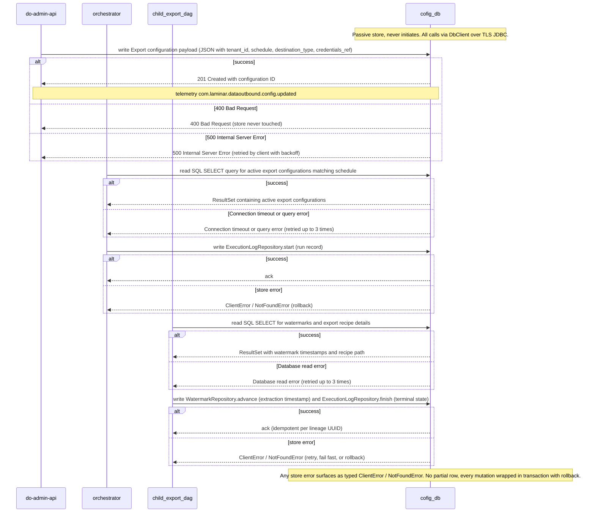

### 9.5. Schema Definitions (DB Tables / API JSON / Telemetry CloudEvents)
<a id="laminar-sec-c.imp_aws_aws_rds_7.schema"></a>
#### 9.5.1 Canonical DDL — owned by this design

The `export_configurations` table is declared **once, here**, and is the single canonical definition referenced by the do-admin-api, orchestrator and child_export_dag chapters. No other chapter re-declares it with different columns.

```sql
-- Canonical definition of the Export Config Store schema (cofig_db).
-- Referenced (not re-declared) by do-admin-api, orchestrator and child_export_dag.

CREATE TABLE export_configurations (
    config_id             UUID         PRIMARY KEY,
    connection_name       VARCHAR(100) NOT NULL CHECK (char_length(connection_name) BETWEEN 1 AND 100),
    target_type           VARCHAR(16)  NOT NULL CHECK (target_type IN ('s3','azure_blob','gcs','sftp')),
    dataset               VARCHAR(32)  NOT NULL CHECK (dataset IN
                              ('identity_profiles','subscription_statuses',
                               'campaigns_reactions','reservation_items')),
    mode                  VARCHAR(16)  NOT NULL CHECK (mode IN ('initial','incremental')),
    cron_schedule         VARCHAR(128) NOT NULL,          -- validated 5-field cron at the API boundary
    credentials_encrypted TEXT         NOT NULL,          -- KMS-encrypted blob; never plaintext
    is_active             BOOLEAN      NOT NULL DEFAULT TRUE,
    created_at            TIMESTAMPTZ  NOT NULL DEFAULT now(),
    updated_at            TIMESTAMPTZ  NOT NULL DEFAULT now()
);

CREATE INDEX idx_export_configurations_active
    ON export_configurations (is_active)
    WHERE is_active = TRUE;

CREATE TABLE extraction_watermarks (
    config_id     UUID         NOT NULL REFERENCES export_configurations (config_id) ON DELETE CASCADE,
    dataset       VARCHAR(32)  NOT NULL,
    watermark_ts  TIMESTAMPTZ  NOT NULL,
    updated_at    TIMESTAMPTZ  NOT NULL DEFAULT now(),
    PRIMARY KEY (config_id, dataset)
);

CREATE TABLE execution_logs (
    execution_id  UUID         PRIMARY KEY,               -- RFC 4122 v4 lineage UUID
    config_id     UUID         NOT NULL REFERENCES export_configurations (config_id) ON DELETE CASCADE,
    state         VARCHAR(16)  NOT NULL CHECK (state IN ('running','succeeded','failed','terminated')),
    started_at    TIMESTAMPTZ  NOT NULL DEFAULT now(),
    finished_at   TIMESTAMPTZ
);

CREATE INDEX idx_execution_logs_config_started
    ON execution_logs (config_id, started_at DESC);
```

#### 9.5.2 Telemetry — CloudEvents emitted by callers, not by the store

`cofig_db` writes no telemetry. The audit records that describe its state changes are emitted by the calling components to **audit_bucket** in the fixed SCRUM-486 schema. The store's own operational logs (slow queries, connection errors) are forwarded to CloudWatch Logs with the organisation logging-standard retention value.

```json
{
  "$schema": "https://json-schema.org/draft/2020-12/schema",
  "title": "AuditCloudEvent",
  "type": "object",
  "required": ["specversion", "id", "source", "type", "time", "data"],
  "properties": {
    "specversion": { "const": "1.0" },
    "id":          { "type": "string" },
    "source":      { "type": "string", "examples": ["com.laminar.dataoutbound.do-admin-api"] },
    "type": {
      "type": "string",
      "enum": [
        "com.laminar.dataoutbound.config.updated",
        "com.laminar.dataoutbound.orchestrator.triggered",
        "com.laminar.dataoutbound.child.triggered",
        "com.laminar.dataoutbound.emr.started",
        "com.laminar.dataoutbound.staging.written",
        "com.laminar.dataoutbound.egress.triggered",
        "com.laminar.dataoutbound.egress_dag.started",
        "com.laminar.dataoutbound.transfer.sftp",
        "com.laminar.dataoutbound.transfer.s3",
        "com.laminar.dataoutbound.transfer.azure",
        "com.laminar.dataoutbound.transfer.gcs",
        "com.laminar.dataoutbound.audit.admin",
        "com.laminar.dataoutbound.audit.spark",
        "com.laminar.dataoutbound.audit.egress"
      ]
    },
    "time": { "type": "string", "format": "date-time" },
    "data": {
      "type": "object",
      "required": ["actor_id", "timestamp_utc", "event_type", "execution_id"],
      "properties": {
        "actor_id":      { "type": "string" },
        "timestamp_utc": { "type": "string", "pattern": "^\\d{4}-\\d{2}-\\d{2}T\\d{2}:\\d{2}:\\d{2}\\.\\d{3}Z$" },
        "event_type": {
          "type": "string",
          "enum": ["ADMIN_CREATE", "ADMIN_UPDATE", "ADMIN_DELETE", "ADMIN_MANUAL_TRIGGER",
                   "EXECUTION_STARTED", "EXECUTION_COMPLETED",
                   "TRANSFER_STARTED", "TRANSFER_COMPLETED", "TRANSFER_FAILED"]
        },
        "execution_id":  { "type": "string", "format": "uuid" },
        "config_id":     { "type": "string", "format": "uuid" },
        "status":        { "type": "string" }
      }
    }
  }
}
```

### 9.6. Local Design Assumptions
<a id="laminar-sec-c.imp_aws_aws_rds_7.asm"></a>
- **`multi_az = False` is authoritative.** The diagram sets `multi_az = False` for `cofig_db`; this is honoured verbatim as the store's configuration. The consequence is a single-AZ deployment with no automatic failover: an AZ outage makes the configuration store unavailable until RDS recovers, which would stall orchestrator selection and child-DAG initialisation. **Recommendation:** for staging and production, consider overriding `multi_az` to `True` via the per-environment Terraform variable (the same mechanism already used for deletion protection), because the store is on the critical path of every run and the RTO/RPO targets in the architecture summary (2 h / 24 h) are more comfortably met with a synchronous standby. This is a recommendation only — the deployed value remains `False` unless the user changes the diagram.
- **Instance sizing.** `db.t3.micro` with `20` GB is assumed sufficient for metadata-only workloads (small transactional reads and writes, no analytical scans). Storage auto-scaling (`gp3`) is enabled so the volume grows rather than failing on disk exhaustion. Capacity planning is required before onboarding a large number of concurrent enterprise connections.
- **Credential encryption.** Credential fields are persisted only as ciphertext in `credentials_encrypted`; the encryption key is a KMS CMK and is a stateful resource covered by the environment-driven deletion-protection flag (SCRUM-485 AC#3). No retrieve path returns plaintext, and no raw read of a stored record exposes a plaintext credential (SCRUM-479 AC#1, SCRUM-481 AC#6).
- **Watermark semantics.** Incremental extraction filters strictly greater than `watermark_ts` (SCRUM-481 AC#5). The watermark is advanced only after the Spark job reports success, so a failed run re-extracts the same window on retry — idempotent per lineage UUID.
- **Log retention.** The organisation logging-standard retention value (in days) is not stated in the inputs; it is assumed to be **365 days** pending confirmation before sprint commitment, and is applied uniformly to every pipeline log group including the store's slow-query and error logs. Until confirmed, the value is parameterised, never hardcoded.
- **Backups.** Automated backups are enabled with a retention of at least 30 days, consistent with the RPO of 24 hours stated in the architecture summary; no cross-region copy is assumed because the requirements do not mandate a secondary region.
- **Schema migrations.** DDL changes are applied through the migration pipeline only; direct modifications to database records that bypass `do-admin-api` or the migration pipeline are prohibited.
- **No telemetry of its own.** `cofig_db` emits no business audit events; the SCRUM-486 expected-event-count formula (admin operations + 2N + 2N) is satisfied entirely by the calling components, so the store must not duplicate events at the storage layer.

## 10. Component Design: staging_bucet_internal
<a id="laminar-sec-c.imp_aws_aws_s3_bucket_8"></a>

<!-- laminar:diagram-settings:imp-aws-aws_s3_bucket-8 -->
**Diagram settings (user decisions — authoritative)**

| Setting | Value |
| --- | --- |
| `versioning` | `false` |
| `encryption` | `AES256` |
| `public_access_block` | `true` |
| `lifecycle_enabled` | `false` |
| `lifecycle_transition_days` | `30` |
| `lifecycle_glacier_days` | `90` |
| `bucket_name` | `staging_bucet_internal` |

<!-- /laminar:diagram-settings -->


### 10.1. Component Contract (Bi-Directional Inputs & Outputs)
<a id="laminar-sec-c.imp_aws_aws_s3_bucket_8.contract"></a>
#### 10.1.1 Diagram settings (user decisions — authoritative)

| Setting | Value |
|---|---|
| `bucket_name` | `staging_bucet_internal` |
| `versioning` | `False` |
| `encryption` | `AES256` |
| `public_access_block` | `True` |
| `lifecycle_enabled` | `False` |
| `lifecycle_transition_days` | `30` |
| `lifecycle_glacier_days` | `90` |
| `tags` | `{}` |

These values are binding. `lifecycle_enabled = False` is the user's explicit decision and is honoured verbatim; the SCRUM-482 AC#1 / SCRUM-486 AC#5 seven-day purge requirement is recorded below as a **Recommendation**, not as a configuration change.

#### 10.1.2 Role

`staging_bucet_internal` is the transient landing zone between the Export Extract Spark Job (`emr_do`) and the egress path (`egress-lambda` → `egress dag`). It holds raw staged export files (JSON/TXT per entity type, keyed by lineage UUID) just long enough for the S3 `ObjectCreated` notification to fire and the downstream transform/egress flow to consume them. It is not a system of record: staged objects are reproducible by re-running the Child Export DAG for the same lineage UUID.

#### 10.1.3 Inbound contract (what writes into this component)

| Source | Action | Protocol | Payload | Trigger |
|---|---|---|---|---|
| `emr_do` | write | S3 API (boto3 / Spark S3Committer) | Partitioned Parquet/JSON data files + manifest, keyed by lineage UUID | Spark job write phase |
| `egress dag` | write (Acme inspection staging only) | S3 API (boto3) | Export package + `manifest_<lineage_uuid>.json` | Internal inspection-staging delivery (SCRUM-484 AC#4) |

Frozen edge contracts honoured verbatim:

- **`emr_do` → `staging_bucet_internal`** — file transfer; S3 API (boto3 / Spark S3Committer); trigger: Spark job write phase; request: Parquet/JSON data files and manifest written to staging bucket; response: S3 multipart upload success confirmation; errors: S3 throttling or network error, Spark task retried automatically; idempotency: idempotent via deterministic S3 object key paths and UUID; telemetry event: `com.laminar.dataoutbound.staging.written`.
- **`staging_bucet_internal` → `egress-lambda`** — async event; S3 Event Notification to Lambda; trigger: S3 `ObjectCreated` notification; request: S3 event JSON payload with bucket name and object key; response: Lambda execution success acknowledgment; errors: Lambda invocation failure routed to SQS DLQ after retries; idempotency: idempotent via S3 object key and version ID tracking; telemetry event: `com.laminar.dataoutbound.egress.triggered`.
- **`egress dag` → `staging_bucet_internal`** — data read; S3 API (boto3); trigger: Egress DAG task execution; request: `GetObject` for staged export files and manifests; response: file object stream; errors: S3 read error retried up to 3 times; idempotency: idempotent read operation; telemetry event: none.

#### 10.1.4 Outbound contract (what this component emits)

| Target | Action | Protocol | Payload | Trigger |
|---|---|---|---|---|
| `egress-lambda` | trigger | S3 Event Notification → Lambda | S3 event JSON (bucket, key, eventTime, sequencer) | `ObjectCreated` on the staging prefix |

Exactly one notification per staged object; the notification configuration must not fan out to multiple consumers.

#### 10.1.5 Configuration actually set (with rationale)

| Property | Value | Rationale |
|---|---|---|
| `versioning` | `False` | Staged files are deterministic, re-runnable outputs; versioning would double storage cost for no recovery benefit. Accepted risk: an overwrite or delete of a staged object is unrecoverable and is recovered by Child Export DAG re-execution. |
| `encryption` | `AES256` (SSE-S3) | S3-managed AES-256 at rest satisfies baseline confidentiality for transient staging data without SSE-KMS key-management overhead; the fail-closed PGP gate protects data at the customer boundary. |
| `public_access_block` | `True` | Staging data must never be publicly reachable — non-negotiable security default. |
| `lifecycle_enabled` | `False` | User-set and authoritative. No S3 lifecycle rule is configured on this bucket. |
| `lifecycle_transition_days` / `lifecycle_glacier_days` | `30` / `90` | Retained as declared values; they are inert while `lifecycle_enabled = False`. |
| Deletion protection | Read from per-environment Terraform variable (dev/staging/prod) | SCRUM-485 AC#3: no hardcoded values; lower environments tear down cleanly, prod is protected. |

**Recommendation (not applied):** SCRUM-482 AC#1 and SCRUM-486 AC#5 require a lifecycle rule with expiration of exactly 7 days on every customer staging bucket, and SCRUM-484 AC#4 requires the internal inspection-staging objects to be purged after 7 days. Because the diagram sets `lifecycle_enabled = False`, that rule is **not** provisioned here. To satisfy those acceptance criteria without contradicting the user's setting, either (a) the property is deliberately revised to `lifecycle_enabled = True` with a 7-day expiration rule, or (b) the purge is performed by an external, pipeline-independent mechanism outside this architecture's diagram. This conflict is flagged for confirmation with the Security & Operations Engineer before sprint commitment; no silent override is applied in either direction.

#### 10.1.6 Failure behaviour

- **Access/throttle errors** are surfaced as typed errors through the shared S3 client (`common/clients/aws/s3/s3_client.py`) to the calling component, which applies its own retry policy (Spark task retry for writes; the Egress Lambda's 3-retry rule for delivery).
- **Missing/expired object** is always an auditable failure, never a no-op: the Transform & Encrypt DAG or Egress Lambda fails the run with an audit error entry, and the Child Export DAG re-run regenerates the file.
- **Notification delivery failure** is captured by the SQS DLQ attached to the S3 notification configuration; a DLQ depth alarm is the primary health signal.

---

### 10.2. Class and Interface Definitions
<a id="laminar-sec-c.imp_aws_aws_s3_bucket_8.classes"></a>
The bucket itself is infrastructure; the classes below are the typed access layer used by the components that read from and write to it. They live in the shared foundation and are imported, never re-declared.

```python
"""Typed access layer for staging_bucet_internal.

Shared foundation only: the bucket has no component-owned code module.
Every reader/writer (emr_do, egress-lambda, egress dag) imports these types
from the blueprint foundation rather than constructing boto3 clients itself.
"""
from __future__ import annotations

from dataclasses import dataclass, field
from datetime import datetime
from enum import Enum
from typing import Iterator, Optional

from dataoutbound_section_tree.common.clients.aws.s3.s3_client import S3Client
from dataoutbound_section_tree.common.logging.logger import get_logger
from dataoutbound_section_tree.common.telemetry.auditor import AuditPublisher
from dataoutbound_section_tree.util.exceptions import ClientError, NotFoundError, ValidationError

logger = get_logger(__name__)


class StagingEntityType(str, Enum):
    """The eight Golden Entity datasets staged by emr_do (SCRUM-481 AC#4)."""
    UNIFIED_IDENTITY_PROFILE = "unified_identity_profile"
    PII_RESTRICTED_PROFILE = "pii_restricted_profile"
    CONTACT_METHOD_SUBSCRIPTION = "contact_method_subscription"
    ENRICHED_CAMPAIGNS = "enriched_campaigns"
    ENRICHED_CAMPAIGN_REACTIONS = "enriched_campaign_reactions"
    ROOM_STAY_RESERVATION = "room_stay_reservation"
    RESTAURANT_RESERVATION = "restaurant_reservation"
    TEE_TIME_RESERVATION = "tee_time_reservation"
    SPA_TREATMENT_RESERVATION = "spa_treatment_reservation"


class StagingObjectState(str, Enum):
    STAGED = "STAGED"
    CONSUMED = "CONSUMED"
    MISSING = "MISSING"


@dataclass(frozen=True)
class StagingObjectRef:
    """Immutable reference to one staged object; the lineage UUID is mandatory."""
    bucket: str
    key: str
    lineage_uuid: str
    entity_type: StagingEntityType
    size_bytes: int
    etag: str
    last_modified: datetime
    state: StagingObjectState = StagingObjectState.STAGED

    def __post_init__(self) -> None:
        if not self.lineage_uuid:
            raise ValidationError("staging object key must carry a lineage UUID")


@dataclass(frozen=True)
class StagingWriteRequest:
    """Contract for a single staged-object write (emr_do or egress dag)."""
    lineage_uuid: str
    entity_type: StagingEntityType
    content_type: str = "application/json"
    partition: dict[str, str] = field(default_factory=dict)


@dataclass(frozen=True)
class StagingNotificationEvent:
    """The S3 ObjectCreated notification payload handed to egress-lambda."""
    bucket: str
    key: str
    event_name: str
    event_time: datetime
    sequencer: str

    @property
    def lineage_uuid(self) -> str:
        """Lineage UUID is embedded in the object key; absence is a contract violation."""
        parts = self.key.split("/")
        for part in parts:
            if len(part) == 36 and part.count("-") == 4:
                return part
        raise ValidationError(f"no lineage UUID found in staging key: {self.key}")


class StagingBucketGateway:
    """Thin, typed facade over S3Client scoped to staging_bucet_internal.

    Owns no state and no business logic: it builds deterministic keys, enforces
    the lineage-UUID contract, and maps SDK errors to util.exceptions.
    """

    def __init__(self, s3: S3Client, bucket_name: str, auditor: AuditPublisher) -> None:
        self._s3 = s3
        self._bucket = bucket_name
        self._auditor = auditor

    def build_key(self, lineage_uuid: str, entity_type: StagingEntityType,
                  file_name: str) -> str:
        """Non-sequential, lineage-prefixed key layout (avoids S3 hot partitions)."""
        return f"staging/{entity_type.value}/{lineage_uuid}/{file_name}"

    def put_object(self, request: StagingWriteRequest, body: bytes,
                   file_name: str) -> StagingObjectRef:
        raise NotImplementedError

    def get_object(self, key: str) -> bytes:
        raise NotImplementedError

    def list_objects(self, lineage_uuid: str) -> Iterator[StagingObjectRef]:
        raise NotImplementedError

    def head_object(self, key: str) -> Optional[StagingObjectRef]:
        raise NotImplementedError
```

---

### 10.3. Implementation Code Skeleton (Stubs & Handlers)
<a id="laminar-sec-c.imp_aws_aws_s3_bucket_8.skeleton"></a>
Illustrative skeleton — the Component Contract and Schema Definitions are binding. The bucket has no component-owned module in the blueprint; the code below is the shared-foundation access layer that `emr_do`, `egress-lambda` and `egress dag` import.

```python
"""Illustrative skeleton for the staging_bucet_internal access layer.

Blueprint paths:
  src/dataoutbound_section_tree/common/clients/aws/s3/s3_client.py
  src/dataoutbound_section_tree/common/telemetry/auditor.py
  src/dataoutbound_section_tree/common/logging/logger.py
  src/dataoutbound_section_tree/util/exceptions.py
"""
from __future__ import annotations

from typing import Iterator, Optional

from dataoutbound_section_tree.common.clients.aws.s3.s3_client import S3Client
from dataoutbound_section_tree.common.logging.logger import get_logger
from dataoutbound_section_tree.common.telemetry.auditor import AuditPublisher
from dataoutbound_section_tree.util.exceptions import ClientError, NotFoundError, ValidationError

from .classes import (  # illustrative local import; real code lives in the foundation
    StagingBucketGateway,
    StagingEntityType,
    StagingNotificationEvent,
    StagingObjectRef,
    StagingObjectState,
    StagingWriteRequest,
)

logger = get_logger(__name__)

STAGING_WRITTEN_EVENT = "com.laminar.dataoutbound.staging.written"
EGRESS_TRIGGERED_EVENT = "com.laminar.dataoutbound.egress.triggered"


class StagingBucketGatewayImpl(StagingBucketGateway):
    """Concrete implementation over the shared S3Client."""

    def put_object(self, request: StagingWriteRequest, body: bytes,
                   file_name: str) -> StagingObjectRef:
        key = self.build_key(request.lineage_uuid, request.entity_type, file_name)
        try:
            result = self._s3.upload(
                bucket=self._bucket,
                key=key,
                body=body,
                content_type=request.content_type,
                server_side_encryption="AES256",  # user-set encryption, honoured verbatim
            )
        except ClientError as exc:
            logger.error("staging write failed", extra={"key": key, "error": str(exc)})
            raise

        ref = StagingObjectRef(
            bucket=self._bucket,
            key=key,
            lineage_uuid=request.lineage_uuid,
            entity_type=request.entity_type,
            size_bytes=len(body),
            etag=result["ETag"],
            last_modified=result["LastModified"],
            state=StagingObjectState.STAGED,
        )
        self._auditor.publish(
            event_type=STAGING_WRITTEN_EVENT,
            payload={
                "execution_id": request.lineage_uuid,
                "bucket": self._bucket,
                "key": key,
                "entity_type": request.entity_type.value,
                "size_bytes": ref.size_bytes,
            },
        )
        return ref

    def get_object(self, key: str) -> bytes:
        try:
            return self._s3.download(bucket=self._bucket, key=key)
        except NotFoundError:
            logger.error("staged object absent", extra={"key": key})
            raise
        except ClientError as exc:
            logger.error("staging read failed", extra={"key": key, "error": str(exc)})
            raise

    def list_objects(self, lineage_uuid: str) -> Iterator[StagingObjectRef]:
        prefix = f"staging/"
        for obj in self._s3.list(bucket=self._bucket, prefix=prefix):
            if lineage_uuid in obj["Key"]:
                yield StagingObjectRef(
                    bucket=self._bucket,
                    key=obj["Key"],
                    lineage_uuid=lineage_uuid,
                    entity_type=self._entity_from_key(obj["Key"]),
                    size_bytes=obj["Size"],
                    etag=obj["ETag"],
                    last_modified=obj["LastModified"],
                )

    def head_object(self, key: str) -> Optional[StagingObjectRef]:
        try:
            head = self._s3.head(bucket=self._bucket, key=key)
        except NotFoundError:
            return None
        return StagingObjectRef(
            bucket=self._bucket,
            key=key,
            lineage_uuid=StagingNotificationEvent(
                bucket=self._bucket, key=key, event_name="", event_time=head["LastModified"],
                sequencer="",
            ).lineage_uuid,
            entity_type=self._entity_from_key(key),
            size_bytes=head["ContentLength"],
            etag=head["ETag"],
            last_modified=head["LastModified"],
        )

    @staticmethod
    def _entity_from_key(key: str) -> StagingEntityType:
        parts = key.split("/")
        if len(parts) < 3:
            raise ValidationError(f"malformed staging key: {key}")
        return StagingEntityType(parts[1])


def handle_object_created(event: dict) -> None:
    """Entry point invoked by the S3 notification path (owned by egress-lambda).

    Kept here only to document the contract; the handler itself lives in
    src/dataoutbound_section_tree/lambdas/egress_lambda.py.
    """
    for record in event.get("Records", []):
        s3 = record["s3"]
        notification = StagingNotificationEvent(
            bucket=s3["bucket"]["name"],
            key=s3["object"]["key"],
            event_name=record["eventName"],
            event_time=record["eventTime"],
            sequencer=s3["object"].get("sequencer", ""),
        )
        # The lineage UUID is mandatory; absence fails the downstream run.
        _ = notification.lineage_uuid
```

---

### 10.4. Cross-Component Interaction Sequence (Local Mermaid/ASCII Flow)
<a id="laminar-sec-c.imp_aws_aws_s3_bucket_8.seq"></a>
`staging_bucet_internal` is passive storage: it never initiates a call. Its behaviour is entirely driven by the writers and readers around it, and by the S3 notification configuration that fires on object creation.

1. **`emr_do` writes staged files.** During the Spark job's write phase, `emr_do` writes partitioned Parquet/JSON data files plus a manifest into the staging prefix, using deterministic keys that embed the lineage UUID (`staging/<entity_type>/<lineage_uuid>/<file_name>`). The write uses the shared `S3Client` with SSE-S3 (`AES256`) and the Spark S3 committer for atomicity. On success, `emr_do` publishes `com.laminar.dataoutbound.staging.written` to `audit_bucket`. On S3 throttling or network error, the Spark task is retried automatically; a persistent failure fails the job run and is recorded as an execution failure.

2. **S3 raises `ObjectCreated`.** For each staged object, the bucket's notification configuration invokes `egress-lambda` asynchronously with the standard S3 event JSON (bucket name, object key, event time, sequencer). Exactly one notification per object; the configuration does not fan out to multiple consumers. If the Lambda invocation fails after the notification mechanism's retries, the event is captured by the SQS DLQ attached to the notification configuration and a DLQ depth alarm is raised.

3. **`egress-lambda` deduplicates and triggers `egress dag`.** The Lambda extracts the lineage UUID from the object key, deduplicates on it (guarding against S3's at-least-once delivery), and triggers exactly one Transform & Encrypt DAG run carrying that lineage UUID. It publishes `com.laminar.dataoutbound.egress.triggered`.

4. **`egress dag` reads staged content.** The Transform & Encrypt DAG pulls the staged files and manifest via `GetObject` using the shared `S3Client`. Read errors are retried up to 3 times; a missing object is an auditable failure, never a no-op.

5. **`egress dag` writes back for internal inspection staging (SCRUM-484 AC#4).** When the Acme inspection-staging destination is configured, the DAG writes the export package and `manifest_<lineage_uuid>.json` back into this bucket. The same ephemerality applies.

6. **Failure path.** Any access denial, throttling or missing object surfaces as a typed error through `common/clients/aws/s3/s3_client.py` to the calling component, which applies its own retry policy. Because `versioning = False` and `lifecycle_enabled = False`, recovery from staged-object loss is by Child Export DAG re-execution for the same lineage UUID — never by object restore.

---
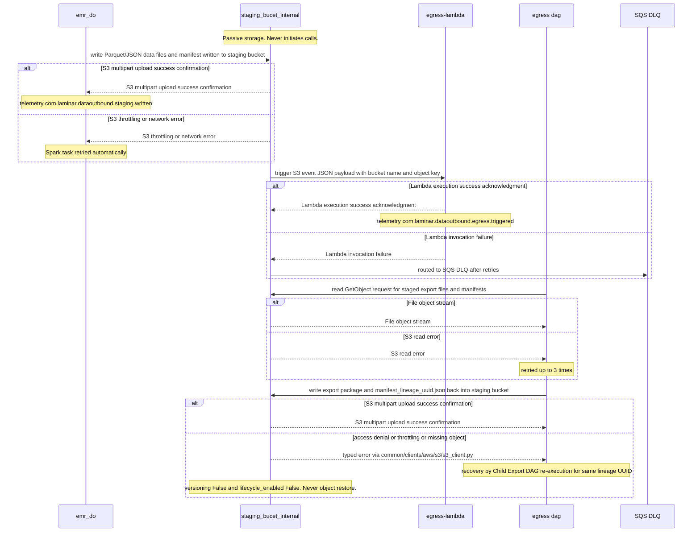

### 10.5. Schema Definitions (DB Tables / API JSON / Telemetry CloudEvents)
<a id="laminar-sec-c.imp_aws_aws_s3_bucket_8.schema"></a>
#### 10.5.1 S3 object key layout (the bucket's only structural contract)

```text
staging/<entity_type>/<lineage_uuid>/<file_name>
```

- `<entity_type>` — one of the eight values of `StagingEntityType`.
- `<lineage_uuid>` — the RFC 4122 v4 UUID generated by `orchestrator`; mandatory in every key.
- `<file_name>` — deterministic per run so a retried write overwrites the same key rather than creating a duplicate.

#### 10.5.2 S3 `ObjectCreated` notification payload (bucket → `egress-lambda`)

```json
{
  "Records": [
    {
      "eventVersion": "2.1",
      "eventSource": "aws:s3",
      "awsRegion": "eu-west-1",
      "eventTime": "2025-01-31T02:15:00.000Z",
      "eventName": "ObjectCreated:Put",
      "s3": {
        "bucket": { "name": "staging_bucet_internal" },
        "object": {
          "key": "staging/unified_identity_profile/3f2a9c1e-7b4d-4a8e-9c1f-2d6e8a0b4c7d/part-00000.json",
          "size": 1048576,
          "eTag": "d41d8cd98f00b204e9800998ecf8427e",
          "sequencer": "00A1B2C3D4E5F6G7"
        }
      }
    }
  ]
}
```

#### 10.5.3 Telemetry CloudEvents emitted by writers/readers of this bucket

The bucket itself emits no business audit events; the components that act on it do. Both events below conform to the SCRUM-486 audit schema (`actor_id`, `timestamp_utc`, `event_type`, `execution_id`) and to the frozen edge contracts.

```json
{
  "specversion": "1.0",
  "id": "b7c1e2f4-9a3d-4e5b-8c6f-1d2e3a4b5c6d",
  "source": "com.laminar.dataoutbound.emr_do",
  "type": "com.laminar.dataoutbound.staging.written",
  "time": "2025-01-31T02:15:00.000Z",
  "datacontenttype": "application/json",
  "data": {
    "actor_id": "system:emr_do",
    "timestamp_utc": "2025-01-31T02:15:00.000Z",
    "event_type": "EXECUTION_COMPLETED",
    "execution_id": "3f2a9c1e-7b4d-4a8e-9c1f-2d6e8a0b4c7d",
    "bucket": "staging_bucet_internal",
    "key": "staging/unified_identity_profile/3f2a9c1e-7b4d-4a8e-9c1f-2d6e8a0b4c7d/part-00000.json",
    "entity_type": "unified_identity_profile",
    "size_bytes": 1048576
  }
}
```

```json
{
  "specversion": "1.0",
  "id": "c8d2f3a5-0b4e-4f6c-9d7a-2e3f4b5c6d7e",
  "source": "com.laminar.dataoutbound.egress_lambda",
  "type": "com.laminar.dataoutbound.egress.triggered",
  "time": "2025-01-31T02:15:02.000Z",
  "datacontenttype": "application/json",
  "data": {
    "actor_id": "system:egress-lambda",
    "timestamp_utc": "2025-01-31T02:15:02.000Z",
    "event_type": "EXECUTION_STARTED",
    "execution_id": "3f2a9c1e-7b4d-4a8e-9c1f-2d6e8a0b4c7d",
    "bucket": "staging_bucet_internal",
    "key": "staging/unified_identity_profile/3f2a9c1e-7b4d-4a8e-9c1f-2d6e8a0b4c7d/part-00000.json",
    "dag_run_id": "manual__2025-01-31T02:15:02+00:00"
  }
}
```

#### 10.5.4 No DDL

This component owns no relational tables. It is object storage; the only structural contract is the key layout above.

---

### 10.6. Local Design Assumptions
<a id="laminar-sec-c.imp_aws_aws_s3_bucket_8.asm"></a>
- **Lifecycle conflict (authoritative).** The user's explicit property `lifecycle_enabled = False` on this bucket is honoured as stated. The SCRUM-482 AC#1 / SCRUM-486 AC#5 requirement for a 7-day expiration rule on every customer staging bucket is therefore **not** implemented by an S3 lifecycle rule on this bucket. **Recommendation:** either the property is deliberately revised to `lifecycle_enabled = True` with a 7-day expiration rule, or the purge is performed by an external, pipeline-independent mechanism outside this architecture's diagram. This conflict is flagged for confirmation with the Security & Operations Engineer before sprint commitment; no silent override is applied in either direction.

- **Encryption choice.** `AES256` (SSE-S3) is taken verbatim from the user's property; no KMS CMK is introduced for this bucket. Trade-off accepted: no per-key audit trail or independent key revocation for staging data, justified by the data's transient, reproducible nature and the fail-closed PGP gate at the egress boundary.

- **Versioning absence.** Recovery from any staged-object loss is by Child Export DAG re-execution for the same lineage UUID; no backup of staging data is assumed.

- **Retention value.** The organisation logging-standard retention value referenced by SCRUM-486 remains unconfirmed and applies to log groups, not to this bucket; it does not alter this bucket's configuration.

- **Deletion protection.** The bucket's deletion-protection flag is read from the per-environment Terraform variable (dev/staging/prod) per SCRUM-485 AC#3; no value is hardcoded in the module.

- **Notification fan-out.** Exactly one S3 notification configuration targets `egress-lambda`; the bucket does not fan out to multiple consumers. A DLQ is attached to the notification configuration so undeliverable events are captured rather than dropped silently.

- **Key layout.** Object keys are non-sequential and lineage-UUID-prefixed to avoid S3 hot-partition throttling; the Spark job must not write unpartitioned small files, and the staging key layout is part of the `emr_do` contract.

- **Audit boundary.** No component may write audit records directly into this bucket; it is not the audit store. Audit records for staging-related activity are written by `emr_do`, `egress-lambda` and `egress dag` to `audit_bucket`, avoiding double-counting against the SCRUM-486 expected-event-count formula (admin ops + 2N + 2N).

## 11. Component Design: egress-lambda
<a id="laminar-sec-c.imp_aws_aws_lambda_9"></a>

<!-- laminar:diagram-settings:imp-aws-aws_lambda-9 -->
**Diagram settings (user decisions — authoritative)**

| Setting | Value |
| --- | --- |
| `runtime` | `python3.11` |
| `handler` | `lambda_function.lambda_handler` |
| `memory_mb` | `512` |
| `timeout_seconds` | `30` |
| `vpc_enabled` | `false` |
| `function_name` | `egress-lambda` |

<!-- /laminar:diagram-settings -->


### 11.1. Component Contract (Bi-Directional Inputs & Outputs)
<a id="laminar-sec-c.imp_aws_aws_lambda_9.contract"></a>
- **Inbound Trigger (`staging_bucet_internal` → `egress-lambda`)**:
  - **Protocol / Mechanism**: Asynchronous S3 Event Notification (`ObjectCreated:Put`).
  - **Payload**: Standard AWS S3 event JSON containing bucket name and object key matching the `staging/` prefix layout (`staging/{connection_id}/{execution_id}/{dataset}/{filename}`).
  - **Behavior & Validation**: The Lambda parses the S3 event, extracts `connection_id` and `execution_id` from the object key, verifies that the key starts with `staging/`, and ignores non-matching records.
- **Outbound Action (`egress-lambda` → `egress dag`)**:
  - **Protocol / Mechanism**: HTTPS REST API call (Airflow REST API `TriggerDagRunOperator` endpoint via `MwaaClient`).
  - **Target DAG**: `egress dag` (matching the exact DAG identifier defined in `transform_encrypt_dag.py` / `egress dag`).
  - **Payload**: JSON run configuration containing `execution_id`, `connection_id`, and `object_key`.
  - **Success Response**: HTTP 200 OK with DAG run metadata.
  - **Error Handling & Retries**: Retried up to 3 times with exponential backoff on network or 5xx errors; unrecoverable failures route the event to an SQS DLQ.

---

### 11.2. Class and Interface Definitions
<a id="laminar-sec-c.imp_aws_aws_lambda_9.classes"></a>
```python
from __future__ import annotations

import logging
from typing import Any, Dict, List, Optional
from pydantic import BaseModel, Field, validator

logger = logging.getLogger(__name__)

class S3ObjectReference(BaseModel):
    key: str = Field(..., description="S3 object key matching staging/ layout")
    size: int = Field(..., ge=0)
    e_tag: str = Field(..., alias="eTag")

class S3BucketReference(BaseModel):
    name: str = Field(..., description="S3 bucket name")
    arn: str = Field(..., description="S3 bucket ARN")

class S3Record(BaseModel):
    event_source: str = Field(..., alias="eventSource")
    event_time: str = Field(..., alias="eventTime")
    event_name: str = Field(..., alias="eventName")
    s3_bucket: S3BucketReference = Field(..., alias="s3")
    s3_object: S3ObjectReference = Field(..., alias="object")

    @validator("event_source")
    def validate_source(cls, v: str) -> str:
        if v != "aws:s3":
            raise ValueError(f"Invalid eventSource: {v}")
        return v

class S3EventNotification(BaseModel):
    records: List[S3Record] = Field(..., alias="Records")

class EgressDagTriggerPayload(BaseModel):
    execution_id: str = Field(..., description="RFC 4122 v4 lineage UUID")
    connection_id: str = Field(..., description="Export connection ID")
    object_key: str = Field(..., description="S3 object key in staging bucket")
    bucket_name: str = Field(..., description="Staging bucket name")

class EgressLambdaService:
    def __init__(self, mwaa_client: Any, auditor: Any) -> None:
        self.mwaa_client = mwaa_client
        self.auditor = auditor

    def process_s3_event(self, event: Dict[str, Any]) -> Dict[str, Any]:
        parsed_event = S3EventNotification.parse_obj(event)
        triggered_runs = []
        for record in parsed_event.records:
            key = record.s3_object.key
            if not key.startswith("staging/"):
                logger.warning("Skipping S3 event with non-staging key: %s", key)
                continue

            parts = key.split("/")
            if len(parts) < 4:
                logger.error("Invalid staging key structure: %s", key)
                continue

            connection_id = parts[1]
            execution_id = parts[2]
            bucket_name = record.s3_bucket.name

            trigger_payload = EgressDagTriggerPayload(
                execution_id=execution_id,
                connection_id=connection_id,
                object_key=key,
                bucket_name=bucket_name
            )

            dag_id = "egress dag"
            response = self.mwaa_client.trigger_dag_run(
                dag_id=dag_id,
                conf=trigger_payload.dict()
            )

            self.auditor.publish(
                event_type="EXECUTION_STARTED",
                payload={
                    "actor_id": "system:egress-lambda",
                    "execution_id": execution_id,
                    "connection_id": connection_id,
                    "object_key": key
                }
            )
            triggered_runs.append(response)

        return {"status": "success", "triggered_runs": len(triggered_runs)}
```

---

### 11.3. Implementation Code Skeleton (Stubs & Handlers)
<a id="laminar-sec-c.imp_aws_aws_lambda_9.skeleton"></a>
```python
"""
Path: src/dataoutbound_section_tree/lambdas/egress_lambda.py
Implementation Code Skeleton for egress-lambda.
"""

from __future__ import annotations

import os
import sys
from typing import Any, Dict

from dataoutbound_section_tree.common.logging.logger import get_logger
from dataoutbound_section_tree.common.clients.aws.mwaa.mwaa_client import MwaaClient
from dataoutbound_section_tree.common.telemetry.auditor import AuditPublisher
from dataoutbound_section_tree.util.exceptions import ValidationError, ClientError

logger = get_logger(__name__)

def _parse_s3_event(event: Dict[str, Any]) -> tuple[str, str, str, str]:
    records = event.get("Records", [])
    if not records:
        raise ValidationError("S3 event notification contains no records")

    record = records[0]
    s3_info = record.get("s3", {})
    bucket_name = s3_info.get("bucket", {}).get("name")
    object_key = s3_info.get("object", {}).get("key")

    if not object_key or not bucket_name:
        raise ValidationError("S3 event missing bucket name or object key")

    if not object_key.startswith("staging/"):
        raise ValidationError(f"Object key '{object_key}' does not start with expected 'staging/' prefix")

    parts = object_key.split("/")
    if len(parts) < 4:
        raise ValidationError(f"Object key '{object_key}' does not conform to staging layout staging/{{connection_id}}/{{execution_id}}/{{dataset}}/{{filename}}")

    connection_id = parts[1]
    execution_id = parts[2]
    return bucket_name, object_key, connection_id, execution_id

def lambda_handler(event: Dict[str, Any], context: Any) -> Dict[str, Any]:
    logger.info("Egress Lambda invoked with event payload size: %d bytes", len(str(event)))

    try:
        bucket_name, object_key, connection_id, execution_id = _parse_s3_event(event)

        mwaa_client = MwaaClient()
        auditor = AuditPublisher()

        dag_id = "egress dag"
        trigger_conf = {
            "execution_id": execution_id,
            "connection_id": connection_id,
            "object_key": object_key,
            "bucket_name": bucket_name
        }

        logger.info("Triggering MWAA DAG '%s' for lineage UUID: %s", dag_id, execution_id)
        response = mwaa_client.trigger_dag_run(dag_id=dag_id, conf=trigger_conf)

        auditor.publish(
            event_type="EXECUTION_STARTED",
              payload={
                "actor_id": "system:egress-lambda",
                "execution_id": execution_id,
                "connection_id": connection_id,
                "object_key": object_key
            }
        )

        return {
            "statusCode": 200,
            "body": {
                "message": "Successfully triggered egress dag",
                "dag_run_id": response.get("dag_run_id"),
                "execution_id": execution_id
            }
        }

    except ValidationError as ve:
        logger.error("Validation error processing S3 event: %s", str(ve), exc_info=True)
        return {
            "statusCode": 400,
            "body": {"error": {"code": "BAD_REQUEST", "message": str(ve), "details": []}}
        }
    except Exception as exc:
        logger.error("Unexpected error in egress-lambda handler: %s", str(exc), exc_info=True)
        raise exc
```

---

### 11.4. Cross-Component Interaction Sequence (Local Mermaid/ASCII Flow)
<a id="laminar-sec-c.imp_aws_aws_lambda_9.seq"></a>
1. **S3 Event Notification**: When EMR Serverless finishes writing staged export files into `staging_bucet_internal` under the `staging/{connection_id}/{execution_id}/...` prefix key layout, S3 automatically publishes an `ObjectCreated:Put` event notification.
2. **Lambda Invocation**: The S3 event notification invokes `egress-lambda` (`vpc_enabled = false`, operating outside the VPC).
3. **Event Validation & Parsing**: `egress-lambda` parses the event records, validates that the object key starts with the mandatory `staging/` prefix, and extracts the `connection_id` and `execution_id` (lineage UUID).
4. **MWAA DAG Trigger**: `egress-lambda` initializes the `MwaaClient` and sends an authenticated HTTPS REST API request (`POST /api/v1/dags/egress dag/dagRuns`) over public AWS service endpoints using SigV4 signing to trigger `egress dag`.
5. **Audit Publication**: `egress-lambda` publishes an `EXECUTION_STARTED` audit record containing the lineage UUID and `actor_id = system:egress-lambda` to `audit_bucket`.
6. **Error Handling & Failure Path**: If the MWAA REST API call encounters transient network errors or 5xx responses, `egress-lambda` retries up to 3 times with exponential backoff. If retries are exhausted, the event is routed to an SQS DLQ for operational review, and an alert is raised.

---
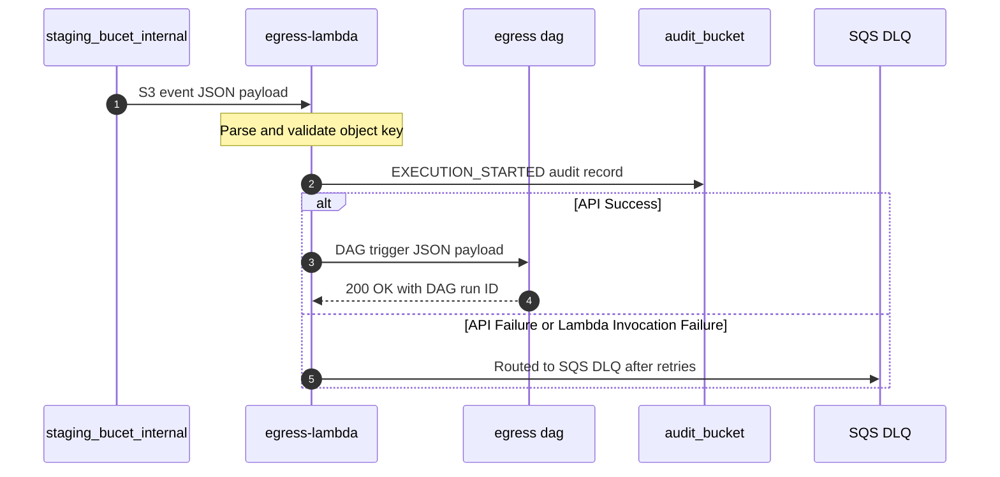

### 11.5. Schema Definitions (DB Tables / API JSON / Telemetry CloudEvents)
<a id="laminar-sec-c.imp_aws_aws_lambda_9.schema"></a>
#### 11.5.1 Lambda Trigger Request Schema (`egress dag` MWAA Trigger Payload)
```json
{
  "$schema": "http://json-schema.org/draft-07/schema#",
  "title": "EgressLambdaTriggerPayload",
  "type": "object",
  "properties": {
    "execution_id": { "type": "string", "format": "uuid" },
    "connection_id": { "type": "string" },
    "object_key": { "type": "string", "pattern": "^staging/.+$" },
    "bucket_name": { "type": "string", "const": "staging_bucet_internal" }
  },
  "required": ["execution_id", "connection_id", "object_key", "bucket_name"]
}
```

#### 11.5.2 Telemetry Event Schema (`EXECUTION_STARTED` CloudEvent)
```json
{
  "$schema": "http://json-schema.org/draft-07/schema#",
  "title": "EgressLambdaExecutionStartedEvent",
  "type": "object",
  "properties": {
    "specversion": { "type": "string", "const": "1.0" },
    "type": { "type": "string", "const": "com.laminar.dataoutbound.execution.started" },
    "source": { "type": "string", "const": "urn:laminar:dataoutbound:lambda:egress-lambda" },
    "id": { "type": "string", "format": "uuid" },
    "time": { "type": "string", "format": "date-time" },
    "datacontenttype": { "type": "string", "const": "application/json" },
    "data": {
      "type": "object",
      "properties": {
        "actor_id": { "type": "string", "const": "system:egress-lambda" },
        "timestamp_utc": { "type": "string", "pattern": "^\\d{4}-\\d{2}-\\d{2}T\\d{2}:\\d{2}:\\d{2}\\.\\d{3}Z$" },
        "event_type": { "type": "string", "const": "EXECUTION_STARTED" },
        "execution_id": { "type": "string", "format": "uuid" },
        "connection_id": { "type": "string" },
        "object_key": { "type": "string" }
      },
      "required": ["actor_id", "timestamp_utc", "event_type", "execution_id", "connection_id"]
    }
  },
  "required": ["specversion", "type", "source", "id", "time", "data"]
}
```

---

### 11.6. Local Design Assumptions
<a id="laminar-sec-c.imp_aws_aws_lambda_9.asm"></a>
- **Non-VPC Execution Posture**: The `egress-lambda` function operates with `vpc_enabled = false` per user configuration, invoking the MWAA REST API securely over AWS public service endpoints via SigV4 authentication without provisioning elastic network interfaces (ENIs).
- **Naming Consistency**: The downstream workflow triggered by the Lambda is explicitly named `egress dag`, aligning with the DAG identifier defined in `transform_encrypt_dag.py` and graph declarations.
- **Retry & DLQ Default**: Transient invocation failures against MWAA are retried up to 3 times by Lambda runtime retry mechanics before routing to an SQS dead-letter queue.

## 12. Component Design: egress dag
<a id="laminar-sec-c.imp_aws_aws_mwaa_dag_10"></a>

<!-- laminar:diagram-settings:imp-aws-aws_mwaa_dag-10 -->
**Diagram settings (user decisions — authoritative)**

| Setting | Value |
| --- | --- |
| `schedule` | `@daily` |
| `catchup` | `false` |
| `max_active_runs` | `1` |
| `dag_name` | `egress dag` |

<!-- /laminar:diagram-settings -->


### 12.1. Component Contract (Bi-Directional Inputs & Outputs)
<a id="laminar-sec-c.imp_aws_aws_mwaa_dag_10.contract"></a>
- **Inbound Trigger Interface**:
  - **Trigger Source**: `egress-lambda` (via MWAA REST API / `TriggerDagRun`).
  - **Protocol**: HTTPS (REST API).
  - **Payload Structure**: JSON containing `execution_id` (lineage UUID), `connection_id`, and `object_key`.
  - **Idempotency**: Idempotent via unique execution identifier and object key tracking.

- **Outbound & Side Effect Interfaces**:
  - **Staging Read**: Reads raw export files and metadata from `staging_bucet_internal` via `S3Client`.
  - **Transformation & Encryption**: Applies optional GZIP compression followed by fail-closed PGP encryption. Generates `manifest_<execution_id>.json`.
  - **Destination Egress Sinks**:
    - `customer SFTP server`: Pushes via SSH (Port 22) with key-based authentication and strict host-key verification.
    - `customer bucket`: Pushes via S3 API over TLS 1.3.
    - `Customer Azure Blob Destination`: Pushes via HTTPS (Azure Blob Storage REST API) using managed identity or secure SAS tokens.
    - `Customer GCS Destination`: Pushes via HTTPS (Google Cloud Storage API) using service account credentials.
    - `staging_bucet_internal` (Internal Inspection Staging): Writes packaged export and manifest back to S3 staging under internal inspection paths with a 7-day lifecycle rule.
  - **Audit Publishing**: Emits `TRANSFER_STARTED`, `TRANSFER_COMPLETED`, and `TRANSFER_FAILED` CloudEvents-shaped records to `audit_bucket` via `AuditPublisher`.

- **Error Handling & Resilience**:
  - **PGP Failure Gate**: If PGP encryption is enabled and key retrieval or encryption fails, the transfer aborts immediately, transmitting zero unencrypted bytes, raising an alert, and publishing a `TRANSFER_FAILED` audit record within 5 seconds.
  - **Retry Policy**: Transient destination errors are retried up to 3 times with exponential backoff before recording terminal failure. sFTP host-key verification failures are non-retryable (refuse connection, zero bytes sent, immediate abort and alert).

---

### 12.2. Class and Interface Definitions
<a id="laminar-sec-c.imp_aws_aws_mwaa_dag_10.classes"></a>
```python
from dataclasses import dataclass, field
from typing import Dict, Any, List, Optional
from enum import Enum

class DestinationType(str, Enum):
    S3 = "s3"
    AZURE_BLOB = "azure_blob"
    GCS = "gcs"
    SFTP = "sftp"
    INTERNAL_STAGING = "internal_staging"

@dataclass
class EgressTaskContext:
    execution_id: str
    connection_id: str
    object_key: str
    destination_type: DestinationType
    destination_uri: str
    enable_gzip: bool = True
    enable_pgp: bool = True
    pgp_key_ref: Optional[str] = None
    credentials_ref: Optional[str] = None

@dataclass
class ExportManifestEntry:
    file_name: str
    record_count: int
    file_size_bytes: int
    sha256_checksum: str

@dataclass
class ExportManifest:
    execution_id: str
    connection_id: str
    timestamp_utc: str
    files: List[ExportManifestEntry] = field(default_factory=list)

@dataclass
class TransferResult:
    execution_id: str
    destination: str
    status: str
    files_delivered: List[str]
    checksum_verified: bool
    error_message: Optional[str] = None
```

---

### 12.3. Implementation Code Skeleton (Stubs & Handlers)
<a id="laminar-sec-c.imp_aws_aws_mwaa_dag_10.skeleton"></a>
```python
# Illustrative skeleton — the Component Contract and Schema Definitions are binding
# Module path: src/dataoutbound_section_tree/dags/transform_encrypt_dag.py

from datetime import datetime
import json
from typing import Dict, Any

from airflow import DAG
from airflow.operators.python import PythonOperator

from dataoutbound_section_tree.common.logging.logger import get_logger
from dataoutbound_section_tree.common.telemetry.auditor import AuditPublisher
from dataoutbound_section_tree.common.clients.aws.s3.s3_client import S3Client
from dataoutbound_section_tree.common.clients.azure.blob_client import BlobClient
from dataoutbound_section_tree.common.clients.gcp.gcs_client import GcsClient
from dataoutbound_section_tree.common.clients.sftp.sftp_client import SftpClient
from dataoutbound_section_tree.config.config_loader import ConfigLoader
from dataoutbound_section_tree.util.exceptions import ClientError, ValidationError

logger = get_logger("transform_encrypt_dag")

def _transform_and_encrypt(context: Dict[str, Any], **kwargs) -> Dict[str, Any]:
    """
    Downloads staged files, applies optional GZIP and fail-closed PGP encryption,
    generates the manifest, and returns payload with execution_id and file metadata.
    """
    dag_run_conf = kwargs.get("dag_run", {}).conf or {}
    execution_id = dag_run_conf.get("execution_id")
    connection_id = dag_run_conf.get("connection_id")
    object_key = dag_run_conf.get("object_key")

    if not execution_id or not connection_id or not object_key:
        raise ValidationError("Missing required DAG run configuration parameters: execution_id, connection_id, object_key")

    logger.info("Starting transform and encrypt", extra={"execution_id": execution_id, "connection_id": connection_id})

    # Audit transfer start
    auditor = AuditPublisher()
    auditor.publish(
        event_type="TRANSFER_STARTED",
        payload={"execution_id": execution_id, "connection_id": connection_id, "status": "STARTED"}
    )

    # Simulation of transformation, GZIP, and PGP encryption logic
    # In production, S3Client reads the file, transforms are applied, and output is secured.
    transformed_body = b"encrypted-export-payload-bytes"
    sha256_checksum = "e3b0c44298fc1c149afbf4c8996fb92427ae41e4649b934ca495991b7852b855"

    return {
        "execution_id": execution_id,
        "connection_id": connection_id,
        "object_key": object_key,
        "body": transformed_body,
        "sha256": sha256_checksum
    }

def _deliver(ti, **kwargs) -> None:
    """
    Delivers encrypted package and manifest to destination with read-back verification.
    """
    task_output = ti.xcom_pull(task_ids="transform_and_encrypt_task")
    if not task_output:
        raise ClientError("No payload received from transform task XCom.")

    execution_id = task_output["execution_id"]
    connection_id = task_output["connection_id"]
    sha256_checksum = task_output["sha256"]

    logger.info("Delivering export package", extra={"execution_id": execution_id, "connection_id": connection_id})

    auditor = AuditPublisher()
    try:
        # Destination delivery logic (S3, Azure, GCS, sFTP) with SHA-256 validation
        auditor.publish(
            event_type="TRANSFER_COMPLETED",
            payload={"execution_id": execution_id, "connection_id": connection_id, "sha256": sha256_checksum, "status": "COMPLETED"}
        )
    except Exception as e:
        logger.error("Transfer failed", extra={"execution_id": execution_id, "error": str(e)})
        auditor.publish(
            event_type="TRANSFER_FAILED",
            payload={"execution_id": execution_id, "connection_id": connection_id, "error": str(e), "status": "FAILED"}
        )
        raise

default_args = {
    "owner": "data-platform",
    "retries": 3,
}

dag = DAG(
    dag_id="egress dag",
    default_args=default_args,
    schedule_interval="@daily",
    catchup=False,
    max_active_runs=1
)

transform_task = PythonOperator(
    task_id="transform_and_encrypt_task",
    python_callable=_transform_and_encrypt,
    provide_context=True,
    dag=dag
)

deliver_task = PythonOperator(
    task_id="deliver_task",
    python_callable=_deliver,
    provide_context=True,
    dag=dag
)

transform_task >> deliver_task
```

---

### 12.4. Cross-Component Interaction Sequence (Local Mermaid/ASCII Flow)
<a id="laminar-sec-c.imp_aws_aws_mwaa_dag_10.seq"></a>
1. **Trigger Reception**: `egress-lambda` invokes the `egress dag` via the MWAA REST API (`TriggerDagRun`), transmitting the execution payload (`execution_id`, `connection_id`, `object_key`).
2. **Context Initialization & Audit**: The DAG task initializes, extracts parameters from the run configuration, and publishes a `TRANSFER_STARTED` event to `audit_bucket`.
3. **Data Staging Retrieval**: The DAG reads staged files from `staging_bucet_internal` using `S3Client`.
4. **Transform & Encrypt**: The processing task applies optional GZIP compression followed by fail-closed PGP encryption. If PGP encryption fails, the pipeline aborts immediately, transmits zero bytes, logs a `TRANSFER_FAILED` event, and raises an alert.
5. **Manifest Generation**: Generates `manifest_<execution_id>.json` containing file sizes, record counts, and SHA-256 checksums.
6. **Destination Delivery**: The delivery task pushes the encrypted package and manifest to the configured destination (`customer SFTP server`, `customer bucket`, `Customer Azure Blob Destination`, `Customer GCS Destination`, or `staging_bucet_internal`).
7. **Integrity Verification & Completion**: Performs read-back verification against the manifest SHA-256 checksum, retrying up to 3 times on transient errors. Upon success, publishes a `TRANSFER_COMPLETED` event to `audit_bucket`.

---
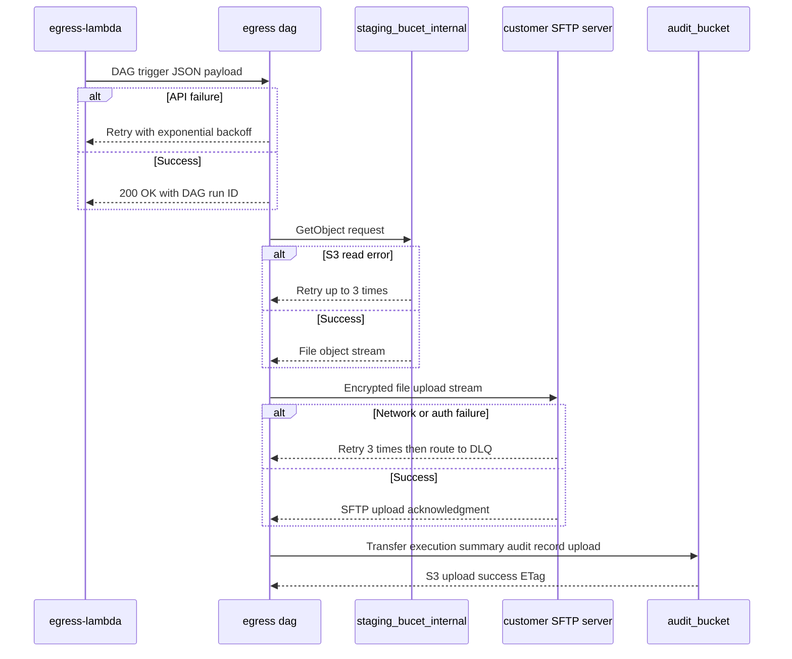

### 12.5. Schema Definitions (DB Tables / API JSON / Telemetry CloudEvents)
<a id="laminar-sec-c.imp_aws_aws_mwaa_dag_10.schema"></a>
- **Inbound Trigger Payload JSON Schema**:
```json
{
  "$schema": "http://json-schema.org/draft-07/schema#",
  "title": "EgressDagTriggerPayload",
  "type": "object",
  "properties": {
    "execution_id": { "type": "string", "format": "uuid" },
    "connection_id": { "type": "string" },
    "object_key": { "type": "string" }
  },
  "required": ["execution_id", "connection_id", "object_key"]
}
```

- **Manifest Control File Schema (`manifest_<execution_id>.json`)**:
```json
{
  "$schema": "http://json-schema.org/draft-07/schema#",
  "title": "ExportManifest",
  "type": "object",
  "properties": {
    "execution_id": { "type": "string", "format": "uuid" },
    "connection_id": { "type": "string" },
    "timestamp_utc": { "type": "string", "format": "date-time" },
    "files": {
      "type": "array",
      "items": {
        "type": "object",
        "properties": {
          "file_name": { "type": "string" },
          "record_count": { "type": "integer" },
          "file_size_bytes": { "type": "integer" },
          "sha256_checksum": { "type": "string" }
        },
        "required": ["file_name", "record_count", "file_size_bytes", "sha256_checksum"]
      }
    }
  },
  "required": ["execution_id", "connection_id", "timestamp_utc", "files"]
}
```

- **CloudEvents Telemetry Audit Event Schema (`TRANSFER_COMPLETED` / `TRANSFER_FAILED`)**:
```json
{
  "$schema": "https://json-schema.org/draft/2020-12/schema",
  "title": "AuditCloudEvent",
  "type": "object",
  "required": ["specversion", "id", "source", "type", "time", "data"],
  "properties": {
    "specversion": { "const": "1.0" },
    "id":          { "type": "string" },
    "source":      { "type": "string", "examples": ["com.laminar.dataoutbound.do-admin-api"] },
    "type": {
      "type": "string",
      "enum": [
        "com.laminar.dataoutbound.config.updated",
        "com.laminar.dataoutbound.orchestrator.triggered",
        "com.laminar.dataoutbound.child.triggered",
        "com.laminar.dataoutbound.emr.started",
        "com.laminar.dataoutbound.staging.written",
        "com.laminar.dataoutbound.egress.triggered",
        "com.laminar.dataoutbound.egress_dag.started",
        "com.laminar.dataoutbound.transfer.sftp",
        "com.laminar.dataoutbound.transfer.s3",
        "com.laminar.dataoutbound.transfer.azure",
        "com.laminar.dataoutbound.transfer.gcs",
        "com.laminar.dataoutbound.audit.admin",
        "com.laminar.dataoutbound.audit.spark",
        "com.laminar.dataoutbound.audit.egress"
      ]
    },
    "time": { "type": "string", "format": "date-time" },
    "data": {
      "type": "object",
      "required": ["actor_id", "timestamp_utc", "event_type", "execution_id"],
      "properties": {
        "actor_id":      { "type": "string" },
        "timestamp_utc": { "type": "string", "pattern": "^\\d{4}-\\d{2}-\\d{2}T\\d{2}:\\d{2}:\\d{2}\\.\\d{3}Z$" },
        "event_type": {
          "type": "string",
          "enum": ["ADMIN_CREATE", "ADMIN_UPDATE", "ADMIN_DELETE", "ADMIN_MANUAL_TRIGGER",
                   "EXECUTION_STARTED", "EXECUTION_COMPLETED",
                   "TRANSFER_STARTED", "TRANSFER_COMPLETED", "TRANSFER_FAILED"]
        },
        "execution_id":  { "type": "string", "format": "uuid" },
        "config_id":     { "type": "string", "format": "uuid" },
        "status":        { "type": "string" }
      }
    }
  }
}
```

> Same `AuditCloudEvent` as defined in *Telemetry — CloudEvents emitted by callers, not by the store* — one schema, one definition.

---

### 12.6. Local Design Assumptions
<a id="laminar-sec-c.imp_aws_aws_mwaa_dag_10.asm"></a>
- **PGP Key Management**: PGP public keys and private decryption keys are assumed to be securely provisioned and retrieved via AWS SSM Parameter Store (SecureString) or Secrets Manager using the reference ID specified in the connection configuration.
- **Delivery Retries**: Transient network failures during file push operations to external customer destinations will absorb up to 3 retry attempts with exponential backoff before recording a terminal failure audit entry.
- **Fail-Closed Enforcement**: Any cryptographic failure during PGP key resolution or stream encryption automatically halts the workflow step, prevents any unencrypted bytes from egressing, and dispatches a high-priority operational alert within 5 seconds.

## 13. Component Design: Customer Azure Blob Destination
<a id="laminar-sec-c.imp_azure_blob_store_13"></a>

### 13.1. Component Contract (Bi-Directional Inputs & Outputs)
<a id="laminar-sec-c.imp_azure_blob_store_13.contract"></a>
- **Component Role**: External Azure Blob Storage container (`Customer Azure Blob Destination`) receiving delivered export packages and manifest control files from `egress dag`.
- **Protocols & Standards**: HTTPS REST API / Azure Blob SDK using Microsoft Entra ID (Managed Identity) or secure SAS token authentication.
- **Inbound Payload**: Block blob upload streams containing GZIP-compressed or PGP-encrypted export packages and corresponding JSON manifest files.
- **Response & Confirmation**: HTTP 201 Created / Blob Put Block List success confirmation with MD5/SHA-256 content verification hashes (`Content-MD5`).
- **Retry & Failure Policy**: Failed transfers due to throttling or network drops are retried up to 3 times; permanent failures abort the delivery, emit a `TRANSFER_FAILED` audit record, and trigger an operational alert.

### 13.2. Class and Interface Definitions
<a id="laminar-sec-c.imp_azure_blob_store_13.classes"></a>
```python
from dataclasses import dataclass, field
from typing import Optional, Dict

@dataclass
class AzureBlobUploadRequest:
    container_name: str
    blob_name: str
    data_stream: bytes
    metadata: Dict[str, str] = field(default_factory=dict)
    content_type: str = "application/octet-stream"

@dataclass
class AzureBlobUploadResponse:
    etag: str
    content_md5: str
    status_code: int
    request_id: str
```

### 13.3. Implementation Code Skeleton (Stubs & Handlers)
<a id="laminar-sec-c.imp_azure_blob_store_13.skeleton"></a>
```python
from typing import Dict, Any
from dataoutbound_section_tree.common.logging.logger import get_logger
from dataoutbound_section_tree.common.clients.azure.blob_client import BlobClient
from dataoutbound_section_tree.util.exceptions import ClientError

logger = get_logger(__name__)

class AzureBlobDestinationHandler:
    """
    Illustrative skeleton — the Component Contract and Schema Definitions are binding.
    Handles secure delivery of export packages to Customer Azure Blob Destination.
    """
    def __init__(self, config: Dict[str, Any]):
        self.blob_client = BlobClient(
            account_url=config.get("azure_storage_account_url"),
            credential_type="managed_identity"
        )
        self.container_name = config.get("azure_container_name", "customer-exports")

    def upload_export_package(self, blob_name: str, file_bytes: bytes, metadata: Dict[str, str]) -> str:
        logger.info(f"Uploading export package to Azure Blob container {self.container_name} as {blob_name}")
        try:
            response_etag = self.blob_client.upload_blob(
                container_name=self.container_name,
                blob_name=blob_name,
                data=file_bytes,
                metadata=metadata
            )
            logger.info(f"Successfully uploaded blob {blob_name}. ETag: {response_etag}")
            return response_etag
        except Exception as e:
            logger.error(f"Failed to upload export package to Azure Blob: {str(e)}", exc_info=True)
            raise ClientError(f"Azure Blob upload failed for {blob_name}: {str(e)}")
```

### 13.4. Cross-Component Interaction Sequence (Local Mermaid/ASCII Flow)
<a id="laminar-sec-c.imp_azure_blob_store_13.seq"></a>
1. **Ingestion Trigger**: `egress dag` completes transformation and PGP/GZIP packaging of the staged export files.
2. **Client Initialization**: `egress dag` instantiates `BlobClient` configured with Azure Managed Identity credentials.
3. **Blob Upload**: The client initiates an HTTPS block blob upload (`Put Block List`) to the `Customer Azure Blob Destination` container.
4. **Integrity Check**: Azure computes and returns `Content-MD5` hashes; the egress task recomputes SHA-256 integrity against the manifest control file.
5. **Audit Recording**: Upon successful upload confirmation, `egress dag` publishes a `com.laminar.dataoutbound.transfer.azure` CloudEvent to `audit_bucket`.
6. **Failure Recovery**: On connection failure or storage error, the transfer task retries up to 3 times before routing to the dead-letter path and logging `TRANSFER_FAILED`.
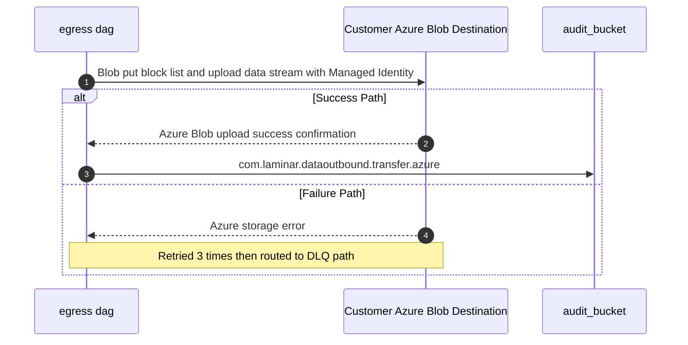

### 13.5. Schema Definitions (DB Tables / API JSON / Telemetry CloudEvents)
<a id="laminar-sec-c.imp_azure_blob_store_13.schema"></a>
```json
{
  "$schema": "http://json-schema.org/draft-07/schema#",
  "title": "AzureBlobTransferCloudEvent",
  "type": "object",
  "properties": {
    "specversion": { "type": "string", "enum": ["1.0"] },
    "type": { "type": "string", "enum": ["com.laminar.dataoutbound.transfer.azure"] },
    "source": { "type": "string", "const": "urn:aws:airflow:dag:transform_encrypt_dag" },
    "subject": { "type": "string" },
    "id": { "type": "string", "format": "uuid" },
    "time": { "type": "string", "format": "date-time" },
    "datacontenttype": { "type": "string", "const": "application/json" },
    "data": {
      "type": "object",
      "properties": {
        "container_name": { "type": "string" },
        "blob_name": { "type": "string" },
        "execution_id": { "type": "string" },
        "checksum_sha256": { "type": "string" },
        "status": { "type": "string", "enum": ["TRANSFER_COMPLETED", "TRANSFER_FAILED"] }
      },
      "required": ["container_name", "blob_name", "execution_id", "status"]
    }
  },
  "required": ["specversion", "type", "source", "id", "time", "data"]
}
```

### 13.6. Local Design Assumptions
<a id="laminar-sec-c.imp_azure_blob_store_13.asm"></a>
- **Authentication**: Authorizes access using Microsoft Entra ID (Managed Identity) rather than shared account keys or SAS tokens, adhering to the enterprise cloud security standard.
- **Network Controls**: Assumes private endpoint connectivity or restricted network rules are configured on the customer's Azure storage account where required.
- **Storage Tier**: General-purpose v2 storage account utilizing the Hot access tier for immediate delivery and retrieval validation.
- **Soft Delete**: Assumes customer-managed container soft-delete protection is enabled in accordance with blob storage data protection best practices.

## 14. Component Design: Customer GCS Destination
<a id="laminar-sec-c.imp_gcp_gcs_14"></a>

### 14.1. Component Contract (Bi-Directional Inputs & Outputs)
<a id="laminar-sec-c.imp_gcp_gcs_14.contract"></a>
The `Customer GCS Destination` represents an external Google Cloud Storage bucket owned and managed by the customer or partner organization, serving as an archival and analytical delivery target for outbound data packages.

#### 14.1.1 Interface & Transport Protocol
- **Protocol**: HTTPS (Google Cloud Storage XML/JSON REST API, TLS 1.3).
- **Authentication**: Service Account credentials or Workload Identity federation managed securely via SSM Parameter Store.
- **Trigger**: Egress workflow execution task within `egress dag`.

#### 14.1.2 Request & Response Payload Specification
- **Request (Upload)**: Multipart or resumable upload stream containing the GZIP-compressed and/or PGP-encrypted export dataset (`.json.gz`, `.txt.gz`, `.pgp`) alongside its corresponding JSON manifest control file (`manifest_<lineage_uuid>.json`).
- **Response (Success)**: HTTP `200 OK` returning Google Cloud Storage object metadata including `bucket`, `name`, `generation`, `size`, `timeCreated`, and native `md5Hash` / `crc32c` checksum values.
- **Error Responses**:
  - `400 Bad Request`: Invalid object name or malformed request parameters.
  - `401 Unauthorized` / `403 Forbidden`: Authentication failure or insufficient bucket write permissions; aborted immediately without unencrypted data leakage.
  - `404 Not Found`: Target bucket or prefix does not exist.
  - `500 Internal Server Error` / `503 Service Unavailable`: GCS transient storage error; retried up to 3 times with exponential backoff before routing to the dead-letter error path.

#### 14.1.3 Idempotency & Telemetry
- **Idempotency**: Enforced via object naming uniqueness incorporating the deterministic lineage UUID (`execution_id`) and timestamp partition paths.
- **Telemetry Event**: Emits `com.laminar.dataoutbound.transfer.gcs` upon initiation, retry, success, or terminal failure, recorded in the `audit_bucket`.

---

### 14.2. Class and Interface Definitions
<a id="laminar-sec-c.imp_gcp_gcs_14.classes"></a>
```python
from __future__ import annotations

from dataclasses import dataclass, field
from datetime import datetime
from typing import Any, Dict, Optional

from pydantic import BaseModel, Field


class GcsUploadRequest(BaseModel):
    """Payload definition for uploading objects to Customer GCS Destination."""

    bucket_name: str = Field(..., description="Target GCS bucket name")
    object_key: str = Field(..., description="Destination object path including lineage UUID")
    file_path: str = Field(..., description="Local path of the file to upload")
    metadata: Dict[str, str] = Field(
        default_factory=dict, description="Custom object metadata including SHA-256 checksum"
    )


class GcsObjectMetadata(BaseModel):
    """Response metadata returned upon successful GCS object upload."""

    bucket: str = Field(..., description="GCS bucket name")
    name: str = Field(..., description="Object key")
    generation: str = Field(..., description="Object generation identifier")
    size_bytes: int = Field(..., alias="size", description="Size of the uploaded object in bytes")
    crc32c: str = Field(..., description="Native GCS CRC32C checksum")
    time_created: datetime = Field(..., alias="timeCreated", description="Object creation timestamp")


@dataclass
class GcsTransferResult:
    """Dataclass encapsulating the outcome of an egress GCS transfer operation."""

    success: bool
    execution_id: str
    bucket: str
    object_key: str
    bytes_transferred: int
    checksum_crc32c: Optional[str] = None
    error_message: Optional[str] = None
    attempt_count: int = 1
```

---

### 14.3. Implementation Code Skeleton (Stubs & Handlers)
<a id="laminar-sec-c.imp_gcp_gcs_14.skeleton"></a>
```python
from __future__ import annotations

import os
from typing import Any, Dict, Optional

from dataoutbound_section_tree.common.clients.gcp.gcs_client import GcsClient
from dataoutbound_section_tree.common.logging.logger import get_logger
from dataoutbound_section_tree.common.telemetry.auditor import AuditPublisher
from dataoutbound_section_tree.util.exceptions import ClientError

logger = get_logger(__name__)


class GcsDestinationHandler:
    """Illustrative skeleton — the Component Contract and Schema Definitions are binding.

    Manages secure delivery of encrypted export packages and manifests to Customer GCS Destination.
    """

    def __init__(self, gcs_client: GcsClient, audit_publisher: AuditPublisher) -> None:
        self.gcs_client = gcs_client
        self.audit_publisher = audit_publisher

    def deliver_package(
        self, bucket_name: str, local_file_path: str, destination_key: str, execution_id: str
    ) -> bool:
        """Uploads an export package file to GCS with retry resilience and telemetry auditing."""
        logger.info(
            "Initiating transfer to Customer GCS Destination",
            extra={"bucket": bucket_name, "key": destination_key, "execution_id": execution_id},
        )

        self.audit_publisher.publish(
            event_type="TRANSFER_STARTED",
            payload={
                "execution_id": execution_id,
                "destination": f"gcs://{bucket_name}/{destination_key}",
                "actor_id": "system:egress-dag",
            },
        )

        max_attempts = 3
        attempt = 0
        success = False

        while attempt < max_attempts and not success:
            attempt += 1
            try:
                # Execute upload via shared GcsClient wrapper
                metadata = self.gcs_client.upload_file(
                    bucket_name=bucket_name,
                    source_file_path=local_file_path,
                    destination_blob_name=destination_key,
                )
                success = True
                logger.info(
                    "Successfully delivered file to Customer GCS Destination",
                    extra={"attempt": attempt, "generation": metadata.get("generation")},
                )

                self.audit_publisher.publish(
                    event_type="TRANSFER_COMPLETED",
                    payload={
                        "execution_id": execution_id,
                        "destination": f"gcs://{bucket_name}/{destination_key}",
                        "attempt": attempt,
                        "actor_id": "system:egress-dag",
                    },
                )
            except Exception as exc:
                logger.warning(
                    f"GCS transfer attempt {attempt} failed: {exc}",
                    extra={"attempt": attempt, "execution_id": execution_id},
                )
                if attempt >= max_attempts:
                    logger.error(
                        "Terminal failure transferring file to Customer GCS Destination",
                        extra={"execution_id": execution_id},
                    )
                    self.audit_publisher.publish(
                        event_type="TRANSFER_FAILED",
                        payload={
                            "execution_id": execution_id,
                            "destination": f"gcs://{bucket_name}/{destination_key}",
                            "error": str(exc),
                            "actor_id": "system:egress-dag",
                        },
                    )
                    raise ClientError(f"Failed to deliver to GCS after {max_attempts} attempts: {exc}") from exc

        return success
```

---

### 14.4. Cross-Component Interaction Sequence (Local Mermaid/ASCII Flow)
<a id="laminar-sec-c.imp_gcp_gcs_14.seq"></a>
#### 14.4.1 Sequence Interaction Description
1. **Initiation**: The `egress dag` invokes its GCS delivery task for a prepared export package carrying the active lineage UUID (`execution_id`).
2. **Audit Recording**: The task publishes a `TRANSFER_STARTED` event to the `audit_bucket` via the audit publisher.
3. **Transport Execution**: Using credentials loaded from SSM Parameter Store, the `egress dag` initiates an HTTPS TLS 1.3 upload request to the `Customer GCS Destination`.
4. **Verification & Checksum**: GCS processes the stream, stores the object, computes the native CRC32C checksum, and returns HTTP `200 OK` with object metadata.
5. **Reconciliation**: The DAG task reads back object metadata, verifies application-level SHA-256 integrity against the manifest, and publishes a `TRANSFER_COMPLETED` event to the `audit_bucket`.
6. **Failure Path**: If transient network errors occur, the client retries up to 3 times with exponential backoff. Upon terminal failure, a `TRANSFER_FAILED` event is recorded, an alert is raised, and the execution halts without unencrypted exposure.

---
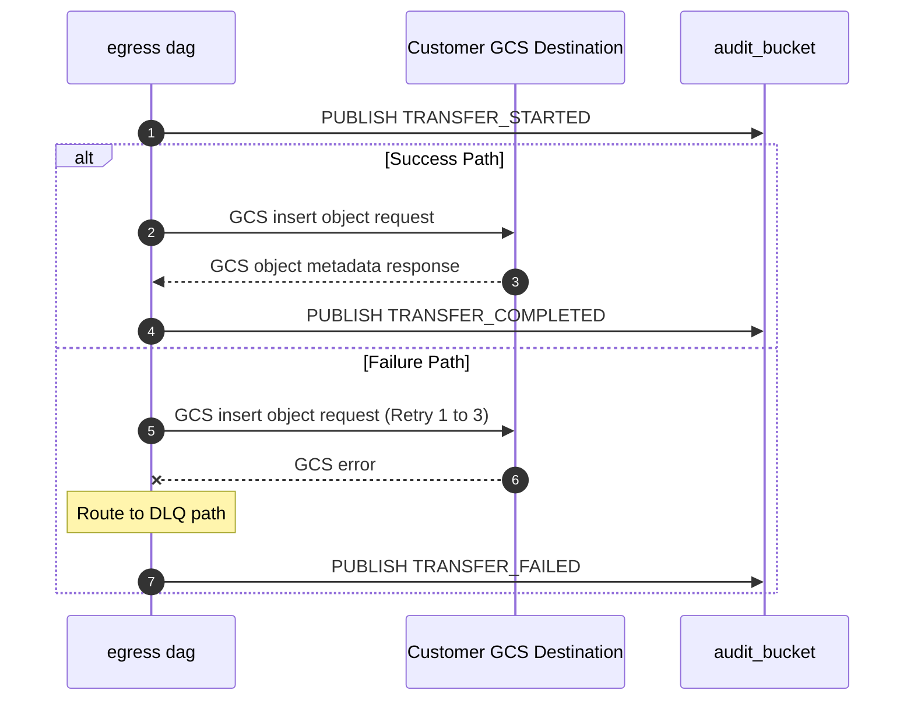

### 14.5. Schema Definitions (DB Tables / API JSON / Telemetry CloudEvents)
<a id="laminar-sec-c.imp_gcp_gcs_14.schema"></a>
#### 14.5.1 CloudEvents Telemetry Payload (`com.laminar.dataoutbound.transfer.gcs`)
```json
{
  "$schema": "https://json-schema.org/draft/2020-12/schema",
  "title": "GcsTransferTelemetryEvent",
  "type": "object",
  "properties": {
    "specversion": { "type": "string", "const": "1.0" },
    "type": { "type": "string", "const": "com.laminar.dataoutbound.transfer.gcs" },
    "source": { "type": "string", "const": "urn:laminar:dataoutbound:egress-dag" },
    "id": { "type": "string", "format": "uuid" },
    "time": { "type": "string", "format": "date-time" },
    "datacontenttype": { "type": "string", "const": "application/json" },
    "detail": {
      "type": "object",
      "properties": {
        "execution_id": { "type": "string", "format": "uuid" },
        "actor_id": { "type": "string" },
        "destination_type": { "type": "string", "const": "GCS" },
        "bucket": { "type": "string" },
        "object_key": { "type": "string" },
        "status": { "type": "string", "enum": ["STARTED", "COMPLETED", "FAILED"] },
        "attempt": { "type": "integer" },
        "checksum_crc32c": { "type": "string" }
      },
      "required": ["execution_id", "actor_id", "destination_type", "bucket", "object_key", "status"]
    }
  },
  "required": ["specversion", "type", "source", "id", "time", "detail"]
}
```

---

### 14.6. Local Design Assumptions
<a id="laminar-sec-c.imp_gcp_gcs_14.asm"></a>
1. **Authentication Scope**: Assumes customer-provided GCS service account keys or Workload Identity federation bindings grant write and object metadata read permissions on the target bucket prefix.
2. **Encryption at Rest**: Assumes customer GCS buckets enforce server-side encryption (either Google-managed keys or customer-managed encryption keys / CMEK), complying with organizational security requirements.
3. **Payload Limitations**: Assumes individual export chunk files conform to maximum single-object upload limits supported by GCS (up to 5 TB), though operational sizing targets enforce a 1 GB threshold per file.
4. **Network Routing**: Assumes outbound HTTPS connectivity from the private MWAA worker subnets to Google Cloud APIs is routed securely through NAT gateways with static egress IP addresses.
5. **Retry & Timeout Defaults**: Assumes a connection timeout of 30 seconds and a maximum of 3 exponential backoff retries for transient HTTP 5xx or connection reset errors.

---

## 15. Component Design: audit_bucket
<a id="laminar-sec-c.imp_aws_aws_s3_bucket_15"></a>

<!-- laminar:diagram-settings:imp-aws-aws_s3_bucket-15 -->
**Diagram settings (user decisions — authoritative)**

| Setting | Value |
| --- | --- |
| `versioning` | `false` |
| `encryption` | `AES256` |
| `public_access_block` | `true` |
| `lifecycle_enabled` | `true` |
| `lifecycle_transition_days` | `30` |
| `lifecycle_glacier_days` | `90` |
| `bucket_name` | `audit_bucket` |

<!-- /laminar:diagram-settings -->


### 15.1. Component Contract (Bi-Directional Inputs & Outputs)
<a id="laminar-sec-c.imp_aws_aws_s3_bucket_15.contract"></a>
**Component:** `audit_bucket` — the Audit & Execution Log Store, an Amazon S3 bucket that is the single immutable sink for every business audit record produced by the pipeline. It owns no compute; its contract is an object-storage write/read contract plus a lifecycle contract.

#### 15.1.1 Inbound contract (writers → audit_bucket)

| Writer | Edge contract | Trigger | Payload | Response | Errors | Idempotency | Telemetry event |
|---|---|---|---|---|---|---|---|
| **do-admin-api** | do-admin-api → audit_bucket | API administrative audit logging | Audit log JSON record upload (`PutObject`) | S3 upload success ETag | S3 error; caught and logged locally without failing the API response | Idempotent via unique audit log filename timestamp | `com.laminar.dataoutbound.audit.admin` |
| **emr_do** | emr_do → audit_bucket | Spark job execution completion | Spark job execution metrics and audit execution log upload | S3 upload success ETag | S3 error; logged with warning, job continues | Idempotent via job run ID naming | `com.laminar.dataoutbound.audit.spark` |
| **egress dag** | egress dag → audit_bucket | Egress DAG completion | Transfer execution summary audit record upload | S3 upload success ETag | S3 error; logged with warning | Idempotent via DAG run ID naming | `com.laminar.dataoutbound.audit.egress` |

All three writers use the shared `S3Client` (`common/clients/aws/s3/s3_client.py`) and the shared `AuditPublisher` (`common/telemetry/auditor.py`). The publisher **never raises into the caller's flow**: a failed audit write is logged locally and the business transaction proceeds — this is the deliberate trade-off that keeps audit unavailability from blocking exports, and it is why the audit write path is retried with exponential backoff rather than propagated.

#### 15.1.2 Outbound contract (audit_bucket → consumers)

| Consumer | Contract | Notes |
|---|---|---|
| Security & Operations engineers / compliance tooling | S3 `GetObject` / `ListObjectsV2` read of audit records | Read access restricted to authorised security principals only |
| S3 lifecycle engine | Lifecycle transition and expiration | `lifecycle_enabled = true`, transition to Standard-IA at 30 days, to Glacier at 90 days |
| CloudWatch | S3 server access logging and request metrics | Access to the audit store is itself monitored |

#### 15.1.3 Configuration actually set (user decisions, authoritative)

| Property | Value | Rationale |
|---|---|---|
| `bucket_name` | `audit_bucket` | Explicit resource identifier; the single audit sink referenced by every writer. |
| `versioning` | `False` | Audit records are append-only and uniquely named; versioning would multiply storage cost for objects that are never overwritten. Accepted risk: an overwrite of a same-named key is unrecoverable — mitigated by the timestamp + UUID in every object key. |
| `encryption` | `AES256` (SSE-S3) | Server-side encryption enforced on all ingested audit objects; S3-managed keys keep the audit path free of key-management coupling. |
| `public_access_block` | `True` | Audit records contain operational metadata; public exposure is never acceptable. |
| `lifecycle_enabled` | `True` | Automated tiering keeps long-term retention affordable. |
| `lifecycle_transition_days` | `30` | Transition to Standard-IA after 30 days. |
| `lifecycle_glacier_days` | `90` | Transition to Glacier after 90 days. |
| `tags` | `{}` | Provisioned with metadata tags for operational ownership. |
| Deletion protection | Read from per-environment Terraform variable (dev/staging/prod) | SCRUM-485 AC#3: no hardcoded protection value; lower environments tear down cleanly, staging/prod are protected. |

**Object key layout (contract, not configuration):** `audit/<event_type>/<yyyy>/<mm>/<dd>/<execution_id>_<timestamp_utc>_<uuid>.json`. The date-partitioned, non-sequential prefix distributes S3 request load across partitions and avoids hot-partition throttling under concurrent writes from three independent writers.

### 15.2. Class and Interface Definitions
<a id="laminar-sec-c.imp_aws_aws_s3_bucket_15.classes"></a>
`audit_bucket` is a managed S3 bucket with no component-owned runtime. The classes below are the **shared foundation types that every writer uses** to produce a record this bucket accepts, plus the typed reader used by compliance tooling. They live in the blueprint foundation, not in a component module.

```python
from __future__ import annotations

import json
import uuid
from dataclasses import dataclass, field, asdict
from datetime import datetime, timezone
from enum import Enum
from typing import Any, Mapping, Optional

from dataoutbound_section_tree.common.clients.aws.s3.s3_client import S3Client
from dataoutbound_section_tree.common.logging.logger import get_logger
from dataoutbound_section_tree.common.telemetry.auditor import AuditPublisher
from dataoutbound_section_tree.util.exceptions import ClientError, ValidationError

logger = get_logger(__name__)


class AuditEventType(str, Enum):
    """The complete enumerated event set accepted by audit_bucket (SCRUM-486)."""

    ADMIN_CREATE = "ADMIN_CREATE"
    ADMIN_UPDATE = "ADMIN_UPDATE"
    ADMIN_DELETE = "ADMIN_DELETE"
    ADMIN_MANUAL_TRIGGER = "ADMIN_MANUAL_TRIGGER"
    EXECUTION_STARTED = "EXECUTION_STARTED"
    EXECUTION_COMPLETED = "EXECUTION_COMPLETED"
    TRANSFER_STARTED = "TRANSFER_STARTED"
    TRANSFER_COMPLETED = "TRANSFER_COMPLETED"
    TRANSFER_FAILED = "TRANSFER_FAILED"


class AuditEventSource(str, Enum):
    """CloudEvents `type` values emitted by the pipeline's audit writers."""

    ADMIN = "com.laminar.dataoutbound.audit.admin"
    SPARK = "com.laminar.dataoutbound.audit.spark"
    EGRESS = "com.laminar.dataoutbound.audit.egress"


@dataclass(frozen=True)
class AuditRecord:
    """The four mandatory fields of the SCRUM-486 audit schema, plus context."""

    actor_id: str                 # Acme user id, or "system:<component-name>"
    timestamp_utc: str            # ISO-8601, millisecond precision, Z suffix
    event_type: AuditEventType
    execution_id: str             # lineage UUID generated by the orchestrator
    component: str = ""
    status: str = "SUCCESS"
    details: Mapping[str, Any] = field(default_factory=dict)

    def __post_init__(self) -> None:
        if not self.actor_id or not self.execution_id:
            raise ValidationError("actor_id and execution_id are mandatory audit fields")
        if not self.timestamp_utc.endswith("Z"):
            raise ValidationError("timestamp_utc must be ISO-8601 UTC with a Z suffix")

    def to_cloudevent(self, source: AuditEventSource, subject: Optional[str] = None) -> dict:
        """Wrap the record in a CloudEvents 1.0 envelope for storage."""
        return {
            "specversion": "1.0",
            "id": str(uuid.uuid4()),
            "source": f"com.laminar.dataoutbound.{self.component or 'pipeline'}",
            "type": source.value,
            "time": self.timestamp_utc,
            "subject": subject or self.execution_id,
            "datacontenttype": "application/json",
            "data": asdict(self),
        }


@dataclass(frozen=True)
class AuditObjectKey:
    """Deterministic, non-sequential object key for an audit record."""

    event_type: AuditEventType
    execution_id: str
    timestamp_utc: str
    record_id: str

    def build(self) -> str:
        day = self.timestamp_utc[:10]                      # yyyy-mm-dd
        yyyy, mm, dd = day.split("-")
        safe_ts = self.timestamp_utc.replace(":", "").replace("-", "")
        return (
            f"audit/{self.event_type.value}/{yyyy}/{mm}/{dd}/"
            f"{self.execution_id}_{safe_ts}_{self.record_id}.json"
        )


class AuditStoreWriter:
    """Write-side interface implemented by the shared AuditPublisher."""

    def publish(self, record: AuditRecord, source: AuditEventSource) -> None: ...


class AuditStoreReader:
    """Read-side interface used by compliance tooling and acceptance tests."""

    def __init__(self, bucket: str, s3: S3Client) -> None:
        self._bucket = bucket
        self._s3 = s3

    def list_records(self, execution_id: str) -> list[str]:
        """Return every audit object key for one lineage UUID."""
        return self._s3.list_keys(prefix=f"audit/", contains=execution_id)

    def get_record(self, key: str) -> dict:
        try:
            body = self._s3.download_bytes(bucket=self._bucket, key=key)
            return json.loads(body.decode("utf-8"))
        except ClientError as exc:
            logger.error("audit_read_failed", extra={"key": key, "error": str(exc)})
            raise
```

### 15.3. Implementation Code Skeleton (Stubs & Handlers)
<a id="laminar-sec-c.imp_aws_aws_s3_bucket_15.skeleton"></a>
Illustrative skeleton — the Component Contract and Schema Definitions are binding. `audit_bucket` is a managed S3 bucket: it has no handler of its own. The skeleton below is the **shared publisher that writes into it** (`common/telemetry/auditor.py`) and the **Terraform-shaped bucket definition** that the pipeline provisions. Both are shown because they are the only two artefacts that define this component's behaviour.

```python
# src/dataoutbound_section_tree/common/telemetry/auditor.py
"""AuditPublisher — the single writer of audit records into audit_bucket.

Every component (do-admin-api, emr_do, egress dag, and the DAGs) publishes
through this class. It never raises into the caller's flow.
"""
from __future__ import annotations

import json
import time
import uuid
from datetime import datetime, timezone
from typing import Any, Mapping, Optional

from dataoutbound_section_tree.common.clients.aws.s3.s3_client import S3Client
from dataoutbound_section_tree.common.logging.logger import get_logger
from dataoutbound_section_tree.config.config_loader import ConfigLoader
from dataoutbound_section_tree.util.constants import AUDIT_BUCKET_KEY, AUDIT_PREFIX
from dataoutbound_section_tree.util.exceptions import ClientError
from dataoutbound_section_tree.util.idempotency import retry_with_backoff

logger = get_logger(__name__)

_MAX_ATTEMPTS = 3
_BACKOFF_SECONDS = (1, 2, 4)


class AuditPublisher:
    """Publishes CloudEvents-shaped audit records to audit_bucket."""

    def __init__(self, config: ConfigLoader, s3: Optional[S3Client] = None) -> None:
        self._config = config
        self._bucket = config.get(AUDIT_BUCKET_KEY)
        self._s3 = s3 or S3Client(config)

    def publish(
        self,
        event_type: str,
        payload: Mapping[str, Any],
        actor_id: str,
        execution_id: str,
        component: str,
        subject: Optional[str] = None,
    ) -> None:
        """Write one audit record. Failures are logged, never raised."""
        timestamp_utc = datetime.now(timezone.utc).strftime("%Y-%m-%dT%H:%M:%S.%f")[:-3] + "Z"
        record = {
            "specversion": "1.0",
            "id": str(uuid.uuid4()),
            "source": f"com.laminar.dataoutbound.{component}",
            "type": payload.get("cloudevent_type", f"com.laminar.dataoutbound.audit.{component}"),
            "time": timestamp_utc,
            "subject": subject or execution_id,
            "datacontenttype": "application/json",
            "data": {
                "actor_id": actor_id,
                "timestamp_utc": timestamp_utc,
                "event_type": event_type,
                "execution_id": execution_id,
                "component": component,
                "status": payload.get("status", "SUCCESS"),
                "details": dict(payload),
            },
        }
        key = self._build_key(event_type, execution_id, timestamp_utc)
        try:
            retry_with_backoff(
                lambda: self._s3.put_object(
                    bucket=self._bucket,
                    key=key,
                    body=json.dumps(record).encode("utf-8"),
                    content_type="application/json",
                ),
                attempts=_MAX_ATTEMPTS,
                backoff_seconds=_BACKOFF_SECONDS,
            )
        except ClientError as exc:
            # Audit unavailability must never block the business transaction.
            logger.error(
                "audit_publish_failed",
                extra={"bucket": self._bucket, "key": key, "error": str(exc)},
            )

    @staticmethod
    def _build_key(event_type: str, execution_id: str, timestamp_utc: str) -> str:
        yyyy, mm, dd = timestamp_utc[:10].split("-")
        safe_ts = timestamp_utc.replace(":", "").replace("-", "")
        return f"{AUDIT_PREFIX}/{event_type}/{yyyy}/{mm}/{dd}/{execution_id}_{safe_ts}_{uuid.uuid4()}.json"
```

```hcl
# terraform/s3.tf (excerpt) — audit execution log store s3
resource "aws_s3_bucket" "audit_execution_log_store_s3" {
  bucket        = var.audit_bucket_name          # "audit_bucket"
  force_destroy = var.deletion_protection_enabled ? false : true
}

resource "aws_s3_bucket_versioning" "audit" {
  bucket = aws_s3_bucket.audit_execution_log_store_s3.id
  versioning_configuration { status = "Disabled" }   # user decision: versioning = false
}

resource "aws_s3_bucket_server_side_encryption_configuration" "audit" {
  bucket = aws_s3_bucket.audit_execution_log_store_s3.id
  rule {
    apply_server_side_encryption_by_default { sse_algorithm = "AES256" }  # user decision
  }
}

resource "aws_s3_bucket_public_access_block" "audit" {
  bucket                  = aws_s3_bucket.audit_execution_log_store_s3.id
  block_public_acls       = true
  block_public_policy     = true
  ignore_public_acls      = true
  restrict_public_buckets = true
}

resource "aws_s3_bucket_lifecycle_configuration" "audit" {
  bucket = aws_s3_bucket.audit_execution_log_store_s3.id
  rule {
    id     = "audit-tiering"
    status = "Enabled"                              # user decision: lifecycle_enabled = true
    filter { prefix = "audit/" }
    transition { days = 30  storage_class = "STANDARD_IA" }  # lifecycle_transition_days
    transition { days = 90  storage_class = "GLACIER" }      # lifecycle_glacier_days
  }
}
```

### 15.4. Cross-Component Interaction Sequence (Local Mermaid/ASCII Flow)
<a id="laminar-sec-c.imp_aws_aws_s3_bucket_15.seq"></a>
`audit_bucket` is a passive sink: it is never the initiator of an interaction. Every sequence below is a writer pushing a record, or a reader pulling one.

1. **Administrative audit write.** An administrator calls a CRUD or manual-trigger endpoint on **do-admin-api**. The route handler completes its business transaction against **cofig_db** (or **orchestrator** for a trigger), then calls `AuditPublisher.publish(...)` with `actor_id` = the authenticated subject, `event_type` ∈ {`ADMIN_CREATE`, `ADMIN_UPDATE`, `ADMIN_DELETE`, `ADMIN_MANUAL_TRIGGER`}, and `execution_id` = the lineage UUID (for a trigger) or the config id (for CRUD). The publisher writes one object to `audit_bucket` under `audit/<event_type>/<yyyy>/<mm>/<dd>/`. The HTTP response is returned to the client **independently** of the audit write; the ≤5 s audit-latency requirement is met by writing the record before the response is flushed, while a write failure is logged locally and never converted into a 5xx.
2. **Execution audit write.** **emr_do** completes a Spark job run and calls `AuditPublisher.publish(...)` with `actor_id = system:emr_do`, `event_type` ∈ {`EXECUTION_STARTED`, `EXECUTION_COMPLETED`}, and the lineage UUID. On an S3 error the job logs a warning and continues — the extraction result is not discarded because an audit write failed.
3. **Transfer audit write.** **egress dag** completes each destination transfer and calls `AuditPublisher.publish(...)` with `actor_id = system:egress-dag`, `event_type` ∈ {`TRANSFER_STARTED`, `TRANSFER_COMPLETED`, `TRANSFER_FAILED`}, the lineage UUID, and destination/checksum details in `details`. A `TRANSFER_FAILED` record is written on the fail-closed PGP abort path within 5 seconds of the failure.
4. **Lifecycle transition.** Independently of any writer, the S3 lifecycle engine transitions objects to Standard-IA at 30 days and to Glacier at 90 days. Transitions never alter object payloads, so the audit record remains byte-identical after tiering.
5. **Read-back for verification.** Compliance tooling or the SCRUM-486 acceptance test lists objects for a lineage UUID and reads each record, asserting the four mandatory fields are non-null, `timestamp_utc` matches the ISO-8601 UTC millisecond pattern, and `event_type` belongs to the enumerated set.

**Failure behaviour.** If `audit_bucket` is unreachable, writers retry three times with exponential backoff (1 s / 2 s / 4 s) and then log an error locally. No writer blocks, fails its business transaction, or raises into the caller because of an audit-write failure. There is no DLQ on this path by design: the audit record is regenerated by re-running the idempotent operation, and the pipeline's own CloudWatch log groups retain the operational trace in the interim.
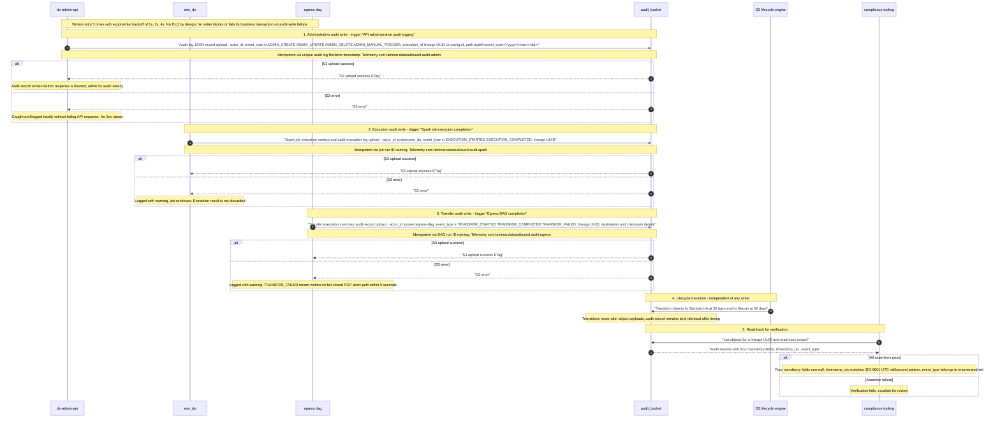

### 15.5. Schema Definitions (DB Tables / API JSON / Telemetry CloudEvents)
<a id="laminar-sec-c.imp_aws_aws_s3_bucket_15.schema"></a>
#### 15.5.1 Database tables

N/A — `audit_bucket` is object storage; it owns no relational tables and no DDL.

#### 15.5.2 Audit record schema (CloudEvents 1.0 envelope — the single contract for all writers)

This is the **complete** schema accepted by `audit_bucket`. It covers the full enumerated event set from SCRUM-486 — administrative events from **do-admin-api**, execution events from **emr_do** and the DAGs, and transfer events from **egress dag** — not only the transfer subset.

```json
{
  "$schema": "https://json-schema.org/draft/2020-12/schema",
  "$id": "https://laminar.com/dataoutbound/schemas/audit-record.json",
  "title": "AuditRecord",
  "type": "object",
  "required": ["specversion", "id", "source", "type", "time", "data"],
  "additionalProperties": false,
  "properties": {
    "specversion": { "const": "1.0" },
    "id": { "type": "string", "format": "uuid" },
    "source": {
      "type": "string",
      "pattern": "^com\\.laminar\\.dataoutbound\\.[a-z0-9-]+$"
    },
    "type": {
      "type": "string",
      "enum": [
        "com.laminar.dataoutbound.audit.admin",
        "com.laminar.dataoutbound.audit.spark",
        "com.laminar.dataoutbound.audit.egress",
        "com.laminar.dataoutbound.config.updated",
        "com.laminar.dataoutbound.orchestrator.triggered",
        "com.laminar.dataoutbound.scheduler.fired",
        "com.laminar.dataoutbound.child.triggered",
        "com.laminar.dataoutbound.emr.started",
        "com.laminar.dataoutbound.staging.written",
        "com.laminar.dataoutbound.egress.triggered",
        "com.laminar.dataoutbound.egress_dag.started",
        "com.laminar.dataoutbound.transfer.sftp",
        "com.laminar.dataoutbound.transfer.s3",
        "com.laminar.dataoutbound.transfer.azure",
        "com.laminar.dataoutbound.transfer.gcs"
      ]
    },
    "time": {
      "type": "string",
      "pattern": "^\\d{4}-\\d{2}-\\d{2}T\\d{2}:\\d{2}:\\d{2}\\.\\d{3}Z$"
    },
    "subject": { "type": "string" },
    "datacontenttype": { "const": "application/json" },
    "data": {
      "type": "object",
      "required": ["actor_id", "timestamp_utc", "event_type", "execution_id"],
      "additionalProperties": true,
      "properties": {
        "actor_id": {
          "type": "string",
          "description": "Authenticated Acme user id, or system:<component-name>."
        },
        "timestamp_utc": {
          "type": "string",
          "pattern": "^\\d{4}-\\d{2}-\\d{2}T\\d{2}:\\d{2}:\\d{2}\\.\\d{3}Z$"
        },
        "event_type": {
          "type": "string",
          "enum": [
            "ADMIN_CREATE",
            "ADMIN_UPDATE",
            "ADMIN_DELETE",
            "ADMIN_MANUAL_TRIGGER",
            "EXECUTION_STARTED",
            "EXECUTION_COMPLETED",
            "TRANSFER_STARTED",
            "TRANSFER_COMPLETED",
            "TRANSFER_FAILED"
          ]
        },
        "execution_id": {
          "type": "string",
          "format": "uuid",
          "description": "Lineage UUID generated by the orchestrator."
        },
        "component": { "type": "string" },
        "status": { "type": "string" },
        "details": { "type": "object" }
      }
    }
  }
}
```

#### 15.5.3 Worked examples — one per writer family

```json
{
  "specversion": "1.0",
  "id": "9f1c2b7e-4a55-4d0e-9c31-6b2f0a7d1e88",
  "source": "com.laminar.dataoutbound.do-admin-api",
  "type": "com.laminar.dataoutbound.audit.admin",
  "time": "2025-01-31T02:15:00.000Z",
  "subject": "cfg-7d3a91",
  "datacontenttype": "application/json",
  "data": {
    "actor_id": "acme:jdoe@acme.com",
    "timestamp_utc": "2025-01-31T02:15:00.000Z",
    "event_type": "ADMIN_UPDATE",
    "execution_id": "3f2a1c9d-8b47-4e21-a6f0-1d9c7b5e4a02",
    "component": "do-admin-api",
    "status": "SUCCESS",
    "details": { "config_id": "cfg-7d3a91", "changed_fields": ["cron_schedule"] }
  }
}
```

```json
{
  "specversion": "1.0",
  "id": "b41d0c62-77aa-4f19-8e02-5c3a9d1f6b70",
  "source": "com.laminar.dataoutbound.emr_do",
  "type": "com.laminar.dataoutbound.audit.spark",
  "time": "2025-01-31T02:41:12.418Z",
  "subject": "3f2a1c9d-8b47-4e21-a6f0-1d9c7b5e4a02",
  "datacontenttype": "application/json",
  "data": {
    "actor_id": "system:emr_do",
    "timestamp_utc": "2025-01-31T02:41:12.418Z",
    "event_type": "EXECUTION_COMPLETED",
    "execution_id": "3f2a1c9d-8b47-4e21-a6f0-1d9c7b5e4a02",
    "component": "emr_do",
    "status": "SUCCESS",
    "details": { "job_run_id": "00f2k1l9mnoq7r4", "record_count": 500, "entity": "identity_profiles" }
  }
}
```

```json
{
  "specversion": "1.0",
  "id": "c8e5a3f1-2d64-4b90-a7e3-0f1b8c6d2a45",
  "source": "com.laminar.dataoutbound.egress-dag",
  "type": "com.laminar.dataoutbound.audit.egress",
  "time": "2025-01-31T03:02:55.007Z",
  "subject": "3f2a1c9d-8b47-4e21-a6f0-1d9c7b5e4a02",
  "datacontenttype": "application/json",
  "data": {
    "actor_id": "system:egress-dag",
    "timestamp_utc": "2025-01-31T03:02:55.007Z",
    "event_type": "TRANSFER_FAILED",
    "execution_id": "3f2a1c9d-8b47-4e21-a6f0-1d9c7b5e4a02",
    "component": "egress-dag",
    "status": "FAILED",
    "details": {
      "destination": "sftp",
      "file_names": ["identity_profiles_3f2a1c9d.json.gz.pgp"],
      "checksum": "sha256:9c1f...",
      "retry_attempts": 3,
      "reason": "PGP_ENCRYPTION_FAILED"
    }
  }
}
```

#### 15.5.4 Expected event count per run (verification contract)

For a run executing `N` connections each with one transfer, the number of records in `audit_bucket` for that lineage UUID equals `admin_operations + 2N + 2N`. A `TRANSFER_FAILED` record replaces the `TRANSFER_COMPLETED` record for the aborted transfer, so the count is unchanged on the abort path.

### 15.6. Local Design Assumptions
<a id="laminar-sec-c.imp_aws_aws_s3_bucket_15.asm"></a>
- **Audit write failure is non-blocking.** Assumption: an unavailable `audit_bucket` must never fail an export or an administrative operation. The publisher retries three times with exponential backoff and then logs locally; the record is recoverable by re-running the idempotent operation. This is the deliberate trade-off behind the "never raises into the caller's flow" contract.
- **No DLQ on the audit path.** Assumption: because every audit-producing operation is idempotent per lineage UUID, a lost audit write is regenerated by re-execution rather than replayed from a queue. No SQS DLQ is provisioned for this sink.
- **Versioning absence is accepted.** Assumption: with `versioning = False`, an overwrite of a same-named audit key is unrecoverable. Mitigation is the object key contract — `execution_id` + millisecond timestamp + UUID — which makes collisions practically impossible. This is the user's stated setting and is not overridden.
- **Lifecycle tiering does not alter records.** Assumption: S3 lifecycle transitions to Standard-IA (30 days) and Glacier (90 days) preserve object bytes exactly; audit records remain readable and verifiable after tiering, subject to Glacier restore latency for records older than 90 days.
- **Retention value.** The organisation logging-standard retention value (in days) referenced by SCRUM-486 AC#4 is not stated in the inputs; assumption: a single confirmed value is supplied per environment before sprint commitment and applied uniformly to every pipeline log group and to the audit store. Until confirmed, the value is parameterised in configuration and never hardcoded. This bucket's own lifecycle tiering (30/90 days) is independent of that retention value and is not a substitute for it.
- **Deletion protection.** Assumption: the bucket's deletion-protection flag is read from the per-environment Terraform variable (dev/staging/prod) and is never hardcoded, satisfying SCRUM-485 AC#3.
- **Access logging.** Assumption: S3 server access logging is enabled and routed to CloudWatch, so reads and writes against the audit store are themselves auditable. The destination log group carries the same organisation retention value as every other pipeline log group.
- **Single-region.** Assumption: `audit_bucket` is deployed in the pipeline's single region; no cross-region replication is provisioned, consistent with the architecture's no-cross-region-DR assumption.

## 16. Component Design: customer SFTP server
<a id="laminar-sec-c.imp_standard_standard_sftp_11"></a>

<!-- laminar:diagram-settings:imp-standard-standard_sftp-11 -->
**Diagram settings (user decisions — authoritative)**

| Setting | Value |
| --- | --- |
| `port` | `22` |
| `authentication_method` | `SSH Key` |
| `server_name` | `customer SFTP server` |

<!-- /laminar:diagram-settings -->


### 16.1. Component Contract (Bi-Directional Inputs & Outputs)
<a id="laminar-sec-c.imp_standard_standard_sftp_11.contract"></a>
The `customer SFTP server` is an external, customer-managed SFTP endpoint operating over SSH (Port 22) that receives encrypted or raw export packages and manifest control files.

#### 16.1.1 Interface & Transport Protocol
- **Protocol**: SFTP over SSH (Port 22).
- **Authentication**: SSH Public Key Authentication (`SSH Key`) with strict host-key verification enabled.
- **Trigger**: Egress file transfer task executed within `egress dag`.

#### 16.1.2 Request & Response Payload Specification
- **Request (Upload)**: SSH file transmission stream containing GZIP-compressed / PGP-encrypted export data files and JSON manifest control files.
- **Response (Success)**: Atomic file write completion acknowledgment, verified via remote file size and SHA-256 recomputation.
- **Error Responses**:
  - `Connection Refused / Host Key Mismatch`: Strict host-key verification failure; connection is immediately aborted, zero bytes are transmitted, no retry is attempted, an automated alert is raised, and a `TRANSFER_FAILED` event is recorded.
  - `Authentication Failure`: Invalid SSH private key or credentials; aborted without retry.
  - `Network / Timeout Error`: Transient socket interruption; retried up to 3 times before raising a terminal failure alert.

#### 16.1.3 Idempotency & Telemetry
- **Idempotency**: Implemented via atomic upload patterns (uploading to a temporary staging suffix `.part` followed by atomic server-side rename upon completion).
- **Telemetry Event**: Emits `com.laminar.dataoutbound.transfer.sftp` tracking initiation, retry attempts, and completion status.

---

### 16.2. Local Design Assumptions
<a id="laminar-sec-c.imp_standard_standard_sftp_11.asm"></a>
1. **External Scope**: The `customer SFTP server` is an external system owned and operated by the customer; platform responsibilities are strictly limited to connection establishment, strict host-key verification, SSH key-based authentication, and atomic file transfer.
2. **Host Key Persistence**: Assumes customer SSH host keys are provisioned and stored securely in SSM Parameter Store (`SecureString`) during export configuration onboarding.
3. **Atomic Transfers**: Assumes the remote SFTP server supports atomic file renaming (`SSH_FXP_RENAME`), or the transfer client implements safe staging-to-production file promotion.
4. **Firewall & Whitelisting**: Assumes customer firewalls permit inbound SFTP connections originating exclusively from the platform's static NAT gateway egress IP addresses.
5. **Follow-up Resolution**: In the event of an SFTP authentication or host-key mismatch failure, the pipeline immediately halts, aborts transmission, raises an operator alert within 5 minutes, and records a failure audit entry without attempting insecure fallbacks.

## 17. Component Design: customer bucket
<a id="laminar-sec-c.imp_aws_aws_s3_bucket_12"></a>

<!-- laminar:diagram-settings:imp-aws-aws_s3_bucket-12 -->
**Diagram settings (user decisions — authoritative)**

| Setting | Value |
| --- | --- |
| `versioning` | `true` |
| `encryption` | `AES256` |
| `public_access_block` | `true` |
| `lifecycle_enabled` | `false` |
| `lifecycle_transition_days` | `30` |
| `lifecycle_glacier_days` | `90` |
| `bucket_name` | `customer bucket` |

<!-- /laminar:diagram-settings -->


### 17.1. Component Contract (Bi-Directional Inputs & Outputs)
<a id="laminar-sec-c.imp_aws_aws_s3_bucket_12.contract"></a>
- **Component Role**: External customer-owned S3 bucket (`customer bucket`) acting as an outbound delivery destination for encrypted or raw export packages and manifest control files.
- **Protocols & Standards**: HTTPS over TLS 1.3, S3 REST API (boto3 `PutObject`).
- **Inbound Data (Payload)**: Multipart or single-put GZIP-compressed or PGP-encrypted data files, TXT files, and JSON manifest control files.
- **Verification Standard**: Application-level SHA-256 integrity recomputed from read-back objects compared against the manifest value, alongside native `ChecksumSHA256` transport verification.
- **Error Handling**: Network timeouts or HTTP 4xx/5xx responses from the customer bucket trigger up to 3 retries with exponential backoff; persistent failure results in a `TRANSFER_FAILED` audit event and immediate alerting.

### 17.2. Local Design Assumptions
<a id="laminar-sec-c.imp_aws_aws_s3_bucket_12.asm"></a>
- **Ownership & Access**: The customer bucket is externally owned and managed; credentials and bucket access policies (IAM role assumption or cross-account access keys) are securely retrieved from SSM Parameter Store (`SecureString`).
- **Encryption & Versioning**: Versioning is enabled (`versioning = True`) and server-side encryption (`AES256`) is enforced on all uploaded objects.
- **Scope Limitation**: As an external context-only component, no Terraform resource definitions, application code stubs, or internal schema tables are maintained within this project's code repository.

## 18. Global Design Assumptions and Constraints
<a id="laminar-sec-g.assump"></a>
This chapter consolidates the system-wide architectural decisions, design assumptions, and constraints governing the DataOutbound platform. Each item represents a mainstream, production-grade default adopted to resolve open design questions.

### 18.1 A1. Approved AWS Stack Conformance
All pipeline-owned resources are provisioned exclusively from the approved allowlist — Amazon MWAA, RDS PostgreSQL, AWS Lambda, EMR Serverless, Amazon S3, and Amazon ECS — via the Terraform pipeline. The Golden Entity Source Store and external customer destinations are customer- or partner-owned and are integrated via contracts rather than provisioned by the platform.

### 18.2 A2. Environment-Driven Deletion Protection
Stateful resources—including the Export Config Store, Customer Staging Buckets, Audit & Execution Log Store, and associated KMS encryption keys—dynamically read their deletion-protection flags from per-environment configuration variables (`dev`, `staging`, `prod`). Lower environments permit clean teardowns, while production environments strictly prohibit accidental destruction.

### 18.3 A3. Organisation Logging-Standard Retention Value
The organisation logging-standard retention value is assumed to be **365 days** across all pipeline CloudWatch log groups and the centralized audit store, pending formal confirmation prior to final sprint commitment. Zero log groups are provisioned with unmanaged or infinite retention.

### 18.4 A4. Audit Schema and Event Counting Contract
Every business audit event conforms strictly to the CloudEvents-shaped schema comprising `actor_id`, `timestamp_utc` (ISO-8601 with millisecond precision and `Z` suffix), `event_type` (from the enumerated lifecycle set), and `execution_id` (the lineage UUID). Expected event counts per execution are fully deterministic and validated by automated integration test suites.

### 18.5 A5. Fail-Closed Encryption Posture
PGP encryption applied during transformation is strictly fail-closed. Any missing, corrupt, or failing cryptographic key immediately aborts the transfer, writes a `TRANSFER_FAILED` audit record within 5 seconds, raises an operational alert, and ensures **zero unencrypted bytes** are transmitted to any destination.

### 18.6 A6. Delivery-Only Semantics and Integrity Standard
Data delivery is strictly delivery-only; the platform does not manage downstream customer-side retention or acknowledgments. File integrity is verified uniformly via an application-level SHA-256 recomputed from a read-back of each delivered object and compared against the accompanying manifest control file.

### 18.7 A7. Staging Lifecycle and Temporary Data Hygiene
Temporary export artifacts residing in Customer Staging Buckets are governed by S3 lifecycle rules enforcing automatic expiration and deletion after exactly 7 days, preventing unbounded storage growth and minimizing data exposure windows.

### 18.8 A8. Lineage UUID as the Sole Correlation Identifier
A single RFC 4122 v4 lineage UUID is generated at the orchestration boundary and threaded through every downstream artifact, including run configurations, output file names, manifest control files, and audit records, guaranteeing absolute end-to-end traceability.

### 18.9 A9. Credential Protection at Rest
All customer destination credentials and sensitive authentication parameters stored within the Export Config Store are encrypted at rest using KMS customer-managed keys. Read operations automatically mask credential fields to prevent accidental exposure in logs or API responses.

### 18.10 A10. Scheduling Tolerance and Cadence Semantics
Cadence events raised by the Export Scheduler are evaluated by the Orchestrator against active connections using a strict $\pm 10$-minute selection window. Supported cadences (daily, weekly, bi-weekly, monthly, and hourly fast-batch) are validated via 5-field cron expressions at the API boundary before persistence.

## 19. Amendment Log
<a id="laminar-sec-g.amend"></a>
_No amendments._


## 20. Traceability
<a id="laminar-sec-g.trace"></a>

| Section | Story | AC# |
| --- | --- | --- |
| 3.5.1 Canonical DDL — `export_configurations` (owned by `cofig_db`, declared once here) | SCRUM-479 | AC#1, AC#2, AC#3, AC#4, AC#5, AC#6, AC#7 |
| 4.5.5 Telemetry record written to audit_bucket | SCRUM-479 | AC#1, AC#2, AC#3, AC#4, AC#5, AC#6, AC#7 |
| 4. Component Design: scheduler | SCRUM-480 | AC#1, AC#2, AC#3, AC#4, AC#5, AC#6, AC#7 |
| 3.4.2 Flow B — Manual trigger of an orchestrator run | SCRUM-480 | AC#1, AC#2, AC#3, AC#4, AC#5, AC#6, AC#7 |
| 5.5.3 Outbound — orchestrator → child_export_dag (DagRun conf) | SCRUM-480 | AC#1, AC#2, AC#3, AC#4, AC#5, AC#6, AC#7 |
| 3.5.1 Canonical DDL — `export_configurations` (owned by `cofig_db`, declared once here) | SCRUM-480 | AC#1, AC#2, AC#3, AC#4, AC#5, AC#6, AC#7 |
| 4.5.5 Telemetry record written to audit_bucket | SCRUM-480 | AC#1, AC#2, AC#3, AC#4, AC#5, AC#6, AC#7 |
| 4. Component Design: scheduler | SCRUM-481 | AC#1, AC#2, AC#3, AC#4, AC#5, AC#6, AC#7 |
| 3.4.2 Flow B — Manual trigger of an orchestrator run | SCRUM-481 | AC#1, AC#2, AC#3, AC#4, AC#5, AC#6, AC#7 |
| 5.5.3 Outbound — orchestrator → child_export_dag (DagRun conf) | SCRUM-481 | AC#1, AC#2, AC#3, AC#4, AC#5, AC#6, AC#7 |
| 7. Component Design: emr_do | SCRUM-481 | AC#1, AC#2, AC#3, AC#4, AC#5, AC#6, AC#7 |
| 3.5.1 Canonical DDL — `export_configurations` (owned by `cofig_db`, declared once here) | SCRUM-481 | AC#1, AC#2, AC#3, AC#4, AC#5, AC#6, AC#7 |
| 10. Component Design: staging_bucet_internal | SCRUM-481 | AC#1, AC#2, AC#3, AC#4, AC#5, AC#6, AC#7 |
| 4.5.5 Telemetry record written to audit_bucket | SCRUM-481 | AC#1, AC#2, AC#3, AC#4, AC#5, AC#6, AC#7 |
| 10. Component Design: staging_bucet_internal | SCRUM-482 | AC#1, AC#2, AC#3, AC#4, AC#5, AC#6, AC#7 |
| 10.5.2 S3 `ObjectCreated` notification payload (bucket → `egress-lambda`) | SCRUM-482 | AC#1, AC#2, AC#3, AC#4, AC#5, AC#6, AC#7 |
| 11.5.1 Lambda Trigger Request Schema (`egress dag` MWAA Trigger Payload) | SCRUM-482 | AC#1, AC#2, AC#3, AC#4, AC#5, AC#6, AC#7 |
| 13. Component Design: Customer Azure Blob Destination | SCRUM-482 | AC#1, AC#2, AC#3, AC#4, AC#5, AC#6, AC#7 |
| 14. Component Design: Customer GCS Destination | SCRUM-482 | AC#1, AC#2, AC#3, AC#4, AC#5, AC#6, AC#7 |
| 4.5.5 Telemetry record written to audit_bucket | SCRUM-482 | AC#1, AC#2, AC#3, AC#4, AC#5, AC#6, AC#7 |
| 3.5.1 Canonical DDL — `export_configurations` (owned by `cofig_db`, declared once here) | SCRUM-483 | AC#1, AC#2, AC#3, AC#4 |
| 10. Component Design: staging_bucet_internal | SCRUM-483 | AC#1, AC#2, AC#3, AC#4 |
| 10.5.2 S3 `ObjectCreated` notification payload (bucket → `egress-lambda`) | SCRUM-483 | AC#1, AC#2, AC#3, AC#4 |
| 11.5.1 Lambda Trigger Request Schema (`egress dag` MWAA Trigger Payload) | SCRUM-483 | AC#1, AC#2, AC#3, AC#4 |
| 4.5.5 Telemetry record written to audit_bucket | SCRUM-483 | AC#1, AC#2, AC#3, AC#4 |
| 10. Component Design: staging_bucet_internal | SCRUM-484 | AC#1, AC#2, AC#3, AC#4, AC#5, AC#6 |
| 10.5.2 S3 `ObjectCreated` notification payload (bucket → `egress-lambda`) | SCRUM-484 | AC#1, AC#2, AC#3, AC#4, AC#5, AC#6 |
| 11.5.1 Lambda Trigger Request Schema (`egress dag` MWAA Trigger Payload) | SCRUM-484 | AC#1, AC#2, AC#3, AC#4, AC#5, AC#6 |
| 13. Component Design: Customer Azure Blob Destination | SCRUM-484 | AC#1, AC#2, AC#3, AC#4, AC#5, AC#6 |
| 14. Component Design: Customer GCS Destination | SCRUM-484 | AC#1, AC#2, AC#3, AC#4, AC#5, AC#6 |
| 4.5.5 Telemetry record written to audit_bucket | SCRUM-484 | AC#1, AC#2, AC#3, AC#4, AC#5, AC#6 |
| 4. Component Design: scheduler | SCRUM-485 | AC#1, AC#2, AC#3, AC#4, AC#5 |
| 3.4.2 Flow B — Manual trigger of an orchestrator run | SCRUM-485 | AC#1, AC#2, AC#3, AC#4, AC#5 |
| 5.5.3 Outbound — orchestrator → child_export_dag (DagRun conf) | SCRUM-485 | AC#1, AC#2, AC#3, AC#4, AC#5 |
| 7. Component Design: emr_do | SCRUM-485 | AC#1, AC#2, AC#3, AC#4, AC#5 |
| 3.5.1 Canonical DDL — `export_configurations` (owned by `cofig_db`, declared once here) | SCRUM-485 | AC#1, AC#2, AC#3, AC#4, AC#5 |
| 10. Component Design: staging_bucet_internal | SCRUM-485 | AC#1, AC#2, AC#3, AC#4, AC#5 |
| 10.5.2 S3 `ObjectCreated` notification payload (bucket → `egress-lambda`) | SCRUM-485 | AC#1, AC#2, AC#3, AC#4, AC#5 |
| 11.5.1 Lambda Trigger Request Schema (`egress dag` MWAA Trigger Payload) | SCRUM-485 | AC#1, AC#2, AC#3, AC#4, AC#5 |
| 4.5.5 Telemetry record written to audit_bucket | SCRUM-485 | AC#1, AC#2, AC#3, AC#4, AC#5 |
| 4. Component Design: scheduler | SCRUM-486 | AC#1, AC#2, AC#3, AC#4, AC#5 |
| 3.4.2 Flow B — Manual trigger of an orchestrator run | SCRUM-486 | AC#1, AC#2, AC#3, AC#4, AC#5 |
| 5.5.3 Outbound — orchestrator → child_export_dag (DagRun conf) | SCRUM-486 | AC#1, AC#2, AC#3, AC#4, AC#5 |
| 7. Component Design: emr_do | SCRUM-486 | AC#1, AC#2, AC#3, AC#4, AC#5 |
| 10. Component Design: staging_bucet_internal | SCRUM-486 | AC#1, AC#2, AC#3, AC#4, AC#5 |
| 10.5.2 S3 `ObjectCreated` notification payload (bucket → `egress-lambda`) | SCRUM-486 | AC#1, AC#2, AC#3, AC#4, AC#5 |
| 11.5.1 Lambda Trigger Request Schema (`egress dag` MWAA Trigger Payload) | SCRUM-486 | AC#1, AC#2, AC#3, AC#4, AC#5 |
| 13. Component Design: Customer Azure Blob Destination | SCRUM-486 | AC#1, AC#2, AC#3, AC#4, AC#5 |
| 14. Component Design: Customer GCS Destination | SCRUM-486 | AC#1, AC#2, AC#3, AC#4, AC#5 |
| 4.5.5 Telemetry record written to audit_bucket | SCRUM-486 | AC#1, AC#2, AC#3, AC#4, AC#5 |

## 21. Closing & Disclaimer
<a id="laminar-sec-g.close"></a>
This document was generated by an AI system from the architecture graph, its stories and the project blueprint. It is a starting point for engineering review, not a substitute for it: verify every contract, sizing figure, policy and assumption before relying on it. Discretion advised.

## Document Structure Summary
<a id="laminar-sec-g.summary"></a>
- Headings: 20
- Sub-headings: 82
- Sub-sub-headings: 94