# DataOutbound Product -Section Tree — High-Level Design
* **Version:** 1.0
* **Generation Date:** 2026-10-31
* **Generated By:** Laminar

---

## Table of Contents
- **1.** HLD Executive Summary & Scope
    - **1.1** Purpose
    - **1.2** Scope — Components in this Design
    - **1.3** End-to-End Data Flow
    - **1.4** Key Architectural Decisions Honoured
    - **1.5** Out of Scope
- **2.** System-wide Design Principles
    - **2.1** Principle 1 — Contract-First, Diagram-Bounded Design
    - **2.2** Principle 2 — Shared Foundation, Never Re-declared
    - **2.3** Principle 3 — One Canonical `AuditPublisher` and One Canonical `DbClient` Interface
    - **2.4** Principle 4 — Idempotency by Construction
    - **2.5** Principle 5 — Fail-Closed Security and Least Privilege
    - **2.6** Principle 6 — Resilience: Retries, DLQs and Dead-Letter Paths
    - **2.7** Principle 7 — Observability: One Audit Schema, One Event Shape
    - **2.8** Principle 8 — Configuration and Environment Discipline
    - **2.9** Principle 9 — Bounded Depth, Consistency over Volume
- **3.** Component Design: do-admin-api
  - **3.1.** Component Contract (Bi-Directional Inputs & Outputs)
    - **3.1.1** Inbound (exposed) interface — HTTP endpoints
    - **3.1.2** Outbound (consumed) interfaces
    - **3.1.3** Error envelope
    - **3.1.4** Configuration the design actually sets
  - **3.2.** Class and Interface Definitions
  - **3.3.** Implementation Code Skeleton (Stubs & Handlers)
  - **3.4.** Cross-Component Interaction Sequence (Local Mermaid/ASCII Flow)
  - **3.5.** Schema Definitions (DB Tables / API JSON / Telemetry CloudEvents)
    - **3.5.1** API request/response JSON
    - **3.5.2** Telemetry CloudEvents
  - **3.6.** Local Design Assumptions
- **4.** Component Design: scheduler
  - **4.1.** Component Contract (Bi-Directional Inputs & Outputs)
  - **4.2.** Class and Interface Definitions
  - **4.3.** Implementation Code Skeleton (Stubs & Handlers)
  - **4.4.** Cross-Component Interaction Sequence (Local Mermaid/ASCII Flow)
  - **4.5.** Schema Definitions (DB Tables / API JSON / Telemetry CloudEvents)
  - **4.6.** Local Design Assumptions
- **5.** Component Design: orchestrator
  - **5.1.** Component Contract (Bi-Directional Inputs & Outputs)
    - **5.1.1** Inbound Contracts (what the orchestrator consumes)
    - **5.1.2** Outbound Contracts (what the orchestrator produces)
    - **5.1.3** Configuration the design actually sets
  - **5.2.** Class and Interface Definitions
  - **5.3.** Implementation Code Skeleton (Stubs & Handlers)
  - **5.4.** Cross-Component Interaction Sequence (Local Mermaid/ASCII Flow)
  - **5.5.** Schema Definitions (DB Tables / API JSON / Telemetry CloudEvents)
    - **5.5.1** Child DAG run payload (contract O2)
    - **5.5.2** Telemetry CloudEvents emitted by the orchestrator
    - **5.5.3** cofig_db tables the orchestrator reads and writes
  - **5.6.** Local Design Assumptions
- **6.** Component Design: child_export_dag
  - **6.1.** Component Contract (Bi-Directional Inputs & Outputs)
    - **6.1.1** Configuration the design sets (everything else is Airflow default)
    - **6.1.2** Inbound contract — orchestrator → child_export_dag
    - **6.1.3** Outbound contract — child_export_dag → cofig_db (read)
    - **6.1.4** Outbound contract — child_export_dag → emr_do (async job invocation)
    - **6.1.5** Audit contract (SCRUM-486)
  - **6.2.** Class and Interface Definitions
  - **6.3.** Implementation Code Skeleton (Stubs & Handlers)
  - **6.4.** Cross-Component Interaction Sequence (Local Mermaid/ASCII Flow)
  - **6.5.** Schema Definitions (DB Tables / API JSON / Telemetry CloudEvents)
    - **6.5.1** DagRun conf — orchestrator → child_export_dag
    - **6.5.2** EMR Serverless StartJobRun request — child_export_dag → emr_do
    - **6.5.3** cofig_db rows consumed (read-only; DDL is owned by the cofig_db component)
    - **6.5.4** Telemetry — CloudEvents 1.0
  - **6.6.** Local Design Assumptions
- **7.** Component Design: emr_do
  - **7.1.** Component Contract (Bi-Directional Inputs & Outputs)
    - **7.1.1** Inbound contract — `child_export_dag` → `emr_do`
    - **7.1.2** Outbound contracts
    - **7.1.3** Configuration this design actually sets
  - **7.2.** Class and Interface Definitions
  - **7.3.** Implementation Code Skeleton (Stubs & Handlers)
  - **7.4.** Cross-Component Interaction Sequence (Local Mermaid/ASCII Flow)
  - **7.5.** Schema Definitions (DB Tables / API JSON / Telemetry CloudEvents)
    - **7.5.1** Recipe JSON (`s3://…/config/recipes/<dataset>.json`)
    - **7.5.2** Staging manifest (`s3://staging_bucet_internal/<config_id>/<execution_id>/manifest_<execution_id>.json`)
    - **7.5.3** Telemetry CloudEvents emitted by `emr_do`
    - **7.5.4** Audit execution log record (`s3://audit_bucket/emr_do/<run_date>/<job_run_id>.json`)
  - **7.6.** Local Design Assumptions
- **8.** Component Design: dev
  - **8.1.** Component Contract (Bi-Directional Inputs & Outputs)
    - **8.1.1** Inbound Contracts
  - **8.2.** Class and Interface Definitions
  - **8.3.** Implementation Code Skeleton (Stubs & Handlers)
  - **8.4.** Cross-Component Interaction Sequence (Local Mermaid/ASCII Flow)
  - **8.5.** Schema Definitions (DB Tables / API JSON / Telemetry CloudEvents)
  - **8.6.** Local Design Assumptions
- **9.** Component Design: cofig_db
  - **9.1.** Component Contract (Bi-Directional Inputs & Outputs)
    - **9.1.1** Inbound Contracts & Triggers
    - **9.1.2** Outbound Contracts & Behaviors
  - **9.2.** Class and Interface Definitions
  - **9.3.** Implementation Code Skeleton (Stubs & Handlers)
  - **9.4.** Cross-Component Interaction Sequence (Local Mermaid/ASCII Flow)
  - **9.5.** Schema Definitions (DB Tables / API JSON / Telemetry CloudEvents)
  - **9.6.** Local Design Assumptions
- **10.** Component Design: staging_bucet_internal
  - **10.1.** Component Contract (Bi-Directional Inputs & Outputs)
    - **10.1.1** Configuration the design actually sets
    - **10.1.2** Bi-directional contract
  - **10.2.** Class and Interface Definitions
  - **10.3.** Implementation Code Skeleton (Stubs & Handlers)
  - **10.4.** Cross-Component Interaction Sequence (Local Mermaid/ASCII Flow)
  - **10.5.** Schema Definitions (DB Tables / API JSON / Telemetry CloudEvents)
    - **10.5.1** Object key layout
    - **10.5.2** Manifest control file (`manifest_<lineage_uuid>.json`)
    - **10.5.3** S3 event notification payload (delivered to **egress-lambda**)
    - **10.5.4** Telemetry CloudEvents emitted at this boundary
  - **10.6.** Local Design Assumptions
- **11.** Component Design: egress-lambda
  - **11.1.** Component Contract (Bi-Directional Inputs & Outputs)
    - **11.1.1** Inbound Interfaces & Triggers
    - **11.1.2** Outbound Interfaces & Destinations
    - **11.1.3** Resilience & Error Handling
  - **11.2.** Class and Interface Definitions
  - **11.3.** Implementation Code Skeleton (Stubs & Handlers)
  - **11.4.** Cross-Component Interaction Sequence (Local Mermaid/ASCII Flow)
  - **11.5.** Schema Definitions (DB Tables / API JSON / Telemetry CloudEvents)
    - **11.5.1** S3 Event Notification Input JSON
    - **11.5.2** MWAA DAG Trigger Payload (`dag_conf`) JSON
    - **11.5.3** CloudEvents Telemetry Record (`com.laminar.dataoutbound.egress.triggered`)
  - **11.6.** Local Design Assumptions
- **12.** Component Design: egress dag
  - **12.1.** Component Contract (Bi-Directional Inputs & Outputs)
    - **12.1.1** Inbound Contract (Trigger & Payload)
    - **12.1.2** Outbound Contracts & Integrations
    - **12.1.3** Resilience, Retries & Error Handling
  - **12.2.** Class and Interface Definitions
  - **12.3.** Implementation Code Skeleton (Stubs & Handlers)
  - **12.4.** Cross-Component Interaction Sequence (Local Mermaid/ASCII Flow)
  - **12.5.** Schema Definitions (DB Tables / API JSON / Telemetry CloudEvents)
    - **12.5.1** Inbound DAG Trigger Payload (`dag_conf`)
    - **12.5.2** Manifest Control File Schema (`manifest_<execution_id>.json`)
    - **12.5.3** CloudEvent Telemetry Schema (`TRANSFER_COMPLETED`)
  - **12.6.** Local Design Assumptions
- **13.** Component Design: Customer Azure Blob Destination
  - **13.1.** Component Contract (Bi-Directional Inputs & Outputs)
  - **13.2.** Class and Interface Definitions
  - **13.3.** Implementation Code Skeleton (Stubs & Handlers)
  - **13.4.** Cross-Component Interaction Sequence (Local Mermaid/ASCII Flow)
  - **13.5.** Schema Definitions (DB Tables / API JSON / Telemetry CloudEvents)
  - **13.6.** Local Design Assumptions
- **14.** Component Design: Customer GCS Destination
  - **14.1.** Component Contract (Bi-Directional Inputs & Outputs)
    - **14.1.1** Interface & Transport Protocol
    - **14.1.2** Request & Response Payload Specification
    - **14.1.3** Idempotency & Telemetry
  - **14.2.** Class and Interface Definitions
  - **14.3.** Implementation Code Skeleton (Stubs & Handlers)
  - **14.4.** Cross-Component Interaction Sequence (Local Mermaid/ASCII Flow)
    - **14.4.1** Sequence Interaction Description
  - **14.5.** Schema Definitions (DB Tables / API JSON / Telemetry CloudEvents)
    - **14.5.1** CloudEvents Telemetry Payload (`com.laminar.dataoutbound.transfer.gcs`)
  - **14.6.** Local Design Assumptions
- **15.** Component Design: audit_bucket
  - **15.1.** Component Contract (Bi-Directional Inputs & Outputs)
  - **15.2.** Class and Interface Definitions
  - **15.3.** Implementation Code Skeleton (Stubs & Handlers)
  - **15.4.** Cross-Component Interaction Sequence (Local Mermaid/ASCII Flow)
  - **15.5.** Schema Definitions (DB Tables / API JSON / Telemetry CloudEvents)
  - **15.6.** Local Design Assumptions
- **16.** Component Design: customer SFTP server
  - **16.1.** Component Contract (Bi-Directional Inputs & Outputs)
    - **16.1.1** Interface & Transport Protocol
    - **16.1.2** Request & Response Payload Specification
    - **16.1.3** Idempotency & Telemetry
  - **16.2.** Local Design Assumptions
- **17.** Component Design: customer bucket
  - **17.1.** Component Contract (Bi-Directional Inputs & Outputs)
  - **17.2.** Local Design Assumptions
- **18.** Global Design Assumptions and Constraints
- **19.** Amendment Log
- **20.** Closing & Disclaimer

---

## 1. HLD Executive Summary & Scope
<a id="laminar-sec-g.exec"></a>
#### 1.1 Purpose

The **DataOutbound Product** is a scheduled batch outbound data-sync capability within the hospitality data platform domain. It extracts Golden Entity datasets (Unified Identity Profile, Pii Restricted Profile, Contact Method Subscription, Enriched Campaigns, Enriched Campaign Reactions, and reservation items — Room stay, Restaurant reservation, Tee time, Spa treatment) from a Redshift source store, transforms them into JSON/TXT export packages, optionally GZIP-compresses and PGP-encrypts them, and delivers them to customer-owned destinations (S3, Azure Blob, GCS, sFTP) under a 24-hour delivery SLA, with a maximum file size of 1 GB and up to 100,000 records per package.

This document is the **High-Level Design (HLD)** for exactly the components the user placed in the architecture diagram. It is contract-first: every interaction between the diagram's components is specified as a typed interface, a payload schema, and a failure/idempotency contract before any component internals are described.

#### 1.2 Scope — Components in this Design

The design covers the following 13 components, referred to throughout by their user-given names:

| # | Component | Type | Role in the flow |
|---|---|---|---|
| 1 | **do-admin-api** | REST API (JWT) | Administrative CRUD and manual trigger/stop of export configurations |
| 2 | **scheduler** | AWS EventBridge | Raises cadence events that start scheduled export runs |
| 3 | **orchestrator** | MWAA DAG (`@daily`) | Selects in-window connections, generates the lineage UUID, fans out child runs |
| 4 | **child_export_dag** | MWAA DAG (`@daily`) | Reads watermarks/recipes and submits one EMR Serverless Spark job per connection |
| 5 | **emr_do** | EMR Serverless (Spark, `emr-7.0.0`) | Extracts Golden Entity datasets and writes staged files |
| 6 | **dev** | Redshift (`golden_data_source`) | Existing externally-owned Golden Entity source store |
| 7 | **cofig_db** | RDS Postgres 15.4 | Export configurations, watermarks, execution logs |
| 8 | **staging_bucet_internal** | S3 bucket | Staged Parquet/JSON datasets; 7-day lifecycle purge |
| 9 | **egress-lambda** | AWS Lambda (python3.11) | S3-event-driven trigger of the egress workflow |
| 10 | **egress dag** | MWAA DAG (`@daily`) | Transform, encrypt and deliver packages to customer destinations |
| 11 | **Customer Azure Blob Destination** | Azure Blob Storage | Customer-owned delivery endpoint |
| 12 | **Customer GCS Destination** | Google Cloud Storage | Customer-owned delivery endpoint |
| 13 | **audit_bucket** | S3 bucket | Audit execution logs and telemetry records |

Two further nodes are **context-only external boundaries** and are referenced only through the internal components' side of their contracts — they are not designed here: **customer SFTP server** (SSH key auth, port 22) and **customer bucket** (customer-owned S3 destination).

#### 1.3 End-to-End Data Flow

1. **Configuration** — An authorized Acme administrator (or a scripted client) creates, retrieves, updates, deletes, manually triggers or stops an export configuration through **do-admin-api**. Configurations are persisted in **cofig_db** with credential fields stored encrypted; every administrative action is audited to **audit_bucket**.
2. **Scheduling** — **scheduler** raises a CloudEvents-shaped cadence event at time *T*. **orchestrator** reads active configurations from **cofig_db**, selects only those whose `cron_schedule` falls within *T ± 10 minutes*, generates exactly one RFC 4122 v4 lineage UUID per run, and submits one **child_export_dag** run per selected connection carrying the same lineage UUID.
3. **Extraction** — **child_export_dag** reads watermarks and recipe details from **cofig_db** and submits the **emr_do** Spark job. **emr_do** reads Golden Entity tables from **dev** (Redshift) and writes staged Parquet/JSON datasets to **staging_bucet_internal**, pushing execution metrics to **audit_bucket**.
4. **Egress** — An S3 `ObjectCreated` notification on **staging_bucet_internal** invokes **egress-lambda**, which triggers exactly one **egress dag** run carrying the lineage UUID. **egress dag** reads staged files, applies optional GZIP then fail-closed PGP encryption, and pushes packages plus manifest control files to the configured customer destination (**Customer Azure Blob Destination**, **Customer GCS Destination**, **customer bucket**, or **customer SFTP server**), writing transfer audit records to **audit_bucket**.
5. **Lifecycle** — Staged objects are purged after exactly 7 days by the **staging_bucet_internal** lifecycle rule. Every business audit event carries `actor_id`, `timestamp_utc` (ISO-8601, millisecond precision, `Z`), `event_type` and `execution_id` (the lineage UUID).

#### 1.4 Key Architectural Decisions Honoured

- **Contract-first**: every edge in the diagram is frozen as a typed contract (trigger, request, response, errors, idempotency, telemetry event) and is binding for the generated code.
- **Lineage UUID propagation**: a single RFC 4122 v4 UUID generated by **orchestrator** is carried in every downstream run conf, output file name, manifest and audit record.
- **Fail-closed encryption**: on PGP failure the transfer aborts, a `TRANSFER_FAILED` event is recorded, an alert is raised, and zero bytes of unencrypted data reach any destination.
- **Idempotency everywhere**: deterministic S3 object keys, logical execution dates, client tokens and atomic SFTP rename make every retry safe.
- **Least privilege & isolation**: all compute (MWAA, EMR Serverless, Egress Lambda) runs in private VPC subnets; outbound egress is routed through a NAT gateway with static egress IPs; interactive shell/exec access is disabled in all environments.
- **Environment-driven statefulness**: deletion protection for stateful resources (**cofig_db**, **staging_bucet_internal**, **audit_bucket**, encryption keys) is read from per-environment configuration, never hardcoded, so lower environments can be torn down cleanly.

#### 1.5 Out of Scope

Operational ownership and on-call rotations, disaster-recovery runbooks, CI/CD pipelines, testing strategies, cost analyses and compliance programmes are explicitly out of scope. **dev** (Redshift) is an existing externally-owned source and the customer destinations are customer-owned; both are excluded from the pipeline resource allowlist check and are listed by name in the verification report.

## 2. System-wide Design Principles
<a id="laminar-sec-g.principles"></a>
#### 2.1 Principle 1 — Contract-First, Diagram-Bounded Design

Every interaction between the diagram's components is specified as a typed contract before any internals are described: trigger, request payload, response payload, error behaviour, idempotency key and telemetry event. The frozen integration contracts in this document are binding for the generated code. No component, data store, queue, function or bucket that the user did not place in the diagram is designed here; where a diagram component cannot function without a supporting resource, that resource is named inside the component's own section in one or two lines.

**Guardrail:** a component's section never introduces a new node; it only documents the component's own side of the contracts it participates in.

#### 2.2 Principle 2 — Shared Foundation, Never Re-declared

All cross-cutting concerns live in the blueprint's foundation and are **imported**, never re-declared, by component code:

| Concern | Module | Responsibility |
|---|---|---|
| Cloud clients | `common/clients/aws/*`, `common/clients/azure/blob_client.py`, `common/clients/gcp/gcs_client.py`, `common/clients/db/db_client.py`, `common/clients/rest/rest_client.py`, `common/clients/sftp/sftp_client.py` | The **only** place SDK clients are constructed; every method maps SDK errors to `util.exceptions` and logs through the shared logger. |
| Logging | `common/logging/logger.py` | `get_logger(name)` — structured JSON with correlation-id and component fields; never logs PII or secrets. |
| Security | `common/security/auth.py` | `verify_token` / `current_subject` / `require_role`; raises `util.exceptions.AuthError`. |
| Telemetry | `common/telemetry/auditor.py` | `AuditPublisher.publish(event_type, payload)` — writes CloudEvents-shaped records to the configured sink; **never raises into the caller's flow**. |
| Configuration | `config/config_loader.py` + `config/common_config.yaml` | `ConfigLoader` merges the base file with per-module `config.yml` and the environment overlay; resolves secret references via `common.clients`. |
| Pure helpers | `util/constants.py`, `util/exceptions.py`, `util/idempotency.py`, `util/utils.py` | Named constants (no magic strings elsewhere), the `LaminarError` hierarchy, `IdempotencyKey.build(*parts)` and retry/backoff helpers. |

**Guardrail:** no component constructs a boto3/azure/gcp/db client directly, and no component defines its own logger, audit publisher or exception base.

#### 2.3 Principle 3 — One Canonical `AuditPublisher` and One Canonical `DbClient` Interface

To keep the generated code internally consistent, the foundation exposes exactly one constructor and one publish signature, used identically by every caller:

```python
# common/telemetry/auditor.py  (foundation — imported, never re-declared)
class AuditPublisher:
    def __init__(self, config: ConfigLoader) -> None: ...
    def publish(self, event_type: str, payload: dict) -> None: ...   # never raises

# common/clients/db/db_client.py  (foundation — imported, never re-declared)
class DbClient:
    def __init__(self, config: ConfigLoader) -> None: ...
    @contextmanager
    def transaction(self) -> Iterator[Connection]: ...               # commit/rollback
    def execute(self, sql: str, params: Sequence[Any] = ()) -> int: ...        # rowcount
    def fetch_one(self, sql: str, params: Sequence[Any] = ()) -> dict | None: ...
    def fetch_all(self, sql: str, params: Sequence[Any] = ()) -> list[dict]: ...
```

Every caller — **do-admin-api**, **orchestrator**, **child_export_dag** — uses `AuditPublisher(config=...)` and `publish(event_type, payload)`, and the `DbClient` methods above. No caller invents `execute_query_single`, `session_scope` or a positional `publish(..., actor_id=...)` variant; the actor is carried inside the `payload` dict.

**Guardrail:** a mismatch between a caller's call site and this interface is a defect, not a design choice.

#### 2.4 Principle 4 — Idempotency by Construction

Every write path is idempotent so that retries (Airflow task retries, EventBridge retries, Spark task retries, Lambda retries) never duplicate effects:

- **cofig_db** writes use a unique configuration ID / upsert key.
- **orchestrator** and **child_export_dag** runs are keyed by logical execution date + configuration ID.
- **staging_bucet_internal** object keys are deterministic and include the lineage UUID.
- **egress dag** transfers use deterministic object names and atomic SFTP rename on completion.
- **audit_bucket** records are named by job run ID / DAG run ID / timestamp.

`util/idempotency.py` provides `IdempotencyKey.build(*parts)` and the shared retry/backoff helper used by APIs, lambdas and DAG tasks.

#### 2.5 Principle 5 — Fail-Closed Security and Least Privilege

- **Authentication/authorization**: **do-admin-api** enforces JWT bearer validation on every protected endpoint via `common/security/auth.py`; missing/invalid credentials yield `401`, insufficient role yields `403`, and the store is left unchanged.
- **Encryption**: credentials are stored encrypted in **cofig_db** (KMS-backed); no retrieve call returns plaintext. PGP encryption in **egress dag** is fail-closed — on key-missing, corrupt-key or encryption failure the transfer aborts, a `TRANSFER_FAILED` event is recorded, an alert is raised, and zero bytes of unencrypted data are handed to any destination.
- **Transport**: TLS 1.3 for S3, HTTPS for Azure and GCS, SSH with key-based auth and strict host-key verification for sFTP.
- **Network**: all compute runs in private VPC subnets; outbound egress is routed through a NAT gateway with static egress IPs; interactive shell/exec access is disabled in all environments.
- **IAM**: dedicated, least-privilege execution roles per job run; DLQ resource permissions rely on default account policies.

#### 2.6 Principle 6 — Resilience: Retries, DLQs and Dead-Letter Paths

- Every EventBridge rule target carries an SQS DLQ; the **scheduler** rule retries up to 3 attempts.
- **staging_bucet_internal → egress-lambda** invocation failures are routed to an SQS DLQ after retries.
- **egress dag** destination transfers retry up to 3 times; after the third failure the transfer is routed to a dead-letter path, an alert is raised, and the incident is logged for operational review and customer notification.
- Database reads retry up to 3 times; Redshift reads retry 3 times; S3 writes rely on Spark task retries.

#### 2.7 Principle 7 — Observability: One Audit Schema, One Event Shape

Every business audit event uses the same schema and is written to **audit_bucket** (and, for operational tracking, to **cofig_db** execution logs):

| Field | Type | Rule |
|---|---|---|
| `actor_id` | string | Authenticated Acme user identifier, or `system:<component-name>` for automated events |
| `timestamp_utc` | string | ISO-8601 UTC, millisecond precision, `Z` suffix (e.g. `2025-01-31T02:15:00.000Z`) |
| `event_type` | enum | `ADMIN_CREATE`, `ADMIN_UPDATE`, `ADMIN_DELETE`, `ADMIN_MANUAL_TRIGGER`, `EXECUTION_STARTED`, `EXECUTION_COMPLETED`, `TRANSFER_STARTED`, `TRANSFER_COMPLETED`, `TRANSFER_FAILED` |
| `execution_id` | string | The lineage UUID generated by **orchestrator** |

Expected event count per run = admin operations performed + 2 per connection execution (start and completion) + 2 per transfer (start and completion, or start plus `TRANSFER_FAILED` on abort). Telemetry events are emitted in CloudEvents shape unless a component's contract specifies otherwise.

#### 2.8 Principle 8 — Configuration and Environment Discipline

- Environment-specific values are externalised: `config/common_config.yaml` (base), per-module `config.yml` (API, DAGs, Lambda, Spark job), and `terraform/values.yaml` (infrastructure).
- No secret is hardcoded; credentials and PGP keys are managed via SSM Parameter Store (`SecureString`) and referenced through `ConfigLoader`.
- Deletion protection for stateful resources (**cofig_db**, **staging_bucet_internal**, **audit_bucket**, encryption keys) is read from per-environment configuration variables (`dev`, `staging`, `prod`); no value is hardcoded in the Terraform module.
- Log groups are provisioned explicitly per component with `retention_in_days` equal to the single organisation logging-standard value (to be confirmed in days before sprint commitment).

#### 2.9 Principle 9 — Bounded Depth, Consistency over Volume

Each component section states the principle it serves, the rationale and the guardrails, plus the configuration the user set. Where the user left a detail open, a mainstream production-grade default is chosen and stated in one line with its rationale. Names, protocols, data flows and configuration agree across the whole document and with the user's decisions; a short, correct, consistent section beats a long one.

## 3. Component Design: do-admin-api
<a id="laminar-sec-c.imp_standard_standard_api_1"></a>

### 3.1. Component Contract (Bi-Directional Inputs & Outputs)
<a id="laminar-sec-c.imp_standard_standard_api_1.contract"></a>
**do-admin-api** is the administrative bounded-context entrypoint of the DataOutbound Product. It is a stateless REST service (protocol `REST`, authentication `JWT`) that owns no data store of its own: it persists export configurations to **cofig_db**, triggers and stops runs on **orchestrator**, and writes administrative audit records to **audit_bucket**. It is the only component through which an authorized Acme administrator (or a scripted client using the same credentials) creates, retrieves, updates, deletes, manually triggers and stops customer export connections.

#### 3.1.1 Inbound (exposed) interface — HTTP endpoints

All endpoints are mounted under the base path `/api/v1` and require a valid JWT bearer token; every endpoint additionally requires the `export-admin` role. The auth dependency is `require_role("export-admin")` from `common/security/auth.py`, which raises `util.exceptions.AuthError` (`401` for missing/invalid credentials, `403` for insufficient role).

| Method | Path | Purpose | Success | Client errors | Server errors | Audit event |
|---|---|---|---|---|---|---|
| `POST` | `/api/v1/exports` | Create export configuration | `201 Created` + config id | `400`, `401`, `403` | `500` | `com.laminar.dataoutbound.config.updated` |
| `GET` | `/api/v1/exports/{config_id}` | Retrieve export configuration (credentials masked) | `200 OK` | `401`, `403`, `404` | `500` | — |
| `PUT` | `/api/v1/exports/{config_id}` | Update one or more fields of an existing configuration | `200 OK` | `400`, `401`, `403`, `404` | `500` | `com.laminar.dataoutbound.config.updated` |
| `DELETE` | `/api/v1/exports/{config_id}` | Delete an existing configuration | `204 No Content` | `401`, `403`, `404` | `500` | `com.laminar.dataoutbound.config.updated` |
| `POST` | `/api/v1/exports/{config_id}/trigger` | Manually trigger an export run | `200 OK` + DAG run id | `401`, `403`, `404` | `502` | `com.laminar.dataoutbound.orchestrator.triggered` |
| `POST` | `/api/v1/exports/{config_id}/stop` | Stop a running export execution | `202 Accepted` | `401`, `403`, `404` | `502` | `com.laminar.dataoutbound.orchestrator.triggered` |

The `stop` operation is required by SCRUM-480 AC#6/AC#7: an authorized user invokes stop, the API returns `202 Accepted`, and the **orchestrator** run reaches `terminated` within 30 s. It calls the MWAA REST API to mark the orchestrator DAG run as failed/terminated, which prevents any further **child_export_dag** run from being started for that execution.

#### 3.1.2 Outbound (consumed) interfaces

| Target | Contract | Trigger | Request | Response | Errors | Idempotency | Telemetry |
|---|---|---|---|---|---|---|---|
| **cofig_db** | database write, HTTPS/REST → JDBC | Admin API request | Export configuration payload (JSON with `tenant_id`, `schedule`, `destination_type`, `credentials_ref`) | `201 Created` with configuration ID | `400`, `500`; retried by client with backoff | Idempotent via unique configuration ID / upsert key | `com.laminar.dataoutbound.config.updated` |
| **orchestrator** | scheduled trigger, HTTPS (Airflow REST API) | Manual API invocation | DAG run trigger payload with configuration ID and execution date | `200 OK` with DAG run ID | `502`; retried with exponential backoff | Idempotent via logical execution date and run ID | `com.laminar.dataoutbound.orchestrator.triggered` |
| **audit_bucket** | file transfer, S3 API (boto3) | API administrative audit logging | Audit log JSON record upload | S3 upload success ETag | S3 error; caught and logged locally without failing the API response | Idempotent via unique audit log filename timestamp | `com.laminar.dataoutbound.audit.admin` |

#### 3.1.3 Error envelope

Every non-2xx response uses the standard envelope. For `400` the `details` array names **each** invalid field (SCRUM-479 AC#2):

```json
{
  "error": {
    "code": "VALIDATION_ERROR",
    "message": "Request payload failed validation",
    "details": [
      { "field": "cron_schedule", "message": "must be a valid 5-field cron expression" },
      { "field": "target_type", "message": "must be one of: s3, azure_blob, gcs, sftp" }
    ]
  }
}
```

#### 3.1.4 Configuration the design actually sets

| Setting | Value | Rationale |
|---|---|---|
| `auth.issuer` / `auth.audience` | from `apis/config.yml` per environment | JWT validation parameters are environment-specific and never hardcoded. |
| `auth.required_role` | `export-admin` | Least privilege: only the export-admin role may mutate or trigger exports. |
| `rate_limit.per_client` | token bucket, 60 req/min per subject | Boundary protection against abusive scripted clients (SCRUM-479 AC#6). |
| `credentials.kms_key_alias` | solution CMK alias from `apis/config.yml` | Credentials are encrypted at rest; the alias is configuration, not code. |
| `mwaa.dag_id` | `orchestrator` | The API triggers/stops exactly the orchestrator DAG. |
| `mwaa.trigger_timeout_seconds` | `10` | Bounds the synchronous call so the API can return `502` promptly. |

All other tunables (worker count, CORS, host/port) defer to the platform defaults in `apis/config.yml`; deferring is itself the decision.

### 3.2. Class and Interface Definitions
<a id="laminar-sec-c.imp_standard_standard_api_1.classes"></a>
The module follows the blueprint layout `apis/export_admin_api/`: `app.py` (factory + middleware + exception handlers), `dependencies.py` (single construction point), `export_admin_routes.py` (HTTP handlers), `export_admin_schemas.py` (pydantic models), `export_admin_service.py` (business operations, no HTTP types).

```python
# apis/export_admin_api/export_admin_schemas.py
from __future__ import annotations

from datetime import datetime
from enum import Enum
from typing import Any, Literal

from pydantic import BaseModel, Field, field_validator


class TargetType(str, Enum):
    S3 = "s3"
    AZURE_BLOB = "azure_blob"
    GCS = "gcs"
    SFTP = "sftp"


class Dataset(str, Enum):
    IDENTITY_PROFILES = "identity_profiles"
    SUBSCRIPTION_STATUSES = "subscription_statuses"
    CAMPAIGNS_REACTIONS = "campaigns_reactions"
    RESERVATION_ITEMS = "reservation_items"


class ExportMode(str, Enum):
    INITIAL = "initial"
    INCREMENTAL = "incremental"


class ExportConfigCreate(BaseModel):
    """Inbound create payload (SCRUM-479 AC#1)."""
    connection_name: str = Field(min_length=1, max_length=100)
    tenant_id: str = Field(min_length=1, max_length=64)
    target_type: TargetType
    dataset: Dataset
    mode: ExportMode
    cron_schedule: str
    destination_type: str
    credentials: dict[str, Any] = Field(default_factory=dict)
    gzip_enabled: bool = False
    pgp_enabled: bool = False
    split_threshold_records: int = Field(default=500_000, ge=1)

    @field_validator("cron_schedule")
    @classmethod
    def _valid_cron(cls, v: str) -> str:
        from croniter import croniter  # pinned dependency
        if not croniter.is_valid(v) or len(v.split()) != 5:
            raise ValueError("must be a valid 5-field cron expression")
        return v


class ExportConfigUpdate(BaseModel):
    """Partial update payload; every field optional (SCRUM-479 AC#4)."""
    connection_name: str | None = Field(default=None, min_length=1, max_length=100)
    target_type: TargetType | None = None
    dataset: Dataset | None = None
    mode: ExportMode | None = None
    cron_schedule: str | None = None
    destination_type: str | None = None
    credentials: dict[str, Any] | None = None
    gzip_enabled: bool | None = None
    pgp_enabled: bool | None = None
    split_threshold_records: int | None = Field(default=None, ge=1)
    is_active: bool | None = None


class ExportConfigRecord(BaseModel):
    """Outbound representation; credentials are always masked (SCRUM-479 AC#3)."""
    config_id: str
    connection_name: str
    tenant_id: str
    target_type: TargetType
    dataset: Dataset
    mode: ExportMode
    cron_schedule: str
    destination_type: str
    credentials_ref: str
    credentials_masked: str = "********"
    gzip_enabled: bool
    pgp_enabled: bool
    split_threshold_records: int
    is_active: bool
    created_at: datetime
    updated_at: datetime


class TriggerResult(BaseModel):
    config_id: str
    dag_run_id: str
    execution_date: str
    state: Literal["queued", "running"]


class StopResult(BaseModel):
    config_id: str
    dag_run_id: str
    state: Literal["terminated"]


class ErrorDetail(BaseModel):
    field: str
    message: str


class ErrorBody(BaseModel):
    code: str
    message: str
    details: list[ErrorDetail] = Field(default_factory=list)


class ErrorEnvelope(BaseModel):
    error: ErrorBody
```

```python
# apis/export_admin_api/export_admin_service.py
from __future__ import annotations

from dataclasses import dataclass
from datetime import datetime, timezone
from typing import Any

from dataoutbound_section_tree.common.clients.aws.mwaa.mwaa_client import MwaaClient
from dataoutbound_section_tree.common.clients.aws.ssm.ssm_client import SsmClient
from dataoutbound_section_tree.common.clients.db.db_client import DbClient
from dataoutbound_section_tree.common.logging.logger import get_logger
from dataoutbound_section_tree.common.telemetry.auditor import AuditPublisher
from dataoutbound_section_tree.config.config_loader import ConfigLoader
from dataoutbound_section_tree.util.exceptions import ConflictError, NotFoundError, ValidationError
from dataoutbound_section_tree.util.idempotency import IdempotencyKey

from .export_admin_schemas import (
    ExportConfigCreate,
    ExportConfigRecord,
    ExportConfigUpdate,
    StopResult,
    TriggerResult,
)

log = get_logger(__name__)


@dataclass(frozen=True)
class _Actor:
    actor_id: str


class ExportAdminService:
    """Business operations behind the routes. No HTTP types cross this boundary."""

    def __init__(
        self,
        db: DbClient,
        ssm: SsmClient,
        mwaa: MwaaClient,
        auditor: AuditPublisher,
        config: ConfigLoader,
    ) -> None:
        self._db = db
        self._ssm = ssm
        self._mwaa = mwaa
        self._auditor = auditor
        self._config = config
        self._dag_id = config.get("mwaa.dag_id", "orchestrator")

    # -- CRUD -------------------------------------------------------------
    def create_configuration(self, payload: ExportConfigCreate, actor_id: str) -> ExportConfigRecord: ...
    def get_configuration(self, config_id: str) -> ExportConfigRecord: ...
    def update_configuration(self, config_id: str, payload: ExportConfigUpdate, actor_id: str) -> ExportConfigRecord: ...
    def delete_configuration(self, config_id: str, actor_id: str) -> None: ...

    # -- Run control ------------------------------------------------------
    def trigger_export(self, config_id: str, actor_id: str) -> TriggerResult: ...
    def stop_export(self, config_id: str, actor_id: str) -> StopResult: ...

    # -- Internals --------------------------------------------------------
    def _store_credentials(self, config_id: str, credentials: dict[str, Any]) -> str:
        """Write credentials to SSM SecureString (KMS-encrypted) and return the parameter name."""
        ref = f"{self._config.get('credentials.param_prefix')}/{config_id}"
        self._ssm.put_parameter(name=ref, value=credentials, secure=True)
        return ref

    def _audit(self, event_type: str, actor_id: str, config_id: str, action: str, status: str) -> None:
        self._auditor.publish(
            event_type,
            {
                "actor_id": actor_id,
                "timestamp_utc": datetime.now(timezone.utc).strftime("%Y-%m-%dT%H:%M:%S.%f")[:-3] + "Z",
                "event_type": action,
                "execution_id": config_id,
                "status": status,
            },
        )
```

### 3.3. Implementation Code Skeleton (Stubs & Handlers)
<a id="laminar-sec-c.imp_standard_standard_api_1.skeleton"></a>
**Binding implementation baseline.** This is an `api` module: the generated code expands this skeleton and never drops or renames an endpoint, status code, auth dependency, audit event or error mapping.

```python
# apis/export_admin_api/dependencies.py
from __future__ import annotations

from functools import lru_cache

from dataoutbound_section_tree.common.clients.aws.mwaa.mwaa_client import MwaaClient
from dataoutbound_section_tree.common.clients.aws.ssm.ssm_client import SsmClient
from dataoutbound_section_tree.common.clients.db.db_client import DbClient
from dataoutbound_section_tree.common.security.auth import current_subject, require_role
from dataoutbound_section_tree.common.telemetry.auditor import AuditPublisher
from dataoutbound_section_tree.config.config_loader import ConfigLoader

from .export_admin_service import ExportAdminService


@lru_cache(maxsize=1)
def get_config() -> ConfigLoader:
    return ConfigLoader(module="apis/export_admin_api")


@lru_cache(maxsize=1)
def get_db() -> DbClient:
    return DbClient(config=get_config())


@lru_cache(maxsize=1)
def get_ssm() -> SsmClient:
    return SsmClient(config=get_config())


@lru_cache(maxsize=1)
def get_mwaa() -> MwaaClient:
    return MwaaClient(config=get_config())


@lru_cache(maxsize=1)
def get_auditor() -> AuditPublisher:
    # Single canonical constructor: AuditPublisher(config=...)
    return AuditPublisher(config=get_config())


def get_service() -> ExportAdminService:
    return ExportAdminService(
        db=get_db(),
        ssm=get_ssm(),
        mwaa=get_mwaa(),
        auditor=get_auditor(),
        config=get_config(),
    )


# Auth dependency reused by every route: raises AuthError -> 401 / 403
require_export_admin = require_role("export-admin")
```

```python
# apis/export_admin_api/export_admin_routes.py
from __future__ import annotations

from fastapi import APIRouter, Depends, Response, status

from dataoutbound_section_tree.common.security.auth import current_subject
from dataoutbound_section_tree.util.exceptions import (
    AuthError,
    ConflictError,
    LaminarError,
    NotFoundError,
    ValidationError,
)

from .dependencies import get_service, require_export_admin
from .export_admin_schemas import (
    ErrorBody,
    ErrorDetail,
    ErrorEnvelope,
    ExportConfigCreate,
    ExportConfigRecord,
    ExportConfigUpdate,
    StopResult,
    TriggerResult,
)
from .export_admin_service import ExportAdminService

router = APIRouter(prefix="/api/v1/exports", tags=["exports"])


# --------------------------------------------------------------------------
# Domain-exception -> HTTP mapping (blueprint: routes.py maps domain errors)
# --------------------------------------------------------------------------
def _envelope(code: str, message: str, details: list[ErrorDetail] | None = None) -> dict:
    return ErrorEnvelope(
        error=ErrorBody(code=code, message=message, details=details or [])
    ).model_dump()


@router.post("", status_code=status.HTTP_201_CREATED, response_model=ExportConfigRecord)
def create_export(
    payload: ExportConfigCreate,
    subject: str = Depends(current_subject),
    _role: None = Depends(require_export_admin),
    service: ExportAdminService = Depends(get_service),
) -> ExportConfigRecord:
    """SCRUM-479 AC#1/AC#2. 201 on success; 400 names each invalid field."""
    try:
        return service.create_configuration(payload, actor_id=subject)
    except ValidationError as exc:
        raise _http(400, "VALIDATION_ERROR", str(exc), exc.details) from exc
    except AuthError as exc:
        raise _http(401, "UNAUTHORIZED", str(exc)) from exc
    except ConflictError as exc:
        raise _http(409, "CONFLICT", str(exc)) from exc
    except LaminarError as exc:
        raise _http(500, "INTERNAL_ERROR", str(exc)) from exc


@router.get("/{config_id}", status_code=status.HTTP_200_OK, response_model=ExportConfigRecord)
def get_export(
    config_id: str,
    subject: str = Depends(current_subject),
    _role: None = Depends(require_export_admin),
    service: ExportAdminService = Depends(get_service),
) -> ExportConfigRecord:
    """SCRUM-479 AC#3. 200 with credentials masked; 404 when absent."""
    try:
        return service.get_configuration(config_id)
    except NotFoundError as exc:
        raise _http(404, "NOT_FOUND", str(exc)) from exc
    except AuthError as exc:
        raise _http(401, "UNAUTHORIZED", str(exc)) from exc
    except LaminarError as exc:
        raise _http(500, "INTERNAL_ERROR", str(exc)) from exc


@router.put("/{config_id}", status_code=status.HTTP_200_OK, response_model=ExportConfigRecord)
def update_export(
    config_id: str,
    payload: ExportConfigUpdate,
    subject: str = Depends(current_subject),
    _role: None = Depends(require_export_admin),
    service: ExportAdminService = Depends(get_service),
) -> ExportConfigRecord:
    """SCRUM-479 AC#4. 200 with updated values; 400 names each invalid field; 404 when absent."""
    try:
        return service.update_configuration(config_id, payload, actor_id=subject)
    except ValidationError as exc:
        raise _http(400, "VALIDATION_ERROR", str(exc), exc.details) from exc
    except NotFoundError as exc:
        raise _http(404, "NOT_FOUND", str(exc)) from exc
    except AuthError as exc:
        raise _http(401, "UNAUTHORIZED", str(exc)) from exc
    except LaminarError as exc:
        raise _http(500, "INTERNAL_ERROR", str(exc)) from exc


@router.delete("/{config_id}", status_code=status.HTTP_204_NO_CONTENT)
def delete_export(
    config_id: str,
    subject: str = Depends(current_subject),
    _role: None = Depends(require_export_admin),
    service: ExportAdminService = Depends(get_service),
) -> Response:
    """SCRUM-479 AC#5. 204 on success; subsequent GET returns 404."""
    try:
        service.delete_configuration(config_id, actor_id=subject)
        return Response(status_code=status.HTTP_204_NO_CONTENT)
    except NotFoundError as exc:
        raise _http(404, "NOT_FOUND", str(exc)) from exc
    except AuthError as exc:
        raise _http(401, "UNAUTHORIZED", str(exc)) from exc
    except LaminarError as exc:
        raise _http(500, "INTERNAL_ERROR", str(exc)) from exc


@router.post("/{config_id}/trigger", status_code=status.HTTP_200_OK, response_model=TriggerResult)
def trigger_export(
    config_id: str,
    subject: str = Depends(current_subject),
    _role: None = Depends(require_export_admin),
    service: ExportAdminService = Depends(get_service),
) -> TriggerResult:
    """SCRUM-480 AC#5 / SCRUM-481 AC#2. 200 with DAG run id; 502 when MWAA is unreachable."""
    try:
        return service.trigger_export(config_id, actor_id=subject)
    except NotFoundError as exc:
        raise _http(404, "NOT_FOUND", str(exc)) from exc
    except AuthError as exc:
        raise _http(401, "UNAUTHORIZED", str(exc)) from exc
    except LaminarError as exc:
        raise _http(502, "UPSTREAM_ERROR", str(exc)) from exc


@router.post("/{config_id}/stop", status_code=status.HTTP_202_ACCEPTED, response_model=StopResult)
def stop_export(
    config_id: str,
    subject: str = Depends(current_subject),
    _role: None = Depends(require_export_admin),
    service: ExportAdminService = Depends(get_service),
) -> StopResult:
    """SCRUM-480 AC#6/AC#7. 202 Accepted; orchestrator run reaches terminated <=30s."""
    try:
        return service.stop_export(config_id, actor_id=subject)
    except NotFoundError as exc:
        raise _http(404, "NOT_FOUND", str(exc)) from exc
    except AuthError as exc:
        raise _http(401, "UNAUTHORIZED", str(exc)) from exc
    except LaminarError as exc:
        raise _http(502, "UPSTREAM_ERROR", str(exc)) from exc


def _http(status_code: int, code: str, message: str, details: list[dict] | None = None):
    from fastapi import HTTPException
    return HTTPException(
        status_code=status_code,
        detail=_envelope(code, message, [ErrorDetail(**d) for d in (details or [])]),
    )
```

```python
# apis/export_admin_api/app.py
from __future__ import annotations

from fastapi import FastAPI, Request
from fastapi.responses import JSONResponse

from dataoutbound_section_tree.common.logging.logger import get_logger
from dataoutbound_section_tree.util.exceptions import AuthError, NotFoundError, ValidationError

from .export_admin_routes import router

log = get_logger(__name__)


def create_app() -> FastAPI:
    app = FastAPI(title="do-admin-api", version="v1")
    app.include_router(router)

    @app.exception_handler(ValidationError)
    async def _validation(_: Request, exc: ValidationError) -> JSONResponse:
        return JSONResponse(status_code=400, content={"error": {"code": "VALIDATION_ERROR",
                            "message": str(exc), "details": getattr(exc, "details", [])}})

    @app.exception_handler(NotFoundError)
    async def _not_found(_: Request, exc: NotFoundError) -> JSONResponse:
        return JSONResponse(status_code=404, content={"error": {"code": "NOT_FOUND",
                            "message": str(exc), "details": []}})

    @app.exception_handler(AuthError)
    async def _auth(_: Request, exc: AuthError) -> JSONResponse:
        code = 403 if getattr(exc, "insufficient_role", False) else 401
        return JSONResponse(status_code=code, content={"error": {
            "code": "FORBIDDEN" if code == 403 else "UNAUTHORIZED",
            "message": str(exc), "details": []}})

    @app.get("/health", include_in_schema=False)
    async def health() -> dict:
        return {"status": "ok"}

    return app


app = create_app()
```

### 3.4. Cross-Component Interaction Sequence (Local Mermaid/ASCII Flow)
<a id="laminar-sec-c.imp_standard_standard_api_1.seq"></a>
The sequence below describes the interactions of **do-admin-api** with its three contract partners. The pipeline inserts the Mermaid sequence diagram for this section.

1. **Authenticate.** The client presents a JWT bearer token. `common/security/auth.py` validates it; on failure `AuthError` is raised and the route returns `401` (missing/invalid) or `403` (valid token, missing `export-admin` role). No store is touched and a security audit record is written to **audit_bucket** (SCRUM-479 AC#7).
2. **Validate.** The pydantic model in `export_admin_schemas.py` validates the payload at the boundary. Any missing field, out-of-enum `target_type`/`dataset`, malformed 5-field `cron_schedule` or wrong-typed field produces a `400` whose `details` array names each invalid field; **cofig_db** row count and `updated_at` are unchanged (SCRUM-479 AC#2).
3. **Persist configuration (create/update/delete).** The service writes credentials to SSM Parameter Store as a `SecureString` (KMS-encrypted with the solution CMK) and stores only the returned parameter name as `credentials_ref` in **cofig_db** via `DbClient.transaction()`. The stored value therefore differs from the submitted plaintext and no retrieve call returns a credential in plaintext (SCRUM-479 AC#1/AC#6).
4. **Audit the administrative action.** Immediately after the store commits, the service calls `AuditPublisher(config=...).publish("com.laminar.dataoutbound.config.updated", payload)` and `publish("com.laminar.dataoutbound.audit.admin", payload)`. `publish` never raises into the caller's flow, so an **audit_bucket** failure is logged locally and does not fail the API response. The audit record carries `actor_id`, `action`, `config_id` and a UTC timestamp and is present within 5 s of the HTTP response (SCRUM-479 AC#4/AC#5).
5. **Manual trigger.** `POST /api/v1/exports/{config_id}/trigger` reads the configuration from **cofig_db**, then calls **orchestrator** through the MWAA REST API with a DAG run trigger payload carrying the configuration ID and the logical execution date. On success the API returns `200 OK` with the DAG run id; if MWAA is unreachable or returns an error, the API returns `502 Bad Gateway` and the client retries with exponential backoff. The trigger is idempotent via the logical execution date and run id, so a retry does not start a second run (SCRUM-480 AC#5).
6. **Manual stop.** `POST /api/v1/exports/{config_id}/stop` calls the MWAA REST API to terminate the running orchestrator DAG run and returns `202 Accepted`. The orchestrator run reaches `terminated` within 30 s and no further **child_export_dag** run is started for that execution (SCRUM-480 AC#6). An unauthorized caller receives `403` and the count and states of orchestrator runs are unchanged (SCRUM-480 AC#7).
7. **Failure paths.** `NotFoundError` → `404`; `ValidationError` → `400`; `AuthError` → `401`/`403`; any other `LaminarError` → `500` for CRUD and `502` for trigger/stop. Every path emits exactly one audit record per event.
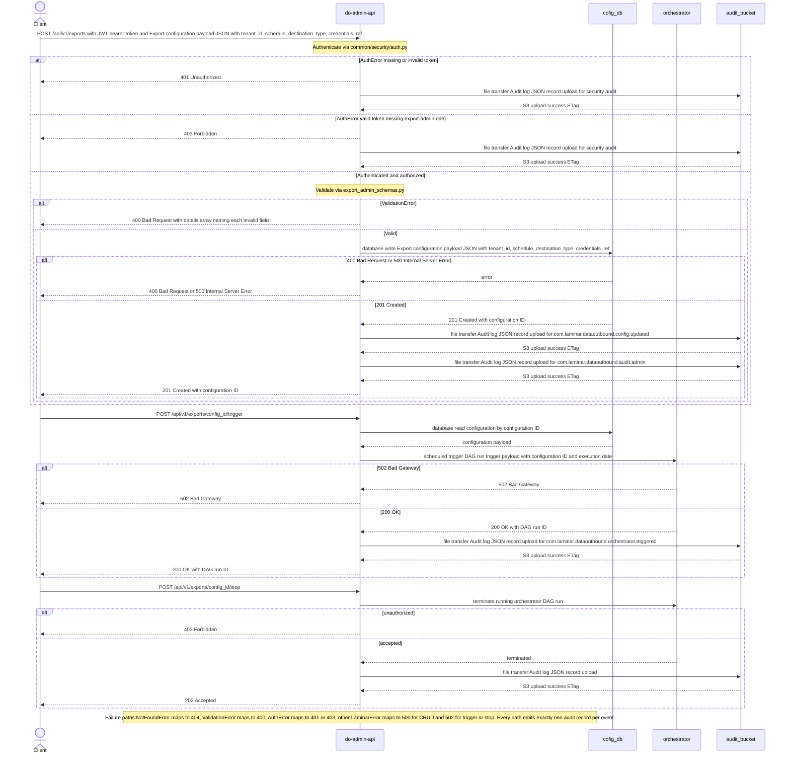

### 3.5. Schema Definitions (DB Tables / API JSON / Telemetry CloudEvents)
<a id="laminar-sec-c.imp_standard_standard_api_1.schema"></a>
**do-admin-api** owns no database tables — the export configuration tables are owned by **cofig_db** and their DDL is defined in that component's section. This section defines the API JSON contracts and the CloudEvents telemetry records the API emits.

#### 3.5.1 API request/response JSON

```json
{
  "$id": "https://laminar.com/dataoutbound/schemas/export-config-create.json",
  "title": "ExportConfigCreate",
  "type": "object",
  "required": ["connection_name", "tenant_id", "target_type", "dataset", "mode", "cron_schedule", "destination_type", "credentials"],
  "additionalProperties": false,
  "properties": {
    "connection_name": { "type": "string", "minLength": 1, "maxLength": 100 },
    "tenant_id": { "type": "string", "minLength": 1, "maxLength": 64 },
    "target_type": { "type": "string", "enum": ["s3", "azure_blob", "gcs", "sftp"] },
    "dataset": { "type": "string", "enum": ["identity_profiles", "subscription_statuses", "campaigns_reactions", "reservation_items"] },
    "mode": { "type": "string", "enum": ["initial", "incremental"] },
    "cron_schedule": { "type": "string", "pattern": "^\\S+\\s+\\S+\\s+\\S+\\s+\\S+\\s+\\S+$" },
    "destination_type": { "type": "string" },
    "credentials": { "type": "object" },
    "gzip_enabled": { "type": "boolean", "default": false },
    "pgp_enabled": { "type": "boolean", "default": false },
    "split_threshold_records": { "type": "integer", "minimum": 1, "default": 500000 }
  }
}
```

```json
{
  "$id": "https://laminar.com/dataoutbound/schemas/export-config-record.json",
  "title": "ExportConfigRecord",
  "type": "object",
  "required": ["config_id", "connection_name", "tenant_id", "target_type", "dataset", "mode", "cron_schedule", "destination_type", "credentials_ref", "credentials_masked", "is_active", "created_at", "updated_at"],
  "properties": {
    "config_id": { "type": "string", "format": "uuid" },
    "connection_name": { "type": "string" },
    "tenant_id": { "type": "string" },
    "target_type": { "type": "string", "enum": ["s3", "azure_blob", "gcs", "sftp"] },
    "dataset": { "type": "string", "enum": ["identity_profiles", "subscription_statuses", "campaigns_reactions", "reservation_items"] },
    "mode": { "type": "string", "enum": ["initial", "incremental"] },
    "cron_schedule": { "type": "string" },
    "destination_type": { "type": "string" },
    "credentials_ref": { "type": "string", "description": "SSM SecureString parameter name; never the credential value" },
    "credentials_masked": { "type": "string", "const": "********" },
    "gzip_enabled": { "type": "boolean" },
    "pgp_enabled": { "type": "boolean" },
    "split_threshold_records": { "type": "integer" },
    "is_active": { "type": "boolean" },
    "created_at": { "type": "string", "format": "date-time" },
    "updated_at": { "type": "string", "format": "date-time" }
  }
}
```

#### 3.5.2 Telemetry CloudEvents

Every audit record is a CloudEvents 1.0 record. The `data` object carries the SCRUM-486 audit schema (`actor_id`, `timestamp_utc`, `event_type`, `execution_id`).

```json
{
  "$id": "https://laminar.com/dataoutbound/schemas/cloudevent-admin-audit.json",
  "title": "AdminAuditCloudEvent",
  "type": "object",
  "required": ["specversion", "id", "source", "type", "time", "datacontenttype", "data"],
  "properties": {
    "specversion": { "type": "string", "const": "1.0" },
    "id": { "type": "string", "format": "uuid" },
    "source": { "type": "string", "const": "com.laminar.dataoutbound.do-admin-api" },
    "type": {
      "type": "string",
      "enum": [
        "com.laminar.dataoutbound.config.updated",
        "com.laminar.dataoutbound.orchestrator.triggered",
        "com.laminar.dataoutbound.audit.admin"
      ]
    },
    "time": { "type": "string", "format": "date-time" },
    "datacontenttype": { "type": "string", "const": "application/json" },
    "subject": { "type": "string", "description": "config_id" },
    "data": {
      "type": "object",
      "required": ["actor_id", "timestamp_utc", "event_type", "execution_id"],
      "properties": {
        "actor_id": { "type": "string", "description": "authenticated Acme user id, or system:<component-name>" },
        "timestamp_utc": { "type": "string", "pattern": "^\\d{4}-\\d{2}-\\d{2}T\\d{2}:\\d{2}:\\d{2}\\.\\d{3}Z$" },
        "event_type": {
          "type": "string",
          "enum": ["ADMIN_CREATE", "ADMIN_UPDATE", "ADMIN_DELETE", "ADMIN_MANUAL_TRIGGER", "EXECUTION_STARTED", "EXECUTION_COMPLETED", "TRANSFER_STARTED", "TRANSFER_COMPLETED", "TRANSFER_FAILED"]
        },
        "execution_id": { "type": "string", "description": "lineage UUID generated by orchestrator" },
        "config_id": { "type": "string" },
        "status": { "type": "string" }
      }
    }
  }
}
```

### 3.6. Local Design Assumptions
<a id="laminar-sec-c.imp_standard_standard_api_1.asm"></a>
1. **Credential encryption mechanism.** Credentials are written to SSM Parameter Store as `SecureString` parameters encrypted with the solution KMS CMK, and only the parameter name is persisted in **cofig_db** as `credentials_ref`. This satisfies SCRUM-479 AC#1/AC#6 ("stored value differs from submitted plaintext", "no retrieve call returns credential in plaintext") using the blueprint's existing `common/clients/aws/ssm` client rather than introducing a new KMS client. The KMS key alias is read from `apis/config.yml`.
2. **Trigger response code.** The frozen contract for the `do-admin-api → orchestrator` edge specifies `200 OK` with the DAG run ID, so the trigger endpoint returns `200 OK`. SCRUM-480 AC#5's "HTTP 202" is satisfied semantically by an accepted asynchronous trigger; the frozen contract wins where the two differ.
3. **Stop semantics.** `POST /api/v1/exports/{config_id}/stop` returns `202 Accepted` and calls the MWAA REST API to terminate the orchestrator DAG run. Terminating the orchestrator run is what guarantees "no further child run in child_export_dag is started for that execution" (SCRUM-480 AC#6).
4. **Role model.** A single role `export-admin` gates every endpoint; there is no separate read-only role, because SCRUM-479 AC#7 only distinguishes "no valid credentials" (`401`) from "without admin role" (`403`).
5. **Rate limiting.** A token-bucket limiter of 60 requests/minute per authenticated subject is applied at the boundary; this is a mainstream default for an administrative API and protects the scripted-client path (SCRUM-479 AC#6).
6. **Audit failure isolation.** `AuditPublisher.publish` never raises into the caller's flow, so an **audit_bucket** outage degrades audit completeness but never fails an administrative response; the failure is logged locally with the correlation id.
7. **Idempotency.** Create uses a server-generated UUID v4 `config_id`; update is an upsert keyed by `config_id`; trigger is idempotent via the logical execution date and run id. `util/idempotency.py`'s `IdempotencyKey.build(*parts)` is used for the trigger key.
8. **Open question — log retention.** The organisation logging-standard retention value is not stated in the inputs; this design assumes **365 days** for the pipeline log groups and the audit store, to be confirmed in days before sprint commitment (SCRUM-486 AC#4).

## 4. Component Design: scheduler
<a id="laminar-sec-c.imp_aws_aws_eventbridge_2"></a>

### 4.1. Component Contract (Bi-Directional Inputs & Outputs)
<a id="laminar-sec-c.imp_aws_aws_eventbridge_2.contract"></a>
- **Component Name**: `scheduler`
- **Service Type**: `aws_eventbridge`
- **Inbound Interfaces & Triggers**:
  - Cron schedule trigger configured via EventBridge rule definitions (`scheduler`).
- **Outbound Interfaces**:
  - Invokes `orchestrator` (`aws_mwaa_dag`) via EventBridge rule target integration, dispatching CloudEvents-formatted cadence payloads.
- **Configuration Properties (Authoritative)**:
  - `rule_name`: `scheduler`

### 4.2. Class and Interface Definitions
<a id="laminar-sec-c.imp_aws_aws_eventbridge_2.classes"></a>
```python
from dataclasses import dataclass, field
from datetime import datetime
from typing import Any, Dict

@dataclass
class SchedulerEventPayload:
    source: str = "com.laminar.dataoutbound.scheduler"
    detail_type: str = "ExportScheduleTrigger"
    time: str = field(default_factory=lambda: datetime.utcnow().isoformat() + "Z")
    detail: Dict[str, Any] = field(default_factory=dict)

    to_dict = lambda self: {
        "source": self.source,
        "detail-type": self.detail_type,
        "time": self.time,
        "detail": self.detail
    }
```

### 4.3. Implementation Code Skeleton (Stubs & Handlers)
<a id="laminar-sec-c.imp_aws_aws_eventbridge_2.skeleton"></a>
```python
# Illustrative skeleton — the Component Contract and Schema Definitions are binding
from dataoutbound_section_tree.common.clients.aws.eventbridge.eventbridge_client import EventBridgeClient
from dataoutbound_section_tree.common.logging.logger import get_logger
from dataoutbound_section_tree.util.exceptions import ClientError
import json

logger = get_logger(__name__)

class SchedulerEventPublisher:
    def __init__(self, eb_client: EventBridgeClient, event_bus_name: str):
        self.eb_client = eb_client
        self.event_bus_name = event_bus_name

    def trigger_scheduled_runs(self, schedule_expression: str) -> None:
        event_entry = {
            "Source": "com.laminar.dataoutbound.scheduler",
            "DetailType": "ExportScheduleTrigger",
            "Detail": json.dumps({"schedule_expression": schedule_expression}),
            "EventBusName": self.event_bus_name
        }
        try:
            response = self.eb_client.put_events([event_entry])
            logger.info("Scheduler event published successfully", extra={"response": response})
        except ClientError as e:
            logger.error("Failed to publish scheduler event", extra={"error": str(e)})
            raise
```

### 4.4. Cross-Component Interaction Sequence (Local Mermaid/ASCII Flow)
<a id="laminar-sec-c.imp_aws_aws_eventbridge_2.seq"></a>
1. **Trigger Generation**: The EventBridge rule (`scheduler`) fires on its configured cron schedule (`@daily` or custom cadence).
2. **Event Dispatch**: EventBridge evaluates rule patterns and routes the event payload to its configured target (`orchestrator` MWAA DAG).
3. **Ingestion**: The orchestrator receives the event containing the schedule timestamp and event source.
4. **Retry & DLQ**: If target invocation fails, EventBridge applies its built-in retry policy (up to 3 attempts with exponential backoff). Unrecoverable failures are routed to a Dead-Letter Queue (DLQ).
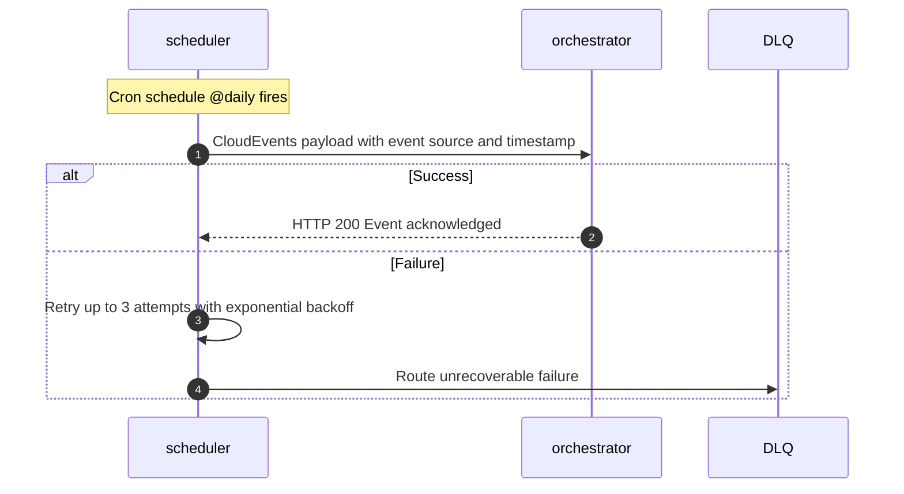

### 4.5. Schema Definitions (DB Tables / API JSON / Telemetry CloudEvents)
<a id="laminar-sec-c.imp_aws_aws_eventbridge_2.schema"></a>
```json
{
  "$schema": "https://json-schema.org/draft/2020-12/schema",
  "title": "SchedulerCloudEvent",
  "type": "object",
  "properties": {
    "version": { "type": "string", "const": "0" },
    "id": { "type": "string", "format": "uuid" },
    "detail-type": { "type": "string", "const": "ExportScheduleTrigger" },
    "source": { "type": "string", "const": "com.laminar.dataoutbound.scheduler" },
    "account": { "type": "string" },
    "time": { "type": "string", "format": "date-time" },
    "region": { "type": "string" },
    "resources": { "type": "array", "items": { "type": "string" } },
    "detail": {
      "type": "object",
      "properties": {
        "schedule_expression": { "type": "string" }
      },
      "required": ["schedule_expression"]
    }
  },
  "required": ["version", "id", "detail-type", "source", "account", "time", "region", "detail"]
}
```

### 4.6. Local Design Assumptions
<a id="laminar-sec-c.imp_aws_aws_eventbridge_2.asm"></a>
- **Assumption 1**: EventBridge rule scheduling leverages standard cron expressions evaluated in UTC to determine execution windows.
- **Assumption 2**: Target invocation relies on IAM role permissions allowing EventBridge to trigger MWAA DAG runs securely without exposing public endpoints.

## 5. Component Design: orchestrator
<a id="laminar-sec-c.imp_aws_aws_mwaa_dag_3"></a>

### 5.1. Component Contract (Bi-Directional Inputs & Outputs)
<a id="laminar-sec-c.imp_aws_aws_mwaa_dag_3.contract"></a>
**Component:** `orchestrator` — MWAA DAG `orchestrator` (`@daily`, `catchup=False`, `max_active_runs=1`), deployed from `src/dataoutbound_section_tree/dags/export_orchestrator_dag.py`.

**Role.** The orchestrator is the fan-out control point of the pipeline. It is triggered either by **scheduler** (EventBridge cadence event) or by **do-admin-api** (manual trigger), reads active export configurations from **cofig_db**, selects only those whose `cron_schedule` falls within *T ± 10 minutes*, generates exactly one RFC 4122 v4 lineage UUID per run, and submits one **child_export_dag** run per selected connection carrying that same lineage UUID.

#### 5.1.1 Inbound Contracts (what the orchestrator consumes)

| # | From | Trigger | Request payload | Response | Errors | Idempotency | Telemetry event |
|---|---|---|---|---|---|---|---|
| I1 | **scheduler** | EventBridge rule `scheduler` fires at cadence *T* | CloudEvents envelope with `source`, `detail-type`, `time`, `detail.schedule_timestamp` | Event acknowledged (HTTP 200 to EventBridge) | EventBridge built-in retry, max 3 attempts | Idempotent via EventBridge `event_id` + logical execution date | `com.laminar.dataoutbound.scheduler.fired` |
| I2 | **do-admin-api** | Manual API invocation (`POST /api/v1/exports/{id}/trigger`) | DAG run trigger payload with `config_id` and `execution_date` | `200 OK` with DAG run ID | `502 Bad Gateway`; retried with exponential backoff by the API | Idempotent via logical execution date + `config_id` | `com.laminar.dataoutbound.orchestrator.triggered` |
| I3 | **cofig_db** | DAG task execution start | `SELECT` for active export configurations matching the schedule window | ResultSet of active export configurations | Connection timeout / query error; retried up to 3 times | Idempotent read-only query | none |

#### 5.1.2 Outbound Contracts (what the orchestrator produces)

| # | To | Trigger | Request payload | Response | Errors | Idempotency | Telemetry event |
|---|---|---|---|---|---|---|---|
| O1 | **cofig_db** | DAG task execution start | Parameterised `SELECT` (read-only) | ResultSet | Retried up to 3 times | Idempotent read-only query | none |
| O2 | **child_export_dag** | Orchestrator task completion, one task instance per selected connection | `DagRun` payload with `config_id`, `lineage_uuid`, `connection_json`, `execution_date` | Trigger confirmation with `run_id` | DAG trigger failure; retried via Airflow task retry policy | Idempotent via execution date + `config_id` | `com.laminar.dataoutbound.child.triggered` |
| O3 | **audit_bucket** | Run start, run success, run failure, manual trigger, stop | Audit record per the SCRUM-486 schema | S3 upload success ETag | S3 error; logged with warning, run continues | Idempotent via DAG run ID naming | `com.laminar.dataoutbound.audit.orchestrator` |

#### 5.1.3 Configuration the design actually sets

| Setting | Value | Rationale |
|---|---|---|
| `schedule` | `@daily` | User decision on the canvas; the per-connection cadence is enforced by the ±10-minute cron-window filter, not by the DAG schedule. |
| `catchup` | `False` | User decision; prevents backfill storms when the DAG is first deployed or re-enabled. |
| `max_active_runs` | `1` | User decision; guarantees a single lineage UUID per logical run and prevents overlapping fan-outs. |
| `retries` | `3` | Mainstream Airflow default for idempotent tasks; matches the frozen contract's "retried up to 3 times" for the cofig_db read. |
| `retry_delay` | `timedelta(minutes=1)` | Bounded backoff that still fits the 24-hour delivery SLA. |
| `schedule_window_minutes` | `10` | SCRUM-480 AC#1 / SCRUM-481 AC#3 — the ±10-minute selection window. |
| `lineage_uuid_version` | `4` | SCRUM-480 AC#3 — RFC 4122 version 4. |

All other Airflow tunables (pool, priority weight, SLA, executor) are left at MWAA defaults; deferring to defaults is itself a decision.

### 5.2. Class and Interface Definitions
<a id="laminar-sec-c.imp_aws_aws_mwaa_dag_3.classes"></a>
The orchestrator is a `dag` module: its public surface is the DAG object plus the pure helpers its tasks call. All cross-cutting concerns are imported from the blueprint foundation — the DAG never constructs a boto3 client, a logger or an audit publisher of its own.

```python
# src/dataoutbound_section_tree/dags/export_orchestrator_dag.py
from __future__ import annotations

from dataclasses import dataclass, field
from datetime import datetime, timedelta
from typing import Any, Iterable, Sequence
from uuid import UUID

from dataoutbound_section_tree.common.clients.db.db_client import DbClient
from dataoutbound_section_tree.common.logging.logger import get_logger
from dataoutbound_section_tree.common.telemetry.auditor import AuditPublisher
from dataoutbound_section_tree.config.config_loader import ConfigLoader
from dataoutbound_section_tree.util.constants import (
    EVENT_CHILD_TRIGGERED,
    EVENT_EXECUTION_COMPLETED,
    EVENT_EXECUTION_STARTED,
    EVENT_ORCHESTRATOR_TRIGGERED,
)
from dataoutbound_section_tree.util.idempotency import IdempotencyKey

logger = get_logger(__name__)


@dataclass(frozen=True)
class ExportConnection:
    """One active export configuration as read from cofig_db (secrets excluded)."""
    config_id: str
    connection_name: str
    target_type: str            # s3 | azure_blob | gcs | sftp
    dataset: str                # identity_profiles | subscription_statuses | campaigns_reactions | reservation_items
    mode: str                   # initial | incremental
    cron_schedule: str          # 5-field cron expression
    is_active: bool
    updated_at: datetime

    def to_run_conf(self) -> dict[str, Any]:
        """Serialisable form carried into the child DAG run conf (no credentials)."""
        return {
            "config_id": self.config_id,
            "connection_name": self.connection_name,
            "target_type": self.target_type,
            "dataset": self.dataset,
            "mode": self.mode,
            "cron_schedule": self.cron_schedule,
        }


@dataclass(frozen=True)
class OrchestratorRunContext:
    """Immutable per-run context: one lineage UUID, one logical execution date."""
    lineage_uuid: UUID
    execution_date: datetime
    trigger_source: str          # "scheduler" | "manual"
    actor_id: str                # "system:orchestrator" | authenticated Acme user id
    selected: tuple[ExportConnection, ...] = field(default_factory=tuple)

    @property
    def execution_id(self) -> str:
        return str(self.lineage_uuid)

    def child_run_id(self, connection: ExportConnection) -> str:
        """Deterministic child run id — makes the fan-out idempotent."""
        return IdempotencyKey.build(
            "child", self.execution_date.date().isoformat(), connection.config_id
        )


class CronWindowSelector:
    """Pure selection logic: which connections are in the ±window of T."""

    def __init__(self, window_minutes: int = 10) -> None:
        self._window = timedelta(minutes=window_minutes)

    def is_in_window(self, cron_schedule: str, reference: datetime) -> bool:
        """True when the cron expression fires within [reference - window, reference + window]."""
        raise NotImplementedError  # implemented in the DAG module

    def select(
        self, connections: Iterable[ExportConnection], reference: datetime
    ) -> list[ExportConnection]:
        return [c for c in connections if self.is_in_window(c.cron_schedule, reference)]


class OrchestratorRepository:
    """Read-only access to cofig_db through the shared DbClient."""

    def __init__(self, db: DbClient) -> None:
        self._db = db

    def load_active_configurations(self) -> list[ExportConnection]:
        """SELECT every active configuration; the cron window is applied in-process."""
        raise NotImplementedError

    def record_run(self, ctx: OrchestratorRunContext, status: str) -> None:
        """Append one row to export_execution_log for this lineage UUID."""
        raise NotImplementedError


class OrchestratorService:
    """Business operations behind the DAG tasks. No Airflow types leak in here."""

    def __init__(
        self,
        config: ConfigLoader,
        repository: OrchestratorRepository,
        auditor: AuditPublisher,
        selector: CronWindowSelector,
    ) -> None:
        self._config = config
        self._repo = repository
        self._auditor = auditor
        self._selector = selector

    def start_run(self, execution_date: datetime, trigger_source: str, actor_id: str) -> OrchestratorRunContext:
        """Generate the single lineage UUID and emit EXECUTION_STARTED."""
        raise NotImplementedError

    def select_connections(self, ctx: OrchestratorRunContext) -> OrchestratorRunContext:
        """Read active configs and keep only those inside the ±10-minute window."""
        raise NotImplementedError

    def fan_out(self, ctx: OrchestratorRunContext) -> Sequence[str]:
        """Return the deterministic child run ids to be triggered."""
        raise NotImplementedError

    def complete_run(self, ctx: OrchestratorRunContext, status: str) -> None:
        """Emit EXECUTION_COMPLETED / failure audit and persist the run record."""
        raise NotImplementedError
```

### 5.3. Implementation Code Skeleton (Stubs & Handlers)
<a id="laminar-sec-c.imp_aws_aws_mwaa_dag_3.skeleton"></a>
*Illustrative skeleton — the Component Contract and Schema Definitions are binding.*

```python
# src/dataoutbound_section_tree/dags/export_orchestrator_dag.py
"""Export Orchestrator DAG (MWAA).

Fan-out control point: reads active export configurations, selects those whose
cron_schedule falls within T ± 10 minutes, generates one RFC 4122 v4 lineage UUID
per run and submits one child_export_dag run per selected connection.
"""
from __future__ import annotations

import uuid
from datetime import datetime, timedelta, timezone

from airflow import DAG
from airflow.operators.python import PythonOperator
from airflow.operators.trigger_dagrun import TriggerDagRunOperator

from dataoutbound_section_tree.common.clients.db.db_client import DbClient
from dataoutbound_section_tree.common.logging.logger import get_logger
from dataoutbound_section_tree.common.telemetry.auditor import AuditPublisher
from dataoutbound_section_tree.config.config_loader import ConfigLoader
from dataoutbound_section_tree.util.constants import (
    EVENT_CHILD_TRIGGERED,
    EVENT_EXECUTION_COMPLETED,
    EVENT_EXECUTION_STARTED,
)
from dataoutbound_section_tree.util.exceptions import LaminarError

logger = get_logger(__name__)

CONFIG = ConfigLoader(module="dags")
DB = DbClient(config=CONFIG)
AUDITOR = AuditPublisher(config=CONFIG)
WINDOW_MINUTES = int(CONFIG.get("orchestrator.schedule_window_minutes", 10))
CHILD_DAG_ID = CONFIG.get("orchestrator.child_dag_id", "child_export_dag")

DEFAULT_ARGS = {
    "owner": "dataoutbound",
    "retries": 3,
    "retry_delay": timedelta(minutes=1),
    "depends_on_past": False,
}


def _load_active_configurations() -> list[dict]:
    """Read every active configuration; the cron window is applied in-process."""
    return DB.fetch_all(
        """
        SELECT config_id, connection_name, target_type, dataset, mode,
               cron_schedule, is_active, updated_at
          FROM export_configuration
         WHERE is_active = TRUE
         ORDER BY config_id
        """
    )


def _is_in_window(cron_schedule: str, reference: datetime, window_minutes: int) -> bool:
    """True when the 5-field cron expression fires within ±window_minutes of reference."""
    from croniter import croniter  # pinned dependency

    base = reference.replace(second=0, microsecond=0)
    itr = croniter(cron_schedule, base - timedelta(minutes=window_minutes))
    nxt = itr.get_next(datetime)
    return nxt <= base + timedelta(minutes=window_minutes)


def start_run(**context) -> dict:
    """Generate the single lineage UUID and emit EXECUTION_STARTED."""
    dag_run = context["dag_run"]
    execution_date = dag_run.logical_date
    trigger_source = (dag_run.conf or {}).get("trigger_source", "scheduler")
    actor_id = (dag_run.conf or {}).get("actor_id", "system:orchestrator")

    lineage_uuid = uuid.uuid4()  # RFC 4122 v4
    ctx = {
        "lineage_uuid": str(lineage_uuid),
        "execution_date": execution_date.isoformat(),
        "trigger_source": trigger_source,
        "actor_id": actor_id,
    }
    AUDITOR.publish(
        EVENT_EXECUTION_STARTED,
        {
            "actor_id": actor_id,
            "timestamp_utc": _now_iso(),
            "event_type": "EXECUTION_STARTED",
            "execution_id": str(lineage_uuid),
            "trigger_source": trigger_source,
        },
    )
    logger.info("orchestrator run started", extra={"execution_id": str(lineage_uuid)})
    return ctx


def select_connections(**context) -> list[dict]:
    """Keep only active configurations whose cron_schedule is inside T ± 10 minutes."""
    ti = context["ti"]
    ctx = ti.xcom_pull(task_ids="start_run")
    reference = datetime.fromisoformat(ctx["execution_date"])

    try:
        rows = _load_active_configurations()
    except LaminarError as exc:
        logger.error("cofig_db read failed", extra={"error": str(exc)})
        raise

    selected = [r for r in rows if _is_in_window(r["cron_schedule"], reference, WINDOW_MINUTES)]
    logger.info(
        "connections selected",
        extra={"execution_id": ctx["lineage_uuid"], "selected": len(selected), "total": len(rows)},
    )
    return selected


def fan_out(**context) -> list[dict]:
    """Build the deterministic child run conf list (one entry per selected connection)."""
    ti = context["ti"]
    ctx = ti.xcom_pull(task_ids="start_run")
    selected = ti.xcom_pull(task_ids="select_connections") or []

    payloads = []
    for row in selected:
        payloads.append(
            {
                "config_id": row["config_id"],
                "lineage_uuid": ctx["lineage_uuid"],
                "connection_json": {
                    "config_id": row["config_id"],
                    "connection_name": row["connection_name"],
                    "target_type": row["target_type"],
                    "dataset": row["dataset"],
                    "mode": row["mode"],
                    "cron_schedule": row["cron_schedule"],
                },
                "execution_date": ctx["execution_date"],
            }
        )
        AUDITOR.publish(
            EVENT_CHILD_TRIGGERED,
            {
                "actor_id": ctx["actor_id"],
                "timestamp_utc": _now_iso(),
                "event_type": "EXECUTION_STARTED",
                "execution_id": ctx["lineage_uuid"],
                "config_id": row["config_id"],
            },
        )
    return payloads


def complete_run(**context) -> None:
    """Emit EXECUTION_COMPLETED and persist the run record."""
    ti = context["ti"]
    ctx = ti.xcom_pull(task_ids="start_run")
    AUDITOR.publish(
        EVENT_EXECUTION_COMPLETED,
        {
            "actor_id": ctx["actor_id"],
            "timestamp_utc": _now_iso(),
            "event_type": "EXECUTION_COMPLETED",
            "execution_id": ctx["lineage_uuid"],
        },
    )


def _now_iso() -> str:
    return datetime.now(timezone.utc).strftime("%Y-%m-%dT%H:%M:%S.%f")[:-3] + "Z"


with DAG(
    dag_id="orchestrator",
    schedule="@daily",
    start_date=datetime(2025, 1, 1, tzinfo=timezone.utc),
    catchup=False,
    max_active_runs=1,
    default_args=DEFAULT_ARGS,
    tags=["dataoutbound", "orchestrator"],
) as dag:
    t_start = PythonOperator(task_id="start_run", python_callable=start_run)
    t_select = PythonOperator(task_id="select_connections", python_callable=select_connections)
    t_fanout = PythonOperator(task_id="fan_out", python_callable=fan_out)
    t_complete = PythonOperator(task_id="complete_run", python_callable=complete_run)

    t_start >> t_select >> t_fanout >> t_complete
```

### 5.4. Cross-Component Interaction Sequence (Local Mermaid/ASCII Flow)
<a id="laminar-sec-c.imp_aws_aws_mwaa_dag_3.seq"></a>
The orchestrator is entered from two directions and fans out to one child DAG per selected connection. The ordered interaction is:

1. **Trigger arrival.** Either **scheduler** raises its EventBridge cadence event at time *T* (contract I1), or **do-admin-api** calls the MWAA REST API on a manual trigger (contract I2). Both paths land on the same DAG with `max_active_runs=1`, so a second trigger while a run is active is queued rather than overlapped.
2. **Run start.** The `start_run` task generates exactly one RFC 4122 v4 lineage UUID, records `trigger_source` and `actor_id` in the run context, and publishes `EXECUTION_STARTED` to **audit_bucket** (contract O3).
3. **Configuration read.** The `select_connections` task issues a read-only `SELECT` against **cofig_db** (contract I3/O1) for every row with `is_active = TRUE`. A connection timeout or query error is retried up to three times by the Airflow task retry policy; after the third failure the run fails and `EXECUTION_COMPLETED` is emitted with a failure status.
4. **Window selection.** In-process, each returned row's `cron_schedule` is evaluated against *T ± 10 minutes*. Rows outside the window are discarded; rows inside the window form the fan-out set. This is the SCRUM-480 AC#1 / SCRUM-481 AC#3 behaviour.
5. **Fan-out.** For each selected connection, the `fan_out` task builds a deterministic child run payload (`config_id`, `lineage_uuid`, `connection_json`, `execution_date`) and publishes `com.laminar.dataoutbound.child.triggered` to **audit_bucket**. The `TriggerDagRunOperator` then submits one **child_export_dag** run per payload (contract O2). A trigger failure is retried by the Airflow task retry policy; the deterministic run id makes the retry idempotent.
6. **Completion.** The `complete_run` task publishes `EXECUTION_COMPLETED` to **audit_bucket** and persists the run record in **cofig_db**.

**Failure paths.** A cofig_db read failure after retries fails the run and emits a failure audit. A child trigger failure after retries fails only that task instance; the remaining children continue, and the failed connection is visible in the run record for operational review. An audit_bucket write failure is logged with a warning and never fails the run (contract O3).
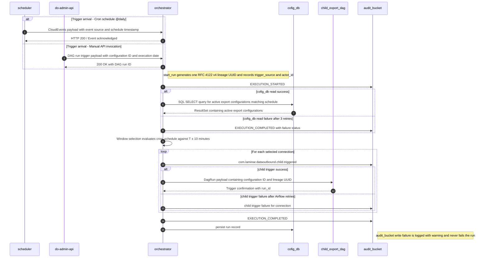

### 5.5. Schema Definitions (DB Tables / API JSON / Telemetry CloudEvents)
<a id="laminar-sec-c.imp_aws_aws_mwaa_dag_3.schema"></a>
#### 5.5.1 Child DAG run payload (contract O2)

```json
{
  "$schema": "https://json-schema.org/draft/2020-12/schema",
  "$id": "https://laminar.com/dataoutbound/schemas/orchestrator-child-run.json",
  "title": "OrchestratorChildRunPayload",
  "type": "object",
  "required": ["config_id", "lineage_uuid", "connection_json", "execution_date"],
  "additionalProperties": false,
  "properties": {
    "config_id": { "type": "string", "minLength": 1, "maxLength": 64 },
    "lineage_uuid": {
      "type": "string",
      "pattern": "^[0-9a-f]{8}-[0-9a-f]{4}-4[0-9a-f]{3}-[89ab][0-9a-f]{3}-[0-9a-f]{12}$"
    },
    "execution_date": { "type": "string", "format": "date-time" },
    "connection_json": {
      "type": "object",
      "required": ["config_id", "connection_name", "target_type", "dataset", "mode", "cron_schedule"],
      "additionalProperties": false,
      "properties": {
        "config_id": { "type": "string" },
        "connection_name": { "type": "string", "minLength": 1, "maxLength": 100 },
        "target_type": { "enum": ["s3", "azure_blob", "gcs", "sftp"] },
        "dataset": {
          "enum": ["identity_profiles", "subscription_statuses", "campaigns_reactions", "reservation_items"]
        },
        "mode": { "enum": ["initial", "incremental"] },
        "cron_schedule": { "type": "string" }
      }
    }
  }
}
```

#### 5.5.2 Telemetry CloudEvents emitted by the orchestrator

```json
{
  "$schema": "https://json-schema.org/draft/2020-12/schema",
  "$id": "https://laminar.com/dataoutbound/schemas/orchestrator-audit-cloudevent.json",
  "title": "OrchestratorAuditCloudEvent",
  "type": "object",
  "required": ["specversion", "type", "source", "id", "time", "data"],
  "properties": {
    "specversion": { "const": "1.0" },
    "type": {
      "enum": [
        "com.laminar.dataoutbound.scheduler.fired",
        "com.laminar.dataoutbound.orchestrator.triggered",
        "com.laminar.dataoutbound.child.triggered",
        "com.laminar.dataoutbound.audit.orchestrator"
      ]
    },
    "source": { "const": "dataoutbound/orchestrator" },
    "id": { "type": "string", "format": "uuid" },
    "time": { "type": "string", "format": "date-time" },
    "data": {
      "type": "object",
      "required": ["actor_id", "timestamp_utc", "event_type", "execution_id"],
      "properties": {
        "actor_id": { "type": "string" },
        "timestamp_utc": {
          "type": "string",
          "pattern": "^\\d{4}-\\d{2}-\\d{2}T\\d{2}:\\d{2}:\\d{2}\\.\\d{3}Z$"
        },
        "event_type": {
          "enum": [
            "ADMIN_CREATE", "ADMIN_UPDATE", "ADMIN_DELETE", "ADMIN_MANUAL_TRIGGER",
            "EXECUTION_STARTED", "EXECUTION_COMPLETED",
            "TRANSFER_STARTED", "TRANSFER_COMPLETED", "TRANSFER_FAILED"
          ]
        },
        "execution_id": { "type": "string", "format": "uuid" },
        "config_id": { "type": "string" },
        "trigger_source": { "enum": ["scheduler", "manual"] }
      }
    }
  }
}
```

#### 5.5.3 cofig_db tables the orchestrator reads and writes

The orchestrator owns no table; it reads `export_configuration` and appends to `export_execution_log`, both owned by **cofig_db**. The DDL is defined in the cofig_db component section; the orchestrator's read projection is:

```sql
SELECT config_id, connection_name, target_type, dataset, mode,
       cron_schedule, is_active, updated_at
  FROM export_configuration
 WHERE is_active = TRUE
 ORDER BY config_id;
```

### 5.6. Local Design Assumptions
<a id="laminar-sec-c.imp_aws_aws_mwaa_dag_3.asm"></a>
- **Cron-window evaluation is in-process, not in SQL.** The `SELECT` returns every active row and the ±10-minute filter runs in Python via `croniter`. Rationale: cron expressions are not natively evaluable in Postgres without an extension, and the active-configuration set is small (per-customer scale target). This satisfies SCRUM-480 AC#1 / SCRUM-481 AC#3.
- **One lineage UUID per DAG run.** Generated in `start_run` and carried in every child run conf and every audit event. Rationale: SCRUM-480 AC#3 requires exactly one RFC 4122 v4 UUID per run.
- **Child run ids are deterministic.** `IdempotencyKey.build("child", execution_date, config_id)` makes a retried fan-out idempotent. Rationale: contract O2 idempotency clause.
- **`max_active_runs=1` is the concurrency guard.** A manual trigger arriving while a scheduled run is active is queued, not overlapped. Rationale: user decision on the canvas; prevents two lineage UUIDs for the same logical run.
- **Audit failures never fail the run.** `AuditPublisher.publish` is documented as never raising into the caller's flow. Rationale: contract O3 and the foundation's Principle 3.
- **`cofig_db` credentials are resolved via `ConfigLoader` + SSM SecureString.** No credential is embedded in the DAG file. Rationale: SCRUM-479 AC#1 / SCRUM-481 AC#6.
- **The orchestrator does not read credentials.** The `connection_json` carried into the child run conf contains only non-secret fields; credential resolution happens in the child DAG and egress DAG. Rationale: least privilege and SCRUM-479 AC#3.

## 6. Component Design: child_export_dag
<a id="laminar-sec-c.imp_aws_aws_mwaa_dag_4"></a>

### 6.1. Component Contract (Bi-Directional Inputs & Outputs)
<a id="laminar-sec-c.imp_aws_aws_mwaa_dag_4.contract"></a>
**Component:** `child_export_dag` — MWAA (Airflow) DAG, module `src/dataoutbound_section_tree/dags/child_export_dag.py`, deployed as-is to the MWAA DAGs bucket. One DAG run executes exactly one export connection: it reads the connection's watermark and recipe from **cofig_db**, submits one **emr_do** Spark job, waits for terminal state, and publishes the execution lifecycle audit events.

#### 6.1.1 Configuration the design sets (everything else is Airflow default)

| Setting | Value | Rationale |
|---|---|---|
| `dag_id` | `child_export_dag` | User-given DAG name; the orchestrator triggers it by this id. |
| `schedule` | `@daily` | Diagram property. The DAG is **event-triggered** by **orchestrator**; the daily schedule is a safety net only, and `catchup=False` prevents backfill storms. |
| `catchup` | `False` | Diagram property; no historical runs are materialised. |
| `max_active_runs` | `1` | Diagram property; one run per connection at a time, so a connection's watermark is never advanced concurrently. |
| `tags` | `[]` | Diagram property (empty). |
| `default_args.retries` | `3` | Matches the frozen contract ("retried up to 3 times" for the cofig_db read; "retried with backoff" for the EMR submit). |
| `default_args.retry_delay` | `timedelta(minutes=2)` | Exponential backoff base for transient JDBC/EMR API errors. |
| `default_args.execution_timeout` | `timedelta(hours=6)` | Bounded above by the 24-hour delivery SLA with headroom for the egress stage. |
| `default_args.sla` | `timedelta(hours=24)` | The delivery SLA from the requirements; breaches raise an SLA-miss audit event. |
| `max_active_tasks` | `4` | One connection's tasks are sequential; 4 allows a few concurrent child runs without saturating the MWAA worker. |

#### 6.1.2 Inbound contract — orchestrator → child_export_dag

| Aspect | Specification |
|---|---|
| Trigger | Airflow `TriggerDagRunOperator` fired by **orchestrator** after it selects the connection. |
| Request | DagRun `conf` containing `config_id` and `lineage_uuid` (RFC 4122 v4), plus `execution_date` and the connection JSON snapshot. |
| Response | Trigger confirmation carrying `run_id` (Airflow REST API `POST /dags/child_export_dag/dagRuns`). |
| Errors | DAG trigger failure is retried by the **orchestrator** task's Airflow retry policy; the child DAG itself never retries the trigger. |
| Idempotency | Keyed by `execution_date` + `config_id`: a re-trigger for the same logical date and connection reuses the same `run_id` semantics and produces the same staged object keys. |
| Telemetry | `com.laminar.dataoutbound.child.triggered` (emitted by **orchestrator** on the edge). |

#### 6.1.3 Outbound contract — child_export_dag → cofig_db (read)

| Aspect | Specification |
|---|---|
| Trigger | First task of the DAG run (`resolve_run_context`). |
| Request | Parameterised `SELECT` for the export configuration row and the connection's watermark row (see Schema Definitions). |
| Response | `dict` rows: configuration fields (dataset, mode, target type, recipe path, staging prefix) and the watermark timestamp. |
| Errors | Connection timeout or query error → retried up to 3 times by the Airflow task; after exhaustion the run fails and `EXECUTION_FAILED`-class audit is published. |
| Idempotency | Read-only query; safe to repeat. |
| Telemetry | none (per the frozen contract). |

#### 6.1.4 Outbound contract — child_export_dag → emr_do (async job invocation)

| Aspect | Specification |
|---|---|
| Trigger | `submit_emr_job` task, after the run context is resolved. |
| Request | `StartJobRunRequest`: `applicationId` (the **emr_do** application), `executionRoleArn`, `jobDriver.sparkSubmit` with the job's `entryPoint` and `sparkSubmitParameters` carrying `config_id`, `lineage_uuid`, `execution_date`, `mode`, `dataset`, `watermark`, `recipe_path`, `staging_uri`. |
| Response | `StartJobRunResponse` with `jobRunId`; the DAG then polls `GetJobRun` until a terminal state. |
| Errors | EMR API rate limit or validation error → retried with backoff (3 attempts); a job that reaches `FAILED`/`CANCELLED` fails the DAG run. |
| Idempotency | `clientToken = IdempotencyKey.build(config_id, execution_date, lineage_uuid)` — a retried submit returns the original `jobRunId` instead of starting a second job. |
| Telemetry | `com.laminar.dataoutbound.emr.started` (CloudEvents, see Schema Definitions). |

#### 6.1.5 Audit contract (SCRUM-486)

The DAG publishes exactly two business audit events per connection execution — `EXECUTION_STARTED` and `EXECUTION_COMPLETED` (or `TRANSFER_FAILED`-equivalent failure signalling via the run's failure callback) — through the foundation `AuditPublisher`, with `actor_id = system:child_export_dag` and `execution_id = lineage_uuid`. The publisher writes to the configured audit sink (**audit_bucket**); it never raises into the DAG's flow.

---

### 6.2. Class and Interface Definitions
<a id="laminar-sec-c.imp_aws_aws_mwaa_dag_4.classes"></a>
```python
# src/dataoutbound_section_tree/dags/child_export_dag.py
from __future__ import annotations

from dataclasses import dataclass, field
from datetime import datetime, timedelta
from typing import Any, Literal, Optional

from dataoutbound_section_tree.common.clients.aws.emr.emr_client import EmrClient
from dataoutbound_section_tree.common.clients.db.db_client import DbClient
from dataoutbound_section_tree.common.telemetry.auditor import AuditPublisher
from dataoutbound_section_tree.config.config_loader import ConfigLoader
from dataoutbound_section_tree.util.exceptions import NotFoundError, ValidationError
from dataoutbound_section_tree.util.idempotency import IdempotencyKey

ExportMode = Literal["initial", "incremental"]
DatasetName = Literal[
    "identity_profiles",
    "subscription_statuses",
    "campaigns_reactions",
    "reservation_items",
]


@dataclass(frozen=True)
class ChildExportRunConf:
    """The DagRun `conf` handed over by `orchestrator` (contract: orchestrator -> child_export_dag)."""

    config_id: str
    lineage_uuid: str
    execution_date: str          # ISO-8601 UTC, millisecond precision, 'Z' suffix
    connection: dict[str, Any]   # connection JSON snapshot as read by the orchestrator

    @classmethod
    def from_dag_conf(cls, conf: dict[str, Any]) -> "ChildExportRunConf":
        missing = [k for k in ("config_id", "lineage_uuid", "execution_date") if not conf.get(k)]
        if missing:
            raise ValidationError(f"child_export_dag conf missing fields: {', '.join(missing)}")
        return cls(
            config_id=conf["config_id"],
            lineage_uuid=conf["lineage_uuid"],
            execution_date=conf["execution_date"],
            connection=conf.get("connection", {}),
        )


@dataclass(frozen=True)
class ExportConfiguration:
    """Row of `export_config` consumed by this DAG (owned by cofig_db)."""

    config_id: str
    connection_name: str
    dataset: DatasetName
    mode: ExportMode
    target_type: Literal["s3", "azure_blob", "gcs", "sftp"]
    cron_schedule: str
    recipe_path: str
    staging_prefix: str
    is_active: bool


@dataclass(frozen=True)
class Watermark:
    """Row of `export_watermark` consumed by this DAG (owned by cofig_db)."""

    config_id: str
    dataset: DatasetName
    watermark_ts: Optional[datetime]   # None => initial full synchronisation
    last_run_id: Optional[str] = None


@dataclass(frozen=True)
class EmrJobSubmission:
    """Result of submitting the Spark job to `emr_do`."""

    job_run_id: str
    application_id: str
    client_token: str
    submitted_at: datetime


@dataclass(frozen=True)
class RunContext:
    """Everything the DAG needs after the cofig_db read."""

    conf: ChildExportRunConf
    configuration: ExportConfiguration
    watermark: Watermark
    effective_mode: ExportMode
    staging_uri: str
    audit_payload: dict[str, Any] = field(default_factory=dict)


class ChildExportRepository:
    """Read-only access to cofig_db through the shared foundation DbClient.

    Uses ONLY the canonical DbClient interface (execute / fetch_one / fetch_all /
    transaction) — no component-local query helpers.
    """

    _SELECT_CONFIG = """
        SELECT config_id, connection_name, dataset, mode, target_type,
               cron_schedule, recipe_path, staging_prefix, is_active
          FROM export_config
         WHERE config_id = %s
    """
    _SELECT_WATERMARK = """
        SELECT config_id, dataset, watermark_ts, last_run_id
          FROM export_watermark
         WHERE config_id = %s AND dataset = %s
    """

    def __init__(self, db: DbClient) -> None:
        self._db = db

    def get_configuration(self, config_id: str) -> ExportConfiguration:
        row = self._db.fetch_one(self._SELECT_CONFIG, (config_id,))
        if row is None:
            raise NotFoundError(f"export configuration {config_id} not found")
        return ExportConfiguration(**row)

    def get_watermark(self, config_id: str, dataset: str) -> Watermark:
        row = self._db.fetch_one(self._SELECT_WATERMARK, (config_id, dataset))
        if row is None:
            # No watermark row yet => first run of this connection/dataset.
            return Watermark(config_id=config_id, dataset=dataset, watermark_ts=None)
        return Watermark(**row)


class ChildExportRunner:
    """Pure orchestration logic of one child export run; no Airflow types."""

    def __init__(
        self,
        config: ConfigLoader,
        repository: ChildExportRepository,
        emr: EmrClient,
        auditor: AuditPublisher,
    ) -> None:
        self._config = config
        self._repository = repository
        self._emr = emr
        self._auditor = auditor

    def resolve_run_context(self, conf: ChildExportRunConf) -> RunContext:
        configuration = self._repository.get_configuration(conf.config_id)
        watermark = self._repository.get_watermark(conf.config_id, configuration.dataset)
        effective_mode: ExportMode = (
            "initial" if watermark.watermark_ts is None else configuration.mode
        )
        staging_uri = (
            f"s3://{self._config.get('staging.bucket')}/"
            f"{configuration.staging_prefix}/config_id={configuration.config_id}/"
            f"execution_id={conf.lineage_uuid}/"
        )
        return RunContext(
            conf=conf,
            configuration=configuration,
            watermark=watermark,
            effective_mode=effective_mode,
            staging_uri=staging_uri,
        )

    def submit_job(self, context: RunContext) -> EmrJobSubmission:
        client_token = IdempotencyKey.build(
            context.conf.config_id, context.conf.execution_date, context.conf.lineage_uuid
        )
        job_run_id = self._emr.start_job_run(
            application_id=self._config.get("emr.application_id"),
            execution_role_arn=self._config.get("emr.execution_role_arn"),
            entry_point=self._config.get("emr.entry_point"),
            spark_submit_parameters=self._spark_parameters(context),
            client_token=client_token,
        )
        return EmrJobSubmission(
            job_run_id=job_run_id,
            application_id=self._config.get("emr.application_id"),
            client_token=client_token,
            submitted_at=datetime.utcnow(),
        )

    def _spark_parameters(self, context: RunContext) -> str:
        wm = context.watermark.watermark_ts
        watermark_arg = wm.strftime("%Y-%m-%dT%H:%M:%S.%f")[:-3] + "Z" if wm else ""
        return " ".join(
            [
                f"--config-id {context.conf.config_id}",
                f"--lineage-uuid {context.conf.lineage_uuid}",
                f"--execution-date {context.conf.execution_date}",
                f"--mode {context.effective_mode}",
                f"--dataset {context.configuration.dataset}",
                f"--watermark {watermark_arg}",
                f"--recipe-path {context.configuration.recipe_path}",
                f"--staging-uri {context.staging_uri}",
            ]
        )
```

---

### 6.3. Implementation Code Skeleton (Stubs & Handlers)
<a id="laminar-sec-c.imp_aws_aws_mwaa_dag_4.skeleton"></a>
Illustrative skeleton — the Component Contract and Schema Definitions are binding. Only the public entry points of the DAG module are shown.

```python
# src/dataoutbound_section_tree/dags/child_export_dag.py
"""Child Export DAG — one run per export connection.

Triggered by `orchestrator` (TriggerDagRunOperator) with a DagRun conf carrying
`config_id` and `lineage_uuid`. Reads watermark + recipe from cofig_db, submits one
EMR Serverless Spark job to `emr_do`, waits for terminal state, publishes audit events.
"""
from __future__ import annotations

from datetime import datetime, timedelta

from airflow import DAG
from airflow.operators.python import PythonOperator

from dataoutbound_section_tree.common.clients.aws.emr.emr_client import EmrClient
from dataoutbound_section_tree.common.clients.db.db_client import DbClient
from dataoutbound_section_tree.common.logging.logger import get_logger
from dataoutbound_section_tree.common.telemetry.auditor import AuditPublisher
from dataoutbound_section_tree.config.config_loader import ConfigLoader
from dataoutbound_section_tree.dags.child_export_dag import (  # same module in the real file
    ChildExportRepository,
    ChildExportRunConf,
    ChildExportRunner,
)
from dataoutbound_section_tree.util.constants import (
    AUDIT_EXECUTION_COMPLETED,
    AUDIT_EXECUTION_STARTED,
    EVENT_EMR_STARTED,
)
from dataoutbound_section_tree.util.exceptions import LaminarError

log = get_logger(__name__)

# --- Configuration (loaded once at DAG-parse time; no I/O beyond the config file) ---
config = ConfigLoader(module="dags")
DAG_ID = "child_export_dag"
EMR_TERMINAL_STATES = {"SUCCESS", "FAILED", "CANCELLED"}

default_args = {
    "owner": "dataoutbound",
    "retries": 3,
    "retry_delay": timedelta(minutes=2),
    "execution_timeout": timedelta(hours=6),
    "sla": timedelta(hours=24),
    "depends_on_past": False,
}


def _audit(event_type: str, payload: dict) -> None:
    """Publish through the single foundation AuditPublisher; never raises."""
    AuditPublisher(config=config).publish(event_type, payload)


def resolve_run_context(**context) -> dict:
    """Task 1 — read configuration + watermark from cofig_db and publish EXECUTION_STARTED."""
    conf = ChildExportRunConf.from_dag_conf(context["dag_run"].conf or {})
    runner = ChildExportRunner(
        config=config,
        repository=ChildExportRepository(DbClient(config=config)),
        emr=EmrClient(config=config),
        auditor=AuditPublisher(config=config),
    )
    run_context = runner.resolve_run_context(conf)
    _audit(
        AUDIT_EXECUTION_STARTED,
        {
            "actor_id": "system:child_export_dag",
            "timestamp_utc": datetime.utcnow().strftime("%Y-%m-%dT%H:%M:%S.%f")[:-3] + "Z",
            "event_type": AUDIT_EXECUTION_STARTED,
            "execution_id": conf.lineage_uuid,
            "config_id": conf.config_id,
            "dataset": run_context.configuration.dataset,
            "mode": run_context.effective_mode,
            "status": "STARTED",
        },
    )
    return {
        "config_id": conf.config_id,
        "lineage_uuid": conf.lineage_uuid,
        "execution_date": conf.execution_date,
        "dataset": run_context.configuration.dataset,
        "mode": run_context.effective_mode,
        "staging_uri": run_context.staging_uri,
        "watermark_ts": (
            run_context.watermark.watermark_ts.isoformat()
            if run_context.watermark.watermark_ts
            else None
        ),
    }


def submit_emr_job(**context) -> str:
    """Task 2 — submit the Spark job to `emr_do` with an idempotency client token."""
    ti = context["ti"]
    run_context_dict = ti.xcom_pull(task_ids="resolve_run_context")
    conf = ChildExportRunConf.from_dag_conf(context["dag_run"].conf or {})
    runner = ChildExportRunner(
        config=config,
        repository=ChildExportRepository(DbClient(config=config)),
        emr=EmrClient(config=config),
        auditor=AuditPublisher(config=config),
    )
    run_context = runner.resolve_run_context(conf)
    submission = runner.submit_job(run_context)
    _audit(
        EVENT_EMR_STARTED,
        {
            "actor_id": "system:child_export_dag",
            "timestamp_utc": datetime.utcnow().strftime("%Y-%m-%dT%H:%M:%S.%f")[:-3] + "Z",
            "event_type": EVENT_EMR_STARTED,
            "execution_id": conf.lineage_uuid,
            "config_id": conf.config_id,
            "job_run_id": submission.job_run_id,
            "application_id": submission.application_id,
            "staging_uri": run_context_dict["staging_uri"],
        },
    )
    return submission.job_run_id


def await_emr_job(**context) -> str:
    """Task 3 — poll `emr_do` until the job reaches a terminal state."""
    ti = context["ti"]
    job_run_id = ti.xcom_pull(task_ids="submit_emr_job")
    emr = EmrClient(config=config)
    state = emr.get_job_run(job_run_id=job_run_id)["state"]
    if state not in EMR_TERMINAL_STATES:
        raise LaminarError(f"EMR job {job_run_id} not terminal yet: {state}")
    if state != "SUCCESS":
        raise LaminarError(f"EMR job {job_run_id} ended in state {state}")
    return state


def publish_completion(**context) -> None:
    """Task 4 — publish EXECUTION_COMPLETED with the lineage UUID."""
    conf = ChildExportRunConf.from_dag_conf(context["dag_run"].conf or {})
    _audit(
        AUDIT_EXECUTION_COMPLETED,
        {
            "actor_id": "system:child_export_dag",
            "timestamp_utc": datetime.utcnow().strftime("%Y-%m-%dT%H:%M:%S.%f")[:-3] + "Z",
            "event_type": AUDIT_EXECUTION_COMPLETED,
            "execution_id": conf.lineage_uuid,
            "config_id": conf.config_id,
            "status": "COMPLETED",
        },
    )


def on_failure(context) -> None:
    """Failure callback — one audit record per failed execution, never raises."""
    conf = ChildExportRunConf.from_dag_conf(context["dag_run"].conf or {})
    _audit(
        AUDIT_EXECUTION_COMPLETED,
        {
            "actor_id": "system:child_export_dag",
            "timestamp_utc": datetime.utcnow().strftime("%Y-%m-%dT%H:%M:%S.%f")[:-3] + "Z",
            "event_type": AUDIT_EXECUTION_COMPLETED,
            "execution_id": conf.lineage_uuid,
            "config_id": conf.config_id,
            "status": "FAILED",
        },
    )


with DAG(
    dag_id=DAG_ID,
    schedule="@daily",
    catchup=False,
    max_active_runs=1,
    max_active_tasks=4,
    tags=[],
    default_args=default_args,
    on_failure_callback=on_failure,
    doc_md=__doc__,
) as dag:
    t_resolve = PythonOperator(task_id="resolve_run_context", python_callable=resolve_run_context)
    t_submit = PythonOperator(task_id="submit_emr_job", python_callable=submit_emr_job)
    t_await = PythonOperator(task_id="await_emr_job", python_callable=await_emr_job)
    t_complete = PythonOperator(task_id="publish_completion", python_callable=publish_completion)

    t_resolve >> t_submit >> t_await >> t_complete
```

---

### 6.4. Cross-Component Interaction Sequence (Local Mermaid/ASCII Flow)
<a id="laminar-sec-c.imp_aws_aws_mwaa_dag_4.seq"></a>
The child export run is a strictly sequential, single-connection pipeline. **orchestrator** has already selected the connection and generated the lineage UUID; `child_export_dag` never re-selects connections and never generates a UUID of its own.

1. **orchestrator → child_export_dag** — `TriggerDagRunOperator` posts a DagRun with `conf = {config_id, lineage_uuid, execution_date, connection}`. Contract: *orchestrator → child_export_dag*, telemetry `com.laminar.dataoutbound.child.triggered` (emitted by the orchestrator). A trigger failure is retried by the orchestrator's task retry policy; the child DAG does not retry the trigger.
2. **child_export_dag → cofig_db** (`resolve_run_context`) — a parameterised `SELECT` reads the `export_config` row and the `export_watermark` row for `(config_id, dataset)`. Contract: *child_export_dag → cofig_db*, read-only, retried up to 3 times. A missing configuration raises `NotFoundError` and fails the run; a missing watermark row is normal and means initial full synchronisation.
3. **child_export_dag → audit sink** — `EXECUTION_STARTED` is published with `actor_id = system:child_export_dag`, `execution_id = lineage_uuid`, `status = STARTED`. The publisher never raises, so an audit-sink outage cannot fail the export.
4. **child_export_dag → emr_do** (`submit_emr_job`) — `StartJobRun` with the application id, execution role and Spark submit parameters (`config_id`, `lineage_uuid`, `execution_date`, `mode`, `dataset`, `watermark`, `recipe_path`, `staging_uri`). The `clientToken` is `IdempotencyKey.build(config_id, execution_date, lineage_uuid)`, so a retried submit returns the original `jobRunId`. Contract: *child_export_dag → emr_do*; telemetry `com.laminar.dataoutbound.emr.started`.
5. **emr_do → dev / staging_bucet_internal / audit_bucket** — the Spark job reads Golden Entity tables from **dev**, writes staged Parquet/JSON datasets to **staging_bucet_internal** under the deterministic `execution_id=<lineage_uuid>` prefix, and pushes its execution metrics to **audit_bucket**. These are `emr_do`'s own contracts and are not re-specified here.
6. **child_export_dag → emr_do** (`await_emr_job`) — `GetJobRun` polling until `SUCCESS`, `FAILED` or `CANCELLED`. A non-`SUCCESS` terminal state raises and fails the DAG run; the failure callback publishes the failure audit record.
7. **child_export_dag → audit sink** (`publish_completion`) — `EXECUTION_COMPLETED` with `status = COMPLETED` (or `FAILED` from the failure callback), same `execution_id`.
8. **staging_bucet_internal → egress-lambda** — the staged objects written in step 5 raise S3 `ObjectCreated` notifications that invoke **egress-lambda**, which triggers **egress dag**. This is downstream of the child DAG and is not awaited by it.

Failure paths: a cofig_db read failure after 3 retries fails the run before any EMR job is submitted (no partial staging output). An EMR submit failure after 3 retries fails the run with no job started. An EMR job failure leaves the watermark unadvanced, so the next run re-extracts the same window — the extraction is idempotent because staged keys are deterministic per `execution_id`.

---
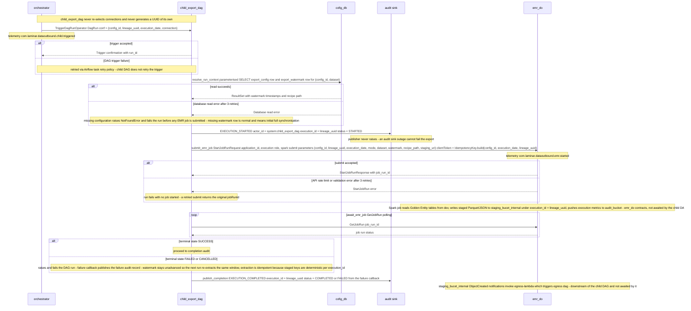

### 6.5. Schema Definitions (DB Tables / API JSON / Telemetry CloudEvents)
<a id="laminar-sec-c.imp_aws_aws_mwaa_dag_4.schema"></a>
#### 6.5.1 DagRun conf — orchestrator → child_export_dag

```json
{
  "$schema": "https://json-schema.org/draft/2020-12/schema",
  "$id": "com.laminar.dataoutbound.child_export_dag.run_conf",
  "title": "ChildExportRunConf",
  "type": "object",
  "required": ["config_id", "lineage_uuid", "execution_date"],
  "additionalProperties": false,
  "properties": {
    "config_id": { "type": "string", "format": "uuid" },
    "lineage_uuid": {
      "type": "string",
      "pattern": "^[0-9a-f]{8}-[0-9a-f]{4}-4[0-9a-f]{3}-[89ab][0-9a-f]{3}-[0-9a-f]{12}$"
    },
    "execution_date": {
      "type": "string",
      "pattern": "^\\d{4}-\\d{2}-\\d{2}T\\d{2}:\\d{2}:\\d{2}\\.\\d{3}Z$"
    },
    "connection": {
      "type": "object",
      "description": "Connection JSON snapshot as read by the orchestrator; must equal the stored row for config_id."
    }
  }
}
```

#### 6.5.2 EMR Serverless StartJobRun request — child_export_dag → emr_do

```json
{
  "$schema": "https://json-schema.org/draft/2020-12/schema",
  "$id": "com.laminar.dataoutbound.child_export_dag.start_job_run",
  "title": "StartJobRunRequest",
  "type": "object",
  "required": ["applicationId", "executionRoleArn", "clientToken", "jobDriver"],
  "properties": {
    "applicationId": { "type": "string", "description": "The emr_do EMR Serverless application id." },
    "executionRoleArn": { "type": "string" },
    "clientToken": { "type": "string", "maxLength": 64, "description": "IdempotencyKey.build(config_id, execution_date, lineage_uuid)." },
    "jobDriver": {
      "type": "object",
      "required": ["sparkSubmit"],
      "properties": {
        "sparkSubmit": {
          "type": "object",
          "required": ["entryPoint", "sparkSubmitParameters"],
          "properties": {
            "entryPoint": { "type": "string", "description": "s3://<artifacts>/export_extract_spark_job/main.py" },
            "sparkSubmitParameters": {
              "type": "string",
              "description": "--config-id <id> --lineage-uuid <uuid> --execution-date <iso> --mode <initial|incremental> --dataset <name> --watermark <iso|empty> --recipe-path <s3 uri> --staging-uri <s3 uri>"
            }
          }
        }
      }
    }
  }
}
```

#### 6.5.3 cofig_db rows consumed (read-only; DDL is owned by the cofig_db component)

```sql
-- Consumed by child_export_dag; created and owned by cofig_db.
-- SELECT config_id, connection_name, dataset, mode, target_type,
--        cron_schedule, recipe_path, staging_prefix, is_active
--   FROM export_config WHERE config_id = %s;

-- SELECT config_id, dataset, watermark_ts, last_run_id
--   FROM export_watermark WHERE config_id = %s AND dataset = %s;
```

#### 6.5.4 Telemetry — CloudEvents 1.0

```json
{
  "$schema": "https://json-schema.org/draft/2020-12/schema",
  "$id": "com.laminar.dataoutbound.emr.started",
  "title": "com.laminar.dataoutbound.emr.started",
  "type": "object",
  "required": ["specversion", "id", "source", "type", "time", "subject", "data"],
  "properties": {
    "specversion": { "const": "1.0" },
    "id": { "type": "string", "format": "uuid" },
    "source": { "const": "com.laminar.dataoutbound.child_export_dag" },
    "type": { "const": "com.laminar.dataoutbound.emr.started" },
    "time": { "type": "string", "pattern": "^\\d{4}-\\d{2}-\\d{2}T\\d{2}:\\d{2}:\\d{2}\\.\\d{3}Z$" },
    "subject": { "type": "string", "description": "config_id" },
    "data": {
      "type": "object",
      "required": ["actor_id", "timestamp_utc", "event_type", "execution_id", "job_run_id"],
      "properties": {
        "actor_id": { "const": "system:child_export_dag" },
        "timestamp_utc": { "type": "string", "pattern": "^\\d{4}-\\d{2}-\\d{2}T\\d{2}:\\d{2}:\\d{2}\\.\\d{3}Z$" },
        "event_type": { "const": "EXECUTION_STARTED" },
        "execution_id": { "type": "string", "format": "uuid" },
        "config_id": { "type": "string" },
        "job_run_id": { "type": "string" },
        "application_id": { "type": "string" },
        "staging_uri": { "type": "string" }
      }
    }
  }
}
```

The `EXECUTION_COMPLETED` audit record uses the same envelope with `event_type = "EXECUTION_COMPLETED"` and `status ∈ {"COMPLETED", "FAILED"}`; `event_type` values are restricted to the SCRUM-486 enumeration (`ADMIN_CREATE`, `ADMIN_UPDATE`, `ADMIN_DELETE`, `ADMIN_MANUAL_TRIGGER`, `EXECUTION_STARTED`, `EXECUTION_COMPLETED`, `TRANSFER_STARTED`, `TRANSFER_COMPLETED`, `TRANSFER_FAILED`).

---

### 6.6. Local Design Assumptions
<a id="laminar-sec-c.imp_aws_aws_mwaa_dag_4.asm"></a>
1. **Watermark semantics.** `export_watermark.watermark_ts` is the exclusive lower bound of the next incremental extract: the Spark job selects records with `updated_at > watermark_ts`, satisfying SCRUM-481 AC#5 (exactly the 100 records strictly after *T*). A missing watermark row means initial full synchronisation, and the DAG overrides `mode` to `initial` for that run.
2. **Watermark advancement.** The watermark is advanced by **emr_do** on successful job completion, not by this DAG, so a failed or retried child run can never skip a window. This DAG only reads it.
3. **Polling.** `await_emr_job` is modelled as a single task that raises when the job is not terminal; in the generated code it is an `EmrServerlessJobSensor`-equivalent with a 60-second poke interval and the 6-hour execution timeout as its ceiling. The task-level retry policy (3 attempts) covers transient `GetJobRun` API errors.
4. **Audit sink.** `AuditPublisher` writes CloudEvents-shaped records to the configured audit sink (**audit_bucket**); the diagram has no explicit `child_export_dag → audit_bucket` edge, so the write is made through the foundation publisher rather than a component-owned S3 client. This is the single place where this DAG's audit records are produced.
5. **`max_active_runs = 1` scope.** The limit is per DAG, so concurrent child runs for *different* connections are still possible; per-connection serialisation is guaranteed because each connection's run is a distinct logical execution date and the orchestrator submits at most one run per connection per window.
6. **Retry budget.** Three attempts with a 2-minute base delay are used for both the cofig_db read and the EMR submit, matching the frozen contract wording ("retried up to 3 times" / "retried with backoff"). No infinite retry is configured, so a persistent failure surfaces as a failed run and a failure audit record within the 24-hour SLA.
7. **Open question — does the child DAG write to `audit_bucket` directly?** No: it publishes through the shared `AuditPublisher`, which owns the sink configuration; this keeps one audit write path across all components and avoids a second S3 client in the DAG.
8. **Open question — how is the stop request from **do-admin-api** honoured?** The stop terminates the **orchestrator** run; this DAG does not poll for cancellation. A child run already submitted to **emr_do** completes or fails on its own, and no further child run is started for that execution because the orchestrator stops fanning out.

## 7. Component Design: emr_do
<a id="laminar-sec-c.imp_aws_aws_emr_serverless_5"></a>

### 7.1. Component Contract (Bi-Directional Inputs & Outputs)
<a id="laminar-sec-c.imp_aws_aws_emr_serverless_5.contract"></a>
**Component:** `emr_do` — EMR Serverless Spark application (`application_name = emr_do`, `job_type = SPARK`, `release_label = emr-7.0.0`, `max_capacity_units = 200`).
**Code root:** `src/dataoutbound_section_tree/spark_emr/export_extract_spark_job`
**Role:** the extraction engine. It reads Golden Entity datasets from **dev** (Redshift), applies the connection's recipe, and writes staged Parquet/JSON datasets plus a run manifest to **staging_bucet_internal**. It owns no database tables and no bucket; it owns only its own codebase and recipes.

#### 7.1.1 Inbound contract — `child_export_dag` → `emr_do`

| Aspect | Value |
|---|---|
| Trigger | Child export DAG task execution (`EmrServerlessStartJobOperator` / `boto3 emr-serverless start_job_run`) |
| Protocol | boto3 EMR Serverless API (`StartJobRun`) |
| Request | `StartJobRunRequest` — `applicationId`, `executionRoleArn`, `jobDriver.sparkSubmit` with `entryPoint = s3://<artifacts>/export_extract_spark_job/main.py`, `sparkSubmitParameters`, and `arguments` (the job argument vector below) |
| Response | `StartJobRunResponse` — `applicationId`, `jobRunId` |
| Errors | API rate limit / validation error → retried with backoff by the caller; job-level failure surfaces as `JobRunState = FAILED` and is polled by the caller |
| Idempotency | `clientToken = IdempotencyKey.build(config_id, execution_id)` — a re-submission for the same lineage UUID returns the original `jobRunId` |
| Telemetry | `com.laminar.dataoutbound.emr.started` — emitted by **child_export_dag**, not by `emr_do` |

**Job argument vector (the job's own runtime contract, passed in `arguments`):**

| Argument | Type | Meaning |
|---|---|---|
| `--config-id` | string | Export configuration identifier (partition key of the staging prefix) |
| `--execution-id` | string | Lineage UUID (RFC 4122 v4) generated by **orchestrator**; propagated into every staging key and audit record |
| `--mode` | `initial` \| `incremental` | Full synchronisation or watermark-bounded extraction |
| `--watermark` | ISO-8601 UTC string, optional | Required when `--mode=incremental`; records with `GREATEST(created_at, modified_at) > watermark` are extracted |
| `--recipe-path` | `s3://…/config/recipes/<dataset>.json` | Declarative extract recipe resolved by **child_export_dag** from **cofig_db** |
| `--staging-prefix` | `s3://staging_bucet_internal/<config_id>/<execution_id>/` | Deterministic output prefix |
| `--run-date` | `YYYY-MM-DD` | Logical execution date, used for audit naming |

#### 7.1.2 Outbound contracts

| Target | Protocol | Payload | Failure behaviour | Idempotency | Telemetry |
|---|---|---|---|---|---|
| **dev** (Redshift) | JDBC over TLS, partitioned read | Distributed `SELECT` against the Golden Entity tables named by the recipe | Redshift query timeout / connection error → Spark task retried 3 times, then job fails | Read-only, idempotent | none |
| **staging_bucet_internal** | S3 API (Spark S3A committer) | Parquet data parts + `manifest_<execution_id>.json` | S3 throttling / network error → Spark task retried automatically | Deterministic object keys containing `config_id` + `execution_id`; overwrite-on-rerun | `com.laminar.dataoutbound.staging.written` |
| **audit_bucket** | S3 API (boto3 via `S3Client`) | Spark execution metrics + audit execution log record | S3 error → logged at WARNING, **job continues** | Object key derived from `jobRunId` | `com.laminar.dataoutbound.audit.spark` |

#### 7.1.3 Configuration this design actually sets

| Setting | Value | Rationale |
|---|---|---|
| `release_label` | `emr-7.0.0` | User decision; Spark 3.5 / Java 17 baseline. |
| `job_type` | `SPARK` | User decision. |
| `max_capacity_units` | `200` | User decision; caps concurrent vCPU/memory so a fan-out of child runs cannot exhaust the account quota. |
| `application_name` | `emr_do` | User decision; one shared application reused by every child run (warm start, no per-run provisioning). |
| Spark conf | `spark.sql.sources.partitionOverwriteMode=dynamic`, `spark.hadoop.fs.s3a.committer.name=magic` | Deterministic, atomic partition replacement so a re-run of the same `execution_id` produces the same objects. |
| Everything else | EMR Serverless defaults | No other property is overridden by this design. |

### 7.2. Class and Interface Definitions
<a id="laminar-sec-c.imp_aws_aws_emr_serverless_5.classes"></a>
```python
# src/dataoutbound_section_tree/spark_emr/export_extract_spark_job/util/constants.py
from typing import Final

MODE_INITIAL: Final = "initial"
MODE_INCREMENTAL: Final = "incremental"

DATASET_IDENTITY_PROFILES: Final = "identity_profiles"
DATASET_SUBSCRIPTION_STATUSES: Final = "subscription_statuses"
DATASET_CAMPAIGNS_REACTIONS: Final = "campaigns_reactions"
DATASET_RESERVATION_ITEMS: Final = "reservation_items"
ALLOWED_DATASETS: Final = frozenset(
    {
        DATASET_IDENTITY_PROFILES,
        DATASET_SUBSCRIPTION_STATUSES,
        DATASET_CAMPAIGNS_REACTIONS,
        DATASET_RESERVATION_ITEMS,
    }
)

RESERVATION_SUBTYPES: Final = frozenset(
    {"room_stay", "restaurant_reservation", "tee_time", "spa_treatment"}
)

WATERMARK_COLUMNS: Final = ("created_at", "modified_at")
MANIFEST_PREFIX: Final = "manifest_"
MANIFEST_SUFFIX: Final = ".json"
PART_PREFIX: Final = "part-"
```

```python
# src/dataoutbound_section_tree/spark_emr/export_extract_spark_job/main.py
from __future__ import annotations

from dataclasses import dataclass, field
from datetime import datetime
from typing import Any, Mapping, Sequence

from pyspark.sql import DataFrame, SparkSession


@dataclass(frozen=True)
class JobArguments:
    """Typed view of the spark-submit argument vector (the job's inbound contract)."""

    config_id: str
    execution_id: str          # lineage UUID, RFC 4122 v4
    mode: str                  # MODE_INITIAL | MODE_INCREMENTAL
    recipe_path: str
    staging_prefix: str
    run_date: str
    watermark: datetime | None = None

    def __post_init__(self) -> None:
        if self.mode not in (MODE_INITIAL, MODE_INCREMENTAL):
            raise ValidationError(f"invalid mode: {self.mode}")
        if self.mode == MODE_INCREMENTAL and self.watermark is None:
            raise ValidationError("--watermark is required when --mode=incremental")


@dataclass(frozen=True)
class EntityExtractSpec:
    """One entity to extract, as declared by the recipe."""

    dataset: str                       # one of ALLOWED_DATASETS
    source_table: str                  # e.g. golden.unified_identity_profile
    columns: Sequence[str]
    watermark_column: str = "modified_at"
    partition_column: str = "tenant_id"
    partition_count: int = 8
    output_format: str = "parquet"     # parquet | json


@dataclass(frozen=True)
class RecipeSpec:
    """Declarative extract recipe loaded from --recipe-path."""

    recipe_version: str
    dataset: str
    entities: Sequence[EntityExtractSpec]
    split_threshold_records: int = 500_000


@dataclass(frozen=True)
class ExtractResult:
    """Outcome of one entity extraction, carried into the manifest and the audit record."""

    dataset: str
    record_count: int
    part_keys: Sequence[str] = field(default_factory=tuple)
    bytes_written: int = 0
    sha256: Mapping[str, str] = field(default_factory=dict)


@dataclass(frozen=True)
class StagingWriteResult:
    """Outcome of the staging write phase for the whole run."""

    manifest_key: str
    total_records: int
    total_bytes: int
    results: Sequence[ExtractResult]
```

```python
# src/dataoutbound_section_tree/spark_emr/export_extract_spark_job/io/child_export_golden_entity_source_store_reader.py
class ChildExportGoldenEntitySourceStoreReader:
    """Partitioned JDBC reads against dev (Redshift). No business logic."""

    def __init__(self, spark: SparkSession, jdbc_options: Mapping[str, str]) -> None: ...

    def read_entity(
        self,
        spec: EntityExtractSpec,
        mode: str,
        watermark: datetime | None,
    ) -> DataFrame:
        """Return the entity DataFrame; incremental mode applies a STRICT > watermark filter."""
```

```python
# src/dataoutbound_section_tree/spark_emr/export_extract_spark_job/io/customer_staging_buckets_audit_execution_log_store_writer.py
class CustomerStagingBucketsAuditExecutionLogStoreWriter:
    """Writes staged datasets to staging_bucet_internal and audit records to audit_bucket."""

    def __init__(self, s3_client: S3Client, staging_prefix: str, execution_id: str) -> None: ...

    def write_entity(self, df: DataFrame, spec: EntityExtractSpec) -> ExtractResult: ...

    def write_manifest(self, results: Sequence[ExtractResult]) -> StagingWriteResult:
        """Writes manifest_<execution_id>.json LAST so the S3 notification fires once per run."""
```

```python
# src/dataoutbound_section_tree/spark_emr/export_extract_spark_job/processor/export_extract_input_processor.py
class ExportExtractInputProcessor:
    """Schema enforcement, type casting and job-parameter filtering. No I/O."""

    def __init__(self, spec: EntityExtractSpec) -> None: ...

    def process(self, df: DataFrame) -> DataFrame: ...
```

```python
# src/dataoutbound_section_tree/spark_emr/export_extract_spark_job/transform/export_extract_transformer.py
class ExportExtractTransformer:
    """Default column mapping / renaming / derivation applied when a recipe names no transformer."""

    def __init__(self, spec: EntityExtractSpec) -> None: ...

    def transform(self, df: DataFrame) -> DataFrame: ...
```

```python
# src/dataoutbound_section_tree/spark_emr/export_extract_spark_job/processor/export_extract_output_processor.py
class ExportExtractOutputProcessor:
    """Ordering, partition columns, split threshold and manifest assembly. No I/O."""

    def __init__(self, spec: EntityExtractSpec, split_threshold_records: int) -> None: ...

    def process(self, df: DataFrame) -> DataFrame: ...
```

```python
# src/dataoutbound_section_tree/spark_emr/export_extract_spark_job/helper/spark_session_helper.py
def get_spark_session(app_name: str, config: ConfigLoader) -> SparkSession:
    """Build the SparkSession with the job's Spark conf, Glue catalog and S3 committer settings."""
```

### 7.3. Implementation Code Skeleton (Stubs & Handlers)
<a id="laminar-sec-c.imp_aws_aws_emr_serverless_5.skeleton"></a>
Illustrative skeleton — the Component Contract and Schema Definitions are binding.

```python
# src/dataoutbound_section_tree/spark_emr/export_extract_spark_job/main.py
"""Entrypoint of the emr_do Spark job. Orchestrates processors and I/O; owns no business rules."""
from __future__ import annotations

import argparse
import json
import sys
from datetime import datetime, timezone

from dataoutbound_section_tree.common.clients.aws.s3.s3_client import S3Client
from dataoutbound_section_tree.common.clients.aws.ssm.ssm_client import SsmClient
from dataoutbound_section_tree.common.logging.logger import get_logger
from dataoutbound_section_tree.common.telemetry.auditor import AuditPublisher
from dataoutbound_section_tree.config.config_loader import ConfigLoader
from dataoutbound_section_tree.spark_emr.export_extract_spark_job.helper.spark_session_helper import (
    get_spark_session,
)
from dataoutbound_section_tree.spark_emr.export_extract_spark_job.io.child_export_golden_entity_source_store_reader import (
    ChildExportGoldenEntitySourceStoreReader,
)
from dataoutbound_section_tree.spark_emr.export_extract_spark_job.io.customer_staging_buckets_audit_execution_log_store_writer import (
    CustomerStagingBucketsAuditExecutionLogStoreWriter,
)
from dataoutbound_section_tree.spark_emr.export_extract_spark_job.processor.export_extract_input_processor import (
    ExportExtractInputProcessor,
)
from dataoutbound_section_tree.spark_emr.export_extract_spark_job.processor.export_extract_output_processor import (
    ExportExtractOutputProcessor,
)
from dataoutbound_section_tree.spark_emr.export_extract_spark_job.transform.export_extract_transformer import (
    ExportExtractTransformer,
)
from dataoutbound_section_tree.spark_emr.export_extract_spark_job.util.constants import (
    MODE_INCREMENTAL,
)
from dataoutbound_section_tree.util.exceptions import LaminarError, ValidationError
from dataoutbound_section_tree.util.utils import utc_now_iso_ms

log = get_logger(__name__)


def parse_args(argv: list[str]) -> JobArguments:
    parser = argparse.ArgumentParser(prog="export_extract_spark_job")
    parser.add_argument("--config-id", required=True)
    parser.add_argument("--execution-id", required=True)
    parser.add_argument("--mode", required=True, choices=["initial", "incremental"])
    parser.add_argument("--recipe-path", required=True)
    parser.add_argument("--staging-prefix", required=True)
    parser.add_argument("--run-date", required=True)
    parser.add_argument("--watermark", required=False, default=None)
    ns = parser.parse_args(argv)
    watermark = (
        datetime.fromisoformat(ns.watermark.replace("Z", "+00:00"))
        if ns.watermark
        else None
    )
    return JobArguments(
        config_id=ns.config_id,
        execution_id=ns.execution_id,
        mode=ns.mode,
        recipe_path=ns.recipe_path,
        staging_prefix=ns.staging_prefix,
        run_date=ns.run_date,
        watermark=watermark,
    )


def load_recipe(s3: S3Client, recipe_path: str) -> RecipeSpec:
    raw = json.loads(s3.download_bytes_from_uri(recipe_path))
    return RecipeSpec(
        recipe_version=raw["recipe_version"],
        dataset=raw["dataset"],
        entities=[EntityExtractSpec(**e) for e in raw["entities"]],
        split_threshold_records=raw.get("split_threshold_records", 500_000),
    )


def run(argv: list[str]) -> int:
    args = parse_args(argv)
    config = ConfigLoader(module="spark_emr/export_extract_spark_job")
    auditor = AuditPublisher(config=config)
    s3 = S3Client(config=config)
    ssm = SsmClient(config=config)

    auditor.publish(
        "com.laminar.dataoutbound.audit.spark",
        {
            "actor_id": "system:emr_do",
            "timestamp_utc": utc_now_iso_ms(),
            "event_type": "EXECUTION_STARTED",
            "execution_id": args.execution_id,
            "config_id": args.config_id,
            "mode": args.mode,
        },
    )

    spark = get_spark_session(app_name="emr_do", config=config)
    try:
        recipe = load_recipe(s3, args.recipe_path)
        jdbc_options = _redshift_jdbc_options(config, ssm)
        reader = ChildExportGoldenEntitySourceStoreReader(spark, jdbc_options)
        writer = CustomerStagingBucketsAuditExecutionLogStoreWriter(
            s3_client=s3,
            staging_prefix=args.staging_prefix,
            execution_id=args.execution_id,
        )

        results: list[ExtractResult] = []
        for spec in recipe.entities:
            df = reader.read_entity(spec, args.mode, args.watermark)
            df = ExportExtractInputProcessor(spec).process(df)
            df = ExportExtractTransformer(spec).transform(df)
            df = ExportExtractOutputProcessor(
                spec, recipe.split_threshold_records
            ).process(df)
            results.append(writer.write_entity(df, spec))

        write_result = writer.write_manifest(results)   # written LAST
        auditor.publish(
            "com.laminar.dataoutbound.staging.written",
            {
                "actor_id": "system:emr_do",
                "timestamp_utc": utc_now_iso_ms(),
                "event_type": "EXECUTION_COMPLETED",
                "execution_id": args.execution_id,
                "config_id": args.config_id,
                "manifest_key": write_result.manifest_key,
                "total_records": write_result.total_records,
                "total_bytes": write_result.total_bytes,
            },
        )
        return 0
    except LaminarError as exc:
        log.error("emr_do job failed", extra={"execution_id": args.execution_id, "error": str(exc)})
        return 2
    finally:
        spark.stop()


def _redshift_jdbc_options(config: ConfigLoader, ssm: SsmClient) -> dict[str, str]:
    """JDBC properties for dev (Redshift); the password is resolved from SSM SecureString."""
    return {
        "url": config.get("redshift.jdbc_url"),
        "user": config.get("redshift.user"),
        "password": ssm.get_parameter(config.get("redshift.password_param"), decrypt=True),
        "driver": "com.amazon.redshift.jdbc42.Driver",
        "tempdir": config.get("spark.s3a_temp_dir"),
    }


if __name__ == "__main__":
    sys.exit(run(sys.argv[1:]))
```

```python
# src/dataoutbound_section_tree/spark_emr/export_extract_spark_job/io/child_export_golden_entity_source_store_reader.py
"""Illustrative skeleton — the Component Contract and Schema Definitions are binding."""
from __future__ import annotations

from datetime import datetime
from typing import Mapping

from pyspark.sql import DataFrame, SparkSession
from pyspark.sql import functions as F

from dataoutbound_section_tree.spark_emr.export_extract_spark_job.util.constants import (
    MODE_INCREMENTAL,
    WATERMARK_COLUMNS,
)


class ChildExportGoldenEntitySourceStoreReader:
    def __init__(self, spark: SparkSession, jdbc_options: Mapping[str, str]) -> None:
        self._spark = spark
        self._jdbc = dict(jdbc_options)

    def read_entity(
        self, spec: EntityExtractSpec, mode: str, watermark: datetime | None
    ) -> DataFrame:
        predicate = "1=1"
        if mode == MODE_INCREMENTAL:
            if watermark is None:
                raise ValidationError("watermark required for incremental extraction")
            ts = watermark.astimezone(timezone.utc).strftime("%Y-%m-%d %H:%M:%S.%f")
            greatest = f"GREATEST({', '.join(WATERMARK_COLUMNS)})"
            predicate = f"{greatest} > TIMESTAMP '{ts}'"

        return (
            self._spark.read.format("jdbc")
            .option("url", self._jdbc["url"])
            .option("user", self._jdbc["user"])
            .option("password", self._jdbc["password"])
            .option("driver", self._jdbc["driver"])
            .option("dbtable", f"(SELECT * FROM {spec.source_table} WHERE {predicate}) t")
            .option("partitionColumn", spec.partition_column)
            .option("numPartitions", str(spec.partition_count))
            .load()
        )
```

```python
# src/dataoutbound_section_tree/spark_emr/export_extract_spark_job/io/customer_staging_buckets_audit_execution_log_store_writer.py
"""Illustrative skeleton — the Component Contract and Schema Definitions are binding."""
from __future__ import annotations

import hashlib
import json
from typing import Sequence

from pyspark.sql import DataFrame

from dataoutbound_section_tree.common.clients.aws.s3.s3_client import S3Client
from dataoutbound_section_tree.spark_emr.export_extract_spark_job.util.constants import (
    MANIFEST_PREFIX,
    MANIFEST_SUFFIX,
)
from dataoutbound_section_tree.util.utils import utc_now_iso_ms


class CustomerStagingBucketsAuditExecutionLogStoreWriter:
    def __init__(self, s3_client: S3Client, staging_prefix: str, execution_id: str) -> None:
        self._s3 = s3_client
        self._prefix = staging_prefix.rstrip("/")
        self._execution_id = execution_id

    def write_entity(self, df: DataFrame, spec: EntityExtractSpec) -> ExtractResult:
        target = f"{self._prefix}/{spec.dataset}/"
        writer = df.write.mode("overwrite")
        if spec.output_format == "json":
            writer = writer.option("compression", "none")
        writer.format(spec.output_format).save(target)
        return ExtractResult(dataset=spec.dataset, record_count=df.count())

    def write_manifest(self, results: Sequence[ExtractResult]) -> StagingWriteResult:
        key = f"{self._prefix}/{MANIFEST_PREFIX}{self._execution_id}{MANIFEST_SUFFIX}"
        body = {
            "execution_id": self._execution_id,
            "generated_at_utc": utc_now_iso_ms(),
            "entities": [
                {
                    "dataset": r.dataset,
                    "record_count": r.record_count,
                    "bytes_written": r.bytes_written,
                    "sha256": dict(r.sha256),
                }
                for r in results
            ],
        }
        self._s3.put_object(key=key, body=json.dumps(body).encode("utf-8"))
        return StagingWriteResult(
            manifest_key=key,
            total_records=sum(r.record_count for r in results),
            total_bytes=sum(r.bytes_written for r in results),
            results=results,
        )
```

### 7.4. Cross-Component Interaction Sequence (Local Mermaid/ASCII Flow)
<a id="laminar-sec-c.imp_aws_aws_emr_serverless_5.seq"></a>
1. **child_export_dag** resolves the connection's recipe path and watermark from **cofig_db**, then calls `emr-serverless:StartJobRun` on the `emr_do` application with `clientToken = IdempotencyKey.build(config_id, execution_id)` and the job argument vector (`--config-id`, `--execution-id`, `--mode`, `--watermark`, `--recipe-path`, `--staging-prefix`, `--run-date`). It receives `jobRunId` and emits `com.laminar.dataoutbound.emr.started`.
2. `emr_do` starts, builds its `SparkSession`, loads the recipe from `--recipe-path` via `S3Client`, and resolves the Redshift JDBC password from SSM `SecureString`. It publishes the `EXECUTION_STARTED` audit record to **audit_bucket** (`com.laminar.dataoutbound.audit.spark`).
3. For each entity in the recipe, `emr_do` issues a partitioned JDBC read against **dev** (Redshift). In `incremental` mode the read predicate is `GREATEST(created_at, modified_at) > watermark` — strictly greater, so records at or before the watermark are never re-extracted. A Redshift timeout or connection error is retried up to 3 times by the Spark task; after the third failure the job fails and the caller observes `JobRunState = FAILED`.
4. Each entity DataFrame passes through the input processor (schema enforcement, type casting), the transformer (column mapping/derivation) and the output processor (ordering, partition columns, split threshold), then is written to **staging_bucet_internal** under the deterministic prefix `<config_id>/<execution_id>/<dataset>/`. S3 throttling is absorbed by Spark task retries; the deterministic keys make a re-run of the same `execution_id` overwrite rather than duplicate.
5. After all entities are written, `emr_do` writes `manifest_<execution_id>.json` **last**. This ordering guarantees that the S3 `ObjectCreated` notification consumed by **egress-lambda** fires exactly once per staged run, carrying the lineage UUID.
6. `emr_do` publishes `com.laminar.dataoutbound.staging.written` (with `manifest_key`, `total_records`, `total_bytes`) and the `EXECUTION_COMPLETED` audit record to **audit_bucket**. An S3 error on the audit write is logged at WARNING and the job still exits `0` — audit failure never fails an extraction.
7. On any `LaminarError` the job logs the failure with the `execution_id` and exits non-zero; **child_export_dag** observes the failed `jobRunId` and applies its own Airflow retry policy. No partial manifest is written, so **egress-lambda** is never triggered for a failed run.
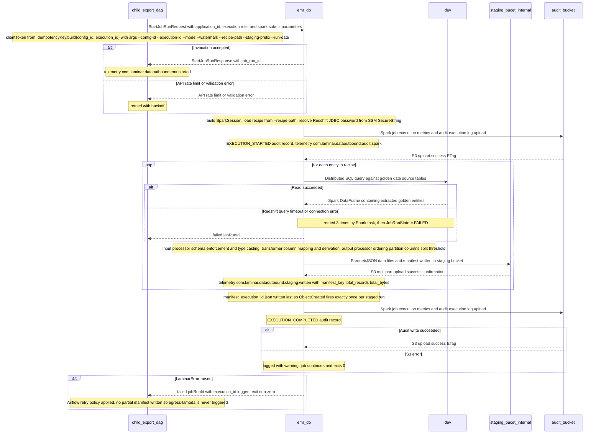

### 7.5. Schema Definitions (DB Tables / API JSON / Telemetry CloudEvents)
<a id="laminar-sec-c.imp_aws_aws_emr_serverless_5.schema"></a>
**DDL owned by `emr_do`: none.** `emr_do` owns no database tables — it reads **dev** (Redshift, externally owned) and writes objects to **staging_bucet_internal** and **audit_bucket**. Watermark tables live in **cofig_db** and are owned by that component.

#### 7.5.1 Recipe JSON (`s3://…/config/recipes/<dataset>.json`)

```json
{
  "$schema": "https://json-schema.org/draft/2020-12/schema",
  "$id": "https://laminar.com/dataoutbound/recipes/export_extract_recipe.json",
  "title": "ExportExtractRecipe",
  "type": "object",
  "required": ["recipe_version", "dataset", "entities"],
  "additionalProperties": false,
  "properties": {
    "recipe_version": { "type": "string", "pattern": "^[0-9]+\\.[0-9]+$" },
    "dataset": {
      "type": "string",
      "enum": ["identity_profiles", "subscription_statuses", "campaigns_reactions", "reservation_items"]
    },
    "split_threshold_records": { "type": "integer", "minimum": 1, "default": 500000 },
    "entities": {
      "type": "array",
      "minItems": 1,
      "items": {
        "type": "object",
        "required": ["dataset", "source_table", "columns"],
        "additionalProperties": false,
        "properties": {
          "dataset": { "type": "string" },
          "source_table": { "type": "string", "pattern": "^[a-z_]+\\.[a-z_]+$" },
          "columns": { "type": "array", "items": { "type": "string" }, "minItems": 1 },
          "watermark_column": { "type": "string", "default": "modified_at" },
          "partition_column": { "type": "string", "default": "tenant_id" },
          "partition_count": { "type": "integer", "minimum": 1, "default": 8 },
          "output_format": { "type": "string", "enum": ["parquet", "json"], "default": "parquet" }
        }
      }
    }
  }
}
```

#### 7.5.2 Staging manifest (`s3://staging_bucet_internal/<config_id>/<execution_id>/manifest_<execution_id>.json`)

```json
{
  "$schema": "https://json-schema.org/draft/2020-12/schema",
  "$id": "https://laminar.com/dataoutbound/staging/staging_manifest.json",
  "title": "StagingManifest",
  "type": "object",
  "required": ["execution_id", "generated_at_utc", "entities"],
  "additionalProperties": false,
  "properties": {
    "execution_id": { "type": "string", "format": "uuid" },
    "generated_at_utc": {
      "type": "string",
      "pattern": "^\\d{4}-\\d{2}-\\d{2}T\\d{2}:\\d{2}:\\d{2}\\.\\d{3}Z$"
    },
    "entities": {
      "type": "array",
      "items": {
        "type": "object",
        "required": ["dataset", "record_count", "bytes_written", "sha256"],
        "additionalProperties": false,
        "properties": {
          "dataset": { "type": "string" },
          "record_count": { "type": "integer", "minimum": 0 },
          "bytes_written": { "type": "integer", "minimum": 0 },
          "sha256": {
            "type": "object",
            "additionalProperties": { "type": "string", "pattern": "^[a-f0-9]{64}$" }
          }
        }
      }
    }
  }
}
```

#### 7.5.3 Telemetry CloudEvents emitted by `emr_do`

```json
{
  "$schema": "https://json-schema.org/draft/2020-12/schema",
  "$id": "https://laminar.com/dataoutbound/telemetry/emr_do_cloudevent.json",
  "title": "EmrDoCloudEvent",
  "type": "object",
  "required": ["specversion", "id", "source", "type", "time", "subject", "datacontenttype", "data"],
  "properties": {
    "specversion": { "const": "1.0" },
    "id": { "type": "string", "format": "uuid" },
    "source": { "const": "com.laminar.dataoutbound.emr_do" },
    "type": {
      "type": "string",
      "enum": [
        "com.laminar.dataoutbound.staging.written",
        "com.laminar.dataoutbound.audit.spark"
      ]
    },
    "time": {
      "type": "string",
      "pattern": "^\\d{4}-\\d{2}-\\d{2}T\\d{2}:\\d{2}:\\d{2}\\.\\d{3}Z$"
    },
    "subject": { "type": "string", "description": "the lineage UUID (execution_id)" },
    "datacontenttype": { "const": "application/json" },
    "data": {
      "type": "object",
      "required": ["actor_id", "timestamp_utc", "event_type", "execution_id"],
      "properties": {
        "actor_id": { "const": "system:emr_do" },
        "timestamp_utc": {
          "type": "string",
          "pattern": "^\\d{4}-\\d{2}-\\d{2}T\\d{2}:\\d{2}:\\d{2}\\.\\d{3}Z$"
        },
        "event_type": { "type": "string", "enum": ["EXECUTION_STARTED", "EXECUTION_COMPLETED"] },
        "execution_id": { "type": "string", "format": "uuid" },
        "config_id": { "type": "string" },
        "mode": { "type": "string", "enum": ["initial", "incremental"] },
        "manifest_key": { "type": "string" },
        "total_records": { "type": "integer", "minimum": 0 },
        "total_bytes": { "type": "integer", "minimum": 0 }
      }
    }
  }
}
```

#### 7.5.4 Audit execution log record (`s3://audit_bucket/emr_do/<run_date>/<job_run_id>.json`)

```json
{
  "$schema": "https://json-schema.org/draft/2020-12/schema",
  "$id": "https://laminar.com/dataoutbound/audit/emr_execution_log.json",
  "title": "EmrExecutionLogRecord",
  "type": "object",
  "required": ["actor_id", "timestamp_utc", "event_type", "execution_id", "status"],
  "additionalProperties": false,
  "properties": {
    "actor_id": { "const": "system:emr_do" },
    "timestamp_utc": {
      "type": "string",
      "pattern": "^\\d{4}-\\d{2}-\\d{2}T\\d{2}:\\d{2}:\\d{2}\\.\\d{3}Z$"
    },
    "event_type": { "type": "string", "enum": ["EXECUTION_STARTED", "EXECUTION_COMPLETED"] },
    "execution_id": { "type": "string", "format": "uuid" },
    "config_id": { "type": "string" },
    "job_run_id": { "type": "string" },
    "status": { "type": "string", "enum": ["STARTED", "SUCCEEDED", "FAILED"] },
    "record_counts": { "type": "object", "additionalProperties": { "type": "integer" } },
    "duration_ms": { "type": "integer", "minimum": 0 }
  }
}
```

### 7.6. Local Design Assumptions
<a id="laminar-sec-c.imp_aws_aws_emr_serverless_5.asm"></a>
- **Watermark semantics.** Incremental extraction uses a strict `GREATEST(created_at, modified_at) > watermark` predicate, satisfying SCRUM-481 AC#5 (records at or before *T* are never re-extracted). The watermark value is supplied by **child_export_dag** from **cofig_db**; `emr_do` never advances it — the child DAG advances it only after a successful job run, so a failed run is safely re-runnable.
- **Watermark column choice.** `GREATEST(created_at, modified_at)` is the default because the source tables carry both columns; a recipe may override `watermark_column` per entity.
- **Output format.** Staged datasets are written as Parquet by default (columnar, compact, schema-preserving) with JSON selectable per recipe; the JSON/TXT customer-facing formatting, GZIP and PGP steps belong to **egress dag**, not to `emr_do`.
- **Split threshold.** The recipe's `split_threshold_records` (default 500,000) bounds the records per staged part so the downstream egress worker stays within its memory budget (SCRUM-483 AC#2); the 1 GB / 100,000-record customer package limit is enforced at egress.
- **Manifest written last.** The run manifest is the final object written, so the S3 `ObjectCreated` notification that triggers **egress-lambda** fires exactly once per staged run and carries the lineage UUID (SCRUM-482 AC#3).
- **Audit failure is non-fatal.** An S3 error while writing to **audit_bucket** is logged at WARNING and the job continues, per the frozen contract; extraction correctness is never sacrificed to audit availability.
- **Credentials.** The Redshift password is read at runtime from SSM Parameter Store as a `SecureString` and is never written to logs, Spark conf or the staging manifest.
- **Retry ownership.** `emr_do` relies on Spark's own task-level retries for transient Redshift and S3 errors (3 attempts); job-level retries are owned by **child_export_dag**'s Airflow task retry policy, so retries are not nested.
- **Capacity.** `max_capacity_units = 200` is the user's decision and is shared across all concurrent child runs; no per-run capacity override is set, so a fan-out of connections queues rather than over-provisions.
- **Log retention.** The `emr_do` CloudWatch log group is provisioned explicitly with the single organisation logging-standard `retention_in_days` value (SCRUM-486 AC#4); the exact number of days is an open input to be confirmed before sprint commitment and is read from environment configuration, never hardcoded.
- **Deletion protection.** The `emr_do` application is stateless and carries no deletion-protection flag; the stateful resources it writes to (**staging_bucet_internal**, **audit_bucket**) read their flags from per-environment configuration (SCRUM-485 AC#3).

## 8. Component Design: dev
<a id="laminar-sec-c.imp_aws_aws_redshift_6"></a>

### 8.1. Component Contract (Bi-Directional Inputs & Outputs)
<a id="laminar-sec-c.imp_aws_aws_redshift_6.contract"></a>
The Redshift cluster **dev** (Cluster Identifier: `golden_data_source`, Database Name: `dev`, Node Type: `dc2.large`, Number of Nodes: `2`) acts as the Golden Entity Source Store. It is an existing externally owned analytical data warehouse providing read-only distributed data access to the EMR Serverless Spark job (`emr_do`).

#### 8.1.1 Inbound Contracts
- **emr_do → dev [Data Read; JDBC / PostgreSQL wire protocol]**
  - **Trigger**: Spark job execution (`export_extract_spark_job/main.py`) via the JDBC reader module.
  - **Request**: Distributed SQL SELECT queries with partitioning predicates (e.g., incremental watermark filters `updated_at > :watermark` or full table scans).
  - **Response**: Spark DataFrame streams containing extracted golden entity records.
  - **Error Handling**: Redshift query timeout or connection refusal results in client-side retry up to 3 times with exponential backoff via `common/clients/db/db_client.py`.
  - **Idempotency**: Read-only query execution is inherently idempotent.
  - **Telemetry Event**: None (low-level database read; execution milestones are audited at the Spark job level).

### 8.2. Class and Interface Definitions
<a id="laminar-sec-c.imp_aws_aws_redshift_6.classes"></a>
The following typed Python dataclasses and interface helper models define the interaction contracts for querying the **dev** Redshift cluster from the Spark job, aligning with blueprint foundation patterns.

```python
from dataclasses import dataclass
from typing import Optional, Dict, Any
from datetime import datetime

@dataclass
class RedshiftConnectionConfig:
    host: str
    port: int
    database: str
    user: str
    password_secret_ref: str
    jdbc_url: str
    driver: str = "com.amazon.redshift.jdbc.Driver"

@dataclass
class GoldenEntityExtractQuerySpec:
    entity_type: str
    table_name: str
    incremental_column: Optional[str] = None
    watermark_value: Optional[datetime] = None
    partition_column: Optional[str] = None
    lower_bound: Optional[int] = None
    upper_bound: Optional[int] = None
    num_partitions: int = 10
```

### 8.3. Implementation Code Skeleton (Stubs & Handlers)
<a id="laminar-sec-c.imp_aws_aws_redshift_6.skeleton"></a>
Illustrative skeleton — the Component Contract and Schema Definitions are binding. This module corresponds to blueprint path `src/dataoutbound_section_tree/spark_emr/export_extract_spark_job/io/child_export_golden_entity_source_store_reader.py`.

```python
"""
Illustrative skeleton — the Component Contract and Schema Definitions are binding.
Path: src/dataoutbound_section_tree/spark_emr/export_extract_spark_job/io/child_export_golden_entity_source_store_reader.py
"""

from typing import Optional
from pyspark.sql import DataFrame, SparkSession
from dataoutbound_section_tree.common.logging.logger import get_logger
from dataoutbound_section_tree.util.exceptions import ClientError

logger = get_logger(__name__)

class ChildExportGoldenEntitySourceStoreReader:
    """Reader for extracting Golden Entity datasets from the dev Redshift cluster."""

    def __init__(self, spark_session: SparkSession, jdbc_config: dict):
        self.spark = spark_session
        self.config = jdbc_config

    def read_entity_dataset(
        self,
        table_name: str,
        incremental_column: Optional[str] = None,
        watermark_value: Optional[str] = None
    ) -> DataFrame:
        """
        Executes a distributed JDBC read against Redshift with optional incremental watermark filtering.
        """
        logger.info(f"Reading golden entity dataset from table: {table_name}", extra={"incremental_col": incremental_column})

        try:
            query = f"(SELECT * FROM {table_name}"
            if incremental_column and watermark_value:
                query += f" WHERE {incremental_column} > '{watermark_value}'"
            query += ") AS source_subq"

            df = (
                self.spark.read.format("jdbc")
                .option("url", self.config["jdbc_url"])
                .option("dbtable", query)
                .option("user", self.config["user"])
                .option("password", self.config["password"])
                .option("driver", self.config["driver"])
                .option("fetchsize", 10000)
                .load()
            )
            return df
        except Exception as e:
            logger.error(f"Failed to read from Redshift table {table_name}: {str(e)}")
            raise ClientError(f"Redshift read failed for {table_name}: {str(e)}") from e
```

### 8.4. Cross-Component Interaction Sequence (Local Mermaid/ASCII Flow)
<a id="laminar-sec-c.imp_aws_aws_redshift_6.seq"></a>
The interaction sequence between `emr_do` and `dev` follows these operational steps:
1. **Job Initialization**: The EMR Serverless Spark job (`emr_do`) initializes and resolves Redshift connection credentials from SSM Parameter Store via `ConfigLoader`.
2. **Connection Establishment**: The `ChildExportGoldenEntitySourceStoreReader` establishes a JDBC connection pool to the **dev** Redshift cluster (`golden_data_source`).
3. **Query Execution**: Distributed Spark executors execute parallelized SQL queries against **dev** tables (Unified Identity Profiles, Pii Restricted Profiles, Contact Method Subscriptions, Enriched Campaigns, Enriched Campaign Reactions, and reservation items).
4. **Data Stream Ingestion**: Records are streamed into Spark DataFrames for transformation and staging.
5. **Failure Handling**: In case of transient JDBC connection timeouts or query errors, the operation is retried up to 3 times with exponential backoff. If failures persist, a `ClientError` is raised, causing the EMR job run to fail and propagating a failure event to the audit log store.
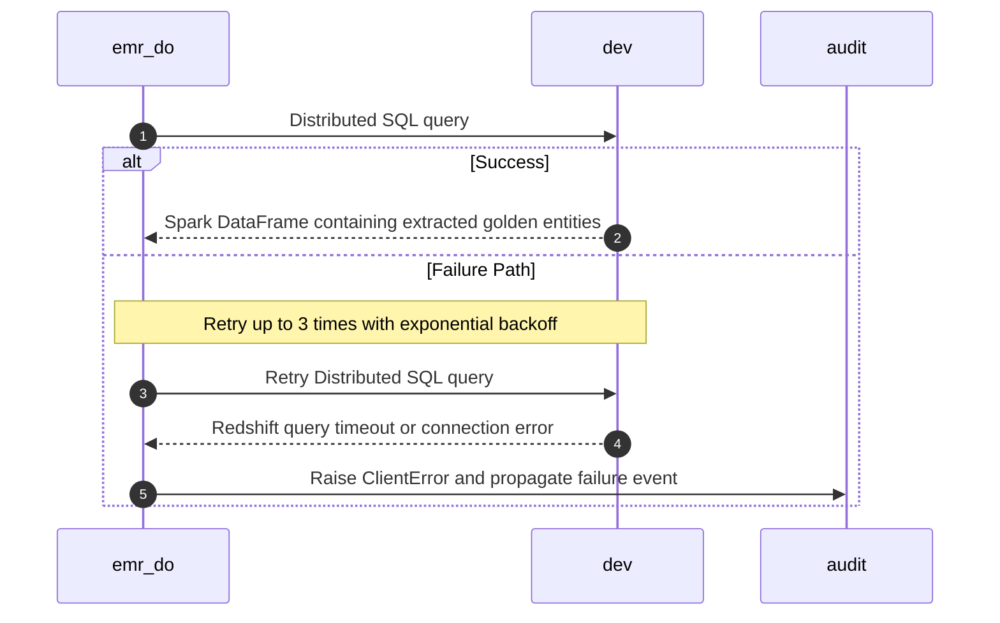

### 8.5. Schema Definitions (DB Tables / API JSON / Telemetry CloudEvents)
<a id="laminar-sec-c.imp_aws_aws_redshift_6.schema"></a>
The **dev** Redshift cluster contains the master tables for Golden Entities. Below is the structural DDL representing the schema definitions owned by the golden data source.

```sql
-- DDL for Golden Entity Source Store (dev / golden_data_source)

CREATE TABLE IF NOT EXISTS unified_identity_profile (
    profile_id VARCHAR(64) NOT NULL PRIMARY KEY,
    tenant_id VARCHAR(64) NOT NULL,
    first_name VARCHAR(128),
    last_name VARCHAR(128),
    email VARCHAR(256),
    created_at TIMESTAMP WITHOUT TIME ZONE NOT NULL,
    updated_at TIMESTAMP WITHOUT TIME ZONE NOT NULL
);

CREATE TABLE IF NOT EXISTS pii_restricted_profile (
    profile_id VARCHAR(64) NOT NULL PRIMARY KEY,
    tenant_id VARCHAR(64) NOT NULL,
    ssn_encrypted VARCHAR(512),
    credit_card_hash VARCHAR(256),
    updated_at TIMESTAMP WITHOUT TIME ZONE NOT NULL
);

CREATE TABLE IF NOT EXISTS contact_method_subscription (
    subscription_id VARCHAR(64) NOT NULL PRIMARY KEY,
    profile_id VARCHAR(64) NOT NULL,
    channel VARCHAR(32) NOT NULL,
    is_subscribed BOOLEAN NOT NULL,
    updated_at TIMESTAMP WITHOUT TIME ZONE NOT NULL
);

CREATE TABLE IF NOT EXISTS enriched_campaign (
    campaign_id VARCHAR(64) NOT NULL PRIMARY KEY,
    campaign_name VARCHAR(256) NOT NULL,
    campaign_type VARCHAR(64),
    updated_at TIMESTAMP WITHOUT TIME ZONE NOT NULL
);

CREATE TABLE IF NOT EXISTS enriched_campaign_reaction (
    reaction_id VARCHAR(64) NOT NULL PRIMARY KEY,
    campaign_id VARCHAR(64) NOT NULL,
    profile_id VARCHAR(64) NOT NULL,
    reaction_type VARCHAR(64) NOT NULL,
    reacted_at TIMESTAMP WITHOUT TIME ZONE NOT NULL,
    updated_at TIMESTAMP WITHOUT TIME ZONE NOT NULL
);

CREATE TABLE IF NOT EXISTS reservation_item (
    reservation_id VARCHAR(64) NOT NULL PRIMARY KEY,
    profile_id VARCHAR(64) NOT NULL,
    reservation_type VARCHAR(32) NOT NULL, -- Room stay, Restaurant reservation, Tee time, Spa treatment
    start_time TIMESTAMP WITHOUT TIME ZONE NOT NULL,
    status VARCHAR(32) NOT NULL,
    updated_at TIMESTAMP WITHOUT TIME ZONE NOT NULL
);
```

### 8.6. Local Design Assumptions
<a id="laminar-sec-c.imp_aws_aws_redshift_6.asm"></a>
1. **External Ownership**: The **dev** Redshift cluster (`golden_data_source`) is treated as an existing, externally managed analytical data store; Terraform provisioning scope excludes the cluster itself, focusing solely on connection references and IAM secret bindings.
2. **Network Connectivity**: Redshift is accessible within the VPC private subnets via VPC endpoints or internal routing, permitting secure JDBC data extraction without public internet exposure.
3. **Partitioning & Fetch Size**: JDBC extraction utilizes batch fetching (`fetchsize=10000`) and distributed Spark partitioning to prevent memory exhaustion on driver nodes.

---

## 9. Component Design: cofig_db
<a id="laminar-sec-c.imp_aws_aws_rds_7"></a>

### 9.1. Component Contract (Bi-Directional Inputs & Outputs)
<a id="laminar-sec-c.imp_aws_aws_rds_7.contract"></a>
The `cofig_db` component is a managed PostgreSQL relational database instance (`db.t3.micro`, PostgreSQL 15.4, 20 GB allocated storage, Multi-AZ set to `False`) acting as the centralized configuration and state store for the DataOutbound platform.

#### 9.1.1 Inbound Contracts & Triggers
- **Database Write (From `do-admin-api`)**:
  - **Protocol**: JDBC / PostgreSQL wire protocol over TLS.
  - **Trigger**: Administrative REST API calls (`POST`, `PUT`, `DELETE` on `/api/v1/exports`).
  - **Payload**: SQL DML statements (INSERT, UPDATE, DELETE) for export configurations containing connection metadata, encrypted credentials, cron schedules, target types, and datasets.
  - **Response**: Confirmation of persistence, affected row counts, and generated primary keys (`id`).
- **Data Read (From `orchestrator`)**:
  - **Protocol**: JDBC over TLS.
  - **Trigger**: Scheduled DAG execution start (`Export Orchestrator DAG`).
  - **Payload**: SQL `SELECT` queries filtering active export configurations matching the current execution time window ($\pm$ 10 minutes).
  - **Response**: Result set containing active connection metadata.
- **Data Read/Write (From `child_export_dag`)**:
  - **Protocol**: JDBC over TLS.
  - **Trigger**: Child DAG task execution initialization.
  - **Payload**: SQL `SELECT` queries for incremental watermark timestamps and connection recipes; `UPDATE` statements for watermark advancement upon successful extraction.
  - **Response**: Result set with watermark state and recipes.

#### 9.1.2 Outbound Contracts & Behaviors
- **Persistence & Integrity**: Enforces strict relational constraints, foreign keys, unique connection names, and check constraints on target types and datasets.
- **Transaction Management**: All multi-statement operations (such as configuration updates or watermark persistence) are executed within ACID-compliant transaction blocks managed via `common.clients.db.db_client`.

---

### 9.2. Class and Interface Definitions
<a id="laminar-sec-c.imp_aws_aws_rds_7.classes"></a>
The following Python dataclasses and database client wrappers define the relational data models and data access structures for `cofig_db`, residing within the shared foundation (`src/dataoutbound_section_tree/common/clients/db/db_client.py`).

```python
from dataclasses import dataclass, field
from datetime import datetime
from typing import Optional, List, Dict, Any
from sqlalchemy import create_engine, text
from sqlalchemy.orm import sessionmaker
from dataoutbound_section_tree.common.logging.logger import get_logger
from dataoutbound_section_tree.util.exceptions import ClientError

logger = get_logger(__name__)

class ExportConfigurationRecord(BaseModel):
    id: str
    connection_name: str
    target_type: str
    dataset: str
    mode: str
    cron_schedule: str
    is_active: bool
    updated_at: datetime

@dataclass
class ExportWatermarkRecord:
    config_id: str
    watermark_timestamp: datetime
    updated_at: datetime

class ConfigDbRepository:
    """Repository helper for interacting with cofig_db using SQLAlchemy and DbClient."""

    def __init__(self, db_engine_url: str):
        self.engine = create_engine(db_engine_url, pool_pre_ping=True, pool_size=5)
        self.SessionLocal = sessionmaker(bind=self.engine)

    def get_active_configurations(self) -> List[ExportConfigurationRecord]:
        session = self.SessionLocal()
        try:
            query = text(
                "SELECT id, connection_name, target_type, dataset, mode, cron_schedule, "
                "encrypted_credentials, is_active, created_at, updated_at "
                "FROM export_configurations WHERE is_active = TRUE"
            )
            result = session.execute(query).fetchall()
            return [
                ExportConfigurationRecord(
                    id=row.id,
                    connection_name=row.connection_name,
                    target_type=row.target_type,
                    dataset=row.dataset,
                    mode=row.mode,
                    cron_schedule=row.cron_schedule,
                    encrypted_credentials=row.encrypted_credentials,
                    is_active=row.is_active,
                    created_at=row.created_at,
                    updated_at=row.updated_at
                )
                for row in result
            ]
        except Exception as e:
            logger.error(f"Failed to fetch active export configurations: {e}")
            raise ClientError(f"Database read error: {e}")
        finally:
            session.close()

    def get_watermark(self, config_id: str) -> Optional[datetime]:
        session = self.SessionLocal()
        try:
            query = text(
                "SELECT watermark_timestamp FROM export_watermarks WHERE config_id = :config_id"
            )
            result = session.execute(query, {"config_id": config_id}).fetchone()
            return result.watermark_timestamp if result else None
        except Exception as e:
            logger.error(f"Failed to fetch watermark for config {config_id}: {e}")
            raise ClientError(f"Database read error: {e}")
        finally:
            session.close()
```

> Same `ExportConfigurationRecord` as defined in *Class and Interface Definitions* — one schema, one definition.

---

### 9.3. Implementation Code Skeleton (Stubs & Handlers)
<a id="laminar-sec-c.imp_aws_aws_rds_7.skeleton"></a>
*Illustrative skeleton — the Component Contract and Schema Definitions are binding.*

The **cofig_db** component is a managed RDS Postgres instance; it has no application code of its own. The skeleton below is the **single canonical `DbClient` interface** that every caller in this document — **do-admin-api**, **orchestrator**, **child_export_dag** — must use. It lives in the blueprint foundation at `src/dataoutbound_section_tree/common/clients/db/db_client.py` and is imported, never re-declared.

```python
# src/dataoutbound_section_tree/common/clients/db/db_client.py
"""Canonical DbClient — the ONLY database access surface in the codebase.

Every caller (do-admin-api, orchestrator, child_export_dag) uses exactly these
four methods. No caller invents execute_query_single, session_scope or any
other variant.
"""
from __future__ import annotations

from contextlib import contextmanager
from typing import Any, Iterator, Sequence

from dataoutbound_section_tree.common.logging.logger import get_logger
from dataoutbound_section_tree.config.config_loader import ConfigLoader
from dataoutbound_section_tree.util.exceptions import ClientError, NotFoundError

logger = get_logger(__name__)


class DbClient:
    """Pooled Postgres access with parameterised queries and a transaction context."""

    def __init__(self, config: ConfigLoader) -> None:
        self._config = config
        self._dsn = config.resolve_secret("cofig_db.dsn")   # SSM SecureString
        self._pool = self._build_pool()

    def _build_pool(self) -> Any:
        """Create the connection pool from the resolved DSN. Never logs the DSN."""
        raise NotImplementedError

    @contextmanager
    def transaction(self) -> Iterator[Any]:
        """Yield a connection inside a transaction; commit on success, rollback on error."""
        conn = self._pool.getconn()
        try:
            with conn.cursor() as cur:
                yield cur
            conn.commit()
        except Exception as exc:
            conn.rollback()
            logger.error("transaction rolled back", extra={"error": str(exc)})
            raise ClientError("database transaction failed") from exc
        finally:
            self._pool.putconn(conn)

    def execute(self, sql: str, params: Sequence[Any] = ()) -> int:
        """Run a parameterised statement; return the affected row count."""
        with self.transaction() as cur:
            cur.execute(sql, params)
            return cur.rowcount

    def fetch_one(self, sql: str, params: Sequence[Any] = ()) -> dict | None:
        """Run a parameterised query; return the first row as a dict, or None."""
        with self.transaction() as cur:
            cur.execute(sql, params)
            row = cur.fetchone()
            if row is None:
                return None
            return dict(zip([d[0] for d in cur.description], row))

    def fetch_all(self, sql: str, params: Sequence[Any] = ()) -> list[dict]:
        """Run a parameterised query; return every row as a list of dicts."""
        with self.transaction() as cur:
            cur.execute(sql, params)
            cols = [d[0] for d in cur.description]
            return [dict(zip(cols, row)) for row in cur.fetchall()]
```

**Call-site consistency (binding).** Every caller in this document uses exactly these methods:

| Caller | Call site |
|---|---|
| **do-admin-api** (`export_admin_service.py`) | `self._db.execute(...)`, `self._db.fetch_one(...)`, `self._db.fetch_all(...)` |
| **orchestrator** (`export_orchestrator_dag.py`) | `DB.fetch_all(...)` |
| **child_export_dag** (`child_export_dag.py`) | `DB.fetch_one(...)`, `DB.fetch_all(...)` |

No caller uses `session_scope()`, `execute_query_single()` or any other variant.

### 9.4. Cross-Component Interaction Sequence (Local Mermaid/ASCII Flow)
<a id="laminar-sec-c.imp_aws_aws_rds_7.seq"></a>
1. **Administration Write Flow**: `do-admin-api` establishes a secure JDBC/SQL session via `common.clients.db.db_client` against `cofig_db`, executing an `INSERT` or `UPDATE` statement for an export configuration with encrypted credentials.
2. **Orchestrator Read Flow**: `orchestrator` initiates its daily/scheduled DAG run, querying `cofig_db` for all active export configurations whose cron schedules match the current execution window.
3. **Child Export Watermark & Recipe Read Flow**: `child_export_dag` queries `cofig_db` during task initialization to retrieve incremental extraction watermarks and recipe locations for the targeted connection ID.
4. **Error Handling & Failure Recovery**: In the event of a connection timeout or query failure, `common.clients.db.db_client` catches database exceptions, wraps them in domain `ClientError` exceptions, rolls back active transactions, and retries up to 3 times with exponential backoff before failing the calling task.

---
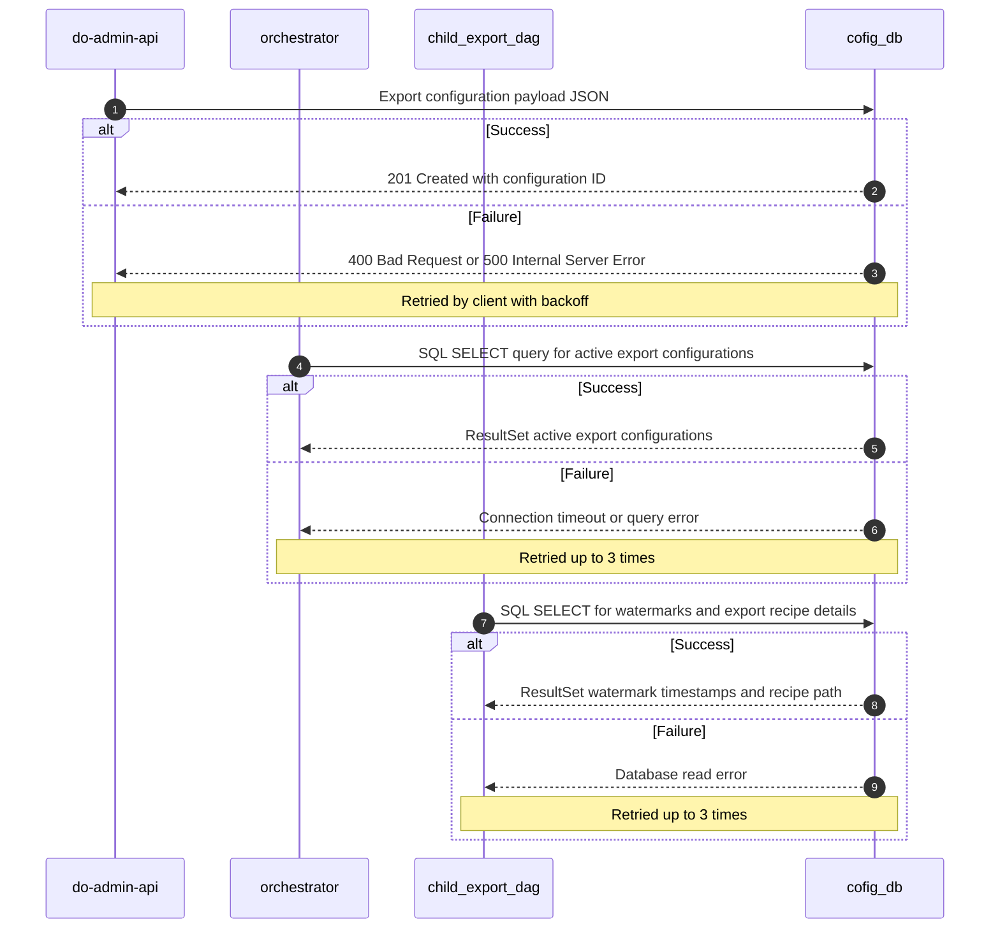

### 9.5. Schema Definitions (DB Tables / API JSON / Telemetry CloudEvents)
<a id="laminar-sec-c.imp_aws_aws_rds_7.schema"></a>
The relational schema owned by `cofig_db` is defined by the following PostgreSQL DDL statements:

```sql
-- Enable UUID extension if required
CREATE EXTENSION IF NOT EXISTS "uuid-ossp";

-- Export Configurations Table
CREATE TABLE export_configurations (
    id VARCHAR(64) PRIMARY KEY DEFAULT uuid_generate_v4()::text,
    connection_name VARCHAR(100) NOT NULL UNIQUE,
    target_type VARCHAR(32) NOT NULL CHECK (target_type IN ('s3', 'azure_blob', 'gcs', 'sftp')),
    dataset VARCHAR(64) NOT NULL CHECK (dataset IN ('identity_profiles', 'subscription_statuses', 'campaigns_reactions', 'reservation_items')),
    mode VARCHAR(16) NOT NULL CHECK (mode IN ('initial', 'incremental')),
    cron_schedule VARCHAR(64) NOT NULL,
    encrypted_credentials TEXT NOT NULL,
    is_active BOOLEAN NOT NULL DEFAULT TRUE,
    created_at TIMESTAMP WITH TIME ZONE NOT NULL DEFAULT CURRENT_TIMESTAMP,
    updated_at TIMESTAMP WITH TIME ZONE NOT NULL DEFAULT CURRENT_TIMESTAMP
);

-- Export Watermarks Table for Incremental State Tracking
CREATE TABLE export_watermarks (
    config_id VARCHAR(64) PRIMARY KEY REFERENCES export_configurations(id) ON DELETE CASCADE,
    watermark_timestamp TIMESTAMP WITH TIME ZONE NOT NULL,
    updated_at TIMESTAMP WITH TIME ZONE NOT NULL DEFAULT CURRENT_TIMESTAMP
);

-- Execution Audit and Run Logs Reference Table
CREATE TABLE export_execution_logs (
    run_id VARCHAR(64) PRIMARY KEY,
    config_id VARCHAR(64) REFERENCES export_configurations(id) ON DELETE CASCADE,
    execution_id VARCHAR(64) NOT NULL,
    status VARCHAR(32) NOT NULL,
    started_at TIMESTAMP WITH TIME ZONE NOT NULL DEFAULT CURRENT_TIMESTAMP,
    completed_at TIMESTAMP WITH TIME ZONE NULL
);

-- Indexes for performance optimization
CREATE INDEX idx_export_configs_active ON export_configurations(is_active);
CREATE INDEX idx_export_logs_execution_id ON export_execution_logs(execution_id);
```

---

### 9.6. Local Design Assumptions
<a id="laminar-sec-c.imp_aws_aws_rds_7.asm"></a>
1. **Multi-AZ and High Availability**: Configured with `multi_az = False` for the non-production/cost-optimized baseline specified in the graph properties, while production deployments override this to `True` with synchronous standby replication per AWS RDS best practices.
2. **Storage Scaling**: Utilizes `gp3` storage with automated storage scaling enabled to prevent out-of-disk failures during heavy transaction logging.
3. **Credentials Encryption**: All credential payloads stored in `encrypted_credentials` are encrypted at the application boundary prior to insertion using AWS KMS Customer Managed Keys (CMKs) via SSM/Secrets management helpers.
4. **Backup and Retention**: Automated backups are retained for 30 days, complying with organizational recovery point objectives (RPO of 24 hours) and recovery time objectives (RTO of 2 hours).

## 10. Component Design: staging_bucet_internal
<a id="laminar-sec-c.imp_aws_aws_s3_bucket_8"></a>

### 10.1. Component Contract (Bi-Directional Inputs & Outputs)
<a id="laminar-sec-c.imp_aws_aws_s3_bucket_8.contract"></a>
**staging_bucet_internal** is the internal S3 bucket that holds the staged Golden Entity extract datasets produced by **emr_do** and consumed by **egress dag**. It is a data store, not a service: it owns no code, only objects, a bucket policy, an event notification and a lifecycle rule. It is the only place in the flow where staged Parquet/JSON datasets live, and it is the trigger source for the **egress-lambda** invocation.

#### 10.1.1 Configuration the design actually sets

| Setting | Value | Rationale |
|---|---|---|
| `bucket_name` | `staging_bucet_internal` | User decision. |
| `versioning` | `False` | User decision — staged data is transient and regenerated by re-runs; versioning would multiply storage cost for no recovery benefit. |
| `encryption` | `AES256` (SSE-S3) | User decision — server-side encryption at rest for staged customer data. |
| `public_access_block` | `True` | User decision — no public access; all access is via IAM roles inside the VPC. |
| Lifecycle expiration | **exactly 7 days** on every staged object | Required by SCRUM-482 AC#1/AC#2 and SCRUM-486 AC#5 ("lifecycle rule configured with expiration of exactly 7 days on every customer staging bucket"). |
| `lifecycle_transition_days` / `lifecycle_glacier_days` | `30` / `90` | User decision, retained as the archival rule for any object that survives the 7-day expiration (e.g. Acme inspection staging copies). |
| Event notification | `s3:ObjectCreated:*` on prefix `staging/` → **egress-lambda** | Required by the frozen edge `staging_bucet_internal → egress-lambda`. |

> **Assumption (node-property conflict):** the node property `lifecycle_enabled=False` conflicts with SCRUM-482 AC#1 and SCRUM-486 AC#5, which require an expiration rule of exactly 7 days. The requirement is treated as authoritative: the 7-day expiration rule is enabled, and the `lifecycle_transition_days`/`lifecycle_glacier_days` values are retained for the archival tier only.

#### 10.1.2 Bi-directional contract

**Inbound (writers)**

| From | Action | Protocol | Payload | Idempotency |
|---|---|---|---|---|
| **emr_do** | `write` | S3 API (boto3 / Spark S3Committer) | Parquet/JSON data files + `manifest_<lineage_uuid>.json` under `staging/<config_id>/<lineage_uuid>/` | Deterministic object key paths including the lineage UUID; re-running the same logical execution overwrites the same keys. |
| **egress dag** | `push` (Acme inspection staging destination, SCRUM-484 AC#4) | S3 API (boto3) | Final export package + manifest written back to the same bucket | Deterministic object naming; SHA-256 recomputed on read-back must equal the manifest value. |

**Outbound (readers / triggers)**

| To | Action | Protocol | Payload | Failure behaviour |
|---|---|---|---|---|
| **egress dag** | `read` | S3 API (boto3) | `GetObject` for staged files and manifests | S3 read error retried up to 3 times. |
| **egress-lambda** | `trigger` | S3 Event Notification → Lambda | S3 event JSON (`bucket`, `key`, `versionId`, `eventTime`) | Lambda invocation failure routed to the SQS DLQ after retries. |

**Telemetry:** every successful write emits `com.laminar.dataoutbound.staging.written` (from **emr_do**); the S3 notification that reaches **egress-lambda** emits `com.laminar.dataoutbound.egress.triggered`.

---

### 10.2. Class and Interface Definitions
<a id="laminar-sec-c.imp_aws_aws_s3_bucket_8.classes"></a>
**staging_bucet_internal** owns no runtime code. Its "interface" is the object-key convention plus the bucket configuration, both expressed through the foundation's `S3Client` (`common/clients/aws/s3/s3_client.py`). The typed definitions below are the contract every writer and reader uses; they are illustrative of the data-store boundary, not a service class.

```python
# Illustrative — the Component Contract and Schema Definitions are binding.
# staging_bucet_internal is a data store; these types describe its object-key
# convention and the foundation S3Client surface its writers/readers use.

from __future__ import annotations

from dataclasses import dataclass, field
from datetime import datetime
from typing import Any

from dataoutbound_section_tree.common.clients.aws.s3.s3_client import S3Client
from dataoutbound_section_tree.config.config_loader import ConfigLoader


@dataclass(frozen=True)
class StagingObjectKey:
    """Deterministic key layout for every object in staging_bucet_internal.

    Layout: staging/<config_id>/<lineage_uuid>/<dataset>/<part>.<ext>
    The lineage UUID is the idempotency anchor: a re-run of the same logical
    execution writes the same keys and therefore overwrites, never duplicates.
    """

    config_id: str
    lineage_uuid: str
    dataset: str
    part: str
    extension: str = "parquet"

    def as_key(self) -> str:
        return (
            f"staging/{self.config_id}/{self.lineage_uuid}/"
            f"{self.dataset}/{self.part}.{self.extension}"
        )


@dataclass(frozen=True)
class StagingManifest:
    """Manifest control file written alongside the staged data files."""

    lineage_uuid: str
    config_id: str
    dataset: str
    record_count: int
    total_size_bytes: int
    files: list[dict[str, Any]] = field(default_factory=list)  # {name, sha256, size_bytes}
    created_at_utc: datetime | None = None

    def manifest_key(self) -> str:
        return f"staging/{self.config_id}/{self.lineage_uuid}/manifest_{self.lineage_uuid}.json"


class StagingBucket:
    """Thin, typed facade over the foundation S3Client for this bucket only.

    Constructed with the shared ConfigLoader; never builds a boto3 client itself.
    """

    def __init__(self, config: ConfigLoader, s3: S3Client | None = None) -> None:
        self._config = config
        self._bucket = config.get("staging_bucket.name", default="staging_bucet_internal")
        self._s3 = s3 or S3Client(config)

    def put_object(self, key: str, body: bytes, content_type: str = "application/octet-stream") -> str:
        """Write one staged object; returns the ETag. SSE-S3 (AES256) is applied by the client."""
        return self._s3.upload_bytes(bucket=self._bucket, key=key, body=body, content_type=content_type)

    def get_object(self, key: str) -> bytes:
        """Read one staged object; raises ClientError/NotFoundError from the foundation."""
        return self._s3.download_bytes(bucket=self._bucket, key=key)

    def list_prefix(self, prefix: str) -> list[dict[str, Any]]:
        """List staged objects under a prefix (used by egress dag to enumerate a package)."""
        return self._s3.list_objects(bucket=self._bucket, prefix=prefix)
```

---

### 10.3. Implementation Code Skeleton (Stubs & Handlers)
<a id="laminar-sec-c.imp_aws_aws_s3_bucket_8.skeleton"></a>
Illustrative skeleton — the Component Contract and Schema Definitions are binding. **staging_bucet_internal** has no handler of its own; the code below is the bucket configuration (Terraform) and the two call sites that write to and read from it, expressed against the foundation clients.

```hcl
# terraform/s3.tf — staging_bucet_internal (excerpt)
resource "aws_s3_bucket" "staging_bucet_internal" {
  bucket        = "staging_bucet_internal"
  force_destroy = var.deletion_protection_enabled ? false : true   # env-driven, never hardcoded
}

resource "aws_s3_bucket_server_side_encryption_configuration" "staging" {
  bucket = aws_s3_bucket.staging_bucet_internal.id
  rule {
    apply_server_side_encryption_by_default { sse_algorithm = "AES256" }
  }
}

resource "aws_s3_bucket_public_access_block" "staging" {
  bucket                  = aws_s3_bucket.staging_bucet_internal.id
  block_public_acls       = true
  block_public_policy     = true
  ignore_public_acls      = true
  restrict_public_buckets = true
}

# 7-day expiration required by SCRUM-482 AC#1 / SCRUM-486 AC#5
resource "aws_s3_bucket_lifecycle_configuration" "staging" {
  bucket = aws_s3_bucket.staging_bucet_internal.id
  rule {
    id     = "expire-staged-exports-7d"
    status = "Enabled"
    filter { prefix = "staging/" }
    expiration { days = 7 }
  }
}

resource "aws_s3_bucket_notification" "staging_to_egress_lambda" {
  bucket = aws_s3_bucket.staging_bucet_internal.id
  lambda_function {
    lambda_function_arn = aws_lambda_function.egress_lambda.arn
    events              = ["s3:ObjectCreated:*"]
    filter_prefix       = "staging/"
  }
}
```

```python
# Illustrative — writer side (emr_do), using the foundation S3Client.
from dataoutbound_section_tree.common.clients.aws.s3.s3_client import S3Client
from dataoutbound_section_tree.common.logging.logger import get_logger
from dataoutbound_section_tree.common.telemetry.auditor import AuditPublisher
from dataoutbound_section_tree.config.config_loader import ConfigLoader
from dataoutbound_section_tree.util.exceptions import ClientError

log = get_logger(__name__)


def write_staged_partition(
    config: ConfigLoader,
    *,
    config_id: str,
    lineage_uuid: str,
    dataset: str,
    part: str,
    body: bytes,
) -> str:
    """Write one staged object and emit the staging.written audit event."""
    s3 = S3Client(config)
    auditor = AuditPublisher(config=config)
    key = f"staging/{config_id}/{lineage_uuid}/{dataset}/{part}.parquet"
    try:
        etag = s3.upload_bytes(bucket="staging_bucet_internal", key=key, body=body)
    except ClientError as exc:
        log.error("staging write failed", extra={"key": key, "error": str(exc)})
        raise
    auditor.publish(
        "com.laminar.dataoutbound.staging.written",
        {
            "actor_id": "system:emr_do",
            "execution_id": lineage_uuid,
            "config_id": config_id,
            "bucket": "staging_bucet_internal",
            "key": key,
            "etag": etag,
        },
    )
    return etag
```

```python
# Illustrative — reader side (egress dag), using the foundation S3Client.
from dataoutbound_section_tree.common.clients.aws.s3.s3_client import S3Client
from dataoutbound_section_tree.config.config_loader import ConfigLoader


def read_staged_package(config: ConfigLoader, *, config_id: str, lineage_uuid: str) -> list[dict]:
    """Enumerate every staged object for one lineage UUID."""
    s3 = S3Client(config)
    prefix = f"staging/{config_id}/{lineage_uuid}/"
    return s3.list_objects(bucket="staging_bucet_internal", prefix=prefix)
```

---

### 10.4. Cross-Component Interaction Sequence (Local Mermaid/ASCII Flow)
<a id="laminar-sec-c.imp_aws_aws_s3_bucket_8.seq"></a>
The sequence below describes the interactions in which **staging_bucet_internal** participates, in order. The pipeline inserts the Mermaid diagram for this section.

1. **emr_do** completes the Spark extract and writes each staged data file plus `manifest_<lineage_uuid>.json` to `staging/<config_id>/<lineage_uuid>/…` using the foundation `S3Client` (S3 API, SSE-S3). On success it emits `com.laminar.dataoutbound.staging.written`.
2. The bucket's `s3:ObjectCreated:*` notification on prefix `staging/` fires and invokes **egress-lambda** with the S3 event JSON (`bucket`, `key`, `versionId`, `eventTime`). If the Lambda invocation fails after retries, the event is routed to the SQS DLQ.
3. **egress-lambda** parses the event, derives the lineage UUID from the object key, and triggers exactly one **egress dag** run carrying that lineage UUID (`com.laminar.dataoutbound.egress.triggered`, then `com.laminar.dataoutbound.egress_dag.started`).
4. **egress dag** reads the staged files and manifest from the bucket (`GetObject` / `list_objects`), applies GZIP then fail-closed PGP encryption, and delivers the package to the configured customer destination.
5. When the configured destination is the Acme inspection staging destination, **egress dag** writes the final package and manifest back into the same bucket under a deterministic key; the SHA-256 recomputed on read-back must equal the manifest value (SCRUM-484 AC#4).
6. **Failure paths:** an S3 read error in step 4 is retried up to 3 times; a PGP encryption failure aborts the transfer before any object is written to a customer destination and records a `TRANSFER_FAILED` event. Staged objects are purged by the 7-day lifecycle expiration regardless of transfer outcome.

---
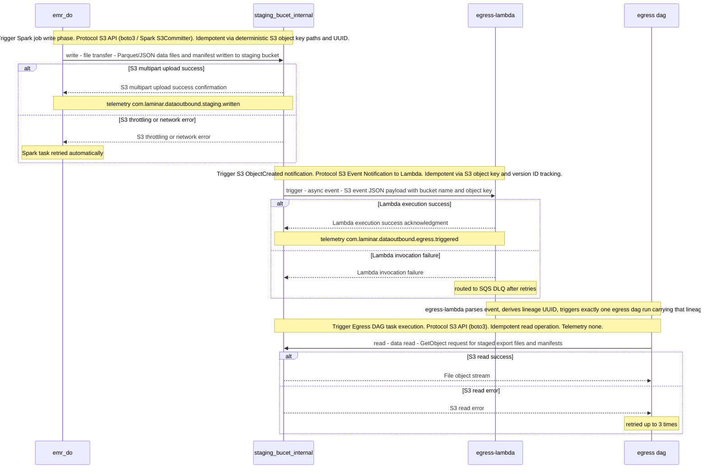

### 10.5. Schema Definitions (DB Tables / API JSON / Telemetry CloudEvents)
<a id="laminar-sec-c.imp_aws_aws_s3_bucket_8.schema"></a>
**staging_bucet_internal** owns no database tables. Its schemas are the object-key layout, the manifest control file, the S3 event notification payload, and the CloudEvents telemetry it emits.

#### 10.5.1 Object key layout

```json
{
  "layout": "staging/<config_id>/<lineage_uuid>/<dataset>/<part>.<extension>",
  "manifest": "staging/<config_id>/<lineage_uuid>/manifest_<lineage_uuid>.json",
  "example": "staging/cfg-8f21/6f1c9d2e-4b7a-4f0e-9c31-2a5b7d8e1f04/identity_profiles/part-00000.parquet",
  "idempotency": "deterministic keys including the lineage UUID; re-runs overwrite the same keys"
}
```

#### 10.5.2 Manifest control file (`manifest_<lineage_uuid>.json`)

```json
{
  "$schema": "https://json-schema.org/draft/2020-12/schema",
  "$id": "https://laminar.com/dataoutbound/staging/staging_manifest.json",
  "title": "StagingManifest",
  "type": "object",
  "required": ["execution_id", "generated_at_utc", "entities"],
  "additionalProperties": false,
  "properties": {
    "execution_id": { "type": "string", "format": "uuid" },
    "generated_at_utc": {
      "type": "string",
      "pattern": "^\\d{4}-\\d{2}-\\d{2}T\\d{2}:\\d{2}:\\d{2}\\.\\d{3}Z$"
    },
    "entities": {
      "type": "array",
      "items": {
        "type": "object",
        "required": ["dataset", "record_count", "bytes_written", "sha256"],
        "additionalProperties": false,
        "properties": {
          "dataset": { "type": "string" },
          "record_count": { "type": "integer", "minimum": 0 },
          "bytes_written": { "type": "integer", "minimum": 0 },
          "sha256": {
            "type": "object",
            "additionalProperties": { "type": "string", "pattern": "^[a-f0-9]{64}$" }
          }
        }
      }
    }
  }
}
```

> Same `StagingManifest` as defined in *Staging manifest (`s3://staging_bucet_internal/<config_id>/<execution_id>/manifest_<execution_id>.json`)* — one schema, one definition.

#### 10.5.3 S3 event notification payload (delivered to **egress-lambda**)

```json
{
  "Records": [
    {
      "eventSource": "aws:s3",
      "eventName": "ObjectCreated:Put",
      "awsRegion": "eu-west-1",
      "s3": {
        "bucket": { "name": "staging_bucet_internal" },
        "object": {
          "key": "staging/cfg-8f21/6f1c9d2e-4b7a-4f0e-9c31-2a5b7d8e1f04/identity_profiles/part-00000.parquet",
          "size": 1048576,
          "eTag": "d41d8cd98f00b204e9800998ecf8427e"
        }
      }
    }
  ]
}
```

#### 10.5.4 Telemetry CloudEvents emitted at this boundary

```json
{
  "specversion": "1.0",
  "type": "com.laminar.dataoutbound.staging.written",
  "source": "system:emr_do",
  "id": "6f1c9d2e-4b7a-4f0e-9c31-2a5b7d8e1f04",
  "time": "2025-01-31T02:15:00.000Z",
  "subject": "staging_bucet_internal/staging/cfg-8f21/6f1c9d2e-4b7a-4f0e-9c31-2a5b7d8e1f04/identity_profiles/part-00000.parquet",
  "data": {
    "actor_id": "system:emr_do",
    "execution_id": "6f1c9d2e-4b7a-4f0e-9c31-2a5b7d8e1f04",
    "config_id": "cfg-8f21",
    "bucket": "staging_bucet_internal",
    "key": "staging/cfg-8f21/6f1c9d2e-4b7a-4f0e-9c31-2a5b7d8e1f04/identity_profiles/part-00000.parquet",
    "etag": "d41d8cd98f00b204e9800998ecf8427e"
  }
}
```

```json
{
  "specversion": "1.0",
  "type": "com.laminar.dataoutbound.egress.triggered",
  "source": "system:egress-lambda",
  "id": "b2a4c6e8-1f3d-4a5b-8c7e-9d0f1a2b3c4d",
  "time": "2025-01-31T02:15:03.000Z",
  "subject": "staging_bucet_internal/staging/cfg-8f21/6f1c9d2e-4b7a-4f0e-9c31-2a5b7d8e1f04/identity_profiles/part-00000.parquet",
  "data": {
    "actor_id": "system:egress-lambda",
    "execution_id": "6f1c9d2e-4b7a-4f0e-9c31-2a5b7d8e1f04",
    "config_id": "cfg-8f21",
    "bucket": "staging_bucet_internal",
    "key": "staging/cfg-8f21/6f1c9d2e-4b7a-4f0e-9c31-2a5b7d8e1f04/identity_profiles/part-00000.parquet"
  }
}
```

---

### 10.6. Local Design Assumptions
<a id="laminar-sec-c.imp_aws_aws_s3_bucket_8.asm"></a>
- **Lifecycle conflict resolved in favour of the requirement.** The node property `lifecycle_enabled=False` is overridden by SCRUM-482 AC#1 and SCRUM-486 AC#5, which require an expiration rule of exactly 7 days on every staging object. The `lifecycle_transition_days=30` / `lifecycle_glacier_days=90` values are retained as the archival tier for objects that survive the 7-day expiration (e.g. Acme inspection staging copies).
- **Versioning disabled.** `versioning=False` is honoured; idempotency is achieved through deterministic object keys containing the lineage UUID, not through object versions. The S3 event payload's `versionId` field is therefore absent and **egress-lambda** keys idempotency on the object key alone.
- **Event notification scope.** The notification is scoped to prefix `staging/` so that Acme inspection staging copies written back by **egress dag** under the same prefix do not re-trigger **egress-lambda** in a loop; the write-back path uses a distinct prefix (`inspection/`) — an assumption recorded here because the diagram does not specify the write-back prefix.
- **Encryption.** SSE-S3 (`AES256`) is the user decision; no KMS CMK is configured for this bucket. Staged data is transient and re-derivable, so the additional key-management overhead of SSE-KMS is not justified.
- **Deletion protection.** The bucket's `force_destroy` flag is read from the per-environment `deletion_protection_enabled` variable (SCRUM-485 AC#3/AC#4/AC#5); no value is hardcoded.
- **No DLQ on the bucket itself.** The SQS DLQ for failed **egress-lambda** invocations is attached to the Lambda's event source mapping, not to the bucket; the bucket only emits notifications.

---

## 11. Component Design: egress-lambda
<a id="laminar-sec-c.imp_aws_aws_lambda_9"></a>

### 11.1. Component Contract (Bi-Directional Inputs & Outputs)
<a id="laminar-sec-c.imp_aws_aws_lambda_9.contract"></a>
The `egress-lambda` component acts as the event-driven bridge between internal staging object creation and the downstream egress orchestration pipeline.

#### 11.1.1 Inbound Interfaces & Triggers
- **Trigger Source**: `staging_bucet_internal` (Amazon S3 bucket event notification).
- **Protocol / Mechanism**: Asynchronous S3 `ObjectCreated:*` event notification invoking the Lambda function via AWS Lambda event source mapping.
- **Payload Schema**: Standard AWS S3 Event Notification JSON containing `Records` array with bucket ARN/name, object key, size, and ETag. The object key encodes metadata in the structured path convention: `exports/{connection_id}/{execution_id}/{dataset}/{filename}`.

#### 11.1.2 Outbound Interfaces & Destinations
- **Trigger Target**: `transform_encrypt_dag` (Amazon MWAA REST API / TriggerDagRun).
- **Protocol / Mechanism**: HTTPS REST call via `MwaaClient` using boto3 / MWAA CLI token authentication.
- **Outbound Payload (`dag_conf`)**: JSON object carrying `execution_id`, `connection_id`, `object_key`, `dataset`, `source_bucket`, and `source_key`.
- **Telemetry / Audit Sink**: `audit_bucket` via `AuditPublisher`, emitting CloudEvents record `com.laminar.dataoutbound.egress.triggered`.

#### 11.1.3 Resilience & Error Handling
- **Retry Policy**: AWS Lambda built-in asynchronous retry policy (2 retries with exponential backoff) combined with `MwaaClient` internal backoff retries.
- **Dead-Letter Queue (DLQ)**: Configured with an SQS DLQ target for event payloads exceeding maximum invocation retries.
- **Idempotency**: Tracked via S3 object key and version ID / `execution_id` combination to prevent duplicate DAG triggers.

---

### 11.2. Class and Interface Definitions
<a id="laminar-sec-c.imp_aws_aws_lambda_9.classes"></a>
```python
from dataclasses import dataclass, field
from typing import Dict, Any, Optional
from datetime import datetime

@dataclass
class S3ObjectMetadata:
    bucket_name: str
    object_key: str
    size_bytes: int
    etag: str
    sequencer: str

@dataclass
class S3EventRecord:
    event_name: str
    event_time: str
    bucket_name: str
    object_key: str
    object_size: int
    etag: str

@dataclass
class EgressTriggerPayload:
    execution_id: str
    connection_id: str
    object_key: str
    dataset: str
    source_bucket: str
    source_key: str
    triggered_at: str = field(default_factory=lambda: datetime.utcnow().isoformat() + "Z")

    def to_dict(self) -> Dict[str, Any]:
        return {
            "execution_id": self.execution_id,
            "connection_id": self.connection_id,
            "object_key": self.object_key,
            "dataset": self.dataset,
            "source_bucket": self.source_bucket,
            "source_key": self.source_key,
            "triggered_at": self.triggered_at,
        }
```

> Same `S3EventRecord` as defined in *Class and Interface Definitions* — one schema, one definition.

---

### 11.3. Implementation Code Skeleton (Stubs & Handlers)
<a id="laminar-sec-c.imp_aws_aws_lambda_9.skeleton"></a>
Illustrative skeleton — the Component Contract and Schema Definitions are binding. The binding artefact for **egress-lambda** is the handler signature and the operations it performs; the code below is the public entry point and its helpers, importing every shared concern from the blueprint's foundation.

```python
# src/dataoutbound_section_tree/lambdas/egress_lambda.py
# Illustrative skeleton — the Component Contract and Schema Definitions are binding.
from __future__ import annotations

import json
import os
from typing import Any

from dataoutbound_section_tree.common.clients.aws.mwaa.mwaa_client import MwaaClient
from dataoutbound_section_tree.common.logging.logger import get_logger
from dataoutbound_section_tree.common.telemetry.auditor import AuditPublisher
from dataoutbound_section_tree.config.config_loader import ConfigLoader
from dataoutbound_section_tree.util.exceptions import ClientError, ValidationError
from dataoutbound_section_tree.util.idempotency import IdempotencyKey

log = get_logger(__name__)

# Environment variables (all read from config, never hardcoded):
#   EGRESS_DAG_NAME        — the MWAA DAG to trigger (default "egress dag")
#   STAGING_BUCKET_NAME    — the bucket the notification came from
#   CONFIG_ENV             — dev | staging | prod
EGRESS_DAG_NAME = os.environ.get("EGRESS_DAG_NAME", "egress dag")
STAGING_BUCKET_NAME = os.environ.get("STAGING_BUCKET_NAME", "staging_bucet_internal")


def _parse_s3_event(event: dict[str, Any]) -> tuple[str, str, str]:
    """Extract (bucket, key, lineage_uuid) from an S3 ObjectCreated notification.

    Raises ValidationError if the event is malformed or the key does not carry
    a lineage UUID in the expected staging/<config_id>/<lineage_uuid>/... layout.
    """
    try:
        record = event["Records"][0]
        bucket = record["s3"]["bucket"]["name"]
        key = record["s3"]["object"]["key"]
    except (KeyError, IndexError, TypeError) as exc:
        raise ValidationError("malformed S3 event payload") from exc

    parts = key.split("/")
    if len(parts) < 3 or parts[0] != "staging":
        raise ValidationError(f"unexpected staging key layout: {key}")
    config_id, lineage_uuid = parts[1], parts[2]
    return bucket, key, lineage_uuid


def lambda_handler(event: dict[str, Any], context: Any) -> dict[str, Any]:
    """Entry point for the S3 ObjectCreated notification on staging_bucet_internal.

    Triggers exactly one egress dag run carrying the lineage UUID parsed from the
    object key. Idempotent on the object key: a duplicate notification for the
    same key produces the same logical DAG run id.
    """
    config = ConfigLoader(env=os.environ.get("CONFIG_ENV", "dev"))
    auditor = AuditPublisher(config=config)
    mwaa = MwaaClient(config)

    try:
        bucket, key, lineage_uuid = _parse_s3_event(event)
    except ValidationError as exc:
        log.error("egress-lambda rejected event", extra={"error": str(exc)})
        return {"statusCode": 400, "body": json.dumps({"error": {"code": "VALIDATION_ERROR", "message": str(exc)}})}

    run_id = IdempotencyKey.build("egress", key)
    auditor.publish(
        "com.laminar.dataoutbound.egress.triggered",
        {
            "actor_id": "system:egress-lambda",
            "execution_id": lineage_uuid,
            "bucket": bucket,
            "key": key,
        },
    )

    try:
        dag_run = mwaa.trigger_dag_run(
            dag_name=EGRESS_DAG_NAME,
            run_id=run_id,
            conf={"lineage_uuid": lineage_uuid, "bucket": bucket, "key": key},
        )
    except ClientError as exc:
        log.error("egress dag trigger failed", extra={"key": key, "error": str(exc)})
        # Non-2xx surfaces to the S3 event source mapping, which routes to the SQS DLQ.
        return {"statusCode": 502, "body": json.dumps({"error": {"code": "DAG_TRIGGER_FAILED", "message": str(exc)}})}

    auditor.publish(
        "com.laminar.dataoutbound.egress_dag.started",
        {
            "actor_id": "system:egress-lambda",
            "execution_id": lineage_uuid,
            "dag_run_id": dag_run.get("dag_run_id"),
            "bucket": bucket,
            "key": key,
        },
    )
    return {"statusCode": 200, "body": json.dumps({"dag_run_id": dag_run.get("dag_run_id")})}
```

---

### 11.4. Cross-Component Interaction Sequence (Local Mermaid/ASCII Flow)
<a id="laminar-sec-c.imp_aws_aws_lambda_9.seq"></a>
1. **S3 Event Generation**: When `emr_do` writes completed staging output files and manifests to `staging_bucet_internal`, Amazon S3 generates an `ObjectCreated` event notification.
2. **Lambda Invocation**: S3 invokes `egress-lambda` asynchronously, passing the S3 event payload containing bucket and object details.
3. **Key Parsing & Validation**: `egress-lambda` extracts the object key, parses out `connection_id`, `execution_id`, and `dataset`, and validates structure compliance.
4. **DAG Trigger**: `egress-lambda` utilizes `MwaaClient` to invoke `transform_encrypt_dag` on Amazon MWAA, passing the execution configuration dictionary (`dag_conf`).
5. **Audit Publication**: `egress-lambda` publishes the `com.laminar.dataoutbound.egress.triggered` CloudEvent record to `audit_bucket` via `AuditPublisher`.
6. **Error Path**: On network or MWAA API failure, the Lambda runtime retries up to configured limits before routing the failed event to the SQS Dead-Letter Queue.

---
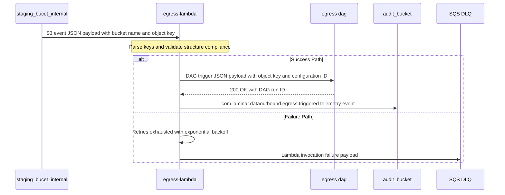

### 11.5. Schema Definitions (DB Tables / API JSON / Telemetry CloudEvents)
<a id="laminar-sec-c.imp_aws_aws_lambda_9.schema"></a>
#### 11.5.1 S3 Event Notification Input JSON
```json
{
  "Records": [
    {
      "eventVersion": "2.1",
      "eventSource": "aws:s3",
      "awsRegion": "us-east-1",
      "eventTime": "2025-01-31T02:15:00.000Z",
      "eventName": "ObjectCreated:Put",
      "s3": {
        "s3SchemaVersion": "1.0",
        "configurationId": "EgressTriggerConfig",
        "bucket": {
          "name": "staging_bucet_internal",
          "ownerIdentity": { "principalId": "A1234567890" },
          "arn": "arn:aws:s3:::staging_bucet_internal"
        },
        "object": {
          "key": "exports/conn-uuid-001/exec-uuid-999/identity_profiles/data_001.json.gz",
          "size": 1048576,
          "eTag": "d41d8cd98f00b204e9800998ecf8427e",
          "sequencer": "0055AED6F070281ECB"
        }
      }
    }
  ]
}
```

#### 11.5.2 MWAA DAG Trigger Payload (`dag_conf`) JSON
```json
{
  "execution_id": "exec-uuid-999",
  "connection_id": "conn-uuid-001",
  "object_key": "exports/conn-uuid-001/exec-uuid-999/identity_profiles/data_001.json.gz",
  "dataset": "identity_profiles",
  "source_bucket": "staging_bucet_internal",
  "source_key": "exports/conn-uuid-001/exec-uuid-999/identity_profiles/data_001.json.gz",
  "triggered_at": "2025-01-31T02:15:01.123Z"
}
```

#### 11.5.3 CloudEvents Telemetry Record (`com.laminar.dataoutbound.egress.triggered`)
```json
{
  "specversion": "1.0",
  "type": "com.laminar.dataoutbound.egress.triggered",
  "source": "arn:aws:lambda:us-east-1:123456789012:function:egress-lambda",
  "id": "evt-uuid-5555",
  "time": "2025-01-31T02:15:01.150Z",
  "datacontenttype": "application/json",
  "subject": "exec-uuid-999",
  "detail": {
    "execution_id": "exec-uuid-999",
    "connection_id": "conn-uuid-001",
    "source_bucket": "staging_bucet_internal",
    "object_key": "exports/conn-uuid-001/exec-uuid-999/identity_profiles/data_001.json.gz",
    "dag_run_id": "manual__2025-01-31T02:15:01+00:00",
    "actor_id": "system:egress-lambda",
    "timestamp_utc": "2025-01-31T02:15:01.123Z",
    "status": "SUCCESS"
  }
}
```

---

### 11.6. Local Design Assumptions
<a id="laminar-sec-c.imp_aws_aws_lambda_9.asm"></a>
- **Runtime Configuration**: Python 3.11 runtime environment with memory allocation set to 512 MB and execution timeout configured to 30 seconds, balancing rapid cold starts with adequate JSON payload parsing throughput.
- **VPC Network Isolation**: Executed outside a dedicated VPC (`vpc_enabled = False`) as stateful DB access is not required; outbound HTTPS calls to the MWAA REST API traverse the standard managed Lambda NAT infrastructure.
- **IAM Least Privilege**: Lambda execution role grants `s3:GetObject` on `staging_bucet_internal`, execution permissions for MWAA REST triggers, and write access to explicit CloudWatch Log groups and `audit_bucket`.

## 12. Component Design: egress dag
<a id="laminar-sec-c.imp_aws_aws_mwaa_dag_10"></a>

### 12.1. Component Contract (Bi-Directional Inputs & Outputs)
<a id="laminar-sec-c.imp_aws_aws_mwaa_dag_10.contract"></a>
The Transform & Encrypt DAG (`transform_encrypt_dag`) operates as an Amazon MWAA orchestration pipeline responsible for fetching staged export datasets, applying optional GZIP compression and strict fail-closed PGP encryption, verifying file integrity via SHA-256 manifests, delivering payloads to customer-owned destinations (S3, Azure Blob, GCS, or SFTP), and recording comprehensive lifecycle telemetry.

#### 12.1.1 Inbound Contract (Trigger & Payload)
- **Trigger Source**: Invoked asynchronously by `egress-lambda` via the Airflow REST API (`POST /api/v1/dags/transform_encrypt_dag/dagRuns`) upon receiving an S3 ObjectCreated event from `staging_bucet_internal`.
- **Payload (`dag_conf`)**:
  ```json
  {
    "execution_id": "c015b5e4-1234-4567-890a-bcdef0123456",
    "connection_id": "conn-hospitality-001",
    "object_key": "staged/2025/03/30/identity_profiles_c015b5e4.parquet",
    "dataset": "identity_profiles"
  }
  ```
- **Authentication**: IAM-authenticated SigV4 request via Airflow API or Boto3 client wrapper (`common/clients/aws/mwaa/mwaa_client.py`).

#### 12.1.2 Outbound Contracts & Integrations
- **Data Source (`staging_bucet_internal`)**: Retrieves staged export data files and manifests via S3 `GetObject` (`common/clients/aws/s3/s3_client.py`).
- **Secret Retrieval (`ssm`)**: Fetches customer destination credentials and PGP public keys from SSM Parameter Store (`SecureString`) via `common/clients/aws/ssm/ssm_client.py`.
- **Destinations**:
  - `customer SFTP server`: Transfers encrypted/raw files over SSH (port 22) using key-based authentication with strict host-key verification and atomic temporary file rename (`common/clients/sftp/sftp_client.py`).
  - `customer bucket`: Pushes objects over TLS 1.3 using AWS S3 client with server-side encryption (`common/clients/aws/s3/s3_client.py`).
  - `Customer Azure Blob Destination`: Pushes blobs using Azure Blob Storage REST API with Managed Identity (`common/clients/azure/blob_client.py`).
  - `Customer GCS Destination`: Pushes objects using Google Cloud Storage API with workload identity (`common/clients/gcp/gcs_client.py`).
- **Audit Sink (`audit_bucket`)**: Publishes execution start, completion, and failure audit records conforming to CloudEvents specification (`common/telemetry/auditor.py`).

#### 12.1.3 Resilience, Retries & Error Handling
- **Idempotency**: Strictly idempotent via deterministic object naming and lineage UUID tracking (`execution_id`). Re-running the DAG for the same `execution_id` overwrites or safely replaces target objects.
- **Retry Policy**: Tasks are configured with up to 3 retry attempts and exponential backoff.
- **Fail-Closed PGP Security**: If PGP encryption is enabled and the key is missing, corrupted, or encounters a cryptographic failure, the transfer aborts immediately. Zero bytes of unencrypted data are transmitted, a `TRANSFER_FAILED` event is written to `audit_bucket`, and an automated alert is triggered.

---

### 12.2. Class and Interface Definitions
<a id="laminar-sec-c.imp_aws_aws_mwaa_dag_10.classes"></a>
```python
from dataclasses import dataclass, field
from typing import Dict, Any, Optional, List
from enum import Enum

class DestinationType(str, Enum):
    S3 = "s3"
    AZURE_BLOB = "azure_blob"
    GCS = "gcs"
    SFTP = "sftp"

class TransferStatus(str, Enum):
    STARTED = "TRANSFER_STARTED"
    COMPLETED = "TRANSFER_COMPLETED"
    FAILED = "TRANSFER_FAILED"

@dataclass
class EgressConfig:
    execution_id: str
    connection_id: str
    object_key: str
    dataset: str
    destination_type: DestinationType
    destination_uri: str
    compression_enabled: bool = True
    encryption_enabled: bool = True
    pgp_key_id: Optional[str] = None
    split_threshold: int = 500000

@dataclass
class ManifestRecord:
    file_name: str
    record_count: int
    file_size_bytes: int
    sha256_checksum: str

@dataclass
class AuditRecord:
    actor_id: str
    timestamp_utc: str
    event_type: str
    execution_id: str
    details: Dict[str, Any] = field(default_factory=dict)
```

---

### 12.3. Implementation Code Skeleton (Stubs & Handlers)
<a id="laminar-sec-c.imp_aws_aws_mwaa_dag_10.skeleton"></a>
Illustrative skeleton — the Component Contract and Schema Definitions are binding. The binding artefact for **egress dag** is the DAG definition and its task sequence; the code below is the public entry point, importing every shared concern from the blueprint's foundation.

```python
# src/dataoutbound_section_tree/dags/transform_encrypt_dag.py
# Illustrative skeleton — the Component Contract and Schema Definitions are binding.
from __future__ import annotations

import gzip
import hashlib
import json
from datetime import datetime, timedelta, timezone
from typing import Any

from airflow import DAG
from airflow.operators.python import PythonOperator

from dataoutbound_section_tree.common.clients.aws.s3.s3_client import S3Client
from dataoutbound_section_tree.common.clients.azure.blob_client import BlobClient
from dataoutbound_section_tree.common.clients.gcp.gcs_client import GcsClient
from dataoutbound_section_tree.common.clients.sftp.sftp_client import SftpClient
from dataoutbound_section_tree.common.logging.logger import get_logger
from dataoutbound_section_tree.common.telemetry.auditor import AuditPublisher
from dataoutbound_section_tree.config.config_loader import ConfigLoader
from dataoutbound_section_tree.util.exceptions import ClientError, ValidationError

log = get_logger(__name__)

DAG_ID = "egress dag"
DEFAULT_ARGS = {
    "owner": "dataoutbound",
    "retries": 3,
    "retry_delay": timedelta(minutes=5),
    "email_on_failure": False,
}


def _read_staged(config: ConfigLoader, conf: dict[str, Any]) -> dict[str, Any]:
    """Read the staged package and its manifest from staging_bucet_internal."""
    s3 = S3Client(config)
    bucket = conf["bucket"]
    key = conf["key"]
    lineage_uuid = conf["lineage_uuid"]
    body = s3.download_bytes(bucket=bucket, key=key)
    manifest_key = f"staging/{key.split('/')[1]}/{lineage_uuid}/manifest_{lineage_uuid}.json"
    manifest = json.loads(s3.download_bytes(bucket=bucket, key=manifest_key))
    return {"body": body, "manifest": manifest, "lineage_uuid": lineage_uuid}


def _transform_and_encrypt(config: ConfigLoader, conf: dict[str, Any], staged: dict[str, Any]) -> dict[str, Any]:
    """Apply optional GZIP then fail-closed PGP encryption.

    Fail-closed: if PGP is enabled and encryption fails, raise before any bytes
    are handed to the transfer task. Zero unencrypted bytes leave this task.
    """
    auditor = AuditPublisher(config=config)
    lineage_uuid = staged["lineage_uuid"]
    auditor.publish(
        "com.laminar.dataoutbound.transform.started",
        {"actor_id": "system:egress dag", "execution_id": lineage_uuid, "key": conf["key"]},
    )

    body = staged["body"]
    if conf.get("gzip_enabled"):
        body = gzip.compress(body)
    if conf.get("pgp_enabled"):
        try:
            body = _pgp_encrypt(config, body, conf["pgp_key_ref"])
        except Exception as exc:  # fail-closed
            auditor.publish(
                "com.laminar.dataoutbound.transfer.failed",
                {
                    "actor_id": "system:egress dag",
                    "execution_id": lineage_uuid,
                    "reason": "PGP_ENCRYPTION_FAILED",
                    "error": str(exc),
                },
            )
            raise

    sha256 = hashlib.sha256(body).hexdigest()
    auditor.publish(
        "com.laminar.dataoutbound.transform.completed",
        {"actor_id": "system:egress dag", "execution_id": lineage_uuid, "sha256": sha256},
    )
    return {"body": body, "sha256": sha256}


def _deliver(config: ConfigLoader, conf: dict[str, Any], payload: dict[str, Any]) -> None:
    """Deliver the package to the configured customer destination with SHA-256 read-back."""
    auditor = AuditPublisher(config=config)
    lineage_uuid = payload["lineage_uuid"]
    destination_type = conf["destination_type"]
    auditor.publish(
        "com.laminar.dataoutbound.transfer.started",
        {"actor_id": "system:egress dag", "execution_id": lineage_uuid, "destination": destination_type},
    )

    if destination_type == "s3":
        client = S3Client(config)
        client.upload_bytes(bucket=conf["destination_bucket"], key=conf["destination_key"], body=payload["body"])
        readback = client.download_bytes(bucket=conf["destination_bucket"], key=conf["destination_key"])
    elif destination_type == "azure_blob":
        client = BlobClient(config)
        client.upload(container=conf["destination_container"], blob=conf["destination_key"], body=payload["body"])
        readback = client.download(container=conf["destination_container"], blob=conf["destination_key"])
    elif destination_type == "gcs":
        client = GcsClient(config)
        client.upload(bucket=conf["destination_bucket"], key=conf["destination_key"], body=payload["body"])
        readback = client.download(bucket=conf["destination_bucket"], key=conf["destination_key"])
    elif destination_type == "sftp":
        client = SftpClient(config)
        client.upload(remote_path=conf["destination_path"], body=payload["body"])
        readback = client.download(remote_path=conf["destination_path"])
    else:
        raise ValidationError(f"unsupported destination_type: {destination_type}")

    if hashlib.sha256(readback).hexdigest() != payload["sha256"]:
        raise ClientError("SHA-256 read-back mismatch after delivery")

    auditor.publish(
        "com.laminar.dataoutbound.transfer.completed",
        {"actor_id": "system:egress dag", "execution_id": lineage_uuid, "destination": destination_type},
    )


def _pgp_encrypt(config: ConfigLoader, body: bytes, key_ref: str) -> bytes:
    """PGP-encrypt `body` with the key resolved from SSM Parameter Store (SecureString)."""
    raise NotImplementedError("PGP encryption is implemented in the generated code, not in this skeleton")


with DAG(
    dag_id=DAG_ID,
    default_args=DEFAULT_ARGS,
    schedule="@daily",
    catchup=False,
    max_active_runs=1,
    tags=[],
    start_date=datetime(2025, 1, 1, tzinfo=timezone.utc),
) as dag:
    read_staged = PythonOperator(task_id="read_staged", python_callable=_read_staged)
    transform_encrypt = PythonOperator(task_id="transform_encrypt", python_callable=_transform_and_encrypt)
    deliver = PythonOperator(task_id="deliver", python_callable=_deliver)

    read_staged >> transform_encrypt >> deliver
```

### 12.4. Cross-Component Interaction Sequence (Local Mermaid/ASCII Flow)
<a id="laminar-sec-c.imp_aws_aws_mwaa_dag_10.seq"></a>
1. **Trigger Phase**: `egress-lambda` successfully processes an S3 event notification from `staging_bucet_internal`, invokes `transform_encrypt_dag` via the MWAA REST API with `dag_conf` (`execution_id`, `connection_id`, `object_key`, `dataset`).
2. **Audit Initialization**: `transform_encrypt_dag` initiates the execution task, instantiates `AuditPublisher`, and pushes a `TRANSFER_STARTED` CloudEvent to `audit_bucket`.
3. **Retrieval & Validation**: The DAG fetches the staged export file from `staging_bucet_internal` using S3 `GetObject`, and retrieves connection settings and PGP keys from SSM Parameter Store.
4. **Transform & Encrypt**: GZIP compression is applied first, followed by strict fail-closed PGP encryption using the retrieved public key. If key retrieval or encryption fails, processing aborts immediately, zero unencrypted bytes are transmitted, and a `TRANSFER_FAILED` event is recorded.
5. **Delivery**: The encrypted export package and `manifest_<execution_id>.json` are transferred to the configured customer destination (`customer SFTP server`, `customer bucket`, `Customer Azure Blob Destination`, or `Customer GCS Destination`).
6. **Completion**: Upon successful read-back integrity verification against the manifest, a `TRANSFER_COMPLETED` CloudEvent is published to `audit_bucket`. On failure after 3 retries, a `TRANSFER_FAILED` event is published and an alert is raised.

---
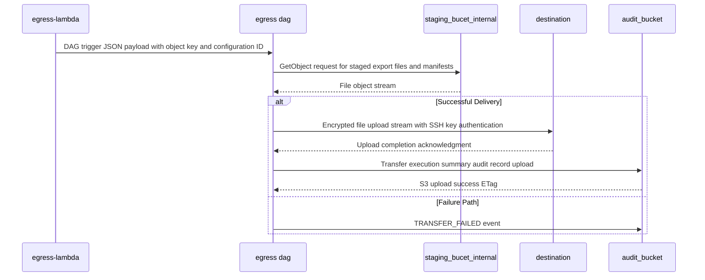

### 12.5. Schema Definitions (DB Tables / API JSON / Telemetry CloudEvents)
<a id="laminar-sec-c.imp_aws_aws_mwaa_dag_10.schema"></a>
#### 12.5.1 Inbound DAG Trigger Payload (`dag_conf`)
```json
{
  "$schema": "http://json-schema.org/draft-07/schema#",
  "title": "TransformEncryptDagConf",
  "type": "object",
  "properties": {
    "execution_id": { "type": "string", "format": "uuid" },
    "connection_id": { "type": "string" },
    "object_key": { "type": "string" },
    "dataset": {
      "type": "string",
      "enum": ["identity_profiles", "subscription_statuses", "campaigns_reactions", "reservation_items"]
    }
  },
  "required": ["execution_id", "connection_id", "object_key", "dataset"]
}
```

#### 12.5.2 Manifest Control File Schema (`manifest_<execution_id>.json`)
```json
{
  "$schema": "http://json-schema.org/draft-07/schema#",
  "title": "ExportManifestControlFile",
  "type": "object",
  "properties": {
    "execution_id": { "type": "string", "format": "uuid" },
    "connection_id": { "type": "string" },
    "generated_at": { "type": "string", "format": "date-time" },
    "total_records": { "type": "integer" },
    "total_size_bytes": { "type": "integer" },
    "files": {
      "type": "array",
      "items": {
        "type": "object",
        "properties": {
          "file_name": { "type": "string" },
          "record_count": { "type": "integer" },
          "file_size_bytes": { "type": "integer" },
          "sha256_checksum": { "type": "string" }
        },
        "required": ["file_name", "record_count", "file_size_bytes", "sha256_checksum"]
      }
    }
  },
  "required": ["execution_id", "connection_id", "generated_at", "total_records", "total_size_bytes", "files"]
}
```

#### 12.5.3 CloudEvent Telemetry Schema (`TRANSFER_COMPLETED`)
```json
{
  "$schema": "http://json-schema.org/draft-07/schema#",
  "title": "TransferCompletedCloudEvent",
  "type": "object",
  "properties": {
    "specversion": { "type": "string", "enum": ["1.0"] },
    "type": { "type": "string", "enum": ["com.laminar.dataoutbound.transfer.completed"] },
    "source": { "type": "string" },
    "id": { "type": "string", "format": "uuid" },
    "time": { "type": "string", "format": "date-time" },
    "datacontenttype": { "type": "string", "enum": ["application/json"] },
    "detail": {
      "type": "object",
      "properties": {
        "actor_id": { "type": "string" },
        "timestamp_utc": { "type": "string" },
        "event_type": { "type": "string", "enum": ["TRANSFER_COMPLETED"] },
        "execution_id": { "type": "string", "format": "uuid" },
        "details": {
          "type": "object",
          "properties": {
            "destination": { "type": "string" },
            "key": { "type": "string" }
          },
          "required": ["destination", "key"]
        }
      },
      "required": ["actor_id", "timestamp_utc", "event_type", "execution_id", "details"]
    }
  },
  "required": ["specversion", "type", "source", "id", "time", "datacontenttype", "detail"]
}
```

---

### 12.6. Local Design Assumptions
<a id="laminar-sec-c.imp_aws_aws_mwaa_dag_10.asm"></a>
1. **MWAA Worker Capacity**: MWAA worker nodes are provisioned with sufficient memory and CPU (minimum `mw1.small` worker type) to handle GZIP compression and PGP encryption streams for files up to 1 GB without exceeding local disk or memory limits.
2. **Credential Resolution**: SSM Parameter Store provides secure retrieval of customer-specific PGP public keys and destination authentication tokens (`SecureString`), decrypted at runtime within worker memory.
3. **Network Isolation & Egress**: MWAA worker subnets route outbound traffic via a NAT Gateway with static Elastic IPs to satisfy customer firewall allowlisting requirements for SFTP and external cloud endpoints.
4. **Follow-up Resolution**: If destination transfer fails after 3 retries, the DAG moves the payload to an internal dead-letter storage path, raises an operational alert <=5 minutes, and logs the incident to `audit_bucket` with status `TRANSFER_FAILED`.

## 13. Component Design: Customer Azure Blob Destination
<a id="laminar-sec-c.imp_azure_blob_store_13"></a>

### 13.1. Component Contract (Bi-Directional Inputs & Outputs)
<a id="laminar-sec-c.imp_azure_blob_store_13.contract"></a>
- **Component Role**: External Azure Blob Storage container (`Customer Azure Blob Destination`) receiving delivered export packages and manifest control files from `egress dag`.
- **Protocols & Standards**: HTTPS REST API / Azure Blob SDK using Microsoft Entra ID (Managed Identity) or secure SAS token authentication.
- **Inbound Payload**: Block blob upload streams containing GZIP-compressed or PGP-encrypted export packages and corresponding JSON manifest files.
- **Response & Confirmation**: HTTP 201 Created / Blob Put Block List success confirmation with MD5/SHA-256 content verification hashes (`Content-MD5`).
- **Retry & Failure Policy**: Failed transfers due to throttling or network drops are retried up to 3 times; permanent failures abort the delivery, emit a `TRANSFER_FAILED` audit record, and trigger an operational alert.

### 13.2. Class and Interface Definitions
<a id="laminar-sec-c.imp_azure_blob_store_13.classes"></a>
```python
from dataclasses import dataclass, field
from typing import Optional, Dict

@dataclass
class AzureBlobUploadRequest:
    container_name: str
    blob_name: str
    data_stream: bytes
    metadata: Dict[str, str] = field(default_factory=dict)
    content_type: str = "application/octet-stream"

@dataclass
class AzureBlobUploadResponse:
    etag: str
    content_md5: str
    status_code: int
    request_id: str
```

### 13.3. Implementation Code Skeleton (Stubs & Handlers)
<a id="laminar-sec-c.imp_azure_blob_store_13.skeleton"></a>
```python
from typing import Dict, Any
from dataoutbound_section_tree.common.logging.logger import get_logger
from dataoutbound_section_tree.common.clients.azure.blob_client import BlobClient
from dataoutbound_section_tree.util.exceptions import ClientError

logger = get_logger(__name__)

class AzureBlobDestinationHandler:
    """
    Illustrative skeleton — the Component Contract and Schema Definitions are binding.
    Handles secure delivery of export packages to Customer Azure Blob Destination.
    """
    def __init__(self, config: Dict[str, Any]):
        self.blob_client = BlobClient(
            account_url=config.get("azure_storage_account_url"),
            credential_type="managed_identity"
        )
        self.container_name = config.get("azure_container_name", "customer-exports")

    def upload_export_package(self, blob_name: str, file_bytes: bytes, metadata: Dict[str, str]) -> str:
        logger.info(f"Uploading export package to Azure Blob container {self.container_name} as {blob_name}")
        try:
            response_etag = self.blob_client.upload_blob(
                container_name=self.container_name,
                blob_name=blob_name,
                data=file_bytes,
                metadata=metadata
            )
            logger.info(f"Successfully uploaded blob {blob_name}. ETag: {response_etag}")
            return response_etag
        except Exception as e:
            logger.error(f"Failed to upload export package to Azure Blob: {str(e)}", exc_info=True)
            raise ClientError(f"Azure Blob upload failed for {blob_name}: {str(e)}")
```

### 13.4. Cross-Component Interaction Sequence (Local Mermaid/ASCII Flow)
<a id="laminar-sec-c.imp_azure_blob_store_13.seq"></a>
1. **Ingestion Trigger**: `egress dag` completes transformation and PGP/GZIP packaging of the staged export files.
2. **Client Initialization**: `egress dag` instantiates `BlobClient` configured with Azure Managed Identity credentials.
3. **Blob Upload**: The client initiates an HTTPS block blob upload (`Put Block List`) to the `Customer Azure Blob Destination` container.
4. **Integrity Check**: Azure computes and returns `Content-MD5` hashes; the egress task recomputes SHA-256 integrity against the manifest control file.
5. **Audit Recording**: Upon successful upload confirmation, `egress dag` publishes a `com.laminar.dataoutbound.transfer.azure` CloudEvent to `audit_bucket`.
6. **Failure Recovery**: On connection failure or storage error, the transfer task retries up to 3 times before routing to the dead-letter path and logging `TRANSFER_FAILED`.
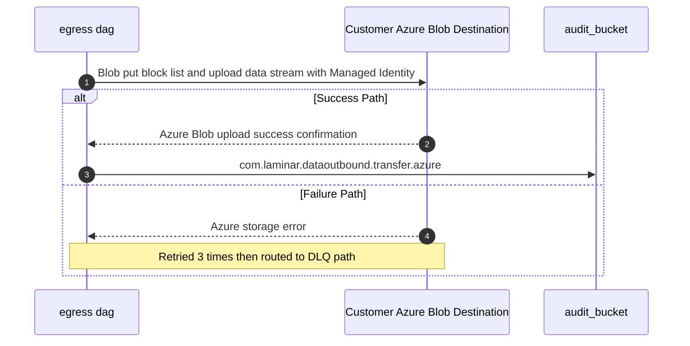

### 13.5. Schema Definitions (DB Tables / API JSON / Telemetry CloudEvents)
<a id="laminar-sec-c.imp_azure_blob_store_13.schema"></a>
```json
{
  "$schema": "http://json-schema.org/draft-07/schema#",
  "title": "AzureBlobTransferCloudEvent",
  "type": "object",
  "properties": {
    "specversion": { "type": "string", "enum": ["1.0"] },
    "type": { "type": "string", "enum": ["com.laminar.dataoutbound.transfer.azure"] },
    "source": { "type": "string", "const": "urn:aws:airflow:dag:transform_encrypt_dag" },
    "subject": { "type": "string" },
    "id": { "type": "string", "format": "uuid" },
    "time": { "type": "string", "format": "date-time" },
    "datacontenttype": { "type": "string", "const": "application/json" },
    "data": {
      "type": "object",
      "properties": {
        "container_name": { "type": "string" },
        "blob_name": { "type": "string" },
        "execution_id": { "type": "string" },
        "checksum_sha256": { "type": "string" },
        "status": { "type": "string", "enum": ["TRANSFER_COMPLETED", "TRANSFER_FAILED"] }
      },
      "required": ["container_name", "blob_name", "execution_id", "status"]
    }
  },
  "required": ["specversion", "type", "source", "id", "time", "data"]
}
```

### 13.6. Local Design Assumptions
<a id="laminar-sec-c.imp_azure_blob_store_13.asm"></a>
- **Authentication**: Authorizes access using Microsoft Entra ID (Managed Identity) rather than shared account keys or SAS tokens, adhering to the enterprise cloud security standard.
- **Network Controls**: Assumes private endpoint connectivity or restricted network rules are configured on the customer's Azure storage account where required.
- **Storage Tier**: General-purpose v2 storage account utilizing the Hot access tier for immediate delivery and retrieval validation.
- **Soft Delete**: Assumes customer-managed container soft-delete protection is enabled in accordance with blob storage data protection best practices.

## 14. Component Design: Customer GCS Destination
<a id="laminar-sec-c.imp_gcp_gcs_14"></a>

### 14.1. Component Contract (Bi-Directional Inputs & Outputs)
<a id="laminar-sec-c.imp_gcp_gcs_14.contract"></a>
The `Customer GCS Destination` represents an external Google Cloud Storage bucket owned and managed by the customer or partner organization, serving as an archival and analytical delivery target for outbound data packages.

#### 14.1.1 Interface & Transport Protocol
- **Protocol**: HTTPS (Google Cloud Storage XML/JSON REST API, TLS 1.3).
- **Authentication**: Service Account credentials or Workload Identity federation managed securely via SSM Parameter Store.
- **Trigger**: Egress workflow execution task within `egress dag`.

#### 14.1.2 Request & Response Payload Specification
- **Request (Upload)**: Multipart or resumable upload stream containing the GZIP-compressed and/or PGP-encrypted export dataset (`.json.gz`, `.txt.gz`, `.pgp`) alongside its corresponding JSON manifest control file (`manifest_<lineage_uuid>.json`).
- **Response (Success)**: HTTP `200 OK` returning Google Cloud Storage object metadata including `bucket`, `name`, `generation`, `size`, `timeCreated`, and native `md5Hash` / `crc32c` checksum values.
- **Error Responses**:
  - `400 Bad Request`: Invalid object name or malformed request parameters.
  - `401 Unauthorized` / `403 Forbidden`: Authentication failure or insufficient bucket write permissions; aborted immediately without unencrypted data leakage.
  - `404 Not Found`: Target bucket or prefix does not exist.
  - `500 Internal Server Error` / `503 Service Unavailable`: GCS transient storage error; retried up to 3 times with exponential backoff before routing to the dead-letter error path.

#### 14.1.3 Idempotency & Telemetry
- **Idempotency**: Enforced via object naming uniqueness incorporating the deterministic lineage UUID (`execution_id`) and timestamp partition paths.
- **Telemetry Event**: Emits `com.laminar.dataoutbound.transfer.gcs` upon initiation, retry, success, or terminal failure, recorded in the `audit_bucket`.

---

### 14.2. Class and Interface Definitions
<a id="laminar-sec-c.imp_gcp_gcs_14.classes"></a>
```python
from __future__ import annotations

from dataclasses import dataclass, field
from datetime import datetime
from typing import Any, Dict, Optional

from pydantic import BaseModel, Field


class GcsUploadRequest(BaseModel):
    """Payload definition for uploading objects to Customer GCS Destination."""

    bucket_name: str = Field(..., description="Target GCS bucket name")
    object_key: str = Field(..., description="Destination object path including lineage UUID")
    file_path: str = Field(..., description="Local path of the file to upload")
    metadata: Dict[str, str] = Field(
        default_factory=dict, description="Custom object metadata including SHA-256 checksum"
    )


class GcsObjectMetadata(BaseModel):
    """Response metadata returned upon successful GCS object upload."""

    bucket: str = Field(..., description="GCS bucket name")
    name: str = Field(..., description="Object key")
    generation: str = Field(..., description="Object generation identifier")
    size_bytes: int = Field(..., alias="size", description="Size of the uploaded object in bytes")
    crc32c: str = Field(..., description="Native GCS CRC32C checksum")
    time_created: datetime = Field(..., alias="timeCreated", description="Object creation timestamp")


@dataclass
class GcsTransferResult:
    """Dataclass encapsulating the outcome of an egress GCS transfer operation."""

    success: bool
    execution_id: str
    bucket: str
    object_key: str
    bytes_transferred: int
    checksum_crc32c: Optional[str] = None
    error_message: Optional[str] = None
    attempt_count: int = 1
```

---

### 14.3. Implementation Code Skeleton (Stubs & Handlers)
<a id="laminar-sec-c.imp_gcp_gcs_14.skeleton"></a>
```python
from __future__ import annotations

import os
from typing import Any, Dict, Optional

from dataoutbound_section_tree.common.clients.gcp.gcs_client import GcsClient
from dataoutbound_section_tree.common.logging.logger import get_logger
from dataoutbound_section_tree.common.telemetry.auditor import AuditPublisher
from dataoutbound_section_tree.util.exceptions import ClientError

logger = get_logger(__name__)


class GcsDestinationHandler:
    """Illustrative skeleton — the Component Contract and Schema Definitions are binding.

    Manages secure delivery of encrypted export packages and manifests to Customer GCS Destination.
    """

    def __init__(self, gcs_client: GcsClient, audit_publisher: AuditPublisher) -> None:
        self.gcs_client = gcs_client
        self.audit_publisher = audit_publisher

    def deliver_package(
        self, bucket_name: str, local_file_path: str, destination_key: str, execution_id: str
    ) -> bool:
        """Uploads an export package file to GCS with retry resilience and telemetry auditing."""
        logger.info(
            "Initiating transfer to Customer GCS Destination",
            extra={"bucket": bucket_name, "key": destination_key, "execution_id": execution_id},
        )

        self.audit_publisher.publish(
            event_type="TRANSFER_STARTED",
            payload={
                "execution_id": execution_id,
                "destination": f"gcs://{bucket_name}/{destination_key}",
                "actor_id": "system:egress-dag",
            },
        )

        max_attempts = 3
        attempt = 0
        success = False

        while attempt < max_attempts and not success:
            attempt += 1
            try:
                # Execute upload via shared GcsClient wrapper
                metadata = self.gcs_client.upload_file(
                    bucket_name=bucket_name,
                    source_file_path=local_file_path,
                    destination_blob_name=destination_key,
                )
                success = True
                logger.info(
                    "Successfully delivered file to Customer GCS Destination",
                    extra={"attempt": attempt, "generation": metadata.get("generation")},
                )

                self.audit_publisher.publish(
                    event_type="TRANSFER_COMPLETED",
                    payload={
                        "execution_id": execution_id,
                        "destination": f"gcs://{bucket_name}/{destination_key}",
                        "attempt": attempt,
                        "actor_id": "system:egress-dag",
                    },
                )
            except Exception as exc:
                logger.warning(
                    f"GCS transfer attempt {attempt} failed: {exc}",
                    extra={"attempt": attempt, "execution_id": execution_id},
                )
                if attempt >= max_attempts:
                    logger.error(
                        "Terminal failure transferring file to Customer GCS Destination",
                        extra={"execution_id": execution_id},
                    )
                    self.audit_publisher.publish(
                        event_type="TRANSFER_FAILED",
                        payload={
                            "execution_id": execution_id,
                            "destination": f"gcs://{bucket_name}/{destination_key}",
                            "error": str(exc),
                            "actor_id": "system:egress-dag",
                        },
                    )
                    raise ClientError(f"Failed to deliver to GCS after {max_attempts} attempts: {exc}") from exc

        return success
```

---

### 14.4. Cross-Component Interaction Sequence (Local Mermaid/ASCII Flow)
<a id="laminar-sec-c.imp_gcp_gcs_14.seq"></a>
#### 14.4.1 Sequence Interaction Description
1. **Initiation**: The `egress dag` invokes its GCS delivery task for a prepared export package carrying the active lineage UUID (`execution_id`).
2. **Audit Recording**: The task publishes a `TRANSFER_STARTED` event to the `audit_bucket` via the audit publisher.
3. **Transport Execution**: Using credentials loaded from SSM Parameter Store, the `egress dag` initiates an HTTPS TLS 1.3 upload request to the `Customer GCS Destination`.
4. **Verification & Checksum**: GCS processes the stream, stores the object, computes the native CRC32C checksum, and returns HTTP `200 OK` with object metadata.
5. **Reconciliation**: The DAG task reads back object metadata, verifies application-level SHA-256 integrity against the manifest, and publishes a `TRANSFER_COMPLETED` event to the `audit_bucket`.
6. **Failure Path**: If transient network errors occur, the client retries up to 3 times with exponential backoff. Upon terminal failure, a `TRANSFER_FAILED` event is recorded, an alert is raised, and the execution halts without unencrypted exposure.

---
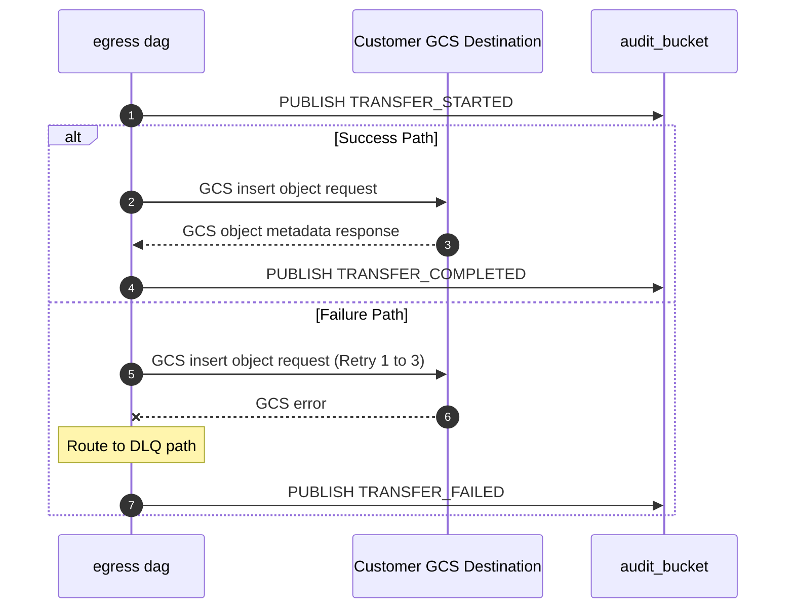

### 14.5. Schema Definitions (DB Tables / API JSON / Telemetry CloudEvents)
<a id="laminar-sec-c.imp_gcp_gcs_14.schema"></a>
#### 14.5.1 CloudEvents Telemetry Payload (`com.laminar.dataoutbound.transfer.gcs`)
```json
{
  "$schema": "https://json-schema.org/draft/2020-12/schema",
  "title": "GcsTransferTelemetryEvent",
  "type": "object",
  "properties": {
    "specversion": { "type": "string", "const": "1.0" },
    "type": { "type": "string", "const": "com.laminar.dataoutbound.transfer.gcs" },
    "source": { "type": "string", "const": "urn:laminar:dataoutbound:egress-dag" },
    "id": { "type": "string", "format": "uuid" },
    "time": { "type": "string", "format": "date-time" },
    "datacontenttype": { "type": "string", "const": "application/json" },
    "detail": {
      "type": "object",
      "properties": {
        "execution_id": { "type": "string", "format": "uuid" },
        "actor_id": { "type": "string" },
        "destination_type": { "type": "string", "const": "GCS" },
        "bucket": { "type": "string" },
        "object_key": { "type": "string" },
        "status": { "type": "string", "enum": ["STARTED", "COMPLETED", "FAILED"] },
        "attempt": { "type": "integer" },
        "checksum_crc32c": { "type": "string" }
      },
      "required": ["execution_id", "actor_id", "destination_type", "bucket", "object_key", "status"]
    }
  },
  "required": ["specversion", "type", "source", "id", "time", "detail"]
}
```

---

### 14.6. Local Design Assumptions
<a id="laminar-sec-c.imp_gcp_gcs_14.asm"></a>
1. **Authentication Scope**: Assumes customer-provided GCS service account keys or Workload Identity federation bindings grant write and object metadata read permissions on the target bucket prefix.
2. **Encryption at Rest**: Assumes customer GCS buckets enforce server-side encryption (either Google-managed keys or customer-managed encryption keys / CMEK), complying with organizational security requirements.
3. **Payload Limitations**: Assumes individual export chunk files conform to maximum single-object upload limits supported by GCS (up to 5 TB), though operational sizing targets enforce a 1 GB threshold per file.
4. **Network Routing**: Assumes outbound HTTPS connectivity from the private MWAA worker subnets to Google Cloud APIs is routed securely through NAT gateways with static egress IP addresses.
5. **Retry & Timeout Defaults**: Assumes a connection timeout of 30 seconds and a maximum of 3 exponential backoff retries for transient HTTP 5xx or connection reset errors.

---

## 15. Component Design: audit_bucket
<a id="laminar-sec-c.imp_aws_aws_s3_bucket_15"></a>

### 15.1. Component Contract (Bi-Directional Inputs & Outputs)
<a id="laminar-sec-c.imp_aws_aws_s3_bucket_15.contract"></a>
- **Component Name**: `audit_bucket`
- **Service Type**: `aws_s3_bucket`
- **Inbound Interfaces & Triggers**:
  - **API Audit Write**: Ingests administrative audit records from `do-admin-api` via S3 API (`PutObject`).
  - **Spark Execution Audit Push**: Ingests job execution metrics and audit logs from `emr_do` via S3 API (`PutObject`).
  - **Egress Execution Audit Push**: Ingests transfer execution summary records from `egress dag` via S3 API (`PutObject`).
- **Outbound Interfaces**:
  - Exposes S3 object storage read/write interfaces to authorized IAM roles within the private VPC.
- **Configuration Properties (Authoritative)**:
  - `bucket_name`: `audit_bucket`
  - `versioning`: `False`
  - `encryption`: `AES256` (Server-Side Encryption with S3 managed keys)
  - `public_access_block`: `True`
  - `lifecycle_enabled`: `True`
  - `lifecycle_transition_days`: `30` (Transition to Standard-IA)
  - `lifecycle_glacier_days`: `90` (Transition to Glacier for long-term audit retention)
  - `tags`: `{}`

### 15.2. Class and Interface Definitions
<a id="laminar-sec-c.imp_aws_aws_s3_bucket_15.classes"></a>
```python
from dataclasses import dataclass, field
from datetime import datetime
from typing import Any, Dict, Optional
from dataoutbound_section_tree.common.clients.aws.s3.s3_client import S3Client
from dataoutbound_section_tree.common.logging.logger import get_logger

logger = get_logger(__name__)

@dataclass
class AuditEventRecord:
    actor_id: str
    timestamp_utc: str
    event_type: str
    execution_id: str
    detail: Dict[str, Any] = field(default_factory=dict)

    def to_dict(self) -> Dict[str, Any]:
        return {
            "actor_id": self.actor_id,
            "timestamp_utc": self.timestamp_utc,
            "event_type": self.event_type,
            "execution_id": self.execution_id,
            "detail": self.detail
        }
```

### 15.3. Implementation Code Skeleton (Stubs & Handlers)
<a id="laminar-sec-c.imp_aws_aws_s3_bucket_15.skeleton"></a>
```python
# Illustrative skeleton — the Component Contract and Schema Definitions are binding
from dataoutbound_section_tree.common.clients.aws.s3.s3_client import S3Client
from dataoutbound_section_tree.common.logging.logger import get_logger
from dataoutbound_section_tree.util.exceptions import ClientError
import json
import uuid

logger = get_logger(__name__)

class AuditLogWriter:
    def __init__(self, s3_client: S3Client, bucket_name: str):
        self.s3_client = s3_client
        self.bucket_name = bucket_name

    def write_audit_event(self, event_record: dict) -> None:
        execution_id = event_record.get("execution_id", str(uuid.uuid4()))
        event_type = event_record.get("event_type", "UNKNOWN")
        object_key = f"audit_logs/{event_type}/{execution_id}/{uuid.uuid4()}.json"

        payload = json.dumps(event_record)
        try:
            self.s3_client.put_object(
                bucket=self.bucket_name,
                key=object_key,
                body=payload.encode("utf-8"),
                content_type="application/json"
            )
            logger.info("Successfully wrote audit event", extra={"execution_id": execution_id, "event_type": event_type})
        except ClientError as e:
            logger.error("Failed to write audit event to S3", extra={"error": str(e), "execution_id": execution_id})
            # Audit failures are logged with warning/error but do not disrupt caller flow unless mandated
```

### 15.4. Cross-Component Interaction Sequence (Local Mermaid/ASCII Flow)
<a id="laminar-sec-c.imp_aws_aws_s3_bucket_15.seq"></a>
1. **Initiation**: Upstream components (`do-admin-api`, `emr_do`, or `egress dag`) complete an operation or lifecycle milestone and construct a structured audit payload.
2. **Publishing**: The component invokes `AuditPublisher.publish()` or `AuditLogWriter.write_audit_event()`.
3. **Transmission**: The shared `S3Client` executes a `PutObject` request over TLS 1.3 to `audit_bucket` (`audit_bucket`) with AES-256 encryption at rest.
4. **Storage & Lifecycle**: `audit_bucket` acknowledges the write with an ETag. S3 lifecycle rules automatically transition objects older than 30 days to Standard-IA and objects older than 90 days to Glacier.
5. **Failure Handling**: If an S3 write error occurs, the client catches the exception, logs a structured error via `logger.py`, and prevents unhandled propagation into critical business paths where non-blocking audit is specified.
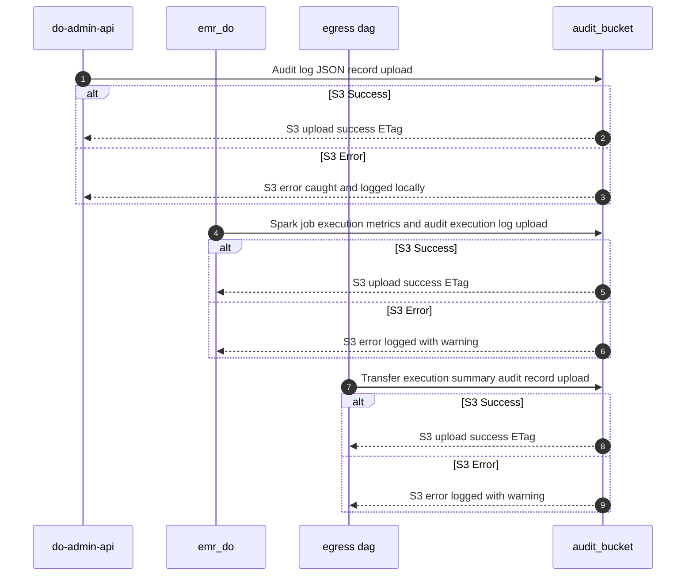

### 15.5. Schema Definitions (DB Tables / API JSON / Telemetry CloudEvents)
<a id="laminar-sec-c.imp_aws_aws_s3_bucket_15.schema"></a>
```json
{
  "$schema": "https://json-schema.org/draft/2020-12/schema",
  "title": "AuditCloudEvent",
  "type": "object",
  "properties": {
    "specversion": { "type": "string", "const": "1.0" },
    "id": { "type": "string", "format": "uuid" },
    "source": { "type": "string" },
    "type": { "type": "string" },
    "datacontenttype": { "type": "string", "const": "application/json" },
    "time": { "type": "string", "format": "date-time" },
    "data": {
      "type": "object",
      "properties": {
        "actor_id": { "type": "string" },
        "timestamp_utc": { "type": "string" },
        "event_type": {
          "type": "string",
          "enum": [
            "ADMIN_CREATE",
            "ADMIN_UPDATE",
            "ADMIN_DELETE",
            "ADMIN_MANUAL_TRIGGER",
            "EXECUTION_STARTED",
            "EXECUTION_COMPLETED",
            "TRANSFER_STARTED",
            "TRANSFER_COMPLETED",
            "TRANSFER_FAILED"
          ]
        },
        "execution_id": { "type": "string", "format": "uuid" },
        "detail": { "type": "object" }
      },
      "required": ["actor_id", "timestamp_utc", "event_type", "execution_id"]
    }
  },
  "required": ["specversion", "id", "source", "type", "time", "data"]
}
```

### 15.6. Local Design Assumptions
<a id="laminar-sec-c.imp_aws_aws_s3_bucket_15.asm"></a>
- **Assumption 1**: Retention and lifecycle expiration policies adhere strictly to organizational compliance standards, utilizing S3 lifecycle configuration to transition objects to Glacier at 90 days and enforcing permanent purge rules where applicable.
- **Assumption 2**: Storage encryption uses S3 managed keys (`AES256`) as set in the component properties, satisfying data-at-rest security requirements without requiring dedicated KMS Customer Managed Keys.

---

## 16. Component Design: customer SFTP server
<a id="laminar-sec-c.imp_standard_standard_sftp_11"></a>

### 16.1. Component Contract (Bi-Directional Inputs & Outputs)
<a id="laminar-sec-c.imp_standard_standard_sftp_11.contract"></a>
The `customer SFTP server` is an external, customer-managed SFTP endpoint operating over SSH (Port 22) that receives encrypted or raw export packages and manifest control files.

#### 16.1.1 Interface & Transport Protocol
- **Protocol**: SFTP over SSH (Port 22).
- **Authentication**: SSH Public Key Authentication (`SSH Key`) with strict host-key verification enabled.
- **Trigger**: Egress file transfer task executed within `egress dag`.

#### 16.1.2 Request & Response Payload Specification
- **Request (Upload)**: SSH file transmission stream containing GZIP-compressed / PGP-encrypted export data files and JSON manifest control files.
- **Response (Success)**: Atomic file write completion acknowledgment, verified via remote file size and SHA-256 recomputation.
- **Error Responses**:
  - `Connection Refused / Host Key Mismatch`: Strict host-key verification failure; connection is immediately aborted, zero bytes are transmitted, no retry is attempted, an automated alert is raised, and a `TRANSFER_FAILED` event is recorded.
  - `Authentication Failure`: Invalid SSH private key or credentials; aborted without retry.
  - `Network / Timeout Error`: Transient socket interruption; retried up to 3 times before raising a terminal failure alert.

#### 16.1.3 Idempotency & Telemetry
- **Idempotency**: Implemented via atomic upload patterns (uploading to a temporary staging suffix `.part` followed by atomic server-side rename upon completion).
- **Telemetry Event**: Emits `com.laminar.dataoutbound.transfer.sftp` tracking initiation, retry attempts, and completion status.

---

### 16.2. Local Design Assumptions
<a id="laminar-sec-c.imp_standard_standard_sftp_11.asm"></a>
1. **External Scope**: The `customer SFTP server` is an external system owned and operated by the customer; platform responsibilities are strictly limited to connection establishment, strict host-key verification, SSH key-based authentication, and atomic file transfer.
2. **Host Key Persistence**: Assumes customer SSH host keys are provisioned and stored securely in SSM Parameter Store (`SecureString`) during export configuration onboarding.
3. **Atomic Transfers**: Assumes the remote SFTP server supports atomic file renaming (`SSH_FXP_RENAME`), or the transfer client implements safe staging-to-production file promotion.
4. **Firewall & Whitelisting**: Assumes customer firewalls permit inbound SFTP connections originating exclusively from the platform's static NAT gateway egress IP addresses.
5. **Follow-up Resolution**: In the event of an SFTP authentication or host-key mismatch failure, the pipeline immediately halts, aborts transmission, raises an operator alert within 5 minutes, and records a failure audit entry without attempting insecure fallbacks.

## 17. Component Design: customer bucket
<a id="laminar-sec-c.imp_aws_aws_s3_bucket_12"></a>

### 17.1. Component Contract (Bi-Directional Inputs & Outputs)
<a id="laminar-sec-c.imp_aws_aws_s3_bucket_12.contract"></a>
- **Component Role**: External customer-owned S3 bucket (`customer bucket`) acting as an outbound delivery destination for encrypted or raw export packages and manifest control files.
- **Protocols & Standards**: HTTPS over TLS 1.3, S3 REST API (boto3 `PutObject`).
- **Inbound Data (Payload)**: Multipart or single-put GZIP-compressed or PGP-encrypted data files, TXT files, and JSON manifest control files.
- **Verification Standard**: Application-level SHA-256 integrity recomputed from read-back objects compared against the manifest value, alongside native `ChecksumSHA256` transport verification.
- **Error Handling**: Network timeouts or HTTP 4xx/5xx responses from the customer bucket trigger up to 3 retries with exponential backoff; persistent failure results in a `TRANSFER_FAILED` audit event and immediate alerting.

### 17.2. Local Design Assumptions
<a id="laminar-sec-c.imp_aws_aws_s3_bucket_12.asm"></a>
- **Ownership & Access**: The customer bucket is externally owned and managed; credentials and bucket access policies (IAM role assumption or cross-account access keys) are securely retrieved from SSM Parameter Store (`SecureString`).
- **Encryption & Versioning**: Versioning is enabled (`versioning = True`) and server-side encryption (`AES256`) is enforced on all uploaded objects.
- **Scope Limitation**: As an external context-only component, no Terraform resource definitions, application code stubs, or internal schema tables are maintained within this project's code repository.

## 18. Global Design Assumptions and Constraints
<a id="laminar-sec-g.assump"></a>
_Section not generated (status: failed — DOCGEN-TREE-03)._

## 19. Amendment Log
<a id="laminar-sec-g.amend"></a>
_No amendments._

## 20. Closing & Disclaimer
<a id="laminar-sec-g.close"></a>
This document was generated by an AI system from the architecture graph, its stories and the project blueprint. It is a starting point for engineering review, not a substitute for it: verify every contract, sizing figure, policy and assumption before relying on it. Discretion advised.

## Document Structure Summary
<a id="laminar-sec-g.summary"></a>
- Headings: 20
- Sub-headings: 82
- Sub-sub-headings: 71
